Wat hebben we er naar uitgekeken en wat hebben we er al veel over gezegd, maar het was dus toch eindelijk zover. Zoet werd zout, beschut werd bloot.

Dinsdag 16 en woensdag 17 juli lagen wij nog even in het centrum van Haarlem. We dronken een laatste borrel met de familie bij restaurant Zuidam, waar Jen altijd werkte voordat ze naar Amsterdam kwam. Er verandert weinig op dat soort goeie, stabiele plekken. Ze hebben door hun locatie en geschiedenis áltijd aanloop. Ja, het personeel verandert en volgens Jen verandert dan alles, want dan verandert ook de cultuur, maar daar merk je niet heel veel van als je eens in de paar jaar een hapje of drankje komt doen.

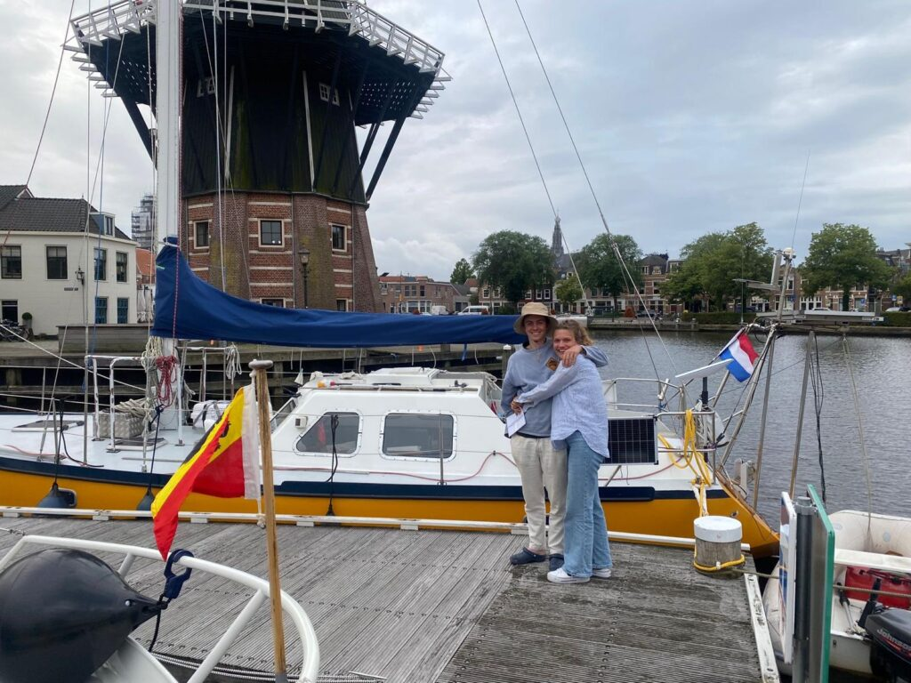

Verder ruimden we in- en op. We verkochten onze Volvo *bijna*. Er was interesse, maar we hadden beiden meer eisen aan waar de koper aan moest voldoen, dan wat het bod zou worden. Voor mij was het belangrijk dat de koper zou erkennen dat deze wagen goed was onderhouden en technisch dus al waardevol was. Over uiterlijk kun je twisten. Opgroeiend met youngtimers en oude auto’s in de stad zit er voor mij niet veel waarde in een puntgave lak. Ik vind onze wagen er voor de 350.000 kilometers nog goed uitzien, maar ik behoor niet tot het ras autopoetser die met veel liefde elk weekend naar de wasstraat rijdt om met een microfiber doek elke vingerafdruk weg te werken. Jen wilde de auto eigenlijk alleen aan zichzelf of aan mij verkopen: Een leuk jong koppel die een leuke (redelijk) luxe oude bak wil rijden die je zonder problemen nog overal naartoe brengt. Beiden, laat staan een combi, wisten zich niet te melden. Wel mooie foto's gemaakt:

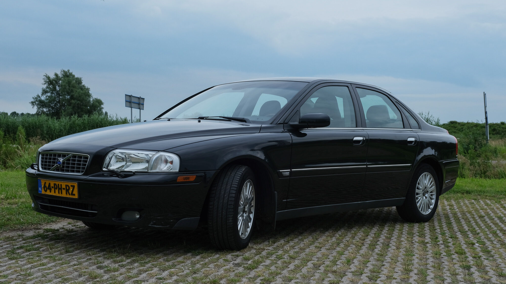

De Volvo staat inmiddels, met hulp van mijn broertje, gekeurd en wel onder een zeiltje in de Italiaanse schuur, te wachten tot we terugkomen. We kunnen daarmee onze vergunning aanhouden en hebben voor de komende tien jaar misschien wel vervoer. Mochten we daar nog behoefte aan hebben.

Tot vlak voor vertrek werd ie nog volop gebruikt. We brachten onze oude verstaging weg, maakten nog een stuk of honderd ritten tussen de boot en de garage van Jen haar vader, waar allerlei spullen van de boot opgeslagen stonden en bezochten alle Action’s in de weide omgeving, op zoek naar de perfecte plastic kistjes voor in onze kasten.

Dat laatste heeft veel spanning gelegd op ons vertrek. Luwte huisvest namelijk een onvoorstelbare hoeveelheid kubieke meters aan opslag. Als je binnen staat zie je daar niets van, maar in totaal zitten er een stuk of 40 dozen in onze bank alleen. Hoe je die ruimte optimaal benut is een tweede. Ik moet Jen volledige credit geven voor het nemen van de verantwoordelijkheid en initiatief van dit project. Niet omdat ik nu een mes op mijn keel heb staan, maar omdat ik heel blij ben dat ik dit onderdeel moest uitbesteden. Ik had slechts de rol van vervelende schipper die opmerkingen maakte als: Maar wat als de boot 45 graden op één kant ligt, en je dat achterste kistje nodig hebt? Dan dondert alles er uit, óf niets komt er uit omdat alles vastzit. Uiteraard bespraken we dit soort filosofische vraagstukken pas ín de Action, op de een of andere manier altijd met honger en dorst, in de spits.

Kibbelen in de Action, Kibbeling en haring om het goed te maken. Drie dingen die ik erg ga missen aan Nederland.

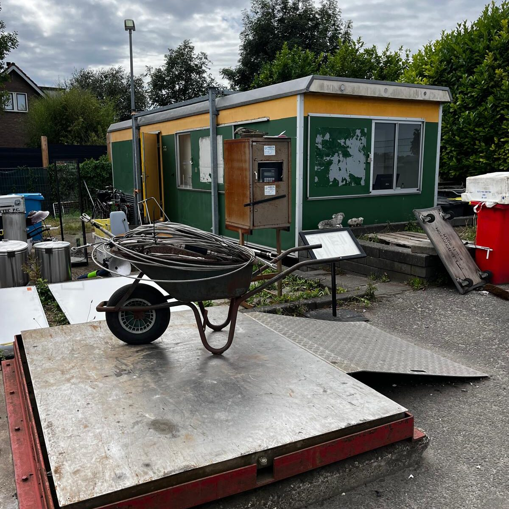

<figure class="wp-block-image size-large is-resized">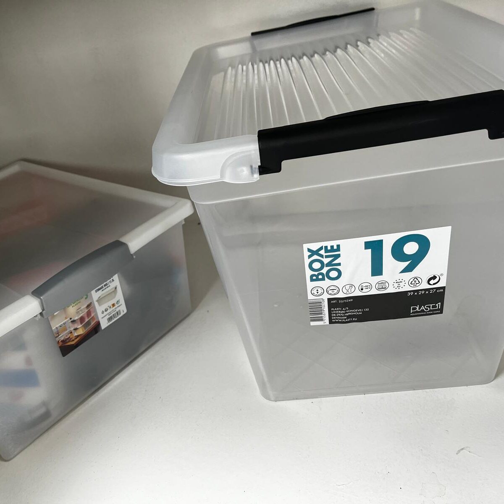<figcaption class="wp-element-caption">Een puzzel der dozen: Welke moeten we hebben en hoe delen we het in..?</figcaption></figure>

40 dozen dus. Maar met wat er in?

Ik prijs mijzelf gelukkig met de verbouwing die ik doorvoerde 3 jaar geleden. Het achterschip ging van één kooi, met een twijfelaar, naar twee kooien. De ene nog steeds met twijfelaar, de ander werd mijn werkplaats. Het heiligdom waarvandaan ik zo’n beetje het hele schip aankan.

Tot voor kort was mijn guilty pleasure het volgen van een hele rits aan YouTube content makende zeilers, over de hele wereld. Het aanbod is enorm en over de afgelopen jaren heeft zich dat geconcentreerd naar een kanaal of 4 die ik echt volg. Sommigen varen alleen boven de poolcirkel, anderen alleen met windkracht 8+ en natuurlijk een aantal die hun leven voorbij zien dobberen vanuit een tropische hemel.

Waarin ze allemaal (op één na) overeen komen, is dat over een lengte van ca. 10 tot 17 meter, een werkplaats geen prioriteit krijgt. En wellicht met goede reden. Je zou ook kunnen stellen dat iemand die zijn zaakjes goed op orde heeft geen werkplaats aan boord nodig heeft. Maar dat is een misconceptie, al is het alleen al om het feit dat het heel duidelijk maakt waar Jen haar territorium eindigt, en het mijne begint. Geen blikken bonen in mijn werkplaats, geen sleutels en schroevendraaiers tussen de pakken tomatensap. Zo behouden we de vrede aan boord. 40 dozen voor Jen dus.

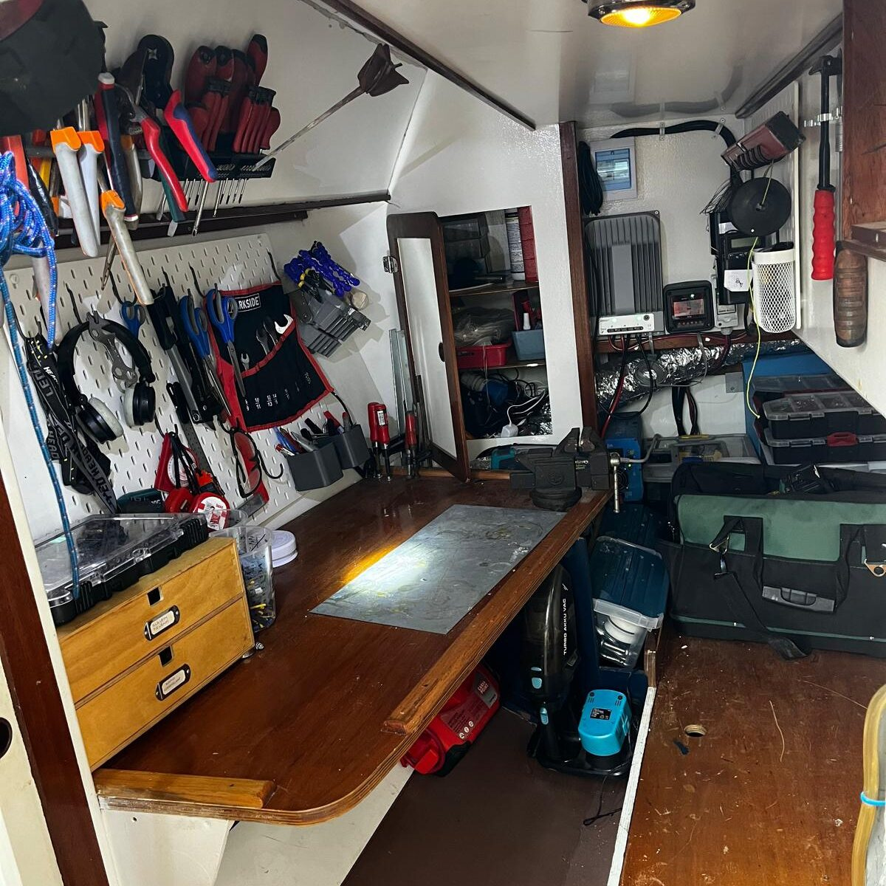

**Picnic at sea**

Al op één van onze eerste post-its kwam Jen haar droom te staan: Boodschappenwagens vullen bij de Makro, alles bestickeren en systematisch wegwerken in onze ruimen.  
Toen we die post-it opplakten wisten we al dat het een vlak-voor-vertrek taak zou worden, maar dat we 48 uur voor vertrek nog met 40 lege dozen zaten had ik niet gedacht. De tijdsdruk nam toe in de laatste weken en het idee kwam op om niet naar de Makro te gaan, en in plaats daarvan alles te laten bezorgen met Jen haar lievelingswinkel: Picnic. Een supermarkt op wielen. Zonder winkel dus.

Onze reeks bestellingen begon zo’n anderhalf jaar geleden, toen we vonden dat we wel iets meer grip konden krijgen op onze uitgaven bij de supermarkt. Dat stuitte op weerstand bij mij. Voor mij is  naar de supermarkt gaan helemaal geen verplichting om ’s avonds een bordje eten te hebben, maar deel van mijn routine, dagelijkse wandeling en kans om gelegitimeerd geld uit te geven.  
Ik ging toch overstag. Aanvankelijk alleen voor de blikken en het houdbare eten. De enige rol die ik daarbij had tot dan toe, was die van pakezel van Jen. Een nog veel belangrijker reden om mee te bewegen: Ze nemen je lege statiegeldblikjes mee.  Anderhalf jaar later kom ik nauwelijks nog in de supermarkt. Echt missen doe ik het niet. Sinds de zelf-scan de standaard is geworden is er toch niet zo heel veel meer aan.

Picnic dus. Via de vader van Jen hebben we contact met ze gezocht om te vertellen over onze reisplannen, onze wens om te bevoorraden en onze voorkeur voor Picnic. Wie niet waagt wie niet wint.

En waarempel. We mochten ons mandje vullen in ruil voor af en toe een post "Picnic at sea". Woensdag 17 juli kwamen er vijf wagentjes verspreid over de dag naar onze ligplaats rijden en stond de kuip vol met Kikkererwten, blikjes tonijn, bonen, pasta, rijst, couscous en noem maar op.

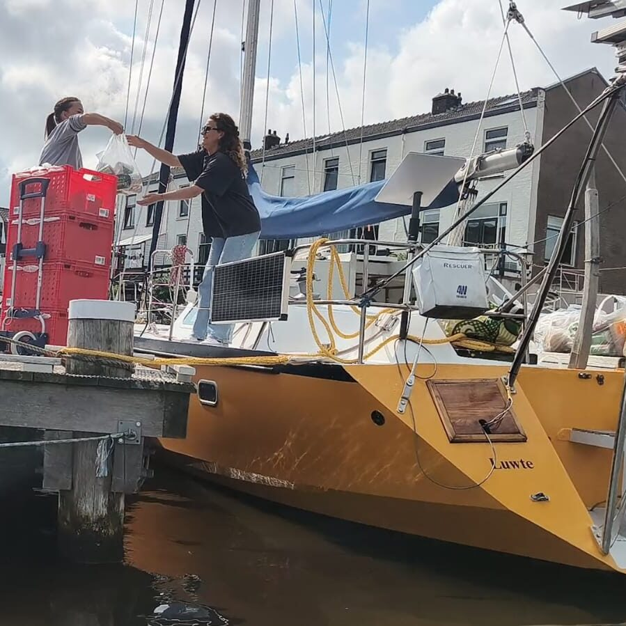

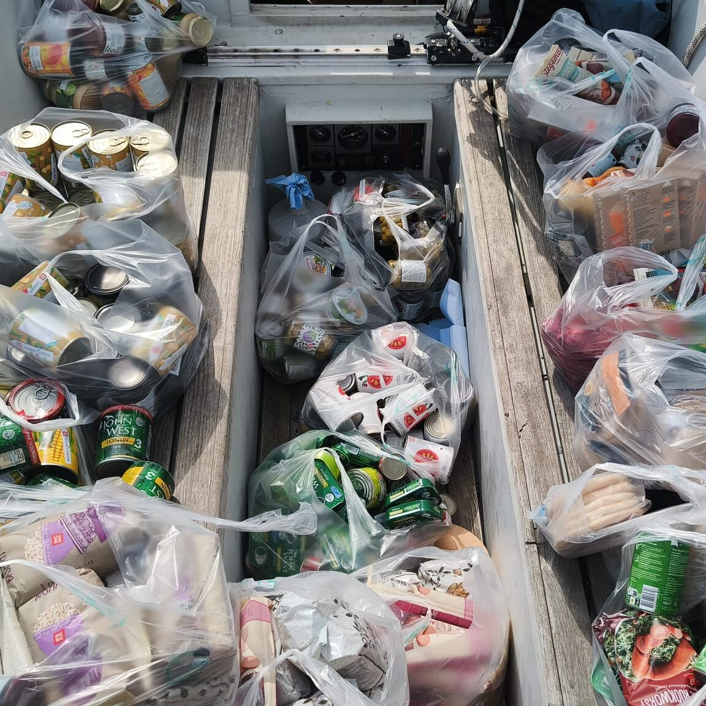

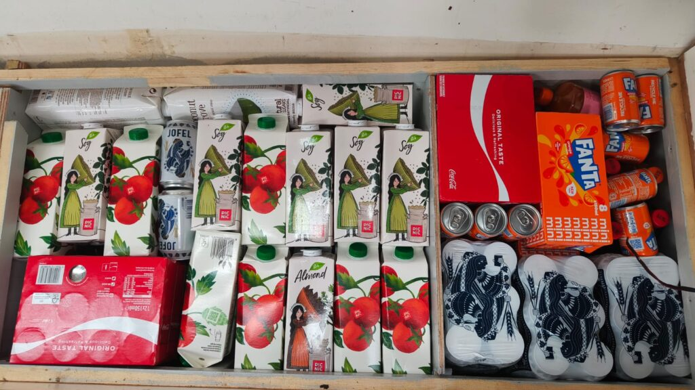

Inmiddels ligt Luwte licht hellend naar stuurboord omdat daar het meeste proviand opgeslagen ligt en hebben we genoeg voedsel aan boord om non-stop een rondje om de wereld te maken. Een enorm voordeel van deze actie is dat we vanaf nu alleen maar verse groenten en vlees hoeven bij  te kopen en de rest al aan boord hebben. Minder sjouwen dus. Onze Spaanse Tapas dopen wij om tot Spaanse Picnic.

**Bestemming IJmuiden**

Terwijl Jen alle boodschappen succesvol verwerkte, ging ik met onze bijboot op en neer naar het benzinestation dat aan de overkant vlakbij de kade lag, om jerrycans met diesel te vullen. Wat destijds de bunkerboot van Haarlem was (tankstation voor boten), was nu een hip, maar gesloten, koffietentje. Onze aankomst in IJmuiden zou te laat zijn om te tanken en ons vertrek te vroeg. Heen en weer dus.

Met volle bunkers gooiden wij om 18.30 los en dobberden brug voor brug terug naar het Noordzeekanaal. Waar de andere bootjes stuurboord uit richting Amsterdam gingen, kozen wij bakboord. Richting zee.

Windstil en een ondergaand zonnetje. Autopilot aan en nog druk bezig met opruimen. Bijboot aan dek vastsnoeren, alle kastjes zeevast (zodat niet alles met een golf naar buiten komt) en de werkplaats voor de miljoenste keer opruimen.

De deuren van de zeesluis van IJmuiden stonden al open en op groen ver voordat we ze konden zien. Zoet naar zout. Daar waar het samenkomt in de sluis ontstaat brak water. Net zoals je zegt dat je lichaam brak is na een avond met een borrel teveel. Als de ethanol en je bloed nog met elkaar in gevecht zijn wie de overhand heeft: Zoet óf zout. Daartussen kolkt het.

IJmuiden lag vol met andere bootjes die naar zee gaan of van zee aankwamen. Veel publiek in de kuipen dus om onze manoeuvres te bekijken en peinzende blikken van deze schippers die vinden dat ze het beter voor elkaar te hebben dan dat gele schip.

Tata had de ovens flink aan en de Zuid-Afrikaanse schipper op de boot waar we naast kwamen te liggen wist ons te vertellen dat je dan beter je ramen dicht kan houden. Wij waren zo kapot, dat we dat zelfs niet meer overwogen. Kooi in, licht uit, een paar uurtjes slapen en dan losgooien.

**Uitzwaaicomité**

Donderdagochtend 17 juli, 04.00. Onze wekker gaat. Ik kijk naar buiten en denk dat we ons verslapen hebben: Komt de zon al op? Het blijkt Tata nog altijd te zijn met een gebouwenhoge fakkel die de lucht oranje-roze kleurt. Slaapdronken zetten we een kop koffie, proberen wat op te ruimen en gooien de rest maar gewoon op een hoop in de punt. Voor ik het doorheb is het 04.45 en word ik gebeld door mijn moeder of ik de poort van de marina wil openen.  
Ons voltallige gezin staat er. Onafgesproken, niet onverwacht, maar ik was er niet van uit gegaan. Op dat moment bedenk ik me dat ik ze natuurlijk expliciet had moeten uitnodigen, maar tegelijkertijd weet ik dat het bij ons ook gewoon zo werkt: Als het moet sta je er gewoon.

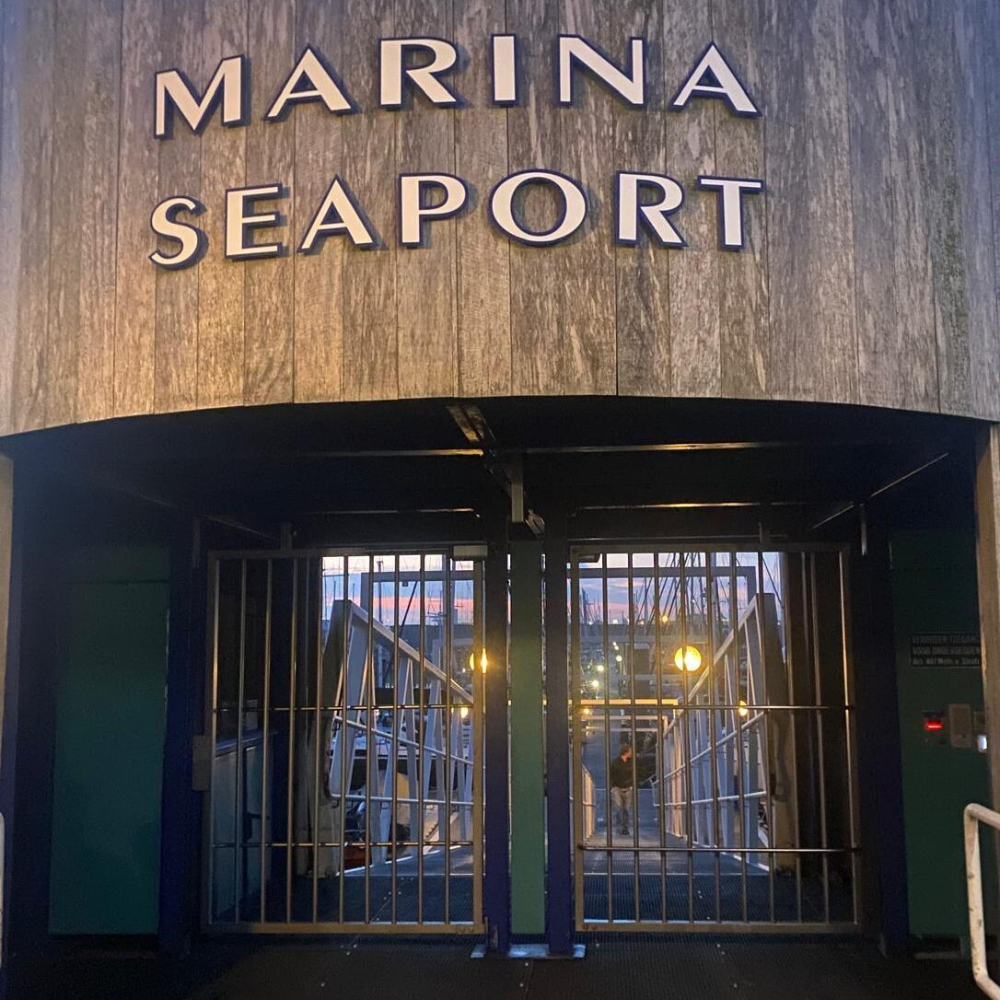

Mark, de man van Patty staat er ook. Jen's moeder moest onverhoopt thuisblijven. Hoe vervelend ook, ze ligt ziek op bed en wil ons koste wat het kost niet aansteken. Gisteren hebben we à la covid nog even gekletst onderaan de trap. Die afscheidsknuffel houden we nog tegoed.

Terwijl we richting de boot lopen komt Jen met armen vol vuilniszakken nog aanlopen. Ze krijgt van 8 man te horen dat ze dat moet laten vallen en dat die wel voor ons worden weggegooid.

Is er een ritueel voor zo’n moment? Geen idee. We dartelen nog wat om de boot met z’n allen. Niemand komt meer aan boord. Dit schip is nu ons domein. Een paar foto’s en laatste ideeën over het weer. Als een soort ritueel leveren we onze lederen werktassen in: Die hadden bij wijze van automatisme nog mee, maar hebben we voorlopig even niet nodig. We horen in de verte op hoge toeren een auto aankomen: Jen haar vader en broertje die hun eigen zeilvakantie hebben onderbroken om naar IJmuiden te komen.

Inmiddels sta ik stijf van de adrenaline en gaat alles heel snel en op de automatische piloot. Het is windstil. Geen ingewikkelde manoeuvres met wegvaren dus. Ik gooi achter los en stuur Jen naar voren om voor los te gooien. Zij heeft nog het empathisch vermogen om mijn moeder het laatste lijntje los te laten maken en ritueel te overhandigen.  Ik zie en hoor tranen, maar kijk zelf naar achteren, kont naar bakboord, vol gas naar stuurboord, klapje achteruit, vol gas stuurboord, gas terug en naar buiten. We zijn los.

Bij de havenmond staan Jelle, Mark, Piet en Doeke. De rest van mijn familie zie ik niet. Zouden we nog een cool shot maken met de drone van dit moment? Waar is de misthoorn? Ik wil zo toeteren. “Rorik, vergeet niet te genieten en zwaaien” hoor ik Jen zeggen.

Ik kijk op en zie op het uiterste puntje van de pier mijn familie staan. Jelle rent vanaf de havenmond die kant op en schiet onderweg nog een prachtige plaat. Pas de volgende dag, als ik mijn WhatsApp even open en de foto’s zie, overvalt het moment me.

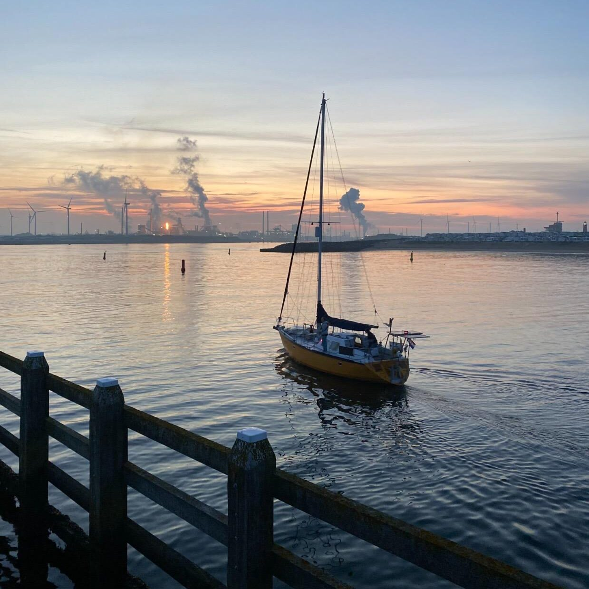

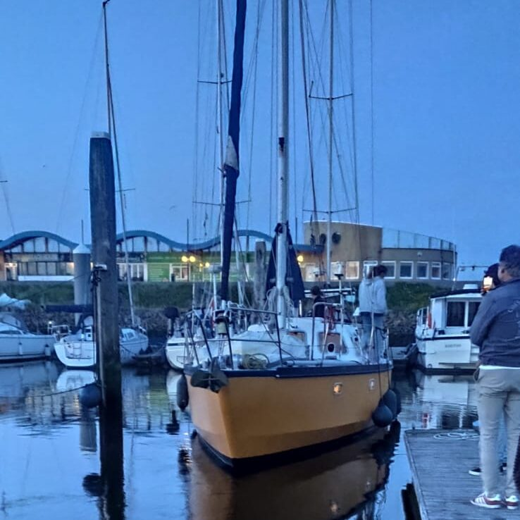

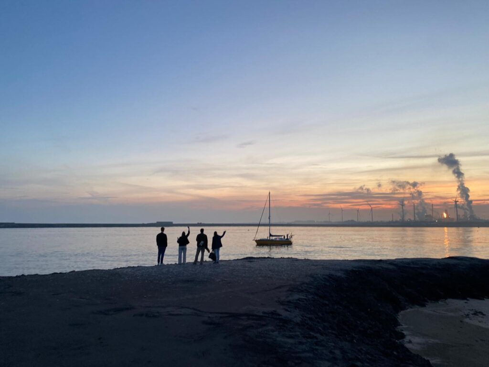

**Op naar Spanje**

Windstil betekent niet golfstil. In tegendeel zelfs. De eerste uren na vertrek pruttelt onze Yanmar onverstoorbaar de Noordzee op. Zeilboot ja, maar wel met een paar hulplijnen. Deze hulplijn gaan we waarschijnlijk meer gebruiken dan we willen, maar zorgt er op dat moment wel voor dat we kunnen gaan. We varen de wind wel tegemoet.

Na een paar uur trekt de adrenaline op en worden we moe. Onze buiken die verder alleen een kop koffie en zenuwen hebben gehad als ontbijt, vinden de Noordzee niet zo prettig. Van zeeziekte is geen sprake. Ik denk dat ik mij op land net zo had gevoeld in zo’n situatie. We ruimen verder op, testen Starlink voor de tiende keer, luisteren naar de marifoonberichten en kijken op de AIS naar de andere scheepvaart om ons heen.

Het eerste stuk is het meest ingewikkeld. We moeten zelf weer even inkomen, de scheepvaart zit dicht op elkaar en je moet niet per ongeluk te dicht langs een windmolen varen. Daar staan zware geldstraffen en strafbladen op. We worden, ruim een uur voordat het zover is, opgeroepen door een boorplatform dat we niet te dichtbij mogen komen. Daar zullen ze wel stiekeme dingen doen om te zorgen dat onze Volvo nog even kan blijven rijden..

De nacht verloopt soepel, maar we moeten wel scherp blijven. Ik laat Jen zien hoe ze met behulp van AIS heel makkelijk en van grote afstand voor elk schip kan zien hoe dichtbij ze passeren. We spreken aanvankelijk af dat we bij een CPA (Closest Point of Approach) van <1.5 mijl het schip markeren en goed in de gaten houden. Als we er invloed op hebben blijven we liever meer dan een mijl uit de buurt. Inmiddels zijn we wat comfortabeler met de voorbij drijvende steden en is een CPA van 0.7 een prima score.

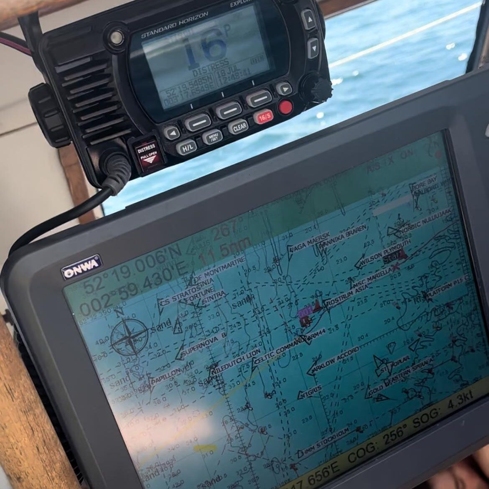

Als ik wakker word gemaakt voor de eerste nachtwacht, vergeten we even uit te wisselen welke bootjes we zien en welke lichten om ons heen geen bootjes zijn. Voor ik het me kan afvragen ligt Jen in een diepe slaap en wil ik haar niet wakker maken. Turend naar de horizon blijkt de Noordzee ’s nachts een levendig geheel van windmolenparken, boorplatformen en andere scheepvaart. Ik probeer me te oriënteren: Komt dat lichtje nou dichterbij? Of staat ie stil? In het duister denk ik af toe opeens de schim van een mast te zien en de navigatielichten van een vliegtuig verwar ik met een toplicht. Na een uur heb ik alles gezien en wordt de zee vergevingsgezinder. Alles vertraagd en afstanden blijken veel groter dan ik dacht.

We wisselen van wacht en ik slaap eindelijk diep. Die paar uurtjes diepe slaap maken een wereld van verschil. Het zal niet de laatste keer zijn dat slaap ons zwaar valt, daar moeten we nog een goede balans in zien te vinden. Met name voor de eerste 48 uur om in je ritme te komen.

Dag twee is het bladstil als we richting het Kanaal varen. Ook de golven zijn verdwenen. Zo gaat het hard met de diesel. Terwijl Jen slaapt speel ik met de drone en dat gaat ook bijna mis. Vliegen en stijgen is het probleem niet, landen des te meer..

De tweede nacht verloopt soepeler en brengt een klein zuchtje wind. We kiezen ervoor dat we liever opkruisen, dan op de motor mijlen maken. Dan doen we er maar wat langer over. We hebben de tijd.

De tweede ochtend zijn we net voorbij Dover als de wind (voorspeld) vrij plotseling aantrekt. Wind en stroom staan tegen elkaar in en dat zorgt ervoor dat de golven steil en kort worden. Over de grond gaan we als een gek, door het water klappen we van golf naar golf en lijken we praktisch stil te liggen. Het is onze eerste wind sinds we van de werf komen en meteen een goede test: De radar komt naar beneden, de kiel maakt een raar geluid, één van de reeflijnen schiet los en binnen vliegt het een en ander in het rond.

Het duurt gelukkig maar een uurtje. Daaarna blijft het nog even klotsen en wordt alles weer rustiger. De rest van de dag herstellen we de feedbackpunten die we van de zee kregen. Met twee lange stukken aluminium en een open harp maken we een hele lange dunne pikhaak die we in de giek kunnen steken. Een stuk nylon koord vanuit de andere kant erin en dan zien dat je die open harp achter een ophoping nylon krijgt om hem door de giek te trekken. Simpel, effectief, maar op een schommelend schip en met nog 20 andere manieren die eraan vooraf gingen een bijna dagvullend programma.

Aangezien er meer wind voorspeld is en ik in het achterlijk van de fok een stukje los doek zag wapperen, besluit ik dat dit een goed moment is om de extra fok die we hebben meegenomen als reserve, op ons rolprofiel te zetten. Die moet eerst uit het vooronder gehaald worden. Datzelfde vooronder dat we vlak voor vertrek gebruikten als dumpplaats voor alles wat nog geen definitieve plek had gekregen…  
Eenmaal aan dek gaat onze fok er af en rollen we die zo goed en zo kwaad als kan aan dek op en proppen hem in de zeilzak. Het zweet staat dan inmiddels op mijn voorhoofd en de eerste blauwe plekken hebben zich gemeld. De reserve fok is een maatje kleiner en daarom niet de primaire fok. Verder dan dat is het in vergelijking tot ons huidige zeil, krakend nieuw. Ik ben trots op mijn marktplaatsaankoop en heb zin om hem op te tuigen. Jen hijst terwijl ik de pees in het profiel begeleidt. Er klopt iets niet.

Ik kan het me niet meer voor de geest halen waar het is misgegaan, maar óf ik heb verkeerd gemeten, óf ik heb verkeerd gelezen, óf er is verkeerd geadverteerd. De pees is net een paar millimeter dunner dan de pees van ons profiel en ik kan hem er uit trekken. Het scheelt een paar millimeter, maar wel een paar teveel. Aftuigen dus, teleurstelling verwerken en deze fok weer oprollen. Met naald, zeildraad en dacron reparatietape ga ik in de weer om het stuk in ons achterlijk in te pakken. Dat lukt aardig, met name de tape blijft mooi zitten en houdt de boel goed bij elkaar. Binnenkort maar even een zeilmaker opzoeken voor een nieuwe pees en een paar goeie stiksels..

Moe maar tevreden gaan we de derde nacht in. We zitten er goed in en slapen beter. Begin van de ochtend begint de wind zoals voorspeld uit het west-zuid-westen te waaien en begint het beuken weer. Onze wereld en ons ritme verandert. Zoekend naar een comfortabel hoekje loont het uitgebreide vooruitkoken, opruimen en inslingeren. Dit kunnen we wel even volhouden. Luwte houdt zich goed, op een paar raamrubbertjes die wat zout water binnen laten na. Die plakken we later wel.

Twaalf uur wordt een etmaal en een etmaal worden er twee. Dit vergt een stuk meer energie dan we aanvankelijk dachten. Ik sta op scherp en slaap heel licht. Een trilling die niet bij het zeilplan hoort merk ik in mijn slaap op en weet ik te lokaliseren. Voordat Jen doorheeft dat er iets mis is, sta ik alweer buiten in alleen een shirt en een zwemvest. Een paar minuten later terug in mijn kooi luister en voel ik dat het goed zit. Onze boeg duikt onder water en doet alles even sidderen, water klettert af en toe tegen de ramen. Luwte trekt zichzelf in een windvlaag schuin en ik voel de versnelling: Wanneer komt de volgende golf die ons lanceert..? Pats! Daar! Boem! Boeg onder water, kletterend spatwater op de ramen. Relax, sit back, repeat. Als ik de volgende ochtend slaperig naar buiten kijk en met een kop koffie de bewegingen volg overstemt een sterk gevoel van trots mij. Wij doen dit, weer of geen weer, stroom tegen of niet, we knallen door. Luwte geeft geen krimp. Nog een duik, nog een sprong. Jen heeft bij elkaar al 16 uur alleen wacht gelopen en ik merk dat ze dit leven ook wil. Ze maakt me niet meer wakker voor alle beslissingen, gaat zelf overstag en navigeert over zee. Dit schip, deze bemanning, de zee, we zijn het aan het doen, we zijn los.

**Weather window**

De term “Weather window” is misschien niet al te bekend onder niet-zeezeilers, maar Nederlanders hebben er een natuurlijk talent voor. Het timen van je acties en beslissingen aan de hand van het weer.

Waar wij op zee vooral geïnteresseerd zijn in de windrichting en -kracht, zijn we als Nederlandse landrotten veelal bezig met regen. Niet voor niets hebben apps als buienalarm en buienradar miljoenen downloads in Nederland. En mijn lievelingssite: kanikeenkortebroekaan.nl voorspelt of je vandaag kans maakt op korte-broeken weer (na 10 jaar testen kan ik beamen dat ze het nog nooit mis hebben gehad!).

We zoeken dus een goed weather window. Met name voor de golf van Biskaje, waar we ver van land varen en geen havens aan kunnen doen als het weer zich tegen ons keert. Één van de redenen dat wij tegen wind en golven in aan het beuken waren, was het beloofde weather window naar noord-Spanje. Nog een uur of 12 en dan zou de wind gaan draaien. Één nachtje nog.

Zoals in ons Position Report al vermeld werd, staken wij weg van de Engelse kust richting Spanje. Vlak voor ons laatste beslismoment haalde ik het weer op en zag dat dat ene nachtje er misschien nog wel drie zouden worden. Slapen, een *pint* drinken en een eerste voet aan wal in Engeland ooit maakten de beslissing makkelijk: We gaan overstag en gaan naar binnen bij Plymouth.

**Logstand**

Al met al noteerden wij in ons logboek een logstand (afgelegde weg) van 664 zeemijlen, over wat normaal zo’n 380 zeemijlen (ca 700 km) zou zijn. Ter vergelijking: Een goed bezeilde tocht naar A Coruña vanuit IJmuiden is normaal ca 800 zeemijlen. En wij waren pas in Plymouth. De eerste mille kunnen we zo meteen dus al afstrepen, voordat we in Spanje landen. We komen al aardig in de buurt, want inmiddels dobberen we midden op de golf van Biskaje. ETA in ca 48 uur.
