Als we 's ochtends de touwtjes van de haven van Coruña los hebben gegooid en onze buren tot ziens hebben gezegd, drijven we de haven uit. Er staat minder wind dan voorspeld, dat is een terugkerend fenomeen waar ik mij aan kan ergeren, want een mooie zeildag op de voorspelling wordt dan opeens een strijd tegen de windstilte, vaak in hoge golven.

Door het uitblijven van wind, de koude zee en hoge temperaturen van het land, worden we al snel ingesloten door een pak dichte mist. De radar draait rondjes en de AIS staat aan. De bootjes om ons heen verdwijnen en we nemen gas terug. Ons zicht is nog geen 50 meter en vissers slingeren nogal. Een ander zeilschip kruist onze koers. Ik zie hem komen op de radar, maar zelfs als hij binnen de binnenste ring van ons scherm komt, kan ik hem niet zien. Wel horen we zijn dieselmotor brommen, ergens in de wolken.

Op het kanaal hadden we ook al eens mist, maar die was van korte duur en 's nachts, toen het toch al donker was en het regende. Toen had ik pas door dat we in de mist zaten toen die zo dicht was dat ik de punt van *Luwte* bijna niet meer kon zien, het zicht was toch al slecht. Nu varen we met de zon in onze rug een wolk in en verdwijnt alle referentie. Dat is een heel andere sensatie.

Door het rustige weer staat er nauwelijks deining of golf en moet je goed opletten. Het enige referentiepunt dat je nog hebt is het kompas. Even afgeleid en je hebt zonder het door te hebben een koerswijziging van 90 graden gemaakt.

Een kleine drie kwartier later varen we de wolk uit en kijken we van het een op het andere moment naar de blauwe lucht. De wind steekt op en we hijsen de gennaker. Coruña blijft in een wolk verscholen achter ons liggen. Het zwarte lichtweerzeil dat we van de *Palustris* hebben geleend trekt ons in deze bries toch al snel naar de 5 knopen. Nauwelijks golven, een rustige lange deining en het ruisen van het water langs de boot. Dit is zeilen!

<figure class="wp-block-video"><video autoplay="" controls="" loop="" muted="" src="/wp-content/uploads/2024/08/IMG_4652.mp4" playsinline=""></video></figure>

We voelen ons goed en bevrijd. Jen heeft mij wel eens verteld over het eiland Koh Phi Phi. Dat eiland deed ze aan in haar tussenjaar toen ze drie maanden door Azië trok. Koh Phi Phi is, naast een prachtig eiland, vooral bekend omdat er veel wordt gefeest. Het businessmodel is bijna perfect. De pont van het vasteland naar het eiland komt 's middags aan en vertrekt de volgende ochtend om 09.00 weer terug naar het vaste land. Volgens de overlevering blijven sommige reizigers hier weken of maanden hangen, in een soort oneindige roes van katers, feestjes, laatste biertjes, activiteiten en bovenal: verslapen voor de pont terug naar het vaste land. Één nachtje extra worden er twee, een week erbij worden er twee enzovoort. Zelfs Jen schijnt er bijna door verzwolgen te zijn.

Ik moet vaak aan dat verhaal denken omdat het zo'n mooi en fataal voorbeeld is van hoe de meeste beslissingen in het leven gaan. Zelfs nu nog. Onze één a twee nachtjes in Coruña werden er drie en drie werden er vier. Vanaf 5 nachten krijg je korting, waardoor het verschil tussen vier, vijf, of zes nachten opeens klein wordt. Het maandtarief is even hoog als 10 nachten, dus je rolt zo terug het comfort van het stadse leven in. Dan liever even in de mist.

## Corme

Ook in 2007 deden we met de *Palustris* Corme aan. Ik kan me er vrij weinig van herinneren, maar op de foto's poseren we als schattige kinderen voor een grote muurschildering van de *Costa da Morte*. De naam van de Spaanse noord-west kust heeft een rijke geschiedenis met schipbreuken en we snappen inmiddels wel waarom. De plotselinge mist, aanlandige wind (wind die naar de rotsen waait) en grote rotspartijen die ver in zee steken en de hoge deining laten breken, maken dit gebied een perfecte kraamkamer voor mythes en scheepswrakken.

Tegenwoordig is het varen met alle hulpsystemen en goede weersvoorspellingen een stuk veiliger geworden, maar ik begrijp wel dat motorpech op het verkeerde moment, terwijl een mistbank je overvalt en je zeilen klapperen ook snel verkeerd kan aflopen. Of, zoals onze buren van Coruña in de golf van Biskaje meemaakten, een Franse overheid die wat testjes uitvoert met de satellieten waardoor je GPS niet meer werkt. Goed zeemanschap is in die zin ook het hebben van een bepaalde mate van wantrouwen in datgene dat niet mag falen...

De muurschildering in Corme is er niet meer, maar verder is er denk ik weinig veranderd. Corme schijnt (en zo zag het er inderdaad uit) helemaal niet zo oud te zijn, maar een nieuwbouwproject uit de jaren 80. Grote flat-achtige gebouwen die zeer dicht op elkaar staan. Niet zo aantrekkelijk, maar ook niet oninteressant.

Voor ons belangrijker is dat we hier erg mooi ten anker liggen en het er betrekkelijk rustig is. We dobberen een paar dagen achter ons anker en krijgen dan van Dorien de vraag waarom er toch wordt gesproken over "voor anker gaan" terwijl we toch achter ons anker liggen?

Deze vraag zet heel wat in werking. Uiteraard had ik dat in het vorige blog willen verwerken, maar het onderzoek liep helaas nog tijdens de publicatie. Na lang zelf nadenken heb ik toch maar contact gezocht met binnenvaarttaal.nl, het taalinstituut, onze zeilvereniging, en natuurlijk de nautische kant van mijn eigen familie. Na enige discussie en afweging heb ik kunnen concluderen dat "voor anker gaan" in essentie een foutieve verbastering is van "ten anker gaan". De eerste stap in deze richting die ik heb kunnen terugvinden dateert al uit een stukje geschreven in 1598 en luidt:

> Wy (lieten) ons derde ancker vallen, ende overmits de wint meerderde ende crachtiger wert, lieten wy ons plecht ancker oock vallen, also dat wy voor vier anckers lagen,

Pas in de jaren 30 van de vorige eeuw begon het gebruik van "voor anker gaan" meer opgepikt te worden in ons schrift.

Terecht merkte mijn contact van Binnenvaarttaal op, dat taal in de eerste plaats als functie heeft om communicatie tot stand te brengen en dat deze zich met name in spraak ontwikkelt. Het schrift volgt ons gesprek. Of "voor anker gaan" als foutief kan worden bestempeld is dus maar net de vraag. Voor de zekerheid ga ik maar terug naar "ten anker" of "achter anker", voordat iemand denkt dat we altijd met onze kont in de wind liggen!

<figure class="wp-block-image size-large is-resized">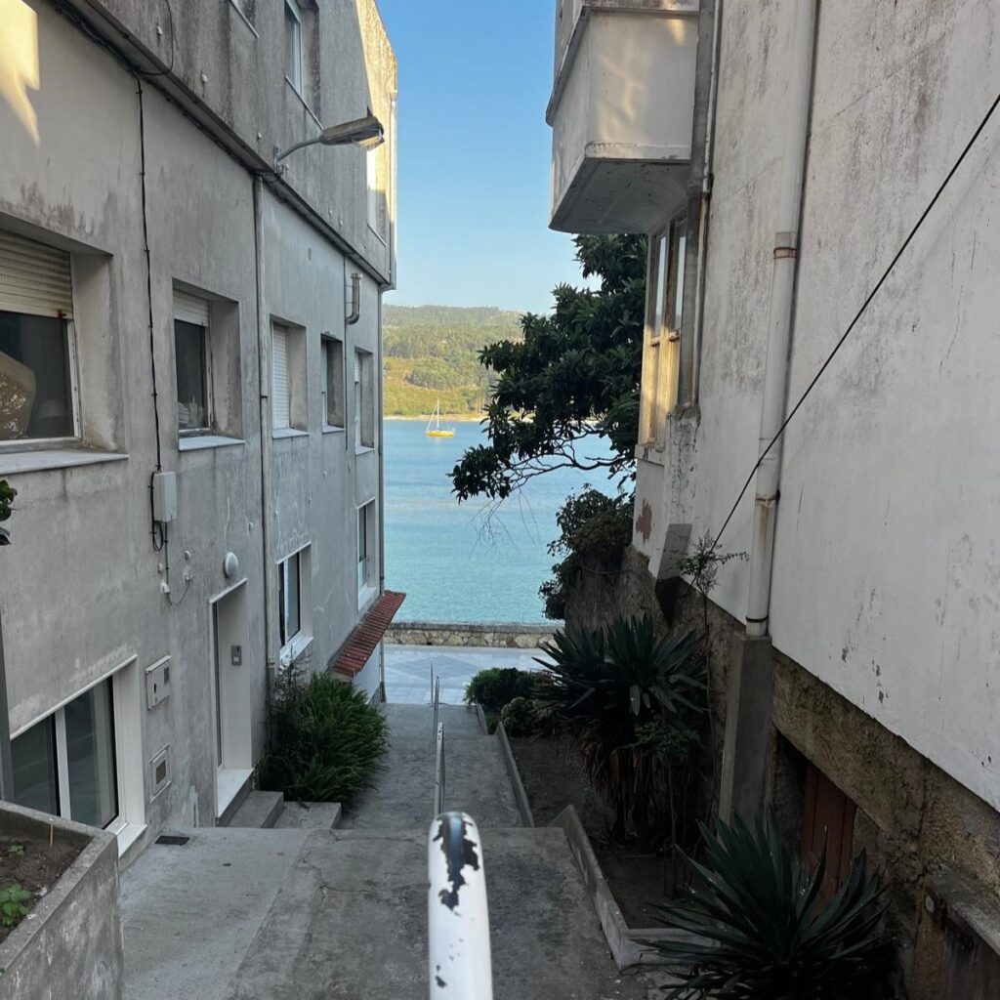<figcaption class="wp-element-caption">Corme met <em>Luwte</em></figcaption></figure>

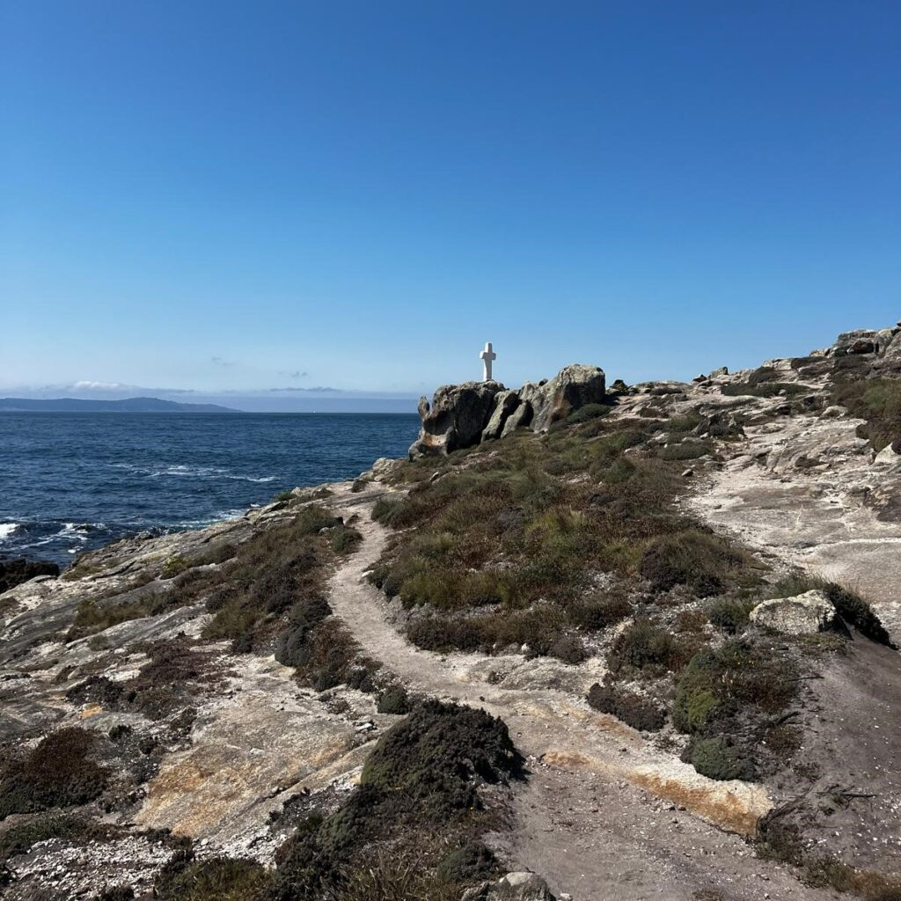

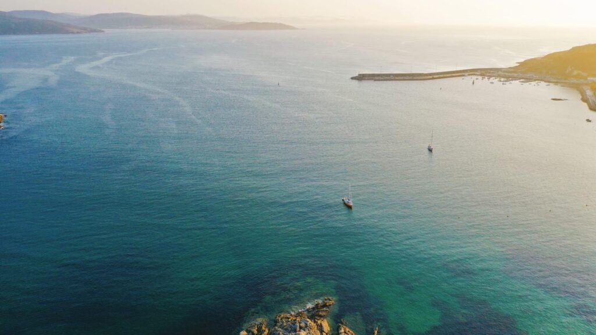

### Een stukje wandelen

Op dag twee wil Jen een stuk hardlopen. Wij verschillen nogal in onze behoeften en daar moeten we de ruimte maar aan geven. Waar we in Amsterdam altijd het *gevoel* hebben gehad alles samen te doen, is dat nu *letterlijk* zo en we merken dat er (gelukkig) toch nog verschillen tussen ons zijn. Ik kan dagen, zo niet weken, op en rond de boot scharrelen. Twee klusjes per dag, groot of klein en ik ben een tevreden man. Jen wil er meer op uit en voelt zich soms wat opgesloten, omdat ze (nog) niet in alle situaties zelfstandig met de bijboot naar de kant kan. Soms is er een steiger, meestal een kade, een ankerplek, of een strand. Ik breng haar graag, maar begrijp haar gevoel van afhankelijkheid: Het is tijd voor dinghy-les.

De dinghy is het kleine bijbootje dat we hebben verrijkt met een iets te zware tweetakt motor van 15PK, bouwjaar Jenny Smit. *Storm* heet deze bijboot, en inmiddels is hij officieel gedoopt en gezegend door Neptunus.

<figure class="wp-block-image size-large">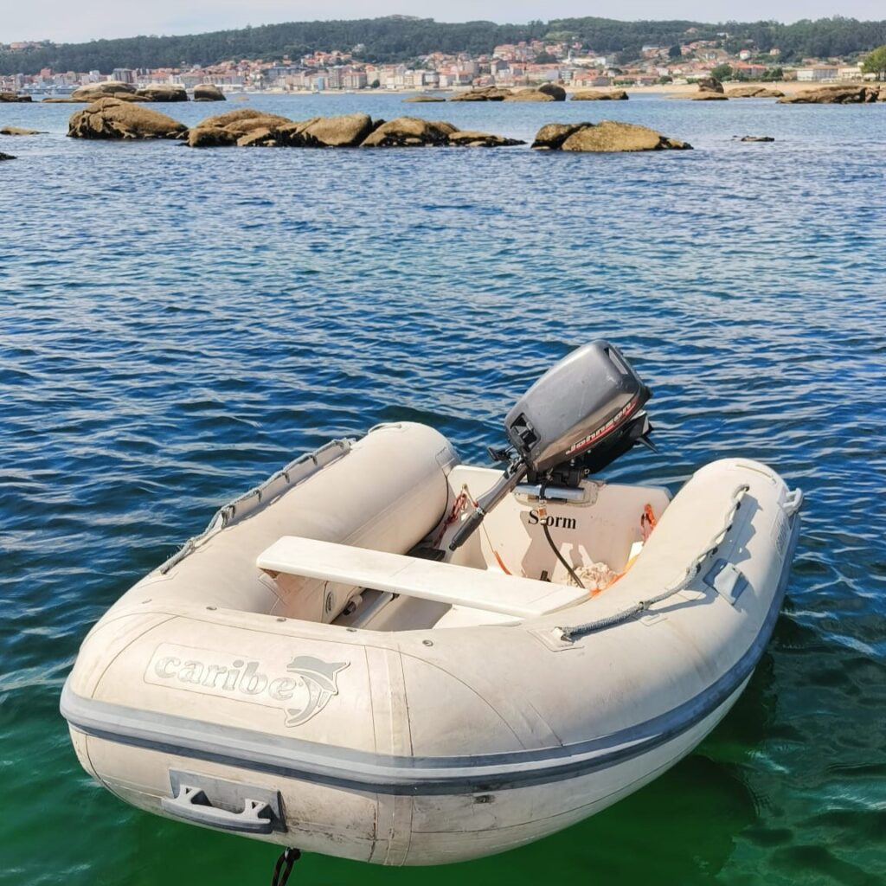<figcaption class="wp-element-caption"><em>Storm</em></figcaption></figure>

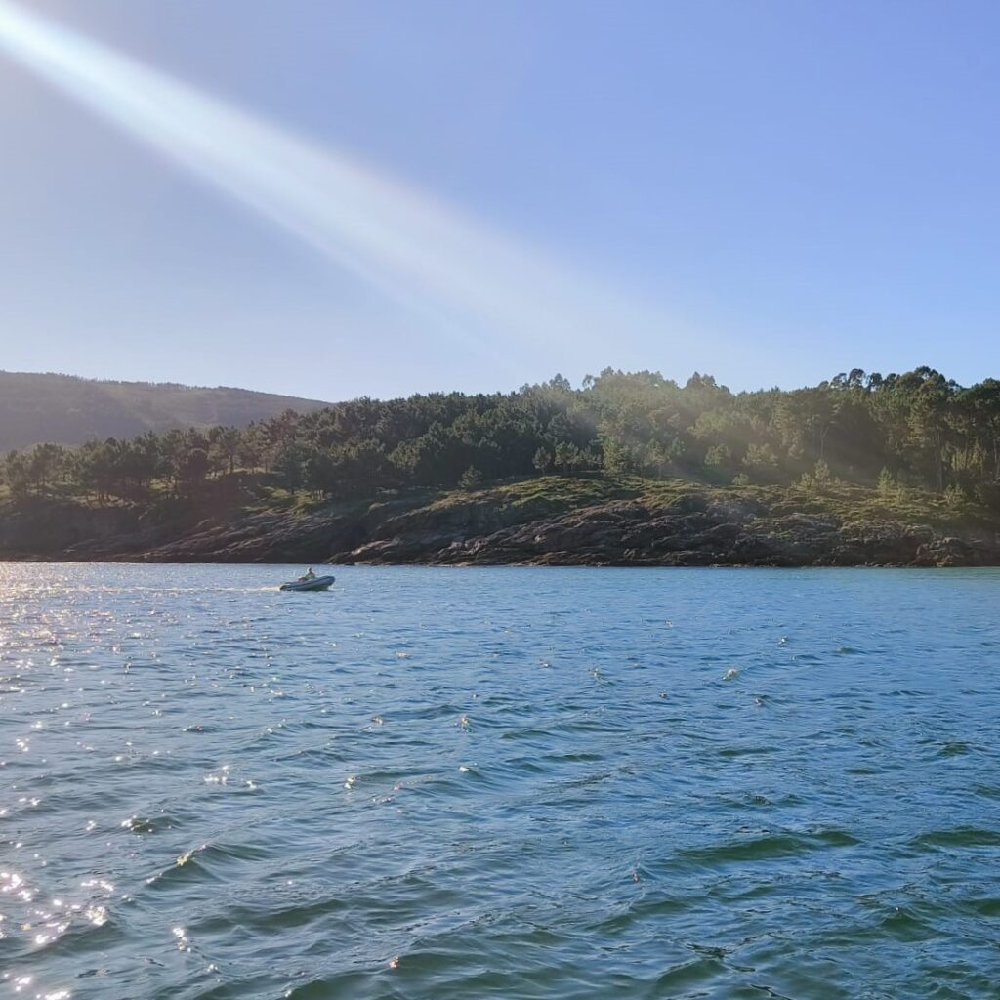

Er valt van alles te zeggen over bijboten, hun concepten en overwegingen, maar daar zal ik jullie niet mee lastigvallen. Het belangrijkste is dat *Storm* onze auto op het water is (of fiets als we de motor er af zouden halen). *Storm* brengt ons van ons drijvende huis naar het strand, naar de supermarkt of naar het naastgelegen stadje.

Eigenlijk past ons type bijboot, met zijn harde bodem en zware motor, niet helemaal bij de maat van *Luwte*. Echter, zoals degenen die mij een beetje kennen weten, paste het type auto dat wij in Amsterdam onder onze kont hadden óók niet helemaal bij onze levensfase en essentiële behoeften.. Wat dat betreft lijkt *Storm* wel een beetje op de Saab en de Volvo.

Inmiddels kan Jen ook aardig met *Storm* overweg, weet ze hoe je de motor omhoog kantelt, wanneer je dat moet doen en hoe je het anker uitzet. Eigenlijk is het kunnen al voldoende om het gevoel van afhankelijkheid weg te nemen. In de praktijk breng ik haar in de meeste gevallen nog steeds naar het strand, of ren ik een rondje mee.

Op dag drie stelt Jen voor een wandeling naar de vuurtoren op de kaap te maken. Ze heeft een mooie route gevonden van zo'n 3 à 3,5 uur. Mijn besef van tijd is weg dus ik heb geen idee hoe lang dat is, klinkt als een mooie wandeling.

Op het heetst van de dag trek ik mijn zwembroek en Crocs aan, zet mijn padvindersmuts van de grootmoeder van Jen op en grijp de canvastas van KindsWijs. Jen kijkt mij met opgetrokken wenkbrauwen aan. Zij heeft haar wandel-outfit aan, met heuptas en wandelschoenen. Onzin vind ik, Crocs zijn prima. Vroeger liep ik dit soort wandelingen nota bene op teenslippers!

Dat de wandeling 9,5 mijl was in plaats van 9,5 kilometer had ik even gemist. Dat is, zoals je inmiddels weet een factor 1,852 verschil... Ik had de pijnlijke fout gemaakt dusdanig overtuigd te vertrekken, dat ik absoluut niet kon toegeven een fout te hebben gemaakt. Er was onderweg wel een klein dieptepunt, maar voor de rest moest ik vooral elke keer erg grinniken als tegemoet komende wandelaars (uiteraard liepen we de route tegen de richting in) mij wat vervreemd aankeken. Na aankomst had ik blaren onder mijn voeten, maar dat kon mij niet deren, het welverdiende biertje maakte alles weer goed.

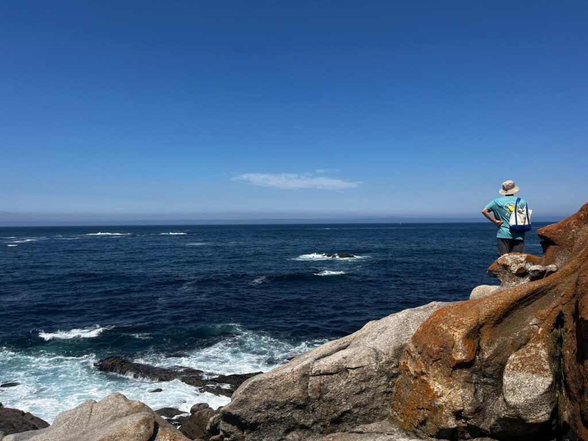

Sinds Jen ziek werd heeft wandelen een heel andere werking op ons beiden en daar komen we al snel in. Tijdens het wandelen ontstaat er ruimte om wat dieper in te gaan op waar we staan, wat we leuk vinden en wat we niet zo leuk vinden. De conclusie is dat het goed met ons gaat en we kijken vooruit naar de toekomst. Niet ver van ons vandaan ligt Fisterra. Tegenwoordig vooral nog bekend als einde van de Camino, maar tot niet zo lang geleden (1492, Columbus) nog het beoogde "einde van de wereld". We weten nog niet wat er achter dat einde schuilgaat, maar hebben daar wel zin in.

Waar we ook zin in hebben, is warmer water. Hoe schitterend het weer, de kust en de natuur hier ook zijn, het water is ijzig koud. De watertemperatuur komt nog altijd niet boven de 15 graden uit. Tijd om naar het zuiden te gaan. We maken een tussenstop in Laxe, waar we met regenachtig weer stranden in het café van de vissers. We vallen uit de toon, maar het bier smaakt goed en ze hebben vers gevangen calemaris. Een dame die in de tijd van onze twee biertjes al drie cocktails heeft gedronken ratelt aan een stuk door. Tegen haar hond, haar buurman, voorbij lopende mensen en uiteindelijk ook tegen ons. Als ze Nederlands had gesproken hadden we het vermoedelijk ook niet begrepen... Uiteindelijk opent ze haar telefoon en zorgt ze voor Tangomuziek op het terras: Ze is vol passie aan het kijken naar een danswedstrijd tussen zwierende Spanjaarden.

## Het einde van de wereld

We kiezen een dag met hoge deining uit om naar Fisterra te varen. Er is ten noorden van ons een flinke depressie voorbij getrokken en die stuurt haar opgebouwde deining van drie meter hoog richting de Spaanse kust. Verder is de voorspelling gunstig en ik vind het dan ook een goed idee om eens wat hogere zee op te zoeken. Het is maar voor een paar uur en dan weten we ook hoe dat is.

Door het oplopen van de kust (het ondieper worden) is het eerste stuk erg onrustig. Puntige, hoge golven kruisen elkaar en de deining wordt teruggekaatst door de kliffen. Uiteraard is de wind weer eens minder dan voorspeld en dat zorgt er voor dat de zeilen geen steun geven. Ik word er letterlijk (zee)ziek van en kruip naar binnen. Jen voelt zich goed en houdt haar hand om het roerhout.

Bij het eerste zuchtje wind steek ik mijn hoofd weer naar buiten en trimmen we de zeilen. De wind trekt door de dag heen verder aan en we varen recht voor de wind naar het einde van de wereld. De zeilen gaan in *butterfly* modus, waarbij het grootzeil naar bakboord wordt vastgezet en de fok naar stuurboord.

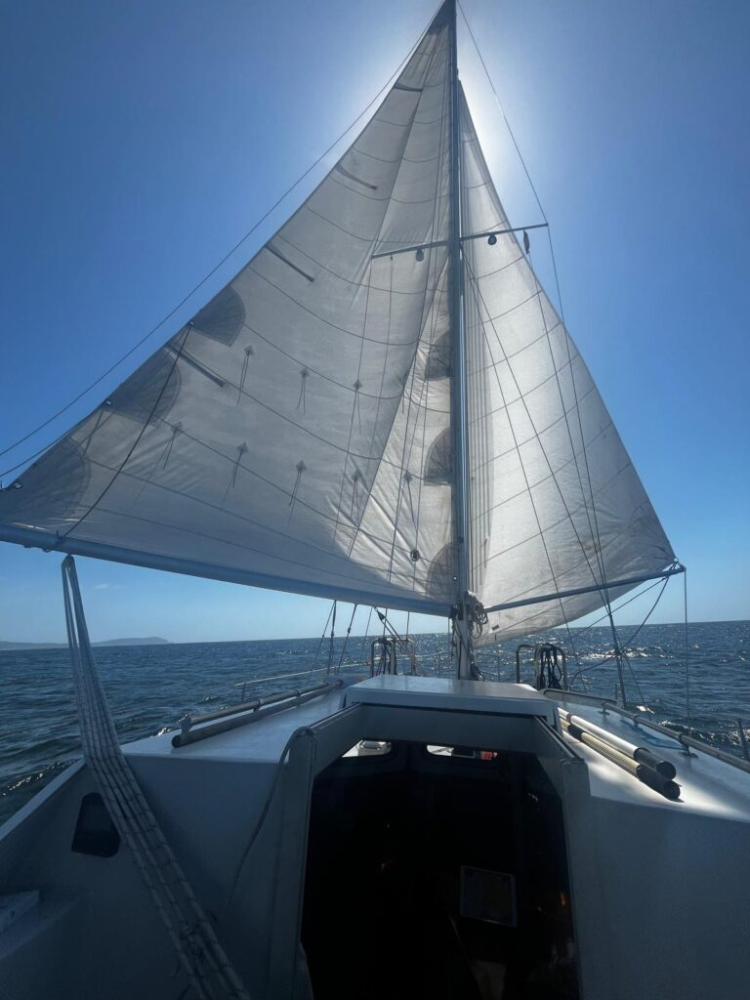

De foto gaat via *Elon Musk* naar onze ouders en ik krijg een paar minuten later de (terechte) opmerking van mijn vader dat onze *bulletalie* te dicht op de mast zit. De bulletalie zorgt er voor dat we niet zomaar kunnen gijpen als een golf, of een windvlaag uit de verkeerde richting onze boot raakt.

Voor wie wel eens gezeild heeft, is het wellicht bekend terrein, maar voor de rest wel handig om te weten: Afhankelijk van je doel en je koers moet je zo nu en dan de zeilen van bakboord naar stuurboord halen. Op die manier zorg je ervoor dat de wind goed in de zeilen blijft staan en je dus vooruit gaat. Dit kan op twee manieren: Overstag gaan en gijpen en er zit een groot verschil tussen die twee.

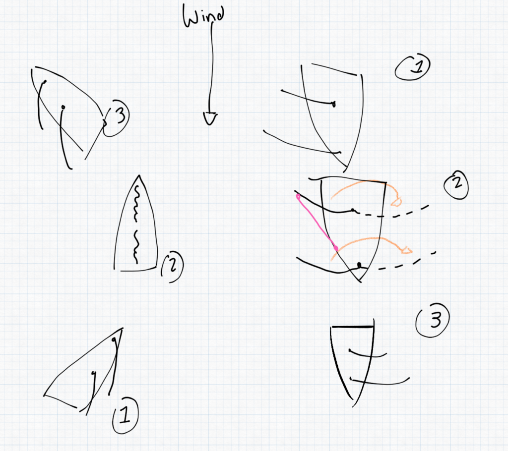

Bij het overstag gaan draai je met de boeg van je schip eerst naar de wind toe en vervolgens van de wind af. Het wordt ook wel "door de wind gaan" genoemd om die reden. Op het moment dat je punt precies tegen de wind in ligt, vangen je zeilen geen wind en gaan ze klapperen. Dat ziet er soms wat heftig uit, maar in werkelijkheid is overstag gaan in bijna alle gevallen rustig en gecontroleerd, op een kortstondig klapperend zeil na.

Gijpen is precies het tegenover gestelde. Eigenlijk ga je met je kont door de wind, in plaats van met je punt. Bij gijpen is er geen moment van klapperende zeilen. De zeilen blijven immers wind vangen *tijdens* de procedure. Als gijpen gecontroleerd gebeurt is het meestal niet zo spannend, maar het gaat altijd snel en met enig geweld, zeker als het wat harder waait. De eerder genoemde *bulletalie* (roze lijn in de afbeelding) zorgt er voor dat dit niet per ongeluk en onverwachts gebeurt. Het grootzeil komt namelijk over de kuip heen, waar wij zitten te sturen, en je moet niet toevallig opstaan of ergens anders mee bezig zijn als dat zeil over komt.

Dat de *bulletalie* nog niet op de goede plek zat, had ik al wel gespot, maar nog niet echt prioriteit gegeven. Met deze opmerking op zak was het tijd voor actie. Een nieuwe *bulletalie* werd gezet en Jen en ik hebben nog een uurtje zitten twijfelen over hoe dat nog beter kon, maar dat dat makkelijker was als we achter ons anker lagen. Voor nu wel prima.

Niet veel later begint de wind aan te trekken en stapelen de windgolven zich bovenop de deining op. We moeten actief sturen om te zorgen dat we niet rare klappers en schuivers maken. Zoals ik in mijn recente literatuur vernam (ik lees tegenwoordig boeken) kunnen alle schippers goed zeilen hijsen, maar is reven slechts voorbestemd aan goede schippers. Tijd om mijn strepen te verdienen.

Het rif zit er snel in. Jen stuurt en ik merk dat we af en toe wel op het randje van gijpen zitten. Bij het strak zetten van ons voorlijk blijft een zeillat achter de verstaging steken en kijken we beiden omhoog. Het is een momentopname, maar ik voel dat we gaan en roep vanaf de mast dat Jen moet terugsturen. De gijp komt, klapt en gaat met de bulletalie én de schoot aan de haal. Nog geen seconde later staat de giek aan de andere kant en hellen we over naar stuurboord. Jen haar reactie was weg bewegen in plaats van tegen houden en daarvoor knijp ik in mijn handjes.

Voordat we over kunnen naar evaluatie moeten we eerst nog wat lijnen herschikken, een volgend rif zetten, de fok uitbomen en orde op zaken stellen. We varen inmiddels voor de kaap van Fisterra. Door de vorm van de kaap en de windrichting, wordt de wind daar nog extra aangezwengeld. Het derde rif gaat er in en met een klein puntje fok stuiven we op één oor langs de vuurtoren. Zodra we die voorbij zijn worden we beloond door de baai van Fisterra. De deining en golven zijn van het één op het andere moment verdwenen achter de rotsen en we varen hoog aan de wind met 6,5 knopen. Een paar minuten geleden had ik eigenlijk besloten de zeilen binnen te halen zodra we het hoekje om waren, om zo snel mogelijk het anker te laten vallen, nu wil ik dat dit eindeloos zo doorgaat. De zon zakt weg achter de bergen en de wind trekt nog wat verder aan, maar ik rol de fok een stukje uit om nog wat sneller te gaan. Rond de 7 knopen, *Luwte* begint te grommen, of zullen we zeggen tevreden spinnen in haar geval. Schip en water gaan een dans aan die door de hele boot heen voelbaar is.

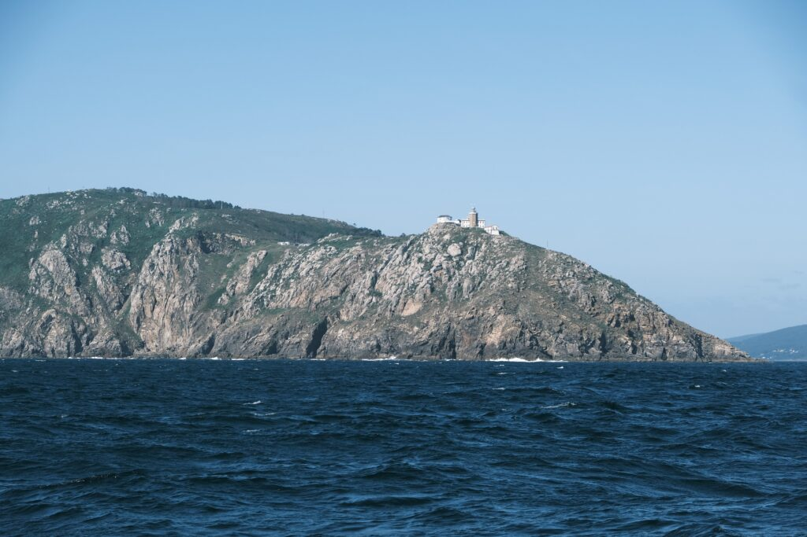

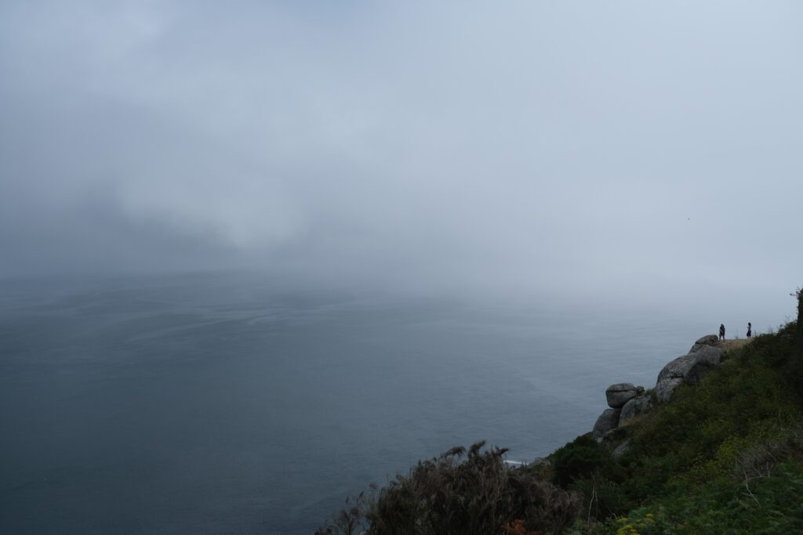

## Fisterra

We worden wakker aan een langgerekt strand, iets verder uit het stadje. Jen gaat een rondje hardlopen en ik maak van de gelegenheid gebruik om voor het eerst die 15 paarden van *Storm* tot hun recht te laten komen. We draven in een paar minuten naar de vissershaven en ik verken de mogelijkheden om *Storm* achter te laten voor onze wal-avonturen. Jen rent hetzelfde stuk heen- en weer en legt dus zo'n zeven kilometer te voet af. Dat doe ik haar inmiddels niet graag meer na.

In de middag verkennen we het stadje, wederom te vroeg en nog midden in de siësta. Het stadje is toeristisch, maar met een sterk gemixt publiek. Camino-wandelaars zijn er in alle gradaties, van hippie tot popster. We gaan op zoek naar postkaarten en postzegels, schrijven op een terrasje wat brieven en lopen langs de (helaas) gesloten *ferreteria's* (letterlijk: ijzerhandel, in praktijk: alles wat je als Rorik kunt dromen). De zoektocht naar Yanmar onderdelen duurt me te lang en ik heb na wat vaderlijk advies besloten dat een vloeibare pakking ook afdoende is om de kleppen te stellen, maar die moet ik wel nog zien te scoren.

<figure class="wp-block-image size-large is-resized">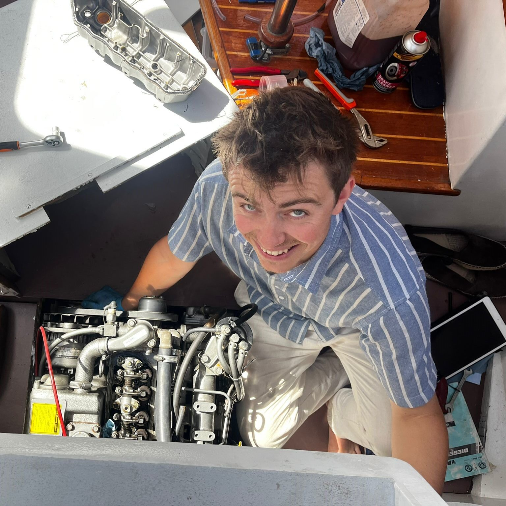<figcaption class="wp-element-caption">Mijn eerste keer kleppen stellen. De vloeibare pakking hing prominent op mij te wachten toen ik de ferreteria binnen kwam lopen de volgende dag. De motor rookt intussen (bijna) niet meer.</figcaption></figure>

### Een stukje Camino

De Camino was voor mij, tot Jen beter werd, onbekend, maar schijnt een van de oudste en meest gewandelde bedevaartstochten te zijn die er is. Ik weet nog goed dat ik niet goed begreep waarom Jen sprak over het willen wandelen van de Camino. Niet binnenkort, maar wel op een dag en het liefste *alleen*.

In principe eindigt de bedevaart in Santiago de Compostella, maar een deel van de wandelaars loopt door tot het einde van de wereld, Fisterra. Volgens de geschiedenisboeken stortte menig heilige zich, na het voltooien van de bedevaartstocht letterlijk van het einde van de wereld in zee, euforisch en verlicht. Het doet de naam *Costa da Morte* eer aan.

Wij liepen met een omweg het laatste stukje van Fisterra naar de vuurtoren, door een mistig en donker bos over verlaten paden. Op aanraden van een andere zeiler nemen we elke wandeling een blikje sardientjes, tonijn of andere vis mee en een stuk brood, dat we onderweg heerlijk tot ons nemen.

<figure class="wp-block-image size-large is-resized">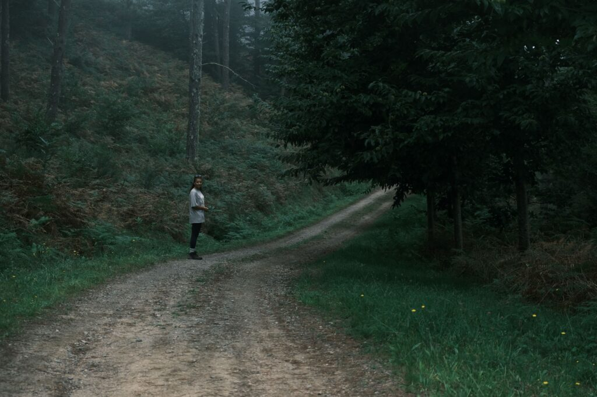</figure>

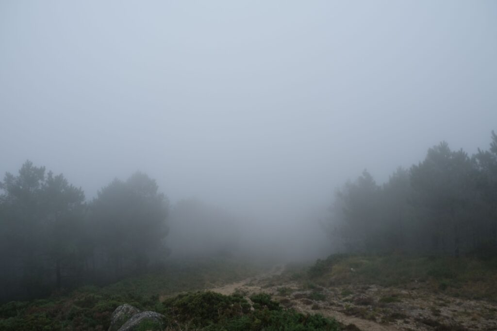

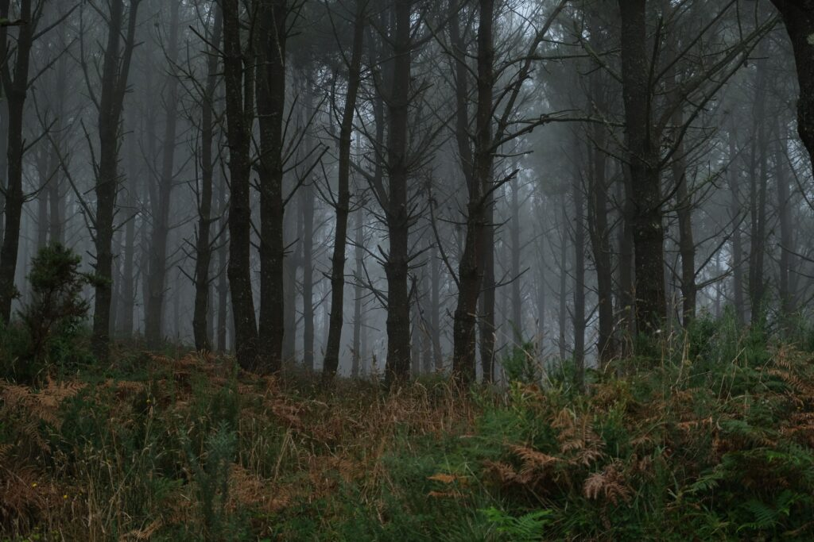

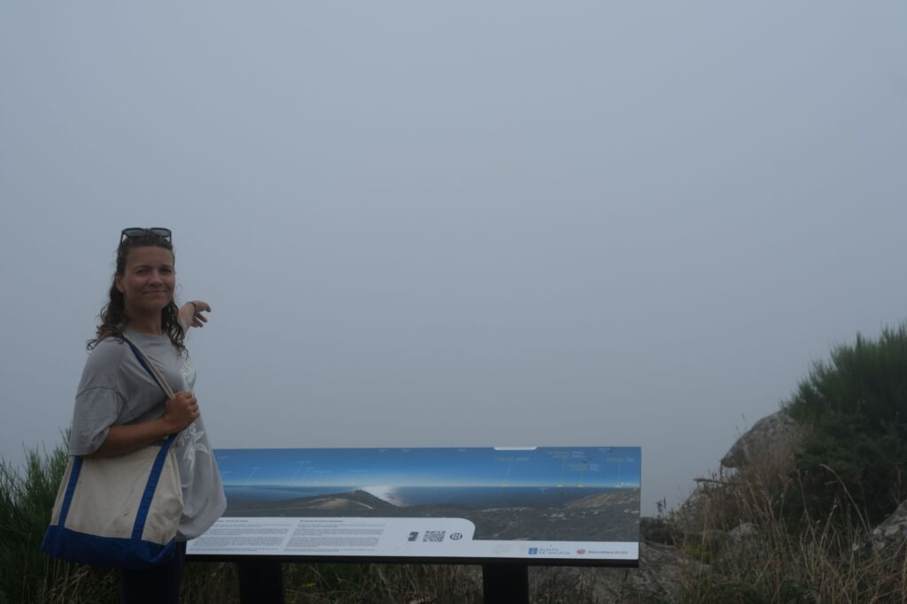

De aankomst bij de vuurtoren geeft een dubbele nasmaak. Touringcars staan in een rij om de stroom toeristen aan- en af te voeren. Het stinkt naar poep en pis in de berm en er lijkt weinig "heiligs" meer over van deze bestemming. Een groep jonge mensen met de print "Camino 2024" op hun t-shirt gedrukt stapt uit een bus, rent naar het laatste bord van de Camino en valt elkaar al selfie-makend in de armen. Tour voltooid? Ze krijgen een paar minuten om in de gift-shop een aandenken te scoren en stappen weer in.

Wij zitten inmiddels op een rots naast de vuurtoren, een beetje uit het gedrang. Er komt een jongen met rugzak op zijn rug aanlopen. Hij wandelt met tranen in zijn ogen voorbij de groep en heeft geen oog voor het bord op de finish, die heeft hij al lang gehaald. Hij lacht en jubelt even in zichzelf, juicht kort en tuurt even over zee. Daarna draait hij zich tevreden om, de tranen inmiddels op zijn wangen en wandelt hetzelfde pad terug als waar hij over is gekomen.

Nu snap ik waar Jen het over had. Op een dag gaat ze hem lopen. Ik overweeg in tegenovergestelde richting naar Zwolle te wandelen.

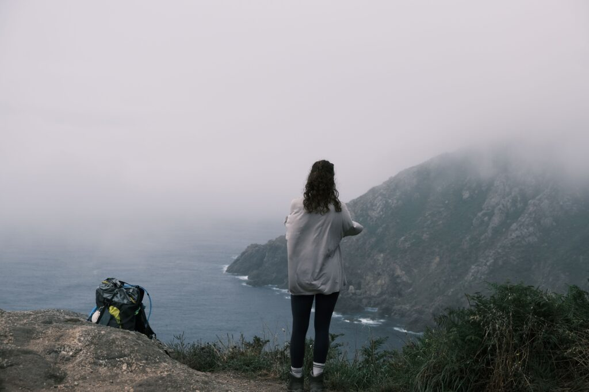

## Sardiñero - Dolphiñero?

We verwachten hoog bezoek. Er moet worden schoongemaakt, mijn "voor- of ten ankervraagstuk" moet worden opgelost, het bier moet koud en de bbq klaar voor gebruik. We zijn er blij mee, want het zet ons weer even in gang om goed voor *Luwte* te zorgen. Dorien reist met een camper door Europa deze zomer en rijdt ook langs deze kust. Een tussenstop ligt voor de hand en een baaitje verderop zit een camping aan het strand.

### Ons eerste bezoek

De nacht ervoor word ik wakker van een vreemd geluid. Het is mistig buiten en we zien de kant, of de andere boten om ons heen niet meer. Alleen dat geluid. Dichtbij. Het blijkt een enorme dolfijn te zijn die om ons heen draait. We spotten hem een paar keer, maar in het donker is het lastig volgen. Na een minuut of tien horen we nog één flinke zucht en zien we een witte schim onder het wateroppervlak wegschieten.

De volgende ochtend starten we de motor en ik loop naar voren. Daar is ie weer! De dolfijn komt ons ophalen. Hij is en blijft dichtbij. Haakt zichzelf om onze ankerketting en zwemt met boot en al rondjes. Ik ben bang dat hij verstrikt raakt, maar elke keer als ik dat uitspreek draait hij een rondje en komt even laten zien dat hij weer los is. Tussen het spelen door haal ik het anker op en laten we ons van het strand af wegdrijven. De dolfijn blijft om ons heen zwemmen, gaat op zijn zij liggen en kijkt ons recht aan, dwars door onze ziel. Het is bijzonder, intiem en helemaal niet zoals ik me interacties met dolfijnen van vroeger kan herinneren. We zetten de motor in zijn vooruit en varen weg. De dolfijn blijft bij ons en surft onder water op de golven van *Luwte* met ons mee, bijna bewegingsloos op dezelfde snelheid.

<figure class="wp-block-image size-large is-resized">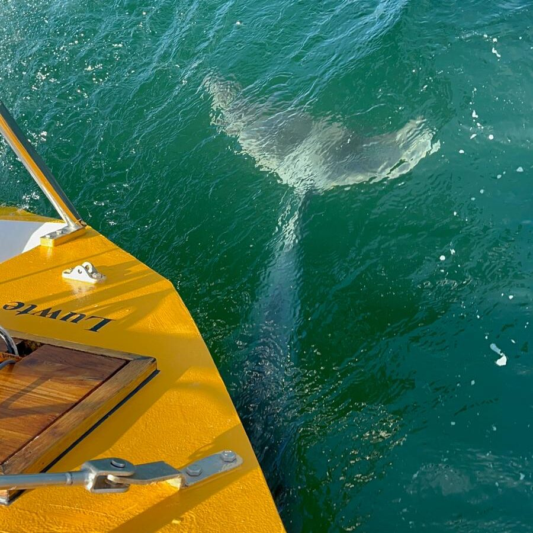<figcaption class="wp-element-caption">Meezwemmen op precies hetzelfde tempo</figcaption></figure>

<figure class="wp-block-video"><video controls="" src="/wp-content/uploads/2024/08/Video-van-WhatsApp-op-2024-08-27-om-11.24.38_3fecf958.mp4"></video><figcaption class="wp-element-caption">Spelen met de ankerketting</figcaption></figure>

We ankeren aan ons nieuwe strand op vier meter diepte. Dat lijkt me voldoende, maar als ik de kaarten nog eens bekijk zie ik dat er meer dan drie meter verschil zit tussen eb en vloed en dat het water nog zeker twee meter kan gaan zakken. Opnieuw ankeren heb ik even geen zin in, maar gelukkig kunnen wij onze kiel intrekken. De waterstand 's avonds komt tot 1,80 meter en ik zie het strand, dat zo ver weg leek, akelig dichtbij komen. Morgen maar even het anker wat verderop uitgooien.

We slapen uit tot ik wakker word van het geluid van de dolfijn. Alweer? Hij is terug en speelt weer met de ankerketting. Ook Jen komt uit bed en we genieten met een kop koffie van het spel. Tussendoor schiet hij opeens weg en zien we verderop een hele school vissen uit het water springen, met daarachter de dolfijn. Het lijkt wel een show. Hij stuurt ze bijna helemaal het strand op en dan zie ik dat het strand alweer dichtbij aan het komen is. Ik pak de kaarten er bij en zie dat we nog een kwartier hebben om het anker op te halen, anders moeten we zes uur wachten tot het weer vloed wordt. Toeval? Ik geloof het haast niet. Zodra we beginnen met het binnenhalen van het anker zwemt de dolfijn weg.

### Ons tweede bezoek

Die middag staat Dorien op het strand en begeven wij ons van de boot naar de camping. We proosten, bekijken de camper, bespreken onze zomer-avonturen, en wat er hierna te wachten staat. Na een paar drankjes verhuizen we van de camper naar de boot en zetten onze gesprekken voort. De bbq gaat aan en er komen nieuwe drankjes op tafel. Ik vertel over mijn - door Dorien gestarte - zoektocht naar het "voor anker gaan" en Dorien krijgt een tour van de boot en het bootleven achter anker.

De volgende dag staan we met hoofdpijn op en bewegen wij niet teveel. Dorien loopt per ongeluk nog helemaal naar Fisterra, omdat het eerste dorp zo dichtbij was. Het lekkere (vinden we geloof ik unaniem) aan ontmoetingen als deze, is dat wij gewoon onze plek op de boot hebben en Dorien die van haar bij de camper. Je loopt en rolt dus niet over elkaar heen in de ochtend, maar kunt elkaar zo weer opzoeken als de tijd rijp is. De tweede avond houden we het binnen de maat. De bbq gaat weer aan, maar we eindigen met een paar koppen thee.

## Warmere wateren

In de zoektocht naar minder condens en meer dolfijnen is het tijd om weer verder te gaan richting het zuiden. *Ria de Muros* heeft onze aandacht opgepikt in de *pilot* en er komt een mooi moment aan om daar naartoe te varen. Overigens mag ik verklappen dat Jen driftig aan het schrijven is (met pen) en al een paar keer de ambitie heeft uitgesproken haar eigen flessenpost de wereld in te slingeren. Vooralsnog mag ik zelfs geen inkijkje in haar gedachten nemen, maar ik maak me geen zorgen. Die tijd zal wel komen als zij rijp is.
