In een werveling van onze verhoudingen lukt het mij tegenwoordig ook af en toe een foto (of selfie) van Jen te maken. Oefening baart kunst, maar op een dag zal er misschien ook eens iets van mij op de Instagram komen..

Om onze relatie wel in balans te houden pakte Jen de pen op. Geen blog vanuit de ogen van de schipper, maar vanuit mijn verstekeling. De Algarve is van Jen:

## Kapen ronden

Rond half 12 ’s ochtends ronden we de Cabo de Santo Vicente. Na een initieel onrustige nacht, waarin ik op een gegeven moment wakker werd van Rorik die bijna over z’n nek ging van de misselijkheid, is de ochtend een cadeau. Het lijkt wel alsof de zon aangeknipt wordt als we de koers op het oosten zetten. De dolfijnen die ons het hoekje om begeleiden maken het gevoel compleet. Na een paar dagen afscheidsmelancholiek weet ik weer precies waarom we dit doen. In het zonnetje jubelen we om onze plotse, maar voor ons gevoel goede, keuze een stuk West-Portugal over te slaan en flink af te zakken. Zo lijkt het alsof we Kirk bijna helemaal ontwijken.

<figure class="wp-block-image size-large">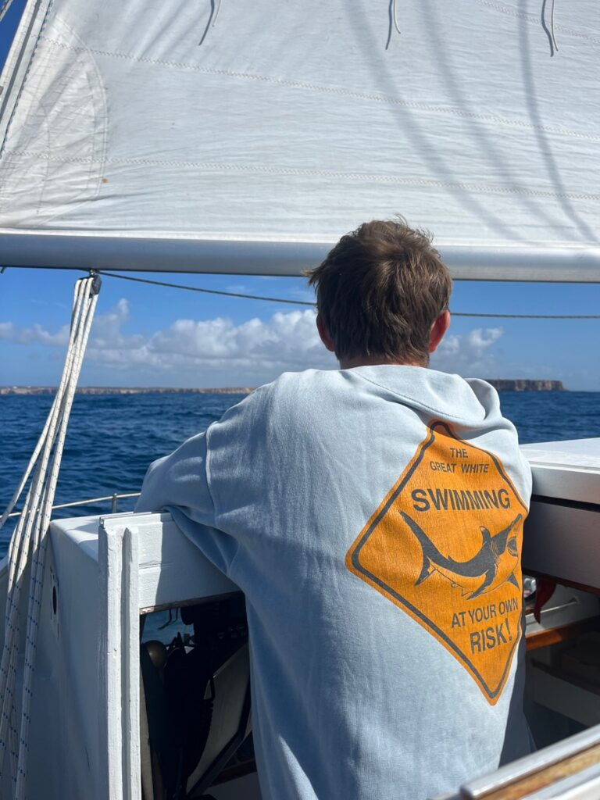<figcaption class="wp-element-caption">'s Ochtends was de misselijkheid verdwenen en had ik weer een vrolijke kapitein aan het roer.</figcaption></figure>

<figure class="wp-block-image size-large">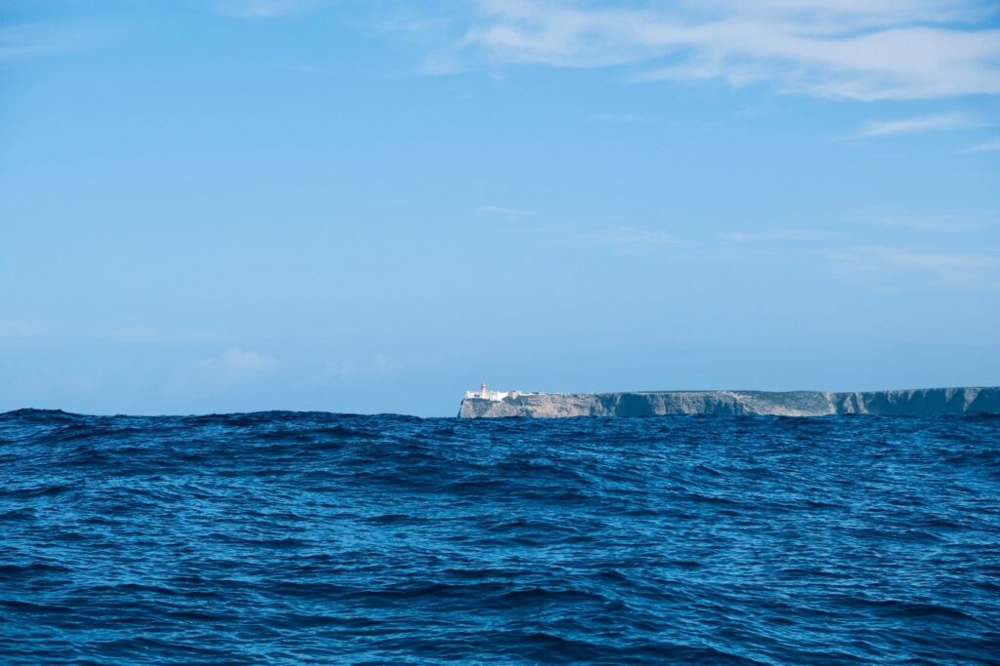<figcaption class="wp-element-caption">Cabo de Santo Vicente. De kustlijn van de Algarve is gelijk majestueus.</figcaption></figure>

We laten ons anker zakken in een inham bij Sagres, een vissersdorp dat inmiddels ook een surf-walhalla is geworden. Rorik duikt nog even in bed, en ik begin met de exercitie om de boot weer van zeil- in leef-modus te krijgen. Opruimen, schoonmaken en onze bedden omwisselen. Op zee slapen we achterin, onder de kuip, achter het anker is het in de punt een stuk ruimer met z’n tweeën. Eind van de middag besluiten we dat we Sagres in gaan. Met de step. Want we hebben twee volle tassen was, en ook al ben ik dol op de wringer, ik heb gezien dat er een laundry-café is. Daar kan je je eigen wasmiddel meenemen, en dat is voor onze huid inmiddels beter. Dus de tassen worden gehesen en voorop bij Rorik steppen we door Sagres. Het doet me een beetje denken aan hoe ik in Amsterdam ook altijd bij Rorik voorop z’n fiets zit. Een Nederlands jochie roept ons nog na over straat “hoezo heeft die meneer een step, mama?”. Het laundry-café is een succes, want laten we eerlijk zijn: een biertje terwijl je wacht op je was is natuurlijk een briljant concept. Zo wilt Rorik wel vaker de was doen... We eindigen die avond bij een lokaal visrestaurantje waar onze sardientjes op straat worden gegrild, en we proosten op hoofdstuk drie van onze reis.

<figure class="wp-block-image size-large">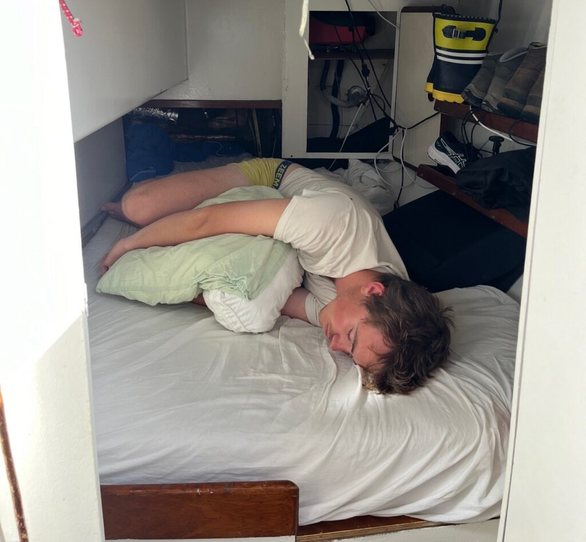<figcaption class="wp-element-caption">Onze "hondenkooi-tevens-opslaghok-en-schoenenkast"- het bed waar we omstebeurt slapen als we op zee zijn.</figcaption></figure>

<figure class="wp-block-image size-large">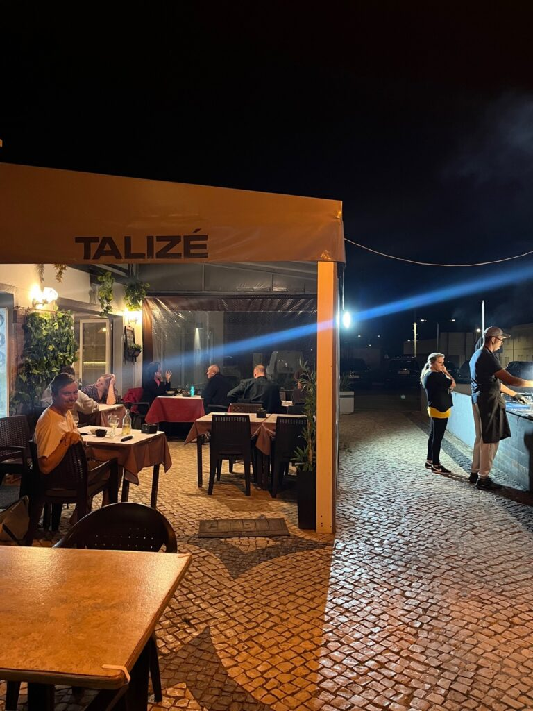<figcaption class="wp-element-caption">In Sagres eten we de tot nu toe lekkerste gegrilde vis en raken we aan de praat met Belgen die hier zijn voor de geweldige surfcondities...</figcaption></figure>

Deel van dit derde hoofdstuk is dat we gaan ontdekken hoe het is om zowel een beetje te werken, als te zeilen. Na 2.5 maanden ultiem vakantiegevoel, waren we stiekem wel benieuwd, hadden we zin in een uitdaging, en kwam het zo op ons pad. Dus de volgende ochtend klappen we onze laptops open. Maar na 2 uur vallen diezelfde laptops bijna van de eettafel af. De swell van Kirk heeft ook Sagres bereikt. Focussen op een scherm en tegelijkertijd je evenwichtsorgaan *in control* houden is een uitdaging, dus de laptops gaan weer dicht. We twijfelen: even doorbijten, of het anker lichten en toch nog even doorvaren tot Lagos? Als we de branding steeds dichter op onze boot zien kruipen, besluiten we tot het laatste. Het is best spannend om in een flink deinend landschap - inclusief brekers dichtbij - het inmiddels flink ingegraven anker op te halen, maar het lukt. Opgelucht draaien we de punt naar open water, waar ons een teletubbie-zee wacht met golven van 5.5 meter waar Luwte als een echte pro vanaf surft.

Over surfen gesproken: van een vriendin krijg ik later die week de vraag waarom wij in hemelsnaam nog niet aan ’t surfen zijn, terwijl we op al die hotspots zijn. Nou zijn we er allebei sowieso niet echt goed in, maar na Sagres weet ik het zeker: als je ergens goed kan surfen, liggen wij er echt liever niet met de boot…

Vlak voor het donker lopen we de havenmond van Lagos in, waar we van plan waren de haven in te duiken. Maar helaas. De loopbrug tussen de havenmond en de haven zelf gaat niet meer open (of dicht?) na 18:00. Wachtsteiger it is. Prima voor ons, we liggen tenminste weer even stil, dat is waar we voor kwamen. Eigenlijk is het best handig: laten we morgenvroeg na boodschappen te doen gelijk weer vertrekken. Water en stroom hebben we toch nog genoeg, en zo besparen we ons weer een duur havenplekje.

<figure class="wp-block-image size-large">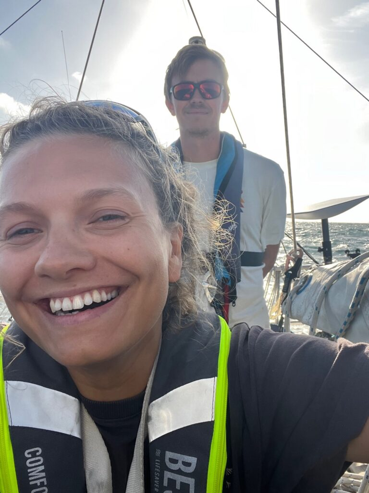<figcaption class="wp-element-caption">Opgelucht weg uit klotsbak Sagres.</figcaption></figure>

<figure class="wp-block-image size-large">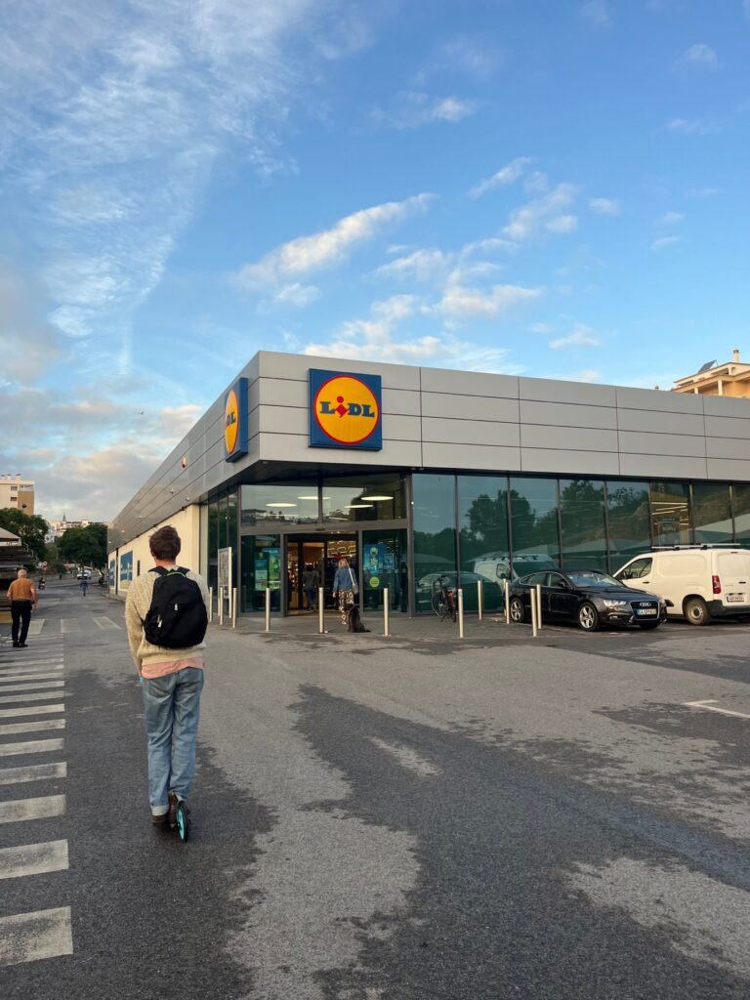<figcaption class="wp-element-caption">In alle vroegte naar de Lidl in Lagos.</figcaption></figure>

<figure class="wp-block-image size-large">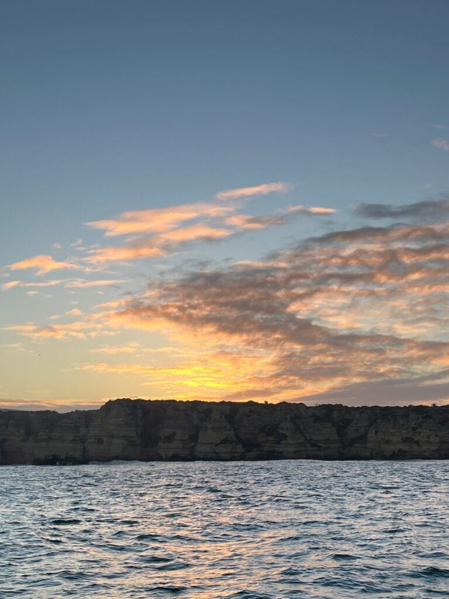<figcaption class="wp-element-caption">Had ik al gezegd hoe mooi die kustlijn is?!</figcaption></figure>

## Alvor

Na een nacht aan de wachtsteiger en een ochtendtripje naar de Lidl zijn we weer helemaal volgeladen en varen we een stukje door naar Alvor. Een soort waddengebiedje, ons al aangeraden door mede-zeilers, en niet onterecht. Het is er echt prachtig, en voor Luwte – met haar hefkiel – een waar speelparadijs. De week die daarop volgt hangen we hier dan ook lekker rond, met een kort intermezzo in de haven van Portimão.

Wat we namelijk hebben ontdekt, is dat op je het liefst op je laptop werkt op een boot wanneer het niet zo mooi weer is. Maar op je laptop werken betekent in ons geval ook dat we constant Starlink voor internet aan moeten hebben, en het grootste deel van de tijd onze laptops aan de lader moeten liggen. En daar hebben we stroom voor nodig, die van de zonnepanelen komt. En ja, je raadt het al, dat gaat niet helemaal lekker samen. Onze zonnepanelen zijn perfect afgestemd op het zeilleven, maar constant internet en zoemende laptops horen daar niet bij. Dat is aan de ene kant frustrerend, maar tegelijk vinden we het ook een goede stok achter de deur om niet helemaal door te slaan en van donker-tot-donker achter onze schermpjes te zitten. Toegegeven, we spelen wel een beetje vals, want we duiken voor twee dagen de haven van Portimão in om de accu’s vol te laden en een goede klap te maken qua werk. Daarna als de wiedeweerga weer terug naar Alvor, want er is nog iets wat op ons verlanglijstje stond.

Droogvallen. De kiel van Luwte is, zoals velen misschien weten, een hefkiel. Dat betekent dat we die helemaal omhoog kunnen halen in de schacht tussen de keuken en badkamer. En dan is de onderkant van Luwte plat. Dat wil je niet als je aan het zeilen bent, want dan is de kiel een belangrijke factor in de stabiliteit van de boot, maar als je in een rustig waddengebied ligt, is het wel echt een cadeau. Iets na hoog water varen we Luwte rustig een zandbank op, totdat we vastliggen. Het water zakt steeds verder weg met de ebstroom en een uur later zijn we helemaal “droog gevallen”. Ons eigen waddeneilandje. Rorik inspecteert de antifouling – die zie je anders namelijk nooit, we borrelen op de punt, en bewonderen het water om ons heen wat ons in de 6 uur daarna weer tot drijven brengt.

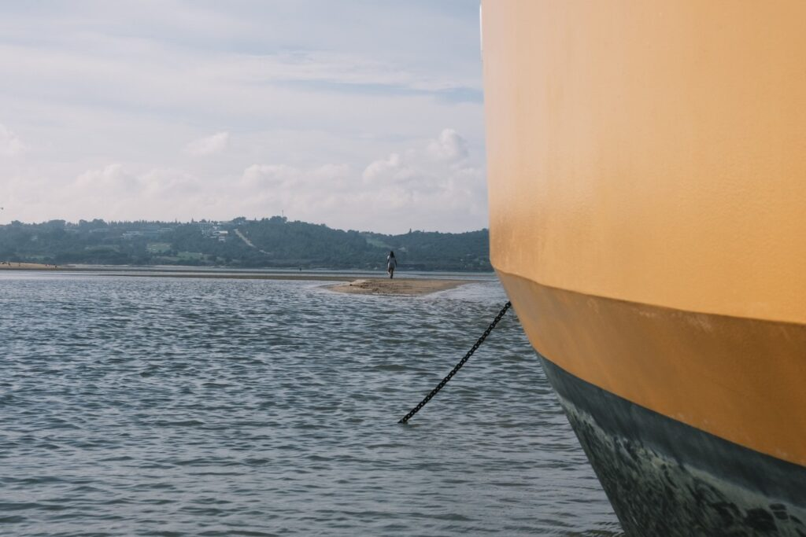

<figure class="wp-block-image size-full">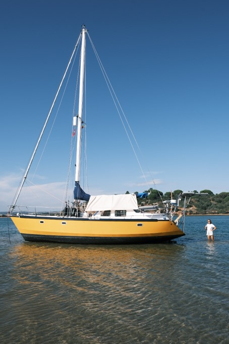</figure>

<figure class="wp-block-image size-full">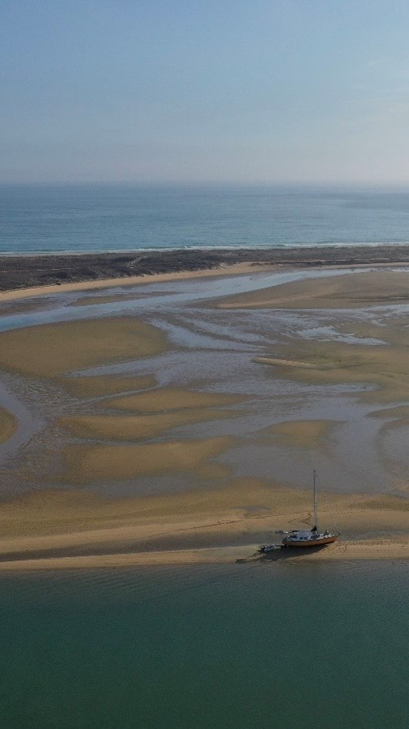</figure>

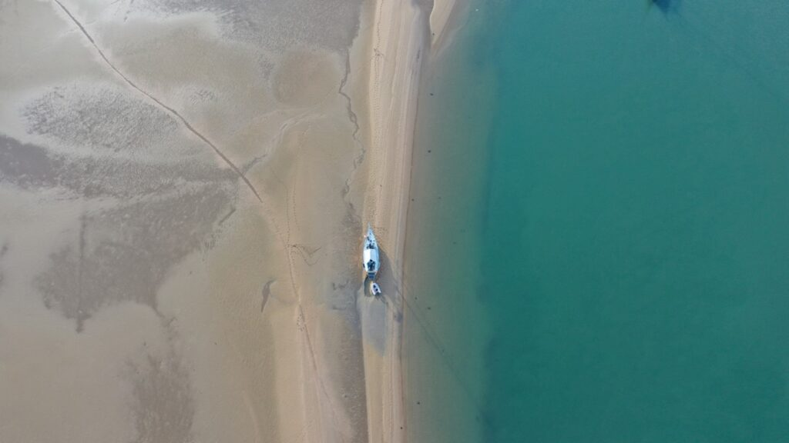

## Tij

Eb en vloed. Om eerlijk te zijn vond ik het nooit mega intrigerend. Het had iets met de maan te maken, en je moet een beetje opletten dat de stroom je niet meezuigt als je zwemt bij Zandvoort. Dat is hoever mijn kennis strekte. Naïef? Ongeïnteresseerd? Misschien. In mijn stadse leven deed die kennis er niet echt toe. Een maand voor vertrek haalde ik nog mijn vaarbewijs 2, waar het uitgebreid ging over het tij – springtij, doodtij – stroomverzet, maanstanden en LAT-standen. Ik haalde het met vlag en wimpel, maar begrijpen? Nee, niet echt. Goed stampen werkt blijkbaar ook… Dat is het grote verschil tussen Rorik en mij wat dit soort zaken betreft. Rorik haalt de toetsen met bloed, zweet en tranen, maar begrijpt in de praktijk *precies* hoe het werkt. Bij mij werkt het net andersom. Laat ik het erop houden dat ik alleen op een boot het nooit zou overleven…

Wat ik inmiddels wél helemaal begrijp, en zo bijzonder vind, is het fenomeen springtij en doodtij. Voor de zeiler die dit leest, sla het vooral over, maar voor mijn stadse vrienden die net zoals ik sommige van deze natuurfenomenen vergeten zijn sinds Aardrijkskunde in de derde klas, een kleine *recapitu*.

De maan gaat van vol naar “leeg” en opnieuw naar vol in de tijdsspanne van een maand. Op dag 1 zou je dus kunnen spreken van volle maan, en na twee weken hebben we het dan over “nieuwe maan”. Bij volle maan en bij nieuwe maan staan de aarde, de maan, en de zon in elkaars verlengde. Dit versterkt de aantrekkende krachten, en hierdoor wordt er harder aan de massa water op aarde getrokken, waardoor deze meer heen-en-weer wordt bewogen. Het resultaat: het verschil tussen eb en vloed vlak na volle en nieuwe maan is groter, en dat noemen we springtij. Het tegenovergestelde vindt plaats een week ná volle maan en een week ná nieuwe maan: doodtij. Dan staan de zon en de maan haaks op elkaar – waardoor we een halve maan zien in de lucht -  en daardoor werken de krachten van de hemellichamen elkaar tegen. Het resultaat is dat er veel minder hard aan de watermassa wordt getrokken en het verschil tussen eb en vloed veel minder wordt. Op sommige plekken waar we hebben gelegen ging het tij-verschil tijdens springtij om 4 meter, en bij doodtij bijvoorbeeld maar om 1 meter. Sinds ik dit ervaar, voel en zie, kijk ik met andere ogen naar de maan. Die is niet alleen maar meer mooi, half of vol, maar is een grote speler in ons leven: hoeveel ankerketting we moeten uitzetten, of we goed een havenmonding kunnen invaren, en hoe stijl de loopplank van de steiger naar de kade loopt.

## Tijd om te gaan?

Na voor een tweede keer een fijne tijd in Alvor te hebben gehad, besluiten we dat het tijd is om richting de Rio Guadiana te gaan. Dit stond hoog op Rorik zijn wensenlijstje. Deze rivier van ruim 700 km lang functioneert deels als grens tussen de Algarve en Andalusië en loopt helemaal terug tot diep in Spanje. In 2007 was Rorik hier met zijn familie al, en daar hebben ze warme herinneringen aan. Zoet water, groene bergen, spannende riviertjes, rivierschildpadjes, ongerepte natuur en authentieke Spaanse én Portugese dorpjes. Ik was allang verkocht natuurlijk. Eerst er maar zien te komen. Het is een flinke tocht, en we moeten rekening houden met het tij: we hebben een ebstroom nodig om weg te gaan uit Alvor, en een vloedstroom om bij de Rio naar binnen te gaan. Het is een puzzel: het is net te krap, of veel te ruim. We mikken op Faro, dat ligt iets over de helft, en zouden we goed moeten redden.

Alleen al vertrekken uit Alvor blijkt toch wat meer voeten in de aarde te hebben dan verwacht. We zien wat golven breken in de havenmond, dus bereiden ons rustig voor – *Storm* op het voordek, windvaan erop, eten alvast klaarmaken, alles zeilvast – en wachten tot we het veilig genoeg achten. Dan horen we van mede zeilers dat de havenmond van Alvor ook officieel “gesloten” is. De website van de havens in Portugal geeft inderdaad een rood bolletje aan. Ga je er wel doorheen, kan dat trucje je een boete van duizenden euro’s opleveren. Balen, maar daar zullen ze vast een reden voor hebben. We wachten. De volgende dag maken we eindeloos veel plannen, veranderen de eindbestemming, wijzigen ze weer, gooien ze in de prullenbak, en wachten… Dit moet niet meer te lang duren. We liggen nu al twee dagen in volledige vertrekmodus, zonder te bewegen, dit voelt als een vacuüm. Op de avond van dag twee besluiten we dat we in alle vroegte gaan vertrekken. Toch naar Faro. Wat ons betreft ziet de havenmond er rustig uit, de vissers gaan inmiddels ook weer naar buiten en binnen. En voor je het weet lig je een week stil omdat iemand vergeet het rode bolletje op groen te zetten. In het kader van zelf blijven nadenken hakken we de knoop door. 

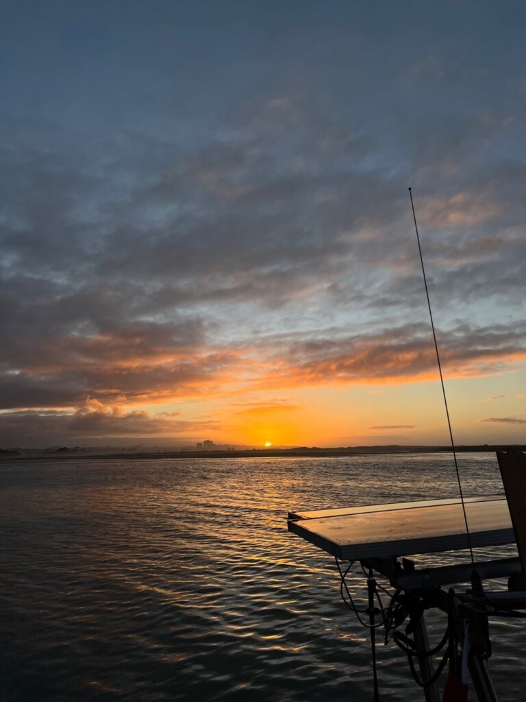

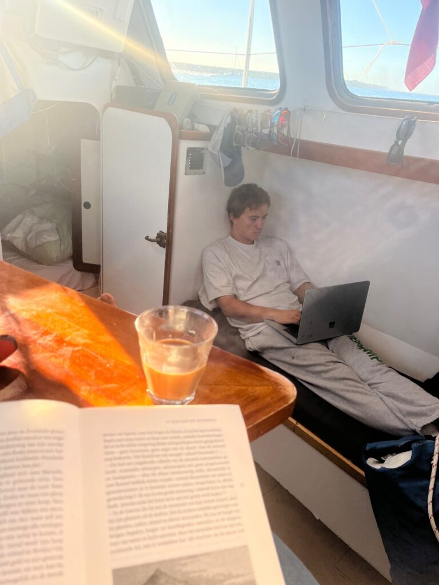

’s Ochtends vroeg vertrekken we met de ebstroom, zodat de stroom ons mee naar buiten helpt. Met een volle maan, opkomende zon en rustige zee motoren we een uurtje, maar daarna trekt de wind aan en zeilen we door een schilderij. Onze voorspelling dat we met het goede tij binnen komen bij Faro komt uit. Dat betekent daar naar binnen, ankeren, slapen en morgenvroeg weer door. Maar dan stel ik nog één keer de vraag: het zeilt nu zó goed, zouden we niet gewoon door kunnen zeilen richting de Rio Guadiana..?

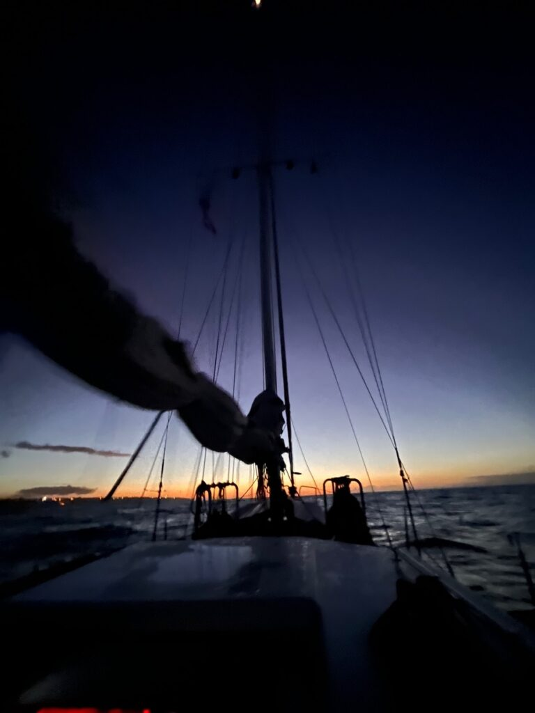

<figure class="wp-block-image size-large">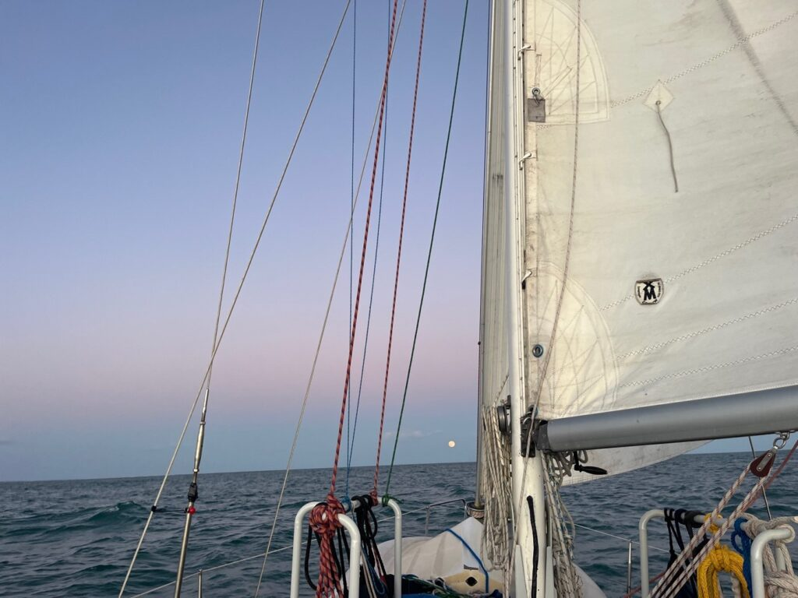<figcaption class="wp-element-caption">Maanopkomst onderweg naar de Rio Guadiana.</figcaption></figure>
