Iets voor Faro bekijken we dan nog één keer de data: hoe waait de wind de komende 6 uur? Hoe laat gaat de zon onder? Wanneer is het laag water bij de riviermonding? En niet geheel onbelangrijk: hebben we nog wat te eten? De conclusie op al deze vragen is dat het kan, we varen door. We komen te vroeg aan om direct naar binnen te varen omdat het tegen die tijd nog te hard naar buiten stroomt, dus moeten we 1.5 uur buitengaats wachten. Dat betekent dat we in het donker naar binnen varen, maar als we de betonning goed bestuderen van tevoren moet het te doen zijn. Ik vis nog ergens onder een luik een pot kant en klare bolognese saus vandaan, en we zijn *ready to continue*.

## Buitengaats wachten

1.5 uur buiten “wachten”… Dat betekent “bijliggen”! In de zeven jaar dat Rorik en ik samen zijn, hebben we het natuurlijk al heel vaak gehad over de zeilreis van zijn familie. Zodra ik eindelijk een beetje begreep wat zo’n zeilreis inhield (en dat je bijvoorbeeld niet ’s avonds en ‘s nachts op een overtocht op de oceaan je anker uitgooit om te slapen…), vroeg ik mij altijd af hoe Dafne in hemelsnaam eten kookte op zo’n schuingaand schip. En ja, de traditionele man-vrouw-verhoudingen spelen een grote rol op de boot ;). Ieder z’n *forte*. Ik heb sowieso diep respect voor Jorrit en Dafne en hun avonturen, maar dat koken… Dat is écht een uitdaging. Toen ik dat waarschijnlijk voor de zoveelste keer uitkraamde, werd mij rustig uitgelegd door familie de Boer dat ze dan vaak met de *Palustris* gingen “bijliggen”. Goed. Lang verhaal kort: nu was het zover. We gingen hetzelfde doen met *Luwte*!

Tegen de tijd dat we bijna bij de riviermonding van de Rio Guadiana zijn – waar we nog niet naar binnen kunnen – bereiden we ons onder het licht van de volle maan voor. We varen halve wind met zowel de fok (het voorzeil) als het grootzeil over bakboord (linkerkant van de boot). We draaien heel rustig door de wind – gaan overstag – waardoor het grootzeil naar stuurboord (rechterkant) klapt. Maar het grote verschil is dat we de fok niet mee laten gaan, maar vastgezet houden aan de bakboord kant. Hierdoor werkt de wind in de fok als tegenkracht op de wind in het grootzeil. Het resultaat: we driften heel langzaam af, en de boot ligt praktisch in balans. Ik heb de rust, de tijd, en de balans om de afwas bij te werken en die kant en klare bolognese op te warmen.

Ik was zó blij. Tijdens onze oversteken onderweg naar Spanje viel het koken me vies tegen. Als het er echt een beetje schuin aan toe ging, sprintte ik om de paar minuten de kombuis uit om even een tijdje naar de horizon te staren, anders werd ik misselijk. Plus: hoewel we een cardanisch fornuis hebben die ervoor zorgt dat het fornuis rechtop blijft hangen ten opzichte van de aarde, zal ik toch echt het pastawater moeten afgieten in een schuine omgeving. Die eerste tochten was zowel de zee onrustig, als wijzelf, waardoor we ook niet de tijd namen om bij te liggen. 3.5 maand verder hangt de vlag er anders bij. We zijn een stuk relaxter geworden.

Na 1.5 uur bijliggen draaien we de boot weer richting de havenmond, zetten we de zeilen op standje vooruit en vliegen we de laatste mijlen richting de pieren. Het blijft spannend, want de geul is heel smal, en de rode en groene lichtjes die de betonning aangeven knipperen alsof het al kerst is. Op het meest ondiepe punt wordt de zee door de bodem omhooggestuwd en wordt het eventjes een heksenketel met schuimende koppen op de golven en stroming dwars op de vaargeul. In de geul staat nog 2.4 meter water en hoewel we een hefkiel hebben, zit die op dat moment gefixeerd op 2.10 diepgang. In opperste concentratie navigeren we ons in het donker de rivier op en een paar minuten later komen we voorbij de pier en wordt het water glad als een spiegel. Het is gelukt!

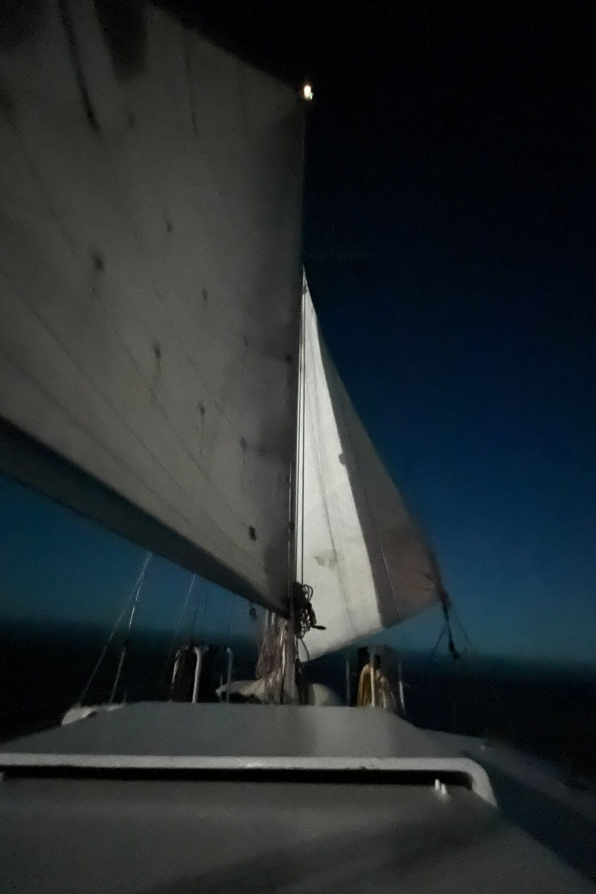

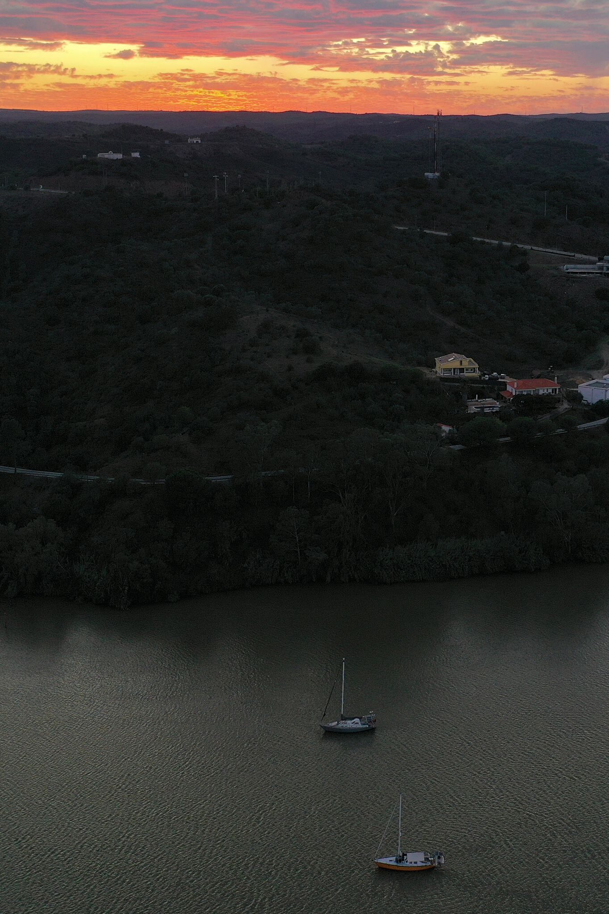

## Rio Guadiana en racen door de Algarve

We zijn nog maar net tussen de pieren als Rorik hardop snuift en met volle overtuiging zegt dat er hier een wasmiddelfabriek moet zijn “want hoe kan het anders zo schoon ruiken.” Ik lach ‘m toe (of uit?) en zeg zelf vol overtuiging dat dat sowieso komt doordat onze neuzen inmiddels gewend zijn aan de continue zoute, zilte, vissige, zeelucht, en dat zoet water dan relatief hartstikke schoon ruikt. Maar ik geef ook toe: voordat ik dit opschreef, heb ik wel nog even op Google Maps gecontroleerd of er niet tóch een wasmiddelenfabriek zit in de buurt van Ayamonte… (Het antwoord is nee ;))

De dagen erna ontdekken we het Spaanse Ayamonte aan de oostelijke kant van de rivier en het Portugese Villa Real de Santo Antonio aan de westelijke kant. Ons lijstje met spullen die niet op loopafstand te halen zijn wordt steeds langer dus we besluiten een auto te huren voor twee dagen. Op zoektocht naar nieuw gas, betere zonnebrillen, een werkende e-reader en een goede supermarkt om de voorraden aan te vullen.

De auto kunnen we huren in Montegordo. Als we er zijn voelt het eerder als het Benidorm van Portugal. Ondanks dat we het helemaal hadden uitgerekend, hebben we ons vergist in het tijdsverschil, en zijn we niet precies op tijd, maar twee uur te vroeg. In grote delen van Portugal wordt de siësta bestempeld als lui Spaans gedrag, maar hier merk je toch dat er wat Spaanse invloeden de rivier overgestoken zijn. Als we om 13.35 aankomen, zit de dame van de autoverhuur in haar kantoor te niksen, maar weet ons er in volle overtuiging van te verzekeren dat ze tussen 13.30 en 15.30 ongelofelijk druk is met het voeren van haar katten. Dan maar even Montegordo in.

We vinden een terrasje waar we denken een kopje koffie te kunnen drinken, maar als we de kaart krijgen, schrikken we ons dood. De kaart is in het Nederlands en gevuld met vaderlands culinairste hoogtepunten: kroketten, frikandellen, bitterballen, tosti’s ham-kaas… Voorzichtig spitsen we onze oren en kijken we om ons heen. We worden ons opeens akelig bewust van het feit dat we ons begeven op het terras van “Café Willem” met bijna uitsluitend Nederlanders! Als we even later voor de lol één van de hotels inlopen om te kijken of het hier ging om een uitzondering of dat het hele dorp gekoloniseerd is, worden we in ons vermoeden bevestigd. Binnen twee meter van de ingang vinden we al een bord met de uiterst Nederlandse tekst “zaterdag welkomstborrel en bridge vanaf 17:30”.

Terwijl we even later in onze fiat 500 met schuifdak door de Algarve krossen, mijmeren we er nog een beetje over door. Ergens is het natuurlijk über-hypocriet om iets te vinden van grote getalen Nederlanders die allemaal naar dezelfde plek reizen in het buitenland. Je als toerist ergeren aan andere toeristen, terwijl je zelf net zo hard meedoet. Je zou zelfs kunnen stellen dat de Nederlandse zeilgemeenschap misschien nog wel erger is. In ieder geval wordt er volop op los ge-welkomst-borrelt en zou het me niet verbazen als er her en der een bridge-kaartje wordt gelegd op zo’n floating bar. Wij zeggen dan wel hautain “nee” tegen het broodje kroket, maar staan even later wel bij de Ikea Zweedse gehaktballen te eten…

## De rivier op

Als ons boodschappenlijstje voltooid is en de watertanks weer vol, gooien we de trossen los en sturen we *Luwte* verder de rivier op. De Rio Guadiana loopt als een bruine slang meanderend het binnenland in, door groene heuvellandschappen met her en der een witgeplaveisd dorpje en zo af en toe een zeilbootje. Sommige op het water voor anker, en sommige inmiddels op het droge. Een prachtige tocht van zes uur verder zijn we ter hoogte van Alcoutim (Portugal) en Sanlucar de Guadiana (Spanje). We gooien ons anker uit tussen een groep andere bootjes en proosten op zoet water.

Het zoete water doet ons goed, ook omdat we iets meer werken deze weken. Dan is het toch relatief rustiger. We hoeven ons in ieder geval geen zorgen te maken over swell. In plaats daarvan hebben we nu te maken met stroom, maar ons ankertje houdt het goed. We bewonderen de omgeving, wandelen wat en genieten van de rust die heerst op de rivier. Rorik herleeft z’n ervaring als kind als we met de dinghy een zijriviertje opgaan, en we spotten nog een zoet-water-schildpadje.

De tijd vliegt. Dat doet het sowieso, maar door het werk nog een beetje extra. Het is super leuk om deze klus te doen, maar we trekken achteraf wel de conclusie dat we het combineren van remote werk én zeilen wel een beetje hebben onderschat. De eenheid tijd komt in het gedrang. Het werken brengt je terug naar Nederlandse maatstaven van werk, het streven naar efficiëntie en het plannen op het uur. Terwijl “tijd” in cruiser-begrippen gaat over de dingen in z’n beloop laten, niet te veel te plannen en te leven op het ritme van de natuur. Een super interessante observatie. We zijn er zelfs blij mee: we ontwikkelen een hernieuwde liefde voor wat we aan het doen zijn. En daarnaast mogen we natuurlijk absoluut niet klagen, want een beetje werken af en toe leidt er al snel toe dat de keuze om eventueel langer weg te blijven niet meer afhangt van de vraag of we het kunnen betalen, maar of we het willen.

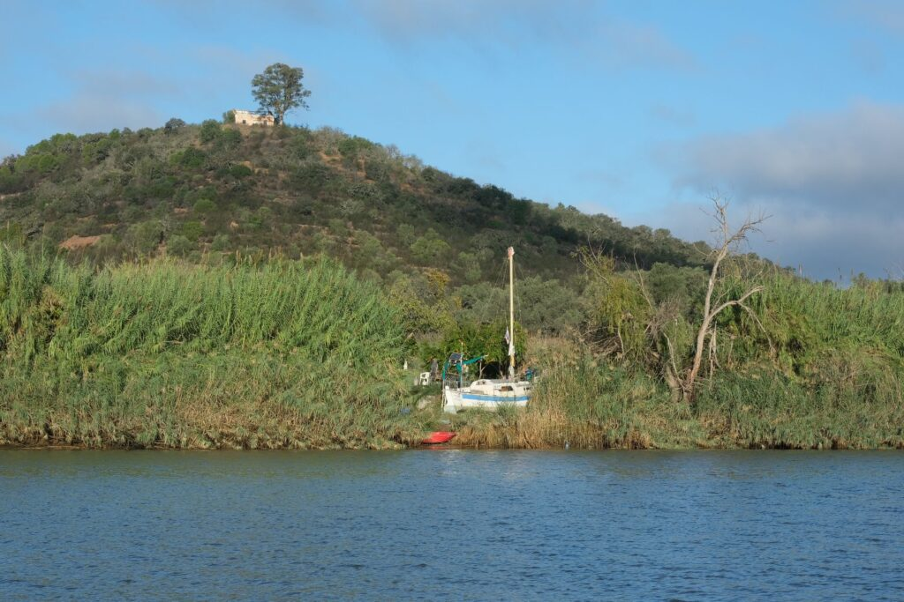

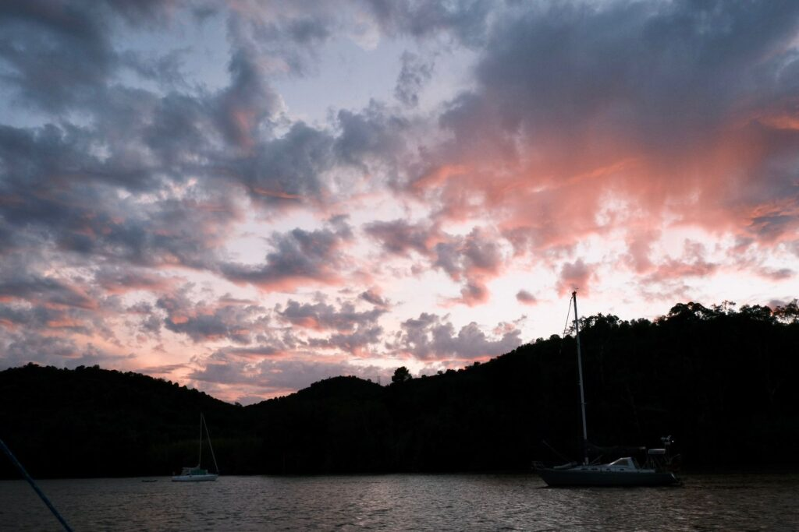

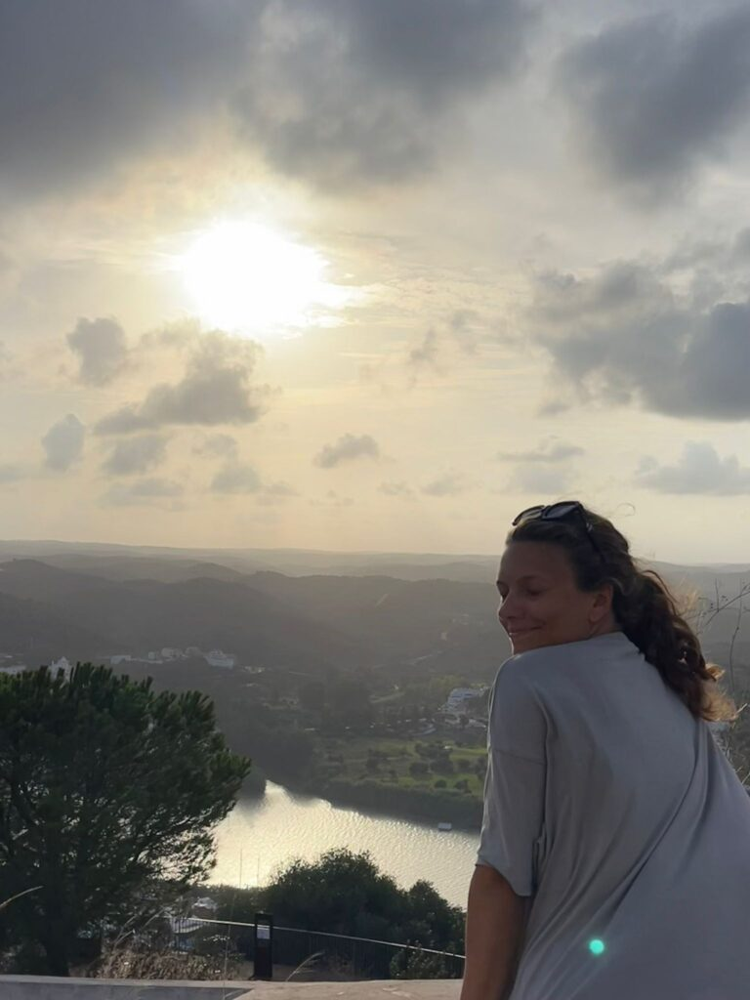

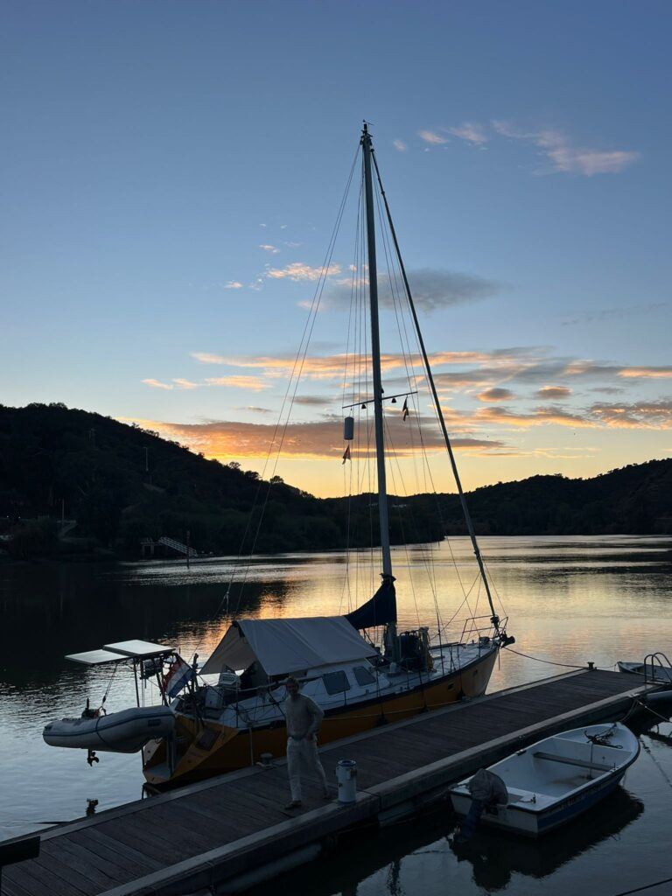

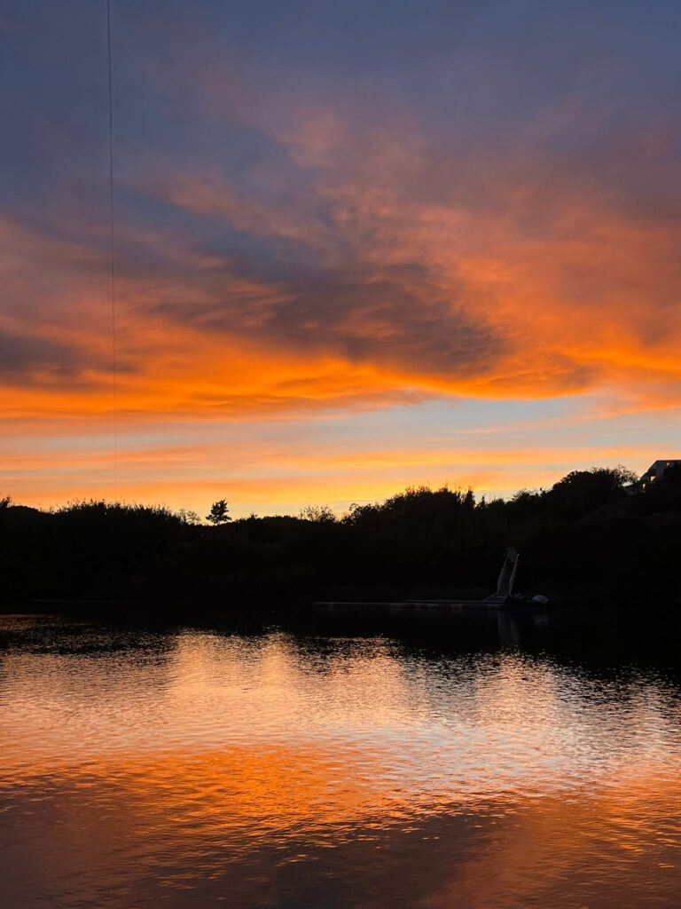

## Hoog bezoek

Na twee weken zoet is het weer tijd voor zout. We krijgen namelijk bezoek! Mama en Doeke komen ons opzoeken in Olhão. Om een goed weervenster te hebben én met een redelijk tij de havenmond uit- en in te varen, vertrekken we om 4 uur ’s ochtends. Het regent pijpenstelen en in onze regenjas manoeuvreren we *Luwte* in het donker opnieuw door de kerstlampjes heen. Het gaat stevig tekeer, en de voorheen uitgelegde factoren spelen opnieuw een rol: het is een ware heksenketel. *Luwte* springt over de golven, en duikt af en toe door eentje heen. Met geknepen billen komen we er doorheen. Zodra we buiten zijn worden de golven langer en kan de tocht beginnen. Het blijft regenen, maar om-en-om doen we een dutje en om 11:00 varen we de Ria Formosa in – een soort Portugees waddengebied.

De tijd met mam en Doek is heerlijk, voelt als een vakantie en vliegt voorbij. Het is zo fijn om ze weer even zo dichtbij te hebben, te knuffelen, en ik verbaas me er opnieuw over hoe snel je eraan went om familie om je heen te hebben. Alsof ze altijd al mee waren. Ze hebben een appartementje in Olhão en ik maak al voordat ze überhaupt zijn aangekomen dankbaar gebruik van de wasmachine. Ook de huurauto wordt goed benut: niet alleen voor een goede ronde boodschappen, maar ook voor een uitje naar Faro, en zelfs naar de westkust om te surfen. Of nou ja… Doek surft, ik verzuip bijna in de grote golven. Gelukkig levert het wat mooie plaatjes op.

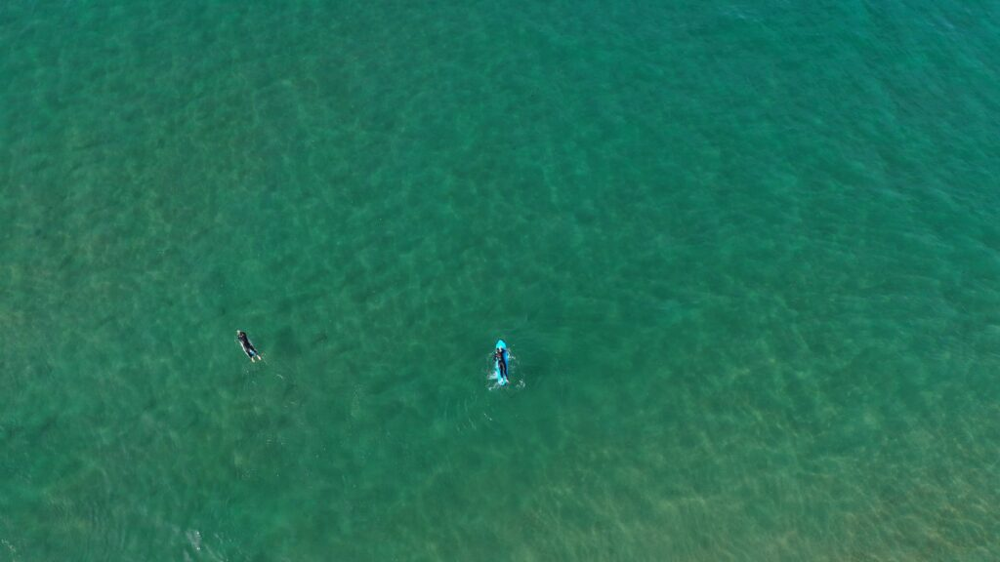

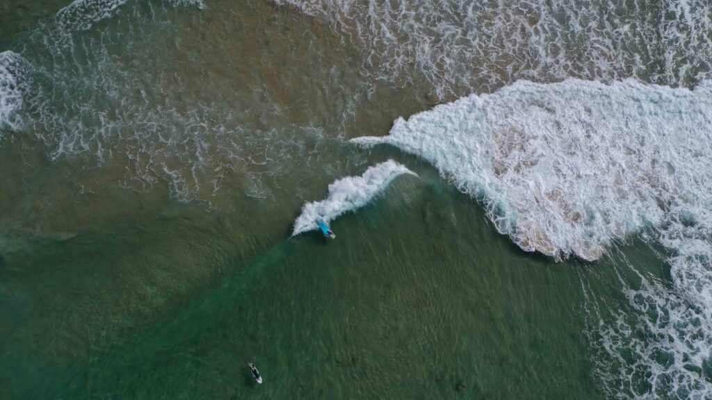

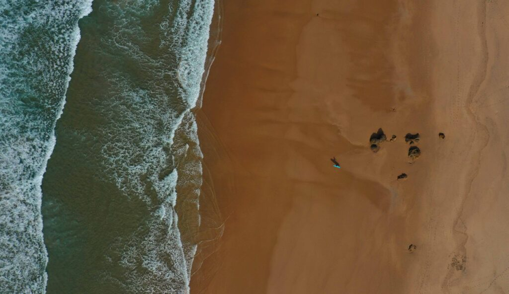

We eten, drinken, lachen, kletsen en gemchen wat af. Wat ons betreft hoort minimaal één nachtje slapen op de boot bij *the full experience*, dus wanneer het weer rustig is, maken we de boot klaar voor opstappers. We varen een stukje het waddengebied in en ankeren voor Ilha de Culatra. Met de dinghy gaan we naar het strand, we wandelen en zwemmen, en Doek doet een dutje in de hangmat. Die avond steken we de barbecue aan en drinken we ongeveer alle flessen wijn op die op *Luwte* te vinden zijn. Mam en ik zijn de baas over de playlist en ik ben bang dat de nabijgelegen boten tot laat hebben kunnen meegenieten van ons gezang. De *full experience* dus.  

De ochtend erna worden we wat brakkig wakker, en dan met z’n vieren op 11.5 meter opeens een stuk kleiner dan gister. Als ik dan ook vraag of ze hun verblijf op *Luwte* met nog een nachtje willen verlengen zegt Doek vriendelijk maar beslist “ik vond het heel leuk, maar één nachtje was genoeg.” En terecht. Rorik brengt ze door ietwat onstuimig water naar de kade met de dinghy en die avond eten we weer lekker op de kant. Het mooiste compliment van de week komt van Doek, die na een nachtje op de boot zegt dat ‘ie het inmiddels wel echt snapt, dat zeilende leven van ons.

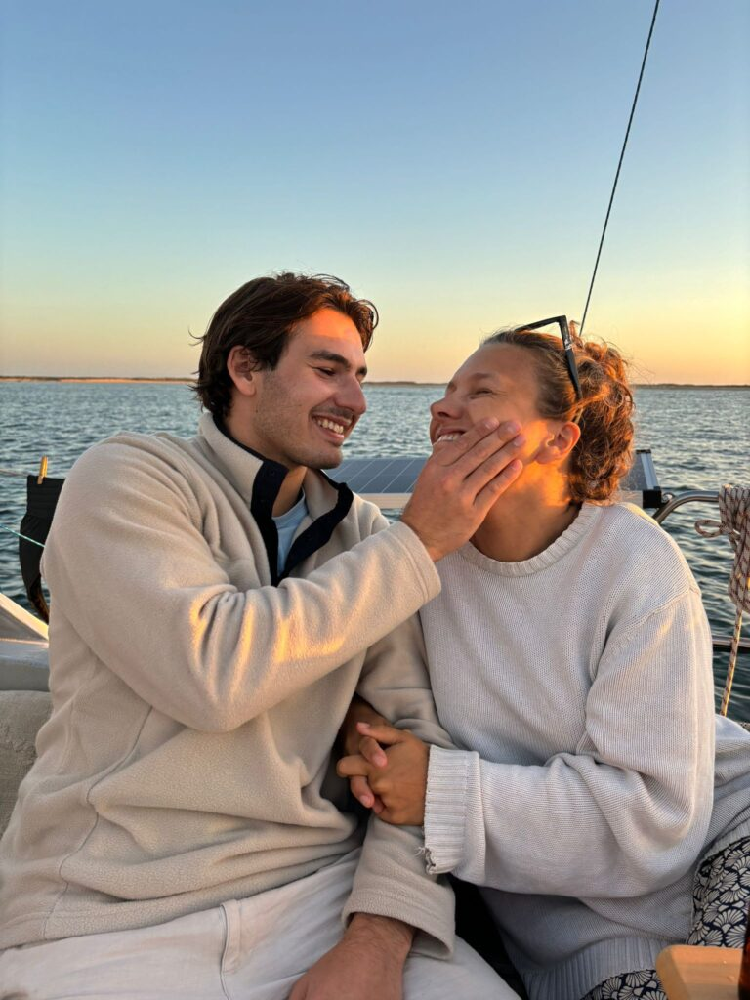

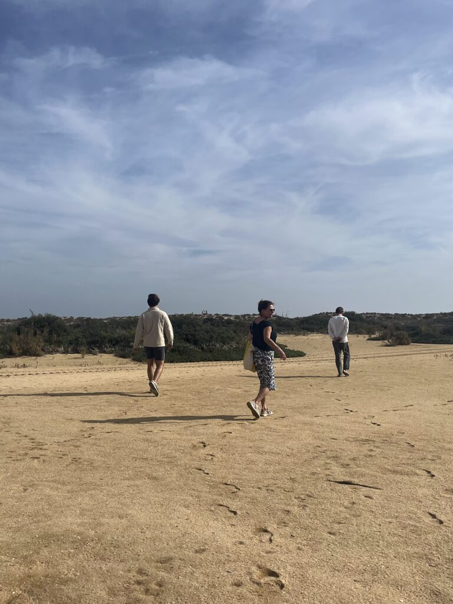

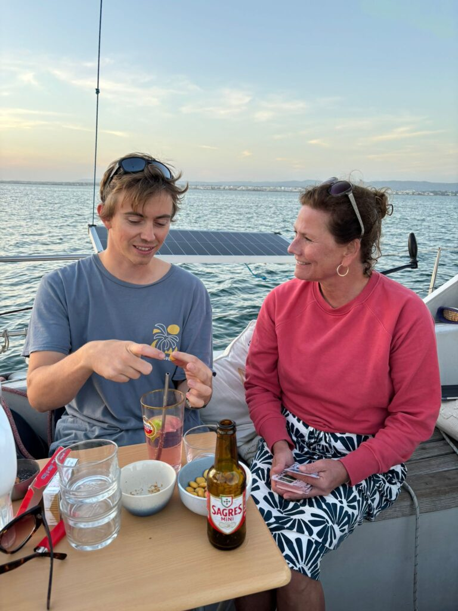

## Zeilvrienden en zenuwen

Inmiddels begint de ankerplek langzaam maar zeker gevuld te raken met boten met de bekende rood-wit-blauwe vlag. We ontmoeten de lieve Kiki en Harmen van *Square One* en hebben een warm weerzien met de *Simon Hendrick* en *Eva Kristina.* Dat verzacht gelukkig enigszins het vertrek van mama en Doek. Ons weer onderdompelen in de zeilerscommunity zorgt ervoor dat de melancholie maar een dagje blijft hangen. *Beautje* en de *Jette* sluiten een paar dagen later ook aan. De avonden vliegen voorbij: We eten gegrilde vis op Culatra, borrelen aan boord van de *Jette*, hebben een spelletjesavond op *Beautje*, en kijken het sinterklaasjournaal bij *Simon Hendrick*. We horen over elkaars eerdere avonturen, plannen voor de toekomst, leven thuis en leven aan boord.

Wat deze gezelligheid met andere boten óók verzacht, is het ongeduld. We willen naar de Canaries. Onze zonnepanelen laden niet meer vol door de lager staande zon, we hebben de Algarve (voor nu) wel gezien en hebben zin in helderblauw water om in te snorkelen. Er is een *weatherwindow* als mam en Doek vertrekken, maar dan zijn we er nog niet klaar voor. We laten ‘m voorbijgaan onder het mom dat er binnenkort vast een volgende aankomt. Maar die volgende… Die laat nog even op zich wachten. *And so the waiting game begins.*

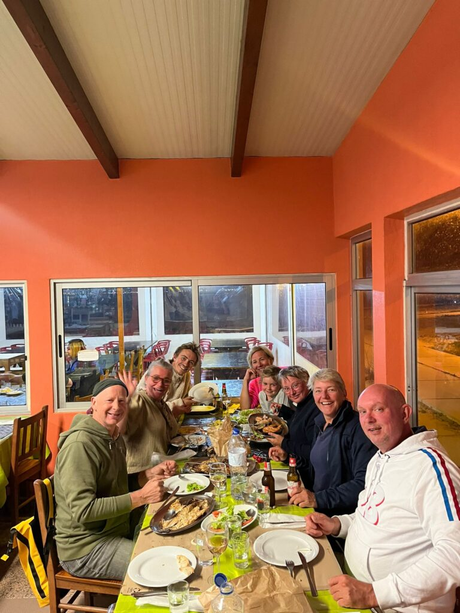

 bij Lajla & Hilda aan boord")

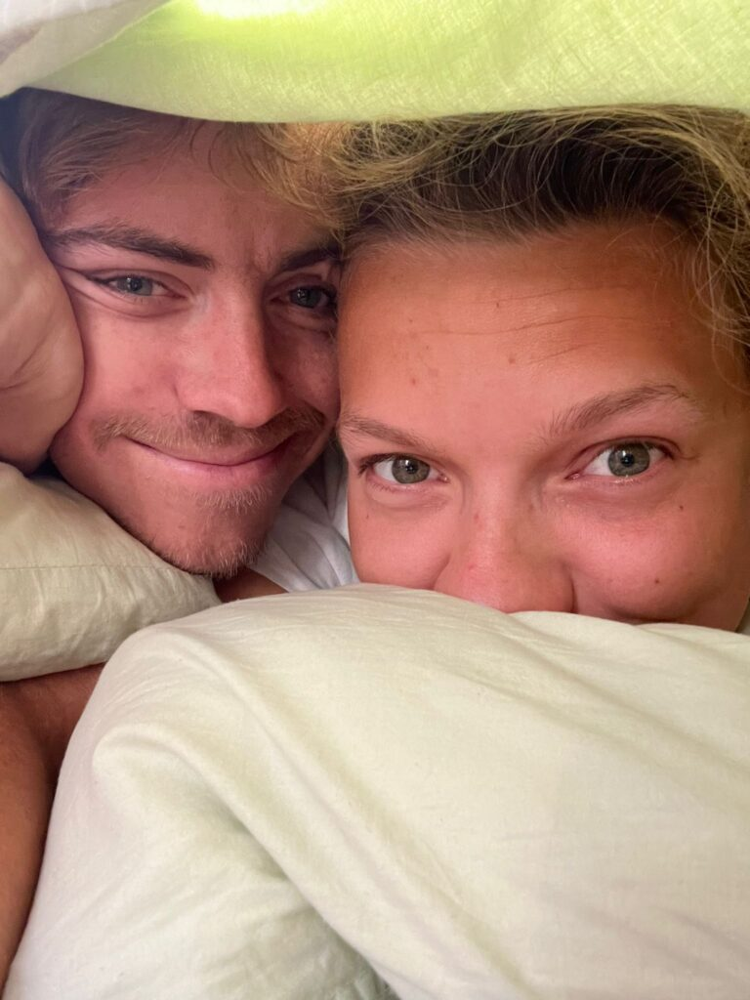
