Zo’n twee etmalen voor we Mindelo verwachten binnen te lopen spendeer ik de hele ochtend aan het op gang krijgen van *OpenCPN*. Dat is een open-source software waarmee je zelfgemaakte, of van een containerschip gevallen kaarten kunt draaien. *OpenCPN* bestaat al veel langer dan de meeste hedendaags gebruikte kaartensoftware, maar voelt door de afhankelijkheid van vrijwillige ontwikkelaars (die vaak weinig belang hechten aan interface) wat gedateerd in de omgang.

Nog voor ons vertrek uit Nederland heb ik een aantal dagen uitgetrokken om de boel te installeren en vond ik in een schemerige hoek van het internet verschillende kaarten van de gebieden waar wij doorheen zouden gaan varen. Tot en met de Canarische Eilanden hebben we primair gevaren op het moderne *Navionics* dat tegenwoordig in bezit is van Garmin en soepeltjes draait op de iPad. Deze commerciële partij heeft duidelijk wel een aantal designers in dienst gehad en hoewel *OpenCPN* een veel uitgebreider pakket aan informatie en functionaliteit omvat, is het gebruik van *Navionics* op de iPad wel héél erg makkelijk. En redelijk betaalbaar. De licenties voor een jaar lang alle Europese kaarten zijn slechts enkele tientjes. Daarvoor krijg je de papieren waterkaarten van het Markermeer nog nauwelijks rond.

Noem het Nederlandse zuinigheid, maar toen wij de Canarische Eilanden verlieten en we voor de kaart van Sao Vicente de licentie voor half Afrika moesten aanschaffen, werd onze (met name mijn) tegendraadse snaar aangeslagen en kwam onze *Navionics*\-tijd ten einde. Met ons nieuw aangeschafte *pilot* boek (die ook niet goedkoop is, maar in ieder geval wel geprint met een stukje karton er omheen) in de boekenkast besluiten we dat de haven van Mindelo ook wel aan te lopen is zonder precies te weten waar we ons op de kaart bevinden. Er zijn daar *landmarks* genoeg.

Terug naar 48 uur voor aankomst. De havenkoorts breekt uit en we komen net uit een paar dagen slecht weer. We beginnen ons op te maken voor onze aankomst na misschien wel de pittigste tocht tot nu toe en de daarbij behorende adrenaline maakt mij toch wat zenuwachtig voor het aanvaren zonder kaarten. *Sya,* waar wij al een tijdje contact mee onderhouden ligt al even te Mindelo en ik weet dat Robin en Kayleigh ook *OpenCPN* draaien. Dankzij *Starlink* kan ik ze een berichtje sturen om te bevestigen dat we inderdaad wel zonder kaarten naar binnen kunnen varen.

Op een groot rotsblok in zee dat ook duidelijk in de pilot staat beschreven - het rotsblok blijkt in het echt een flink eiland - na is er niets om ons zorgen over te maken, maar voor de zekerheid krijgen we van *Sya* nog een ander format kaarten toegestuurd met meer detail.

In de drukte van die ochtend vergeet ik om het routinematige *all-okay* bericht via onze Garmin Inreach naar de ouders te sturen. Deze werkt ook apart van *Starlink* en is deze overtocht gepromoveerd van back-up tot primair *tracking device*, omdat we met één druk op de knop onze positie en status kunnen doorgeven. In de praktijk starten we daarna de *Starlink* alsnog op om het weer op te halen en volgt er kort daarop een *WhatsAppje* met een korte update van de dag en/of de nacht.

Deze ochtend dus niet. Ik was me er niet van bewust dat deze routine sinds ons vertrek vanaf La Palma zo punctueel door ons werd uitgevoerd. Vier bezorgde ouders halen hun hart op als we dan toch een uur of anderhalf later dan normaal laten weten dat alles goed is. De dagen daarvoor blijken we tweemaal per dag binnen een marge van dertig minuten onze berichten uit te sturen, altijd direct na de wisseling van de ochtend- en avondwacht, maar daar komen we dan pas achter..

Het is een delicate balans tussen verbinding met thuis en het hier en nu, zowel voor ons, als het thuisfront dat met ons meeleeft. Het is voor ons gelukkig helemaal geen straf om veel in contact te zijn met onze ouders, maar dit soort momenten stellen wel op de proef wat wij willen en hoe we daar mee omgaan. Voor nu laten we het even zoals het is. We hebben nog genoeg zeemijlen voor de boeg om na te denken over nieuwe routines.

## **Mindelo**

*(spreek uit Min-dèh-lo)*

Met het ochtendgloren roep ik het *Land in zicht!* uit. De windstilte is door de zuiging van de eilanden verdwenen en een rustige bries zorgt ervoor dat we de laatste twee uurtjes nog even kunnen zeilen. Tussen de eilanden door aanschouwen we een episch en stekelig landschap, alsof er dinosaurus-rug-vinnen boven het wateroppervlak naast ons omhoog komen. Het is even zoeken welke ingang we bij de haven precies moeten nemen, maar als we de laatste pier voorbij varen zien we op de rede van Mindelo de bootjes voor anker liggen met daar achter de haven. Zodra die in zicht komt worden we verwelkomd door het zoemende geluid van *Sya’s* drone, die met ons meevliegt naar binnen en onze aankomst bijzonder vastlegt.

<figure class="wp-block-image size-large">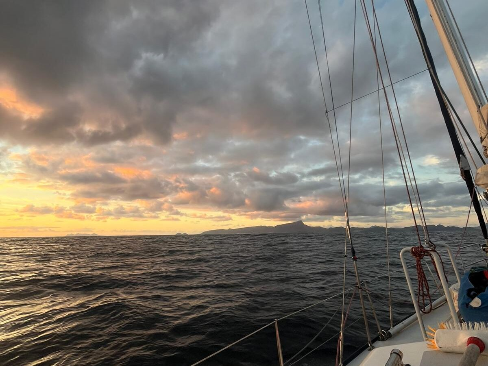<figcaption class="wp-element-caption"><em>Land in zicht!</em></figcaption></figure>

Op instructie van de havenmeester leggen we de boot even vast bij de dieselpomp, voordat we een plekje toegewezen krijgen. De assistent-havenmeester spreekt Engels, maar in een andere taal. Hij gebaart ons naar een steiger, maar blijkbaar hebben we het allebei verkeerd begrepen. Tot tweemaal toe daarna worden we met veel gebaar en geroep ergens anders naartoe verwezen, maar uiteindelijk mogen we tussen twee andere boten in naar binnen draaien. Het is onze eerste ervaring met het beruchte *med-mooring*, dat zijn naam heeft verworven in de Middenlandse zee. Ter optimalisatie van de ruimte worden er geen vingersteigers gebouwd en lig je niet direct aan de steiger, maar parkeer je recht achteruit (of vooruit) in naar de kade en wordt je boeg met een anker of ankerboei op zijn plaats gehouden. Wij varen achteruit naar binnen met de wind op de kont. Het gaat allemaal goed, maar ik zie windvaan *Doris* akelig dichtbij de steiger komen. Zodra we liggen wordt ze ontheven uit haar functie en van onze achtersteven verwijderd om mogelijke schade te voorkomen. Daarna is het tijd voor bubbels. We jubelen van deze aankomst. Een nieuw continent, een nieuwe cultuur en nieuwe avonturen. De zwaarte van de dagen ervoor balanceert zich weer uit met de euforie die we voelen als we op de steiger staan en zien hoe *Luwte* vastgeknoopt ligt aan het continent Afrika.

## **Feest en werk**

Half dronken spuiten we de boot af en maken we schoon schip. Daarna duik ik nog even ons vers opgemaakte bed in om een paar uurtjes bij te halen. Jen stelt onze vrienden en familie op de hoogte van onze aankomst. Het is eerste kerstdag en we zijn uitgenodigd bij *Sya*, die in de baai voor anker liggen, om daar ons kerstmaal te komen verorberen.

Omdat we toch al van plan zijn zelf ook voor anker te gaan gaat de bijboot van het voordek en hangen we de motor er weer achter. Dat is alweer even geleden! We roetsjen naar de rode schuit en worden onthaald met Glühwein, lamsbout en in bacon gerolde dadels. Tussendoor is het even spannend als de olie in de oven vlam vat en alles blauw komt te staan. Brand aan boord is een serieuze zaak, maar Robin blijft koel en weet de lucht te onttrekken en de olie te koelen. Er valt daarmee een gerecht in het water, maar het kan onze pret niet drukken.

<figure class="wp-block-image size-large">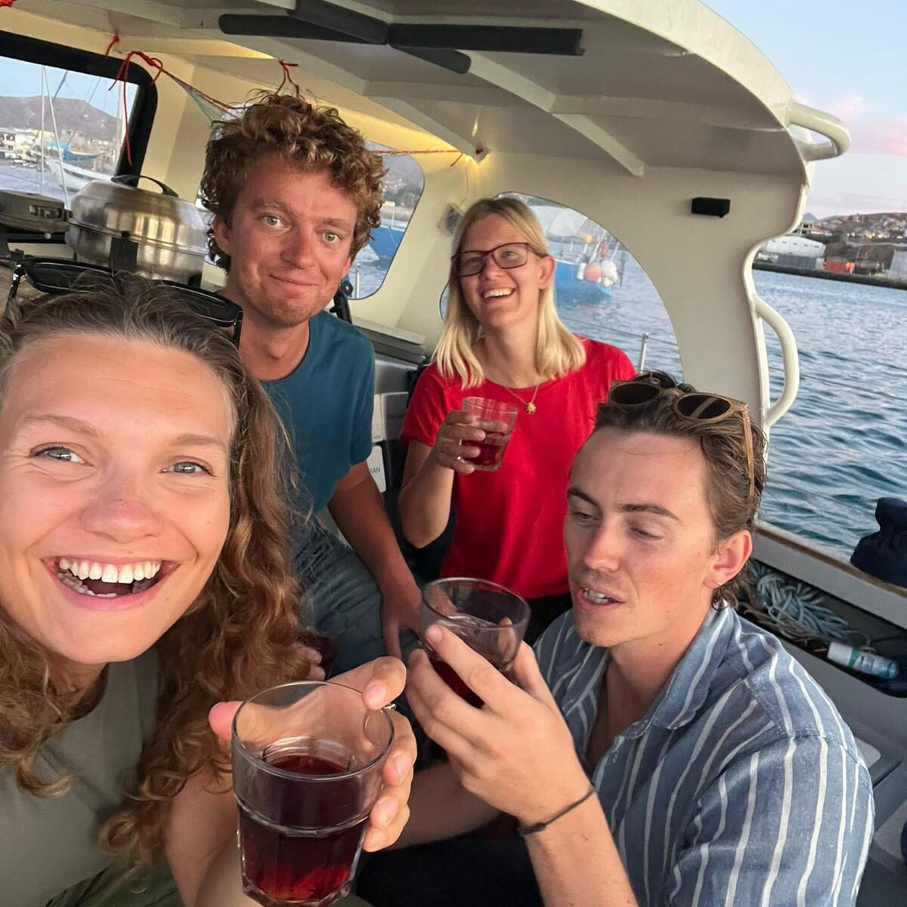<figcaption class="wp-element-caption">Eerste kerstdag aan boord bij <em>Sya</em> inclusief glühwein!</figcaption></figure>

Tweede kerstdag wandelen we met Robin en Kayleigh het leuke Mindelo door. Ze laten ons alle ins- en outs zien van deze bruisende stad. Een heerlijke landing zo, als je meteen je weg weet te vinden. Dat kost ons normaal zeker een dag of vier. Op “markten” die door de hele stad op elke straathoek en plein te vinden zijn wordt een beperkt assortiment aan groenten en ongekoelde vis in emmers tentoon gesteld. In de “vrieswinkel” die bestaat uit een rij vriezers met vlees, vis en kip, zien we hoe de winkelmedewerkers met mutsen en dikke parka’s de binnentemperatuur van zo’n 15 graden Celsius trotseren. Wij slenteren lang heen- en weer om even af te koelen…

Onze eerste geldopname is wat minder florissant. Het lokale CVE heeft een conversie van zo’n 1 tegen 100 en we voelen ons dan ook rijk als we er 20.000 van willen opnemen om de komende weken mee door te komen. De machine geeft keurig de creditcard terug en begint te ratelen. En te ratelen. En te ratelen. Na een minuut begint de dame achter ons een beetje geïrriteerd mee te kijken waarom het zolang duurt. Ze haalt een bankmedewerker erbij die in het Portugees iets onbegrijpelijks uitlegt. Ze vertaalt dat de automaat vaker kuren heeft, maar belooft het geld terug in de automaat te duwen als het er alsnog uitkomt en dat wij beter onze tijd ergens anders kunnen besteden.

Na wat een eeuwigheid later voelt en in werkelijkheid twee minuten is, stopt het ratelen en loopt de machine vast. Daarna valt het scherm uit en zien we de machine herstarten. Het welkomstscherm vraagt om onze pas in te steken om de transactie te starten… We nemen wat foto’s en hopen op het beste. De zaak is inmiddels in behandeling..

De financiële tegenvaller kan onze pret niet drukken. Jen huppelt letterlijk jubelend over straat. De cultureel antropoloog in haar viert hoogtijdagen en zuigt alles op wat we tegenkomen. Van de douaneambtenaar die ons zo’n twintig minuten aan zijn bureau laat zitten omdat een vriend belde, tot het onderhandelen met de vrouwen op de markt. Ik ben een wat simpele ziel die al gauw tevreden is met een boot onder mijn kont, terwijl Jen nu *echt* voelt dat we op een grote reis naar verre oorden zijn. Het is dan ook aan Jen te danken dat we zo nu en dan het avontuur weten te vinden.

Een volgend hoogtepunt is de vondst van een nieuwe *vouwemmer*. Een pareltje van de *Action* waar we er achteraf misschien wel twee of drie van mee hadden moeten nemen. Geheel in lijn met de meeste producten van deze winkel begon het flexibele plastic na voldoende gebruik als opvangbak van dieselig water en eindeloos in- en uitvouwen te scheuren. Al sinds Cascais lopen we elke winkel die het zou *kunnen* hebben binnen op zoek naar een nieuwe. En hier, bij een *Fragata* te Mindelo ligt er eentje in de schappen. Hij mag dan een beetje te duur zijn, maar we praten het goed naar onszelf door te zeggen dat we nog niet zo goed zijn in het doorrekenen van de wisselkoers en denken er een nulletje af.

’s Avonds wandelen we over de steiger naar *Belafonte*, waar de inmiddels in ons hart gesloten Julien en Pieter de tweede-kerstdag-borrel organiseren. Het blijft bij sommige schepen verwonderlijk hoe de juiste balans in verhoudingen een totale flop, of top kunnen creëren. Soms zie je schepen binnenvaren die zo uit proportie zijn dat ze er meer uitzien als woonarken met een mast er op. De *Belafonte* heeft het tegenovergestelde. Met slechts 10.5 meter behoort het schip tot de kleinere oceaanpassanten, maar als je voor, op, in of naast *Belafonte* staat denk je er zo anderhalf tot twee meter bij. We zitten die avond dan ook met zo’n veertien man in hun behoorlijk ruime kuip gepropt en drinken tot we er omstebeurt bij neervallen. Onze ijsblokjesmachine draait bij ons aan boord op volle toeren en ik ga eens per uur op missie om die te legen in een wijnkoeler. De zak wijn die bij ons al een tijdje meegaat omdat hij moeilijk te drinken is, wordt met veel gejuich onthaalt als het bier op is. De volgende dag heeft iedereen er een zwaar hoofd van..

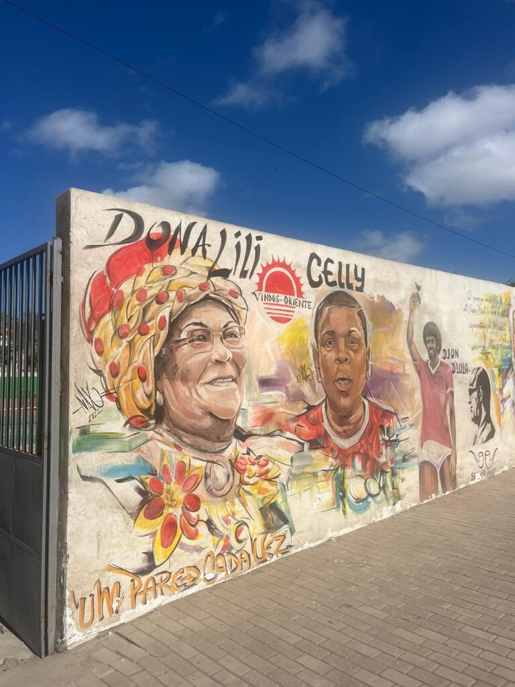

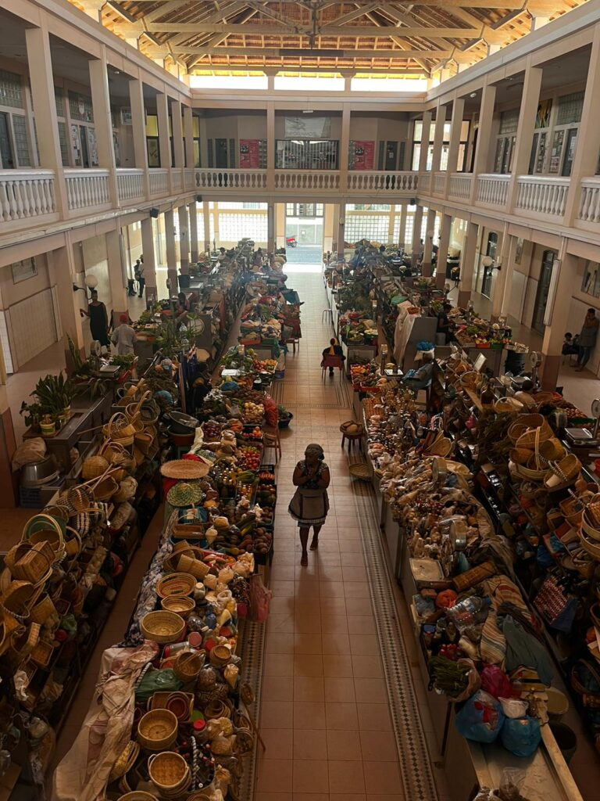

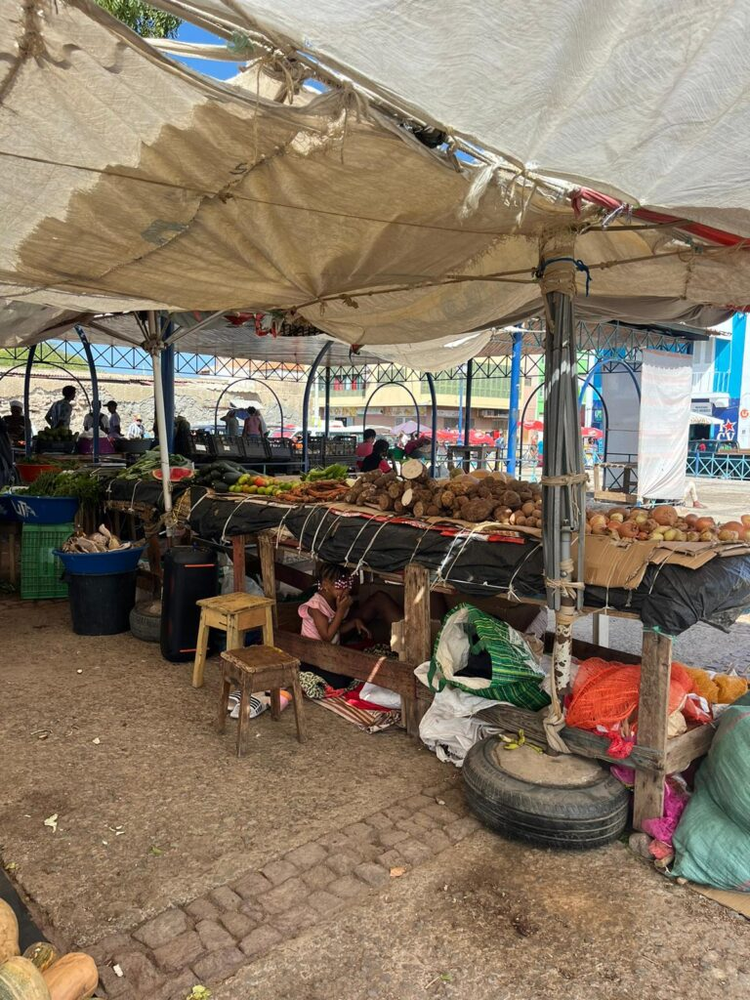

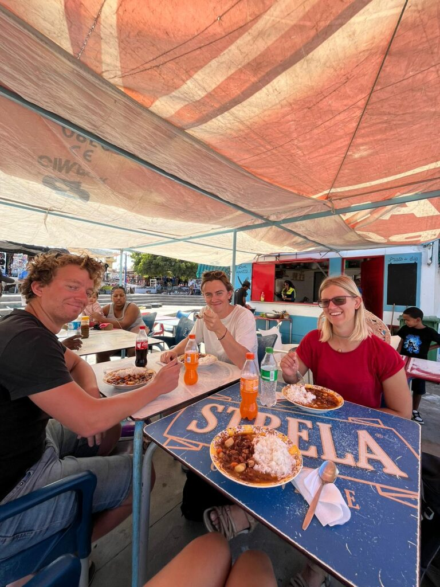

<figure class="wp-block-image size-large">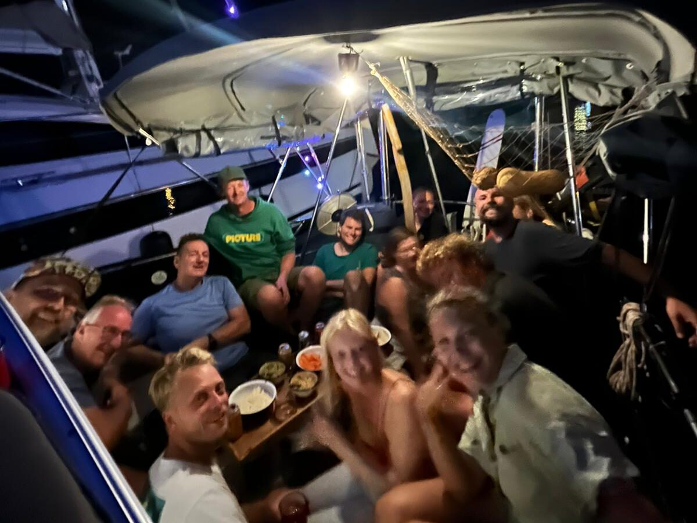<figcaption class="wp-element-caption">Tweede kerstdag aan boord bij <em>Belafonte</em></figcaption></figure>

Na twee dagen begint de haven, zoals altijd, te veranderen in een stinkhaven. Dat is in ieder geval hoe we dat aan boord van *Luwte* benoemen. We hebben het niet zo op havens en liggen liever achter ons anker. De watertank is gevuld, de boot ontzilt en de accu’s zitten vol. Bovendien tikken havendagen hard op de beurs de laatste tijd. In plaats van ons eigen anker uit te gooien, laten we de stootbillen aan bakboord nog even hangen en varen we naar *Sya.* Tijdens het kerstdiner is het plan gesmeed om langszij te komen liggen en samen een paar klussen van *Luwte* op te pakken. Jen en Kayleigh ontfermen zich over de nieuwe bekleding voor onze kussens achter de naaimachine en ik en Robin starten het project om de langwerpige planken die als noodschotten voor de ramen zijn meegenomen, om te toveren tot daadwerkelijk bruikbare planken. Anderhalve dag later hebben we binnen schaduw, nieuwe hoezen om de banken en een verlanglijstje dat is aangevuld met een zware naaimachine en 3D-printer voor een volgende reis.

De volgende ochtend nemen we afscheid van *Sya*. Robin en Kayleigh varen voor ons uit richting de Carieb. Het is de vraag of we elkaar nog gaan tegenkomen, maar het afscheid onder zeilers is altijd lichtvoetig, want je weet nooit waar de wind heen blaast en voor hetzelfde geld lig je over een paar weken weer naast elkaar in een baai onder de tropische zon. Met de drone film ik *Sya*’s vertrek, net zoals zij onze aankomst filmden en dromen Jen ik alvast een beetje vooruit naar onze eigen oversteek. Voor dat zover is staat ons nog een lange kluslijst te wachten…

<figure class="wp-block-image size-large">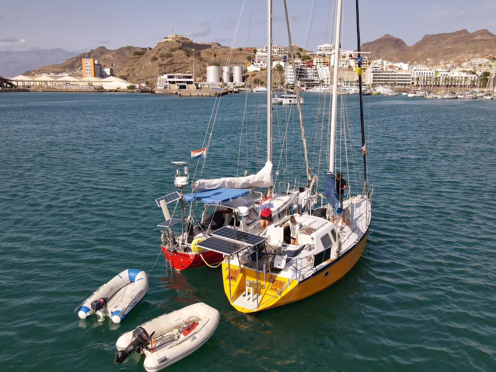<figcaption class="wp-element-caption"><em>Sya </em>en <em>Luwte</em> samen achter anker om te klussen</figcaption></figure>

<figure class="wp-block-image size-large">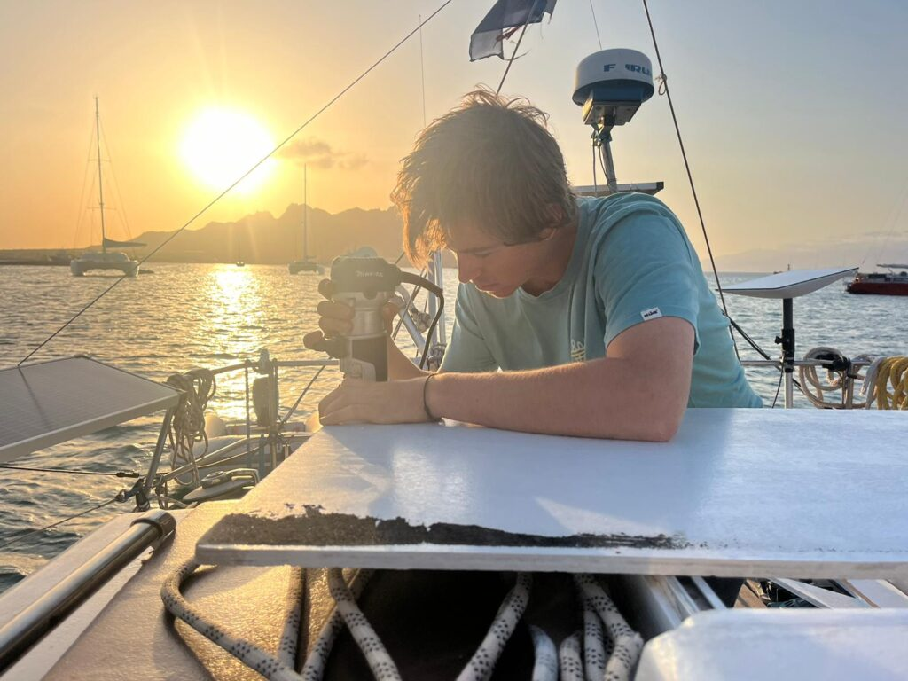<figcaption class="wp-element-caption">Zoals Robin mooi zei: Je moet niet vergeten af en toe te kijken <em>waar en hoe</em> je aan het klussen bent</figcaption></figure>

Die kluslijst voelt dubbel zo lang en dubbel zo vervelend als andere klusintermezzo’s die we tot nu toe hebben gehad. Dat komt met name doordat we La Palma hadden bestempeld als haven om *Luwte* klaar te stomen voor de oversteek. Daar is niets van terecht gekomen. In tegendeel, de lijst is alleen maar langer geworden door ons verblijf daar. Resultaat daarvan is dat het voelt alsof we al bijna drie weken in klusmodus zitten, maar dat er nog niets gelukt is. Het project om de kikkers weer in het dek te krijgen met een constructie die sterker is dan voorheen sleept voort en bevat heel veel stappen met epoxy, uithardtijden, schilderwerk en nog meer uithardtijden.

Met name Jen voelt de tijd hier te Mindelo aan boord tussen haar vingers door sijpelen. Daarom besluiten we 30 december, zonder kikkers, het anker te lichten en naar buureiland Santo Antao te varen, waar Maud en Joris van *Jonathan* ook ten anker liggen. Het wordt ons eerste tochtje ‘voor de fun’ sinds vertrek en even voelen we alsof we er tussenuit zijn op het Markermeer. Er staat een stabiele 3-4 passaat en nauwelijks deining. *Luwte* ligt onder vol tuig op één oor op haar rompsnelheid en tevreden zitten we in de zon om ons heen te kijken. Het tochtje van zo’n anderhalf uur laadt onze batterij weer helemaal op. In het schattige ankerbaaitje liggen we nét buiten de deining in kristalhelder water. ’s Avonds eten we bij *Jonathan* aan boord heerlijke vegetarische lasagne en spelen we *Hitster*. 

De volgende ochtend worden we fris wakker en dartelen nog even rond de boot in het water. Daarna beginnen we aan het laatste stadium van de kikkers: De draad tappen voor de inmiddels verzwaarde M8 bouten. Ik laat Jen zien hoe dat werkt en overhandig het tapsetje. Het zijn van die taakjes waarbij ik dankbaar gebruik maak van de perfectioniste in Jen. Met veel zorg en aandacht worden de voorgeboorde gaatjes door mevrouw voorzien van draad. Echter, na 6 van de 24 gaatjes begeeft het tapsetje het en moeten we stoppen. Gelukkig breekt de tap niet en ligt het aan de houder. Daar moeten we dus een nieuwe voor zien te scoren, maar dat wordt iets voor het nieuwe jaar. Iets met goedkoop en duurkoop sluipt door ons achterhoofd. Tegelijk met *Jonathan* lichten we even later het anker en draaien we de boeg naar Mindelo. We varen bijna precies even hard en besteden het grootste deel van de tocht aan het schieten van foto’s van elkaar.

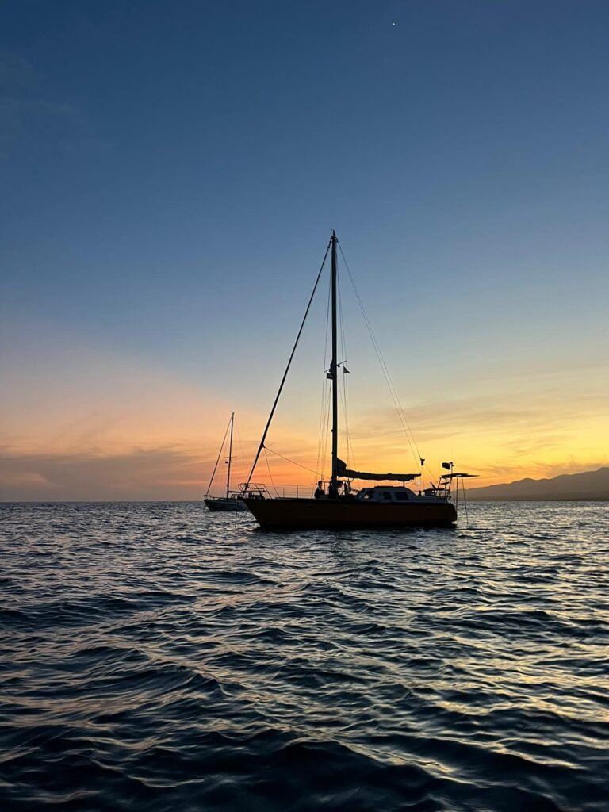

<figure class="wp-block-image size-large">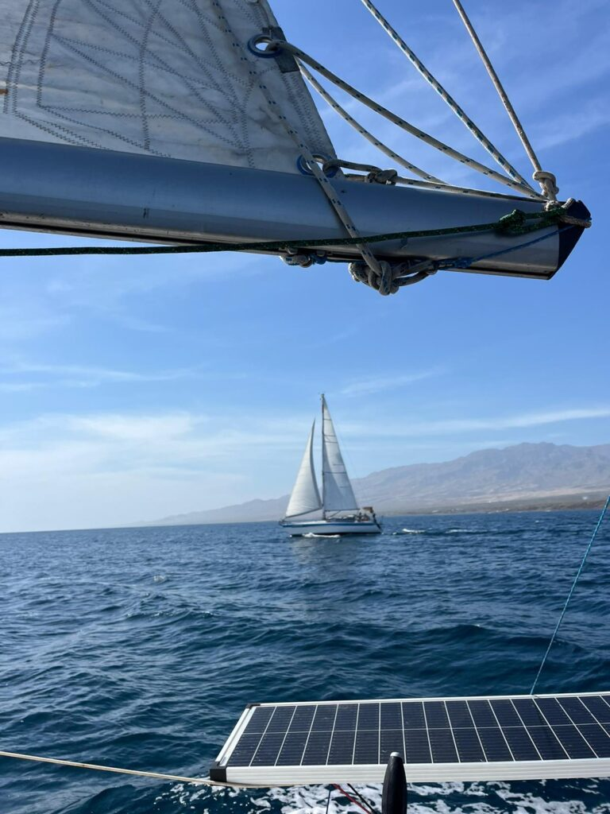<figcaption class="wp-element-caption">En varen samen met <em>Jonathan</em> weer terug naar Mindelo</figcaption></figure>

Terug achter anker in Mindelo begint de oudjaars-stress bij mij toe te slaan. Er is één ding dat mij niet zal ontvallen bij deze overzeese jaarwisseling en dat zijn oliebollen. De uit Nederland meegebrachte rozijnen zijn al in eerdere lekkernijen verwerkt, maar uit een zakje borrelnootjes weten we toch verbazingwekkend veel rozijnen te plukken. Aangevuld met in stukjes gesneden dadels gaan ze in een bad van Whisky, bij gebrek aan rum. Spaans bloem, Nederlands gist en een geheime cominatie van soya- haver- en hazelnootmelk maken de pap die straks moet worden omgetoverd in lekkere oliebollen. Op hoop van zege…

Met het vallen van de avond bel ik mama om trots te laten zien dat haar oliebollentraditie ook op de Kaap Verden wordt voortgezet. We wensen elkaar alvast een gelukkig uiteinde en ontvangen dan mondjesmaat de *Jonathan, Sunset* en *Belafonte* bij ons aan boord. Het tempo van de gin-tonics ligt hoog, de ijmachine blaast en we blèren mee met de laatste nummers van de Top 2000 op het laatste restje 4G-bundel van een van onze gasten. De klok slaat 22:00 als we aftellen tot nieuwjaar, waarna we ons even afvragen of we op dit tempo het nieuwjaar van Mindelo wel gaan halen. De oliebollen vallen goed in de smaak en worden geprezen als *yuppenbollen,* *perfecte minibollen* en andere exotische termen.

Het nieuwe jaar wordt feestelijk ingeluid door een grote vuurwerkshow die door de overheid wordt georganiseerd. Zeker tien à vijftienduizend mensen staan op de kades om dit *in doodse stilte* te aanschouwen. Gelukkig wordt ons luidruchtige gejoel direct na het einde van de vuurwerkshow overstemd door de enorme stereotorens die door de stad heen geplaatst zijn. Het is een soort koningsdag. Op straat wordt gedanst en gefeest en Jen laat zien dat er nog een restje Afrikaans bloed door haar aderen stroomt. Of de dames en heren om ons heen dansles aan Jen geven, of juist krijgen staat nog altijd ter discussie…

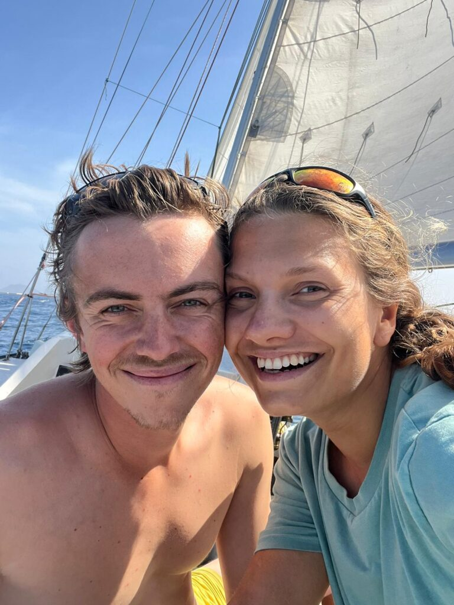

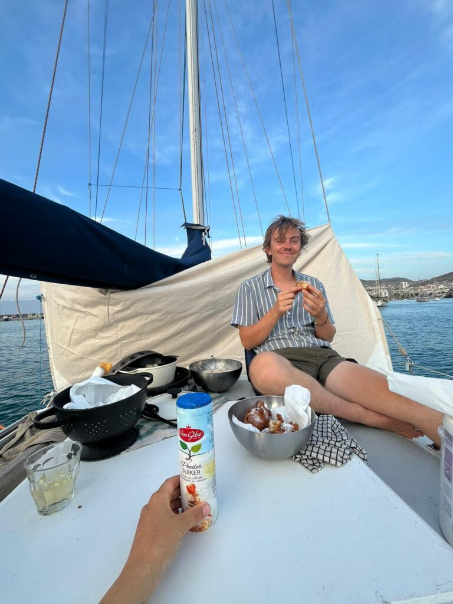

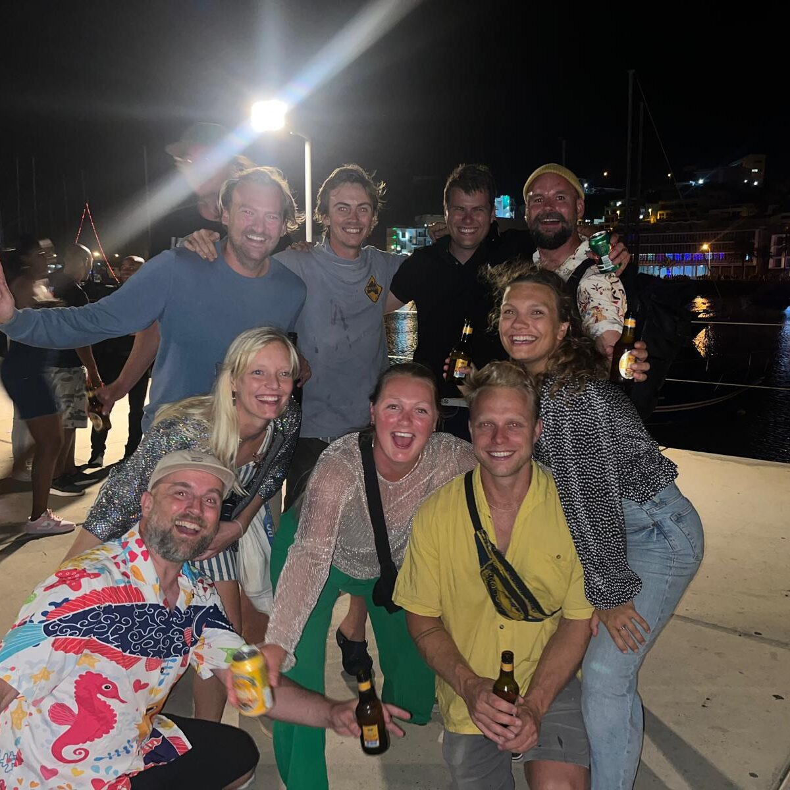

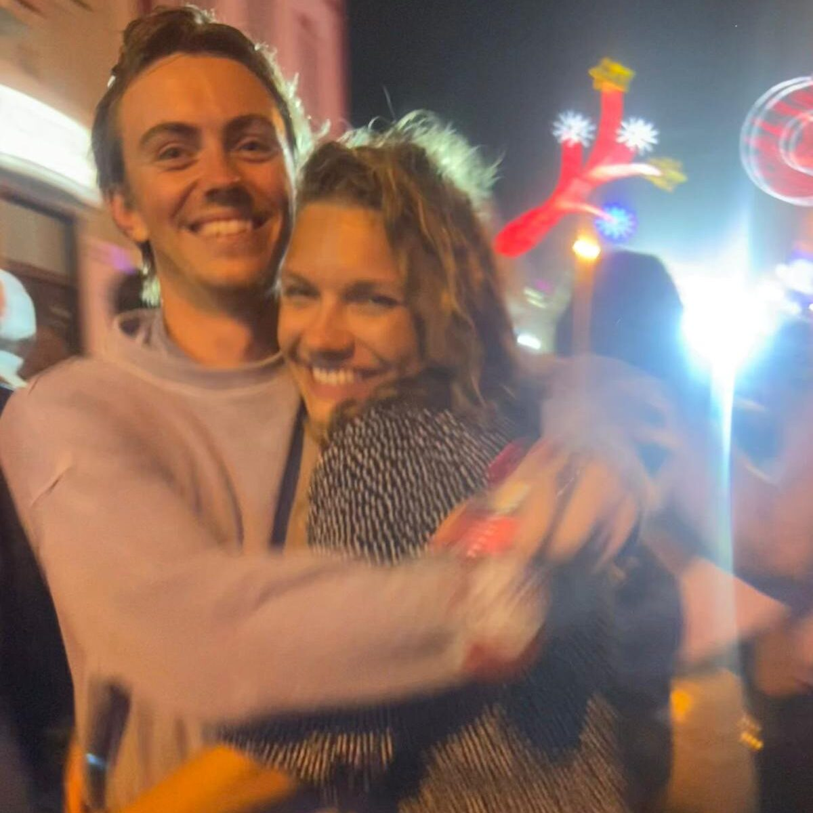

Het nieuwe jaar luiden we katerig in. Het grieperige gevoel van gisteren zet door en kan ik niet meer wegmoffelen met wat extra paracetamol. Het is tijd om eventjes mannengriep te ondergaan. De dagen die volgen lig ik plat op bed en moet Jen de kikker-klussen alleen afmaken. We scoren wel nog een nieuwe tapset bij de lokale bouwwinkel. Een mooi, met de hand gemaakt exemplaar dat een stuk zwaarder aanvoelt dan het standaardkitje van de Hornbach. Jen maakt de draad af en we monteren de kikkers, daarna duik ik weer in bed en offert Jen haar waterverfpenseeltjes op om ook het lakwerk weer in picobello staat te maken. Drie weken en heel wat hoofdpijn verder kunnen we La Palma van ons afschuiven en staan de kikkers, sterker dan ooit, weer aan dek.

Op de dag dat ik me beter voel gaat Jen ten onder. Gelukkig is het mannengriep en daar zijn vrouwen een stuk minder gevoelig voor en kan ik de verzorgmodus meteen overpakken. Jen is er twee dagen later zo goed als helemaal boven op. Wat ons beiden rest is een ratelige kuch en kriebel in onze keel die nog tot ver op de Atlantische Oceaan zal blijven hangen.

Met onze gloednieuw geplaatste kikkers varen we de haven weer in om onze laatste klussen af te maken en *Luwte* klaar te stomen voor de Atlantische oversteek. Jen klimt de mast in en controleert alle vallen en verstaging op mogelijke slijtage, binnen ontploft alles voordat alle spullen in *zeestand* kunnen worden opgeborgen. Één van onze lieren loopt niet meer lekker en na die volledig uit elkaar te hebben gehaald blijkt een heel klein veertje een afgebroken pootje te hebben. Met weinig moed trekken we Mindelo weer in op zoek naar een vervanger. Uiteindelijk kunnen we bij de bootwerkplaats terecht. Ze hebben ze niet liggen, maar kunnen ze wel namaken. Het kost wat, maar een paar uur later hebben we zes nieuwe veertjes en kan de lier weer in elkaar gezet worden. Zo rommelen we door richting ons geplande vertrek. Terwijl we de to-do’s afstrepen wordt de lijst net zo snel weer langer en er lijkt geen eind aan te komen, maar we zijn allebei heel ontspannen en kijken vooral uit naar deze lange overtocht.

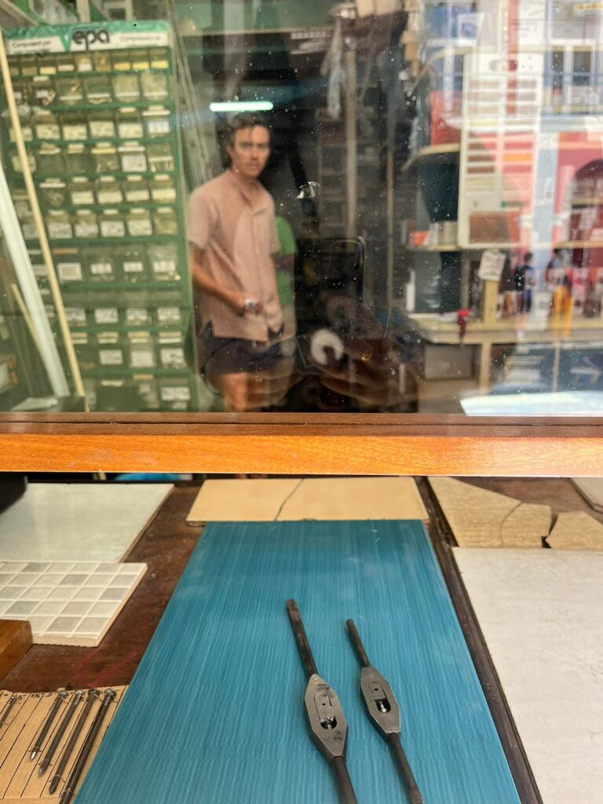

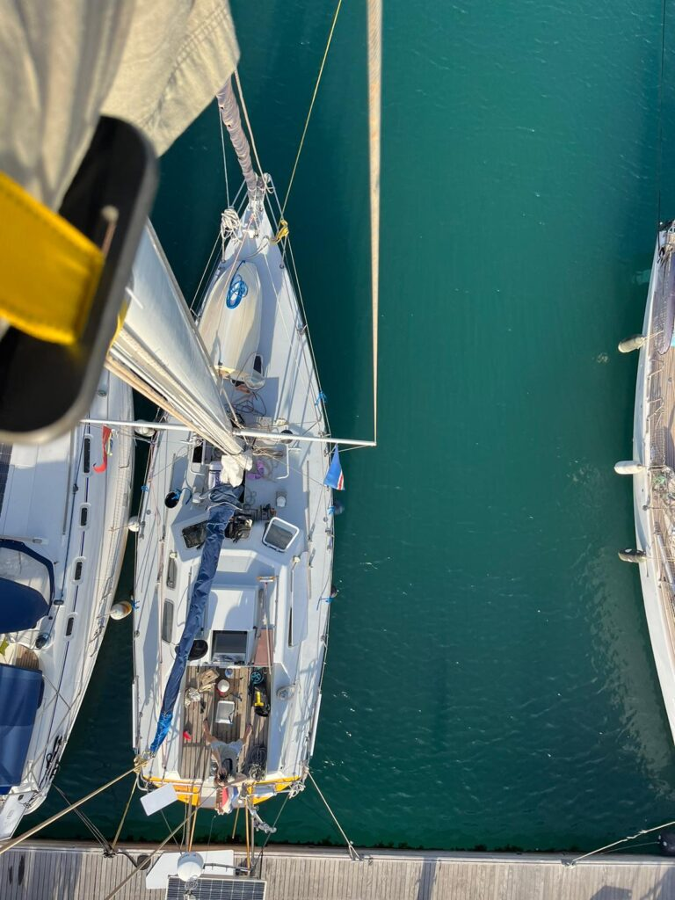

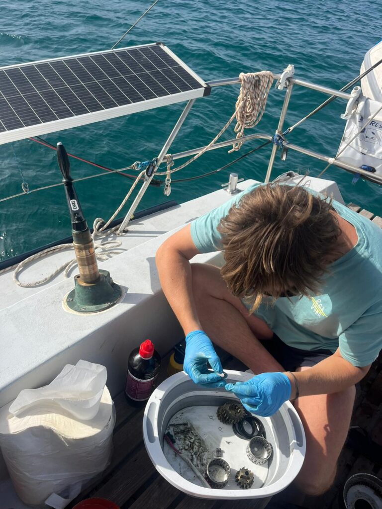

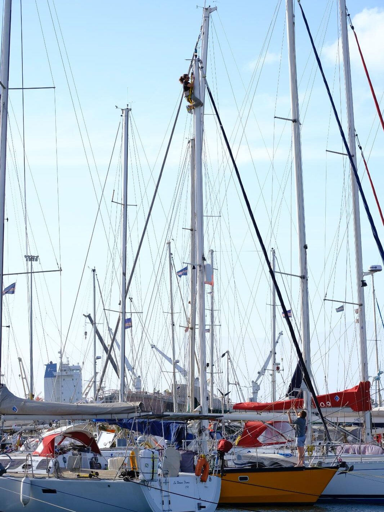

Tijdens het wegwerken van de lijstjes boekt Jen op buureiland Santo Antao een hostel voor twee nachten. De verhalen die we van onze buren hebben gehoord over dit eiland zijn magisch en we vinden dat we nog te weinig hebben gezien van de Kaap Verden om alweer verder te varen.

We gaan op vakantie. Een begrip dat misschien een beetje gek klinkt vanaf de zijlijn. De vraag *jullie zijn toch eigenlijk op een hele lange vakantie?* Is er eentje die lastig te beantwoorden is, simpelweg omdat het slecht over te brengen is wat we aan het doen zijn. Galicië en de Spaanse Ria’s voelde echt nog als vakantie, maar al vóór de grens van Portugal ging die sensatie geleidelijk over in “leven”. Ik denk dat we doorgerekend meer dan de helft van onze tijd besteden aan basisbehoeften als boodschappen doen, de was doen en de boot onderhouden. Binnen wat rest moeten we vaarplannen maken, daadwerkelijk zeilen, formaliteiten afhandelen en onderhouden we onze sociale contacten hier en aan het thuisfront. Er blijft al met al maar weinig tijd over die echt voelt als “vakantie” of vrije tijd en dat vinden we ook helemaal niet erg, maar naar deze kleine nieuwjaarsvakantie kijken we al een tijdje reikhalzend uit…

# POSITION REPORT ATL 2

14°24.093N, 29°38.072W

Terwijl we de balans opmaken van onze tijd op de Cabo Verdes, zijn we ruim onderweg op onze overtocht de grote plas over. De eerste dagen waren onstuimig, niet qua wind, maar wel qua zee. Kruisende zeeën rond de eilanden maakten dat *Luwte* alle kanten op geslingerd werd. Goed in je ritme komen is dan wat lastig.

De tweede ochtend hebben we ons laatste contact gehad met *Belafonte*, niet lang daarna verdwenen zij als laatste stipje van de AIS en sindsdien hebben we geen scheepvaart meer in onze nabije omgeving. Het onstuimige water heeft ons bijna twee etmalen in een passieve status gehouden, horizontaal met af en toe een hoofd naar buiten op zoek naar lichtjes. Ik heb voor het eerst een zeeziektepil genomen en daarna heerlijk geslapen.

Sinds gistermiddag zijn we ingeslingerd en is het leven aan boord begonnen. De golven zijn lang en rustig, schuin van achter. De zee groots en eindeloos. Het zonnetje schijnt en op dit stuk van de oceaan komen *squalls* nog zelden voor. Wel hebben we na een week of drie weer strakblauwe lucht af en toe een wolk aan de horizon.

Vanochtend is de fok ingewisseld voor de grotere gennaker die ons mooi rond de vijf knopen gemiddeld weet te houden. We zitten in de zon, lezen boeken en kijken 's nachts een film. Geheel in lijn met de traditie van 17 jaar geleden zijn we begonnen aan het op *repeat* kijken van *Cars*. Destijds hadden we slechts enkele DVDs mee die we alledrie leuk vonden en een beperkt aantal minuten per dag dat er op auto-dvdspelers gekeken mocht worden. Van deel één zijn inmiddels de eerste zinnen weer vers in mijn geheugen. Tegenwoordig zijn er ook nog een deel twee en drie, dus voorlopig zijn we wel even zoet.

<figure class="wp-block-video"><video controls="" src="/wp-content/uploads/2025/01/Video-van-WhatsApp-op-2025-01-15-om-14.07.09_a3f7c9d9.mp4"></video></figure>

Het ziet er naar uit dat we de komende dagen dit rustige weer de goede kant op aanhouden en dat de wind daarna iets aantrekt. We gaan het zien, omkeren is al geen optie meer, dus we zullen toch echt naar de overkant moeten.

Ter herhaling, via onderstaande link wordt elke vier uur onze positie doorgegeven. Over stand-by:

[https://share.garmin.com/svluwte](https://share.garmin.com/svluwte)
