De boot is *bijna* klaar. We moeten nog wat opruimen en laatste boodschappen doen, maar alle *preflight checks* zijn uitgevoerd en met vlag en wimpel geslaagd. We kunnen met een gerust hart vertrekken, wetende dat we geen belangrijke zaken over het hoofd hebben gezien. De tocht die we gaan maken is ruim twee keer zo lang en vier keer zo afgelegen als de verste tocht die we tot nu toe maakten, maar we zijn er een stuk meer ontspannen om. De passaatwind waait vanaf de Kaap Verden al weken stabiel naar Suriname toe, dus naar een weervenster hoeven we niet te zoeken en we hebben alle krabbels op de to-do lijst doorgehaald.

Als ik met papa bel en het er over heb zegt hij terecht dat we niet moeten vergeten dat we inmiddels in de categorie ervaren zeezeilers vallen en helemaal niet meer zo groen zijn als we onszelf soms voordoen. Dat is een goede *reminder*. Niet eentje om laconiek over te gaan doen en nonchalant van te worden, maar wel een om zelfverzekerdheid en rust uit te putten. Dat lukt ons best aardig al zeg ik het zelf.

*Jonathan* en *Belafonte* zijn van plan om, net als wij, komend weekend te vertrekken en zijn ook bezig met de voorbereidingen. Een aantal andere zeilers om ons heen haalt hun wenkbrauwen op als ze horen dat wij zondag willen vertrekken, omdat er op *Windy* staat dat het over twaalf dagen hard kan gaan waaien op de oceaan. Met enige bravoure ga ik achter mijn argument staan dat zo ver vooruit kijken op dit soort afstanden geen enkel nut heeft en dat je beter naar de seizoensdata kunt kijken, dan naar de voorspellingen vooruit. Terug op de boot klap ik wel meteen de laptop open om te checken of ik niets over het hoofd heb gezien. Jen en ik kijken samen naar de verschillende weermodellen en hun mening over de toekomst. Het Europese *ECMWF* model is ons primaire model om naar te kijken, gevolgd door het Canadese *GFS* en het wederom Europese *ICON* rekenmodel. Over het algemeen kun je aanhouden dat een overeenstemming tussen de drie modellen betekent dat er een hoge kans is op het uitkomen van de voorspelling, maar de praktijk leert dat die overeenstemming meestal twee, maximaal drie dagen overbrugt. Daarna zegt het ene model dat we windstilte krijgen, en het andere waarschuwt voor *gales* op onze route. Voor nu gaan we dus af op de passaat, die al honderden jaren schepen van de ene, naar de andere kant brengt.

## Project *Powered by sail*

Als *sidehustle* hebben we in een café op La Palma een groot nieuw project opgepakt. Al voor ons vertrek hebben we de eerste stapjes hierin gemaakt, maar wegens tijdgebrek, onzekerheid over hoe succesvol onze eerste tocht zou worden en natuurlijk financiële redenen hebben we het toen nog even uitgesteld: Nieuwe motoren voor *Luwte*. Niet de brommende, dieseldrinkende variant, maar de zachte, geruisloze en witte variant.

Toen ik *Luwte* een jaar of 7,5 geleden uit de sloot viste had ze al een tijdje niet zoveel liefde en aandacht gehad. Het originele teakdek was verrot en is door de vorige eigenaar vervangen door een multiplex-epoxy variant. Dat is op zichzelf niet slecht gedaan, maar veel meer dan dat was er in de twaalf jaar ervoor ook niet met *Luwte* gedaan.

Een ongelukje in het verleden met het strijken van de mast heeft nog altijd een litteken achtergelaten. Onze davits, waar onze zonnepanelen op liggen en waar we *Storm* aan ophijsen heeft een knik en de mast die *Luwte* voert is niet origineel. Over de geschiedenis van het tuig is daarom ook weinig bekend en dat was reden genoeg om voor vertrek in ieder geval alle verstaging rondom te vervangen. Voor de zeilen, die naar schatting een jaar of vijftien à twintig oud zijn, maar weinig gebruikt in die tijd, geldt eigenlijk hetzelfde. Thuis achter de naaimachine heb ik de fok zelf nog opgelapt en voorzien van een UV-strook, wat de boel een stuk heeft opgekalefaterd, maar nu zo’n 4.500 zeemijlen verder beginnen we hem vanaf 6 beaufort soms toch aardig te knijpen en missen we een derde rif in het grootzeil. Eerlijk is eerlijk, het zou zomaar kunnen dat onze huidige zeilen het hele rondje zo kunnen afmaken, maar toen wij het in het café van La Palma over onze toekomst hadden, kwam *Luwte* daar als hoeksteen voor vakanties en weekenden in naar voren. Het argument om nu dus nieuwe zeilen te bestellen en er op deze reis nog van te genieten, maakt het voor ons dan ook meer dan logisch om daar niet mee te wachten. Tijd voor nieuwe zeilen dus.

Het is, zoals zoveel dingen rondom deze reis een nieuwe wereld die we moeten ontdekken. Er zijn een aantal grote, gerenommeerde internationale zeilmakers, de lokale (Nederlandse) zeilmakers en de producenten in het Verre Oosten en Turkije. Het grote verschil tussen lokaal en internationaal zeilen laten maken, is dat je geen “ervaren” zeilmaker hebt die zorgt dat alle metingen goed worden verricht en die meedenkt over je wensen en eisen op basis van je schip, ervaring en vaargebied. De *premium* voor die service is bijna 100% van de prijs en valt voor ons sowieso af, omdat we onderweg zijn. Daarnaast laat ik mij niet graag vertellen hoe iets moet en stortte ik mij in de wereld van de zeilmakelarij. Met een paar hints van mijn vader, de *Offshore Cruising Almanac* die er bijna honderd pagina’s aan besteedt en een oneindigheid aan *cruisersfora* kwam ik er achter dat er meer is dan je oude zeil opmeten en een fabrikant om een nieuwe vragen. De verschillende soorten doek, verstevigingen, lederen details en garen zijn talrijk, laat staan de meningen erover.

Na een aantal zeilmakers benaderd te hebben met dezelfde vraag komt er tot mijn verbazing ook een enorm scala aan bedragen voorbij voor op papier hetzelfde zeil. Waar de verschillen nou uiteindelijk gemaakt worden weet ik niet, maar voor ons betekent het dat de best communicerende zeilmaker met een redelijke prijs de winnaar wordt. Daarna is het aan ons om elk minuscuul detail zo goed mogelijk te beschrijven. Inmiddels zijn we zo’n drie weken verder in het proces en hebben we zo goed als alle denkbare upgrades besproken die er te bedenken zijn. Tevreden sluit ik dan ook de laptop dicht met wat ik denk het laatste mailtje is voordat we ’s ochtends vroeg de pont opstappen naar Santo Antao.

## Een onontdekte parel in de Atlantische Oceaan

Gisteren is Jen al naar de *Terminal* gelopen even verderop om bij een in een uithoek gepropt raam twee kaartjes te kopen voor de pont naar de overkant. We hebben er natuurlijk al met de boot voor anker gelegen, maar de ankerbaai en bijbehorende steiger voor de bijboot waren wat ons betreft niet voldoende om samen dagen op stap te gaan. De boot blijft dus wachten in de haven van Sao Vicente. Nadat onze paspoorten goed zijn nagelopen krijgt Jen twee bonnetjes mee met een heel grote stempel *INTERNACIONAL* er overheen. Of dat betekent dat wij internationale toeristen zijn die de hoofdprijs moeten betalen, of dat dit wordt gezien als internationale reis is niet helemaal duidelijk.

Enigszins opgelaten sluiten we *Luwte* om 07.15 uur ’s ochtends af. Ik controleer nóg een keer of alle lijnen vastzitten, doe nog een rondje over dek en we kijken nog drie keer over onze schouder als we voor het eerst sinds zes maanden ons drijvende thuis verlaten om vanavond *niet* terug te keren. We gaan in een vierkant bed slapen vanavond!

De enorme vertrekhal met twee verdiepingen telt welgeteld vijf bankjes en wij installeren ons dan ook net als andere backpackers tegen een pilaar aan op onze tas. Al sinds Jen en ik elkaar kennen heb ik het over verre zeereizen, en heeft Jen het op haar beurt over samen backpacken. En nu is het eindelijk zo ver. De rugzak die ze mee had op haar tussenjaarreis naar Zuid-Oost Azië pronkt fier op haar rug. Ik ben uit mijn rol als pakezel ontheven en mag vandaag de kleine tas dragen. Wandelschoenen, een hostel en een rugzak. Het voelt voor mij wat onwennig, maar ik zie Jen net zo stralen als onze eerste dag door Mindelo en haar dansende heupen op nieuwjaar, dus ik waggel er als tevreden mannetje achteraan.

Via een chique loopbrug klimmen we naar het bovendek van de veerpont die keurig in onderhoud is. Alle hardhouten balustrades en banken zijn keurig afgelakt en een felgroene kunstgrasmat moet iets van luxe overbrengen aan de passagiers. Twee barista’s bedienen een grote espressomachine waar ze wonderbaarlijk genoeg slechte koffie uit weten te produceren. Terwijl we slaperig op het topdek gaan zitten in de eerste zonnestralen verlaat de pont de haven van Sao Vicente en proberen we nog een laatste glimp geel uit de haven op te vangen. Daarna is de navelstreng door en zijn we op reis met alleen de rugzak.

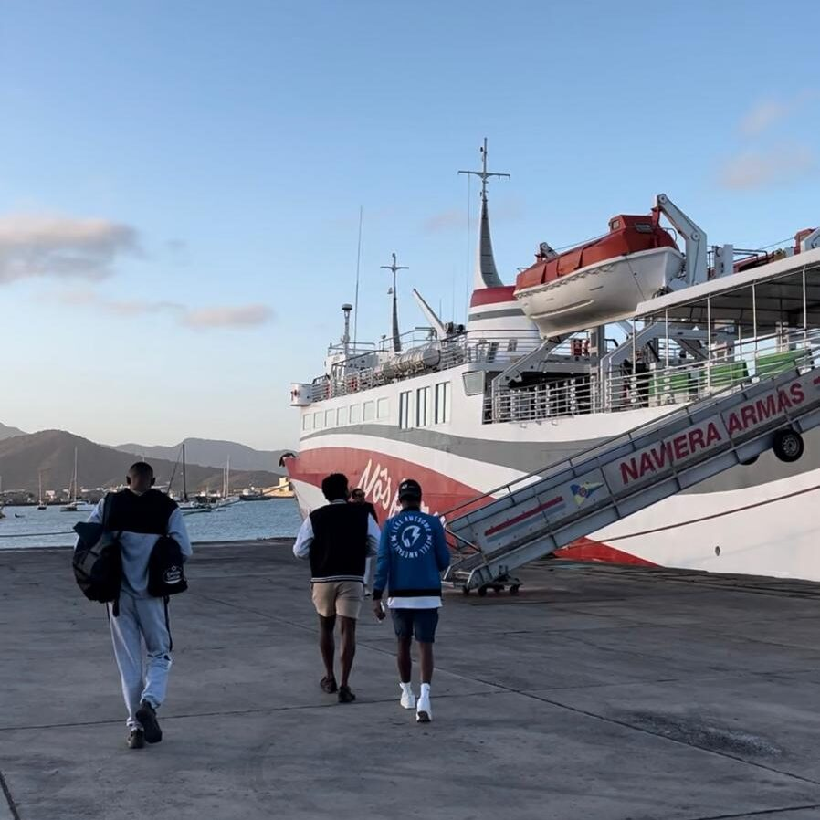

Om ons heen staan voornamelijk toeristen die een vergelijkbare trip gaan maken. Een groep Nederlands-Kaap Verdianen is vrij luidruchtig en maken onderling grappen over hun kater. Een vlaams stelletje staat à la Titanic over de balustrade geknuffeld en her en der zien we oude besjes die in stilte naast elkaar wegdommelen in de zon en de passaat. Voorop het dek staat een jong Frans stel dat we van de haven herkennen met hun peuter op de arm. De blonde krulletjes en gebruinde huid van het reizen doen ons een beetje smelten en we spreken voor de zoveelste keer af dat Jen te zijner tijd haar krullen in het genenpotje zal stoppen.

Dankzij een aflevering van 3 Op Reis van de NPO over Santo Antao (aanrader!) weten we een klein beetje wat ons te wachten staat als we de terminal van Porto Novo uitwandelen. Tientallen taxichauffeurs en *aluguers* storten zich bovenop ons om kenbaar te maken dat zij de beste deal hebben, waar we ook heen willen. Een *aluguer* is niet meer dan een busje, of pick-up truck die voor een vast tarief rondrijdt en waar je een stoeltje kunt kopen. Wij wandelen de eerste meute voorbij en doen een rondje langs de busjes tot we een goede gevonden denken te hebben. Voor vijf euro per persoon worden we aan de andere kant van het eiland - zo’n anderhalf uur rijden – afgezet. We moeten wel nog een paar minuten wachten, want we zijn nog zijn enige klanten, maar nadat Miguel een rondje over het plein heeft gedaan komt hij zonder extra passagiers terug en start onze privé-*collectivo* rit. Wij voelen ons er een beetje schuldig over, want een snel rekensommetje leert dat hij met alleen ons tweeën niet quitte gaat draaien op deze rit.

Gelukkig worden er van langs de weg her en der mensen opgepikt.. Sommige rijden een minuutje mee en betalen een paar centen, anderen rijden mee tot Ponto do Sol. Met een toeter en een fluitje communiceren ze op straat over of ze wel of niet met het busje mee willen en zo wordt ons schuldgevoel langzaam vervangen voor een heel gezellige ervaring. Miguel zet ons af bij ons hostel en biedt ons aan ons morgenochtend op te pikken als taxi en ons bovenop de berg neer te zetten, waar volgens hem maar geen *collecivo’s* heen gaan. Ik wil ook wel eens wat regelen en ga meteen akkoord als ik de prijs hoor. Nadat hij tevreden wegrijdt staat Jen mij hoofdschuddend aan te kijken en besef ik dat ik weer een nulletje te weinig heb doorgerekend in de conversie. Maar ach, we zijn op vakantie.

Hostel Oasis ligt tegen de rand van het dorpje Ponto do Sol op een kruispunt met veel muurschilderingen. Een paar vrouwen verkoopt onder een boom hun groenten en de sfeer is erg gemoedelijk. De eigenaar van de supermarkt is tevens de eigenaar van het hostel en het bijbehorende restaurant. Hij spreekt vloeiend Frans, maar dan ook echt als een Fransman, zelfs bij *‘yes’* en *‘no’* worden we vragend aangekeken. Ik beroep me op Jen haar eindexamen in de Franse taal en mijn eigen onkunde er in, maar uiteindelijk weten we toch samen en met behulp van handen en voeten uit te leggen dat we een boeking hebben. We zijn te vroeg en de kamer is nog niet schoon, maar we mogen wel onze tas achterlaten en over een uurtje terugkomen.

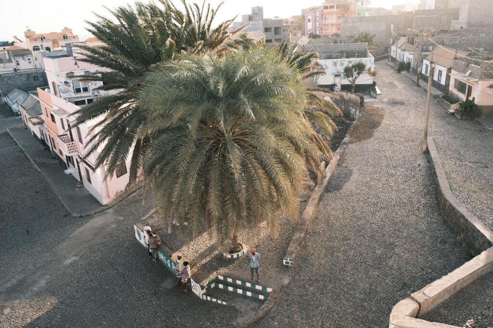

Ponto do Sol kent zo’n zeven restaurantjes die volledig draaien op toeristen. Er heerst hier geen uit-eten cultuur. Bij het eerste beste tentje dat er open uitziet strijken we neer en nog geen twee minuten later horen we twee dames opgewekt in het Nederlands kletsen en naar binnen lopen om voor vanavond te reserveren. Het restaurant oogt vanaf de buitenkant niet als een plek waar je reserveert, maar ’s avonds zit het er afgeladen. De *cachupa* – het lokale gerecht van mais met bonenstoof – is afgestemd op de Europese mond en portemonnee, maar we laten het ons smaken.

Met iets te goed gevulde buiken lopen we terug naar Oasis en kleden ons om voor de eerste wandeling. Vanuit het hostel gaat een bergweggetje langs de kliffen naar wat één van de mooiste dorpjes op aarde schijnt te zijn. We lopen door de *outskirt* van Ponto do Sol. Het oogt niet al te breed, met ongeschilderde betonnen constructies zonder kozijnen en kleine moestuintjes met papayaplanten tussen de weggebroken straatstenen. Ondanks dat is het ook hier erg gemoedelijk en worden we door iedereen op straat een vrolijk *bom dia* gewenst.

Niet veel later stappen we het pad op dat ons vandaag zal leiden. Het pad loopt over de buitenzijde van de kliffen, halverwege de berg en onthult een dramatisch landschap dat uit de oceean omhoog rijst. In de schaduwrijke valleien gaat de droogte abrupt om in groene weelde en de zoutspray die in de lucht hangt zorgt voor een magische speling van het licht. Het eerste stuk van het pad is met kobbelsteentjes verhard, net als de weg van Porto Novo richting Ponto do Sol. Ons vermoeden dat deze wegen steentje voor steentje met de hand worden aangelegd, wordt bevestigd als we een bocht omlopen en een groep mannen op hun knieën in het zand zien zitten. Allemaal hebben ze een eigen afgezette stukje weg dat ze maken, keurig inclusief een middenlijn van strak tegen elkaar aan gelegde keien. Een aantal andere mannen loopt heen en weer met kruiwagens vanaf een berg stenen een stukje hogerop. Ik stel me zo voor dat het aanleggen van de verbinding tussen Ponto do Sol en het verderop gelegen Fontanhas een halve carrière in beslag neemt en dat stratenmaker hier een eervol beroep is.

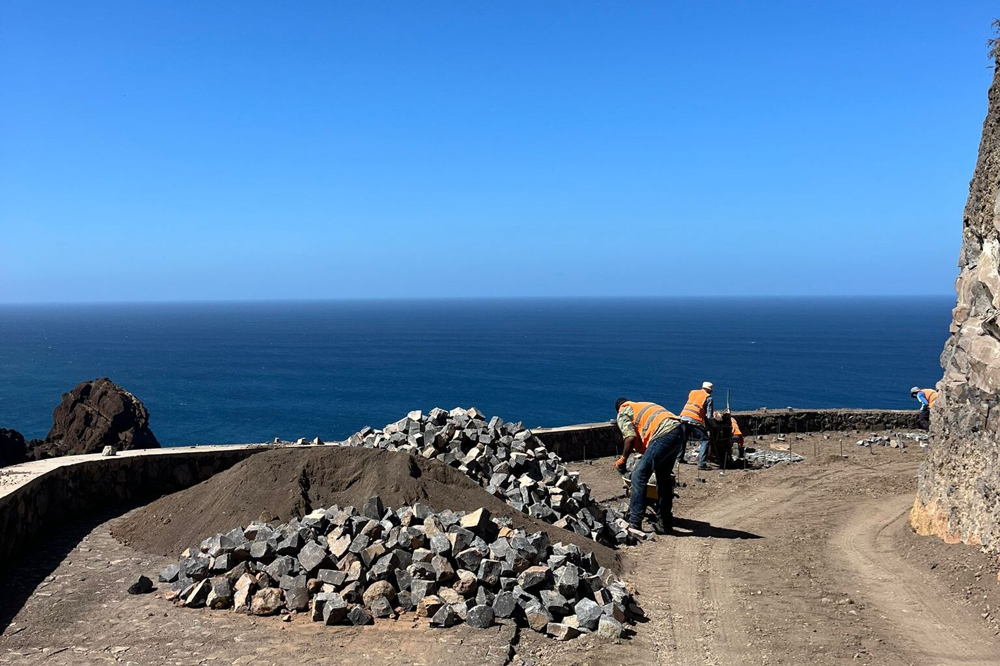

Inmiddels zijn Jen en ik diep verzonken in ons gesprek over de nieuwe zeilen. We zijn dichtbij, maar moeten de knoop nu definitief doorhakken. Zoals altijd had Jen dat al lang gedaan en wik en weeg ik nog wat langer door tot ik zeker weet dat ik geen detail over het hoofd heb gezien. Jen luistert aandachtig en geduldig naar al mijn hersenspinsels en knikt bevestigend, zelfs bij alle termen die ik uitkraam die haar onbekend klinken. Al snel vloeit het gesprek door naar wat we met *Luwte* gaan doen bij terugkomst. Dat ze blijft staat al vast, maar inmiddels hebben we wel wat optimalisaties in ons hoofd die *Luwte* nóg een fijner schip zouden maken. Stiekem fantaseren we door naar een volgende reis en een volgend schip. Als er kinderen in het spel zouden zijn moet de boot toch nét een maatje groter vinden we. De *do’s* en *don’ts* van Luwte en de schepen die we van binnen en buiten gezien hebben passeren de revue en schetsen een beeld van een wel heel specifiek schip. Wie weet komen we die een keer tegen, of moeten we haar zelf gaan bouwen…

Al keuvelend gaan we de volgende hoek om en vallen we beiden tegelijk stil. Wat we aanschouwen lijkt wel nep. Alsof je een *AI* vraagt een spectaculair magisch landschap te creëren dat het midden houdt tussen zomers *Narnia* en *Jurassic Park*. We kijken een diepe vallei in met steile wanden die recht omhoog uit zee komen. De toppen zijn grillig en puntig en over de hele hoogte zijn terrassen aangelegd waar land op verbouwd wordt. Terwijl onze blik van rechts naar links getrokken wordt over de wand ontvouwt een piepklein, felgekleurd dorp zich op een aantal pieken diep in de vallei.

Al foto’s schietend lopen we verder. Onder de schaduw van een rotsblok zit een groepje boeren even uit te puffen van hun werk op de terrassen boven de weg, verder zijn we nog niemand tegengekomen. Verderop zien we onder een boom een ezel vastgeknoopt staan grazen. Hij kijkt ons wat glazig aan als we voorbij lopen en gaat snel weer verder met kauwen. Het dorpje is klein en dicht op elkaar gebouwd, geen wegen maar stegen die over de dakgoot van het lagergelegen huis heen zijn gekruld. We zien een klein barretje, maar besluiten dat we onze versnapering nog niet hebben verdiend en lopen na een paar slokken water en een mueslireep weer door de vallei in.

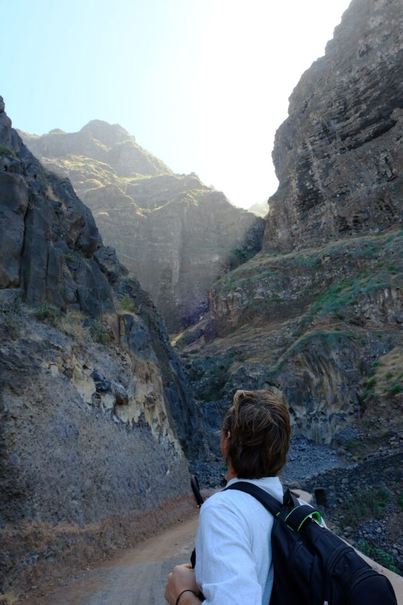

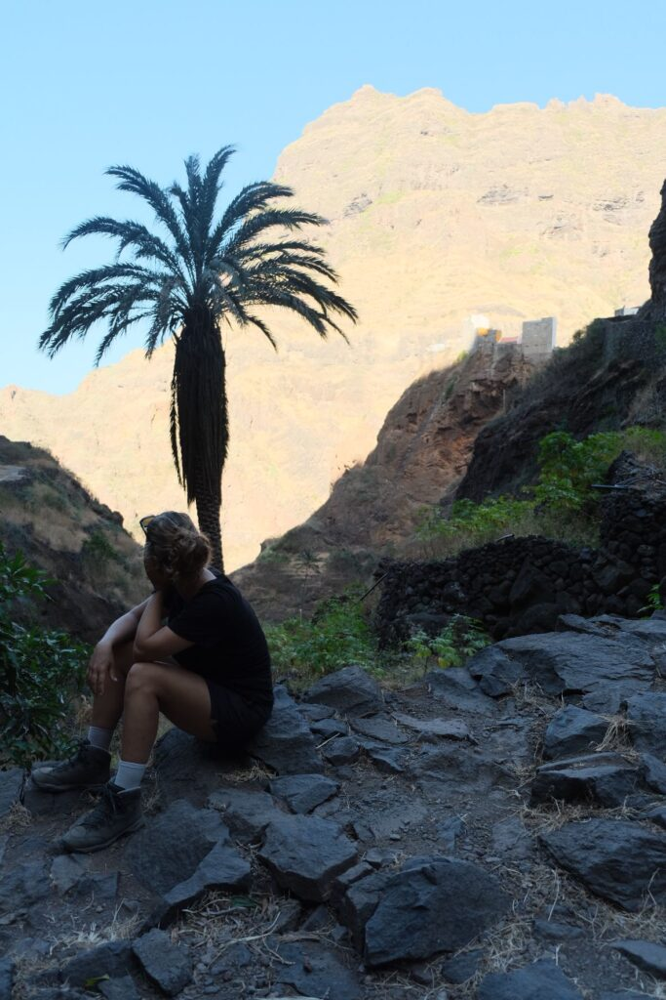

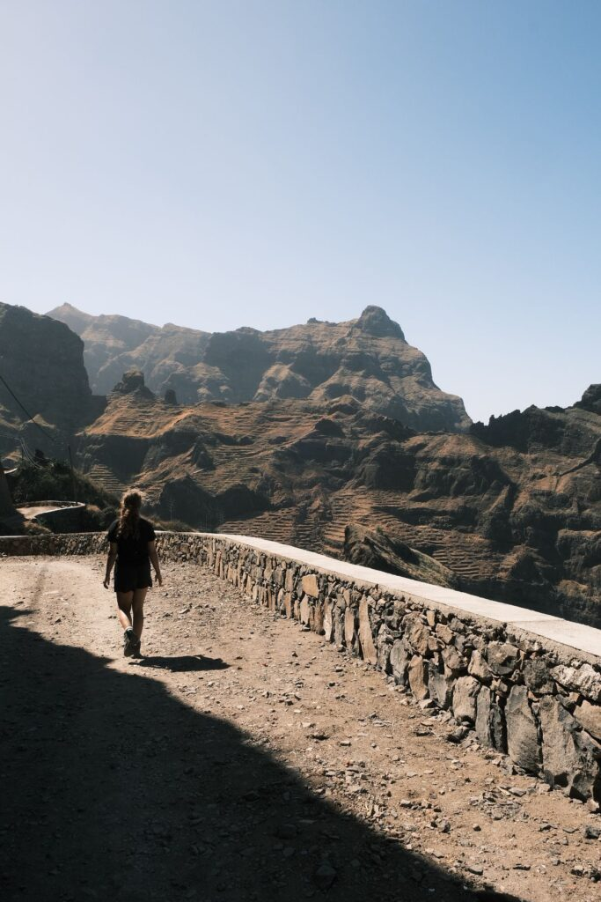

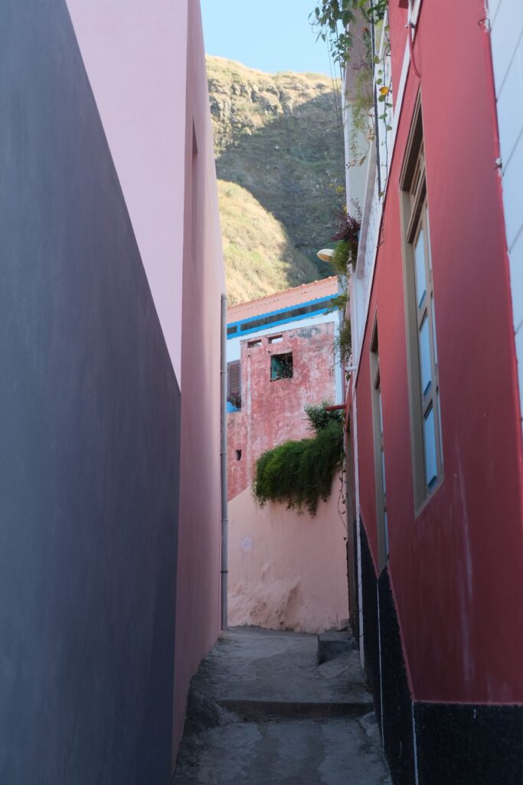

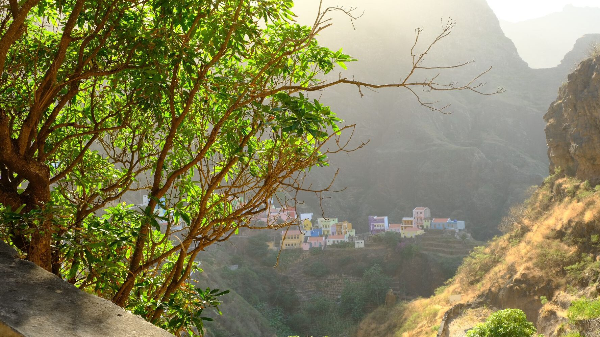

Een klein half uur later komen we bovenop de grillige kam die we net zo hebben bewonderd, de eerste tegenliggers tegen. Bovengekomen zijn ze allemaal rood aangelopen en puffen uit onder het genot van de frisse bries die er staat en het uitzicht over Fontanhas dat, eerlijk is eerlijk, van deze kant niet zo mooi geschilderd is als de andere kant.

Ook wij blazen even uit en zien een volgepakte ezel met eigenaar het steile pad stapje voor stapje beklimmen. De eigenaar loopt op rubberen kaplaarzen en we voelen ons een beetje opgedost met onze chique wandelschoenen. Waarschijnlijk zaten de andere wandelaars samen in een busje, want nadat de groep gepasseerd is, is het pad weer volledig uitgestorven. We vervolgen de weg naar beneden richting Corvo en houden het tempo er goed in. Weer op zeeniveau aangekomen zetten we voet in een minder mooi geschilderd dorp, waar het leeg en troosteloos aanvoelt. De vallei brengt een beekje naar beneden waarin ik onze fles met water weer vul. Sinds Nederland hebben we niet zulk lekker water geproefd.

Terwijl we even overleggen over doorlopen of teruglopen komen er twee kinderen met schooltassen het pad afgerend. Op teenslippers. Het is voor ons het teken dat we hier toch geen prestaties meer te behalen hebben en we besluiten dan ook om huiswaarts te keren. Op de één of andere manier voelt de terugweg altijd een stuk korter dan de heenweg en in een mum van tijd staan we voor het barretje dat we eerder zagen. De eigenaar brengt ons met een brede glimlach naar het dak waar een bonte verzameling aan afgedankte meubelen als inboedel dient. De suikerige Fanta die hier duidelijk nog allerlei (in Nederland) verboden smaak- geur- en kleurstoffen mag bevatten smaakt ons heerlijk en wordt weggespoeld met een lokaal gebrouwen *ponche* van suikkerriet met maracujasmaak.

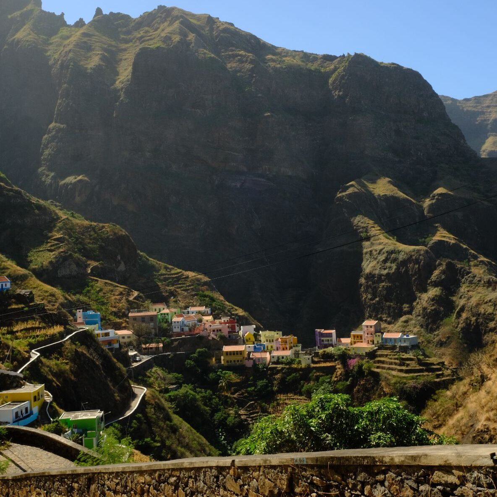

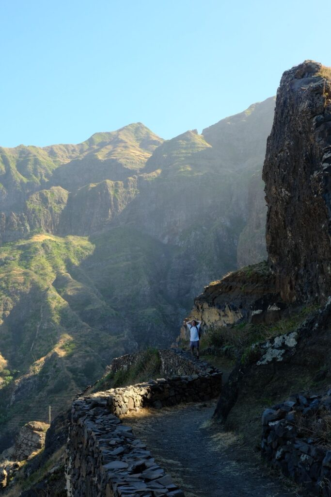

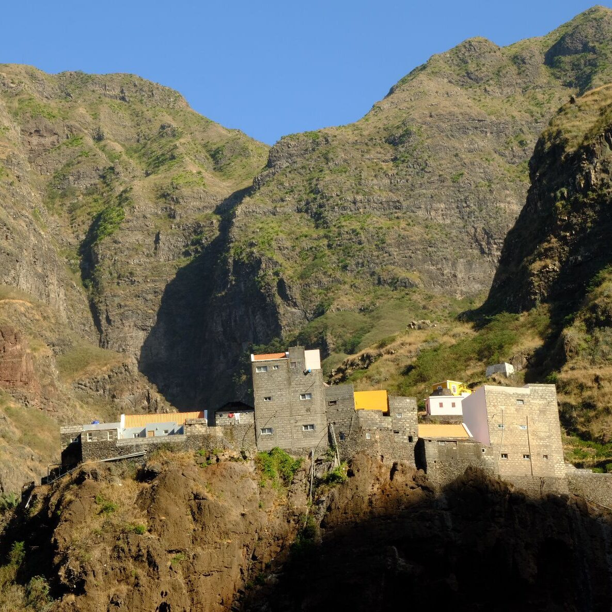

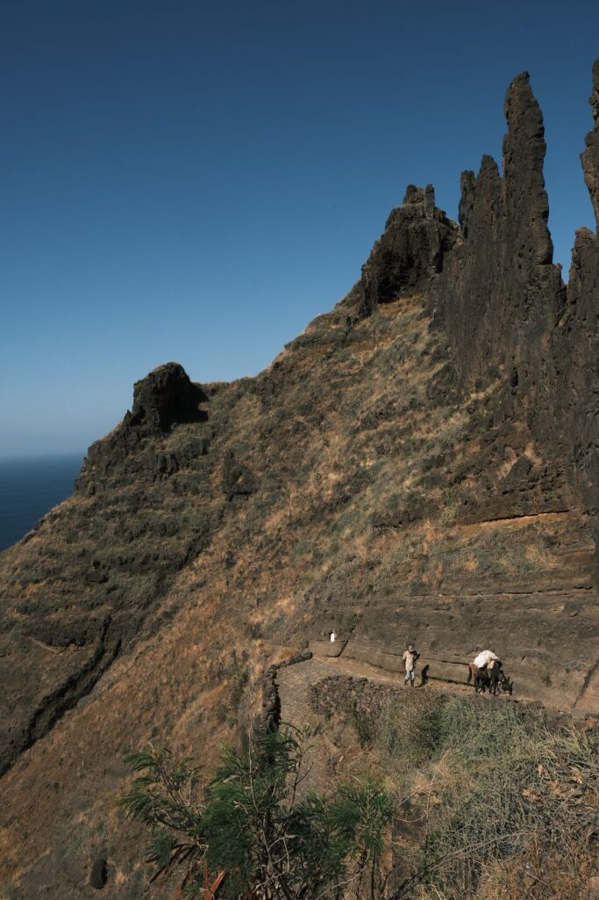

We besluiten de wandeling voldaan en tevreden in het hostel, waar we onze blaren bekijken en voor het eerst sinds lange tijd kunnen douchen met een doucheputje. Niet met de hand het water wegpompen, maar gewoon staan en genieten. Jen komt met een opgerolde handdoek op haar hoofd terug de kamer in en ik duik meteen de badkamer in om zelf ook even schoon te spoelen. Net als het warme water begint te lopen en ik mijn haar nat maak valt in de badkamer het licht uit en een paar tellen later valt ook de druk op de leiding weg. Ik vrees dat de boel gebrekkig is aangelegd en dat de boiler de stoppen heeft laten doorslaan, maar als we niet veel later in het donker naar buiten lopen, komen we er achter dat het overal donker is. Heel Ponto do Sol zit zonder stroom. En dat is een ramp, want vanavond is er voetbal op TV.

We eindigen uiteindelijk bij een restaurantje aan de kade met uitzicht op het piepkleine haventje dat ze op deze aanlandige kust hebben aangelegd. Met de flashlight van onze telefoon onder een fles water hebben we een romantisch dinertje. De keuken doet het gelukkig nog wel. De vissers zijn inmiddels allemaal binnen, maar het is een heel spektakel hier aan de kust. De oceaandeining komt vanuit de diepte opeens omhoog en breekt met veel geweld tegen, en vaak over, de kademuur heen. De vissers moeten hun entree en vertrek precies timen tussen twee golven in. Op de *jetty* staat dan een groep medevissers te wachten en de boot wordt in één beweging binnengevaren en meteen 15 meter de kade op getrokken. De jongetjes uit het dorp slaan het gebeuren gade en we horen van een local dat die vanaf een jaar of 11 à 12 mee mogen om te oefenen. De adrenaline die wij wel eens voelen bij het invaren van een haven staat diep in de schaduw van wat deze jongens moeten ervaren.

Met een gevulde buik, voldoende kilometers in de benen en geen licht op de slaapkamer gaat bij ons het lampje ook snel uit en slapen we allebei diep in, in een onwennig breed en stabiel bed. Geen klapperend lijntje tegen de zaling, geen schroefje dat nog ergens onder de kuipbank heen en weer rolt en geen kabbelende golfjes tegen de romp. Gewoon stilte. Midden in de nacht gaat plots het licht aan en blijkt de elektriciteit het weer te doen.

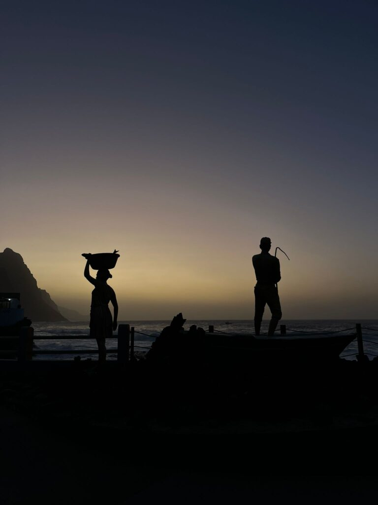

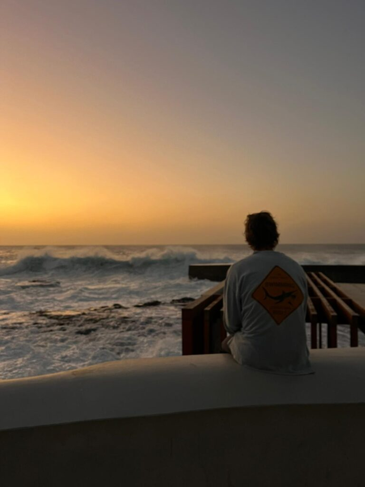

## Paul vallei

De volgende ochtend worden we door Miguel opgepikt met het busje. We gaan voor de zekerheid toch nóg maar eens wat geld pinnen op het dorpsplein en terwijl ik bij de automaat sta komt een Franse dame aangewandeld die vraagt of ze met ons mee mag als ze de helft van de taxi betaalt. Dat vinden wij natuurlijk geen enkel probleem en zo wordt onze *privado* toch nog een beetje *collectivo*. Miguel rijdt ons naar de top van de vulkaankrater. Een dramatische weg over steile bergkammen onthult een glimp van de groene sprookjesvallei waardoor we straks omlaag gaan lopen. Bovenaan gekomen ontvouwt zich een surreëel aangezicht. In de krater ligt een beschutte vallei verborgen die volledig wordt ingezet voor landbouw. In een klein hutje staat een dame met *cachupa* en oploskoffie, die laten we ons niet ontzeggen en voordat de wandeltocht naar beneden begint prikken we een vorkje mee.

Het zig-zag paadje dat vanaf de top naar beneden leidt loopt bijna recht omlaag langs de grillige bergtop. We dalen een uur of anderhalf af voordat het land glooiender begint te worden en we links en rechts van ons de eerste terrassen met bananenbomen tegenkomen. Het is sereen en tropisch. Onze knieën beginnen al een beetje te trillen als we een afdak naast het pad tegenkomen met daarin een verkoper van lokale lekkernijen. Het zal geen *big business* zijn hier, maar wel *business* op een heel mooi plekje van de wereld. We kopen twee sinaasappelen en een flesje *ponche* met honingsmaak. De sinaasappelen zullen ons nog lang heugen. Misschien was het de plek, onze dorst en de timing, maar als we slurpend verder wandelen concluderen we beiden dat dit bij uitstek de lekkerste sinaasappel is die we ooit hebben gegeten.

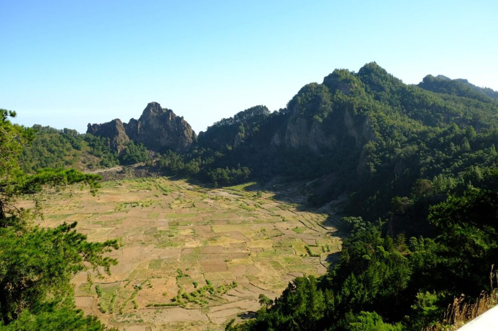

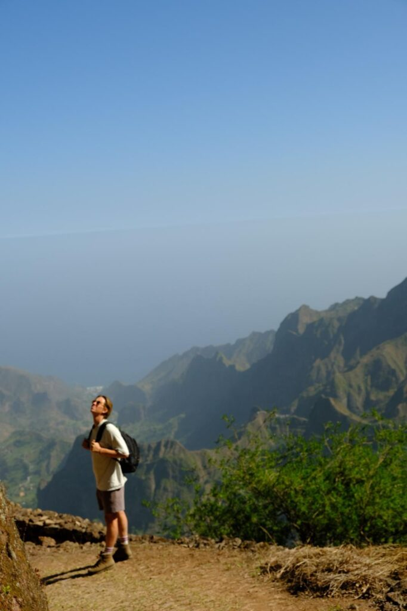

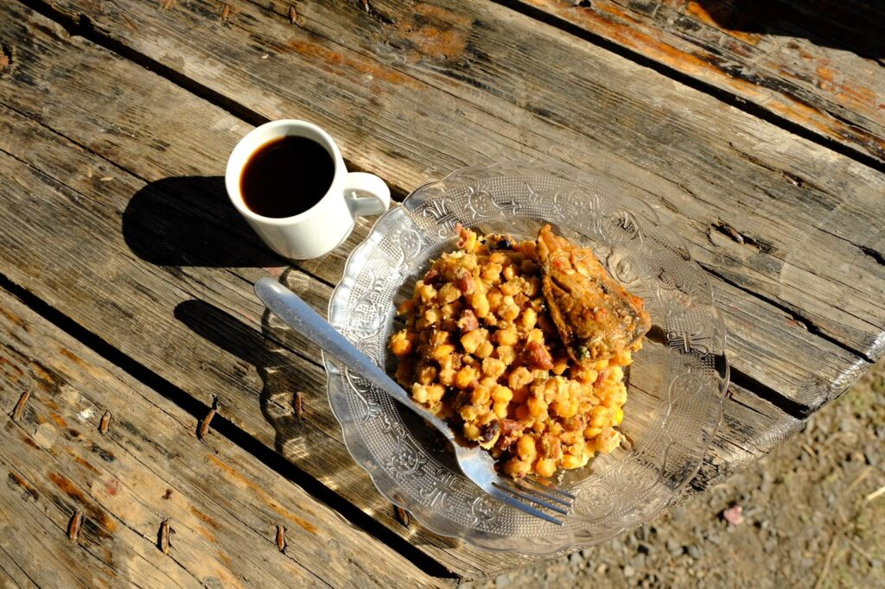

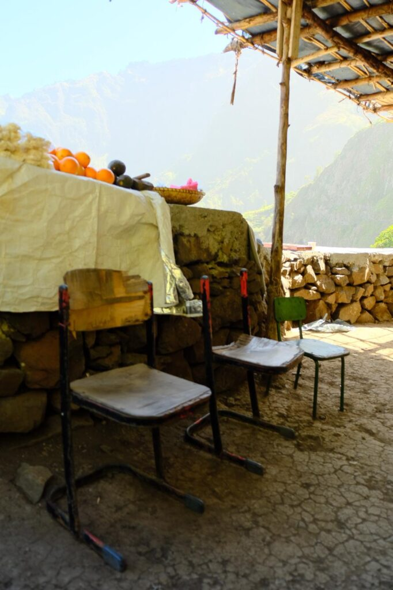

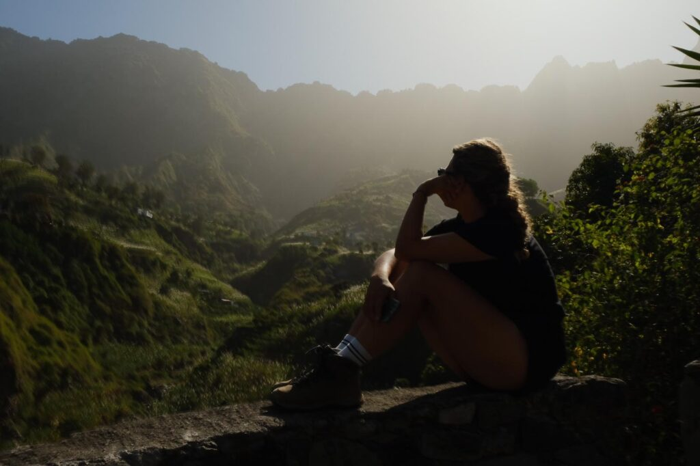

In een klein dorp halverwege de vallei landen we bij een restaurantje. De *cachupa* van vanochtend is nog niet verteerd, maar het ruikt hier zo lekker dat we toch een bordje kip bestellen om samen te delen. Naast ons zit een Duits-Japanse familie met twee tienerdochters die ongeïnteresseerd op hun telefoon zitten en met lange tanden de lokale cuisine voorgeschoteld krijgen. Een beetje weemoedig aanschouwen het tafereel, dat versterkt wordt door het rondrennende kind van het Franse stel dat we eerder op de veerpont zagen staan. Op die momenten hoop ik zelfs met mijn *Digital Business & Innovation* papiertje op een analoge revolutie van de toekomstige generatie..

Naarmate we dieper de vallei inwandelen wordt het landschap glooiender en onze knieën weer wat soepeler. De zon begint te zakken en schijnt nog een laatste sprookjesachtig licht over het riviertje dat door het dal loopt. De zee komt weer in zicht en dat voelt toch als thuiskomen. Achterom zien we de enorme afdaling die we hebben gemaakt. Kletsend over de toekomst en het heden, over de nieuwe vrienden die we hebben gemaakt en de tocht(en) die nog gaan komen.

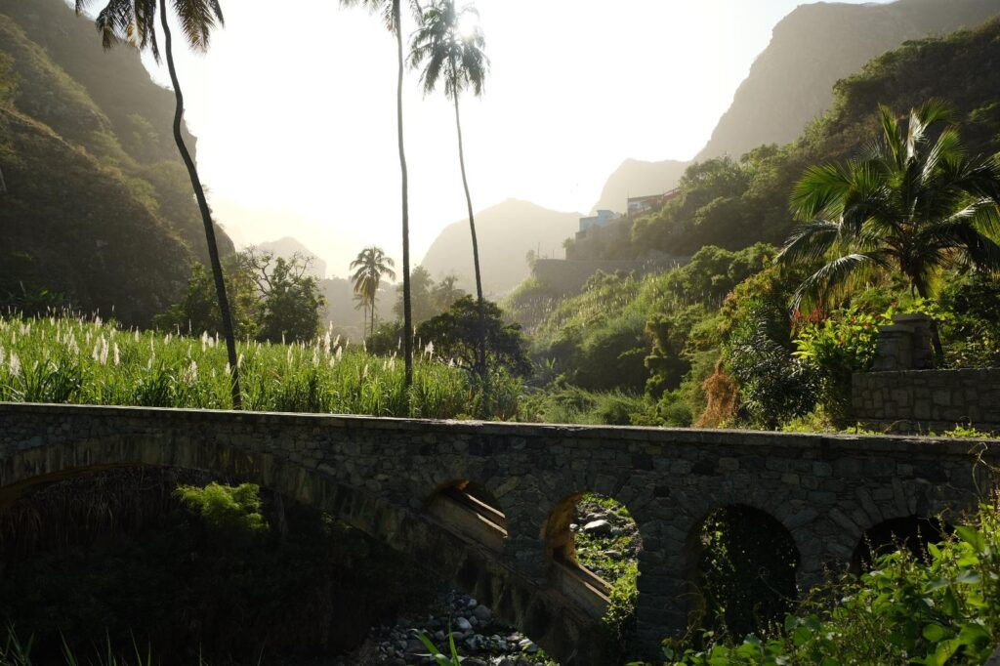

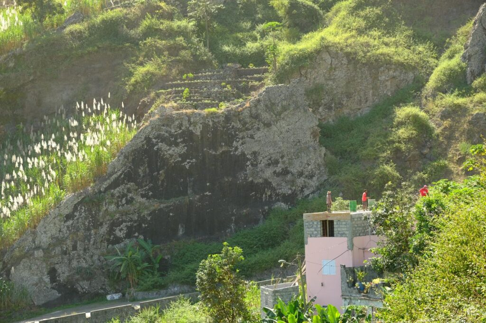

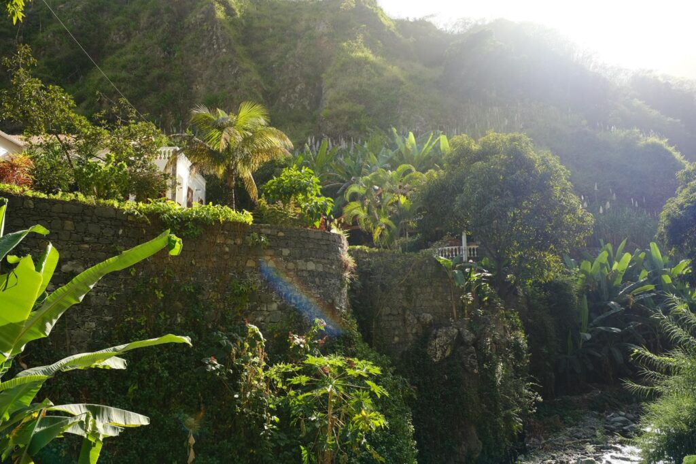

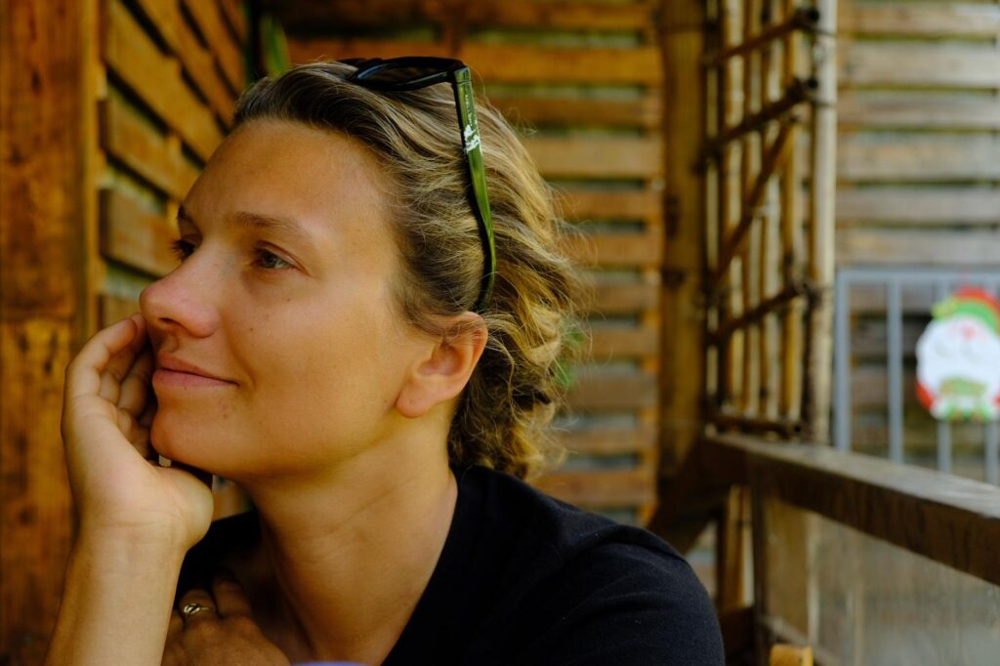

Via de frans-sprekende eigenaar van Oasis wordt er geregeld dat we de volgende ochtend door Philipe worden opgehaald met zijn *collectivo* busje. Of hij nou 06.45 bedoelt of 07.15 is niet helemaal duidelijk, maar 's ochtends om 07.00 zijn we de eersten die instappen, en zeker niet de laatsten. Bijna drie kwartier rijden we rondjes door het dorp, de helft van de passagiers heeft zich verslapen, dus Philipe vervult tevens de rol van wekker. Hij blijft niet wachten, maar rijdt gewoon door naar het volgende adres en komt later nog wel even terug. Het busje is pas vol als zijn hulp, die de koffers op het dak bindt, op een koelbox in het gangpad moet gaan zitten. En zo rijden we met een busje vol Ponto do Sollers terug naar Porto Novo, waar de pont ons weer zal brengen naar Sao Vicente.

Bij terugkomst in de haven van Mindelo sta ik op het bovendek te turen of ik *Luwte* nog wel zie liggen. Uiteindelijk vind ik haar door te zoeken naar de kortste mast. Ze ligt er nog. Gelukkig. Nu we toch bij de terminal zijn kunnen we net zo goed even doorlopen naar de immigratiedienst en *policia maritima* om onze papieren terug te krijgen en een stempel in ons paspoort te laten zetten. Bij de maritieme politie wordt en dikke map *Holandese* uit de kast getrokken en zien we de bonte variëteit aan “bootpapieren”. Er zit geen enkel origineel document tussen en een heleboel van de zelf ontworpen bootpaspoorten. De zeebrieven uitgegeven in naam van de koning zijn té waardevol om kwijt te raken, dus probeert iedereen (net als wij) eerst een kopie of een andere variant in te leveren. Vooralsnog werkt het zelf vormgegeven bootpaspoort van *De Blauwe Pinguin* perfect. Het fotootje van de boot, scheef uitgelijnde titels (want ja het blijft een ambtelijk document) en de zin '*valid in all countries*' is voor de meeste overheidsfunctionarissen uitmuntend.

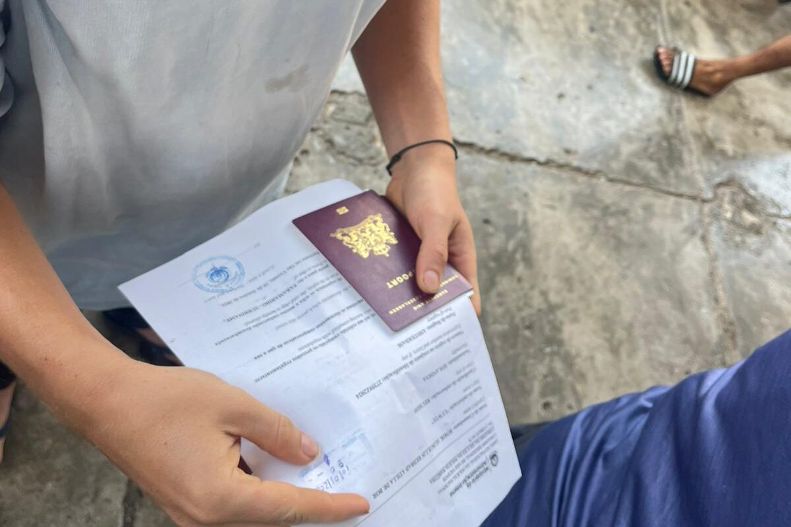

## Palaver

Terug op de boot gaan we vrijwel direct in eindsprint naar vertrek. We hebben zin om te gaan, maar het lijstje met laatste kleine puntjes op de i groeit met de minuut. Jen trekt Mindelo in met de leeggehaalde backpack om die te vullen met groenten en fruit. Als haar eigen minimarktje liggen een paar uur later de groene tomaten, bananen, pompoenen, spitskolen, uien en andere verse producten op de steiger uitgestald. Voordat die aan boord mogen moeten ze eerst gespoeld worden in water met azijn, tegen de schimmel en de kakkerlakken. Of het echt zin heeft is twijfelachtig, maar een beetje liefde in je voedsel stoppen is nooit slecht. De buitenste lagen van de uien worden afgepeld om ze langer mee te laten gaan en ik draai alle eieren om in hun doosje zodat de dooiers niet uitzakken.

Intussen ligt binnen en buiten alles open. Ik controleer alle vloeistoffen van de motor en laat hem even draaien om nog te zoeken naar rare geluidjes. Roestplekjes in de motorruimte worden met schapenvet geconserveerd en alle leidingen nagelopen op schavielplekken. Geen bijzonderheden. Op deze route vermoeden we veel minder motoruren te draaien dan tot nu toe, maar het is altijd prettig als alles weer even helemaal is nagelopen. Terwijl ik vies maak, maakt Jen schoon en start met het voorkoken van maaltijden voor de eerste drie dagen. Tijdens het inslingeren koken is één van de grootste opgaves voor ons beiden op zee, dus dat beperken we de eerste dagen graag tot het opwarmen van voedzaam eten. Soepen, pasta bolognese en couscoussalades zijn vaste prik.

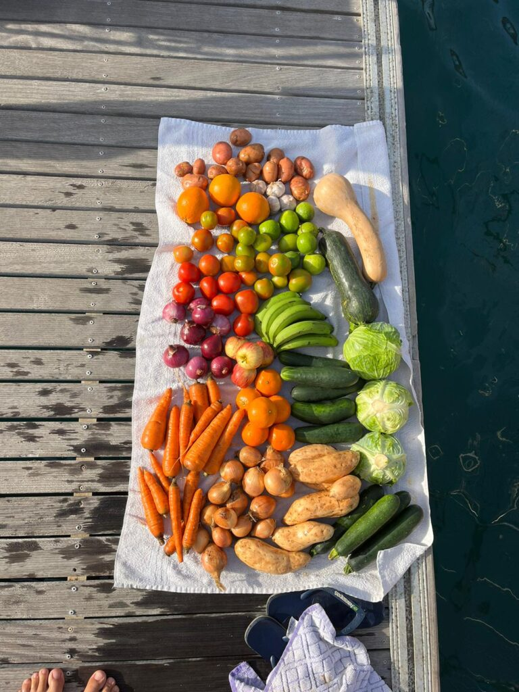

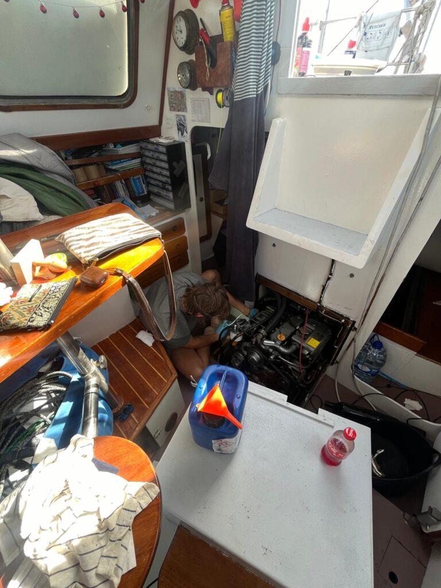

In tegenstelling tot de meerderheid aan schepen hebben wij geen rijen jerrycans aan dek staan. Bij sommige schepen vraag ik me serieus af of ze überhaupt zeilen. Op een grote catamaran met een jong gezin tel ik *aan dek* zeker vijfentwintig 20L jerrycans met diesel. Wij hebben er wel twee, maar die liggen verstopt in het vooronder. We legen ze in de tank en hebben daarmee de liters van La Palma naar Mindelo alweer bijna helemaal aangevuld. Ik wandel met de twee lege naar de pomp en sjouw ze daarna terug naar *Luwte* om ze weer onderin het vooronder weg te werken.

De twee andere jerrycans die wij mee hebben zijn voor water. Dat gaat gewoon overboord en met vers water hervuld. Daarmee zitten de bunkers weer vol en hebben we met bij elkaar 390 liter water ruim voldoende om het een week of drie à vier uit te houden als het moet.

*Luwte* voert vier zonnepanelen, waarvan er twee op de reling gemonteerd zitten, eentje bakboord en eentje stuurboord. Op aanraden van *Sya*, die inmiddels op tweederde van hun tocht zitten, monteren we ze beiden aan bakboord, aangezien we de hele tocht de zon aan één kant hebben. Volgens Robin doet hun zonnepaneel aan stuurboord vrijwel niets. De KISS (Keep It Stupid + Simple) techniek waarmee ik de zonnepanelen heb gemonteerd helpt daarmee en zo’n tien minuten later zitten beide panelen op bakboord en zijn de kabels doorverbonden.

Zondagochtend staan we vroeg en met veel adrenaline op. De laatste lijntjes worden weggewerkt en de huik komt van het grootzeil af. Met *Jonathan* en *Belafonte* hebben we rond het middaguur een laatste palaver op de steiger. We hebben er allemaal erg veel zin in, zijn een beetje gespannen, maar moeten vooral veel lachen en halen nog een paar herinneringen op onder Jen’s *‘Mindelo never forget!’.* Een groepsfoto, laatste knuffels en dan stappen we aan boord van onze scheepjes. *Jonathan* is het snelst weg en hijst op de rede de zeilen. Wij volgen niet lang daarna. Met knikkende knietjes gaat de motor vooruit en gooien we onze lijntjes los. Het is inmiddels gelukkig allemaal wat minder onwerkelijk, maar een zelfde sensatie overvalt ons als bij het uitvaren van IJmuiden. Dit keer niet uitgezwaaid door onze ouders, maar door de bemanningen van *Audrey, Marije* en *Zen* die nog even op Sao Vicente blijven hangen.

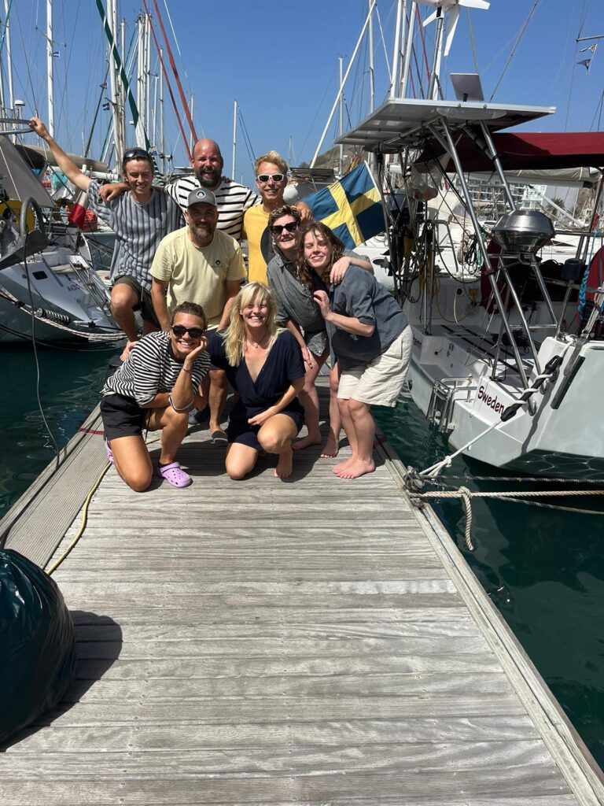

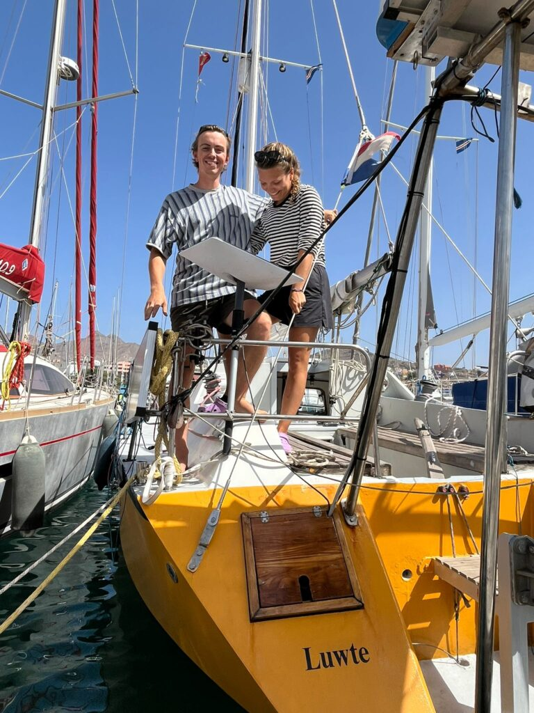

We ruimen de lijnen op, brengen de balletjes naar binnen en hijsen het grootzeil. In de verte zien we *Jonathan* al op ruimer water heen en weer slingeren. We gijpen, laten de giek naar bakboord komen en kabbelen naar de havenmond. De motor gaat nog voor het eind van de pier uit en hoeft hopelijk ook niet meer aan tot de uiterboei van Paramaribo. De fok rolt uit en *Luwte* glijdt naar buiten. Achter ons zien we *Belafonte* hetzelfde riedeltje doorlopen. Inmiddels zitten wij mooi in de *venturi* tussen Santo Antao en Sao Vicente en lopen we met 6.5 knoop over een lichte deining de horizon tegemoet.

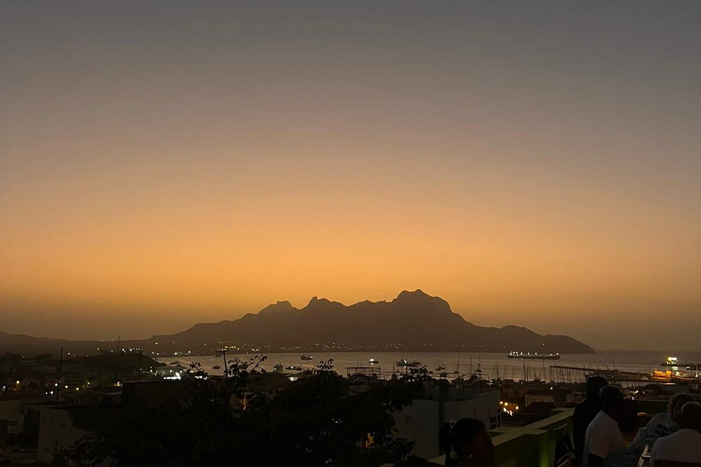

# POSITION REPORT ATL 3

13º06.280N, 37º14.043W

Inmiddels zijn we een week onderweg en ontzettend aan het genieten. Ons dag- en nachtritme zit er in en de bewegingen van het schip overvallen ons niet meer. Wij bewegen als spaghettisliertjes mee, of hangen stationair in een hoek met boek of film. De nachten beginnen wat wisselvalliger te worden met af en toe een bui, gevolgd door prachtige sterrenhemels.

We hebben nog een beetje contact met *Belafonte* en *Jonathan* waarmee het ook voorspoedig gaat en zitten verder in een heel groot vacuüm van niets. Het is dat we nog af en toe een stukje schrijven, maar ik was al helemaal kwijt dat we al meer dan een week onderweg zijn.

Verder gaat het met tuig en bemanning goed. We hebben ons grootzeil niet meer op gehad en rollen ons fokje nog altijd in en uit naar gelang er wind staat. Onze grootste uitdaging op het moment zijn de enorme velden Sargasso-wier die achter het roer van de windvaan blijven hangen en *Luwte* af en toe uit koers laten lopen. Ik heb het nooit zo gehad op waterplanten en die wrok wordt maar weer eens bevestigd.

Tussen de wiervelden door gooit Jen nog een lijntje uit en nét als ze wil opgeven nadat ze voor de zoveelste keer wier aan de haak heeft, springt het elastiek strak en zien we een stukje achter de boot een groene flits voorbij schieten. Een Mahi Mahi van zeker meer dan een meter heeft zich verslikt en wordt bij ons aan boord getrokken. Na een kort gevecht komt het mooie dier op onze grootste snijplank te liggen, waar z'n kop net op past. Gisteravond hadden we pokébowl, nigiri en vissticks. Vandaag eten we ceviche en steak. Smullen!

Met ons *halfway point* in het vooruitzicht mogen jullie je alvast klaar gaan maken voor de volgende weddenschap. Vanaf *position report 4* gaan de stembussen open en maakt u kans op prachtige prijzen!

Over & stand-by

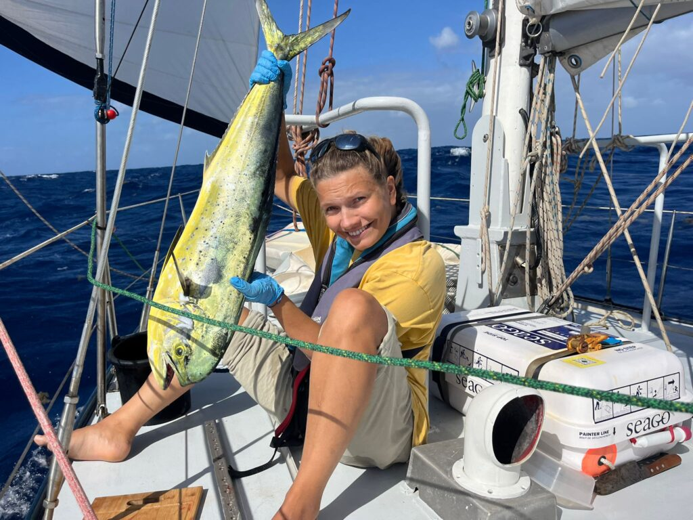
