Het voelt inmiddels als een muizenstukje, zo’n nachtje doorvaren, maar dat maakt het er niet minder zwaar op. Juist bij zo’n enkele nacht is het verleidelijk om het wachtritme een beetje op gevoel te doen, wat er in resulteert dat we allebei halverwege de nacht veel moeier zijn dan nodig. Als de ochtend aanbreekt zien we Grenada naast ons liggen en doemen er in de verte een heleboel eilanden op. De gennaker doet nog altijd braaf zijn werk in de lichte wind en we genieten van de laatste frisse uurtjes terwijl de zon langzaam omhoog komt.

Zodra de zon wat hoger staat begint het ook meteen heet te worden. Het is helder en het ondiepe water rond de eilanden kleurt fluoriserend helder blauw. Zoals je dat op een ansichtkaart verwacht. De passaatwind waait stabiel en vlak voordat we tussen de eilanden door moeten, overwegen we om de gennaker naar beneden te halen om niet in een venturi te komen. Uiteraard hapt er juist op dat moment ook een Mahi Mahi aan de haak en zijn we even afgeleid. Na een zinderend gevecht weet het dier zich los te werken en kan hij nog even verder zwemmen.

Even later zien we tussen de eilanden een nog veel groter en meeslepender gevecht tussen twee vissers in een klein bootje met een reusachtige haai van een meter of twee (als niet langer). Als ze hem eindelijk aan boord hebben klinkt er een euforisch en luid gejuich over het water: Die hebben een goede vangst..

In plaats van de baai van Clifton, gaan we iets om de hoek liggen bij Frigate Island, waar gratis moorrings zijn neergelegd door een subsidie van de overheid. We knopen ons elf-en-een-half meter jachtje vast naast een monster van een zeilschip van een of andere miljardair. Op het hydraulisch open klappende zwemplateau dat bij de spiegel naar beneden komt zouden we *Luwte* zo even uit het water kunnen liften. De *crew* is driftig de waterlijn aan het poetsen en de eigenaar is niet aan boord en zelfs als hij dat wel zou zijn, knijpen wij lekker in onze handjes met een hoop minder zorgen om hetzelfde uitzicht. Het zal één van de vele exemplaren blijken die we in onze tijd in de Carieb tegenkomen.

We springen het water in, plonsen wat rond, duiken naar het betonblok waaraan we vastliggen om de lijnen te controleren en giebelen over hoe helder het water hier wel niet is. Het is bijna alsof je op lucht zweeft. Daarna laten we bijboot *Storm* te water en takelen we de motor vanuit de werkplaats door de uitgang naar buiten. Sinds kort hebben we besloten dat we die niet meer moeten tillen. Het gaat altijd nét goed en het is misschien een minuutje sneller, maar het gevloek, de zere rug en blauwe plekken zijn het eigenlijk gewoon niet waard om de 34 kilo’s in een onhandig omhulsel naar buiten te tillen. Met de val in de top van de mast kan Jen takelen en hoef ik me alleen maar bezig te houden met het begeleiden van de motor naar de spiegel van de bijboot.

Als ook dat ritueel voltooid is gooien we los en dobberen tussen de restanten van een haven en de koraalriffen richting Clifton. Dat is nog best even zoeken naar een route. In het donker zou het onmogelijk zijn om binnendoor af te snijden, maar met Jen op de boeg wijzend en de motor een beetje omhoog gekanteld weten we de baai te bereiken. We worden door een man met een matrozenpak aan de kant geseind dat we daar moeten aanmeren en hij helpt ons een kommetje in dat volledig volgestouwd is met sargassowier. Eenmaal aan land worden wij, maar met name ik, direct overvallen door de staat van het eiland. Jen had zich - verstandig als ze is - wat meer ingelezen over hoe het eiland er aan toe is en wat er zoal gaande is. Vorig jaar juni is een uitzonderlijk zware orkaan over het eiland getrokken en werd in slechts één uur tijd zo’n beetje alles verwoest. Het tentenkamp, de weggeslagen betonnen kade en in de verte daken in aanbouw spreken boekdelen. De *customs* *office* is verplaatst naar het hotel waaraan we de bijboot hebben vastgeknoopt. Dit betonnen bouwwerk is een van de weinige gebouwen die volledig intact is blijven staan en bood tijdens de storm een schuilplaats voor de lokale bewoners.

In een achterkamertje onder de trap zitten een aantal ambtenaren achter provisorisch opgebouwde computers en bureautjes de paspoorten te controleren. Via het digitale *Sailclear* hebben we van tevoren onze gegevens kunnen invullen en hoeven we gelukkig niet opnieuw dertig kantjes carbonpapier in te vullen. Ze liggen er wel nog netjes opgestapeld, voor de zeilers die zich niet digitaal hebben aangemeld wordt het strafregels schrijven…

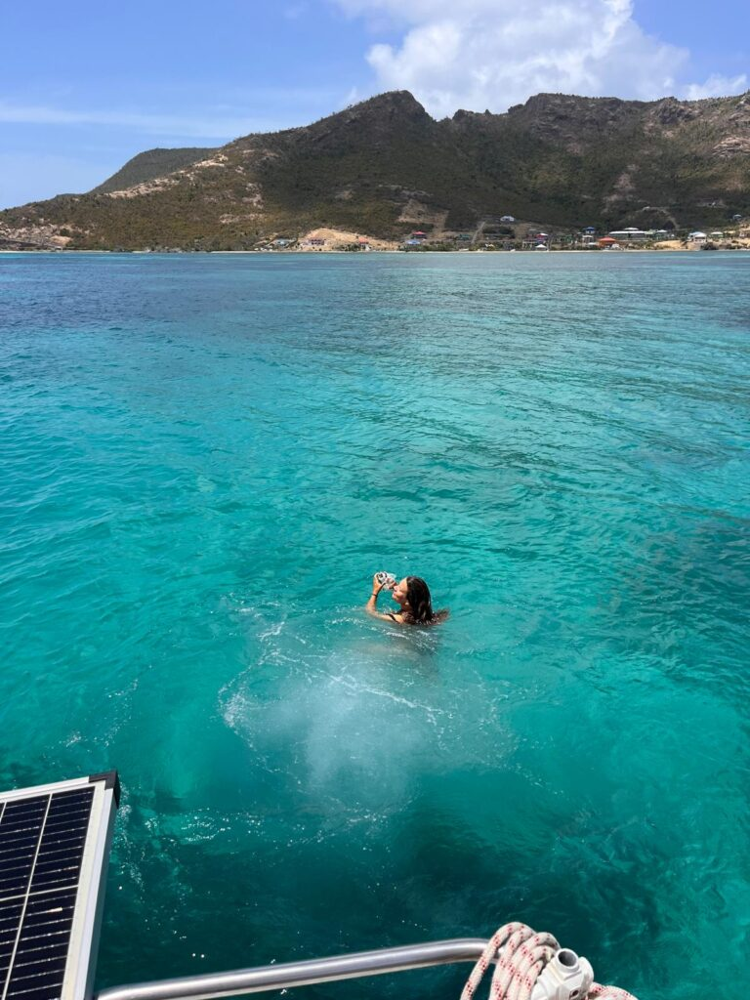

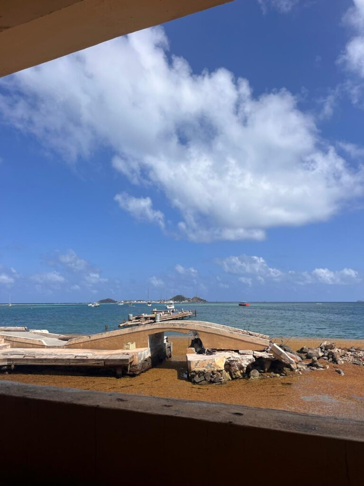

Aangezien we geen geld hebben gewisseld van tevoren is de volgende missie om ergens cash geld vandaan te halen, de zogenaamde East Caribbean Dollar (EC). We wandelen door een dorp waarvan de meeste daken óf net gelegd zijn, óf in aanbouw zijn. Een zeecontainer met een medewerker van de bank erin opgesloten doet dienst als pinautomaat en met wat geld op zak lopen we een stukje verder. Er is niet veel meer over hier. Op het plein staan grote blokken samengeperst afval en onder tentzeiltjes worden wat groenten en etenswaar verkocht. Desalniettemin is de sfeer vriendelijk en de energie niet terneergeslagen. Er wordt door iedereen hard gewerkt. Overal zie je mensen op daken zitten, stuken, en metselen. Als we onze ogen tot spleetjes vormen zien we tussen onze wimpers iets wat een jaar geleden een bruisend stadje moet zijn geweest met leuke restaurants en bars. Daar ligt voorlopig nog even niet de prioriteit, eerst moeten de mensen weer een dak boven het hoofd. Letterlijk.

Bij het hotel waar we incheckten en de dinghy achterlieten kunnen we wel nog een drankje krijgen, maar daarna hebben we voor vandaag wel even genoeg indrukken gehad. Ik zit een beetje beduusd om me heen te kijken als we even later in de kuip zitten met uitzicht op het eiland. We concluderen dat het contrast tussen de witte (en één gele) jachten voor het strand en de tentenkampen die daarop zijn opgezet pijnlijk groot is, maar we weten ook dat de bewoners van het eiland blij zijn met de enkele toerist die wel nog langskomt en wat geld in de economie stopt. De verleiding om snel door te varen naar een minder confronterend strand is groot, maar we besluiten de volgende dag weer aan wal te gaan en van Frigate bay naar Clifton te lopen. We zien onderweg vergelijkbare taferelen en proberen bij een aantal winkeltjes maar wat te kopen. Ansichtkaarten, een zonnebril en een nieuwe haspel voor de vislijn. Op de terugweg kopen we nog wat niet zo fantastisch ogende groenten en dan kan pakezel Rorik weer met twee volle tassen aan de schouders terugwandelen.

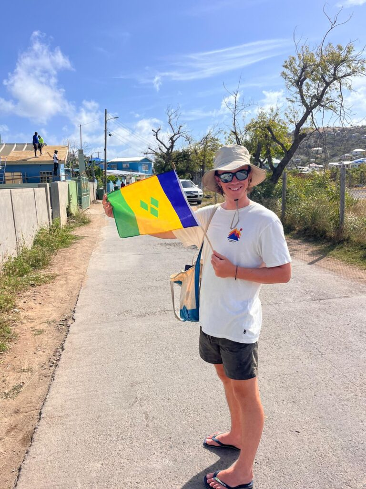

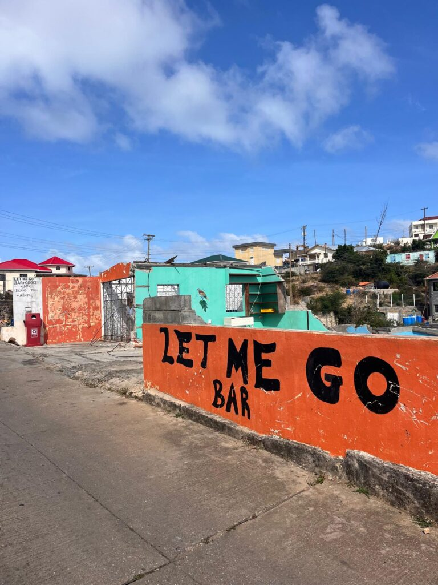

Halverwege de terugtocht stopt er een soort 4x4 versie van een golfkar en wordt ons een lift aangeboden “*walking or riding*?” wordt er naar ons geroepen. Ik zit al in de laadbak voordat Jen doorheeft wat er aan de hand is en veeg het zweet van mijn voorhoofd. Onderweg krijgen we een klein stukje te horen van wat er is gebeurd en vooral wat er nu allemaal gaande is. Het schijnt dat de relatie tussen Saint Vincent (het hoofdeiland) en Union Island niet al te best is en dat er weinig steun wordt gegeven bij de wederopbouw. Een lokale miljardair schijnt alles voor te willen schieten, maar dat wordt door de overheid stellig tegengehouden. Waarschijnlijk verdwijnt er dan te weinig geld in machtige zakken…

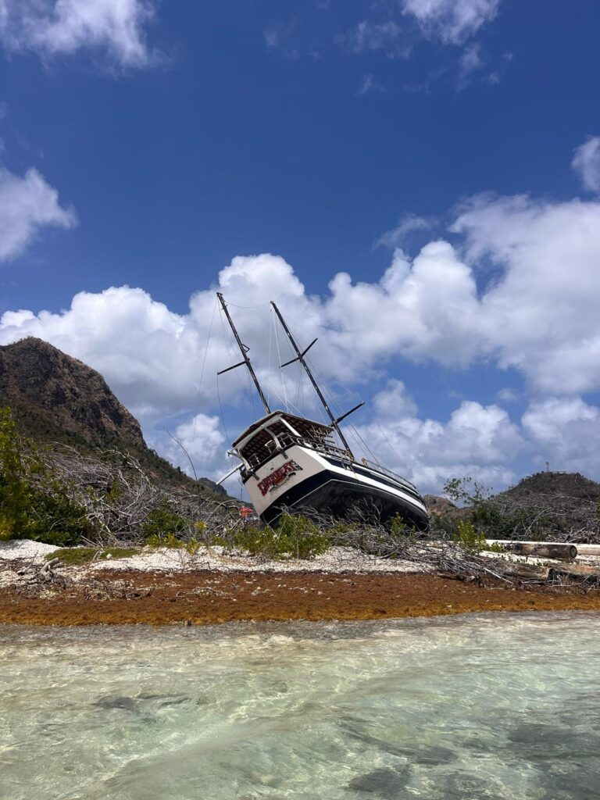

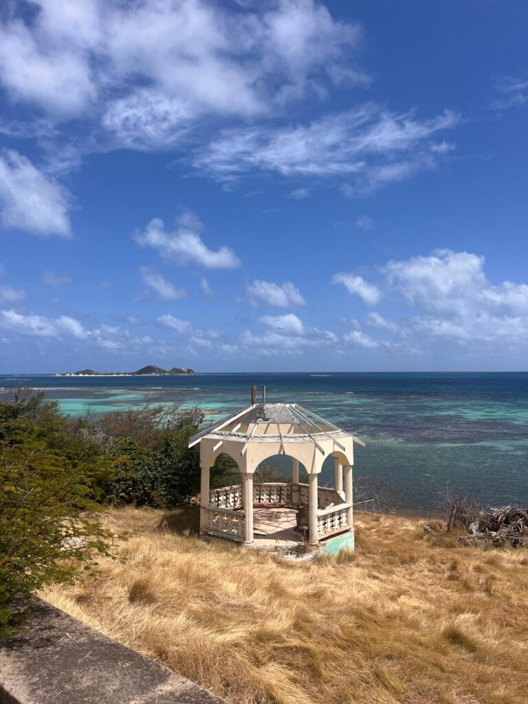

## Charter Paradise

De volgende ochtend laten we de ankerboei los, rollen het fokje uit en zitten we achterover geleund in de kuip met een licht briesje terwijl we achter Union Island langs schuiven. Het is maar een mijl of negen naar onze volgende stop, dus we zijn er met twee uurtjes. Zo hadden we de Carieb wel voor ons gezien. Een beetje hoppen van baaitje naar baaitje, onderweg een beetje keuvelen en dan rond de lunch het anker laten zakken, eten, snorkelen en de rest van de dag een beetje omhangen. Als we de Saltwhistle Bay op Mayreau indraaien zien we dat we niet de enigen zijn die dat ook wel voor zich zien. We zijn beland in wat wij omdopen als *Catamaran Paradise*. We zien de *boatboys* in hun vermoedelijk niet gekochte, maar voor altijd geleende rubberboten voorbij scheren en iedere boot een *lobster dinner,* *tourguide* of tenminste een *moorring* proberen te verkopen. Wij besluiten een beetje achteraan de baai buiten de meute te gaan liggen en zijn natuurlijk zo niet-wit dat we op een vriendelijke man in kano na geen dollartekens uitstralen.

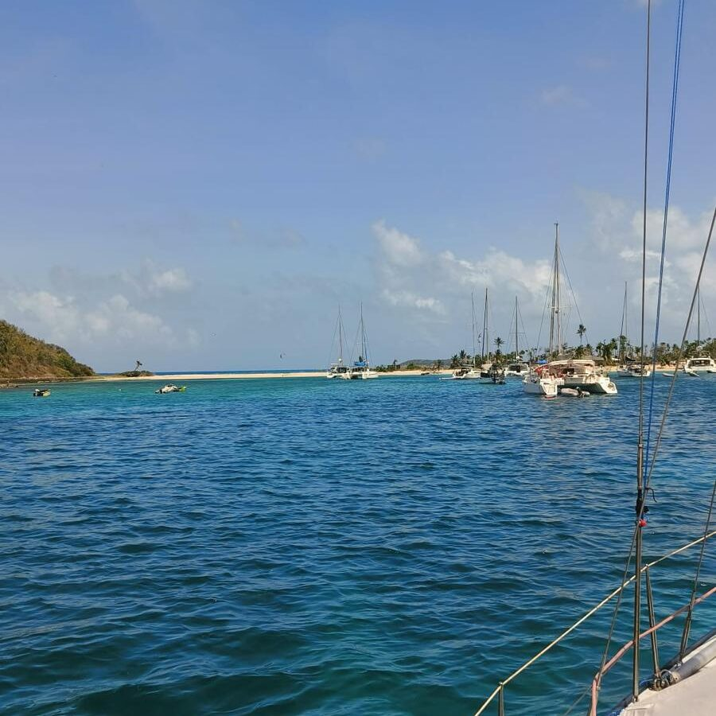

Op het strand van deze prachtige baai staan een paar getimmerde strandtentjes die allemaal dezelfde hapjes en drankjes verkopen. We wandelen een stukje over het strand en strijken dan neer bij een van de tentjes en drinken een biertje met uitzicht op de baai. Het is voor onze portemonnee een klein beetje te gortig om hier met z’n tweeën flink door te zakken, maar het zou er een prima plek voor zijn geweest. We besluiten dan ook onze avond voort te zetten op ons eigen drijvende terras en varen vlak voor de zon onder gaat terug naar *Luwte*, die zoals elke avond oranje kleurt in het avondrood. Een ander stalen scheepje komt op dat moment de haven binnen varen en we zien een enthousiaste zwaai onze kant op terwijl ze naast ons het anker laten zakken. Jonge Britten, toch even langsgaan zo!

Taz en Chloe van de *Alicia* (spreek Brits uit: Arliciààr) en wij klikken vanaf de eerste minuut. De onderlinge magnetische aantrekkingskracht van (relatief) kleine stalen schepen bewijst zich maar weer. In de strandtent die we eigenlijk te duur vonden drinken we onze laatste EC dollars op en worden voor de laatste rondes getrakteerd door Taz en Chloe. Ze hebben een vriendin van Chloe voor twee weken mee die op Barbados is opgestapt. Zij is ernstig zeeziek, maar geniet met behulp van allerlei zware zeeziektetabletten met volle teugen van het leven aan boord. Zij willen de volgende dag ook richting de Tobago Cays en we besluiten dan ook dat we een paar dagen kunnen optrekken.

De Tobago Cays zijn een van de trekpleisters van het Caraïbisch gebied. De vier kleine eilandjes liggen aan de Atlantische kant en worden beschermd door een groot, levendig koraal dat de oceaandeining doet breken en daar direct achter een prachtige ankerbaai vormt. Het ondiepe water is kristalhelder en fel lichtblauw. Als we ons anker laten zakken zien we *live* hoe het zich ingraaft in het zand en *Luwte* op haar plek houdt. *Alicia* komt naast ons liggen. We hebben de minder populaire hoek van het gebied opgezocht om een beetje uit de menigte te liggen en wanen ons dan ook alleen in een grote Pacifische atol. Als we het water in springen en onze snorkels opzetten worden we direct begroet door een wereld vol met vissen, enorme pijlstaartroggen en levendig koraal waarin de kreeften zich verschuilen. Met zijn vijven zwemmen we rond een van de eilanden en laten ons daarna weer met de golven mee drijven richting onze boten. We spreken rond borreltijd af bij ons aan boord en genieten dan nog een paar uurtjes in de kuip van het spectaculaire uitzicht.

Terwijl we daar zitten trekt de wind aan en begint de baai langzaam wat onrustiger te worden. Als de bemanning van de *Alicia* bij ons aan boord klimt, komen we er achter dat onze flippers en duikbril die op het zwemplateau lagen, door een golf zijn weggespoeld en opgeslokt door de zee. We duiken tevergeefs het water in en speuren de bodem af, maar we kunnen ze helaas niet meer terugvinden.

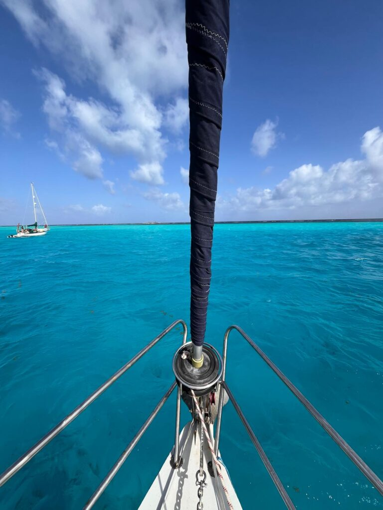

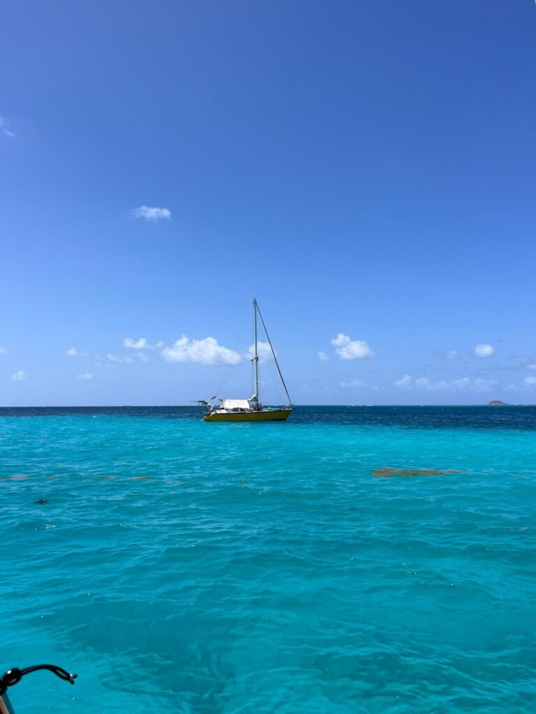

Het maakt de avond er niet minder gezellig om. Al na een uur zien we de vriendin van Chloe wit wegtrekken door het slingeren op de golven. Ze moet nodig gaan liggen, maar vindt het wel zo gezellig dat ze er bij wil blijven. We halen dus snel wat kussens van binnen en plaatsen haar op onze smalle kuipvloer onder onze benen. Zo zitten (en liggen) we de hele avond met haar onder ons in de kuip. We wisselen onze levensverhalen uit en vallen van de ene verbazing in de andere als Taz vertelt over zijn geschiedenis en zijn familie. Zij zijn als gezin verzot op surfen en zijn al eens de wereld rond geweest. Daarna hielpen ze een Britse mafkees onder vlag van *Redbull* om non-stop rondom het Verenigd Koninkrijk te zwemmen (The Great Swim staat op YouTube) en in een recent avontuur vinden ze in een archief een beschrijving van de meest spectaculaire surfspot ooit, die niemand kent en gaan ze à la Indiana Jones op zoek naar deze verborgen parel.

Ik kan nog pagina’s volschrijven over de verhalen die zij met ons gedeeld hebben, maar het belangrijkste is dat we volledig met ze op dezelfde golflengte zitten. Het enige verschil zit hem in onze plannen. De *Alicia* wil de Pacific in om op zoek te gaan naar de mooiste surfspots op aarde, terwijl *Luwte* zich naar het Noorden begeeft om huiswaarts te varen. Eventjes lonkt het weer om ons roer ook gewoon om te gooien en met ze mee te varen naar de andere kant van de wereld. Ze doen hun best, maar we weten de verleiding te weerstaan en houden ons aan ons plan.

Rond een uur of zes in de ochtend, als de zon net de horizon begint op te lichten, klim ik uit bed en kunnen we eindelijk in beweging komen. Ons hoofd is wat zwaar van de avond ervoor en de nacht heeft geen verlichting geboden. Door de nacht heen is de wind verder aangetrokken en staan er daadwerkelijk golven in de baai. Ik kijk naar buiten en zie hoe *Alicia* omhoog springt op de golven, om vervolgens bijna met de neus onder water te verdwijnen. Het is alsof we midden op zee voor anker zijn gegaan. Zo hadden we het niet helemaal bedacht.

We halen ons anker op en laten *Alicia* zonder echt gedag te kunnen zeggen achter ons terwijl we op zoek gaan naar beschutting. Achter de eilanden, tussen de grote gehuurde catamarans vinden we een plekje waar we rustig liggen. We duiken weer te kooi om bij te komen en staan pas rond het eind van de ochtend langzaam op. Ik ben eigenlijk wel klaar met deze plek en wil graag naar een wat beschutter gebied. De komende dagen gaat de wind verder aantrekken en zal het overal een stuk lastiger worden om goede beschutting te vinden. Jen heeft echter andere ambities, want die heeft gelezen dat hier een *turtle beach* is. Ik mok wat dat het niet hoeft en we toch geen flippers meer hebben, maar uiteindelijk heb ik daar natuurlijk weinig op in te brengen. En dat is maar goed ook, want nadat we de bijboot op het strand hebben getrokken en het water in lopen is het wat zoeken, maar zwemmen de schildpadden plotseling om ons heen. Heel relaxed, precies zoals ze in *Finding Nemo* zijn. Een beetje hangen boven de bodem, eten, met één slag omhoog dobberen, even ademhalen en zonder slag weer naar beneden zinken om verder te eten. Dat wij er zwemmen moeten wij maar weten, ze storen zich er niet aan, maar gunnen ons verder ook geen blik waardig.

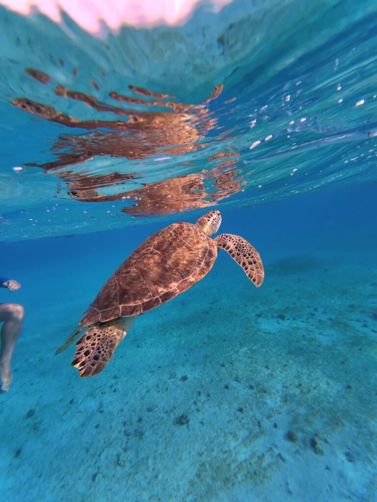

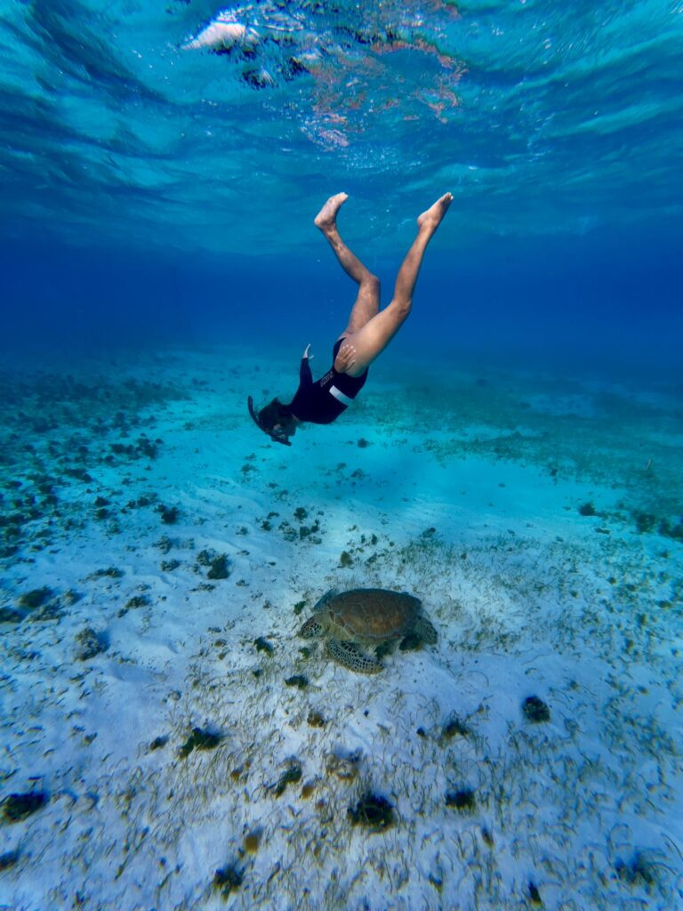

Aan het eind van de ochtend komt *Alicia* ook de beschutting opzoeken en we gaan nog even bij hun op de koffie. Taz overtreft mijn zeebonkerigheid en heeft zichzelf sinds vertrek geleerd op de sterren te navigeren. De sextant die mijn ouders zeventien jaar geleden meehadden als hobby en back-up ligt nu nog altijd hageltje nieuw in *Luwte*s kastjes. Taz en ik klimmen naar binnen waar hij mij met veel geduld de fijne kneepjes van het vak aanleert. We schieten de zon, maken eindeloos veel berekeningen en komen uiteindelijk op zo'n 60 mijl in de buurt uit. Uiteraard is dat niet heel nauwkeurig, maar met slechts een enkele observatie en een eiland op de horizon niet slecht (weet Taz mij te vertellen). Ik krijg een aantal pagina's mee uit zijn speciale plottercollectie en een succeswens voor mijn eerste berekeningen. Intussen zit Jen met de dames buiten in een parallel universum. Al kletsend zijn zij in het half uur dat wij zaten te rekenen verdiept van 'Heb je nog broertjes en zusjes?' naar 'wat is nou je ergste jeugdtrauma?'. Het bevestigd maar weer dat we het goed kunnen vinden denken we.

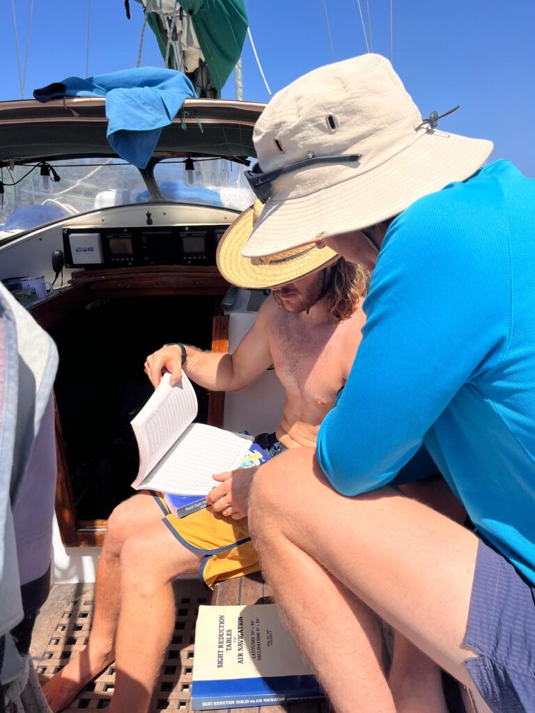

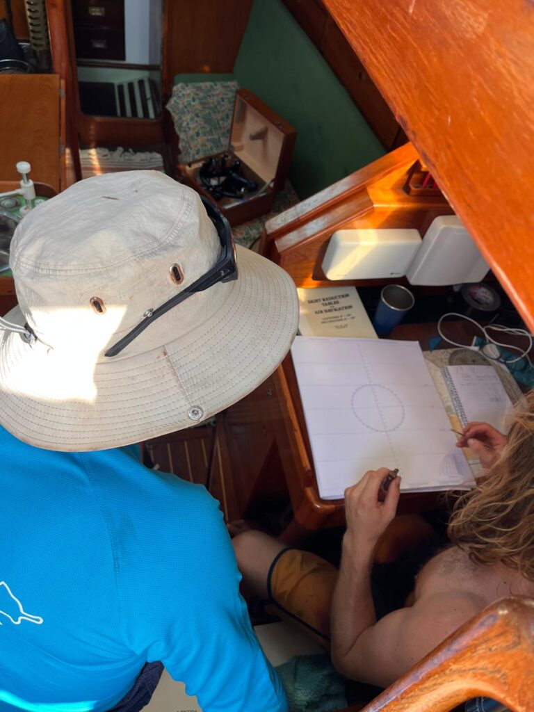

We besluiten de volgende ochtend dat we het hier wel gezien hebben. Het enige wat we hebben overgeslagen is de *lobsterbarbeque* die op het strand wordt georganiseerd, maar de prijzen zijn duidelijk afgestemd op vakantie vierende Amerikanen en gaan ons budget ver te boven. Die gaan we zelf wel ergens proberen te vangen. Een visser probeert ons vlak voor vertrek nog een kleine mahi mahi te verkopen voor zestig euro, maar als hij na de prijs te laten zakken tot dertig euro doorkrijgt dat we het geld simpelweg niet bij ons hebben zijn we al snel niet meer interessant. Voor ons is het tijd om ankerop te gaan.

We varen weg met zo’n 22 knopen op de kop en dat voelen we meteen als we achter de eilanden en het rif vandaan komen. De golven zijn door de grote diepteverschillen kort en aggressief en er staat een flinke stroming waardoor we niet lekker comfortabel halve wind kunnen zeilen, maar hoog aan de wind onze weg door het water ploeteren. Ons plan is om meteen door te varen naar Bequia, maar als we achter Canouan komen en de zee wat rustiger wordt, besluiten we dat we voor de rest van de middag even lekker willen zwemmen in wat kalmer water.

Bij het naderen van het strandje waar we een plekje hopen te vinden, rollen we de genua in en proberen we de motor te starten. Dat lukt heel duidelijk niet. Met een grote bons loopt de motor vast tijdens het starten en lijkt er geen beweging in de cilinders te zitten. Ik haal snel de kappen van de motor af bekijk alles even en probeer het dan nog eens. De startmotor slaat aan, draait de krukas een halve slag maar loopt dan brommend vast. Taz en Chloe vertelden ons eergisteren over hun *waterlock* incident, waarbij er water door de uitlaat het motorblok in was gestroomd en even zie ik voor me hoe dat nu bij ons ook zo moet zijn. Vanochtend draaide ze nog als een zonnetje en was er geen vuiltje aan de lucht!

Jen stuurt op alleen het grootzeil de boot wat heen en weer in de baai, die gelukkig heel rustig is en dus hebben we de tijd. Ik loop alles nog eens na, van olie tot elektra en concludeer dan dat ik niet zo goed weet wat het kan zijn. Met de hand probeer ik de krukas door de compressie heen te duwen, wat niet zou moeten lukken met water in de cilinders en dat lukt! Dat probleem lijkt het dus niet te zijn, maar wat het dan wel is…? Ik probeer nog één keer te starten en vroemm, de motor start als vanouds als een zonnetje, alsof we het gedroomd hebben.

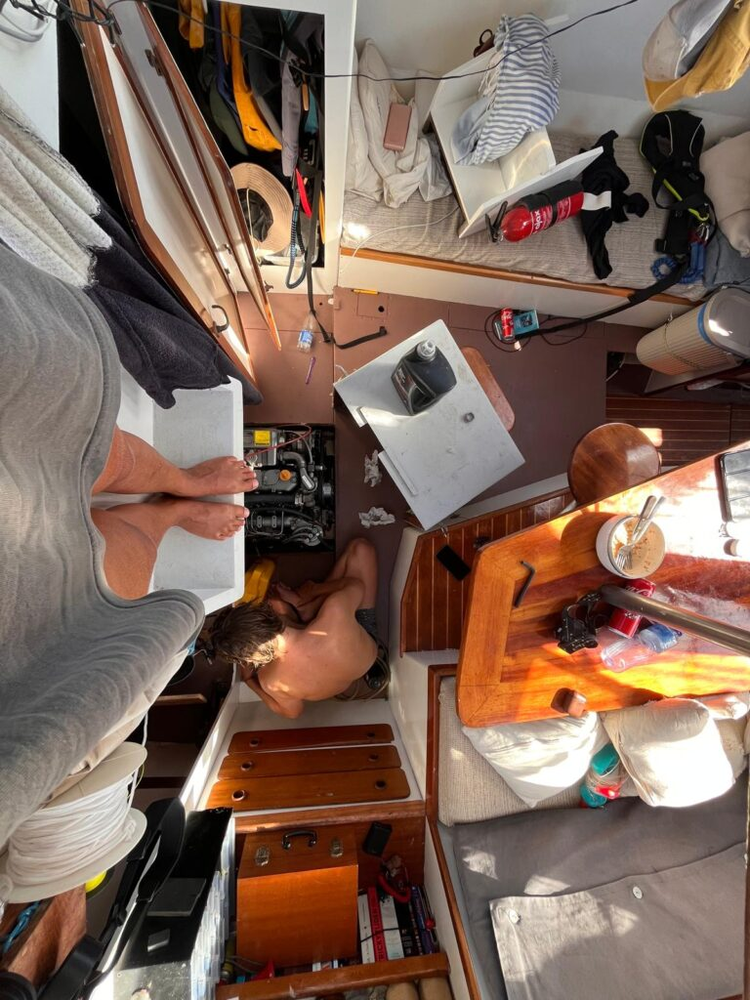

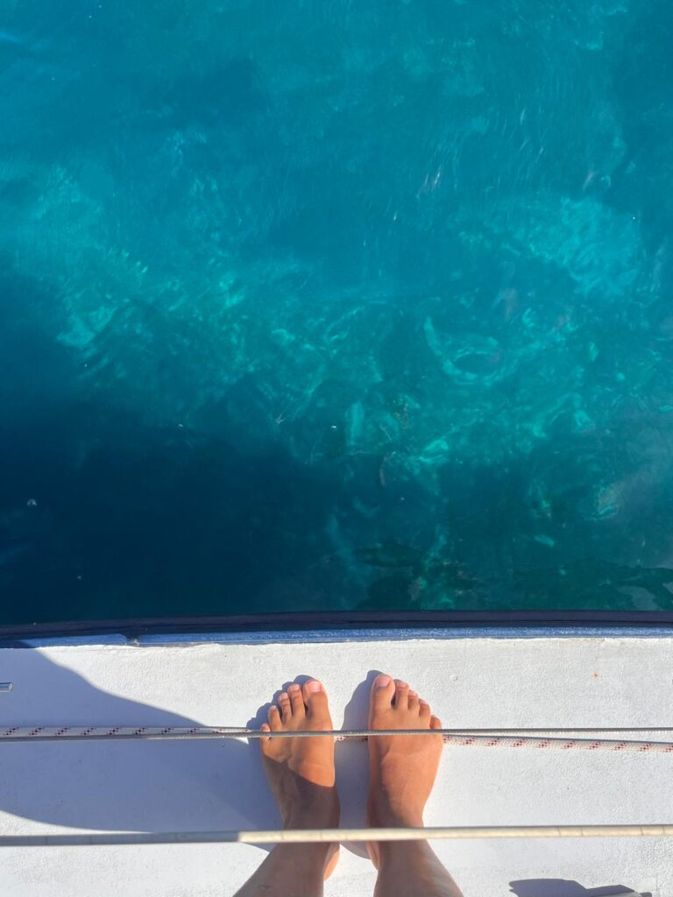

Eenmaal veilig achter anker start ik de motor nog een aantal keer filmend om verder te kunnen zoeken naar wat het geweest zou kunnen zijn, maar de motor doet alsof er niets aan de hand is en we het ons hebben verbeeld. Starten lopen, keer op keer. Omdat het toch niet helemaal lekker voelt stuur ik wat berichten rond naar mensen die er een mening over zouden kunnen hebben en besluiten wij voor de nacht maar bij Canouan te blijven hangen. Vlak voor de zon begint te zakken komt er een visser voorbij die ons een kreeft komt brengen en die gaat heerlijk met knoflook en olie op de barbecue. Toch nog *lobsterdinner*!

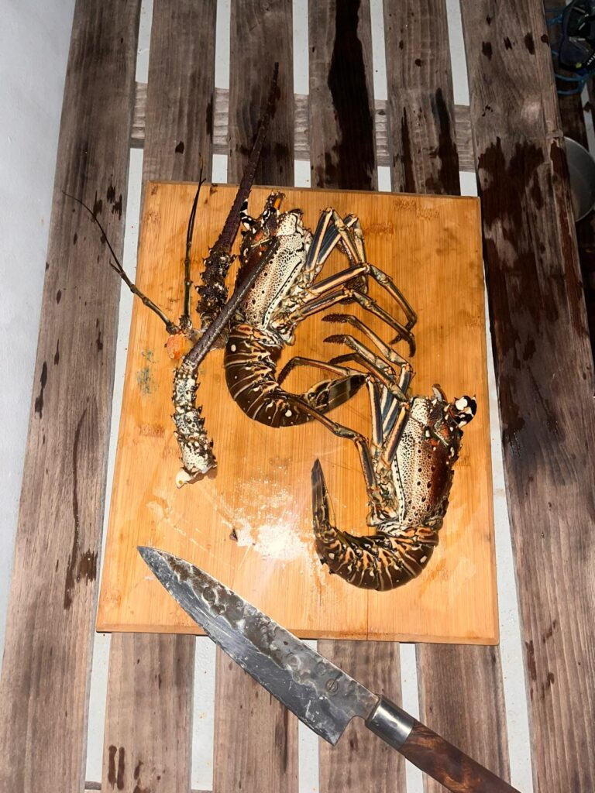

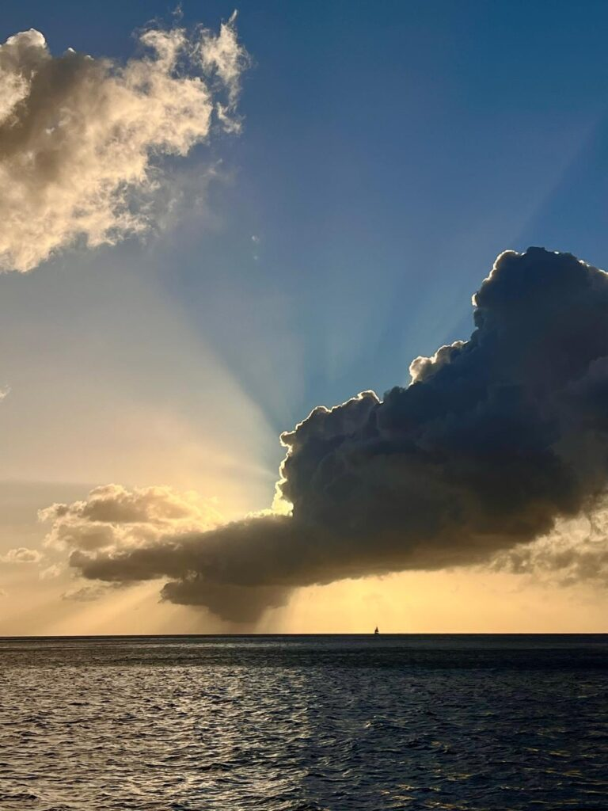

Hoe rustig de baai ook was rondom het vallen van de avond, hoe anders is die nacht. We liggen vlak achter een heuvel waar zogenaamde valwinden naar beneden komen. Dit zijn letterlijk hoeveelheden lucht die over de top van een berg omlaag vallen en over het wateroppervlak versnelt worden. Als resultaat liggen we hard te rukken aan onze ankerketting. Na een paar uur is de zorg wel voorbij dat we losschieten, maar echt lekker slapen doen we er ook niet van.

’s Ochtends besluiten we dan ook om het anker maar weer op te halen en niet bij Canouan te blijven liggen. Bequia schijnt over het algemeen goede beschutting te geven en de voorspellingen voor de komende dagen zien eruit alsof we dat wel kunnen gebruiken. We zeilen uit achter een grote Bavaria verderop, maar komen door de dag heen steeds dichterbij. Als we uit de beschutting komen van Canouan en ons in het ‘gat’ tussen de eilanden bevinden zwelt de wind aan en krijgen we een agressieve golf op onze neus. We zetten het tweede rif maar meteen in het grootzeil en hebben *Luwte* zo prima onder controle. De bijboot hangt achterop, maar zit niet helemaal lekker vast, dus terwijl we aan het stampen zijn klim ik nog even op het zwemplateau om de lijnen wat verder aan te sjorren. Eigenlijk hadden we *Storm* op het voordek moeten leggen…

Als we de Bavaria op een meter of dertig genaderd hebben en ik trots de zeilen nog wat verder trim om de mokerslag uit te delen, horen we opeens een knallend en scheurend geluid, gevolgd door veel geklapper. Vlak voor onze neus scheurt het voorzeil van onze tegenstander spontaan doormidden. We wijken voor ze uit terwijl ze het zeil zo goed en zo kwaad als mogelijk inrollen en zien we hoe ze motorzeilend met het grootzeil bij verder gaan. We bekijken onze eigen zeilen nog eens en komen tot de conclusie dat het nog wel gaat, maar dat we blij zijn als we nieuwe doeken hebben. We rollen de fok toch nog maar een stukje verder in voor de zekerheid als we de lucht zien betrekken.

Nog geen tien minuten later zien we de Bavaria verderop verdwijnen in een gordijn van regen en kort daarna voelen we de plotselinge daling van temperatuur, het aanwakkeren van de wind en tenslotte de stortregen. Het fokje gaat nog wat verder in en hoewel we nu wel erg veel water over dek en onszelf heen krijgen, voelt het allemaal nog redelijk gecontroleerd. De bui trekt over en een half uur later drogen we ons aan de middagzon weer warm. Warme regen, dat gaan we missen als we komende herfst weer op de fiets moeten…

We zijn net droog als Neptunus nog wat olie op het vuur gooit. In een tijdsbestek van nog geen tien minuten horen we twee verschillende Maydays over de marifoon binnenkomen. Er wordt door de kustwacht niet gereageerd. De Mayday wordt een aantal keer herhaalt en bevindt zich nog geen acht mijl bij ons vandaan. We kunnen daar niet naartoe varen en waarschijnlijk ook geen hulp aanbieden, maar zijn allebei opgelucht als we horen dat een superjacht naar ze toe komt om te helpen. Om één of andere reden reageert de kustwacht wel op de oproep van het superjacht en besluit hij om als vertaler en backup in de buurt te blijven. We horen over de marifoon op de achtergrond gevloek en geschreeuw van het schip met negen man aan boord dat water maakt en verwacht niet op eigen kracht de haven te redden. Uiteindelijk komt de kustwacht pas vlak voor de baai tegemoet met grote pompen en wordt het superjacht *dismissed*. Het is voor ons een impactvol moment waarop ineens weer heel duidelijk wordt dat je het water niet moet onderschatten en al klonk dit niet als een erg ervaren *crew*, een ongeluk zit in een klein hoekje en de gevolgen zijn snel groot.

Doordat we aan de marifoon gekluisterd waren hebben we niet door dat de tijd en de wind door zijn gaan tikken. Het laatste stuk kunnen we nauwelijks genoeg hoogte maken om in de buurt van de beschutting te komen en krijgen we bui na bui over ons heen. Intussen gaat de zon onder en begint dit onbekende terrein zich te verstoppen in de donkerte van de nacht. Op een gegeven moment weten we niet zo goed meer wat links en rechts is. We zijn allebei moe, verkleumt en het waait zo hard dat het water spontaan opwaait van de golven en het zout laat opbouwen op onze gezichten. Als we ein-de-lijk in de beschutting van het eiland komen, blaast de wind nog steeds, maar zijn de golven doorkliefbaar. We halen de fok weg en zetten de motor bij voor de laatste twee mijl recht tegen de wind in. We zijn er wel klaar mee en hebben geen ambitie om in het donker nog door de onbekende baai naar binnen te kruisen.

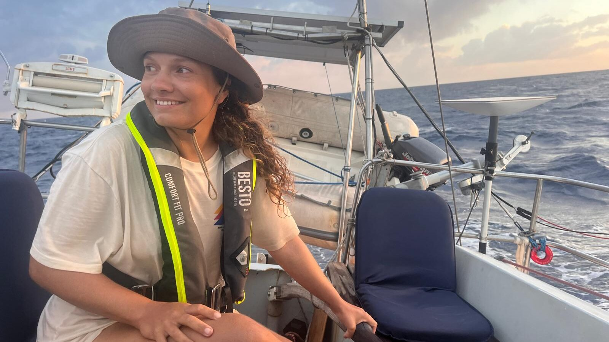

Als ik na een minuut of tien naar binnen ga om onze dagtank bij te vullen, blijkt de opvoerpomp niet meer te werken. Er zit nog zo’n drie liter in de tank waarmee we het moeten doen. Als we het daarmee niét halen, moeten we alsnog zeilend voor anker, of weer buitengaats gaan tot ik het heb kunnen oplossen. Op een laag toerental varen we dus verder, al gaat het tergend langzaam. Er is geen maan en het dorp verblindt ons waardoor we pas op een meter of twintig de eerste andere boten kunnen onderscheiden. De lichtjes in de toppen van de mastjes vermengen zich met straatlantaarns en de sterren, dus daar hebben we eigenlijk niets aan. We vinden een plekje en gooien op goed geluk het anker uit. We blijven liggen en de motor kan gelukkig uit. Meestal voelen we ons op dat moment voldaan, wellicht een beetje moe, maar tevreden. Nu zijn we alleen maar moe, koud en overspoeld door teveel indrukken en hebben we behoefte aan slaap. Geen ankerbiertje, of rum-punch om nog even na te kletsen, maar gewoon direct naar bed en de dag van morgen maar weer een kans geven.

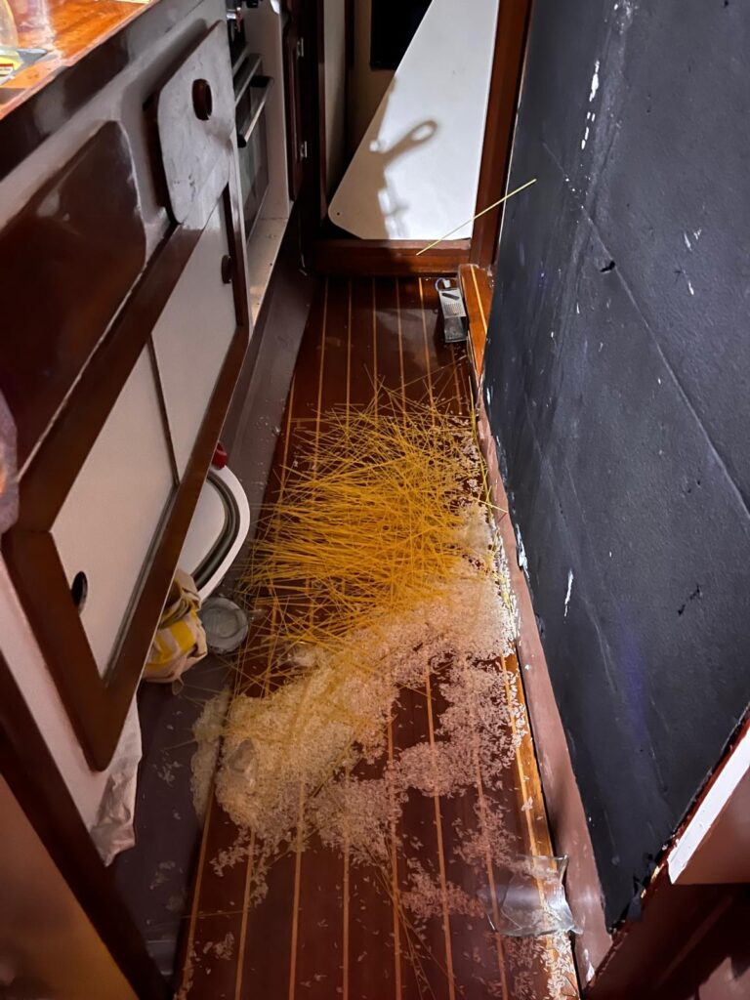

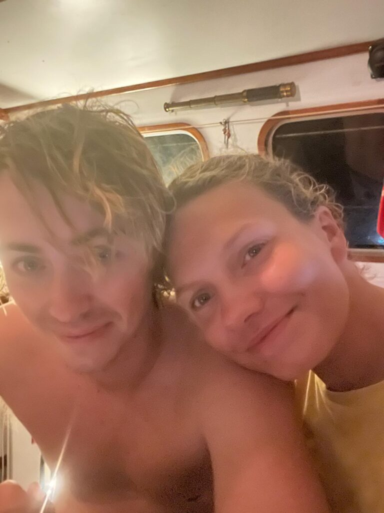

Bequia maakt daarentegen weer veel goed. De baai is inderdaad beschut en gemoedelijk. ’s Ochtends haal ik meteen de opvoerpomp uit elkaar en nadat ik hem drie keer opnieuw helemaal ontmanteld heb, schoongemaakt en in elkaar gezet doet hij het gewoon weer. Er blijkt toch wat vuiligheid in de hoofdtank te zitten, dus daar moeten we nog maar eens een extra filter tussen hangen. Gelukkig hebben ze hier bootwinkeltjes en kunnen we het één en ander scoren. Als alles er ’s middags weer op zit en de dagtank weer mooi vol loopt, starten we de motor om een iets mooier ankerplekje in de baai te scoren. Jen staat al op het voordek om haar spierballen te laten zien met het anker ophalen, als ik er achter kom dat de motor geen gas meer wil geven! Hij schiet wel in versnelling, maar de morse die de gashendel induwt, geeft geen sjoege.

Gelukkig hebben we binnen in ons stuurhuis een tweede gashendel zitten en die doet het nog wel. We zijn gisteravond dus één keer gasgeven verwijderd geweest van dit euvel. Dat had er ook nog even bij moeten komen. Gelukkig is het een bekend probleem in gashendelland. Vroeg of laat breken deze kabels van metaalmoeheid door het eindeloze trillen van de motor. We knijpen in onze handjes dat het nu gebeurt terwijl we lekker achter ons anker hangen, want meestal stoppen deze kabels er natuurlijk mee op het moment dat je ze nodig hebt… De bootjeswinkel heeft er gelukkig nog eentje liggen in onze maat en diezelfde middag zijn we weer operationeel en kunnen we *Luwte* op een iets rustiger plekje neerleggen.

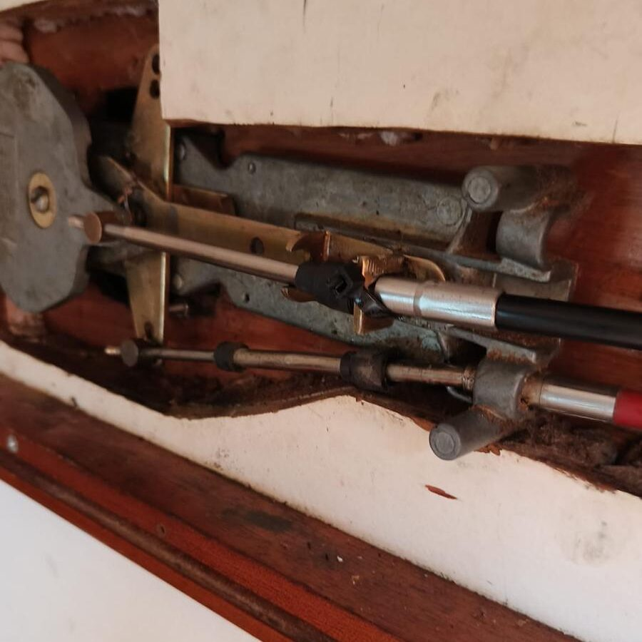

<figure class="wp-block-image size-large">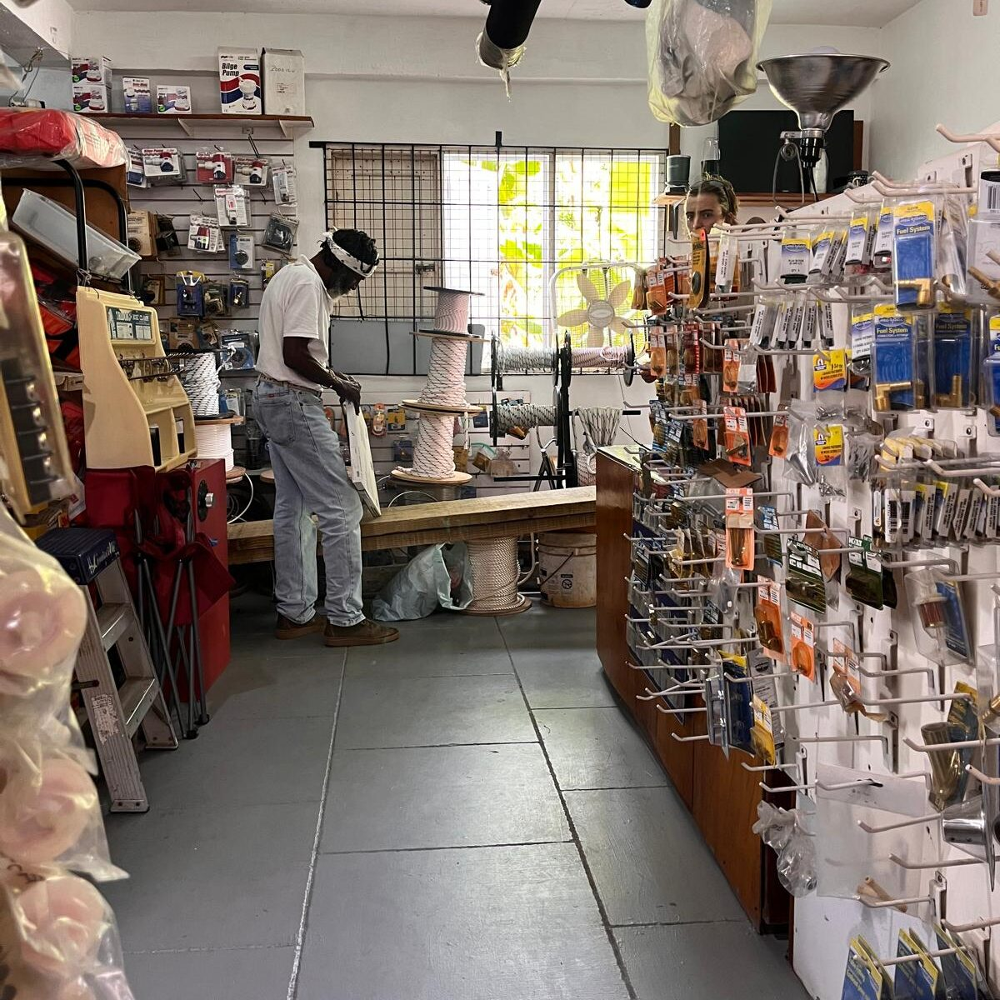<figcaption class="wp-element-caption">Maar deze Caraïbische <em>Pirate</em> had er nog eentje liggen</figcaption></figure>

Eenmaal op een lekker plekje gelegen genieten we van Bequia. Het stadje waar we aan liggen is gezellig en heeft veel restaurantjes. We vinden al snel de lekkerste en goedkoopste roti van het eiland en eten tussen de vissers en werklui onze buiken vol. De dames in de keuken staan de hele dag in grote pannen te roeren en onder een afdakje naast een kraantje staat een grote emmer met kip. Zodra je de hoek om loopt kom je op de ‘boulevard’ die duidelijk is ingericht voor rijke toeristen. Overal staan tentjes met prullaria, koude kokosnoten en de restaurants zijn aangeharkt en schenken chique cocktails. Terwijl we langs het water lopen op zoek naar een terras met uitzicht op *Luwte* lopen we langs een duikschool en trekt Jen me mee naar binnen. Een paar minuten later staan we buiten met een dubbele duik op de planning en een lege beurs, maar het schijnt het hier best waard te zijn.

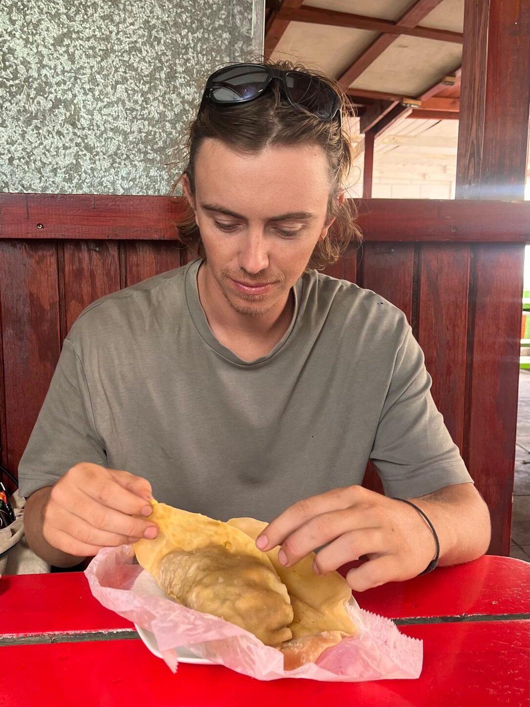

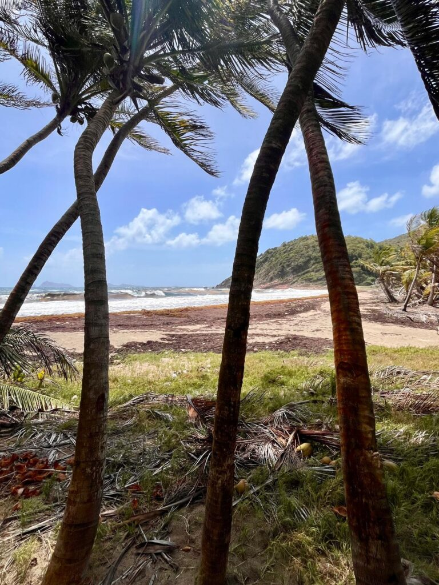

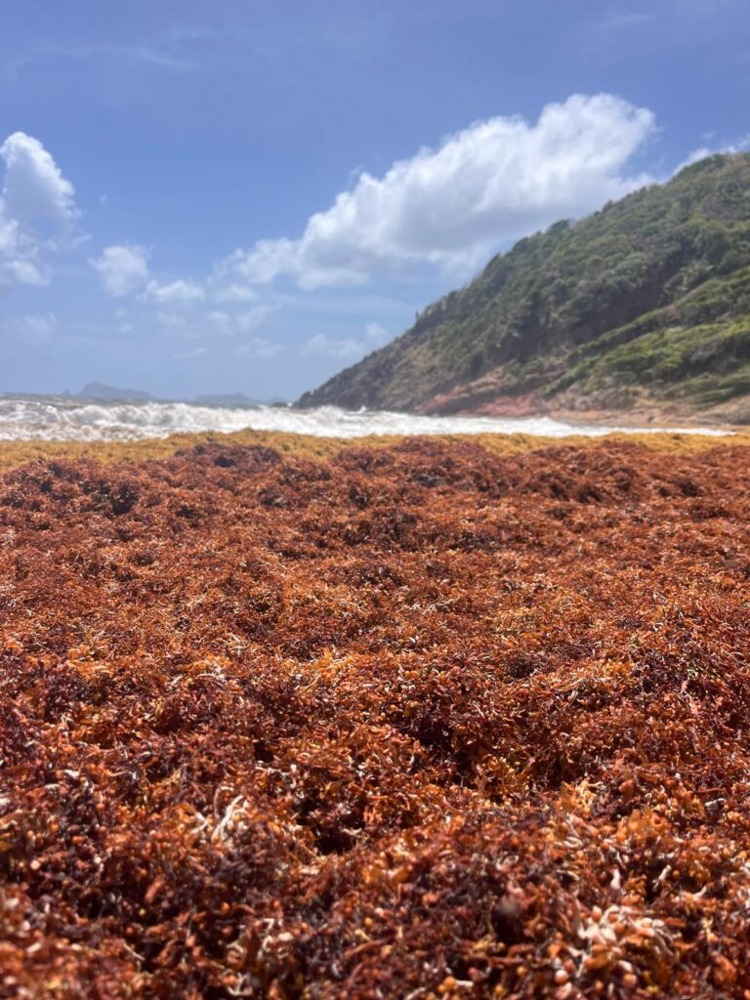

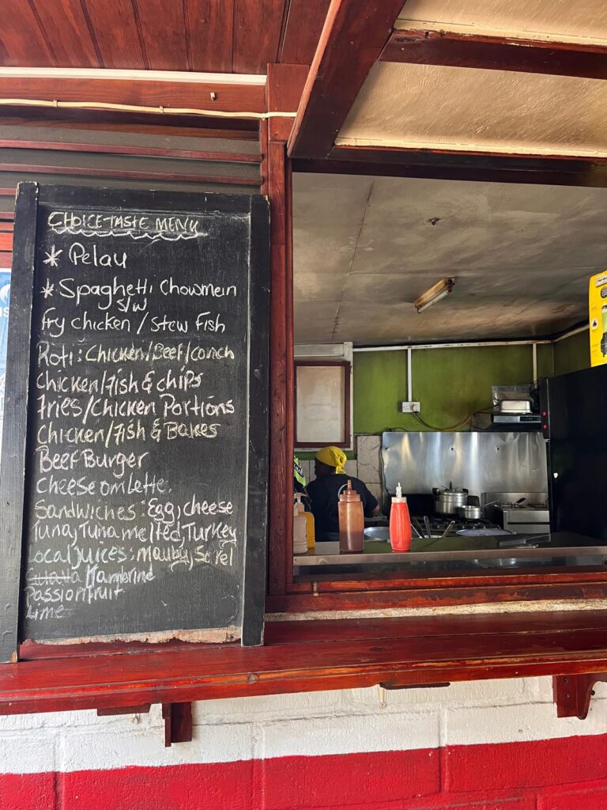

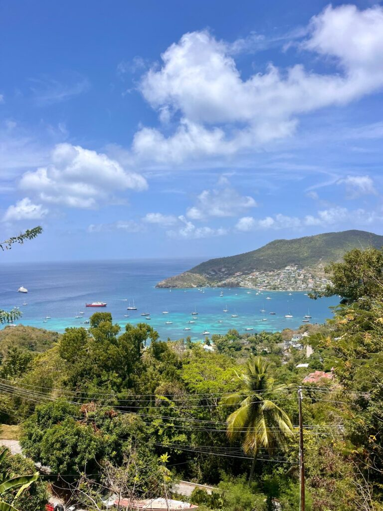

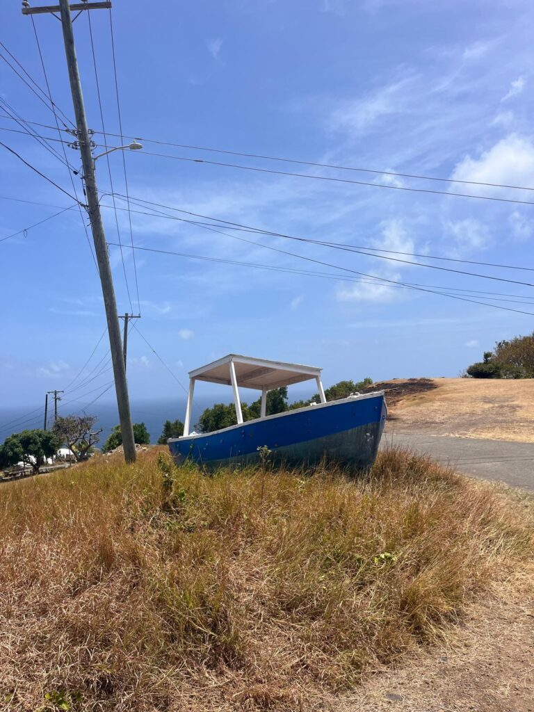

De volgende ochtend vroeg staan we op om richting de duikschool te gaan als ik nog even naar het anker kijk op de bodem. Niets leek er op te wijzen dat we niet goed lagen, maar aangezien we de hele dag op pad gaan is het toch een fijn gevoel om te weten dat die mooi ingegraven ligt. Tot onze verbazing ligt ons anker los op de bodem en is alleen een uiterst puntje ingegraven. We draaien meteen om en trekken met de motor in z’n achteruit de ankerketting strak om het anker beter in te graven. We liggen muurvast, maar bij een tweede inspectie ligt het anker nog altijd bovenop de bodem, en niet er in.

We besluiten snel heen en weer te varen naar de duikschool om onze duik te verplaatsen en halen het anker op om het verderop weer neer te gooien. Daar graaft ze zich direct goed in en liggen we weer goed. Weggaan met onzekerheid over je ankergerei kan je dag (zeker die van mij) volledig in de ban van een potentieel wegdrijvend schip brengen, dus we zijn blij dat we het duiken er nog een dagje voor hebben uitgesteld.

Poging twee, de dag er na is het wachten dubbel en dwars waard. We worden voor de kliffen buitengaats de zee in gegooid en hoewel het wat wild voelt in de boot, overvalt de explosie aan sereniteit ons als we onze vesten ontluchten en naar beneden zakken. Langs een wand van ruim dertig meter recht naar beneden laten we ons afzakken. Jen ziet de hele *Finding Nemo* aan zich voorbij zwemmen, inclusief vissensnelwegen. Als klap op de vuurpeil leidt onze instructeur ons mee naar de *Moonhole* cave. Een onderwatergrot waar we naar binnen kunnen zwemmen. Als we aan de andere kant van de grot naar buiten komen en een beetje afstand nemen van het rif begint onze stijging alweer en komen we vol extase weer boven…

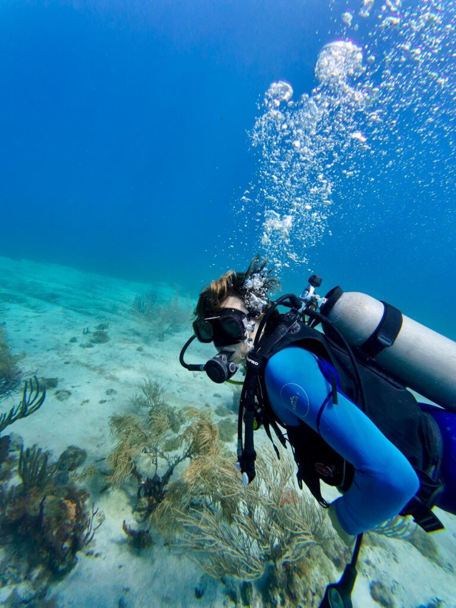

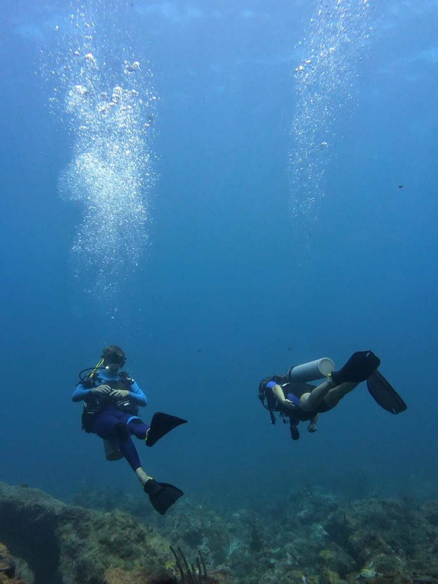

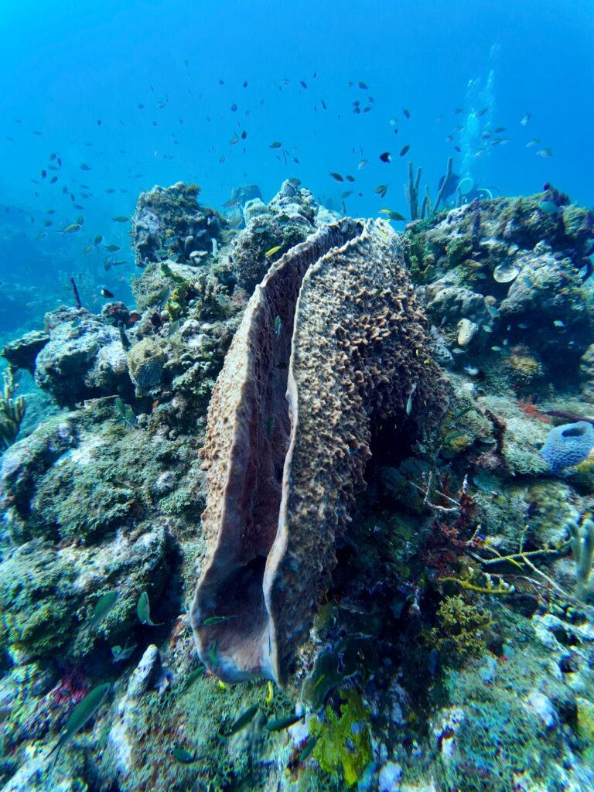

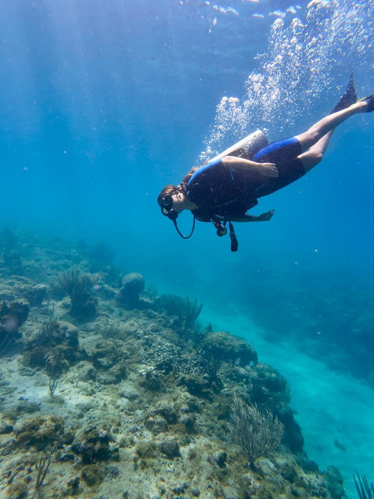

Als we vlak voor ons vertrek nog een rondje in de dinghy doen valt het ons wat zwaar om alweer gedag te moeten zeggen tegen Taz en Chloe van *Alicia*. Zij gaan op zoek naar *big waves* in de Pacific en zullen voorlopig het Europees continentaal vlak niet aandoen. Wij varen door naar Martinique, waar we moeten klussen, Patty en Mark zullen verwelkomen en dan hopelijk toch eindelijk onze nieuwe zeilen zullen ontvangen. De mannen van *Belafonte* zeggen we ook gedag, maar daarbij gaan we er van uit dat we elkaar wel weer gaan zien. Met *Lillesol*, bemand door een jong Duits stel spreken we voor de zoveelste keer af dat we in de volgende baai écht een biertje gaan drinken als we elkaar weer tegenkomen.

<figure class="wp-block-image size-large">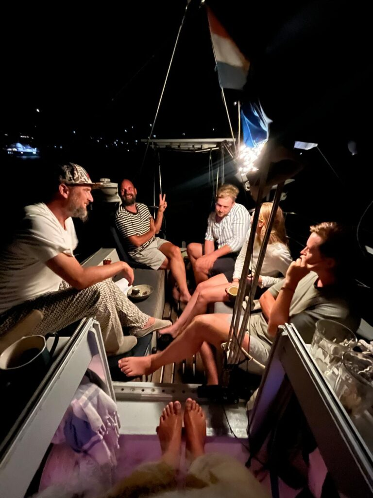<figcaption class="wp-element-caption">Palaver met <em>Belafonte </em>en <em>Lillesol </em>over de volgende trip</figcaption></figure>

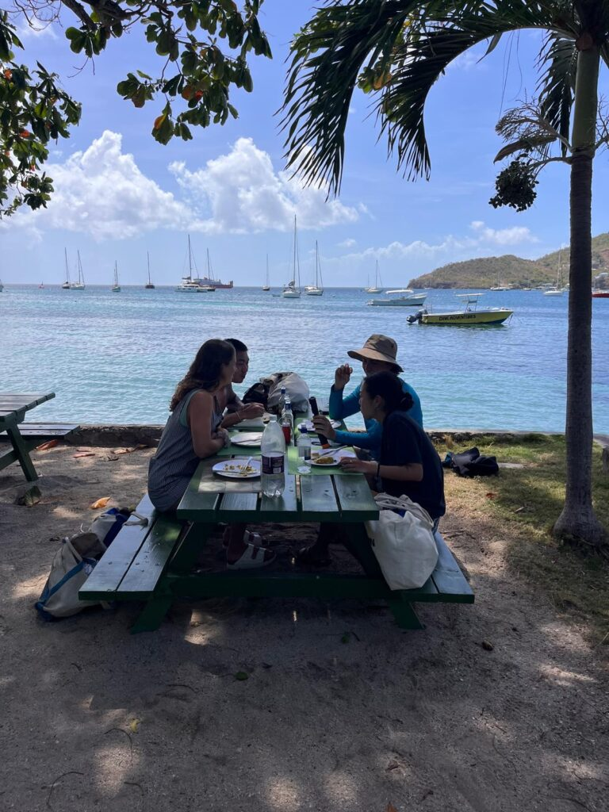

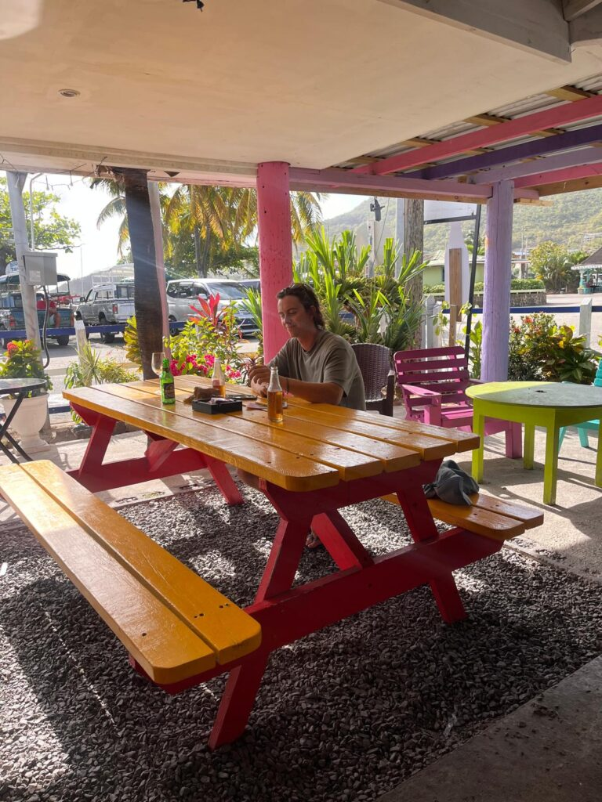

<figure class="wp-block-image size-large">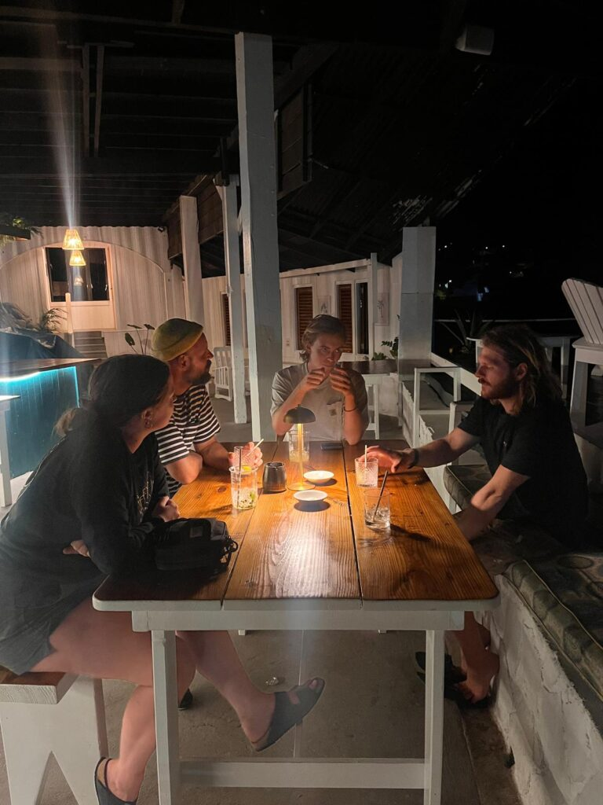<figcaption class="wp-element-caption">Cocktailoverleg <em>Belafonte </em>x <em>Alicia</em> x <em>Luwte</em></figcaption></figure>

*Luwte* heeft weer wat liefde nodig. Vind ik dan, ben ik achter gekomen. In vergelijking met anderen zijn we veel bezig met ‘grote’ klussen zoals ramen vervangen, roest bikken en andere ongein. Daarin zijn verschillende scholen. Als je gewoon niets zou doen aan de boot en alleen het essentiële bijhoudt om een jaar weg te blijven, blijft de boot ook wel drijven en kun je na terugkomst tijd steken in het onderhoud terwijl je nu optimaal geniet. De andere school, waar ik kennelijk meer toe behoor, leert dat vrijwel elk onderhoud in zekere zin essentieel is. Mijn blinde vlek daarin zit wellicht op het cosmetische, waar ik soms wat te weinig waarde aan kan hechten, maar gelukkig heeft Jen daar een scherp zicht op. Ik heb sinds een maandje weer behoefte om roestplekjes bij te werken, alle constructies na te lopen en mijn grote ergernis: de kleine lekkages in onze ramen op te lossen. Jen wil de bijboot plakken en schrobben, ons RVS poetsen en een grote upgrade doorvoeren: Airco. Wij zetten dan ook koers naar Martinique, Le Marin, wat de Caraïbische droom van klussend bootjesmens zou moeten zijn. We gaan onszelf laten zweten en *Luwte* in de watten leggen zodat we klaar zijn voor nieuwe avonturen en oceaanoversteken.
