Het lijkt wel alsof we in herhaling vallen, maar ook de overtocht van Bequia naar Martinique krijgen we niet cadeau. Hoewel we onszelf wat beter hebben voorbereid en de dinghy dit keer niet met motor losjes achterop hangt, wil de Caraïbische zee zich duidelijk in de boeken laten zetten als een beruchter stukje wereld dan waar het om bekend staat.

De passaat komt al een tijdje uit het noord-oosten en daarmee is onze route richting de noordelijkere eilanden niet zo lekker achterover hangen en wachten tot je er bent. Bovendien blaast die noord-oost passaat al bijna twee weken consequent boven de twintig knopen, wat zorgt voor een onplezierig zeetje.

We vertrekken eigenlijk iets later dan gepland, maar in ieder geval voor het donker en varen zo de nacht in. Ik heb weer eens iets teveel hooi op mijn vork genomen om de boot vaarklaar te maken, de weerberichten door te spitten en onze aanloop op Martinique voor te bereiden. Het is een fout die we vaker maken, maar eigenlijk heb ik gewoon nog een uurtje voor me uitstaren nodig voor vertrek. Doordat doordraven kom ik er niet lekker in en doe geen oog dicht tijdens Jen’s wacht. Als we wisselen en Jen direct lekker in slaap valt merk ik dat ik het al zwaar begin te krijgen. Tegen twee uur in de nacht begint dat zijn tol te eisen en zie ik met mijn moeie ogen dat het achterlijk van onze fok begint in te scheuren. Misschien heeft het door midden gaan van de fok op de boot voor ons op de vorige trip toch wat meer indruk gemaakt dan ik me bewust van was, want hoewel ik zeker weet dat ik het zie, blijkt er de volgende ochtend bij daglicht niets aan de hand te zijn.

Om toch het zekere voor het onzekere te nemen rollen we vannacht toch de fok maar in en zetten we de motor bij om een beetje hoogte te kunnen blijven maken. Die fok is zorg voor later. Het is wat lawaaierig zo met de motor aan slapen, maar dat lukt wel. Een uurtje verder zien we drie andere lampjes van zeilboten onze kant op komen. Twee ervan zijn zichtbaar op de AIS, maar de laatste niet. Aangezien we de motor bij hebben maken we een duidelijke uitwijkmanoeuvre voor de andere bootjes en wachten tot ze voorbij zijn. Vlak voordat de laatste Fransman ons voorbij zou moeten gaan, verandert hij echter van richting en liggen we strak op ramkoers. Ik snel naar buiten en koppel de autopilot los. Het roer gaat om en we draaien zo’n 90 graden bij om niet op elkaar te knallen. In het pikkedonker zie ik het schip op een meter of twintig voorbij glijden. Stomme Fransen…

Jen neemt over en houdt de boel voorlopig in de gaten. Als we een uur of drie later weer wisselen is het nog altijd pikkedonker. Achter St. Lucia zijn de wind en golven weggevallen en kunnen we op het monotone geronk van de motor allebei even rustig slapen. Totdat.. drie lichte bonken van boeg richting roer zijn genoeg om mijn zintuigen strak te zetten en naar de gashendel te springen. Nét op tijd lijkt het. Als we buiten komen zien we een stuk piepschuim en een stok achter de boot drijven: Een visnet. Het is midden in de nacht op zee, zo’n twintig mijl van de kust af en we liggen stil. Gelukkig hebben we ruimte én liggen we nog in de beschutting van St. Lucia. Die twee gegevens voel ik op dat moment alleen niet zo en naargeestig proberen Jen en ik te bedenken wat de beste strategie nu is. We gaan er van uit dat ik op tijd was en hij achter het roer is blijven hangen, maar hoe komt die los? Ik voel er niet veel voor om in het donker het water in te gaan, met een schroef die misschien niet bruikbaar is mocht ik van de boot losraken. We kunnen naar St Lucia zeilen, maar dan moeten we de nacht dobberend doorbrengen en een ankerbaai in zeilen. Op zich geen verkeerde keuze, maar het is wel uit de route.

Ik besluit dat we eerst maar eens moeten vaststellen of het net in de schroef is gekomen, of inderdaad alleen achter het roer hangt, dat maakt nogal verschil. In het donker zet ik mijn snorkel op en terwijl Jen van bovenaf in het water schijnt, ga ik vanaf ons zwemplateau met mijn hoofd het water in. Ik zie niet veel, maar het lijkt er op alsof de lijn inderdaad alleen aan ons roer hangt! Nog één keer kijken om het te bevestigen. Ik ga letterlijk kopje onder en precies op het moment dat ik naar boven kom spoelt een golf van achter over het zwemplateau. Hij krijgt mij niet te pakken, maar mijn automatische zwemvest krijgt water binnen en een halve seconde later zit ik vastgeklemd tussen de windvaan en onze davits met een opgeblazen zwemvest. Gelukkig met mijn hoofd boven water…

Geschrokken klim ik terug in de kuip. Eerst even pas op de plaats nu. Er staat nauwelijks wind en we hebben geen haast. Droge kleren aan en dan weer verder denken. We overleggen onze opties nog een keer. En dan schiet de oplossing ons opeens te binnen: We moeten ons roer omhoog halen! De voordelen van een schip dat kan droogvallen blijken maar weer eens eindeloos. Het is even pielen, maar op een gegeven moment schuift het roer een stukje omhoog en zien we meteen de dobber en de lijn in het donker achter ons verdwijnen. Voorzichtig slaan we de motor even in zijn achteruit en weer vooruit om er zeker van te zijn dat er geen lijn in de schroef hangt. Ik voel geen abnormale trillingen en hoor geen geluiden die mij niet bekend zijn. We lijken met de schrik vrij gekomen.

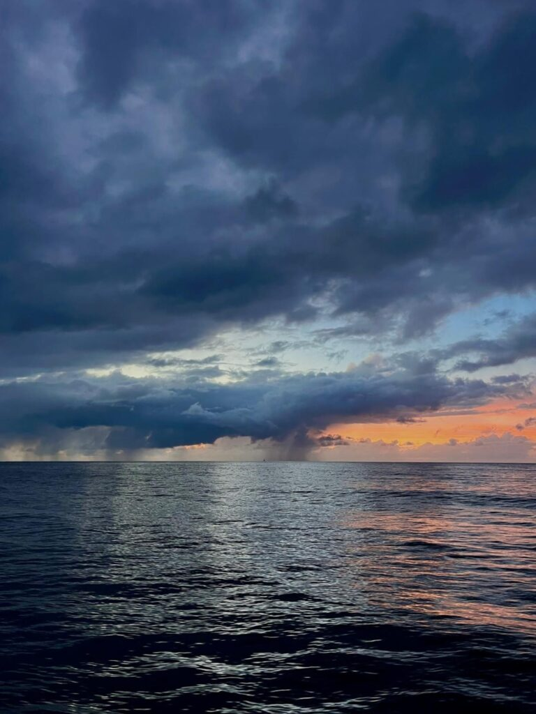

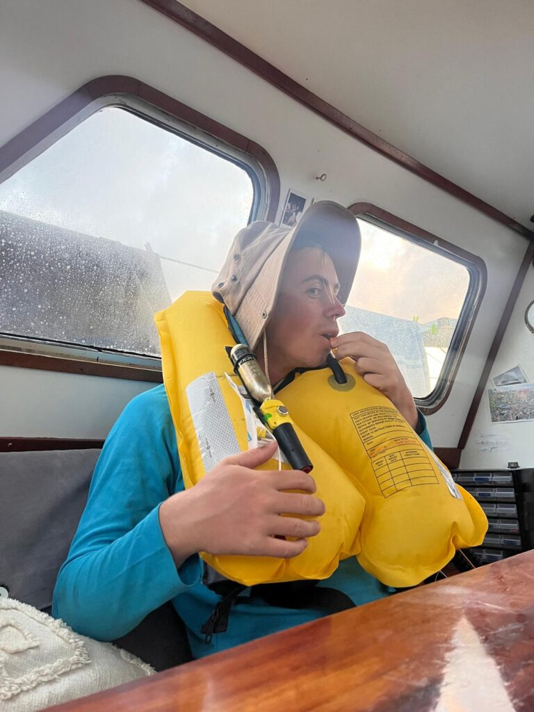

’s Ochtends word ik door Jen wakker gemaakt als het weer licht is. Dat we als mensen niet echt ontworpen zijn voor de nacht blijkt maar weer. Bij nadere inspectie blijkt er wel een paar stiksels een los te laten, maar er is zeker geen sprake van een scheurende fok. We kunnen weer zeilen en zetten de brommer weer uit. Martinique ligt voor ons en St Lucia achter ons en met een zonnetje varen we het laatste stuk hoog aan de wind. Als we de kust naderen zien we treinen catamarans op de motor vlak langs de stranden varen. Het zal de ‘wisseldag’ van de cats wel zijn. Wij kruisen rustig op tot Anse de Arlet en gaan dan richting de kop van het eiland naar het klusparadijs: Le Marin.

Voordat we dit klusoord aanlopen hebben we één grote uitdaging te gaan. Zodra we de kaap ronden en aan de onderkant van het eiland komen staat er bijna drie knopen stroming en komen de golven uiteraard weer precies op de kop. Vastbesloten om niet in het treintje in te voegen trekken we de schoten strak en varen we richting het rotsblok dat daar voor de kust in het water ligt. *Le Diamant*, zoals de Fransen het hebben omgedoopt, ligt voor de kust en werd in de tijd van de slavenhandel gebruikt als strategisch punt om de vaarroute langs Martinique te verdedigen. Of aan te vallen. Volgens de overlevering hebben de Engelsen en de Fransen Martinique wel een stuk of acht keer in bezit gehad. Telkens kwamen de Engelsen weer aanzetten om het over te nemen, waarna de koning van Frankrijk het eiland voor een aantal dozen wijn en wat goudstukken terugkocht. Geen slechte deal, voor de koningen dan.

Voor het slotakkoord van dit stuivertje wisselen komen de Engelsen met een geniaal plan. Midden in de nacht klimmen ze met een handvol soldaten en dertig kanonnen aan wal bij Le Diamant en positioneren zich op het rotsblok. De vaarroute tussen Martinique en St Lucia ligt daarmee plat en dat is een groot probleem voor de handel. De Fransen sturen hele legioenen naar het eiland, maar het is zo steil, dat het zelfs met maar een handvol Engelsen makkelijk te verdedigen is. “*Amai”* denkt de Franse koning (die ook half Vlaams is). “*Hoe kan ik die verdraaide Engelsen nou verleiden om van dat stomme rotsblok af te komen?”.* Hij denkt en denkt en komt uiteindelijk tot een briljante oplossing.

Een paar zwoele nachten later wordt er een sloep gevuld met rumvaten losgelaten vlak voor de kust van Le Diamant. De volgende ochtend gaan een aantal Engelse soldaten direct kijken of er geen vijanden aan land zijn geklommen. Tot hun grote vreugde zien ze geen vijanden, maar een sloep vol met rumvaten! De mannen zitten inmiddels al een paar maanden op het eiland en op wat rijst en vis na is er weinig aan daar. Die avond maken ze een groot kampvuur en drinken ze tot ze er bij neervallen. En de avond daarna ook. En de dag daarna ook. Drie dagen later komt een klein Frans zeilschip naar het eiland en biedt ze aan om ze in vrijheid naar de vaste wal te brengen. De dronken Engelsen gaan akkoord voor nog een vaatje rum en zo geschiedde: Het slotakkoord van Martinique.

Aan boord van *Luwte* beginnen we inmiddels ook wel dorst te krijgen. We gaan nog 1,5 knoop tegen de stroming in en geven uiteindelijk toe. We halen de zeilen naar beneden en sluiten ons aan in het treintje schepen dat op de motor het laatste stuk tegen de golven in aan het stampen is.

De baai van Le Marin is iets wat we nog nooit eerder hebben gezien. Een soort massacamping voor zeilboten. We hebben ze niet geteld, maar we praten over honderden, zo niet in duizendtallen aanwezige schepen. Het is even zoeken naar een plek met genoeg ruimte, maar uiteindelijk gaan we gewoon *front-row* liggen op de grens van gele boeien die volgens de kaart niets aangeven, maar voor bootjesmensen toch vaak geaccepteerd worden als een soort erfgrenzen.  

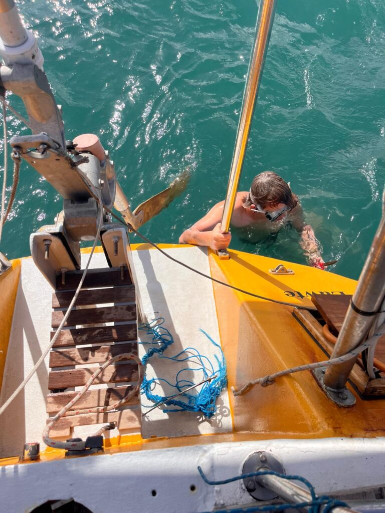

## **Terug in de EU**

Het is nogal discutabel, die Fransen met hun koloniale erfenis. Het contrast met de andere eilanden is enorm. Anders dan de meeste Europese koloniestaten, hebben de Fransen hun koloniën nooit echt de vrijheid gegeven tot zelfbestuur. Daar staat tegenover dat de standaarden die ze op het vaste land Frankrijk hanteren, doorgevoerd worden tot deze provincies. We zijn terug in de EU, met strak geasfalteerde wegen, Europese auto’s, snelwegen met file, Carrefours, baguettes, benzine voor boven de €1,85 per liter, een werkende databundel en eigenlijk alles wat je bij je gemiddelde roadtrip door Frankrijk kunt bedenken, inclusief de sierlijke gietijzeren hekjes langs de stoepen. In de grote supermarkten worden Franse producten stevig gesubsidieerd en ligt de brie voor twee euro in de koeling, naast een lokaal geteelde avocado die relatief onbetaalbaar is. Op de radio horen we berichten over Macron en in ons Engels en kwakkelende Frans worden onbegrepen ontvangen en *un petit arrogant* aangekeken. Het is klein Frankrijk aan de andere kant van de wereld. De grote profiteurs van deze constructie zijn de Franse pensionado’s, die hier in grote getalen hun oude dag uitzitten in idyllische Caraïbische huisjes.

Één ding moeten wij ze wel meegeven: de inklaarprocedure voor dit eiland is extreem eenvoudig. In plaats van de focus leggen op de *customs-officer* die op de andere eilanden bepaalt of je welkom bent, houden ze hier op afstand, met AIS, radar en helikopters de zee in de gaten. Bij binnenkomst meld je je met een digitaal formulier aan en klaar is kees. Welkom in Frankrijk. Als we even later in een baai verderop liggen zien we hoe een Engelsman door een patrouilleboot en helikopter zo ongeveer getorpedeerd wordt als hij niet reageert op Kanaal 16. Een uurtje later horen we hem alsnog op 16 zijn excuses maken naar de Franse kustwacht en beloven dat hij z’n marifoon vanaf nu aan zal houden… Ik denk dat de Fransen nog steeds bang zijn voor een invasie van de Engelsen op *Le Diamant*.

We besluiten een paar nachtjes in de haven te boeken en maken ons snel bekend met de vele jachtjuweliers die hier op de kade zitten. Om de schade te beperken gaan we de eerste dag op index-jacht om in te schatten waar we de creditcard gaan trekken. We nemen een verfmengbakje, 12 mm schootlijn en wat roestvrijstalen boutjes als product en gaan de winkels af om de prijzen te vergelijken. Het blijkt de tijd dubbel en dwars waard, want de verschillen zijn op sommige producten meer dan een factor twee! *Caraibe Marine* wint de wedstrijd op bijna alle fronten en wordt onze *preferred supplier* voor de komende week. We worden al snel bekende gezichten in de winkel en worden om de een of andere manier telkens geholpen door de ene meid die geen woord Engels spreekt. Maar met handen, voeten, en foto’s komen we een heel eind.

We hebben een A4 vol met klussen die we moeten doen, controles die we moeten uitvoeren en spullen die we moeten kopen en de volgende dag beginnen we dan ook vroeg met het halen van een warme baguette en voor mij een croissantje. We leggen er eentje in de kuip van *Belafonte*, die die avond zijn binnengelopen op Le Marin, en beginnen dan aan onze kluslijst. Een week later is *Luwte* weer klaar voor een paar maanden veel zeilen en weinig omkijken. We hopen alle kleine lekkages op de ramen te hebben gefixt (spoiler: nee) en hebben alle technische onderdelen nagelopen. Jen heeft *Storm* geplakt en gewassen, ons RVS gepoleerd en alle butsjes in de verf geschilderd. Onze portemonnee is er een stuk lichter op, maar als we de balans opmaken, hebben we de helft minder uitgegeven dan we hadden gebudgetteerd, dus ook daar komen we goed uit de verf.

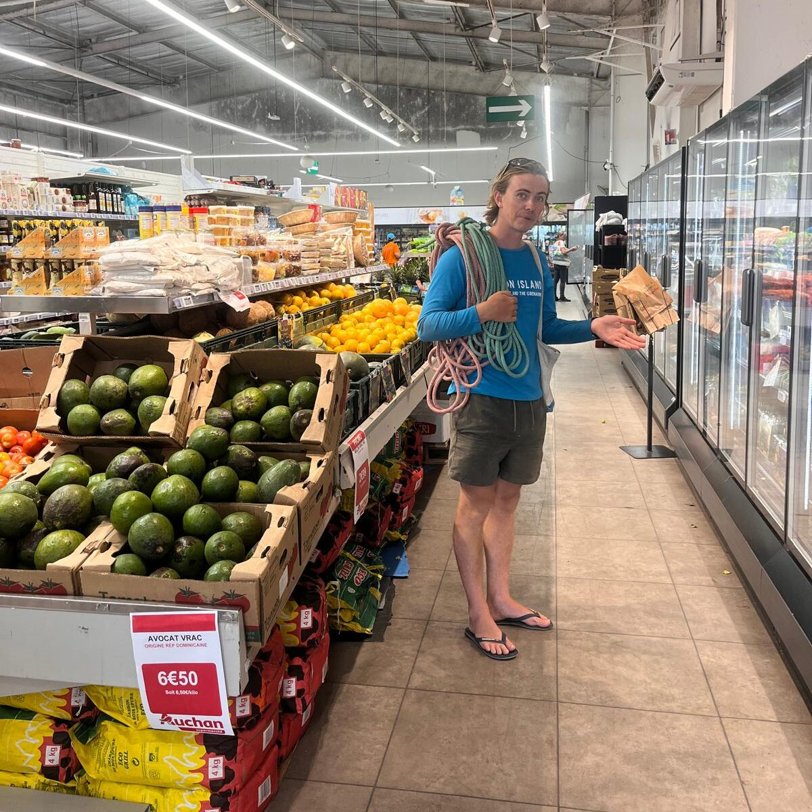

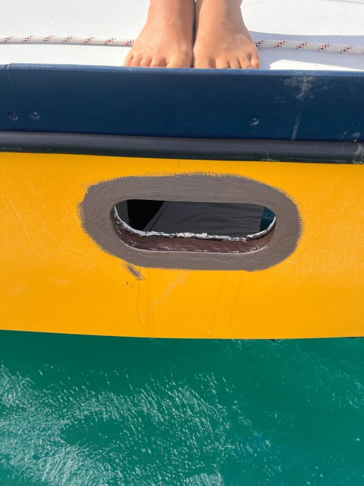

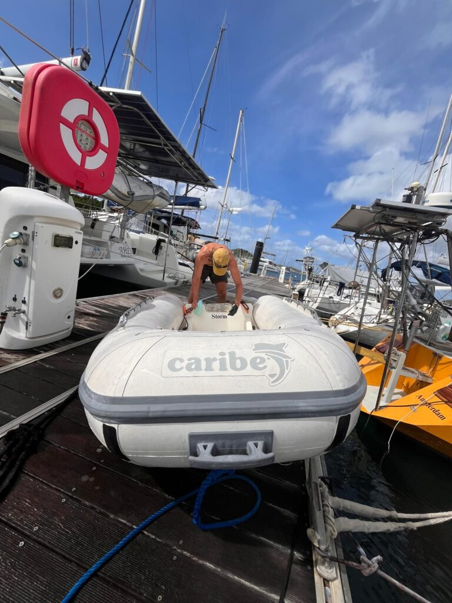

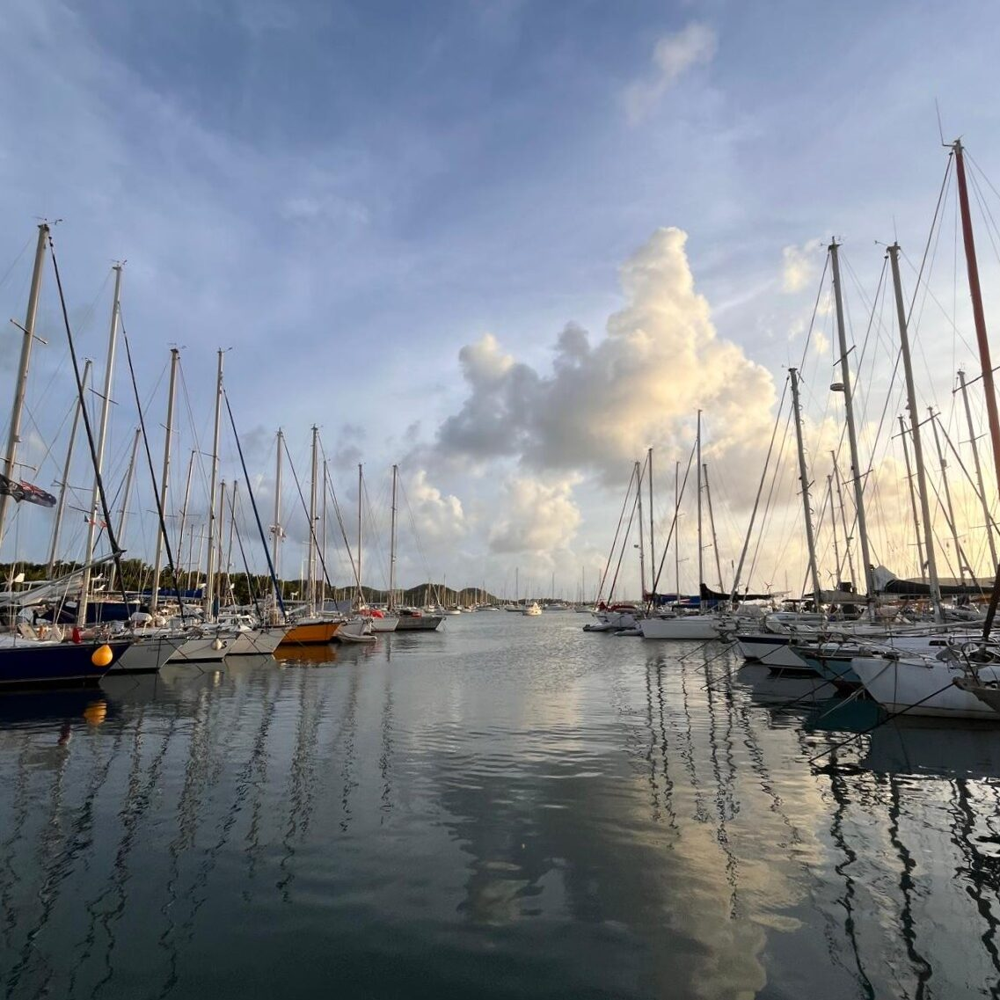

<figure class="wp-block-image size-large">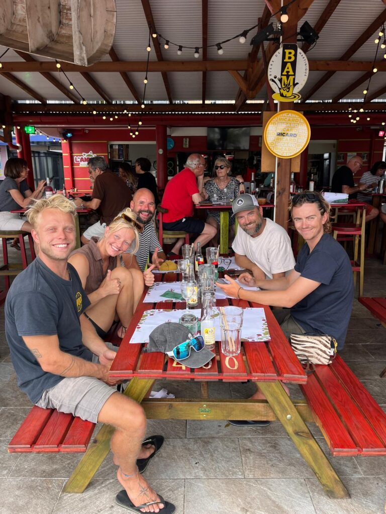<figcaption class="wp-element-caption">Tussen het werk door wederzien met <em>Jonathan </em>en <em>Belafonte!</em></figcaption></figure>

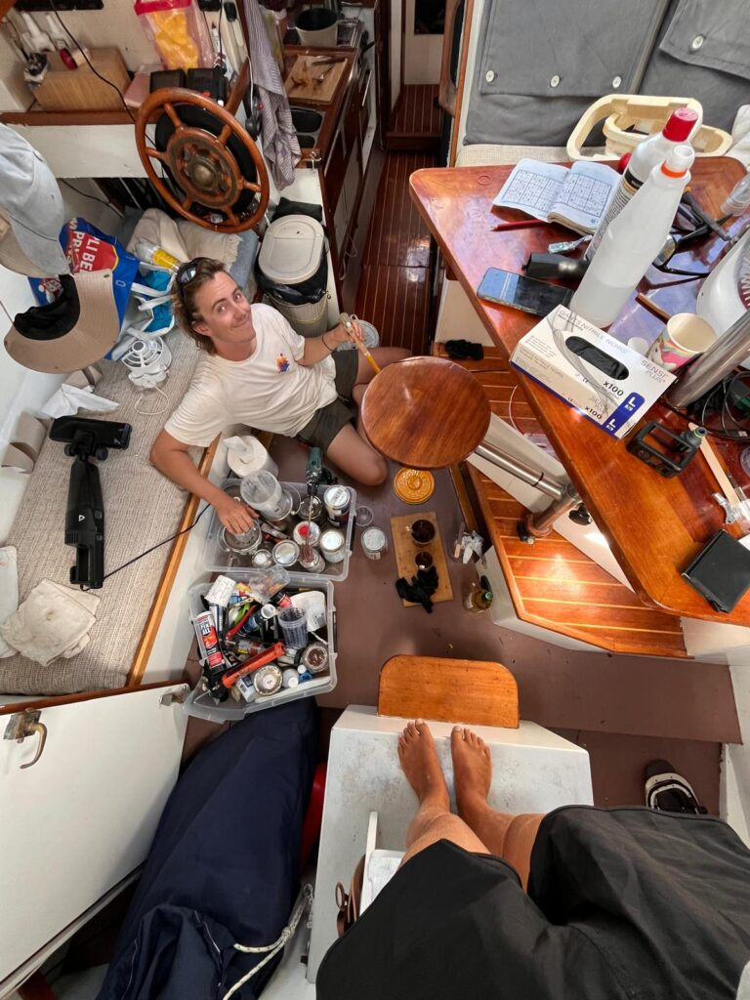

Het enige mankepootje van onze week klussen zijn de zeilen. De zeilen waar we al zó lang over schrijven en die al zó lang bijna klaar zouden moeten zijn. Het is inmiddels een worsteling geworden waarin ik niet mijn vriendelijkste kant meer laat zien. Nog op Tobago kregen we bericht dat de zeilen zo goed als klaar waren en we binnen enkele dagen foto’s konden verwachten. De foto’s, die bijna een week later kwamen, waren van zeilen die nog lang niet klaar waren en waarin bovendien details zaten die anders waren dan de specificatie. Het mailcontact loopt stroef, met een Chinese customer-agent die vooral tijd moet rekken, een production manager die ja-zegt-nee-doet en een hoeveelheid Chinese feestdagen waar je u tegen zegt. Zo glippen de weken door onze vingers en moeten we de levering telkens weer een week of wat doorschuiven naar voren.

Maar Martinique zou moeten lukken. Dachten we. We zijn extra lang op Martinique om te klussen, het eiland te verkennen én natuurlijk ons hoog verwachte bezoek van Patty en Mark te ontvangen. Maar in de week dat we aan het klussen zijn krijgen we wéér foto’s binnen waar we niet helemaal tevreden mee zijn en we besluiten dat we liever alles in één keer goed laten doen, dan achteraf met ze in discussie gaan over dingen die vermaakt moeten worden. Aan boord bij *Sya*, die hun zeilen een paar weken eerder bij hetzelfde bedrijf heeft besteld, is het proces vergelijkbaar, maar zijn de zeilen dan inmiddels verscheept. De UPS belofte van *worldwide shipping* in vijf dagen blijkt een stuk langer te zijn en daarmee sluit onze mogelijkheid om de zeilen nog op Martinique te laten leveren. Na wat heen-en-weer appen met *Sya* krijgen we wel bijzonder contact met Leo. Een familielid van een andere zeiler waar *Sya* een tijdje mee heeft opgevaren in de Carieb en waar zij hun zeilen op Sint Maarten kunnen laten bezorgen. Het is wederom een grote les in vrijgevigheid als we hem opbellen en hij van wildvreemden de vraag krijgt of wij misschien ook zijn adres op ons pakket mogen plakken. En dat is geen probleem. Ons nieuwe bezorgadres wordt dus Sint Maarten, waarmee onze proefvaart waarschijnlijk een oceaanoversteek wordt, als ze op tijd aankomen…

Een beetje gefrustreerd, maar ook blij dat we een nieuw adres hebben, verzetten we onze zinnen en omarmen we dat het is wat het is. Gelukkig krijgen we snel genoeg afleiding, want we hebben nog maar 72 uur tot er hoog bezoek op de stoep staat!

## **Naweeën**

We halen ons anker op uit het smoezelige water van Le Marin (het voelde daar zo vies dat we zelfs niet zwommen) en rollen het fokje uit terug naar Le Diamant en daarna de hoek om. Zo uitgeslapen, voor de wind met rustig weer, stroom mee en zonder touw in de schroef is het een heel ander beeld, dat rotsblok midden op zee. Twee uurtjes later draaien we Anse d’Arlet binnen en gooien we ons anker uit in een verre hoek van de baai. Hier is het water weer kraakhelder en kunnen we op acht meter diepte ons anker zien liggen. Als we er naartoe zwemmen om het te controleren zien we de roggen en zeesterren voorbij trekken.

Onze koelkast zit vol met Franse lekkernijen en de nieuw gekochte *plancha* wordt uitgepakt. Op Bequia zijn we aan een groot ongeluk ontsnapt toen de oude barbecue, die op de *Palustris* al twee keer de oceaan overstak en nu 17 jaar later nog altijd dienst deed, plotseling begon te branden vanuit de onderkant. De kunststof beschermingsplaat die bij de barbecue hoort vatte plotseling vlam en smolt samen in de gasbrander. In een adequate reactie stuurde ik Jen naar binnen om de blusdeken te pakken, draaide ik de gasfles dicht en wikkelden we de gehele barbecue in de deken. Na het uitpakken bleek het plastic volledig versmolten met de brander en betekende dit einde oefening voor het trouwe beestje dat ons zoveel lekkere maaltijden heeft bezorgd. Een zwart litteken in de kuipbank herinnert ons er nog aan. De *plancha* (een grote geëmailleerde gietijzeren plaat met twee branders er onder) is meteen een hit. We hebben eigenlijk een volledige buitenkeuken nu en maken kippetjes, nasi en allerlei groenten op de plaat terwijl de zon onder zakt en we achterover leunend tevreden zijn met het werk dat we de afgelopen week verzet hebben.

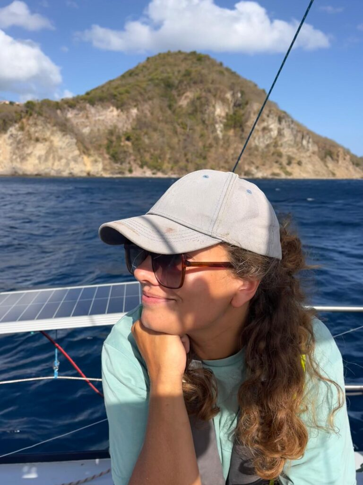

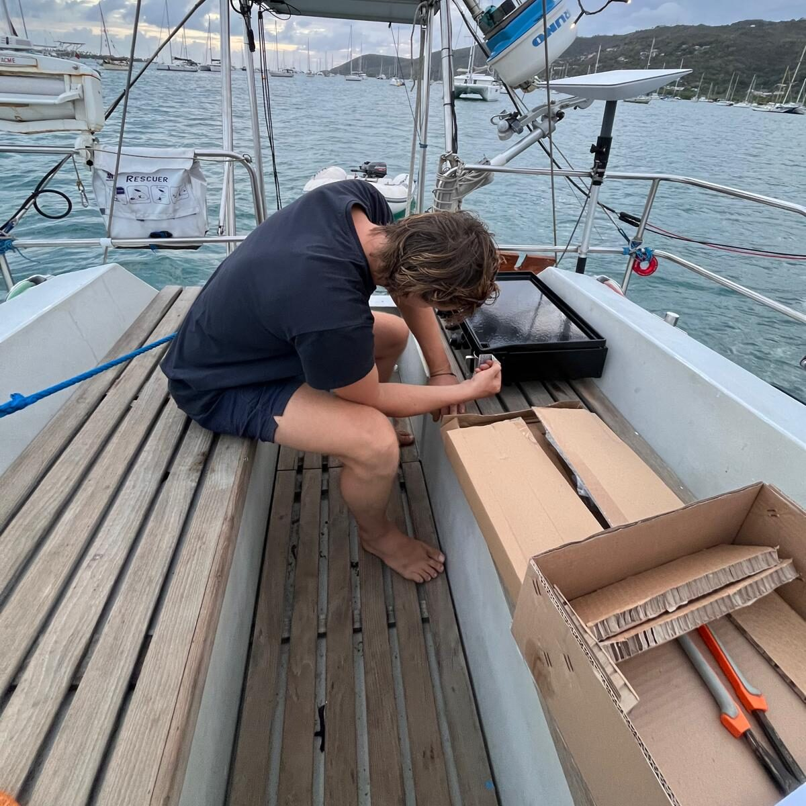

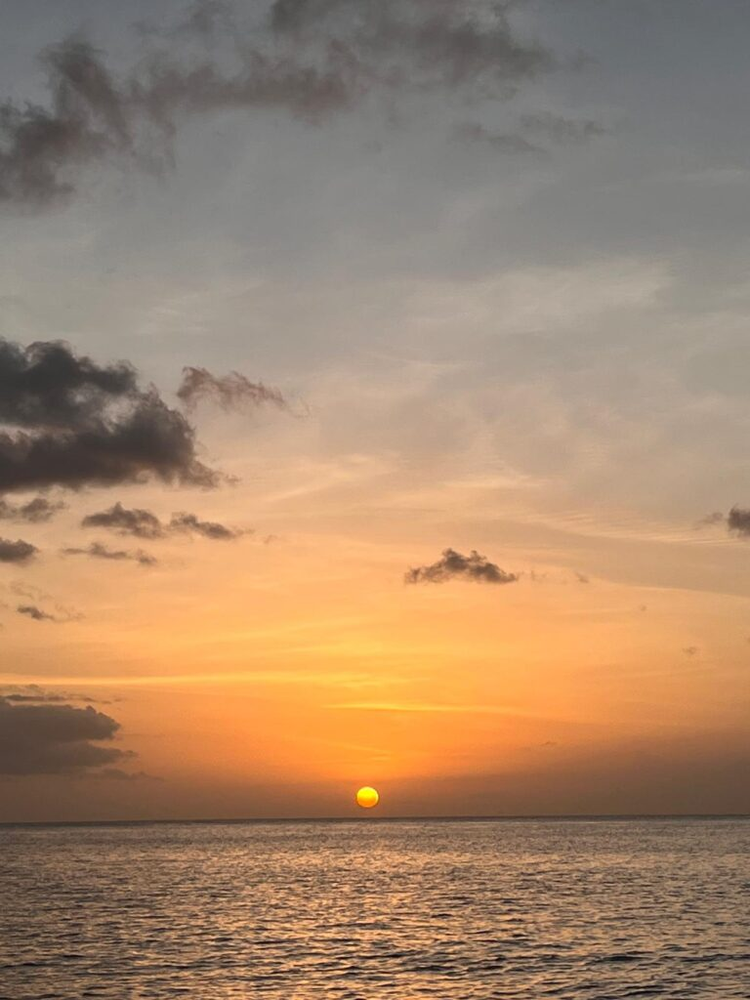

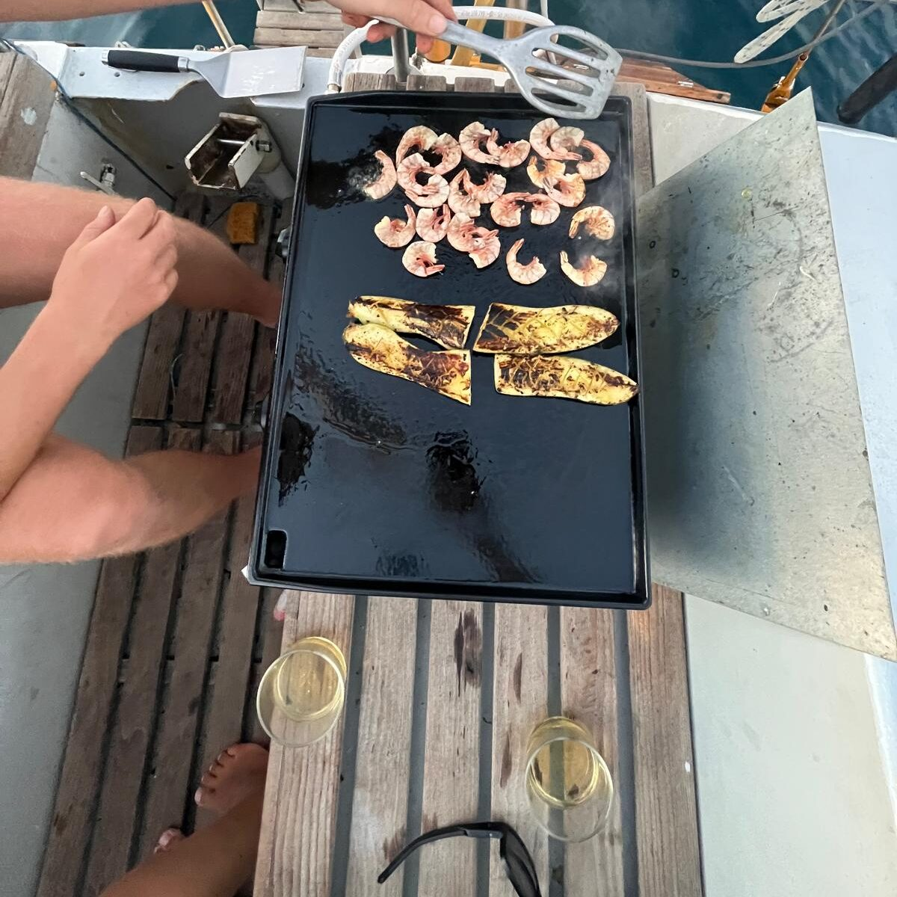

De volgende ochtend krijgt Jen het op haar heupen. Mama komt bijna en hoewel zij samen met Mark een appartementje hebben in de baai hiernaast, hopen we ze voor een paar dagen aan te kunnen monsteren en het eiland per schip te verkennen. En daarvoor is onze eigen levensstandaard aan boord uiteraard te laag. Het klussen was eigenlijk klaar, maar Jen wil in ieder geval nog ‘even’ ventilators ophangen in de punt en het houtwerk ‘even’ een likje verf geven. We gaan samen in de punt zitten en bespreken wat dan wel niet het idee is. Het houtwerk is inderdaad niet erg netjes, want door een lekkage onder de vorige eigenaar is een deel van het multiplex gaan rotten en valt langzaam uit elkaar. Dat goed oplossen is een klusje dat al jaren ergens halverwege de prioriteitenlijst hangt en nu door bezoek plotseling omhoog gekatapulteerd wordt. Jen’s plan van even overschilderen vind ik maar niets, dan kunnen we over twee weken weer gaan schilderen en gooien we dure verf dus in de prullenbak. Als we het doen moet het gewoon goed gebeuren.

We kibbelen wat over wie er gelijk heeft en wat nu belangrijk is, maar uiteindelijk geven we allebei toe. Het gaat op mijn manier, maar dan mag ik het ook zelf uitvoeren. We zijn er allebei niet echt blij mee, want we waren klaar met klussen en nu moet dit nog ‘even’ snel tussendoor. Ik pak de haakse slijper met schuurpad erbij, zet mijn stofmasker weer op en ga rigoureus aan de slacht. Een uur later maakt Jen voorzichtig de deur naar mijn stofparadijs open en ziet een met gruis bedekt mannetje zitten in een slaapkamer die onleefbaar is geworden. Ze doet het deurtje gauw maar weer dicht en gaat wat anders doen.

Als ik eenmaal de meeste rot heb weggeschuurd en het zaagsel in een zak heb geveegd, is het tijd voor stadium twee: het hout injecteren met epoxy en daarna plamuren. En daar gaat het even mis. Van tevoren heb ik niet gekeken of we alle spullen nog hebben, en zowel aan voldoende epoxy, als voldoende vulmiddel ontbreekt het. Gelukkig is *Luwte’s* buik goed gevuld en heb ik wel nog een pot epoxy primer staan voor het staal. Praktisch hetzelfde spul, maar dan met kleur en andere extra’s die eigenlijk niet nodig zijn. De vuller vinden is vervelender. Ik haal de zak met zaagsel open en haal er zo goed en zo kwaad als het kan zoveel mogelijk fijn zaagsel uit tevoorschijn. Daarmee kunnen we de epoxy ook wel indikken.

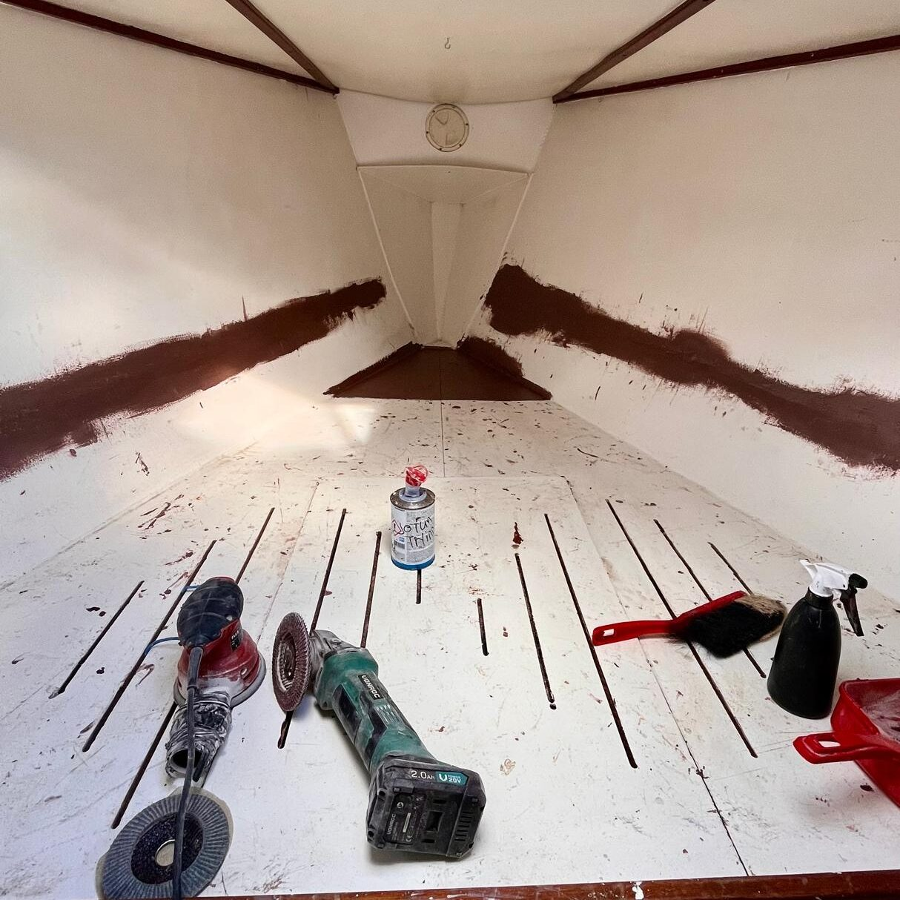

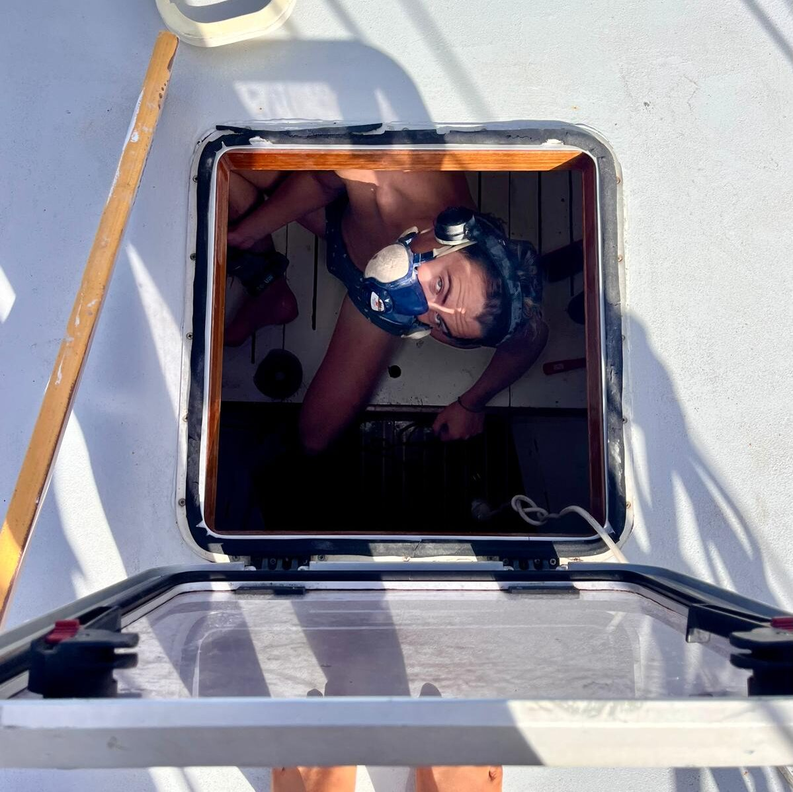

En zo bouw ik het spul weer op. Laag na laag, de hele dag door. Het grote voordeel van de epoxy primer is dat we daar een winter-harder bij hebben die hier in de tropen extreem snel uithardt. Daardoor kan ik telkens alweer bijna schuren waar ik begon, op het moment dat ik het rondje afmaak. Aan het eind van de dag lakken we de boel af met donkerblauwe poly-urethaan lak waar ik nog een pot van had staan. Die tweecomponenten verf is heftig spul. Als het eenmaal is uitgehard is het extreem slijtvast, maar de dampen die vrijkomen bij het schilderen zijn heftig. Gelukkig heb ik goede filters op het masker zitten, maar als het klaar is en ik hem afzet, weet ik wel dat we een uitdaging hebben: Vannacht kunnen we hierbinnen niet slapen.

Daar heeft Jen gelukkig een oplossing voor die meteen één van de Caraïbische dromen in vervulling brengt: Buiten slapen. Het is mooi weer en het blijft droog. Na het eten slepen we de matrassen uit de punt naar buiten en liggen we op de kuipbanken onder de sterren naast elkaar naar boven te kijken. Bij het licht van de flakkerende olielamp kletsen we over de afgelopen tijd en wat ons nog te wachten staat in de komende maanden. We fantaseren over wat de volgende eilanden ons gaan brengen en komen dan uit op ‘het eind van het Caraïbisch gebied’. Wat doen we daarna? We hadden langzaam het plan gesmeed om via de Britse Maagdeneilanden en de USVI’s een visum te regelen, naar de Bahama’s te gaan en daarna New York binnen te zeilen. Maar als we ons huidige tempo naast die plannen leggen en daarbij kijken naar wat er allemaal speelt in de VS moeten we opeens concluderen dat dat wel heel erg veel moeite is voor een land waar we ons eigenlijk niet zo toe voelen aangetrokken. Oké, maar wat dan wel? Nova Scotia, Canada, daar hebben we inmiddels onze zinnen wel op gezet. Wat we daarover lezen en zien is prachtig en zou een enorme verrijking zijn aan onze reis, maar de route over Bermuda geeft weinig uitwijkmogelijkheden. We praten er nog even over door en zien het dan gewoon in de sterren staan: We gaan naar het Noorden.

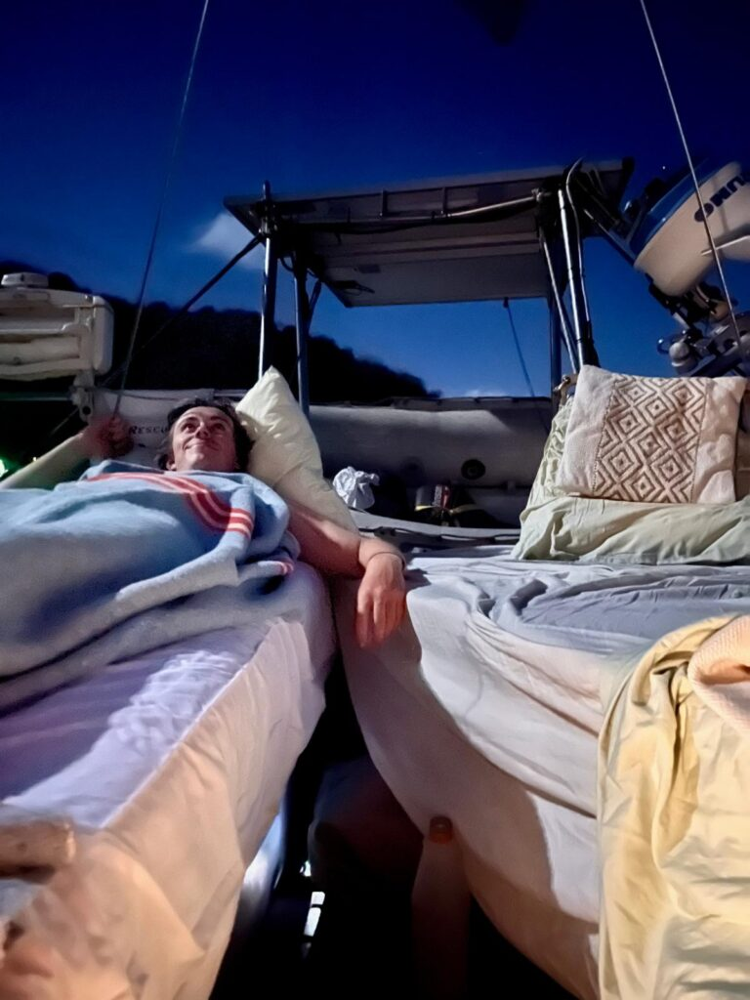

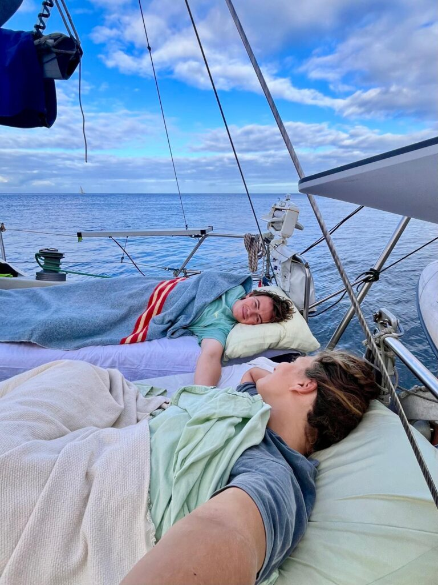

## **Klaar voor bezoek**

De volgende ochtend ruimen we de boot op, maken we schoon en gaan de matrassen terug de punt in, om de Royal Suite van *Luwte* klaar te maken voor ons hoog bezoek. Ik sluit de ventilators aan die Jen heeft opgehangen en dan kunnen we eindelijk nog even relaxen. Het is zondag en de welgestelde Martiniquezen doen dat ook. Op jetski’s en speedboten komen ze in de baai aan en liggen op een gegeven moment met z’n 15en aan elkaar vastgeknoopt te dobberen. Uiteraard met allemaal hun eigen stereoinstallatie vol uit om de coolste DJ te zijn. Bij ons aan boord wordt het een mengelmoes van bassen en sirenes die niet zo lekker in elkaar over gaan.

We schuiven een baaitje op naar Grande Anse d’Arlet, dat in tegenstelling tot wat de naam suggereert een stuk kleiner is dan het ernaast gelegen Anse d’Arlet. We regelen met de eigenaar van het huisje dat we de sleutel iets eerder kunnen oppikken en kijken even binnen. Van wat we zien worden we niet meteen enthousiast. Het is een rommeltje en de wasmachine ligt in tientallen onderdelen uit elkaar op het keukenblok uitgestald… Wij gaan eerst maar een huurauto regelen voordat we intrek nemen. Daarvoor hebben we het onszelf extra makkelijk gemaakt door te zoeken naar de goedkoopste van het eiland en moeten we met het OV naar het vliegveld zien te komen. We lopen langs de weg op zoek naar de bushalte als we een dame zien staan die ogenschijnlijk op een bus staat te wachten. Jen spreekt in haar beste frans een woordje en met handen en voeten begrijpen we dat we met haar in moeten stappen. Een paar minuten later zitten we in de bus die de andere kant op gaat ten opzichte van Google Maps, maar de dame knikt en gebaart dat het goedkomt. Na een half uur worden we gewenkt en stappen we met haar uit. Ze loopt met ons mee naar de volgende halte en laat ons dan, na veel bedankjes van onze kant, achter met de instructie om in “een groene bus” te stappen. Er hangen al wat mensen rond de halte, dus dat zal niet lang meer duren. Denken we. Zo’n half uur later staan er meer dan twintig mensen bij de halte, zijn er allerlei bussen voorbij gekomen, maar is er geen eentje gestopt. Ik ben per definitie bang voor het OV. Zeker in landen waar *wél* een dienstregeling is, want die wordt nooit gehandhaafd. Jen houdt mij koest en dan komt de bus uiteindelijk. We zijn een beetje een vreemde eend in de bijt. Ik vermoed dat de meeste Fransen een eigen auto hebben en het OV niet gebruiken.

Na een overstap op iets wat het midden houdt tussen een bus en een metro, komen we aan op het vliegveld. De autoverhuur heeft pendelbussen, maar die pendelen uiteraard alleen als er net een vliegtuig is geland. Het is een klein half uur lopen, of vijf minuten rijden, dus we spreken toch maar een taxi aan om te vragen wat het kost. Ik zet in op vijf euro, Jen op vijfentwintig. Als de chauffeur begint op twintig euro stopt voor mij de onderhandeling al en besluiten we te gaan wandelen. Een andere chauffeur zit het tafereel hoofdschuddend te bekijken.

We wandelen over de parkeerplaats als er een personenbus komt aanscheuren en voor ons stopt. Het is de hoofdschuddende chauffeur die ons wenkt en zegt dat hij het belachelijk vond dat zijn collega ons voor twintig euro wilde brengen. Hij rijdt ons wel even, gewoon om de reputatie van de vliegveld-taxichauffeurs op te krikken. Als we een paar minuten later voor de deur worden afgezet is ons vertrouwen in de mensheid weer een beetje gegroeid en wandelen we naar binnen om onze bolide op te pikken.

Bij het huren komt mijn grootste nachtmerrie uit. Ik denk dat ik in een of ander onverwerkt jeugdtrauma een keer zonder portemonnee bij een kassa heb gestaan en toen zo overstuur ben geraakt dat er iets is misgegaan in mijn hersenen. Voor de huur van de auto moeten we €900,00 deposit afrekenen. Uiteraard wordt ons aangeboden om voor ‘slechts’ €130 euro het eigen risico af te kopen, maar dan zou de verzekering bijna even duur worden als de huur van de auto zelf. En laat ik nou net vergeten te zijn de creditcard op te toppen… Mijn hersenen maken kortsluiting, mijn hoofd wordt rood en mompelend druipen we af. Gelukkig weet Jen te regelen dat we op de hotspot van de dame achter de kassa mogen, maar haar iPhone weigert uiteraard met mijn Android telefoon te communiceren. Ik probeer op Jen’s telefoon in te loggen, maar dat loopt vast op de dubbele authenticatie, die uiteraard alleen via mijn telefoon loopt. Op een bankje in een hoekje van de ruimte probeer ik van alles om een oplossing te vinden en dan komt onze grote vriend Elon toch uit de hemel vallen. Iemand heeft in de buurt een Starlink antenne staan met een open netwerk. Als ik mijn telefoon precies schuin boven mijn schouder houd heb ik een streepje internet en kan ik de creditcard aanvullen… Eenmaal in de auto heb ik honger, dorst en zin in een ritje en tuffen we over het door de EU gesubsidieerde asfalt weer terug richting de boot.

Met een volle achterbak stoppen we bij het huisje om het bier vast koud te zetten, de koelkast te vullen met lekkernijen en het huisje klaar te maken voor ontvangst. Tot onze grote verbazing is de wasmachine weer in elkaar gezet én doet hij het! We hebben onze was de afgelopen twee weken een beetje opgespaard en zijn blij dat we dat nu niet met de hand hoeven te doen (met name Jen is daar blij mee…).

Tegen het eind van de middag zien we op FlightRadar dat het ze al bijna gelukt is: In het aantal uren dat wij er in dagen over deden, steekt de Boeing de oceaan over en staat op het punt de landing in te zetten. Wij stappen in de racebak van het verhuurbedrijf en begeven ons naar het vliegveld voor een langverwacht weerzien met Mama Pat en Mark.

<figure class="wp-block-image size-large">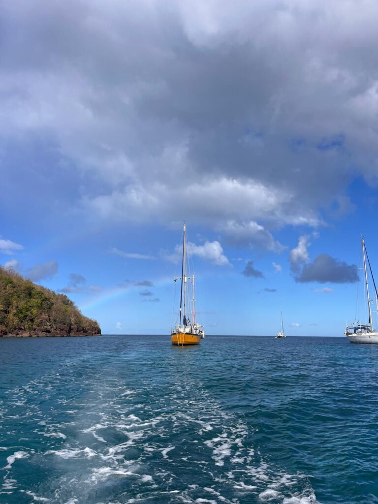<figcaption class="wp-element-caption">We laten <em>Luwte </em>liggen..</figcaption></figure>

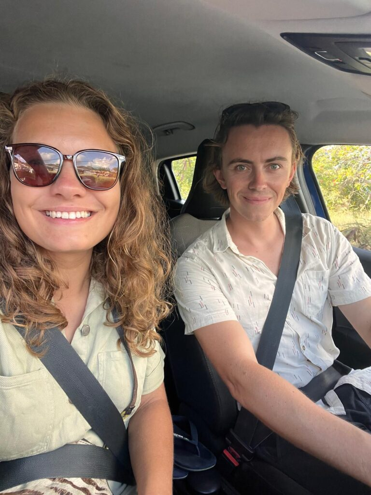
