Het is een beetje een mijl op zeven, om vanaf de boot voor Anse d’Arlet een auto te regelen, naar het vliegveld te gaan en daar Patty en Mark op te pikken. Een taxi had het een stuk efficiënter gemaakt. Maar ik ben helaas opgevoed met de stellige overtuiging dat iemand nooit zonder ontvangstcomité op een vliegveld mag aankomen. Zelfs niet als het praktischer is. Hoe het precies ontstaan is weet ik niet, maar in het wetboek de Boer is het een grondrecht. En het mooie is dat het *altijd* loont. Ook als het onhandig is, is dat eerste contact dat iemand maakt die weer thuiskomt, of juist aankomt op bestemming, een groot goed. Vandaar dat *Hello Goodbye* ook zo’n fantastisch programma is.

We rijden de eerste beste parkeerplaats op die we zien. Ik zie in mijn ooghoek een bord met prijzen voorbij schieten en dan beseffen we dat we in de ‘kiss-and-ride’ baan zijn gaan staan en het parkeren hier een euro per minuut kost na de eerste tien minuten. Gelukkig hebben we dat door voordat we uitgestapt zijn, en kunnen we verderop de P1 opdraaien van Martinique Airport.

Als we binnenlopen, komen net de eerste mensen door de schuifdeuren naar buiten. De lichte reizigers zonder extra koffers. Ik stook Jen een beetje op met elke keer dat de deur open gaat. Om ons heen staan families met ongeduldige, verveelde kinderen die een wedstrijdje spelen wie het dichtst bij de schuifdeur komt. Ze worden steeds iets dapperder, maar als ze op een gegeven moment vlak voor de dichte schuifdeuren staan vliegen ze open en komt er een grote, nors kijkende man van de andere kant en schrikken ze zich een hoedje. Jen staat inmiddels ook te wippen van haar ene op haar andere been en kijkt bij elke passagier die naar buiten komt heimelijk die kant uit. Ik krijg de camera in mijn handen gedrukt met de opdracht om het *event* vast te leggen en dan gebeurt het: mama en Mark komen door de deuren gewandeld.

Lachen, tranen, knuffels. Het is een een typisch *Hello Goodbye* moment, maar dat maakt het niet minder heerlijk. Maar het gaat altijd zo snel. Ik verbaas me daar ook nu weer over. Weken leef je toe naar dit moment. Je past je plannen er op aan, neemt de moeite om helemaal naar het vliegveld te rijden, neemt de tijd om iemand op te wachten en dan is het moment zo vervlogen. Het *moment-supreme* duurt hoogstens dertig seconden en dan pak je je koffer op en loop je naar je auto.

Het is inmiddels donker, dus Pat en Mark hebben geen idee hoe Martinique eruitziet, of waar we zijn. Maar de geuren, temperatuur en luchtvochtigheid geven veel weg. Ze zijn er echt flink tussenuit. Een ruim half uur later parkeren we de auto voor het huisje en nemen we niet veel later positie in op het terras. Met een biertje en het geruis van de branding op de achtergrond vieren we de aankomst en het weerzien. Zo’n avond kan eigenlijk niet lang genoeg duren, maar we hebben nog tien dagen te gaan en de *jetlag* begint haar tol op een gegeven moment te eisen, dus is het tijd om te gaan slapen.

Ik sla een arm om Jen heen als we vanaf het appartement naar beneden lopen en voel aan alles hoe blij en verheugd ze is. De heimwee die bij Jen zo af en toe lonkt is weg en we weten dat de komende dagen heerlijk gaan worden. Op straat is het uitgestorven en donker. Als we bij de betonnen pier aankomen ligt *Storm* trouw op ons te wachten. Met ankertje aan de spiegel om hem van de pier weg te houden en een lijn naar de kade. Het is een acrobatische sprong die ik moet maken om in de bijboot te komen, maar na negen maanden bijboot in, bijboot uit, zijn de meeste landingen soepel. Ik haal het anker op, trek *Storm* naar de kade en laad mijn jonkvrouw in. We zoeken ons ankerlichtje op en vinden niet veel later ons gele huis weer. Snel naar bed, morgen is er weer een dag.

## **Landen in le Grande Anse d'Arlet**

Met familie, of misschien je allerbeste vrienden, gaat het altijd heel snel. Je praat even bij over de alledaagse dingetjes en dan is het net alsof je elkaar een week geleden nog hebt gezien en samen hebt gegeten. Dat punt hebben wij zo ongeveer na het ontbijt wel bereikt. Bij de lokale *superette* halen we een vers stokbroodje en op de veranda van het huisje maken we heimelijk plannen voor de dag en de ruime week die er aan komt. Van tevoren hebben we de verwachtingen een beetje moeten temperen, want hoewel het maar een dagtochtje is naar het volgende eiland, is onze ervaring inmiddels dat de tussen-eilandse-tochten of een rondje Martinique best uitdagend kunnen zijn. Gelukkig biedt de westkust van Martinique een uitgebreid assortiment aan ankerbaaitjes en zeiltochtjes. Jen en ik hebben verschillende *cruises* uitgezet, op een manier dat er per dag verlengd kan worden, maar dat we ook altijd binnen een dag weer terug kunnen zijn bij onze *home base* in Grande Anse D’Arlet.

Vandaag moeten we nog even bijkomen en blijven we lekker hier. Na het ontbijt pakken we wel alvast wat handdoeken en snorkels mee, en verkassen we precies als het heet begint te worden naar de koelte en het briesje op *Luwte*. Jen en ik kunnen door de ogen van Pat en Mark meegenieten van alle kleine gelukjes waar we dagelijks mee te maken hebben. Dat begint al met het oplopen van de kade, in de dinghy stappen en dan in de verte de boot zien liggen. Omdat het ons dagelijks ritueel is, voelt het soms als een heel gedoe, jezelf in die rubberboot werpen, naar de boot varen, en wankelend uitstappen. Maar door de ogen van Pat en Mark is het een avontuur en een ervaring op zich, en dat komt dan ook bij ons weer even binnen.

We drinken nog een kopje koffie onder ons zonnetentje en klimmen dan weer met z’n vieren in de bijboot voor de eerste snorkel van de vakantie. Een stukje verderop liggen een paar boeitjes waar de duikscholen hun boten aan vastknopen, maar waar wij ook mooi vandaan kunnen zwemmen. Nog voor we goed en wel vastliggen hoor ik een schreeuw en ligt Mark al naast de boot met zijn masker op naar de vissen te kijken. Wij volgen snel en verkennen de riffen. Jen en ik dartelen weer als kinderen om de ouders heen en duiken heen en weer naar de bodem, op zoek naar exotische visjes. Als we ze zien zwemmen we naar boven om ze aan te wijzen. Achteraf blijkt Pat de meeste van onze aanwijzingen braaf te hebben beknikt, maar was haar bril eigenlijk alleen maar beslagen en was het mistig onder water…

Zo liggen we zeker twee uur in het water. Beschermd door onze UV-shirts, alvorens we terug naar *Luwte* komen en onze honger stillen met één van Jen’s signature lunches: Linzensalade met tonijn uit blik. Daarna begint de Caraïbische middag al in te zetten en moeten we gaan nadenken over de borrel en het avondeten. *Belafonte* ligt intussen – hoe kan het ook anders – naast ons in de baai en er is dus al snel beklonken dat we elkaar op het strand ontmoeten voor een drankje. Dat loopt niet veel later uit in samen eten en laat op de avond keren Pat en Mark terug naar de heuvel en wij zoeken *Luwte* op.

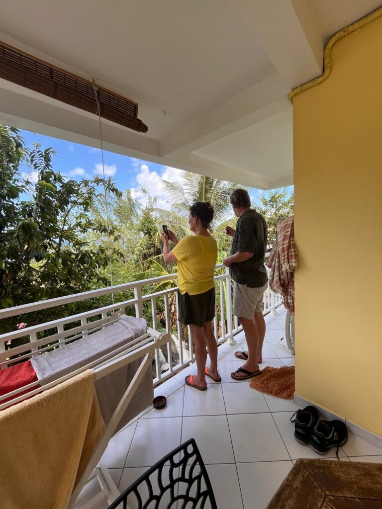

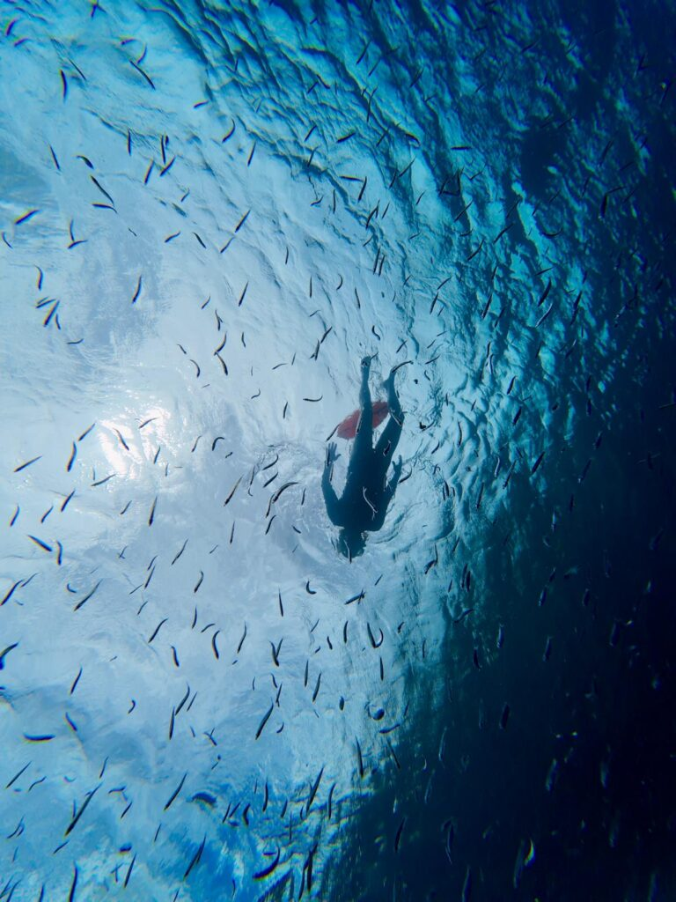

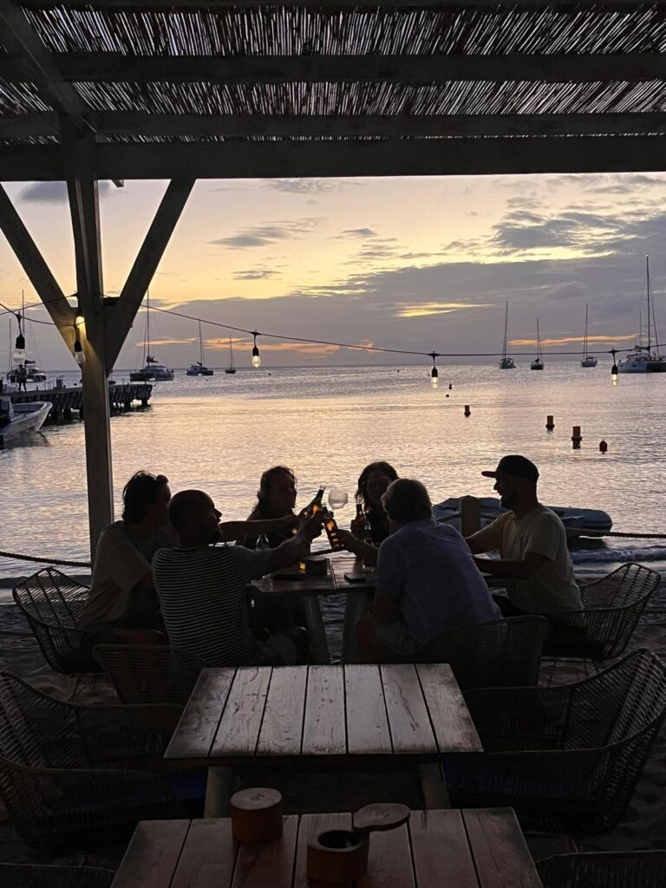

## **Natuur & cultuur**

De volgende morgen ontbijten we op het terras van het huisje en daarna stappen we snel in de bolide die we hebben gehuurd bij auto-discount.fr. Het is een rijdend reclamebord, maar daar krijg je voor terug dat we maar €19 euro per dag hoeven af te rekenen. Verder een opzienbarend prima wagen waar we goed met z'n vieren in passen. Jen spaart inmiddels watervallen, en ze heeft al gevonden waar je op Martinique een mooie wandeling met waterval kunt maken. We rijden over de voor ons imposante snelweg van Fort de France verder naar het centrum van het eiland, waar de bergpunten steil lopen en de relatief kale kust plotseling over gaat in dichtbegroeid regenwoud. Het laatste stuk is smal en kronkelig, maar gelukkig komen we slechts één radicaal scheurende Fransvrouw tegen die doet alsof dit ook snelweg is. Bij wat volgens Google Maps het begin van de trail zou moeten zijn stappen we uit en kijken we om ons heen. Er raast water door een grote waterzuiveringsinstallatie en er staat een groot bord *Entrée Interdit* voor een smal bospaadje naar beneden. Vertwijfeld pakken we de telefoon er nog eens bij. Het zou hier moeten zijn..

We worden opgemerkt door een Martiniquees die op de parkeerplaats staat en ons uitleg geeft over het pad. Volgens hem is het vandaag een slechte dag om de wandeling te maken. Gisteren heeft het geregend en dan verandert de anders kristalheldere waterval in een bruinige stroom. Hij raadt ons aan om een andere dag terug te komen, maar goed, hij staat ook om 10.30 's ochtends uit een doormidden gesneden petfles Ti'Punch te drinken (rum met een beetje suiker en citroensap), dus we zijn dankbaar voor de uitleg van het pad en besluiten zelf wel te beoordelen of het de wandeling waard is.

Het paadje is glibberig en steil. We klouteren eerst een dal in, en daarna het dal weer uit. Onderweg komen we een Franse familie tegen met kleine kinderen die met handen en voeten de tredes moeten beklimmen. We laten ze maar even voor, wat ons direct de tijd geeft om even op adem te komen. Even later komen we de beloofde tunnel tegen. Halverwege het dal omhoog stop het pad opeens en kijken we een donkere schacht in van net aan twee meter hoog en twee meter breed. Het einde is niet te zien, alleen het donkerte. Met de zaklampen van onze telefoon stappen we tunnel in die nog het meeste doet denken aan een droogstaand waterkanaal waar elk moment een stortvloed doorheen kan komen storten, maar we halen zonder te verdrinken de andere kant.

We komen uit in een dromerige vallei, met palmbomen, oud bos en veel klimop in de lawaaibomen. De rivier stroomt er tussendoor en door de hoogte van de vallei schijnt de zon geel-groen licht door de bladeren. Langs het pad worden we er aan herinnerd dat wij als mens toch ook dit soort serene plekjes graag de baas zijn. Een enorme pijpleiding voor drinkwater loopt van hogerop langs het pad naar beneden en de berg in. Ik vraag me altijd af door wie en hoe het idee ontstaat om op zo'n totaal onbereikbare plek infrastructuur aan te gaan leggen. Maar een groot deel van het drinkwater op Martinique schijnt uit dit riviertje te komen.

We glibberen verder tot we een grote waterval zien met een poel die uitnodigt om te gaan zwemmen! Oké, de man aan het begin had gelijk dat het water niet kristalhelder is, maar om nou te zeggen dat het modderig is, is ook erg overdreven. En het mooiste is: We hebben hem voor onszelf. Dus kleden we ons snel om en laten het water op onze schouders kletteren. Een paar minuten later zit ik dammen te bouwen. Want waar Jen misschien watervallen spaart, spaar ik dammen in het buitenland en dit is de derde. Het wordt een flink bouwwerk dat een groot deel van de stroom een andere kant op doet lopen en als Pat, Mark en Jen geduldig beginnen te vragen of ik eindelijk kan meekomen, leg ik de dam als een rechercheur vast op de camera, om wellicht, ooit in de toekomst te kunnen zien wat er van over is gebleven.

## Fort de France

Op de terugweg rijden we door het drukke Fort de France, waar we zowaar weer vast komen te staan in het verkeer, alsof we door Parijs rijden. Vlakbij het befaamde fort, dat nog altijd dienstdoet als maritieme trainingsbasis, parkeren we op een nieuw aangelegd parkeerterrein en proberen we het fort in te komen. Dat blijkt alleen onder begeleiding te mogen en voordat we er goed en wel over nagedacht hebben, wandelen we met lege magen achter een tourguide aan die alle klemtonen van zijn woorden omdraait en eigenlijk niet te volgen is. Maar we mogen het fort in, en worden meegenomen in de bouw, constructie en succesverhalen van de Franse verovering hier. Als er een kritische vraag wordt gesteld over de geschiedenis en de Franse rol daarin, lijkt het antwoord simpelweg niet te bestaan en worden we verder ingelicht over hoeveel kilo buskruit er opgeslagen lag in de kerker waarin we staan.

Een uur later worden we dorstig weer vrijgelaten uit het schroeiend hete kasteel en weten we te landen bij een restaurant dat een toilet én bier op de tap heeft. De twee *essentials* waar we nu direct behoefte aan hebben. We raken aan de praat met een Franse jongedame die eigenlijk hier geboren en getogen is, maar tegenwoordig alleen nog naar het eiland komt voor vakantie. Ze geeft ons tips en *highlights* om te bezoeken en raadt ons aan om zeker langs een van de rumhuizen te gaan. Die zetten we er graag op het lijstje bij!

Daarna besluiten we dat de grote stad niet zoveel te bieden heeft, daarvan hebben we er in Europa ook genoeg. Grande Anse d'Arlet lonkt weer en dus stappen we in de auto terug, met onderweg nog een pitstop bij een mega-supermarkt voor de nodige boodschappen. Terug bij het huisje aangekomen zijn we we moe en uitgekeken op de dag en laten we het plan om zelf te koken varen. We hebben een pizzatent aan de boulevard gespot die er goed uit ziet en besluiten daar op het strand gebruik van te maken. Daarna nog een drankje op het terras als toetje en dan gauw naar bed. Morgen om 09.00 aanmonsteren op *Luwte*!

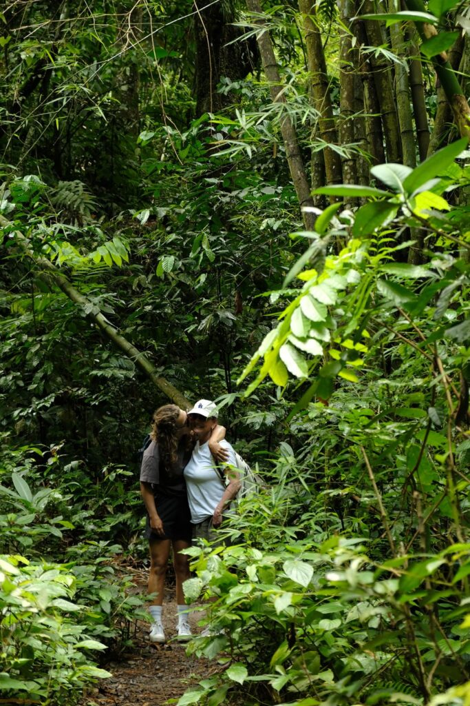

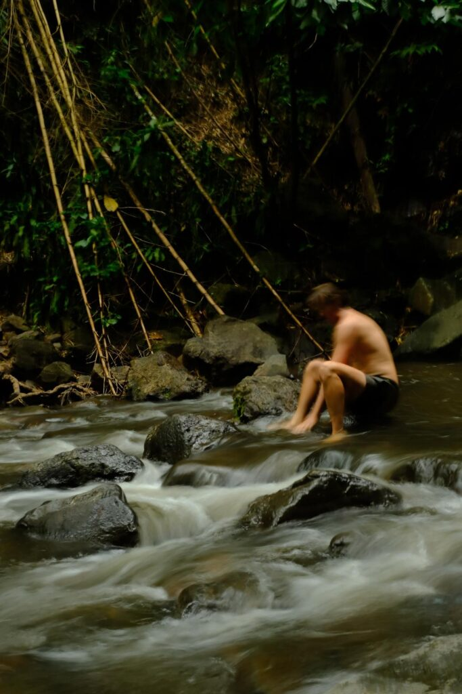

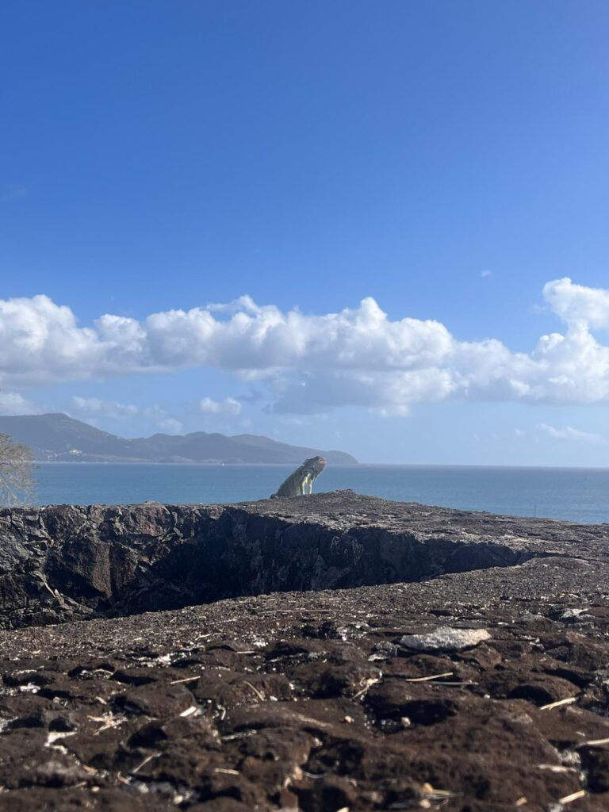

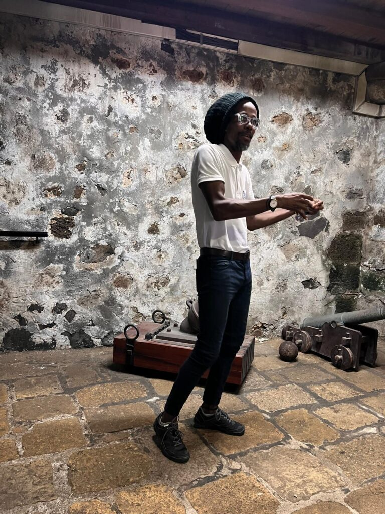

## **Aanmonsteren**

Uiteraard halen we 09.00 niet, maar we komen aardig in de buurt. Als we alle spullen én mensen aan boord hebben geladen, ligt *Storm* aardig diep in het water, maar hij bewijst maar weer dat de 2,50 meter meer dan voldoende is om vier personen en bagage te vervoeren. Planeren is dan helaas niet meer echt een optie. Niet veel later nemen Pat en Mark hun intrek in de punt en kunnen we na nog een kopje koffie beginnen met het zeilkaar maken van *Luwte*. De zonnetent wordt afgebroken, de huik wordt van de giek getrokken en binnen wordt alles zeevast klaargezet. Daarna moet *Storm* nog gehesen worden en hijsen we ons allemaal in ons zwemvest. Ondanks de milde voorspellingen bereid ik mezelf en de anderen voor op een pittig stukje zeilen. De *Lille Ø* heeft ons op Bequia gewaarschuwd voor dit stukje met “*treat it like an ocean passage*”. Die opmerking is bij mij blijven hangen en ik doe vlak voordat Mark naar het voordek wandelt om het anker omhoog te trekken een schietgebedje dat hun voorspellingen een beetje overdreven waren.

Met het mooie briesje dat er hier in de baai staat zijn we vlot weg en kan de motor snel uit. De zonnebrand gaat de ronde en *Luwte* ligt niet al te scheef, maar maakt mooi snelheid. Na het verlaten van de baai komen we even in de luwte van de bergen te hangen, maar omdat we iets verder uit de kust varen halen we wel een grote catamaran in die met slap hangende zeilen een meter of 100 naast ons dobbert. Dat voelt toch altijd fijn. Mark heeft inmiddels de vislijnen uitstaan en is gebrand op een tonijn of mahi mahi, maar maakt ons alvast warm voor het gevecht dat hij zal gaan voeren als het een zwaardvis wordt.

En zo glijden we de open baai van Fort de France binnen en blijken de verhalen die we hebben gehoord inderdaad aangedikt, of pechgevallen, te zijn. Het is een perfecte bries van zo’n drie Beaufort die het water doet rimpelen, maar geen golven produceert. We trekken de schoten iets aan en stevenen hoog aan de wind af op het fort dat we gisteren nog van binnen hebben gezien. Van de verhalen weten we dat de kanonnen de hele baai konden beschieten, dus we houden het vriendenvlaggetje maar hoog in het want om onze intenties duidelijk te maken.

Als we dichtbij genoeg zijn om de mensen op de kade te kunnen zien wandelen, gaan we overstag en draaien de boeg terug naar de overkant van de baai. Over Point du Bout zijn in de pilots en recensies veel goede verhalen geschreven, dus daar willen we ons anker wel laten zakken. Via de Navionics-app houden we op de iPad de koers en ondieptes in de gaten en een uur of anderhalf later ratelt de ankerketting voor het strandje van een groot resort waar veel mensen op het strand hangen. We zwemmen om af te koelen, zetten de zonnetent weer op, en dan kunnen we al snel de glazen vullen met iets anders dan water en limonade. Als kleine verrassing hebben we de kist ‘Familie’, die we met mijn ouders in Suriname openbroken, opnieuw gevuld met bubbels en zo kunnen we volgens *Luwte’s* traditie proosten met bubbels op een behouden vaart en vlucht.

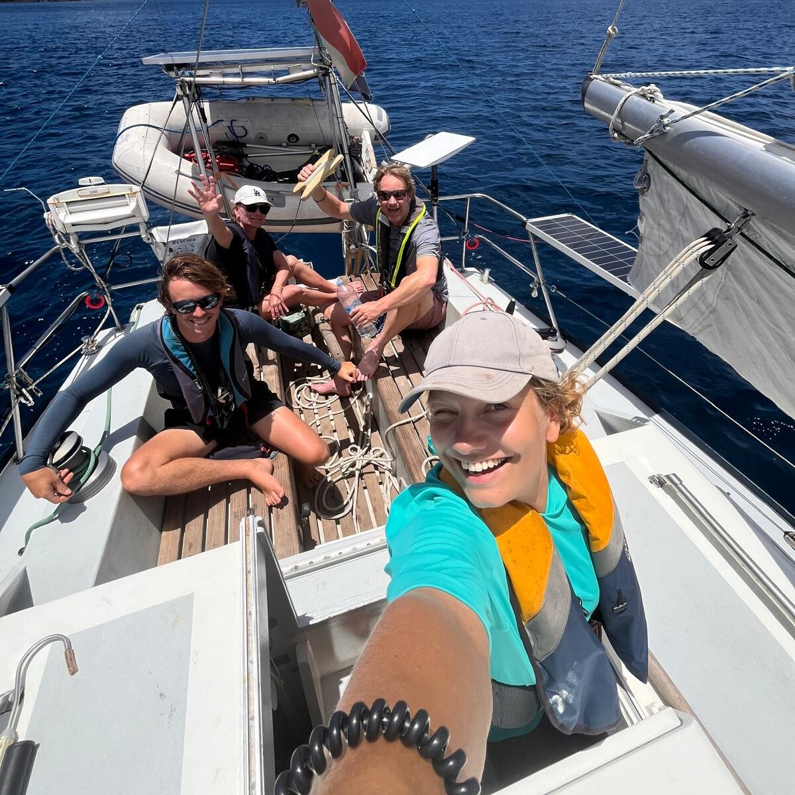

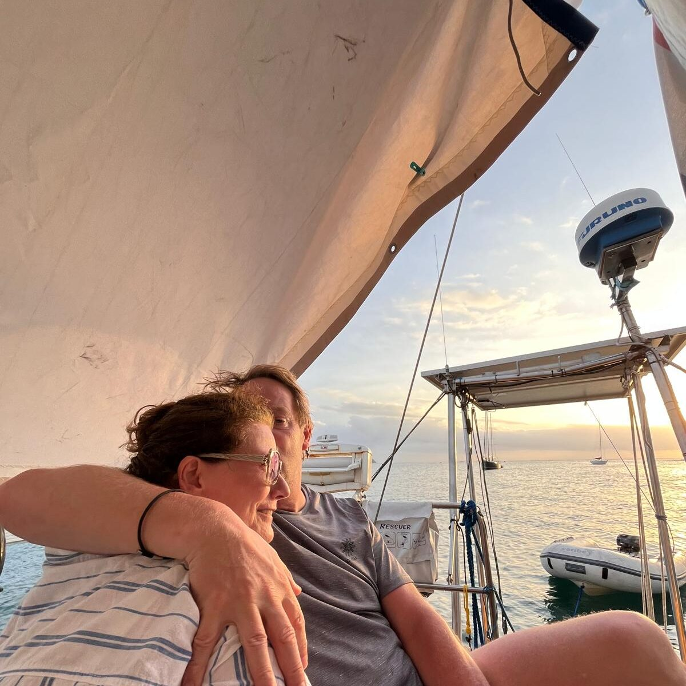

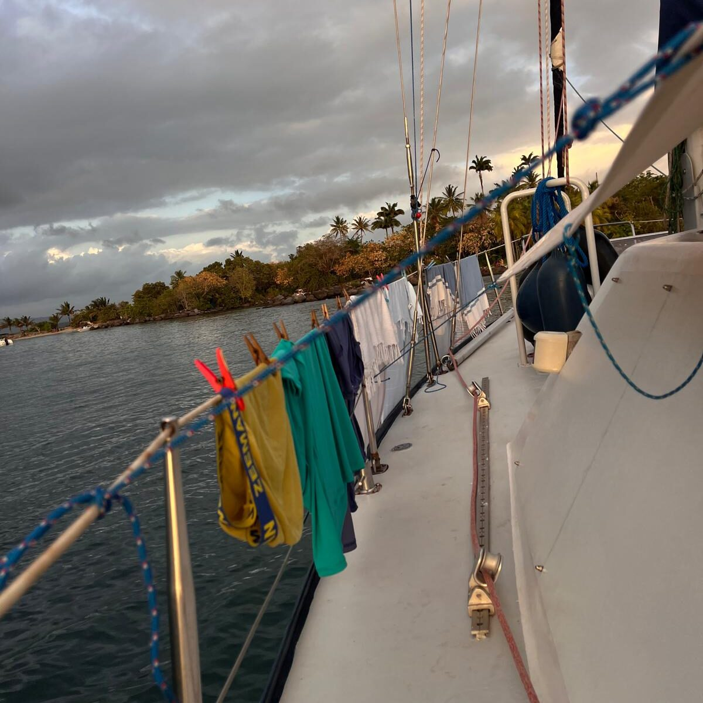

De volgende ochtend is een cruciaal moment. Bij het vorige bezoek van Pat en Doek in Portugal was één nachtje wel voldoende en keerden we daarna weer terug naar vaste grond. Daar moet bij gezegd worden dat het toen grauw, fris en regenachtig was en niet heerlijk warm, met zwemwater om je heen. Een boot wordt snel een stuk kleiner als je met z’n vieren binnen moet zitten. Dat is nu gelukkig niet zo en Pat (en Mark, maar die wilde volgens mij niets liever) monstert nog tenminste één nachtje extra aan. Dat betekent dat we vandaag niet terug hoeven te varen naar Anse d’Arlet, maar nog een ander plaatsje kunnen bezoeken. Over het verderop gelegen St Pierre hebben we ook leuke verhalen gehoord. Het is een mijl of 20 die kant op en dat duurt dus een uur of vier à vijf. Maar het is lekker rustig weer in ons bakstag, dus dat is een kwestie van de zeilen hijsen en achterover leunen.

De vislijnen gaan weer uit, maar ook vandaag resulteert dat in veel verwachtingen en grote bossen Sargassowier. Met nog een mijl of drie voor de boeg (dan kun je de geankerde bootjes al duidelijk zien), valt de wind volledig weg. We gaan nog zo’n anderhalve knoop door het water en houden dat nog een tijdje vol, maar als de zon begint te zakken en we links en rechts worden ingehaald door motorende zeilschepen vouwen ook wij de lappen op en gaat onze ETA van drie uur naar vijf minuten als de Yanmar begint te brommen. Daarna is het even zoeken naar een geschikte ankerplek die niet te diep is. We ankeren liever niet op meer dan acht meter, omdat het dan een hele work-out wordt om de ketting met het anker weer boven water te krijgen. Maar we vinden een plekje voor het strand waar we rustig liggen met genoeg ruimte om ons heen.

Na wederom een verfrissende duik, laden we onszelf in de bijboot met alle snorkelspullen en gaan we op zoek naar de scheepswrakken die hier door de jaren heen zijn uitgegroeid tot volledige koraalriffen. St Pierre, dat aan de voet van de vulkaan van Martinique ligt, is in 1902 à la Pompeii vernietigd bij een grote en onverwachte uitbarsting. Voor de toenmalige hoofdstad van het eiland lag een grote vloot aan handelsschepen die samen met de stad in een paar seconden tijd in een vuurzee veranderden. Naar verluid steeg de temperatuur door de ontploffing van de vulkaan in enkele seconden naar honderden graden Celsius, om te pieken rond de 1.500 graden Celsius! In het museum zijn vreemd vervormde glazen, servies en zelfs verkoolde spaghetti te zien die gesmolten zijn in de hitte van het voorval. De meeste schepen zijn op grote diepte gezonken en zijn zelfs met duikuitrusting niet zomaar te bereiken, maar een aantal wrakken ligt op een meter of zes van de bodem waar je vanaf boven het levendige koraal op kunt zien floreren. Er mag rond de wrakken niet gevist worden en dat heeft duidelijk effect op de diversiteit aan koraal en vissen die hier leven.

Als we de middag af willen sluiten met een biertje op het terras van St Pierre, worden we een beetje teleurgesteld. Het is pasen en die feestdag wordt schijnbaar heilig aangegrepen om alles te sluiten. Op het marktplein is een dansvoorstelling gaande van de lokale kinderen waar toeristen (en met name fotograferende toeristen) zonder pardon worden weggestuurd. We zien om ons heen mokkende Fransen die zich in hun vakantiedrang voelen tekortgeschoten en voelen onszelf ook een beetje op de vingers getikt als ons duidelijk wordt gemaakt dat we niet echt welkom zijn, maar we kunnen ze het ook niet echt kwalijk nemen en lopen verder op zoek naar een leuk terras.

Dat blijkt nog een hele zoektocht en uiteindelijk stranden we met een paar halve liters van een ogenschijnlijk karakterloos restaurant op een strand dat vol zit met strandvlooien. We proberen het even, maar staan al vrij snel weer op de been en besluiten dat het leven aan boord zonder allerlei vliegbeesten toch een stuk behaaglijker is. Terwijl de zon zakt nemen we weer stelling in de kuip en gaat de *plancha* aan om ons avondmaal te bereiden en onder het genot van een biertje, een rum-punch of een wijntje genieten we van het kabbelende water, een potje *Hitster* en het bijkletsen met het thuisfront.

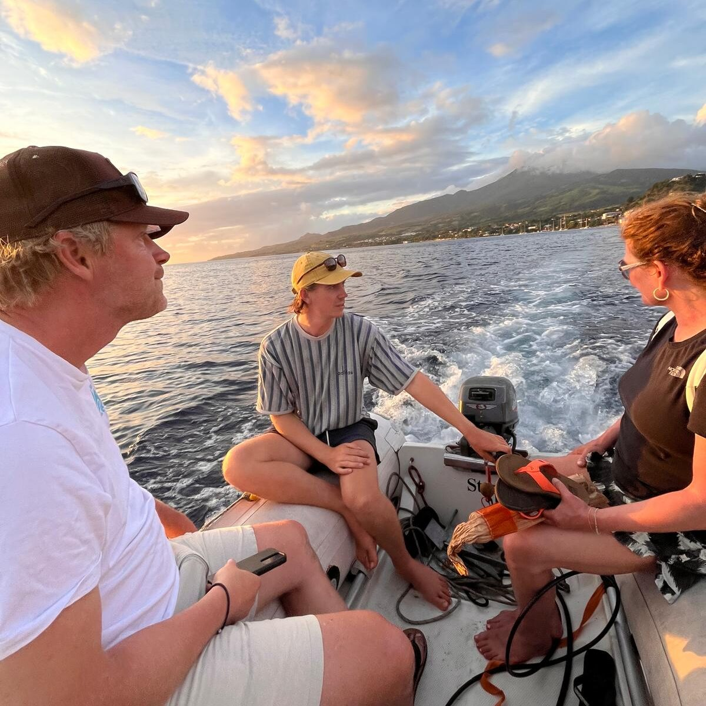

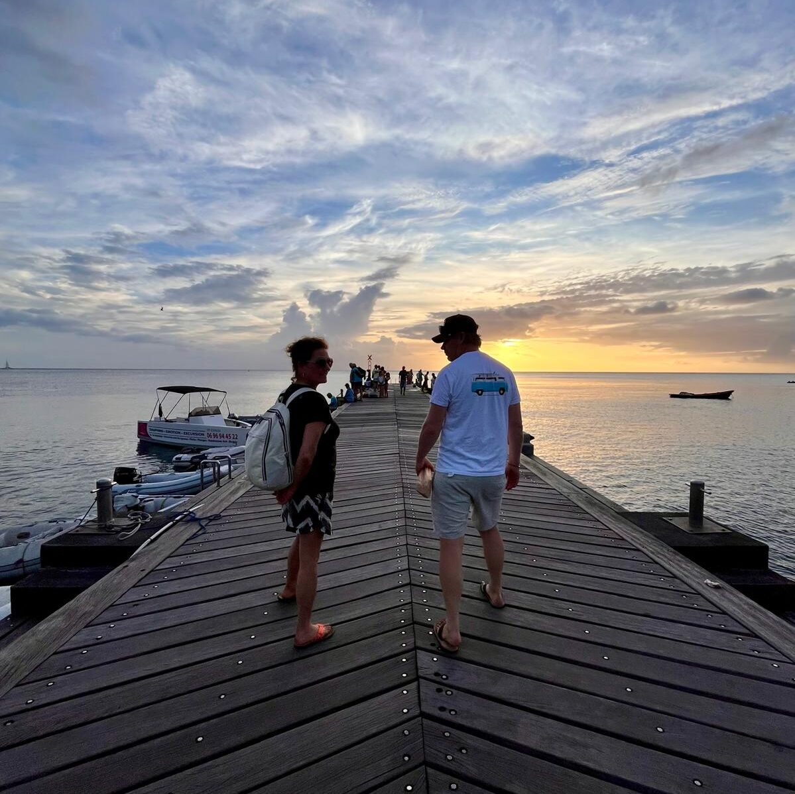

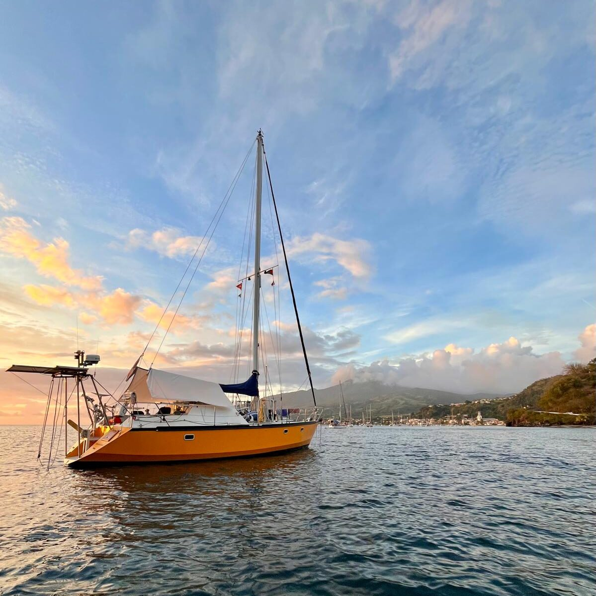

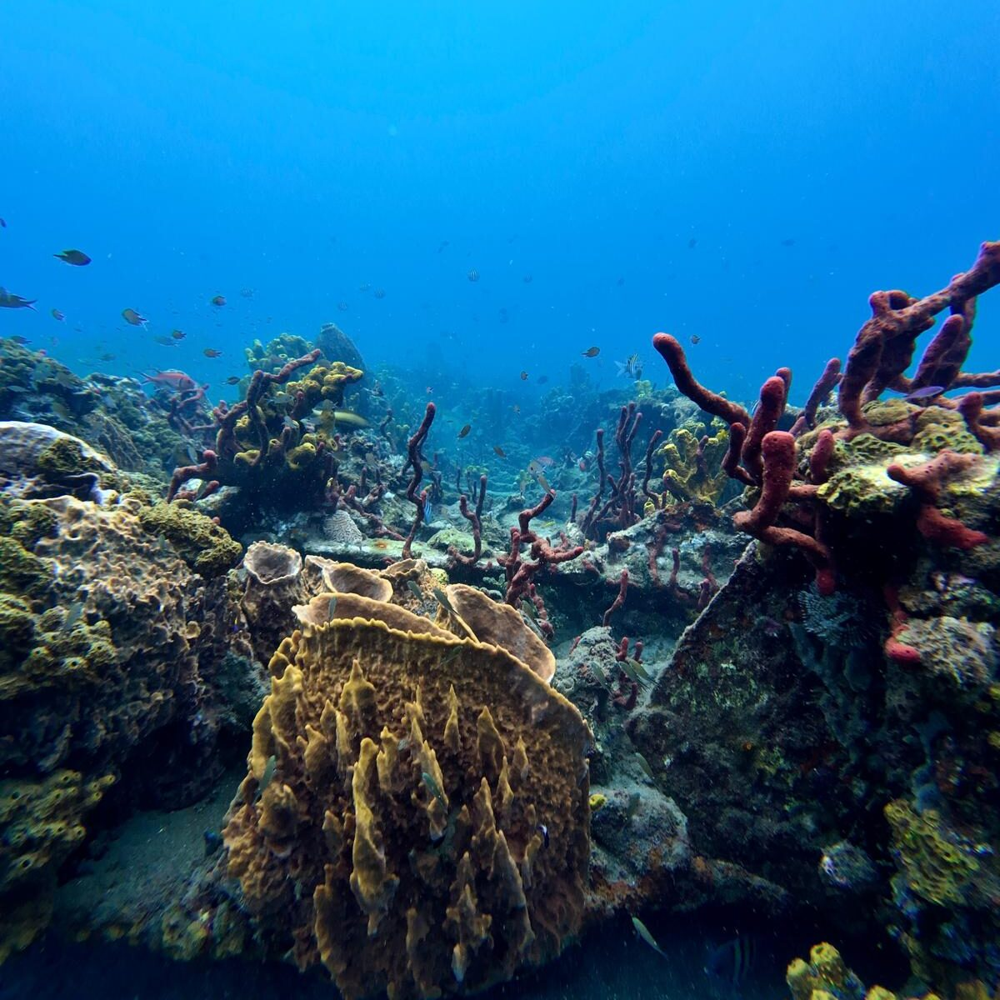

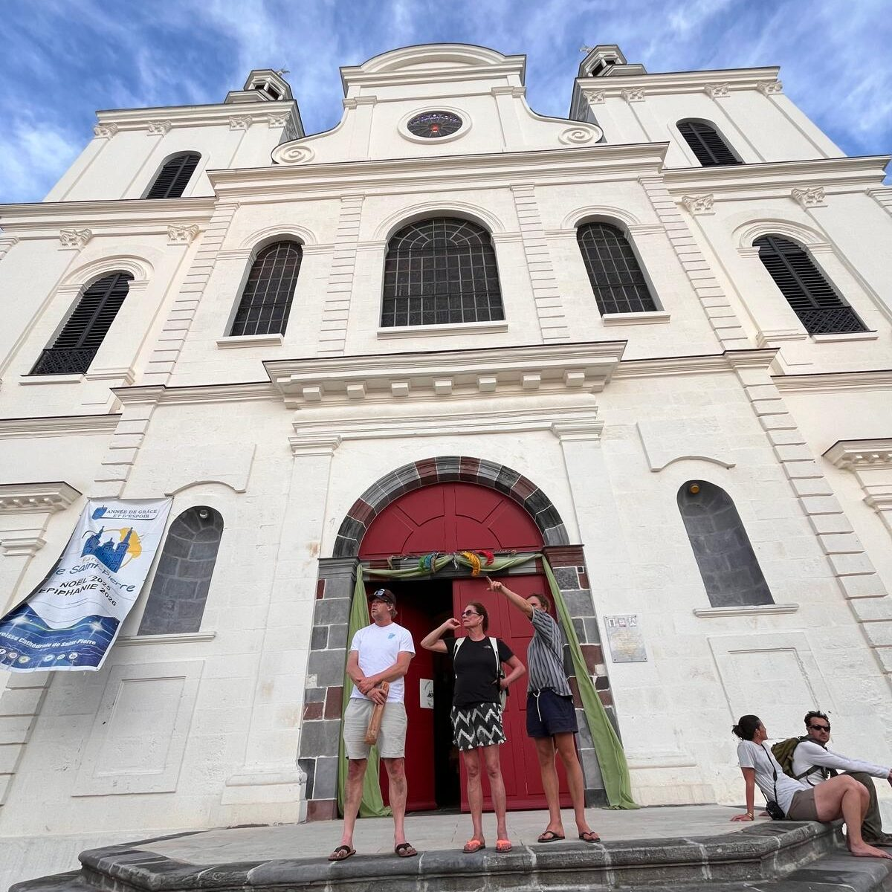

## **Palaver**

De volgende ochtend worden we wakker en smeden we samen met *Belafonte* een masterplan. *Belafonte* is samen met *Seafinn* (Rebekka en Freddie uit Noorwegen met opstappers) en *Nangara* (Simon en Veronique uit België) op weg naar een eilandje diep in de baai van Fort de France om een *potluck* dinner en borrel te organiseren. Volgens mij hebben we het al eerder over de *potluck* en mijn onbegrip voor het fenomeen gehad, maar het idee is dat je allemaal voor jezelf eten maakt, het daarna neerzet en dan vervolgens van elkaars eten gaat eten en maar ziet hoe het goedkomt. Karla die de borrelnootjes meeneemt sluit een fantastische deal, want ze eet mee van Karel die de hele dag in de keuken heeft gestaan voor zelfgemaakte pasteitjes. Karel haat *potlucks*, maar haat het nog meer om op een *potluck* te eindigen met borrelnootjes en is dus niet blij. Althans, zo kan het gaan.

We krijgen Pat en Mark gemakkelijk zo ver om nog één nachtje extra mee te pakken en vanavond een bonte avond te genieten. Door de windstilte motoren we terug richting Fort de France en varen dan nog verder de *lagoon* in op zoek naar het eilandje waar het moet gebeuren. Als we naast de andere drie schepen ons anker laten vallen horen we vanaf het eiland al een zware bas onze kant op blazen en net als we onze aankomstborrel openen hangt onze boot vol met bijbootjes en *supboards* van de andere schepen voor het zogenaamde Palaver.

We palaveren dobberend en kennismakend wat los en concluderen dat het eiland gekaapt is door Martiniquezen en we daarmee geen strijd hoeven te voeren. In plaats daarvan zullen *Seafinn* en *Nangara* hun schepen aan twee ankers aan elkaar binden en zo ons eigen drijvende eiland vormen, waar *Belafonte* en *Luwte* op kunnen enteren met *potluck meals*. Er is nog even verwarring over waar dat eten nou moeten klaargemaakt, maar we besluiten uiteindelijk om ons eten en dat van *Belafonte* onder genot van een paar drankjes bij ons aan boord te bereiden op de *plancha*. Pat en Jen liggen samen met Veronique in het water te kletsen rond onze ankerketting, ik laat de drone op voor wat *shots* en we zien niet veel later hoe Simon wakeboardend voorbij schiet tussen de boten. Het is een soort drijvend festivalterrein aan het worden. En dat terwijl de avond nog moet beginnen.

Met worstjes, kip, gepofte aardappelen, couscous salade een paar liter cocktail en een voorraad ijsblokjes maken we oversteek naar het eiland waar we hartelijk worden ontvangen met enorme glazen piña colada. We gaan benedendeks voor de altijd zo leuke rondleidingen en komen dan in de kajuit bij *Seafinn* waar het aanrecht volgebouwd staat met werkelijk waar de lekkerste dingen. Van zelfgerookte zalm tot groene verse salade, alles is te verkrijgen. Geen Karla’s met borrelnootjes in deze zaal, enkel Karels die de moeite hebben gedaan om lekker eten te maken.

Tegen de tijd dat al het eten klaarstaat en we kunnen beginnen met opscheppen zitten er bij mij al een cocktail of drie in, en ook in de drankjes is de alcohol niet uitgespaard gebleven. Bij het aanpakken van mijn bord zet ik wijselijk mijn drankje weg, maar dat oppervlak blijkt iets schever te zijn dan het zwaartepunt van het hoge glas aankan en voor ik het doorheb ligt de inhoud in het gangboord. Gelukkig hebben ze een waterslang buiten liggen en kan het makkelijk schoongemaakt worden. Op het moment kan ik alleen bedenken dat een gravitationele dwaling van het universum hier schuldig aan is geweest, totdat ik later dezelfde fout opnieuw bega en moet concluderen dat mijn perspectief misschien wat gedraaid is…

Tegen de tijd dat het donker is, de laatste restjes van de heerlijkheden in de keuken op de bordjes zijn geschraapt en we de bodem van de cocktailkannen in zicht krijgen gaat iedere schipper (of schippersvrouw) even naar binnen en worden de voorraden weer rijkelijk aangevuld. Samen met de *Nangara*, die ook een ijsblokjesmachine heeft, is het koelen van de drank geen enkel probleem en als we op een gegeven moment de bas van het eiland overstemmen met onze eigen muziek en gezang kent iedereen elkaar, wordt er gedanst en wordt er zelfs warme Jägermeister gedronken..

In een helder moment bedenk ik dat we straks ook nog van de *Seafinn* naar de *Nangara* moeten overstappen, het zwemplateau moeten bereiken over iedereen heen, de bijboot in moeten klimmen, naar *Luwte* moeten oversteken én daar ook weer goed aan boord moeten klimmen. Het politieke spel dat ik moet spelen, dat zo nu en dan verstoort wordt door een leuk nummer dat moet worden meegeblèèrd, duurt een tijdje, maar uiteindelijk lukt het om de neuzen richting de bijboot te krijgen en komen we zónder nat pak (en zonder Jen’s telefoon) terug aan boord. De kapitale fout zit hem in het afzakkertje dat we nog drinken, anders waren we de volgende ochtend vast frisser wakker geworden…

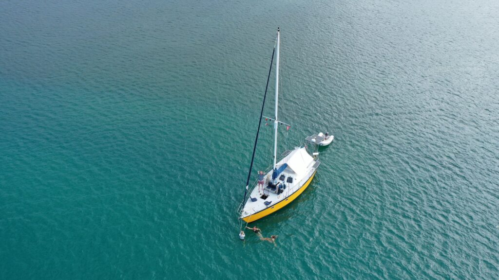

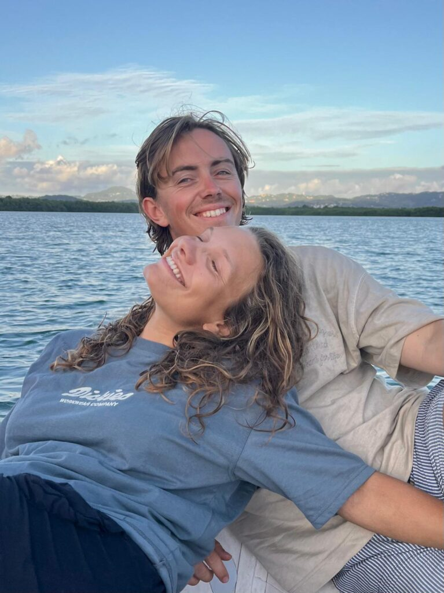

 + Seafinn (rechts) = dubbel feest")

Rond acht uur worden we ons bed uit gebrand. Er staat geen zuchtje wind. Letterlijk nul. Het water onder ons ligt stil en is viezig troebel. Niets nodigt uit om daar even lekker in te springen, al zijn we daar in deze hitte wel heel erg aan toe. We beslissen snel dat het in niemands belang is om hier te blijven liggen en nadat Jen nog snel even haar telefoon heeft opgepikt halen we het anker op en geven we gas om een beetje luchtstroom te creëren. Dat doet gelukkig wonderen en met wat koude limonade, een gebakken eitje, schaduw van de zonnetent en onze voetjes af en toe in het water dippend wordt het leven langzaam weer leuk.

Voordat we ons weer toeleggen op het landrottenleven in Anse d’Arlet duiken we nog even een baaitje in waar we op de heenweg een grote grot bij zagen liggen, in de hoop een verfrissende snorkel te kunnen doen. Mark en ik duiken er iets buiten de hoek van de baai in en hoewel het onderwaterleven niet lelijk is, wemelt het van de kleine kwalletjes. Ze prikken niet, maar echt aantrekkelijk zwemmen is het ook niet en we zijn dan ook blij als we weer worden opgepikt door Jen en Pat in de bijboot, die het strandje even verkend hebben. Het anker mag weer op en we gaan terug naar de thuisbasis. Moe maar voldaan landen we in de baai van Anse d’Arlet, is het afmonsteren geblazen en moeten we even bijkomen van de avond ervoor.

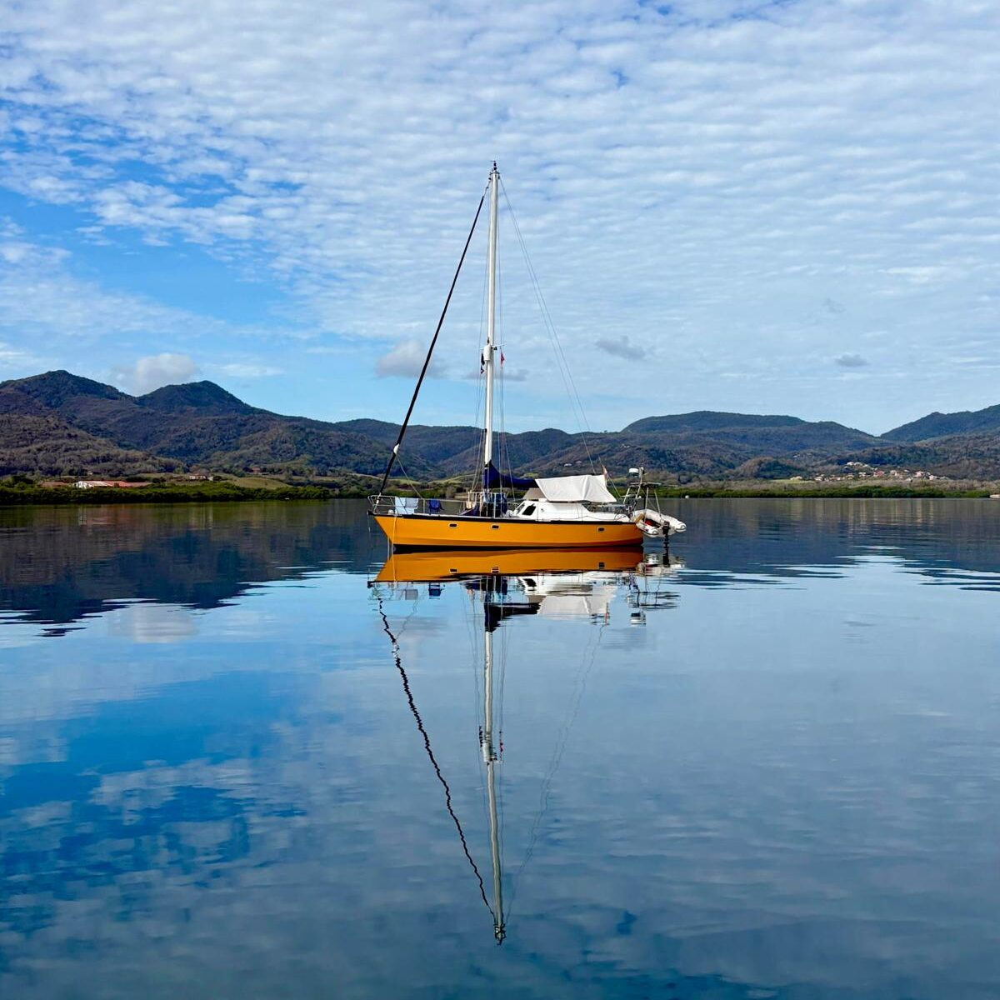

## **Landavonturen**

Ondanks onze ruimhartigheid naar *Luwte* toe tijdens ons verblijf in Le Marin, komen we er gaandeweg toch achter dat we een paar dingetjes zijn vergeten en spijt hebben dat we niet ook een nieuwe bakboord fokkeschoot hebben gekocht. We stellen een dagvullende rit samen die ook langs Le Marin komt, waar we door Pat en Mark worden getrakteerd op ons rondje in de *Caraibe Marine*. Daarna rijden we door naar de punt van het eiland, waar een TikTok-waardig strand schijnt te liggen volgens de dochter van Mark. Het strand is inderdaad mooi en fotogeniek, al moet je de badende Fransen wegdenken en voelt het voor Jen en mij nogal onwennig om op een strand te lopen zonder zicht op ons gele huis. Tussen de struiken aan de rand van het strand staan hele campingopstellingen met partytenten, slaaptenten en barbeques. Het ziet er naar uit dat de vakantievierende Martiniquees zich hier laat landen en geniet van het Caraïbische leventje. We poedelen even, hangen op een kromstaande palmboom en verplaatsen dan niet heel veel later toch maar naar de schaduw van een eettentje. Met enige verbazing kijken we naar de letterlijk bakkende Franse jonge meiden die zichzelf insmeren met lotion om nog sneller te bruinen. Zelfs na ruim negen maanden zon houden wij het maximaal een minuut of tien uit in de zon zonder te verbranden. Ik hoop dat ze thuis een grote pot Aloe Vera hebben.

We vervolgen onze weg over de kleine wegen naar de volgende attractie van de dag: Één van de rumhuizen. Volgens de overlevering zijn de rumhuizen op Martinique en andere Franse eilanden ontstaan toen Napoleon van de ene op de andere dag besloot dat de import van rietsuiker uit overzeese koloniën moest stoppen en verboden werd. Waarschijnlijk om de bietenboeren in Frankrijk te beschermen of iets dergelijks. De plantage-eigenaren stonden dus plotseling niet met handen vol gouden dukaten, maar met bergen rietsuiker waar ze iets mee moesten. Het duurde niet lang voordat de eerste plantage zichzelf omschoolde tot rumproducent. Rum mocht wel nog altijd naar het vaste land verkocht worden en leverde bovendien veel meer op dan de ruwe grondstof! De andere plantages volgden al snel en zo is rum nu een van de grote exportproducten van Martinique. De plantage die wij bezoeken (La Mauny) ruikt vooral naar gistvaten en af en toe zien we een zwarte rookpluim omhoog komen.

Mijn interesse voor het distillatieproces is sinds de vijfde klas van de middelbare school aangewakkerd en nooit meer echt verdwenen. Onder begeleiding van met name onszelf en af en toe een antwoord van de scheikundeleraar brouwden een vriend en ik ons eigen levenselixir als onderdeel van het grote scheikundeproject van dat jaar. Dat de hele school naar gistvat rook na een weekendje turbogist brouwen moest iedereen maar op de koop toenemen. Een paar weken later, nadat we in de tuin in een melkbus het brouwsel distilleerden, konden we in het lab wat testjes doen en kwamen we met onze eigengebouwde keteltje toch tot opzienbarende zuiverheid (85%). Het werd het hoogste cijfer dat ik ooit haalde...

En dat jongensavontuur zie je dan opeens weer op industriële schaal voor je neus gebeuren. Het stinkt misschien wat en het ziet er allemaal wat rudimentair uit, maar in essentie is het een zeer ambachtelijk en regeneratief proces. De suiker wordt gebruikt voor het gisten, de nutriëntrijke afvalstoffen worden over het land teruggestrooid en de vezels en andere plantenresten worden in de oven gebruikt om zelfstandig energie op te wekken voor het distillatieproces. In een treintje worden we als toeristenvee over het terrein gereden. Uiteraard is alle begeleiding in het Frans, maar via een app kunnen we meelezen. Ik doe mijn best er een spannend verhaal van te maken voor Pat, Mark en Jen, maar betwijfel of dat goed overkomt. Aan het eind van de rit mogen we natuurlijk proeven en laten Jen en ik ons verleiden om een paar liter rum in te slaan voor alle rumpunches die we nooit meer gaan maken…

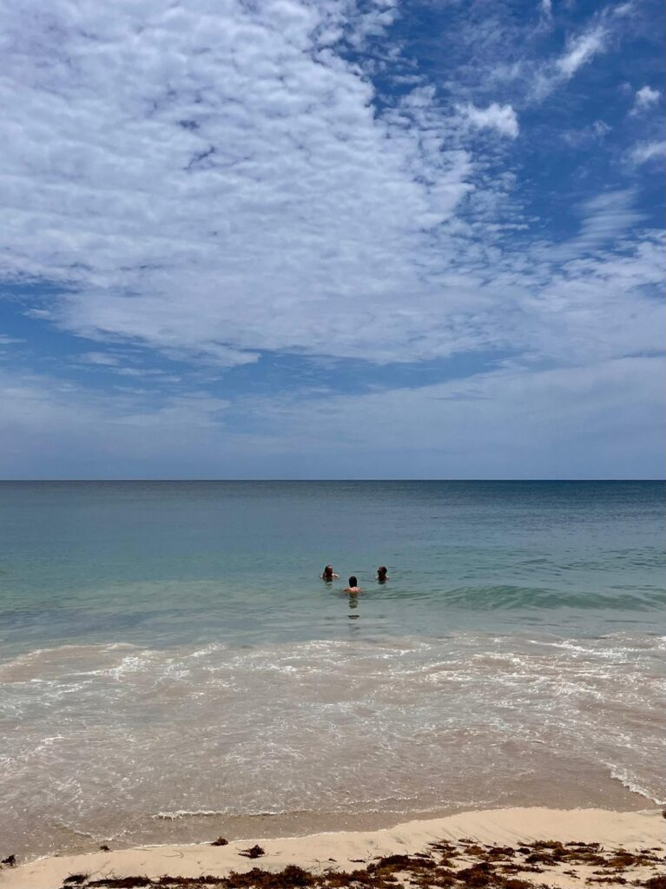

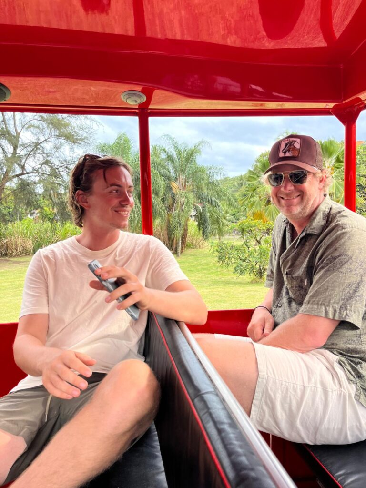

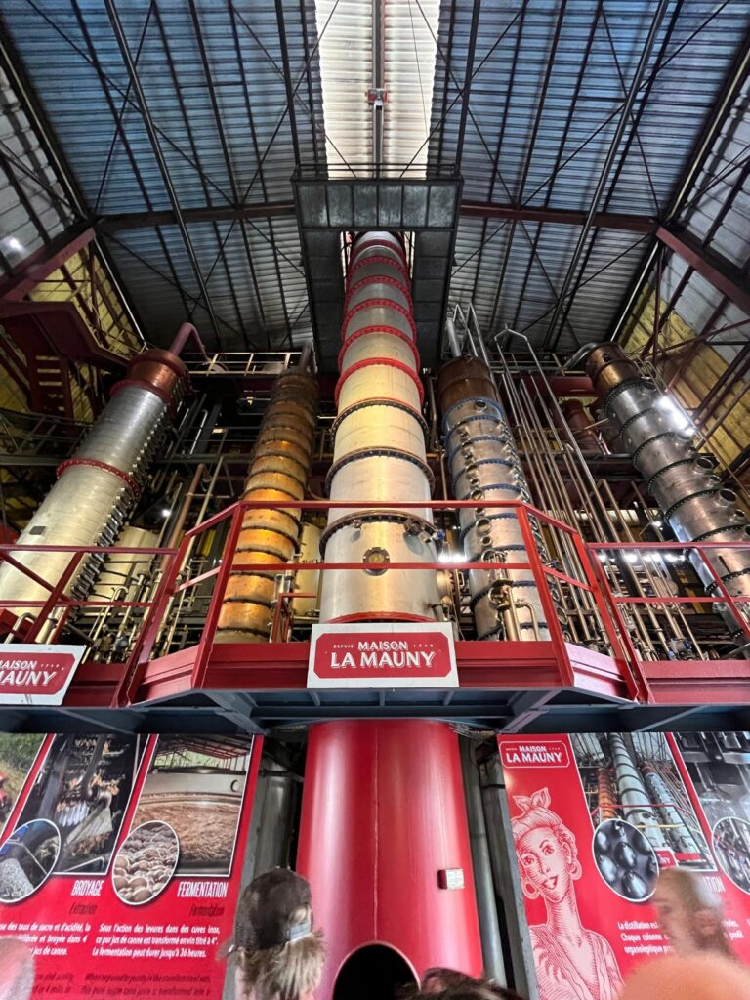

De volgende morgen is het vroeg op. Jen, Mark en ik hebben besloten dat we het eiland niet kunnen verlaten zonder de vulkaan op te zijn geweest. We stappen de auto in, halen onderweg wat baguettes en gaan dan tevergeefs op de route op zoek naar een kop koffie. We kunnen tot ongeveer halverwege de berg omhoog rijden en stappen dan het pad op naar boven. Al na een paar minuten is te merken dat het een hele klim zal worden, maar gaandeweg wordt het pad steiler en steiler. We komen bijna hollende Fransen tegen die met kleine kinderen de berg af stormen. De kinderen worden aan hun armen geslingerd en overgegooid om de grote sprongen te maken die voor ons als volwassenen al bijna niet te doen zijn. Andere wandelcultuur of iets dergelijks.

Halverwege de berg is een splitsing die afgesloten is, maar van de *Nangara* hebben we begrepen dat die prima te doen is. We klimmen om het bordje heen en dalen de krater in om er vervolgens met handen en voeten weer uit te klimmen. Op een gegeven moment heeft het niets meer met wandelen te maken en zijn we op zoek naar onze weg over de grote rotsblokken, maar we komen stap voor stap verder. Hoewel we met een zonnetje vertrokken, zijn we inmiddels blij met de uitzichtonttrekkende wolken die om ons heen blazen. Het maakt de lucht koel en vochtig en zorgt ervoor dat we niet oververhit raken.

Vanuit de bovenste rand van de krater is er nog een klein staartje heen- en weer te nemen om de laatste 25 hoogtemeters te halen naar de top. Dat staartje kost wel anderhalf uur extra en we vinden het eigenlijk wel goed zo. Om Jen een beetje op de kast te jagen discussiëren we wel nog zo’n 25 minuten op de splitsing over hoe het nét niet halen van de top Jen haar de rest van haar leven zal achtervolgen, als *achiever* die ze is. Ze laat een stukje van die eigenschap achter op de top van Martinique en we nemen de (gelukkig) iets vlakkere route weer terug naar de auto onder het mom van meer tijd met mama. Met knikkende knietjes en dampende t-shirts kijken we beneden aangekomen omhoog en kunnen we de vulkaan van Martinique na ruim vijf uur klimmen als overwonnen beschouwen, al heeft Jen de volgende keer nog een appeltje te schillen.

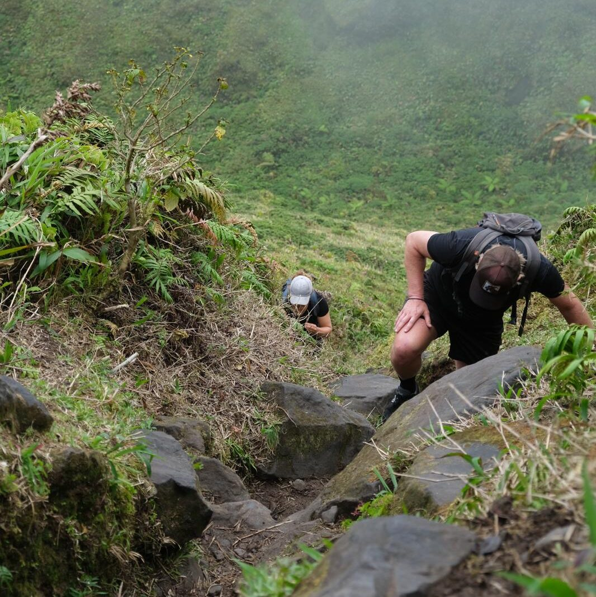

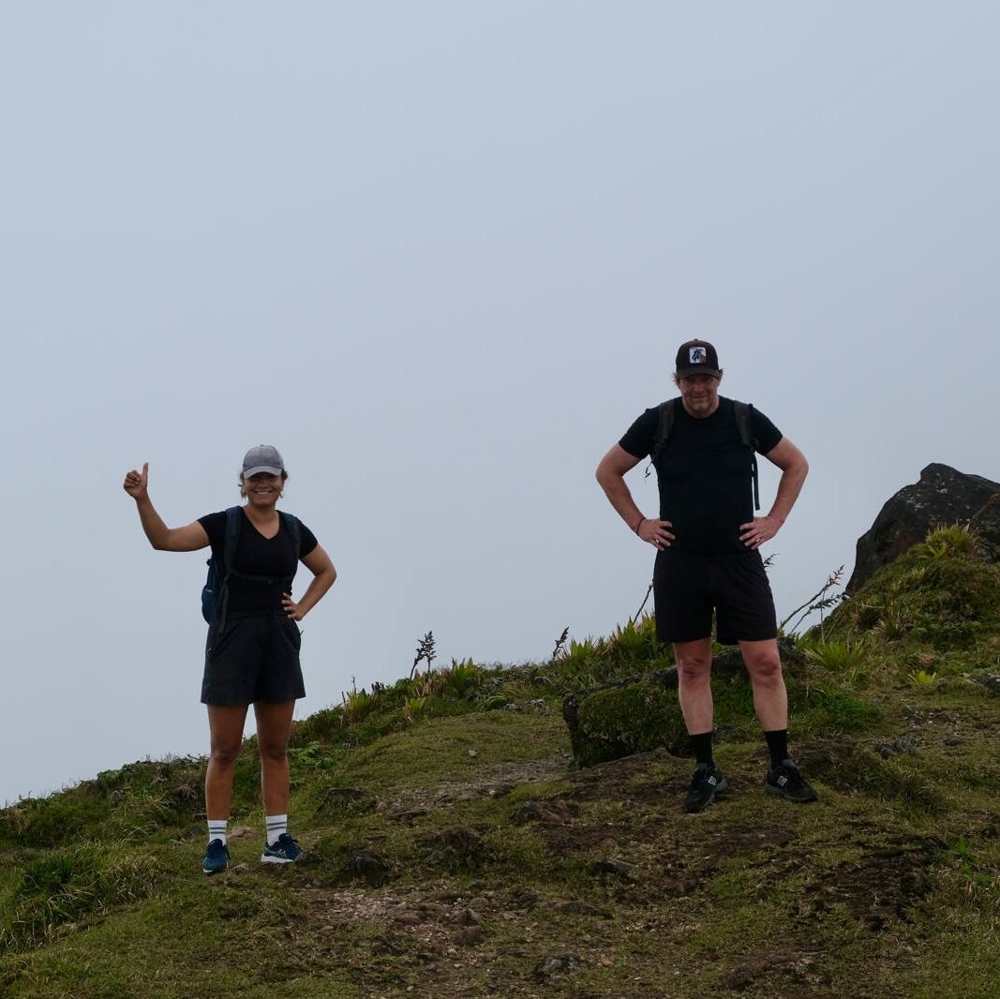

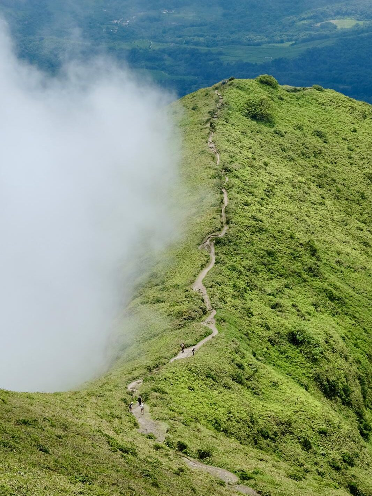

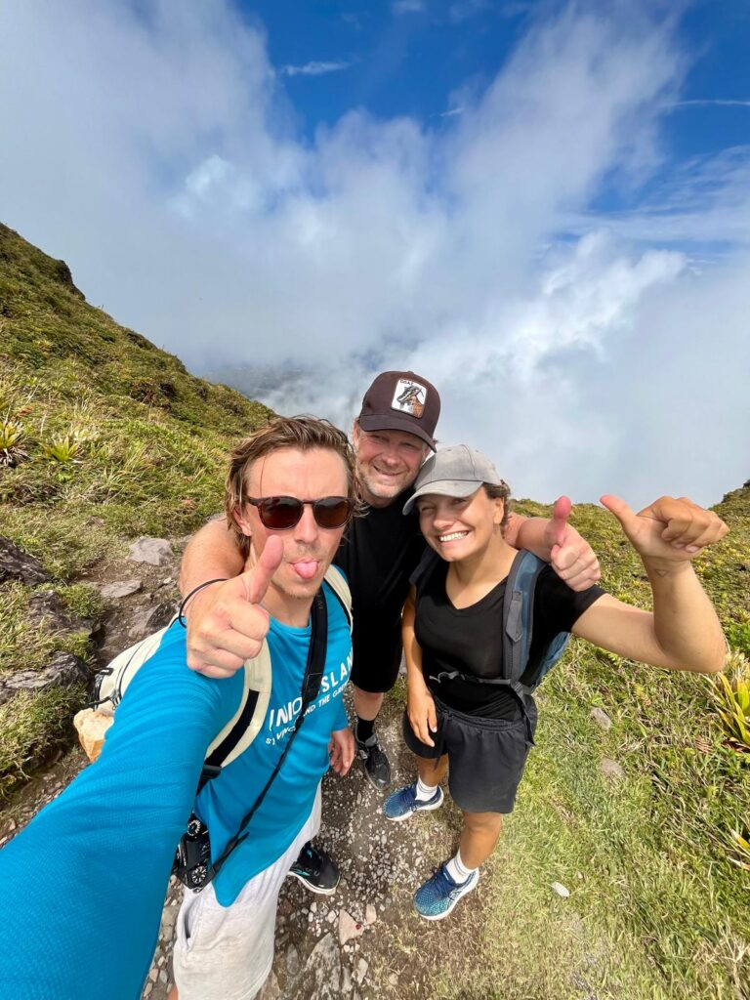

De volgende dag is een beetje een gewonnen en verloren dag. Het vliegtuig terug naar Europa staat pas ’s avonds te wachten, maar echt tijd en zin voor grote activiteiten is er dan ook niet meer. Wel is er alle tijd om rustig het huisje op te ruimen, alles te verhuizen wat verhuisd moet worden naar de boot, en springen daar nog een laatste keer het water in voor een snorkeltje (met zeeschildpadden!). We lunchen aan boord en kijken alvast terug op een prachtige tijd hier samen op het eiland. We hangen nog wat om en dan is het misschien nog niet helemaal tijd, maar hangt het afscheid wel in de lucht. We laden *Storm* weer in, varen naar de kant en tillen de koffers van het huisje naar de auto. Bitterzoet kijken we toe hoe Pat en Mark wegrijden en glijden wij terug in onze bubbel met z’n tweeën. Ik sla net als de eerste avond een arm om Jen heen en we concluderen dat onze verwachtingen zijn overtroffen, dat ons hart vol is en we de komende tijd wel even door kunnen met z’n twee. We hebben grote ambities en hoge verwachtingen van de komende tijd. Het voelt nog ver weg, maar binnenkort staan de volgende oceaanoversteken alweer op de planning. Maar vanavond kruipen we even in ons hol en zoeken we een aflevering van een programma waar je niet over hoeft na te denken, dat komt morgen wel weer.  

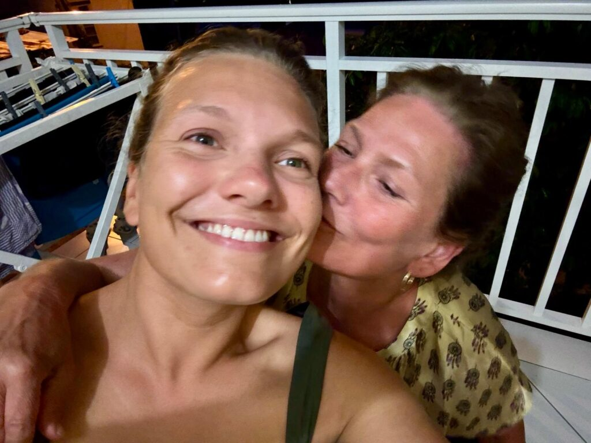
