We hoeven er geen doekjes meer om te winden. Martinique was functioneel én bijzonder met het bezoek van Pat en Mark, maar nu zij weer op het vliegtuig zijn blijft er voor ons niet zoveel meer over om te ontdekken of te doen. We varen weer naar St. Pierre waar we bij de VVV kunnen uitchecken en een stempel krijgen voor onze volgende bestemming: Dominica.

Het weer dat voor de komst van Pat en Mark zo dominant was, met vervelende windstoten en scherpe golven tussen de eilanden, lijkt te zijn verdwenen. Het is maar een dagtochtje vanuit St Pierre naar Dominica en we genieten van het zeilen en de vooruitzichten op één van de eilanden die Jen al sinds de Kaap Verden op haar vizier heeft. Dominica staat ook wel bekend als *Nature Island* en van wat we van anderen gezien hebben doet het die titel absoluut eer aan. Anders dan de naam doet vermoeden, is Dominica geen Frans eiland, maar een eiland in van het Britse “*commonwealth*”, dat overigens een stuk minder welvarend en samenhorig is dan het doet klinken.

Van origine heet het eiland *Wai'tukubuli*, wat zoveel betekent als *Lang is haar lichaam*. Het feit dat we het nu met z’n allen Dominica noemen, komt door de stompzinnige reden dat ene Cristoforo Colombo op een van zijn ontdekkingsreizen langs het eiland voer. En dat was toevallig een zondag, wat naar het latijn vertaalt als Dominica. Hij nam niet eens de moeite om voet aan wal te steken op dit vruchtbare eiland, maar bepaalde wel de naam die wij tot vandaag aanhouden. Aangezien Wai’tikubuli een stuk spannender klinkt, en antropologe Jen van mening is dat we altijd de *first nations* moeten steunen in gekoloniseerd gebied, houden wij het op Wai’tikubuli.

En lang en imposant blijkt haar lichaam als we er langs varen. En ongelooflijk groen in vergelijking met de eilanden die we tot nu toe gezien hebben. Achter het eiland vallen wind en golven weg en glijden we motorzeilend langs een dunbevolkt eiland met hoge groene bergen, plotseling vormende wolken en enkele inhammen met stranden. Wij varen door, richting het in het noorden gelegen Portsmouth. Tegen de tijd dat we de baai in draaien begint het al te schemeren, en trekt de wind weer een beetje aan. We kruisen op de baai in en zien van de andere kant een ander zeilschip ook de baai in draaien. Dat wordt een wedstrijd!

We kruisen achter het schip langs op een meter of honderd, varen nog een stukje door en maken ons dan klaar voor onze wedstrijd-overstag-manoeuvre. Die doen we niet vaak, maar als we willen gaat *Luwte* heel snel overstag en staat de fok direct strak. Midden in onze manoeuvre komt een *boatboy* ons tegemoet scheuren en probeert contact te maken. Een beetje geërgerd reageren we dat we verder praten als we voor anker liggen. Wij zitten immers in een wedstrijd en hoewel we ze tot nu toe goed hebben kunnen ontlopen, hebben we al veel geruchten gehoord over opdringerige *boatboys* langs de Caraïbische eilanden. Ze proberen je tours, moorrings, water en andere zaken te verkopen die wij eigenlijk niet zo nodig hebben.

De wedstrijd verliezen we grandioos van dit snelle X-Yacht, die waarschijnlijk de helft van ons gewicht heeft en meer zeiloppervlak. Ik vind het lastig te verkroppen, maar het is nou eenmaal de harde realiteit als je voor een zwaargebouwd stalen schip kiest. Je kunt niet alles hebben. In het volgende front met wind op de kop zijn we weer spekkoper.

Als we het anker net goed hebben liggen en de lijnen hebben opgeruimd komt de *boatboy*, die in dit geval zeker geen *boy* is, maar een man, naar ons toe. Hij ligt al even naast ons, maar wacht geduldig op een afstandje tot we hem wenken. Daar scoort hij bij mij punten mee.

Titus heet ons welkom op zijn eiland. Hij legt ons uit dat ze in Portsmouth een vereniging van *boatboys* hebben opgezet, zodat ze niet in elkaars vaarwater hoeven te zitten en de kosten en inkomsten kunnen delen. Het resultaat ervan is op zijn minst vriendelijk te noemen. Titus is ons aanspreekpunt en dat weten de andere jongens inmiddels ook al. Die zullen ons niet meer lastigvallen. Ze hebben een moorring waar je op kunt aanleggen met een kraantje eraan waar je tegen betaling drinkwater kunt tappen. Ze hebben een verenigingsgebouw waar je welkom bent en waar ze elke zondag en woensdag een barbecue organiseren met onbeperkt rum-punch. En als we iets geregeld willen hebben, kunnen we hem gewoon oproepen op de VHF. Wij drinken een drankje in de laatste zonnestralen en proosten op het volgende hoofdstuk van onze reis.

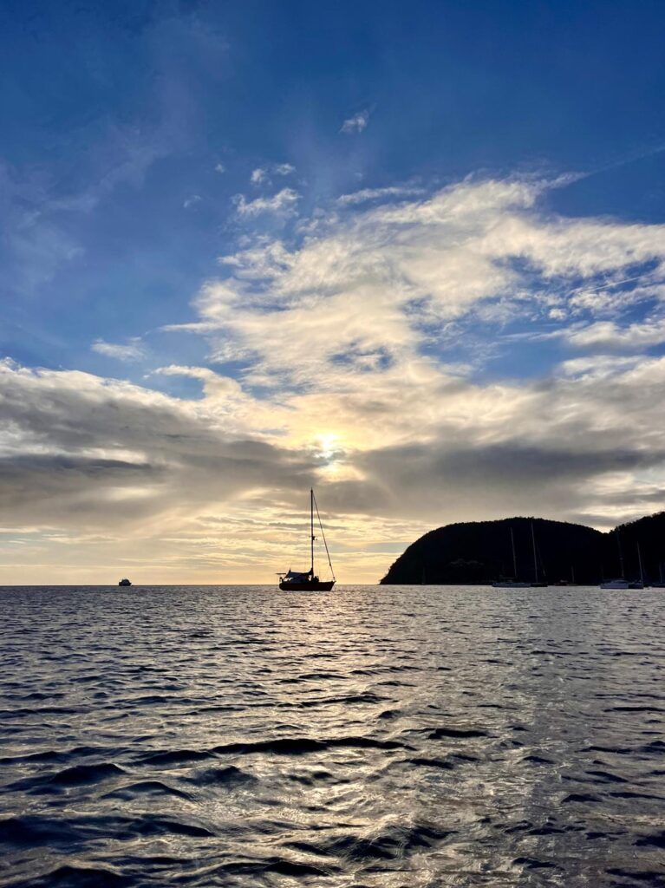

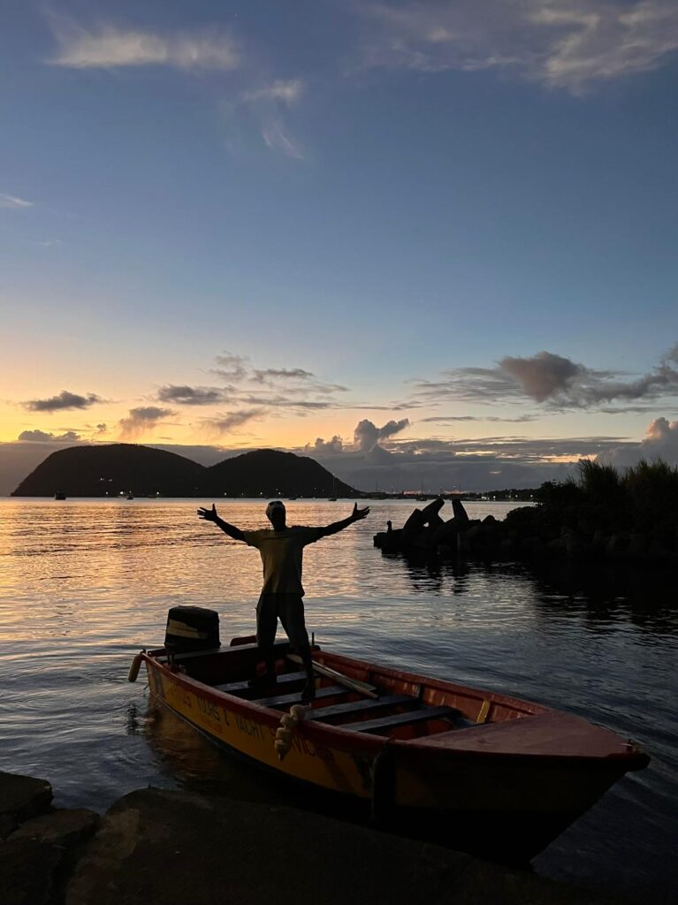

In sommige dingen zijn we, en met name ik, een beetje krenterig. Zo vinden we het hier belachelijk dat je een paar dollar moet betalen voor het gebruikmaken van de steiger van de douane om in te checken. In plaats daarvan leggen we onze dinghy op een twijfelachtige plek op twintig minuten lopen. Dat vinden we niet erg. Op die manier zien we alvast een stukje van het dorp. In dit geval zien we met name een stukje van het industriegebied dat naast het dorp ligt, maar dat weten we dan ook maar weer. Na de nodige stempels, handtekeningen en betalingen zijn we welkom op het eiland en krijgen we van de douanebeambte mee dat we zéker een mooie tijd zullen hebben op het eiland.

<figure class="wp-block-image size-large">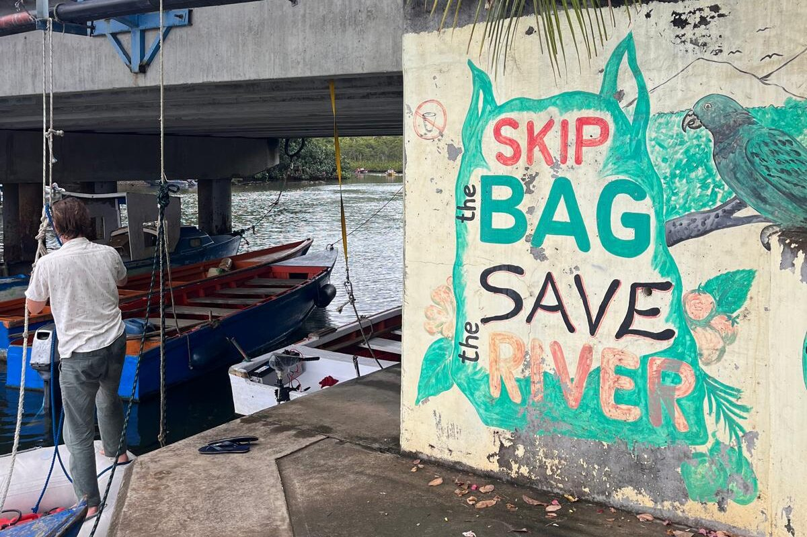<figcaption class="wp-element-caption"><em>Storm</em> achterlaten tussen de andere bootjes</figcaption></figure>

Het contrast tussen Martinique en Wai’tikubuli is bijna even groot als tussen de Canarische en de Kaap Verdische eilanden. Het lijkt wel alsof we weer op een heel ander continent zitten, met een andere cultuur, andere infrastructuur en vooral heel andere manier van leven. We moeten weer even onze houding en onze weg vinden op deze nieuwe plek, maar concluderen allebei snel dat het een verademing is om meteen het gevoel van ‘op reis zijn’ weer te pakken te hebben. De weigerende betaalautomaten, lofzangen van taxichauffeurs of toerverkopers die ons proberen te strikken, en groenten en fruit die gewoon op klaptafels naast de weg verkocht worden, zijn antropologisch misschien een beetje een uitdaging, maar de mensen staan hier open voor een praatje op straat, glimlachen als je naar ze kijkt en bovenal: weigeren niet om Engels te spreken. Bij de vissers trekken we uit een grote plastic bak die half in de zon staat, maar wel is gevuld met ijs, een grijs uitziende vis die we niet kennen. Bij de dames halen we alle soorten groenten, fruit en sla die we kunnen bedenken, met de aarde er nog aan. Alles lijkt hier te groeien!

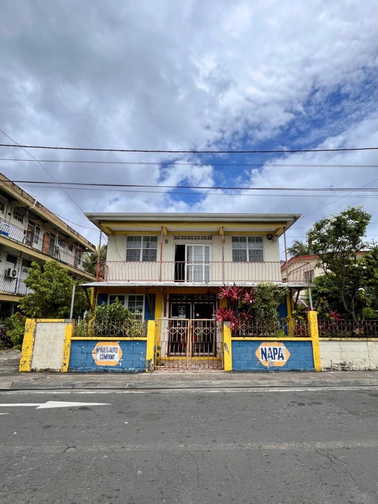

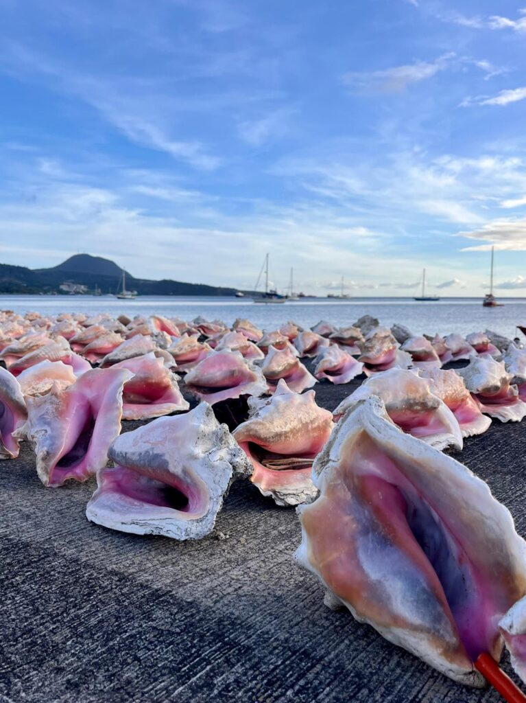

## *Boatboys* BBQ

Terug op *Luwte* komt Titus weer langszij in zijn bontgekleurde boot. Je hoort hem met zijn 70PK tweetakt vanaf de andere kant al aankomen, gevolgd door een rood-gele flits. Titus’ naam pronkt trots op de romp van zijn boot en aan zijn broek hangt een oude handmarifoon waarmee hij binnenkomende scheepvaart kan opvangen. Zijn versleten kleding en doorgeleefde boot verhullen zijn verder goede leven. Een paar dagen later komen we er achter dat het grootste felgekleurde huis langs het water van hem is, inclusief het flinke stuk grond dat er aan vast ligt. De vereniging van bootjesuitbaters doet het erg goed op dit eiland. Ze hebben al een jaar of vijftien geleden ingezien dat ze er gezamenlijk belang bij hebben dat jachtjesmensen een goede tijd hebben in deze haven, en dat berichten over diefstal erg lang blijven hangen. Het is dan ook de eerste plek sinds Noord-Spanje, waar we zonder zorgen onze dinghy zonder slot de hele dag bij de visserskade laten liggen. En dat is veelzeggend.

Titus nodigt ons uit voor de barbecue de volgende dag en wij laten hem weten dat we graag langskomen. Hij zal de volgende dag iemand langs sturen waar we een kaartje bij kunnen kopen en we kondigen meteen maar aan dat we de *Belafonte* ook verwachten mee te nemen. *Life is good*. De baai is rustig, we drinken een drankje en bereiden het boterzachte visje op de *plancha*.

De volgende middag komt *Belafonte* inderdaad ook de baai binnendrijven en zitten we niet veel later bij ons aan boord voor een drankje. We nodigen de jongen die de barbecuekaartjes verkoopt meteen maar bij ons aan boord uit, aangezien hij precies voor een zware regenbui komt aankloppen. Hij is een bedreven *entertainer* en stapt tien minuten later met een buiging weer af terwijl wij lachend achterblijven.

Tegen zevenen verplaatsen we ons naar het clubhuis waar inderdaad een rij barbecues aan het werk is. We trekken *Storm* het strand op en lopen op blote voeten naar binnen. Daar krijgen we een plastic beker in onze hand gedrukt en de uitnodiging om aan de bar zoveel rumpunch te halen als we maar zin in hebben. We laten ons neerdalen tussen een dertigtal andere *yachties* en hoewel het een beetje een witte enclave is, zijn we dik tevreden met deze organisatie. Nog voordat het eten wordt aangekondigd ben ik de tel kwijt van hoeveel rumpunches ik al verwerkt heb, maar de bekertjes zijn maar klein. Naast de lange tafels is een klein podium in het zand gezet waar een DJ zijn rustige plaatjes staat te draaien om de sfeer er een beetje in te krijgen.

Voor de aankondiging van het eten wordt de muziek stilgezet en warmt de DJ zijn *crowd* een beetje op voor de avond. We applaudisseren netjes voor de chefs die het eten hebben bereid, en als hij tenslotte vraagt of er nog Nederlanders in de zaal zitten klinkt er al een iets te luid gejoel op. De DJ blijkt getogen in het pittoreske Hoorn en spreekt vloeiend Nederlands. Ik ben een beetje van slag van hoe klein de wereld af en toe is en ga nog drie keer bij Jen na of we het echt juist gehoord hebben dat hij uit Hoorn komt, voordat we ons bordje eten gaan halen.

We mogen – zoals in bijna alle restaurants in het Caraïbisch gebied – kiezen tussen kip of vis. Maar hoe simpel de maaltijden hier ook zijn, ze hebben zichzelf wel meester gemaakt in de rijst, kip, vis en simpele salade. Uit een emmer Zaanse mayonaise wordt met een bekertje een groene dressing over ons eten gegoten waarvan we het recept helaas nooit hebben kunnen ontfutselen, en een paar minuten later zitten we met volle buiken verwonderd naar onze lege borden te kijken. Dat was fantastisch. Jen en ik delen zelfs nog een tweede bordje. De kippenbotjes worden door de straathonden met veel dank aangenomen en tot splinters gekauwd. Daar kunnen onze Nederlandse rashondjes niet tegen, maar honden die hier geen kippenbotten kunnen verteren halen hun eerste levensjaar niet.

Niet lang na het eten staat Jen met een van de andere dames te dansen, voetjes in het zand, rumpunch in de hand. Ik houd nog even stand op de bank, maar wordt uiteindelijk bij mijn haren meegesleurd om mee te dansen. En dan wordt het snel gezellig en warm. Mijn dorst wil maar niet lessen en ik word snel vaste klant bij de barman, die stilzwijgend mijn glas blijft vullen en er voor blijft zorgen dat de rumpunch tijdig wordt bijgevuld. Het duurt bijna de hele avond, maar uiteindelijk krijgt Jen het voor elkaar. De Hoornse DJ switcht van zijn eigen muziek naar, hoe kan het ook anders, het album van Abba Gold. Een paar induttende oudere dames wordt naar hun gloriejaren terug geteleporteerd en staan plotseling ook te dansen. Niet lang daarna heeft hij er ook wel genoeg van en sluit de DJ af met zijn laatste Abba-nummer. We koprollen naar de bijboot en duwen hem zo goed en zo kwaad als het kan weer terug het water in. We laden onszelf in en vinden onze weg terug naar *Luwte*, waar we in een diepe slaap sukkelen.

<figure class="wp-block-image size-large">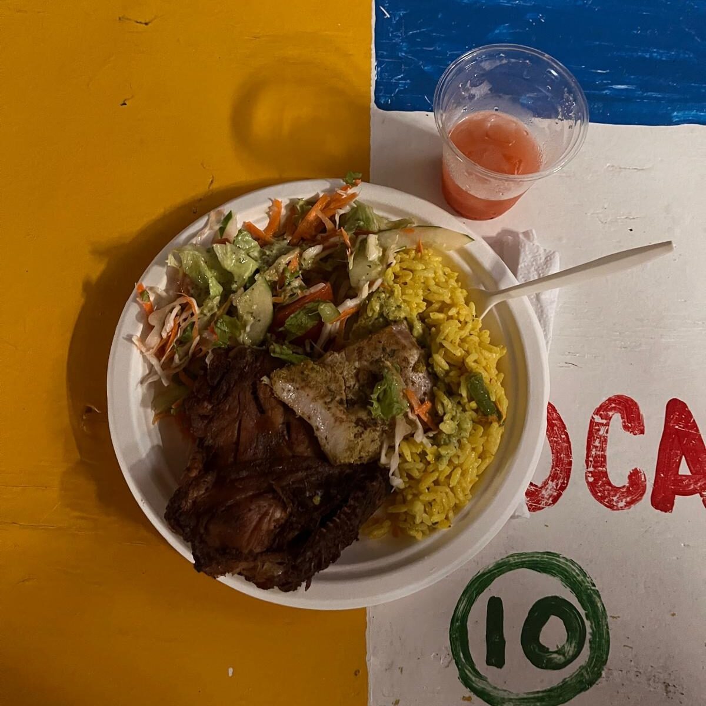<figcaption class="wp-element-caption">Rijst met kip en sla, met een afdronk van rumpunch. Op de BBQ van de <em>boatboys</em></figcaption></figure>

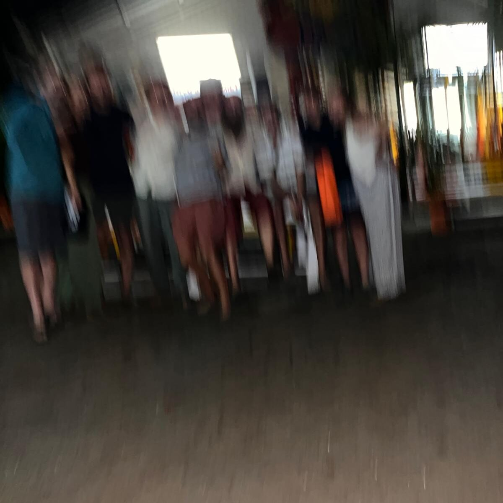

De volgende dag is vanaf het eerste moment verloren. In ieder geval voor mij. Jen blijkt een stuk minder sportief te hebben meegedaan in “waar voor ons geld krijgen” en sleept mij uit bed en het water in. We frissen ons op, hangen onze ziel onder de arm en kloppen dan aan bij *Belafonte*. Ook bij hun zijn de hoofden zwaar en de verwachtingen voor deze dag laag. We leggen de puzzel van gisteren samen in elkaar en lachen om onze onverstandige daden. We drinken intussen liters water en limonade om maar weer een beetje op krachten te komen en overleggen met Titus een tour voor de dag erna. In een poging toch nog iets te bereiken gaan we gezamenlijk aan wal op zoek naar een vriendenvlag en een hapje te eten, maar daarna is de koek ook wel een beetje op.

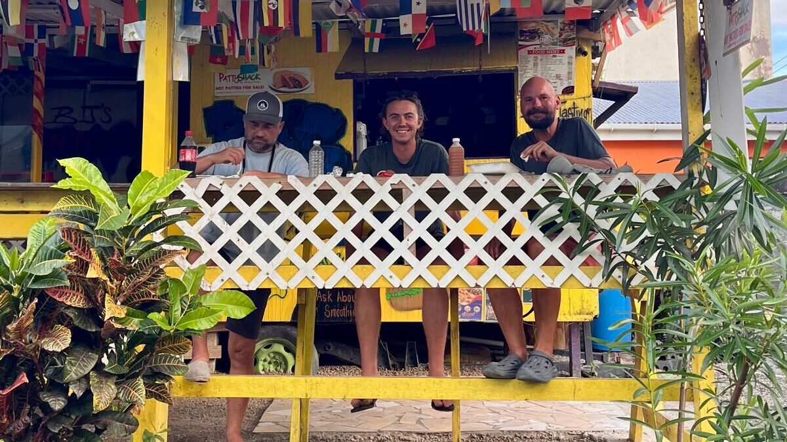

## **Watervalleneiland**

De volgende ochtend worden we vroeg door Titus opgepikt en naar de kant gebracht. Een van zijn jongens staat op ons te wachten in een uitgewoond personenbusje en laat ons instappen. Het is niet de jongen die we beloofd waren. Die is niet komen opdagen vanochtend en ligt waarschijnlijk nog te slapen, maar dat maakt niet zoveel uit. We rijden Portsmouth uit en worden al snel verwelkomd door de geur van citroengras. Dat groeit hier in grote getalen langs de kant van de weg als onkruid. We stappen snel uit om wat bossen te plukken en rijden dan weer verder over een glooiende weg langs de kust. Onze chauffeur wijst ons een *luxe-resort* aan. Zijn vorige werkgever, maar hij is er weggegaan omdat hij er minder betaald kreeg dan als chauffeur en harder moest werken. De bezoekende toerist betaalt daar *vanaf* €1.000 per nacht, maar daarvan vloeit maar weinig terug naar Wai’tikubuli.

Na een flink stuk langs de kust, draaien we een kleine weg op die bijna recht omhoog loopt. Niet veel later slingeren we tussen steile en vooral ontzettend groene bergtoppen door. Het is alsof de saturatie van kleuren hier op 120% staat. Onze bestuurder rijdt rustig en we genieten dus al voordat we ergens zijn van de route. Als we opeens allerlei borden in het Chinees zien en de weg ophoudt zijn we een beetje verbaasd. Hij vertelt ons, terwijl hij op een kleine plaats parkeert, over de Chinese invloed en dat zij Dominica enorm helpen met scholen, ziekenhuizen en de ontwikkeling van een aantal resorts. We hebben gezien hoe die inmenging in Suriname is geëindigd en hopen stiekem voor de mensen hier dat ze zichzelf weer naar eigen poten terug besturen.

We worden afgezet aan het begin van het pad naar de hoogste waterval van het eiland: De Middleham Falls. We hebben deze specifiek gekozen omdat de wandeling er naartoe meer dan een uur duurt en hij daarom wat minder bezocht is dan de watervallen waar de parkeerplaats naast is gelegd. Al snel wandelen we dicht bos in en lopen we in de schaduw van een dik bladerdak het modderige pad af. Ruim voordat de waterval zich laat zien, kunnen we het geruis en gegrom ervan door het bos horen, en als we er plotseling op uitkijken weten we even niet waar we moeten kijken. In de smalle kloof waar we doorheen zijn gekomen vliegt het water bijna honderd meter recht naar beneden. Een dichte mist van opspattend water vouwt zich om zich heen en binnen no-time is alles nat. Verderop stroomafwaarts zijn wat poelen waar mensen zitten te badderen, maar direct onder de waterval zit ook een grote poel waar het water met veel geweld in neerkomt. Julien overtuigd ons om mee omhoog te klimmen over de glibberige stenen en dan laten we ons in het koele water zakken. Het voelt alsof we in een zware *squall* terecht zijn gekomen. Het water vliegt horizontaal in mijn gezicht, we moeten naar elkaar schreeuwen om elkaar te verstaan en de neerwaartse beweging van het water zorgt voor een sterke wind. Jen’s lenzen vliegen bijna uit haar ogen, maar spectaculair is het zeker!

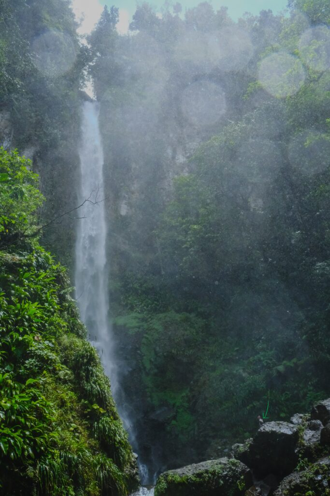

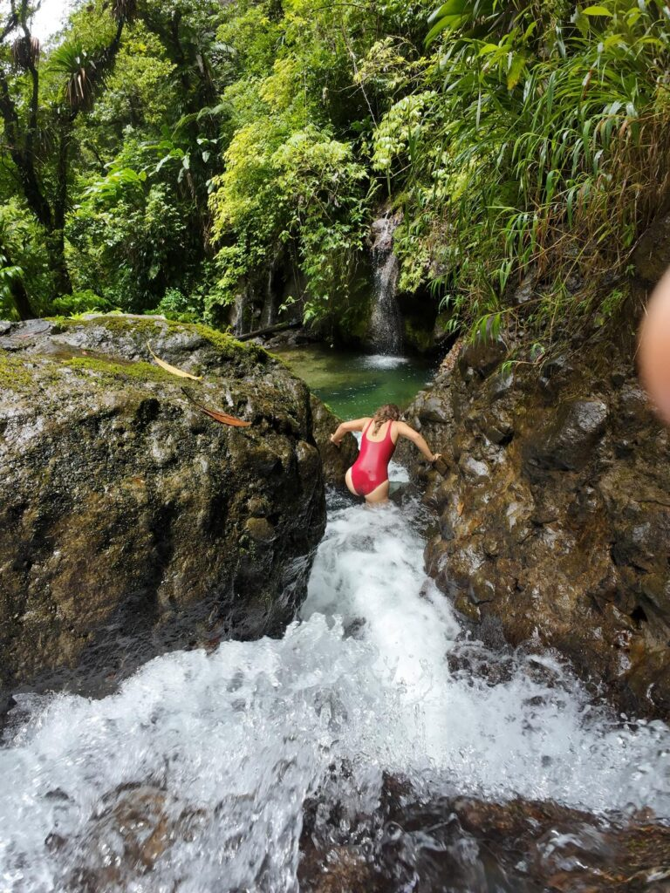

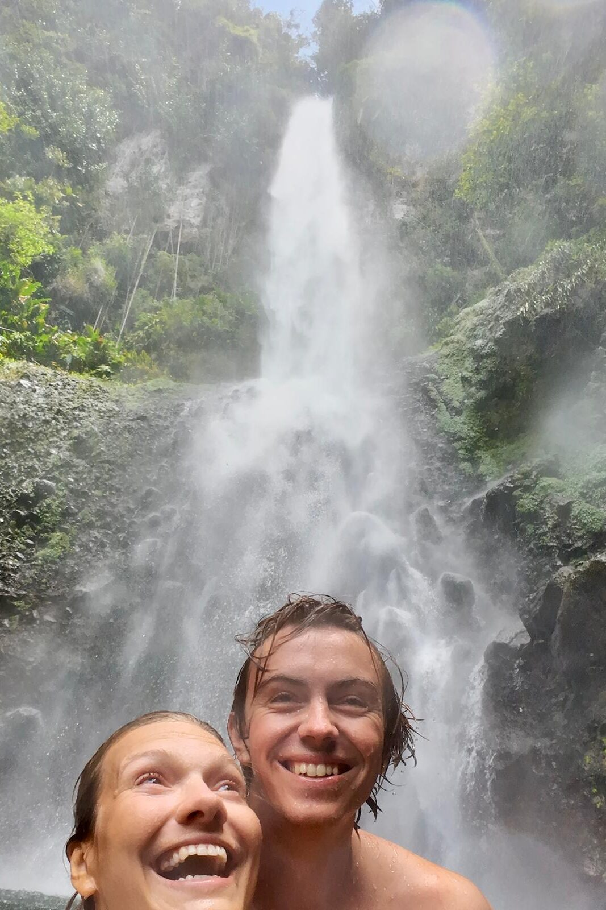

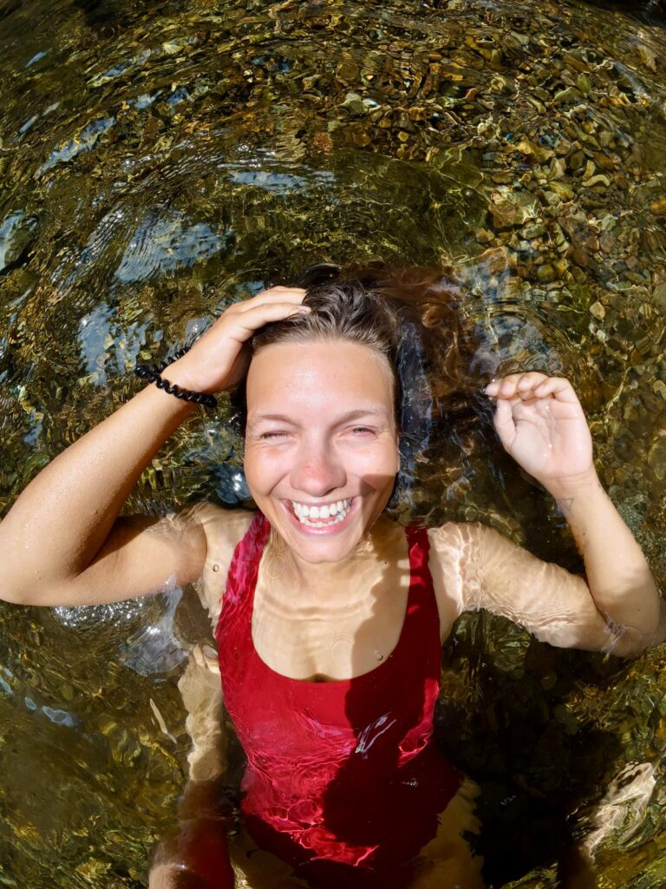

Na een paar minuten is het wel zó overweldigend, dat we ons laten afzakken naar de rustigere poelen stroomafwaarts, waar ik zelfs de drone nog even oplaat, maar het lukt me niet om boven de waterval uit te komen voor het echte spectaculaire beeld dat ik had willen maken…

Doorweekt, maar voldaan lopen we terug naar de bus. Onze chauffeur ligt languit op een picnictafel te slapen. Zijn collega rookt een flinke toeter en schudt hem wakker als we aan komen lopen. We trekken onze droge kleren aan en verkassen dan naar de *Titou Gorge*, waar we bevestigd krijgen dat we een goede beslissing hebben gemaakt bij de Middleham Falls. Als toeristenvee worden we zo’n ouderwetse kurkenband van zwemles omgehangen (die we bij hun gratie mogen huren voor 15 dollar) en mogen we kleuterend het water in. We zijn gelukkig net voor een groep uit, en zwemmen door de spectaculaire grot naar een waterval die een soort *Whirlpool* vormt. Daar zitten we even, tot de groep met gids komt en het snel duidelijk wordt dat we op moeten rotten. Het is al met al maar een minuut of tien, maar ook hier kijken we onze ogen weer uit. Daarna mogen we het busje weer in en worden we naar een lunchplek in het dal gereden waar we tussen de steile bergtoppen weer mogen kiezen tussen kip en vis.

We besluiten de dag met nog een set watervallen en laten ons daarna verwennen bij een soort retreat met hete modderbaden die ze vullen met een hete bron vanuit de vulkaan.

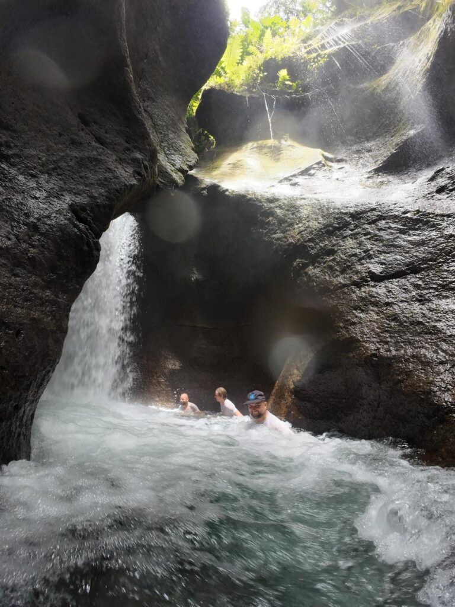

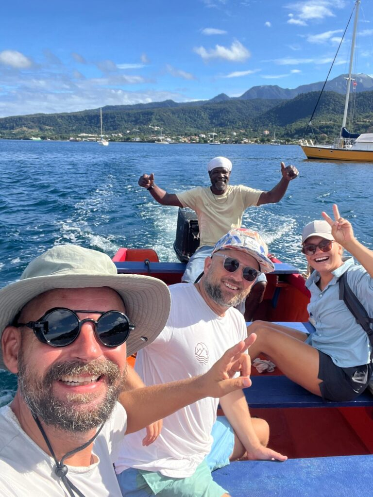

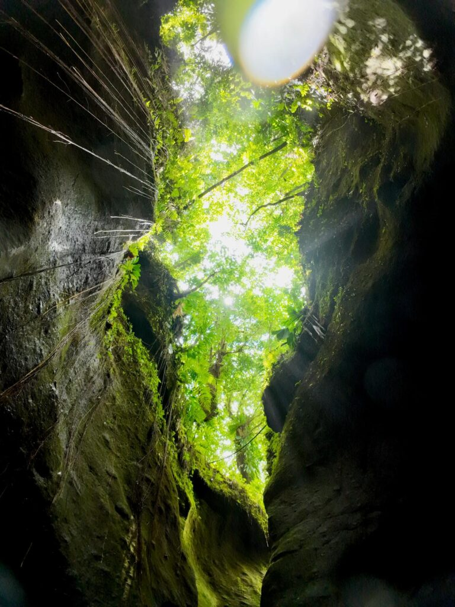

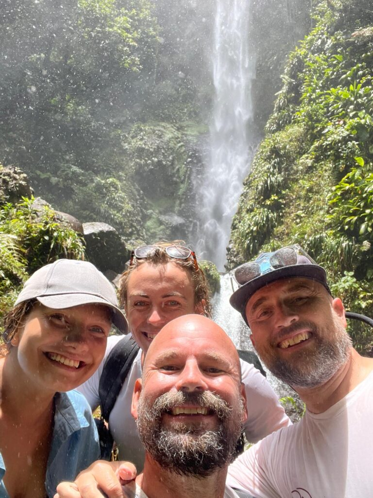

**Komen en gaan**

De volgende ochtend zitten we aan de koffie als ik Jen vertel dat ik me hier wel thuis begin te voelen en nog best even zou kunnen blijven liggen. Terwijl Jen haar tegenovergestelde gevoel uitspreekt en het wel tijd vindt voor onze volgende stop, krijgen we ein-de-lijk ons verlossende bericht: Onze zeilen zijn overgedragen aan UPS en zullen binnen een dag of tien op Sint Maarten aankomen. Zal het dan toch? We hebben de stiekeme hoop om nog een weergaatje richting Antigua en Barbuda te vinden. Dat wordt een mijl op zeven. We kunnen ook gewoon in een rechte lijn naar boven nu, maarja wat slaan we voor die haast over? Voor het zover is willen we nog één keer Wai’tikubuli op. Met z’n twee op avontuur, op zoek naar een verborgen waterval en een vriendelijke boer die ons in zijn pickup wil meenemen.

De volgende ochtend staan we rond half negen op de kant. We wandelen richting het centrum (de kruising van het dorp), als ik halverwege bedenk dat de Starlink nog aan staat. Die vreet energie. En hoewel we eigenlijk al een beetje laat waren, besluiten we toch maar even terug naar *Storm* te lopen, naar *Luwte* te scheuren en nog even het knopje om te zetten. Een kwartiertje later staan we bij de bushalte, waar een bus richting de oostkant van het eiland klaarstaat. We moeten wel nog even wachten tot hij genoeg klanten heeft om de rit rendabel te maken en nemen plaats in het open gebouwtje waar de andere wachtenden zitten. Die raken kort daarna verwikkeld in een vurige politieke discussie die met luide stemmen wordt uitgevochten, maar elke keer als ik denk dat ze echt ruzie gaan krijgen, barsten ze allemaal in lachen uit. Misschien was het geen politieke discussie, maar gewoon de roddel van de week.

Het busje rijdt ons voor twee dollar naar de andere kant van het eiland. We stappen uit in Calibishie en lopen het laatste stuk richting de *Red Rocks*. De zon staat inmiddels wel aan en als ik voor ons een heuvel zie, laat ik me snel verleiden om aan te nemen dat er ook een *shortcut* is over het strand. We lopen langs vervallen vissershuisjes waar niet veel is, maar de mensen die we in de tuintjes zien hangen zien er niet ontevreden uit en hebben zo’n beetje het prachtigste uitzicht ter wereld in hun achtertuin. Uiteraard loopt de weg dood en worden we door een lachende man en vrouw uitgelegd dat ze veel toeristen zien lopen hier, die dezelfde gedachte hadden. Ze vertellen ons hoe we wel moeten lopen en dan keren we om. We hebben geen haast en onder het mom van “dit hadden we anders nooit gezien”, bestempelen we onze omweg als een verrijking van onze dag.

Als we halverwege de heuvel zijn loopt het zweet uit alle hoeken en gaten naar buiten en puffen we even uit onder een mangaboom langs de kant van de weg. Jen duikt het riet in om haar wildplashobby te bevredigen en wil daarna manga’s plukken. Ik heb een beetje een te sterk geweten in dit soort dingen, en beargumenteer dat dit zomaar iemands eten of inkomen kan zijn. Dus settelen we op drie manga’s.

Terwijl we die aan het inpakken zijn horen we een auto toeterend aankomen rijden en denk ik dat we gesnapt zijn, maar het blijken niemand minder dan Julien en Pieter te zijn die vandaag een auto hebben gehuurd en het eiland rondtuffen! We krijgen een lift aangeboden, maar slaan die, onnozelen die we zijn, af.

We wandelen langs huisjes met tuintjes waar werkelijk alles in groeit. Een plank met een paar centimeter aarde er op, is genoeg voor een courgette om haar weg te vinden tot groente. We worden enigszins bevreemd aangekeken dat we lopen, maar de mensen zijn vrolijk en groeten ons links en rechts terwijl we onszelf de heuvel op werken. Op de top staat tussen de bomen een oase waar ze koude limonade schenken. Julien en Pieter zitten ons daar lachend op te wachten en we drinken de grote glazen hibiscuslimonade in flinke teugen leeg. Van de vier liter water die we mee hadden voor vandaag zijn er al twee op.

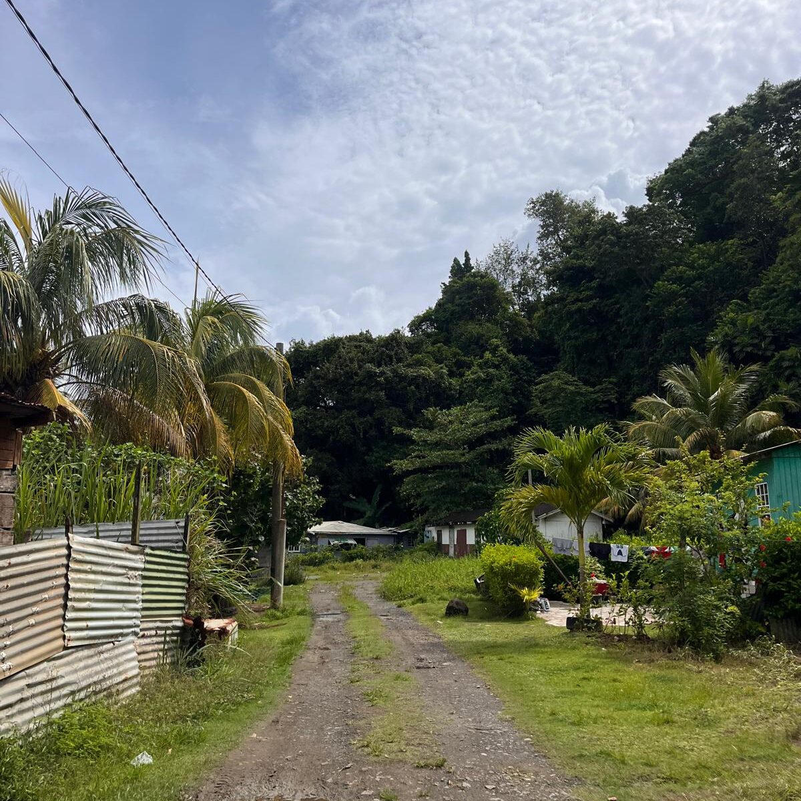

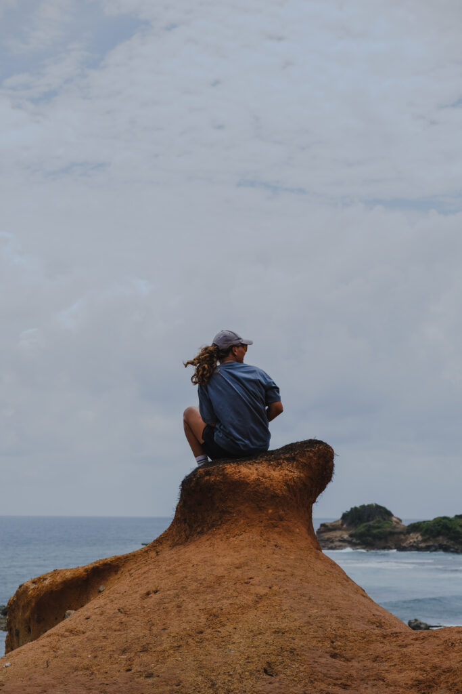

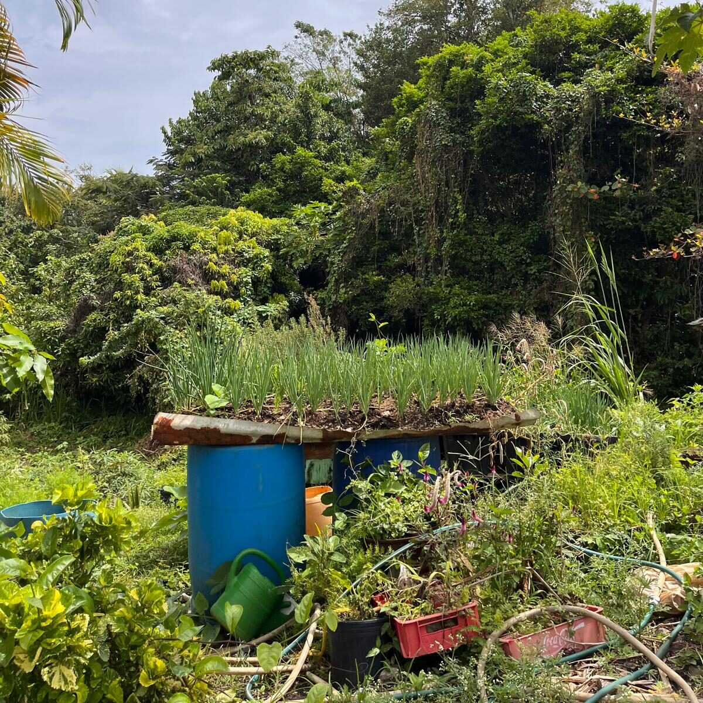

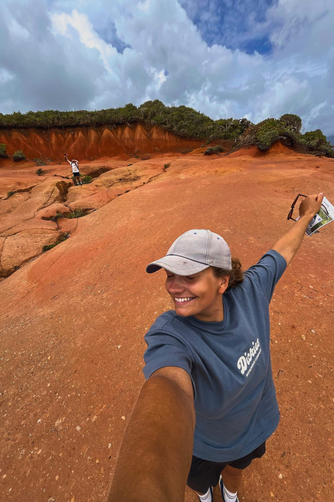

De *Red Rock* zelf is een beetje een vreemde *gimmick*. De klei-achtige, felrode bult aan zee zorgt voor een fotogeniek decor, maar veel meer dan dat is het ook niet. We schieten onze plaatjes, ik ren als een klein kind wat rondjes en dan stappen we het bos weer in terug naar de limonadeplek. Als we daar aankomen zit de man die ons de weg had gewezen op een bankje een flinke toeter te roken met een vriend. Hij moet lachen als hij ons ziet en vertelt dat er wel een *shortcut* is. Gewoon rechtdoor naar beneden lopen langs de huizen. Het paadje in waarvan we dachten dat we door iemands achtertuin zouden lopen…

Wat ons op de heenweg een half uur heeft gekost, maar wel drie lekkende manga’s in de tas opleverde, kost ons op de terugweg nog geen vijf minuten. We zijn terug in het dorp en lopen de andere kant op richting de watervallen. Aan het strand zit *Doris Pastry* die langs de kant van de weg een vitrine heeft staan met gebakken kip, gevulde pasteitjes en *bake*, een soort ongesuikerde oliebol. Ik begin al te watertanden bij het idee dat we die lekkernijen zo meteen kunnen opeten als lunch, en we laden de tas nog wat verder vol. Schuin tegenover Doris zit een supermarkt waar we koud water inslaan en dan kunnen we het dorp uit lopen. Het is nog een paar kilometer tot het begin van de waterval, maar als we daarvan de eerste tweehonderd meter hebben afgelegd, weten we dat we het lopend niet gaan overleven. Deze weg loopt veel te steil omhoog.

We liften, worden door drie auto’s niet opgepikt en eindigen uiteindelijk in een voorbij rijdende bus die ons keurig naar ons startpunt brengt. In de bus krijg ik het zó heet dat ik maar voorover blijf zitten om de stoel niet nat achter te laten en ik ben dan ook blij als we een kleine vijf minuten later weer mogen uitstappen op de top van de bergkam. We slaan linksaf en lopen over de kam met aan alle kanten uitzicht over het groen. Na een klein half uur draait de weg omlaag en zakken we op de flanken de jungle in. We horen vogels om ons heen, lopen onder enorme bladeren door en stappen dan een klein paadje op met glibberige tredes richting de rivier.

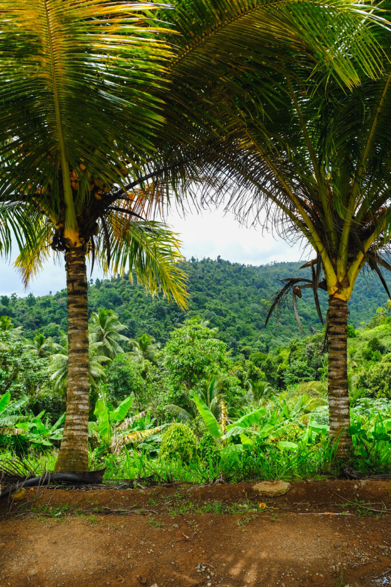

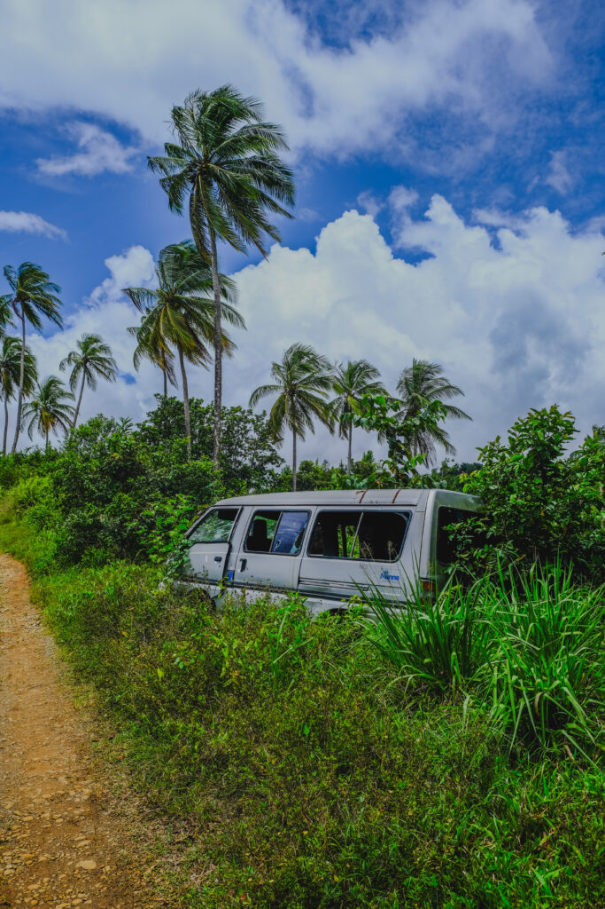

Daar aangekomen is het even zoeken. Volgens de beschrijving moet hier ergens een waterval zijn, maar we staan op een splitsing waar twee rivieren samenkomen. Hoppend van steen naar steen komen we naar het midden en kunnen we de tweede rivierarm inkijken. En daar zien we hem. Helemaal voor onszelf. Een grote, mooie stroom met een poel van bijna tien meter diep er voor. We klauteren er naartoe, poedelen wat en klimmen dan op de rotsen om het water in te springen. Daarna zitten we langs de oever op een grote steen en pakken we onze kip, pasteitjes en *bake* uit. Een koningsmaal, zo midden in het bos met z’n tweeën. We genieten van het moment en zitten in stilte naast elkaar. Nemen het bos op, overdenken ons leven en dan komen we tot de conclusie dat deze dag, en deze plek, eigenlijk de perfecte uitsmijter is van het Caraïbisch gebied. We hebben eruit gehaald wat er in zit en sluiten hem af met een absolute knaller. Dat idee om nog even op te kruisen naar Antigua en Barbuda slaat nergens op. Onze blik moet naar het noorden. Met die pret in onze botten kleden we ons om, nemen we nog één foto met de camera en onze ogen en beginnen dan aan onze klautering terug omhoog.

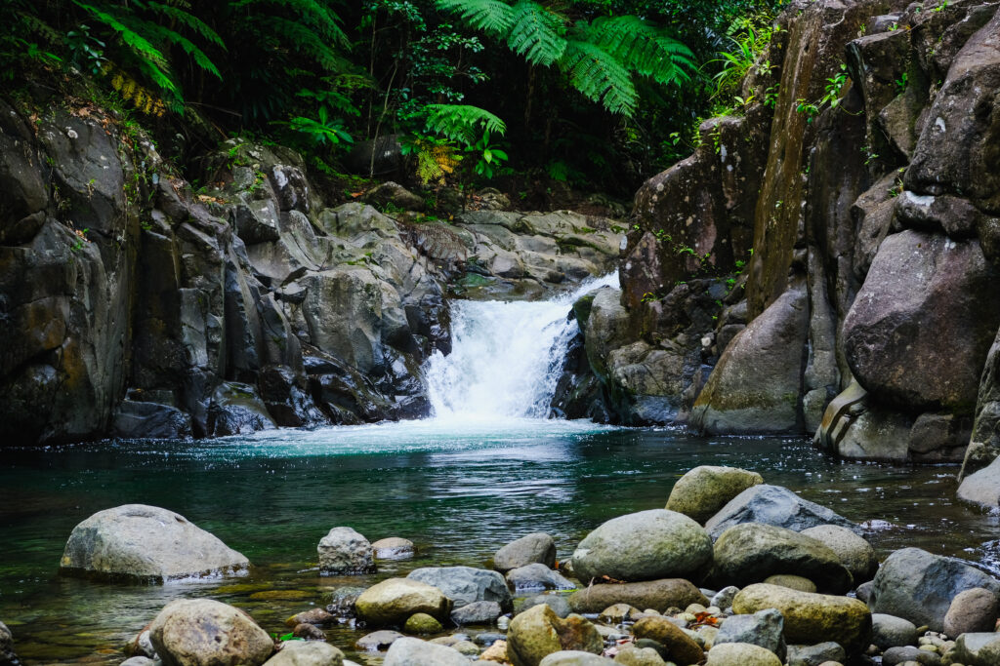

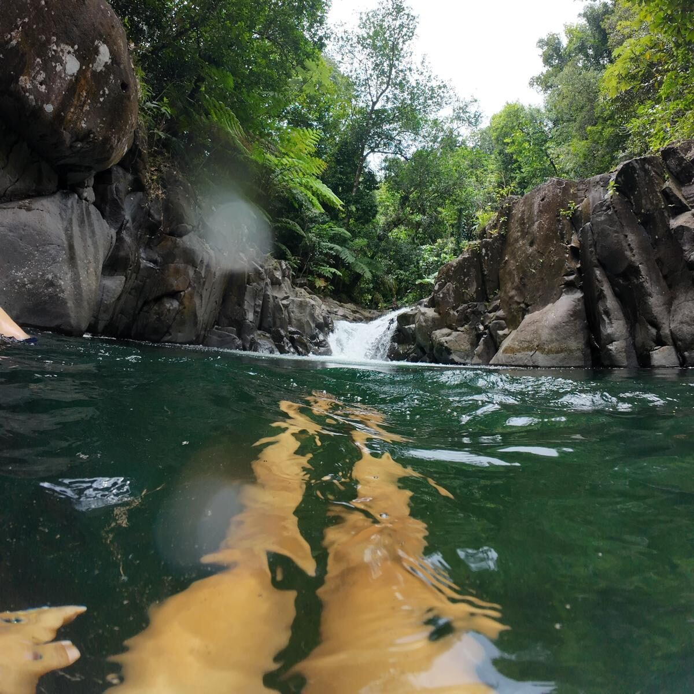

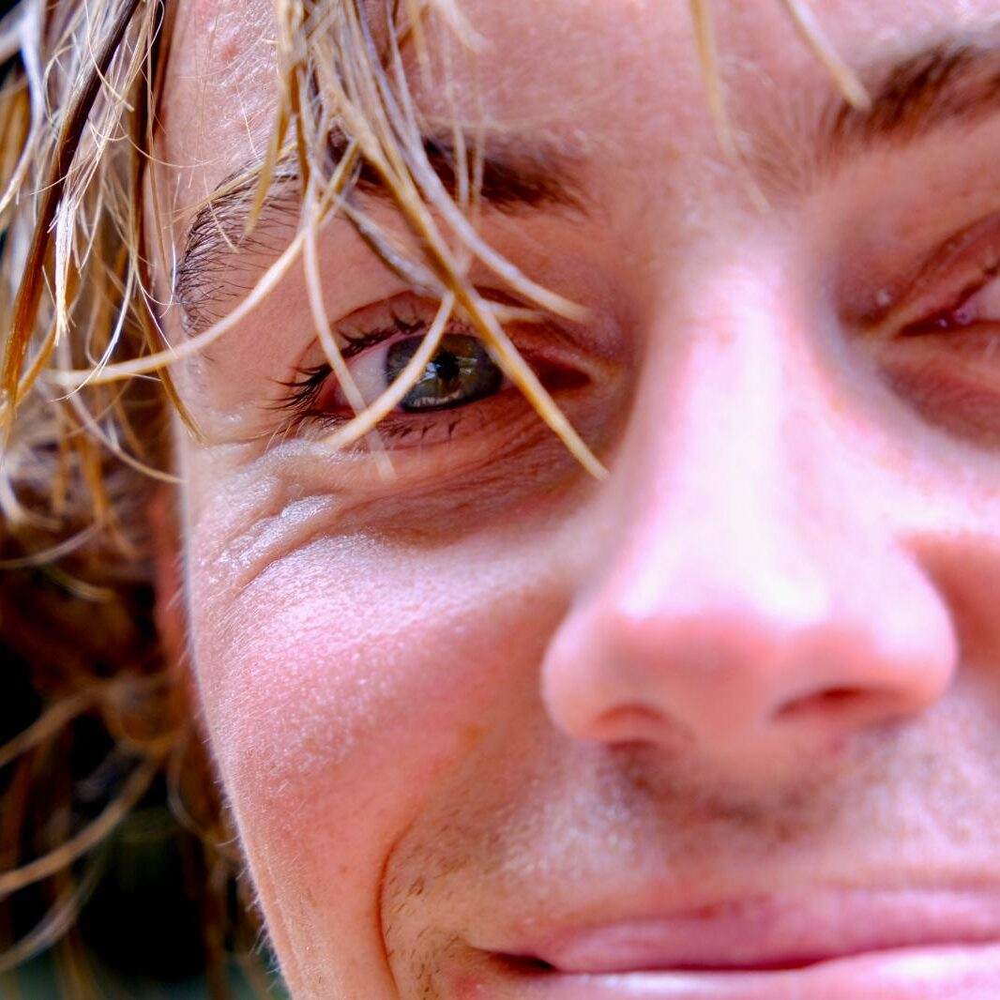

Eenmaal terug op de kam komen we een bananenboer tegen die zijn velden staat te inspecteren. We praten kort met hem over hoe mooi het hier is en wensen hem een fijne dag. Vanaf hier kunnen we in ieder geval een tijdje naar beneden lopen. En dat hebben we ook weer geweten. Het voelt altijd zo heerlijk, die eerste paar stappen heuvelafwaarts, maar een minuut of tien later hoop je om de hoek toch weer een stukje bergop te vinden. Zonder contrast geen geluk denk ik.

We keuvelen over de toekomst, onze droom om naar Canada te varen, hoe de nieuwe zeilen het zullen doen, en wie we nog een kaartje moeten sturen binnenkort. Onderweg worden we door iemand aangesproken die graag wil weten welke taal we spreken, want hij kent veel talen, maar die van ons heeft hij nog nooit gehoord. We kletsen kort en wandelen met knikkende knietjes verder naar beneden, wat uiteindelijk verrassend snel gaat. Op de splitsing met de hoofdweg staat een eettentje, misschien Doris’ zus, maar we houden ons in en wandelen verder over een brug die over een rivier loopt waar prachtige bomen in staan.

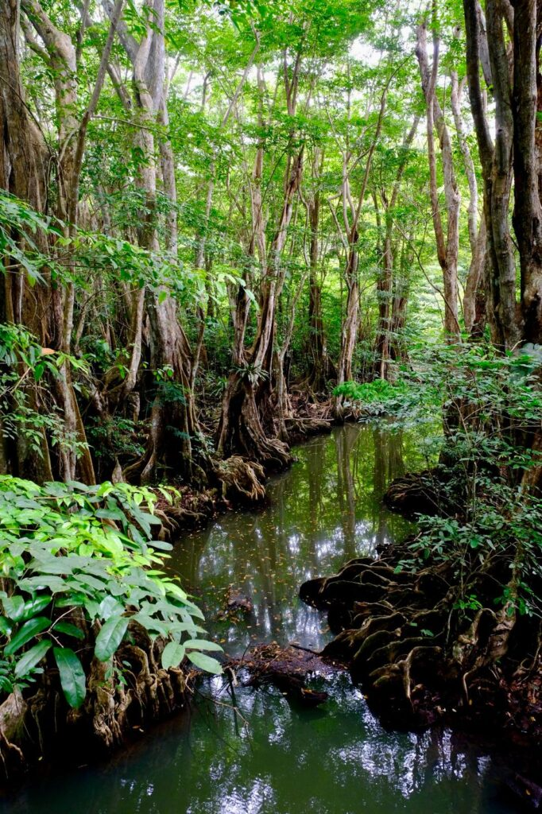

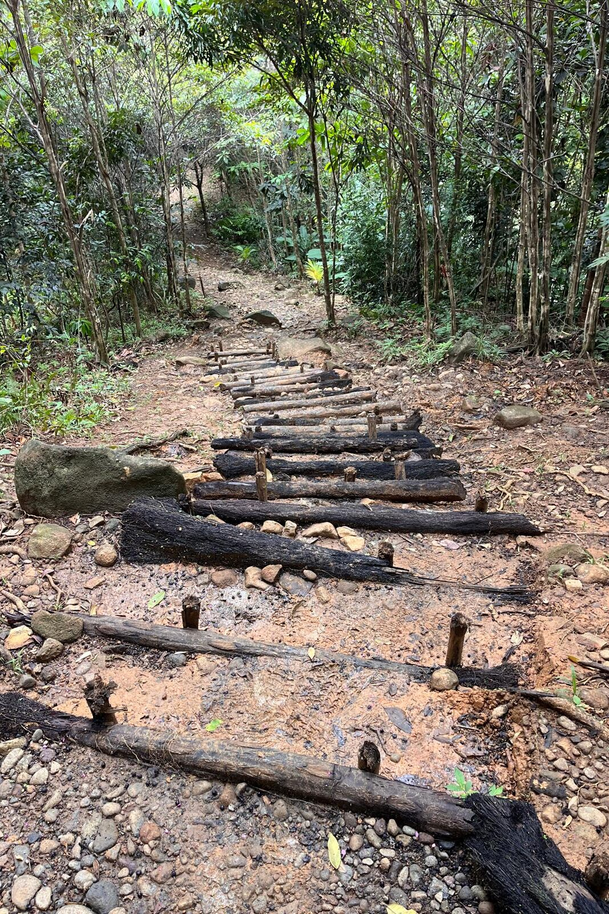

Waar we dan in terechtkomen, is chaos. Aan de linkerkant van de weg is een groot sportveld waar de basisschool een crickettoernooi houdt. Aan de rechterkant van de weg zitten alle moeders (geen vaders) met keiharde muziek te borrelen, barbecueën en schelt er door een microfoon commentaar over het veld. We worden uitgenodigd om een koud drankje te komen drinken en ik laat me direct verleiden. Onder luid gelach en gegiechel worden we op een stoel gezet zodat we naar de wedstrijd kunnen kijken. Voor we het door hebben eten we worstjes van de barbecue en zitten we midden in de wedstrijd. Er worden niet veel ballen geraakt. Het veld is te groot voor de kleine jochies en meiden om de bal goed naar de slagman of -vrouw te gooien en als de bal in de buurt komt is het een wonder als hij geraakt wordt. Eromheen doen de meisjes eindeloze ratslagen en staan de kinderen die te jong zijn om mee te mogen doen, te dansen en te dartelen. Na een minuut of tien worden de kinderen aan de kant geduwd door de meesters en wordt het rood-tegen-groen, de docentenwedstrijd. Voor ons het teken om onze wandeling terug voort te zetten.

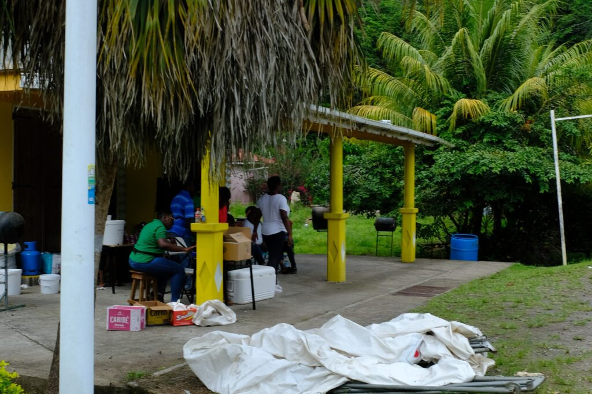

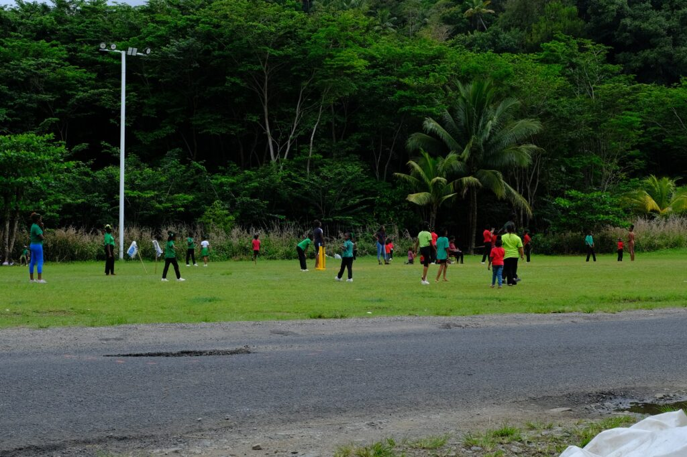

Nog voor we het eind van het veld bereiken stopt er een auto naast ons. Het is de bananenboer die we op de top van de heuvel spraken. Hij gaat niet naar Portsmouth, maar rijdt wel een stukje die kant uit en we mogen wel meerijden als we willen. Eenmaal ingestapt vertelt hij dat hij naar zijn lievelingstentje van het eiland gaat. John Vital is zijn naam en hij nodigt ons uit om even mee te komen, als we de tijd hebben. Tien minuten later zitten we aan het strand met een “Vita Malt”, een mierzoet maltbier dat niet te beuken is. Uit beleefdheid drink ik met John mee, terwijl we onze levensverhalen uitwisselen. Jen krijgt het drankje niet weg, en dus eindig ik met dubbele straf. John is in Engeland geboren, maar door zijn grootmoeder op Dominica opgevoed. Na zijn school is hij begonnen als politieagent en heeft daar een jaar of vijftien dienst gedraaid. Daarna heeft hij zijn leven omgegooid en is in de ICT gaan werken in de USA. Maar nu is hij terug op Dominica, sinds een ruim jaar, en leeft hij een teruggetrokken leven en financiert een aantal lokale boeren. Hij vertelt ons over vroeger. Hoe iedereen hier in zijn achtertuin een moestuin had, maar dat iedereen zoveel overproductie had, dat de rest op centrale markten kon worden verkocht. Het leven was eenvoudig, maar goed. Iedereen had goed te eten en verdiende een centje extra met wat de natuur te bieden had. Maar elektriciteit, televisie, de koelkast en de bijbehorende status hebben grote impact gehad. De Franse vissers van Guadeloupe en Martinique hebben op grote schaal de zee voor de kust leeggehaald en inmiddels worden veel producten die zonder enige moeite op het eiland te verbouwen zijn, voor veel geld geïmporteerd uit de VS. Het eiland kent slechts 70.000 mensen, een flink bedrijf heeft meer medewerkers, maar het organiseren ervan blijkt een onmogelijke opgave. De hooggeplaatste ambtenaren sluiten maar wat graag dealtjes met de Amerikanen en Chinezen, en hebben te weinig omkijken naar de toekomst. Pakken wat je pakken kan.

Met enige verbijstering luisteren we naar het verhaal dat we zelf al een beetje hadden opgemaakt, maar nu zo bevestigd wordt. John op zijn beurt is diep onder de indruk van ons verhaal. Onze keuzes en het leven op zee. Het is niets voor hem, maar op de hoofdlijnen begrijpt hij waarom het reizen met de boot ons zoveel voldoening geeft. De tijd die we hebben, de traagheid van de verplaatsingen. Als we hem vertellen waar we allemaal geweest zijn schudt hij zijn hoofd en vraagt hij hoe onze boot heet. We leggen hem uit wat *Luwte* betekent en dan schudt hij nogmaals zijn hoofd: *You should call your boat “Big Travel”*.

Onze tijd met John Vital is beperkt geweest tot slechts een klein uur, maar heeft bij mij diepe indruk achtergelaten. Het weloverwogen luisteren, vertellen, nadenken en ontdekken wat we elkaar als mensen van verschillende culturen te bieden hebben is tekenend voor de nasmaak die wij meenemen van dit eiland. Het volstrekt vanzelfsprekend vinden iemand een lift aan te bieden, diegenen mee te nemen naar je lievelingstentje en de tijd nemen om ideeën uit te wisselen. Hij vat in één persoon samen wat we hier hebben gevoeld en gezien. Het gevoel lijkt enigszins wederzijds, als hij ons mededeelt dat deze dag en deze ontmoeting één van zijn meest dierbare herinneringen zal zijn sinds zijn terugkeer uit de VS. Met een vol hart nemen we afscheid. Wie weet tot ziens.

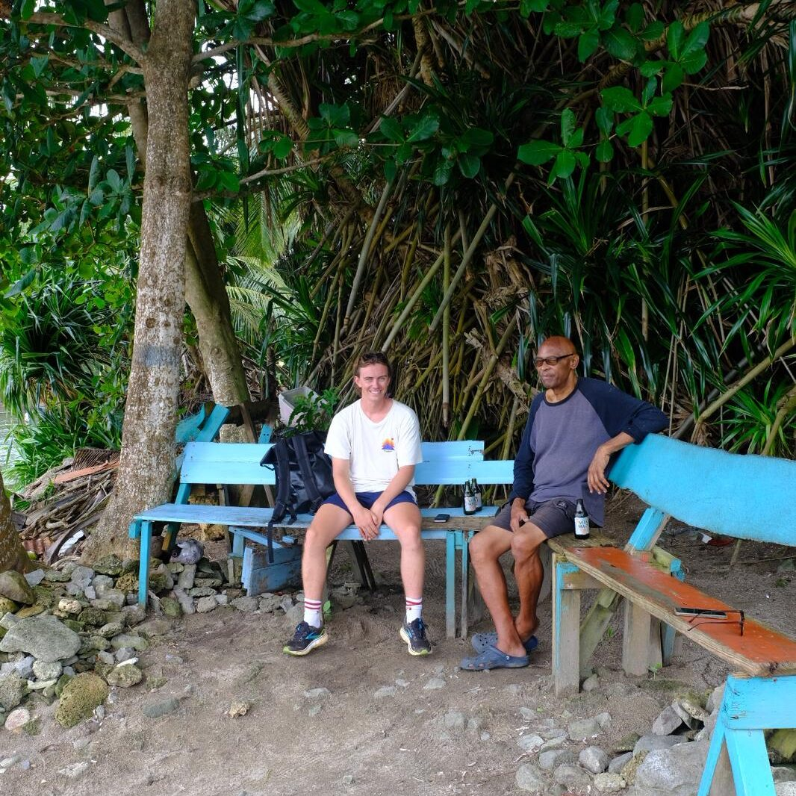

We wandelen terug naar de hoofdweg en kletsen na over deze ontmoeting. Ik moet er nog een beetje van bijkomen, maar we hebben ook nog een rit terug naar Portsmouth te regelen. Liften gaat hier net als in Suriname. Je steekt niet je duim omhoog, maar je wappert met je hand omlaag, om te vragen of iemand vaart wil minderen. De eerste pickup die ons tegemoet komt stopt en wijst naar achteren. Zijn laadbak is vol, maar als we willen mogen we best bovenop de zakken met bananen kruipen. Mijn droom komt uit. Samen achterop de pickup door een van de mooiste landschappen om doorheen te rijden. We moeten ons goed vasthouden, want van rustig rijden is geen sprake. Auto’s met kinderen die we voorbij vliegen joelen ons na en weten niet wat ze zien. Onze haren wapperen in de wind en hier en daar vliegt een traan de lucht in.

Als we een half uur later uitstappen en aanbieden iets te betalen, of te geven, worden we streng aangekeken en wordt ons duidelijk gemaakt dat dat onbeleefd is om aan te bieden. “*We take care of eachother. Enjoy the island!”.* En weg scheuren ze.

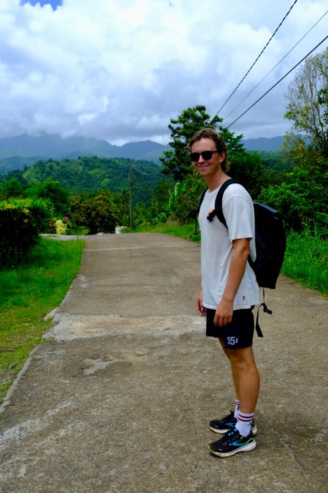

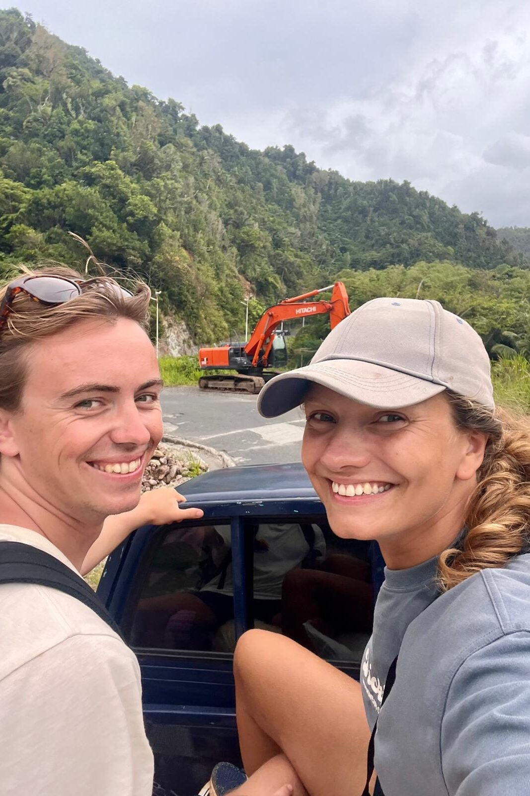

## **Noordwaarts**

De boot is weer vaarklaar. We hebben bij de moorring met het kraantje water getankt en zijn bij het clubhuis langs geweest om de jongens te bedanken voor het faciliteren van deze plek, dit eiland en alle gemakken. Titus zien we niet meer, maar die zal ons over een maand of wat laten verwateren uit zijn geheugen, als dat gevuld is met andere *yachties.* Er zijn niet veel bestemmingen die lonken voor een tweede bezoek, maar Wai’tikubuli, Dominica, is er zeker eentje van. Nu hijsen we voor de laatste keer onze oude zeilen die ons hier helemaal naartoe hebben gebracht en zetten we koers naar Sint Maarten, waar de nieuwe lakens binnenkort binnenkomen.
