Over Bermuda zelf valt naar onze mening weinig interessants te vertellen, op de ligging er van na. Vonden wij dan. We zijn maar een dag of vijf op dit vervreemdende eiland geweest en hebben het wellicht niet de kans gegeven die het verdient. Het incomplete, door eigen mening gevormde beeld is dus maar een *n=2* en betreft alleen de uithoek van het eiland waar je op binnenloopt. Zowel de *cruisersguide*, als andere zeilers die we over Bermuda hebben gehoord, vonden het wel de moeite waard.

Het kantoor van de *customs & immigration* zit prettig gelegen aan de kade waar we de dinghy kunnen achterlaten. Het is een oud kantoortje met een houten balie met glas tot het plafond, alsof het een oud bankgebouwtje is. In het kleine hokje waar we staan hangt het vol met allerlei boetes die je kunt krijgen voor het niet aangeven van goederen, of het importeren van dingen die niet mogen. Zo valt onze *speargun* ook onder de vuurwapenwet en worden handfakkels gezien als granaten. Alcohol importeren mag, als er maar flink accijns wordt betaald, en groenten en fruit worden gezien als biologische wapens die enge ziektes meenemen. Voor het vervoeren van meer dan $10.000 aan contanten kun je een boete van 200.000 dollar krijgen, of drie jaar gevangenisstraf. Ik vraag me daarbij altijd af of je dan zelf mag kiezen wat je liever wilt. Tenslotte is de mooiste boete van allemaal de boete voor poepen in het water: $20.000 als je betrapt wordt. De poepambtenaar moet dus zeker drie boten per jaar aanhouden om zijn eigen inkomen bij elkaar te sprokkelen.

Wij hebben onze nette kleding aangetrokken voor dit bezoek en schudden nee op alle vragen. De voorraad rum die ik heb ingeslagen en de voorraad gin die Jen heeft liggen branden een beetje in mijn gedachten, maar na een strenge blik op onze paspoorten krijgen we een glimlach en een ‘welkom op Bermuda’, nadat we $75 voor het inklaren hebben afgerekend. We wandelen het dorp in en staan een beetje met een mond vol tanden. Het lijkt wel een replica van de Efteling. Over de speakers in de bomen wordt een bandje met pretparkmuziek gedraaid, de straten zijn aangeharkt en de winkels bestaan uit boetiekjes die witte Ibiza-jurken verkopen waar op staat dat het *Real Portuguese Linen* betreft. We hebben inmiddels dorst en landen op een terras waar we de menukaart openslaan en meteen weer dichtslaan. Dit slaat nergens op. Een biertje kost hier elf dollar! Dat moet beter kunnen. Met een kleine blos op de wangen staan we weer op en proberen we het op een andere plek die er meer uitziet als een vistent. Hier is het biertje negen euro, maar ook een maat kleiner… Jen besluit het bij een watertje te houden en we delen een visburger met friet. Daarna is ons weekbudget aan eten er wel weer doorheen en worden we bij het afscheid getrakteerd op een verplichte achttien procent fooi. Voor de rest zien we hier vooral heel veel te dikke Amerikanen die hun vakantiegeld besteden aan dure resorts en duur uit eten. Het belastingstelsel heeft hier geen inkomstenbelasting, dus alle inkomsten voor de staat moeten uit consumptie komen. Daar hebben wij als belastingbetalers niet zoveel baat bij.

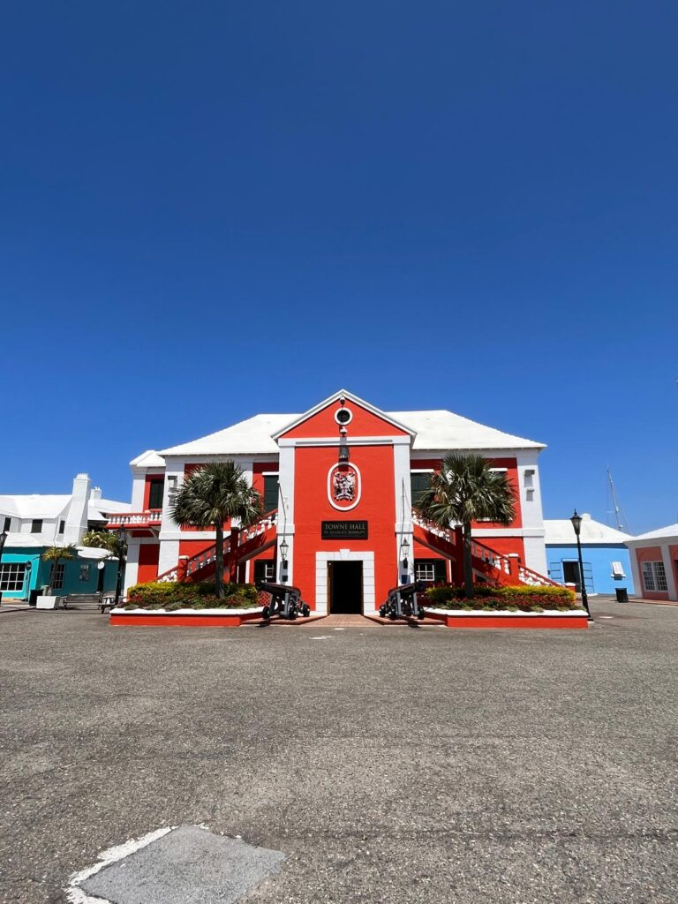

, dus de dinghydock is klein én druk..")

We maken wel nog een fijne wandeling langs de tientallen forten die hier zijn gebouwd om het eiland te verdedigen. Onderweg raken we aan de praat met een marinier die in zijn jonge jaren als navigator heeft gewerkt. Met sextant en een klok. Hij kon zijn oren bijna niet geloven toen we hem vertelden dat onze GPS op een paar meter nauwkeurig onze positie bepaalt, de precieze tijd binnenkrijgt en zelfs via AIS communiceert met andere schepen om ons heen. Andere tijden sport. De man behoort tot de groep oorspronkelijke bewoners van het eiland en laat duidelijk blijken dat hij niet zo’n hoge pet op heeft van alle Amerikanen die hier hun ding komen doen. Zeilers daarentegen zijn altijd welkom.

Wij wandelen verder naar een wit idyllisch strand waar een gigantisch vijfsterren hotel aan gebouwd is. In luxueuze ligbedjes met parasols liggen de *hot-shots* van de wereld hun levens te genieten. De bediendes brengen ze schone handdoekjes en koude drankjes, terwijl wij onder een palmboom achter een handdoekje onze zwemkleding aantrekken en het water in plonzen. We worden wat vreemd aangekeken, want zwemmen doe je in de *infinitypool* aan de rand van het strand. De zee raak je alleen pootjebadend aan, als je een heen-en-weertje doet tussen je amuse en je voorgerecht. We klimmen om een bord heen waarop staat dat je er niet door mag, en lopen ons heen-en-weertje over een door orkanen beschadigde betonnen balustrade langs het water. Daarna wandelen we pootje badend terug over het strand en houden onze kin omhoog als we naast het zwembad gebruikmaken van de douche waaronder we het zout voor het eerst sinds een week of twee uit onze haren spoelen.

Een strand verder zit een ‘hippe’ bar waar Jen wel goede recensies over heeft gelezen, dus daar geven we het nog een kans, maar als we daar aankomen moet ik toch met enige afkeer concluderen dat dit niet mijn type vakantie zou zijn. Het piepkleine strandje is volgezet met ligbedjes die voor een schamele $50 per twee uur kunnen worden gereserveerd. De rotsen om het strand vormen een natuurlijk zwembad waarin grote lichamen met hun hoofd onder water aan het ‘snorkelen’ zijn boven wit zand. Bij de ingang van de bar is een kraantje om je voeten te spoelen. Een echtpaar helpt elkaar hun veters te strikken. Een liefdevol gebaar, ware het niet dat ik niet denk dat ze zelf nog ver genoeg voorover kunnen bukken om hun eigen voeten te zien.

We vinden een plekje, maar staan een minuut later toch weer buiten omdat we eigenlijk niet zoveel zin hebben om hier lang rond te hangen en we het mooiste terras van het eiland natuurlijk eigenlijk zelf hebben meegenomen. Bovendien is een drankje aan boord een stuk voordeliger dan eentje aan wal. Dus we cirkelen tussen de strak aangelegde golfbanen met grote borden ‘*Private property, do not enter!’* terug naar de dinghy dock en ons gele huis.

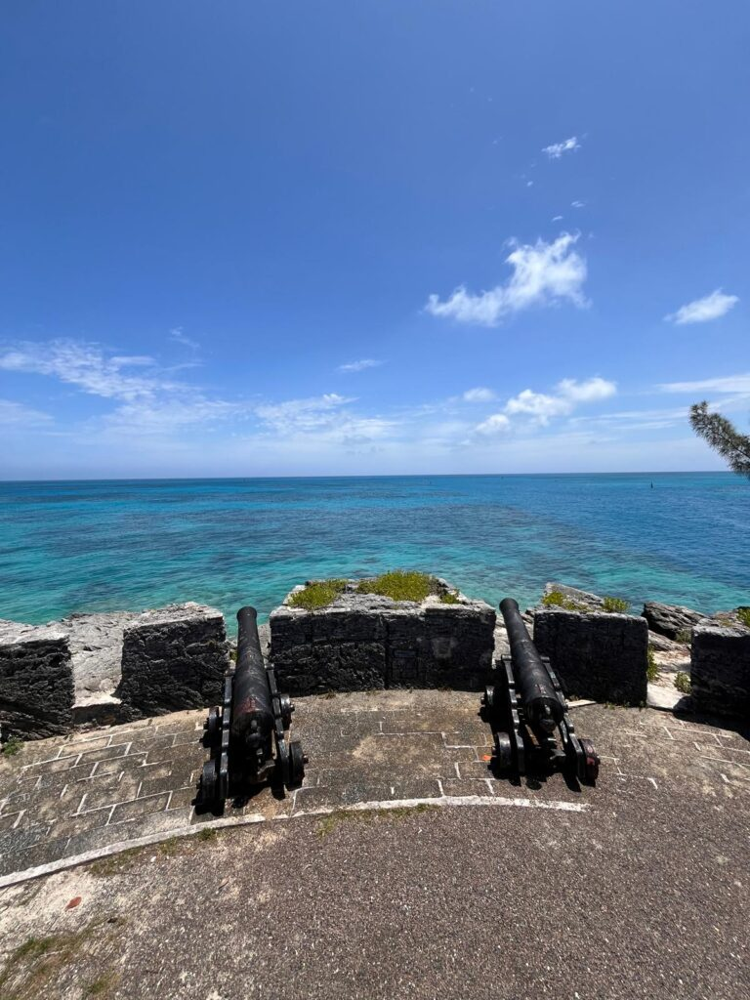

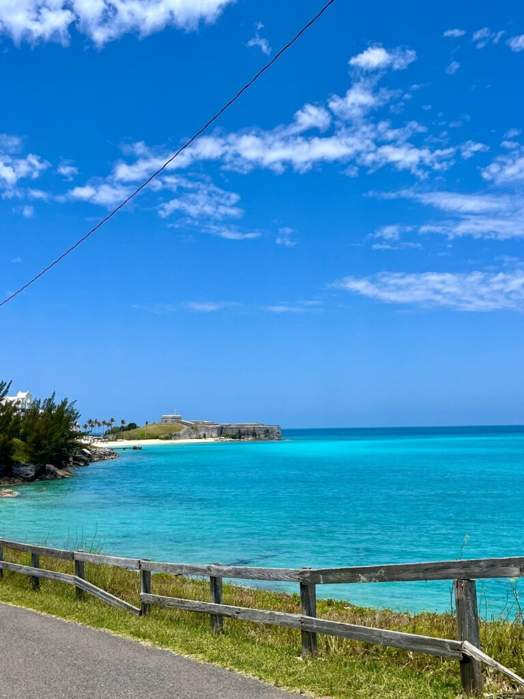

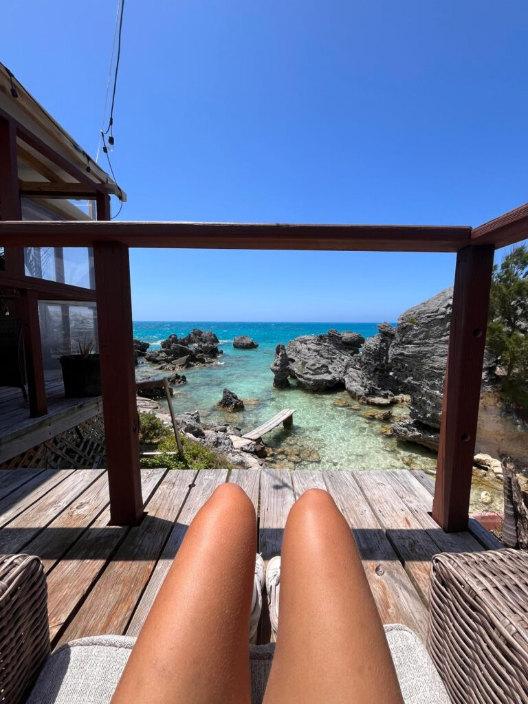

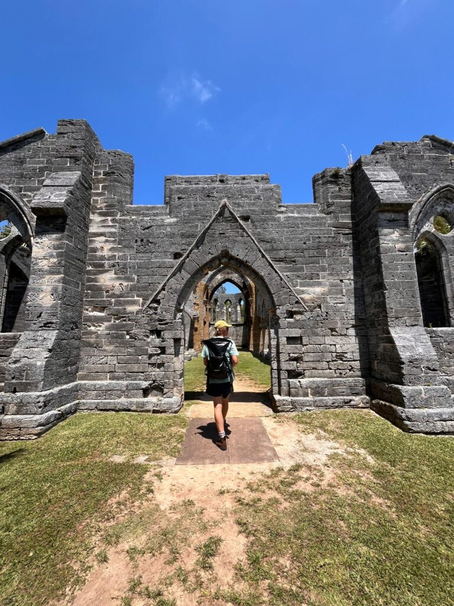

Waar we Bermuda wél dankbaar voor moeten zijn, is ons weerzien met *Drifter*. Het voelt als een half leven geleden, toen we nog jong en onbezonnen waren en net onze eerste baaitjes van Spanje verkenden. *Drifter* kwam kort na ons het strand bij Boiro verkennen in de Ria de Arosa en waren onze eerste zeilvrienden die we onderweg zijn tegengekomen, en nog altijd contact mee onderhouden. Tot Porto kwamen we elkaar veel tegen, maar daarna scheidden onze wegen. Wij naar het zuiden, zij naar Madeira.

Inmiddels is voor ons beiden het cirkeltje weer rond en kunnen we een eindeloze reeks aan verhalen uitwisselen over wat er in de tussentijd allemaal is gebeurd. Het is fijn en vertrouwd om daar weer aan tafel te zitten en we grijpen de kans om vóór onze doorvaart nog samen een hapje te eten bij een tentje zonder alcoholvergunning, waar je wel je eigen biertjes mee mag nemen.

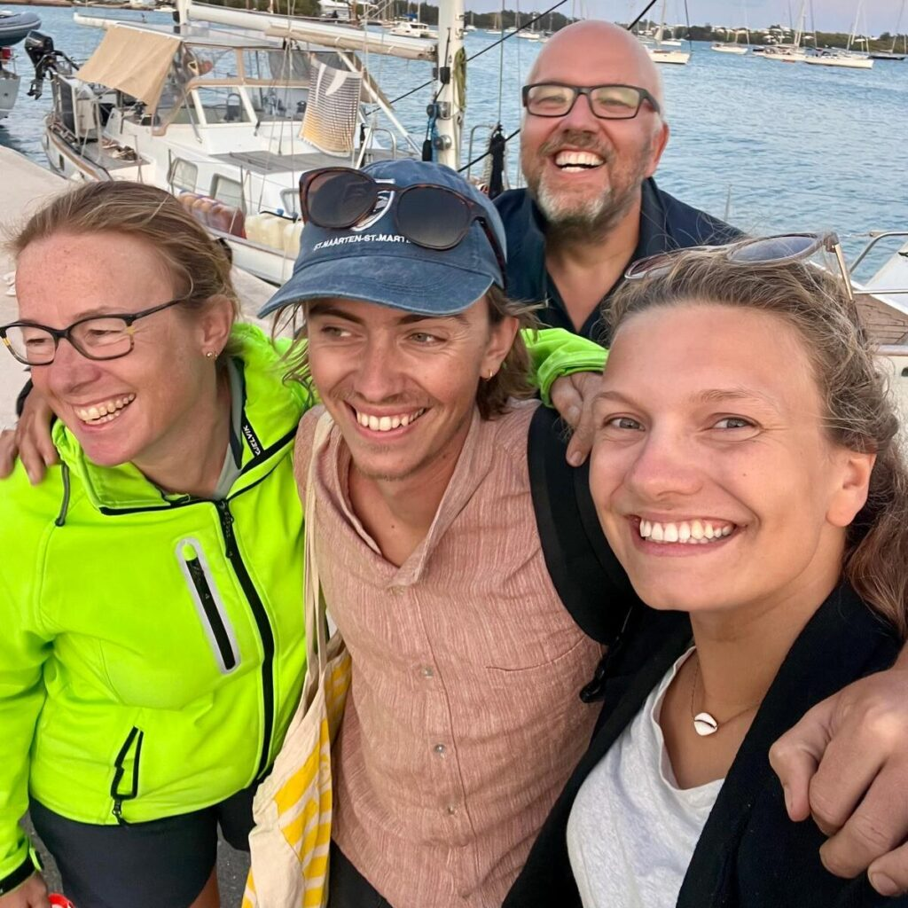

## Passen en meten

De nieuwe zeilen hebben ons al 750 mijlen verderop gebracht en hebben daarmee hun proefvaart succesvol afgerond. Er is alleen één detail verkeerd uitgevoerd en dat zit me niet helemaal lekker. Zeker omdat we op het volgende stuk grotere kans hebben op slecht weer.

Een zeil, op de meeste jachten, is in essentie een tot vleugel gevormde driehoek die zo gespannen wordt dat hij een ideale vorm aanneemt om wind om te zetten in snelheid. De zijden van de driehoek heten bij zeilen ‘lijken’. Een voorlijk, een achterlijk en een onderlijk.

<figure class="wp-block-image size-full is-resized">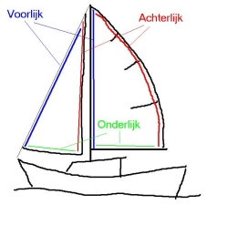<figcaption class="wp-element-caption">De lijken van een zeil. <a href="https://zeilersforum.nl/mediawiki/index.php/Voorlijk">bron</a></figcaption></figure>

Het voorlijk zit vast aan de mast met zogenoemde leuvers, of sledes die door een gleuf in de mast omhoog lopen. Die heb je in allerlei soorten en maten en worden op ons zeil in twee varianten uitgevoerd: Kunststof sledes en ‘karren’, die te herkennen zijn aan hun wieltjes.

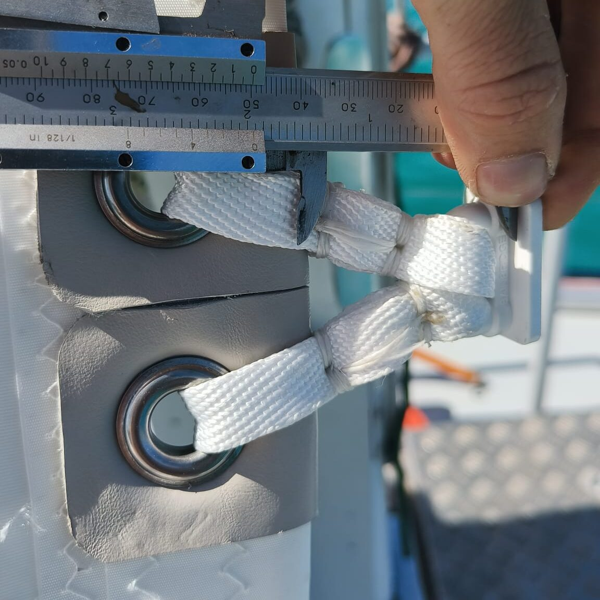

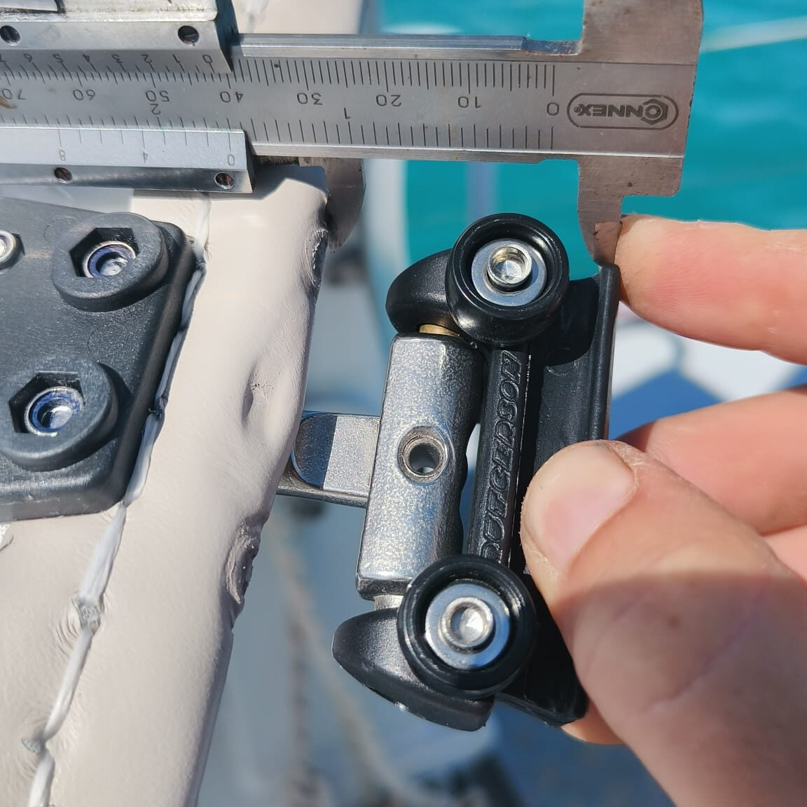

Hoewel de karren enige afstelmogelijkheid hebben, kwam ik er al bij het uitpakken op Sint Maarten achter dat de afstand tussen het voorlijk en de voorkant van de kar, kleiner is dan de afstand tussen het voorlijk en de aangenaaide sledes. Het komt er daarmee op neer dat bij een gehesen zeil, bijna alle kracht op de vier karren komt te staan en dat al die sledes, die er niet voor niets tussen zitten, er een beetje voor spek en bonen bij hangen. Gelukkig hebben we niet echt zwaar weer gehad op het eerste stuk naar Bermuda, maar je kon wel zien hoe in een windvlaag het zeil uit vorm getrokken werd en dat is niet de bedoeling.

Jammer genoeg zijn er over de wereld maar een paar dealers van die karren die ze standaard op voorraad hebben liggen, en op Bermuda zit er uiteraard geen. Er moet dus een creatievere manier gevonden worden om dit probleem te verhelpen. We zouden er ook voor kunnen kiezen om alle genaaide sledes los te peuteren en in te korten, maar dat zou ons waarschijnlijk dagen werk opleveren die we met het aankomende weervenster niet hebben.

Na kort overleg met de zeilproducent krijgen we het advies om de uitstekende bout op de kar te verlengen met een zogenaamde ‘thread extender’ of in het Nederlands: Een boutverlenger. Ook dat blijkt nog makkelijker bedacht dan uitgevoerd, want na wat winkels af te zijn gegaan, komen we tot de conclusie dat ze hier de Amerikaanse *imperial* standaard aanhouden voor schroefdraad en niet de metrische, die de rest van de wereld gebruikt.

Terug aan boord overwegen we de optie om voor veel geld een auto of scooter te huren en de volgende dag naar de grotere stad te scheuren op zoek naar een winkel die het onderdeel misschien wel heeft. Tijd die we eigenlijk niet hebben en de kans op succes is erg klein. Ik sluit mezelf op in mijn werkplaats en haal alle kistjes nog eens open op zoek naar een oplossing. En dan gaat het kistje met ‘oud RVS’ open. Onderdelen die door de jaren heen zijn vervangen door iets anders en zichzelf als ballast nuttig proberen te maken.

Ik denk dat elke booteigenaar wel van deze kastjes en hoekjes heeft, met spullen die je eigenlijk al jaren geleden weg had moeten gooien, maar waar je geen afscheid van kunt nemen: *Je weet maar nooit*. De meeste van deze spullen verdwijnen in het ‘nooit’. Zolders hebben een vergelijkbare aantrekkingskracht, maar hebben als voordeel dat ze vaak ook voldoende ruimte bieden. Bij ons aan boord zijn vierkante centimeters schaars en moeten we eigenlijk een streng beleid voeren als het om het bewaren van oude meuk gaat, maar goed, de gewoonte is ook sterk.

In het kistje met glimmend RVS vind ik vier oude wantspanners die ooit dienst deden om de staalkabels van onze reling op spanning te houden. Ze waren echter te lang en zijn inmiddels vervangen door gevlochten lijn, die als bijkomend voordeel heeft dat je in geval van nood je reling met een mes kunt doorsnijden. Dit was zo’n vijf jaar geleden. Sindsdien liggen ze te wachten op hun ritje naar de vuilnisbak, of een nieuwe functie. En die vinden ze op Bermuda. Het blijkt namelijk dat wantspanners veel langer schroefdraad aan de binnenzijde hebben dan een bout, en daarmee kan ik zelf een ‘boutverlenger’ knutselen.

Met de haakse slijper snijd ik de uiteinden van de spanners af en slijp de randjes mooi rond om geen scherpe hoekjes in de buurt van het zeildoek te hebben. Daarna ben ik een uur of drie aan het tekenen, passen en meten. En nog eens passen en meten, tot ik vier keer achter elkaar tot dezelfde conclusie kom. Aangezien ik ook een stuk van de kar moet afslijpen, heb ik precies één kans voor alle snedes, anders hebben we meteen een veel groter probleem. Even later gaat de haakse slijper weer rond en worden de puzzelstukjes op maat gemaakt en als aan het eind van de dag de zon onder begint te gaan, zitten de zelfgemaakte boutverlengers op de karren. Precies op maat.

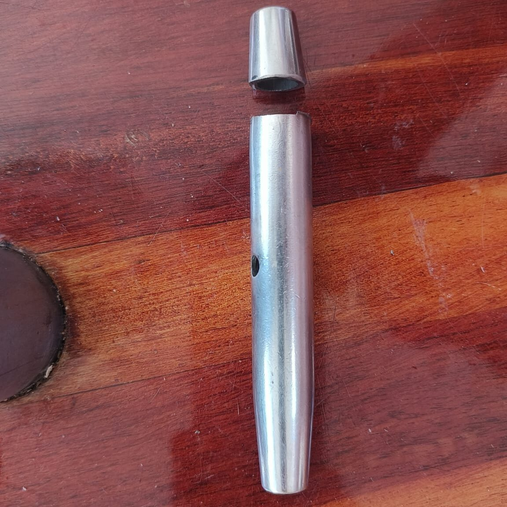

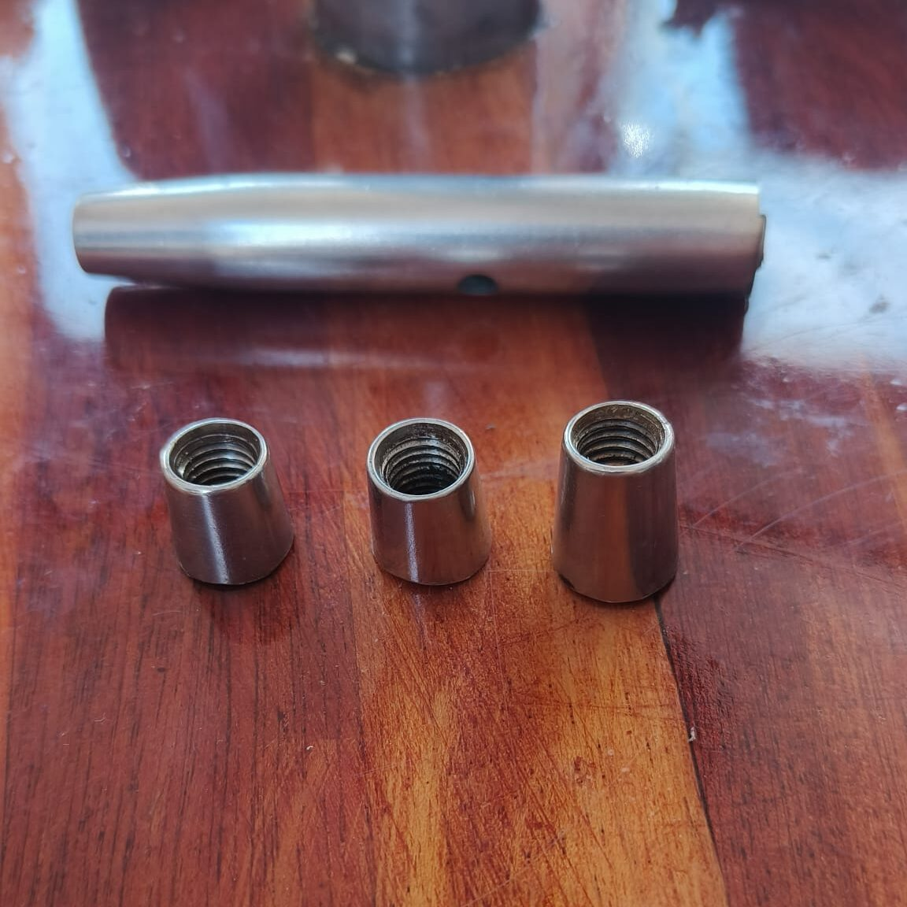

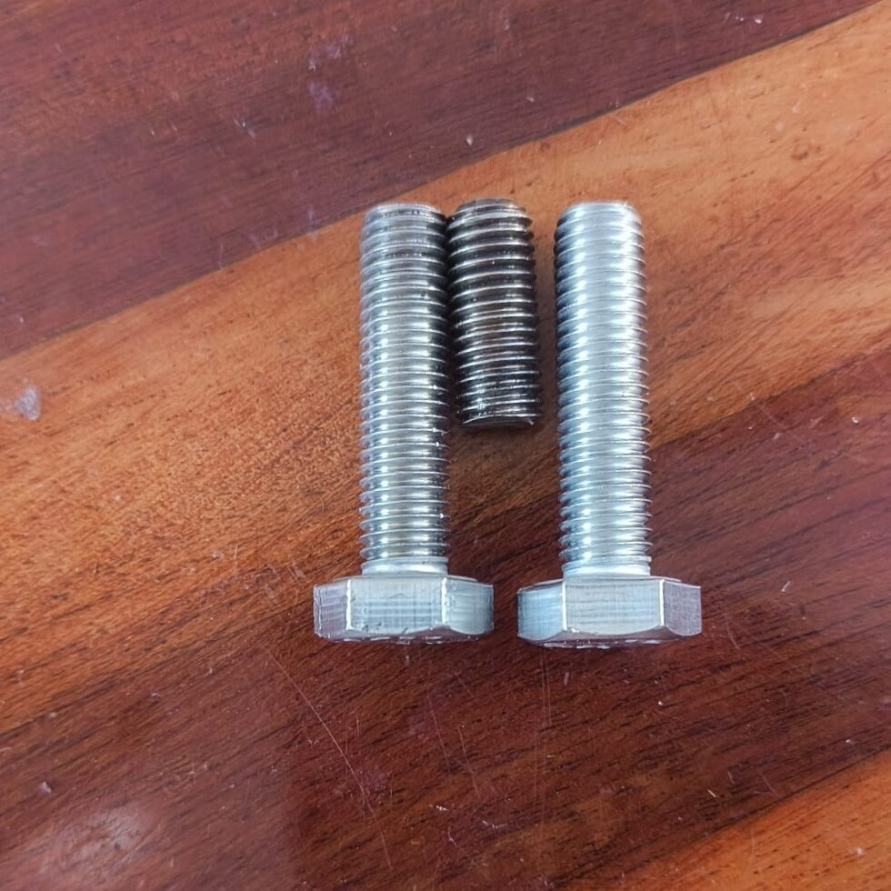

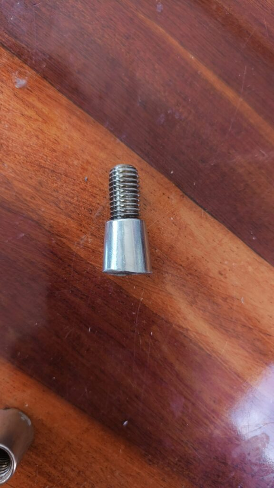

<figure class="wp-block-image size-large">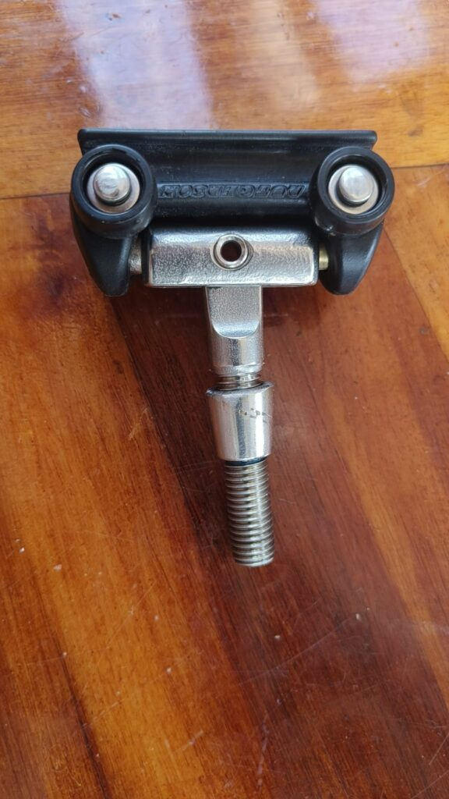<figcaption class="wp-element-caption">De andere kant kar. Vastgezet met <em>loctite</em></figcaption></figure>

<figure class="wp-block-image size-large">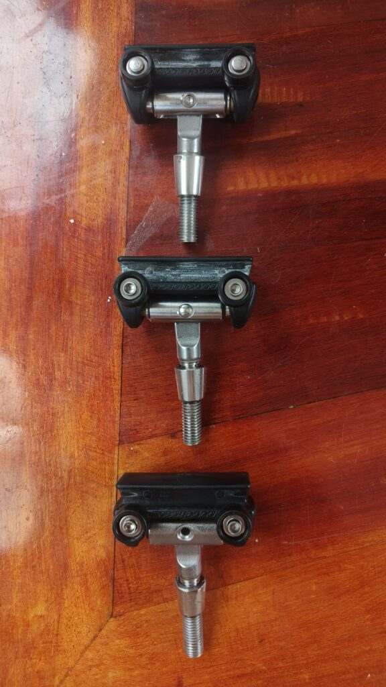<figcaption class="wp-element-caption"><em>Et voilà! Ready to go!</em></figcaption></figure>

## Armpje drukken met Neptunus

Doorlopend in deze dagen is onze blik gericht op de weerberichten. Opent Neptunus onze poort naar het noorden? Of gaan we naar het oosten en wordt het genieten op de Azoren? Ik lees me verder in over wat we kunnen verwachten op de overtocht van Bermuda naar Nova Scotia en kom er langzamerhand achter dat het best een meteorologische uitdaging gaat worden. We zijn vroeg in het seizoen om dit stuk te bezeilen en de lagedrukgebieden volgen elkaar in hoog tempo op. Daarbij komt als interessante factor *De Golfstroom*. Een soort rivier van warm water dwars over de oceaan die zijn eigen weersystemen creëert en bovenal een desastreus effect op golven kan hebben. Als stroming, wind en golven tegen elkaar in komen te staan kunnen er op dit stuk “monsterzeeën” ontstaan met overslaande golven van meer dan tien meter hoog. Daar komen we liever niet in. Uiteraard is het tegenovergestelde ook waar: Als wind, golven en stroming dezelfde kant op gaan, wordt de zee rustiger en langer en kun je een fantastische golfstroom genieten.

<figure class="wp-block-image size-large">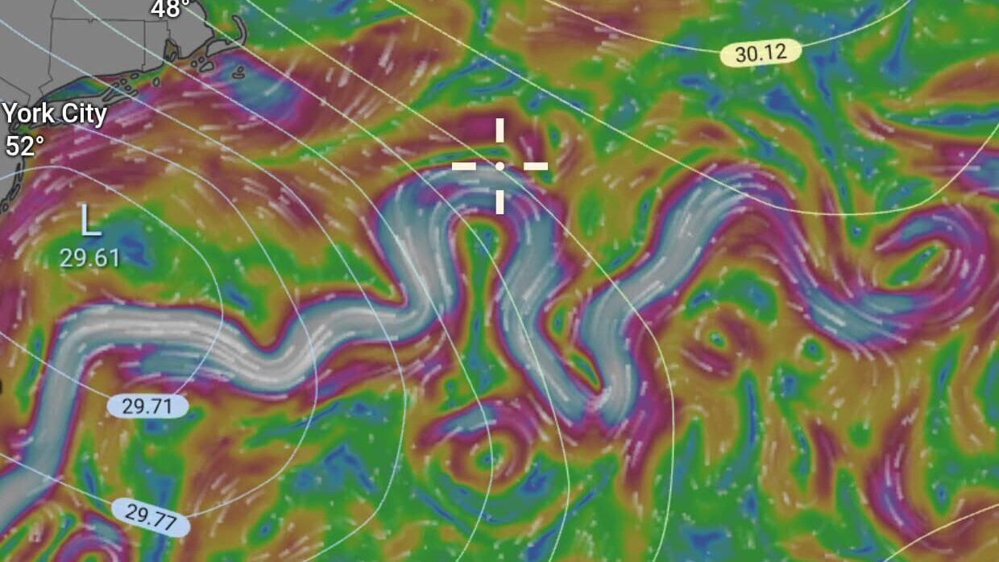<figcaption class="wp-element-caption">De golfstroom is mooi te zien op de stroomkaarten van <em>Windy</em></figcaption></figure>

We merken dat we met de verhalen onzekerder worden over het effect van de stroom op zee. Filmpjes zijn er niet echt te vinden, behalve die van vrachtschepen die in windkracht tien van die monsters over krijgen. De verhalen die worden beschreven zijn van de schepen die er ‘op het verkeerde moment, op de verkeerde plek’ doorheen gingen, maar een simpele ‘*how to not be at the wrong place, at the wrong time*’ is uiteraard niet geschreven.

We besluiten met *Storm* op pad te gaan en aan te kloppen bij alle Canadese vlaggen die we kunnen vinden. Zo spreken we uiteindelijk een paar schepen die al eens eerder deze tocht hebben gemaakt en komen we gerustgesteld weer terug aan boord bij *Luwte*. Onze gedachten, overwegingen en route lijken in lijn te liggen met die van de anderen en hoewel niet iedereen morgen zal vertrekken, krijgen we van geen van de andere schepen afgeraden om dit weervenster mee te pakken. We kunnen ons klaarmaken voor vertrek. Naar Nova Scotia.

In de supermarkt kopen we van onze laatste Bermudaanse tientjes een paar appels en een zak hotdogbroodjes. Van *Drifter* krijgen we een jerrycan diesel cadeau die ze niet kunnen gebruiken en liever vullen met benzine voor hun buitenboordmotor. Ik knutsel als bezigheidstherapie van dyneema nog een babystag om onze mast nog wat meer ondersteuning te geven tijdens het opkruisen en dan is het wachten geblazen tot we mogen vertrekken.

Om 19.00 uur, met het laatste beetje zonlicht, trekken we het anker weer omhoog, draaien een ererondje rondom *Drifter* en kiezen dan weer het havengat. De kustwacht wil allerlei informatie van ons hebben die we niet bij de hand hebben, maar we krijgen uiteindelijk toestemming om uit te varen. We motoren de nacht in, op de voorspelling van een tocht die alles gaat hebben. Van heerlijk achterover hangen tot vrieskou met hoge zee. We zijn gespannen, maar op een goede manier. We staan op het punt om weer een droom in vervulling te brengen.

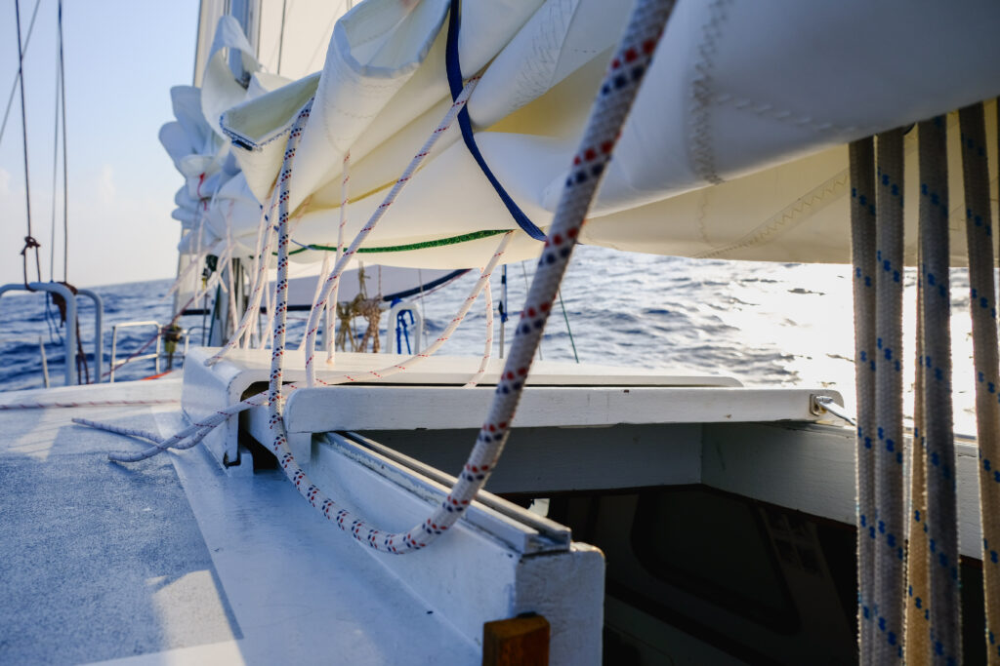
