We varen met een rustig windje richting Otter Harbour. Voordat we de Bras d'Or verlaten moeten we eerst nog door de *Big Bras d'Or*. Een nauwe doorgang tussen de rotsen naar zee. beide binnenmeren laten hier hun water naar buiten stromen, wat zorgt voor enorme stromingen. Er is weinig online, of in de pilot, te vinden over de tijden waarop de stroom de ene, of de andere kant op staat. Wel hebben we de eb- en vloed data. Aan de hand daarvan en onze ervaring met eerdere rivieren, verwachten we dat het zogenaamde *nalijeffect* een uur of twee a drie zal zijn. Dat wil zeggen, de stroming loopt twee uur achter op de waterstand.

Het blijkt de juiste aanname en we hebben een kalme, maar vlotte tocht richting de uitgang. Vlak voor het smalste stuk en de monding naar zee ligt Otter Harbour. Deze plek lijkt inderdaad meer op een haven voor otters dan voor mensen en kan net twee schepen van de wind en stroming beschermen. Een Brits jacht ligt daar al te wachten, vermoedelijk om net als wij morgenochtend vroeg het zeegat te kiezen. Wij puzzelen onszelf om de ondiepte heen en liggen bijna volledig ingesloten door het naaldbos. Het is windstil in deze hoek. En daarmee stil in het algemeen.

*Storm* moet nog naar het voordek en dus besluit ik daarvoor nog even aan te kloppen bij de Engelsman voor een praatje. Tom is een uitermate vriendelijke man die solo geniet van het zeilende leven. Hij laat zo vaak hij kan vrienden of familie overkomen om een stukje mee te varen en heeft inmiddels al heel wat van de wereld gezien. Het is zijn tweede seizoen langs de Canadese wateren en daar ben ik stiekem wel een beetje jaloers op. Hij is op weg naar St John om met een goede vriend Newfoundland te ontdekken en daarna verder te gaan naar Groenland en IJsland. Onze wegen zullen dus al vanavond scheiden, maar we wensen elkaar met een Brits accent *fair winds* en *blissful voyages*.

## (On)geluk

We zijn vroeg uit de veren de volgende ochtend. Het tij stroomt tot een uur of 7.30 naar buiten en het is nog wel een uurtje varen. Maar gelukkig is het een van de langste dagen van het jaar en komt de zon om een uur of 6 al bijna boven de bomen uit.

Terwijl wij nog aan de koffie zitten, haalt Tom zijn anker omhoog en steekt al dobberend in het baaitje zijn lijnen op. Trefzeker vaart hij langs ons en net als ik denk dat hij waarschijnlijk gedetailleerde kaarten zal hebben dan wij, en een andere weg om de ondiepte heen kent, horen we een boem en gekraak die door mijn hele ruggengraat trekt. Hij is bovenop de rotsen gevaren. Zijn waterlijn is een stuk omhoog gekomen en hoeveel gas hij ook achteruit geeft, hij zit muurvast.

Na een paar minuten wrikken is wel duidelijk dat hij niet meer los gaat komen. Over de marifoon bespreken we even met elkaar wat er gebeurd is. Hij ziet aan zijn bakboordzijde de rotsen op kniediepte onder het wateroppervlak liggen. Aan stuurboord lijkt het diep zat. Maar vast is vast. Wij zijn intussen bijna klaar om zelf te vertrekken en bieden aan om een sleepje uit te zetten.

Ondanks onze hefkiel is het wel even spannend, want we moeten dicht naar hem toe varen om een lijn over te kunnen gooien. Zodra dat gelukt is, gaan de twee motoren in zijn werk en komt er onder een niet zo prettig geschraap schot in de zaak. Hij komt los! Een tweede steen bonkt nog aan de onderkant van zijn schip, maar dan is hij vrij. Ik knijp maar weer in mijn handjes met ons staal en hoewel ook Tom schadevrij lijkt te zijn, moet ik er niet aan denken wat voor krachten er op de verkeerde plekken kunnen komen bij een kunststof romp..

We  varen uit en gaan onder de Seal Bridge door, die "slechts" 80 meter hoog is en werd aangelegd zodat de industriële zeilschepen er onderdoor konden. Tien jaar nadat met pijn en moeite deze reusachtige brug werd afgebouwd, stopten de fabrieken echter en bleef een ruime marge voor ons 14 meter hoge sprietje over. We zetten koers op Rammea Island.

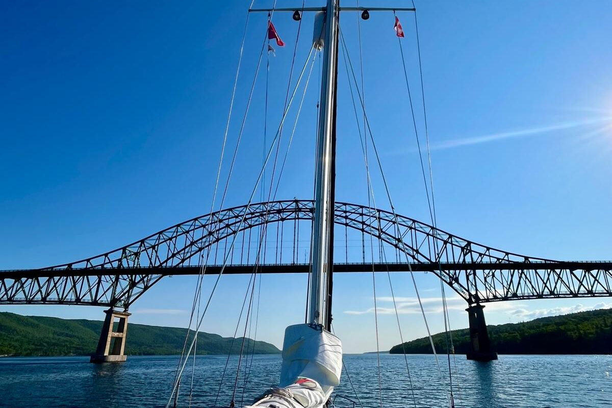

## Ramea Island

De overtocht zelf is frustrerend. We hebben (on)geduldig in Baddeck gewacht op een mooi weervenster voor de oversteek die ongeveer een dag zou moeten duren. 15 tot 20 knopen halve wind, daar zijn alle weermodellen het mee eens. Uiteindelijk varen we 18 van de 24 uur op de motor. De zee is kalm en de wind staat uit. Pas als Ramea in zicht komt kunnen we nog een stukje zeilen. Onder begeleiding van enorme dolfijn-achtigen worden we welkom geheten op het piepkleine eilandje voor de kust van Newfoundland. In de verte zien we de kliffen van het vasteland al liggen, het doet mij denken aan "The Wall" van *Game of Thrones*. Zo breed als de horizon en zo hoog dat je zeker weet dat de slechteriken er niet overheen komen.

Voordat we dat front belegeren, varen we tussen de plukjes eilanden door naar de beschutting van Ramea. Het zonnetje schijnt, wat hier een unicum schijnt te zijn. De heuvels van het eiland zijn schaapjesachtig en begroeid met mos en kleine dennenboompjes.

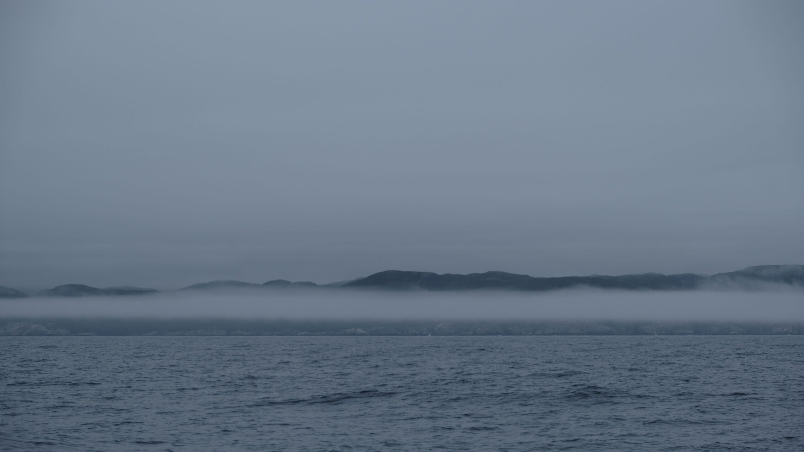

Ramea heeft een wat ingewikkelde geschiedenis. Eigenlijk heeft de hele kust van Newfoundland dat. Tot de jaren ‘90 stond dit gebied bekend om de enorme industrie rondom het kabeljauwvissen. Ramea telde 1224 bewoners en er was een volwaardige basisschool en middelbare school. Op gebied van innovatie was het een koploper, met een van de eerste grootschalige zoutwater zuiveringsinstallaties ter wereld, op groene stroom uit windmolens. Het moet een levendige gemeenschap zijn geweest met veel activiteit en genoeg werk voor iedereen.

Een grote ommekeer was een opkoopprogramma van de overheid, die niet veel later een decreet tekende om alle kabeljauwvisserijen te sluiten. Van de een op de andere dag waren veel van de nederzettingen aan de zuidkust van Newfoundland hun dagelijks brood kwijt en werden de dorpen massaal verlaten. Inmiddels woont eenderde van de bevolking van heel Newfoundland in de grote stad, St John.

Ramea hield stand. De bewoners vonden andere manieren om geld te verdienen in de krabben en kreeften en bleven trouw aan hun eiland, voor zolang het duurt. Ook hier is de leegloop ingezet. De school, die op haar piek zo’n 100 leerlingen telde, huisvest nu nog slechts 4 leerlingen en dreigt de deuren volgend jaar te moeten sluiten. Van de 2500 inwoners zijn er nog zo'n 400 over, waarvan de meesten inmiddels met pensioen.

Desondanks, of misschien juist daardoor, worden we met een voltallig welkomstcomité begroet. Een oude man komt nog terwijl we de lijntjes vastleggen een praatje maken en vertelt ons over het reilen en zeilen op dit eiland. Niet veel later staan er zes andere oude mannen met hun handen achter hun rug mee te praten en te kijken hoe wij onze lijnen beleggen en ons dek opruimen. Als ik een lijn behendig in nette lussen opschiet stoten ze elkaar aan en wordt er een van de mannen gepord of hij dat ook zo netjes kan. "*He's a sailor too! He'll be the only one of us to take care of lines like that!*" Waarop ze allemaal beginnen te grinniken.

Het gesprek loopt soms wat stroef. Het Engels dat ze hier spreken is ver weg nog te herleiden naar het Engels dat wij spreken, maar we moeten echt samen luisteren, elkaar aanvullen en soms maar gokken waar ze het over hebben. Als ik ze vraag naar de waterzuivering en vertel dat wij gelezen hebben dat hier het lekkerste water van de omgeving te vinden is, begint een van de mannen te stralen. Hij is verantwoordelijk voor de waterzuivering en vertelt ons er alles over. Wanneer hij gebouwd is, wat er zoal veranderd is in de afgelopen jaren en waar door het dorp heen publieke kranen te vinden zijn. We mogen direct uit de watertoren jerrycans komen vullen als we willen, maar we kunnen ook gewoon de tuinslang aansluiten op het vissersdok.

Tenslotte komen we bij de reden van ons bezoek. Het schijnt dat hier een coquille-fabriek zit en als wij ergens zin in hebben, dan zijn het wel verse coquilles! Onze vraag wordt fronsend beantwoord en alsof we onwetende kleuters zijn wordt ons uitgelegd dat het coquilleseizoen nog met beginnen. Helaas.

Ze zien onze teleurstelling en weer krijgt iemand een por. Het is de coquille-liefhebber van het stel en hij wordt voor het blok gezet met de vraag of hij niet nog wat in zijn vriezer heeft liggen. Het is duidelijk dat de coquilles hem naar het hart gaan, maar hij belooft er morgen een handvol langs te brengen en vervolgt het verhaal over het leven hier op het eiland.

Naast de coquilles zijn kreeften een grote inkomstenbron, maar het seizoen waarin gevist mag worden is slechts een paar weken. Sommige vissers hebben geluk en vissen in die weken voldoende kreeften uit het water om de rest van het jaar te doen waar ze zin in hebben. Maar de oogsten zijn de afgelopen jaren rap verslechterd. Zelfs nu het seizoen nog open is blijven sommige vissers aan wal omdat de kosten van het uitvaren de inkomsten niet verantwoorden. De mannen mompelen en knikken instemmend toe. De wereld is hier aan het veranderen. Minder ijsbergen in de winter, minder kreeften in de zomer. De vissers van het vasteland komen inmiddels bij Ramea hun potten uitzetten, tot ongenoegen van de eilandbewoners. Wat de toekomst zal brengen weten ze niet, maar volgens hun zijn we als mensen stompzinnig genoeg om tot de laatste kreeft door te vissen, daar om te vechten, en ons dan pas achter de oren te krabben waarom we niet eerder gestopt zijn. Het is misschien visserswijsheid, maar ze slaan de spijker op de kop. Zelfs op Ramea Island.

De zon staat al laag en een briesje steekt op. Daarop trekken ze gezamenlijk de kragen op en zeggen ons gedag. Het was een mooie dag, een van de weinige dagen met zon hier en onze komst is een goed teken. We zijn welkom en mogen blijven liggen. Het havengeld is een tientje per dag, of vijfenvijftig dollar per jaar voor een vaste ligplaats.

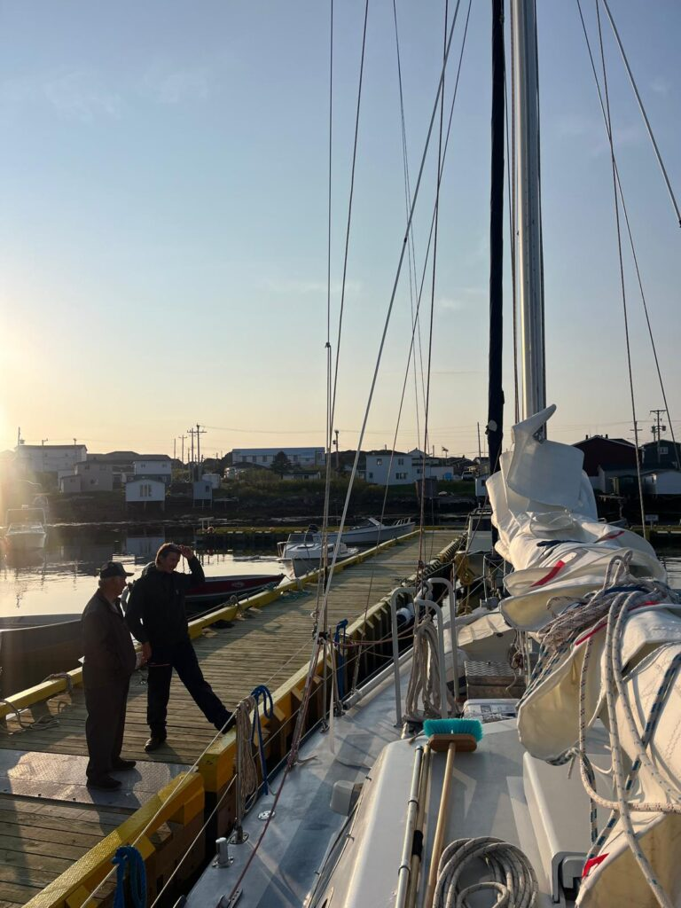

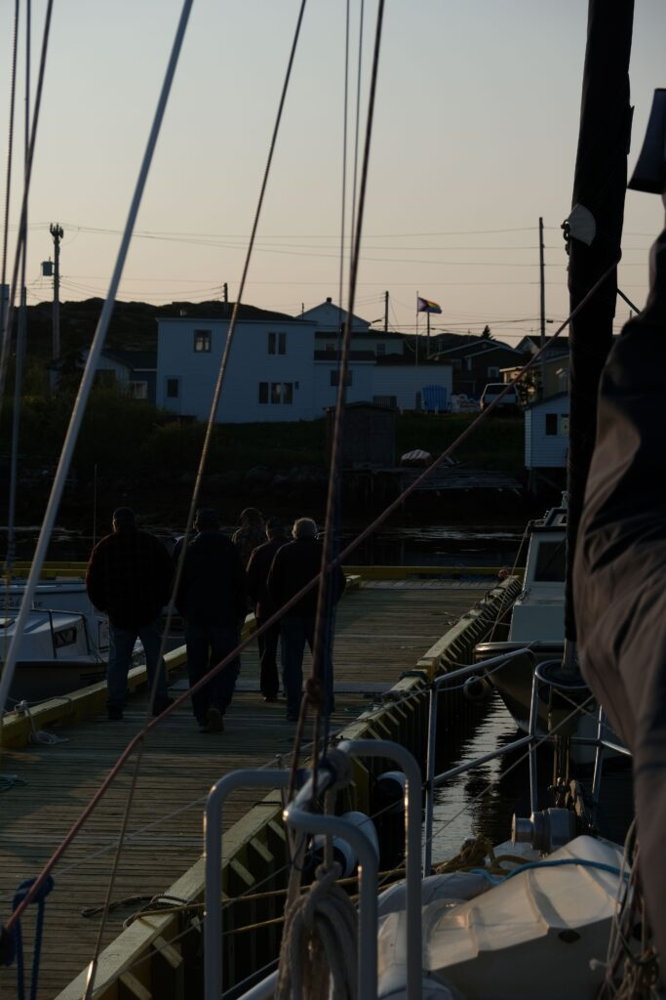

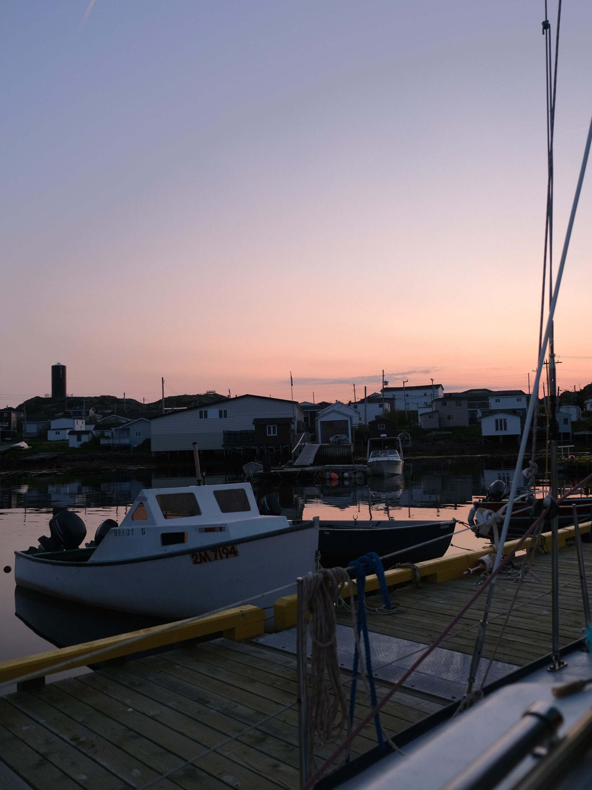

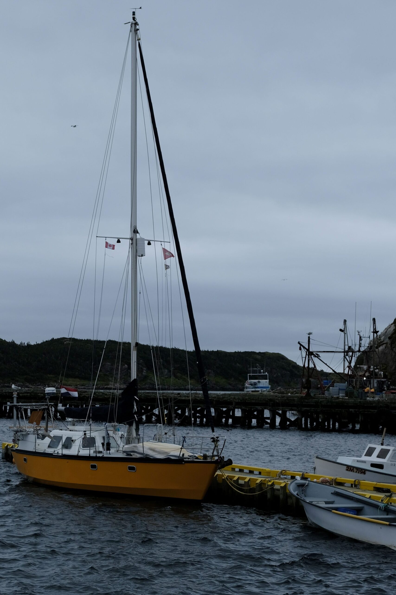

Wij zetten ons kacheltje aan en maken een warme maaltijd. De ramen van het dekhuis beslaan terwijl het langzaam donker wordt buiten. Net als we uitgegeten zijn, zien we iemand naast de boot staan en steken we ons hoofd weer naar buiten. Voor ons staat een stel dat vroeger ook zeilde, maar inmiddels voet aan wal heeft gezet op Ramea Island. Hun vlotte, verstaanbare Engels verraadt dat ze "nieuwelingen" zijn en we worden uitgenodigd om morgen een borrel te komen drinken. "Het derde groene huis langs de Beachside Road".

De volgende morgen staan we rustig op. Als ik de luiken openschuif zie ik een cadeautje in de kuip liggen: een zak met vijftien coquilles. Vacuüm verpakt en wonder boven wonder niet opgemerkt door de zeemeeuwen. We halen ze snel naar binnen en beginnen aan het ontbijt alvast te fantaseren over onze lunch of het avondeten dat we hiermee kunnen bereiden. Dat wordt smullen!

We gaan het eiland op op verkenning. De drijvende steiger waar we aan liggen is recent vernieuwd en ligt er keurig bij. We hebben de enige "passantenligplaats" en daarmee is de haven dus vol. Al vermoed ik dat ze pijn noch moeite zullen sparen om meer bezoekers te verwelkomen. Aan het eind van de kade zit een postkantoor met kluisjes en een dame achter de balie die de post en de pakketten afhandelt. We kunnen er zelfs ansichtkaarten kopen en sturen er een paar naar het thuisfront. We sluiten onderling een weddenschap of de kaarten eerder aan zullen komen dan wij, maar krijgen een kleine week later een appje van mijn grootouders dat de kaart is binnengekomen.

Verder is het dorp eenvoudig. Langs de vloedlijn van de met algen begroeide rotsen staan houten vissershuisjes op palen boven het water. Zo goed als alle huisjes zijn van hout en hebben alleen een begane grond, hooguit een verdieping. De tuintjes liggen er keurig bij, sommigen uitbundig versierd met prullaria, walvis-skeletten of tuinkabouters. De supermarkt is ruim opgezet en doet mij denken aan een combinatie van een noodopvang en een supermarkt zoals ik ze voor me zie op de Noordpool. De twee kassajuffen hebben geen haast en maken met iedereen een kletsje terwijl ze op ouderwetse kassa's de prijskaartjes in rammen. Vers aanbod is er niet, maar we vinden wat koekjes en chipjes die in de aanbieding zijn.

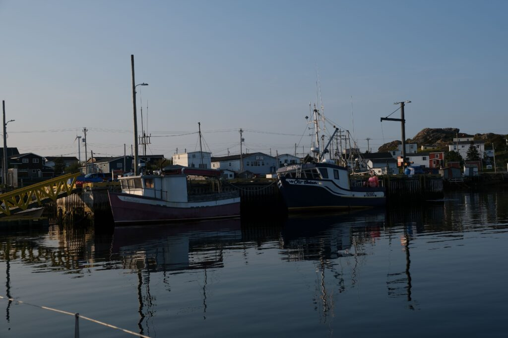

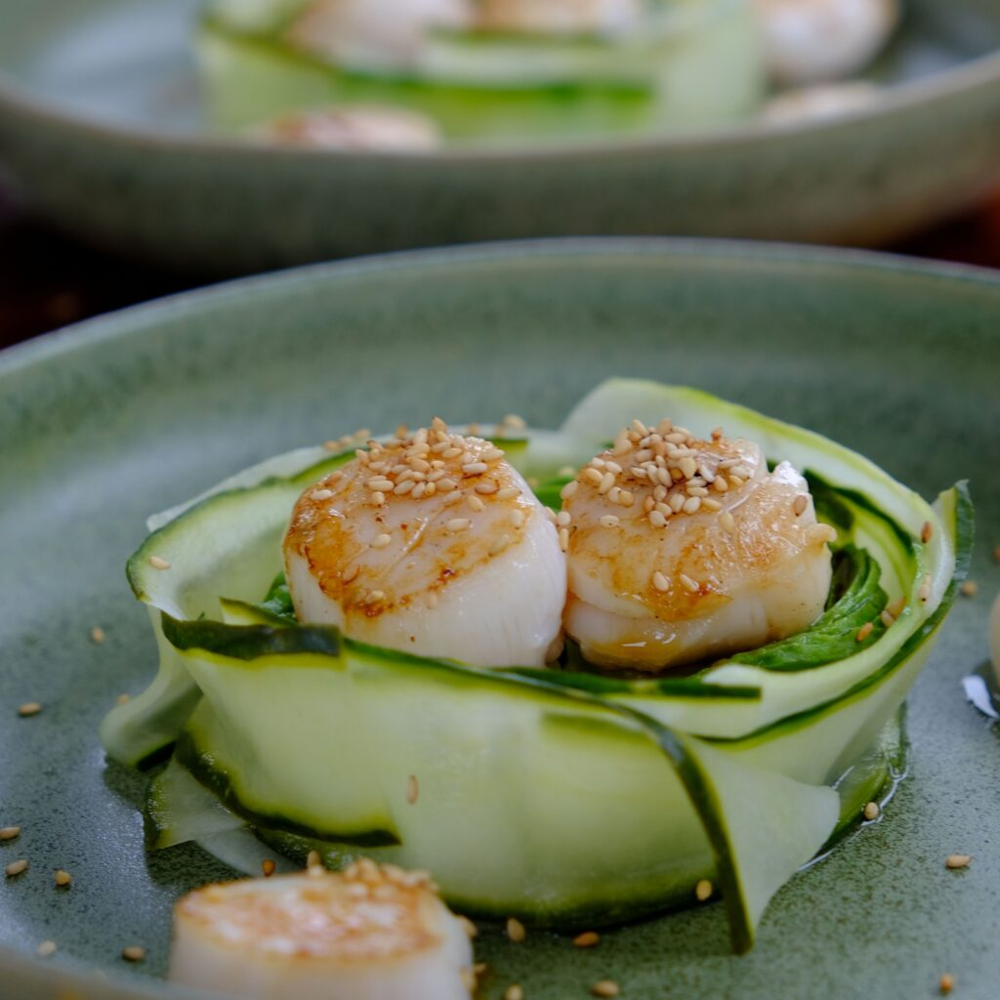

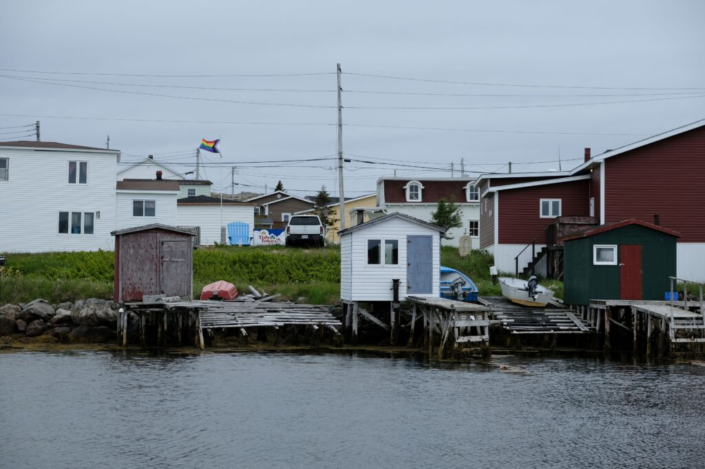

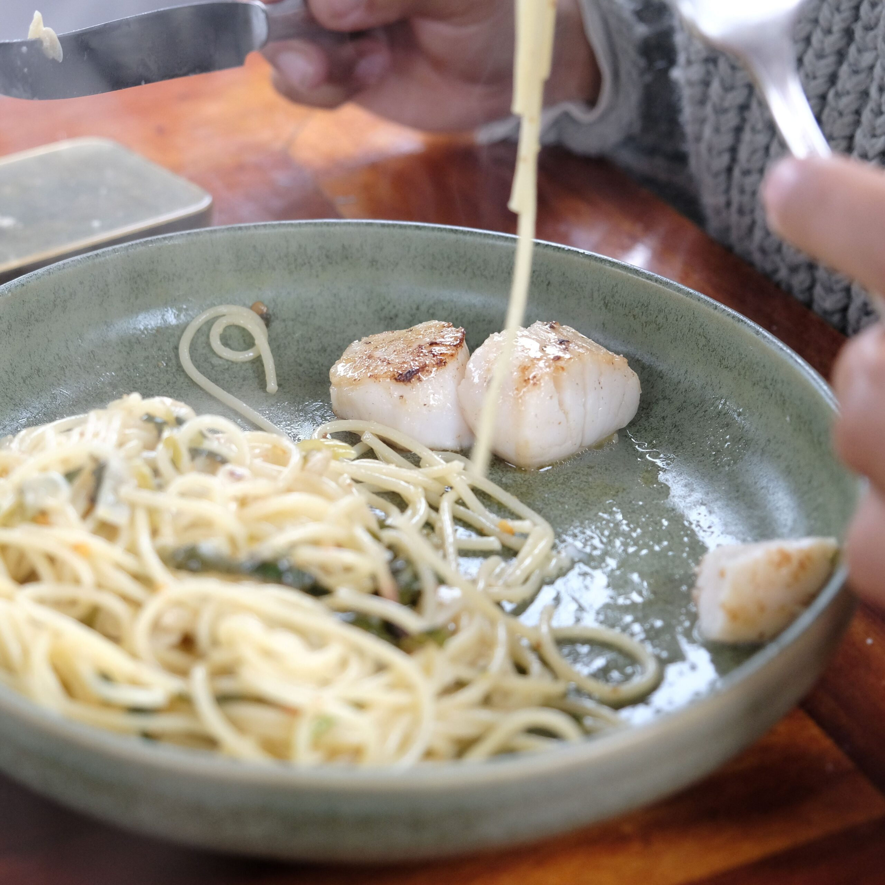

We wandelen verder het dorp uit en gaan op zoek naar de *boardwalk*. Het is een, voor de middelen die ze hier hebben, imposant stukje infrastructuur van wandelsteigers boven de drassige grond over het hele eiland. We nemen het grote rondje van zo'n zes kilometer, het hele eiland rond. Om de zoveel planken vinden we er een, of meerdere, met ingebrande namen. Later leren we dat je een plank kunt doneren en dat daar je naam dan in wordt gezet.

Het landschap is ruw en onherbergzaam. De mist die als een deken over het eiland ligt, trekt langzaam weg als we dichterbij de kust komen en we om de begraafplaats heen lopen. Het is een bijzondere plek. Ruig en sereen. Een mooie laatste rustplaats voor de eilanders. Op een rots verderop zit een vogel die zo groot is dat ik denk dat het een grote adelaar moet zijn, maar na ver inzoomen op de foto moeten we toch concluderen dat het gewoon een reusachtige meeuw is...

Het pad loopt verder over het eiland, langs afgezette stukken land met gele bordjes die waarschuwen voor rondvliegende windmolenwieken. De windmolens, die ooit zo vernieuwend waren, staan stil en zien er uit alsof ze ook niet meer in beweging zullen komen. De roestdruipers komen uit alle kieren zetten en één van de palen is al ontmanteld.

We zetten onze *boardwalk* voort en komen hier en daar mensen tegen die de hond uitlaten, of een wandelingetje maken in het waterige zonnetje. We staan even stil bij een oud zwembad, dat uitkijkt over de zee, maar eruitziet alsof het een jaar of twintig geleden is dat er water in stond. Waar wel water te vinden is, is in het binnenmeer, dat gebruikt wordt voor de opslag van zoet water. Een smalle strook land die het meer van de zee scheidt loopt er langs richting de vuurtoren.

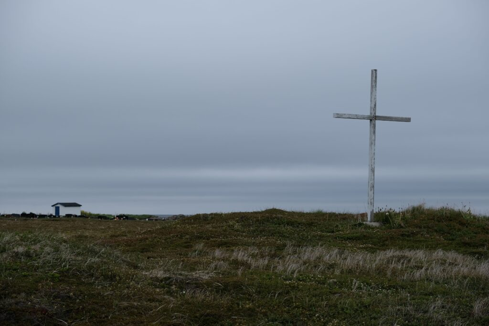

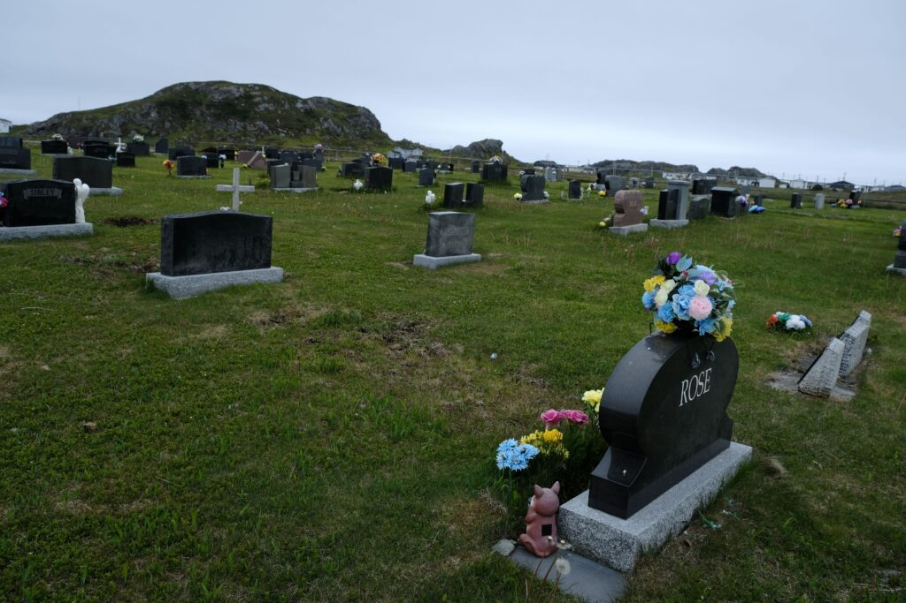

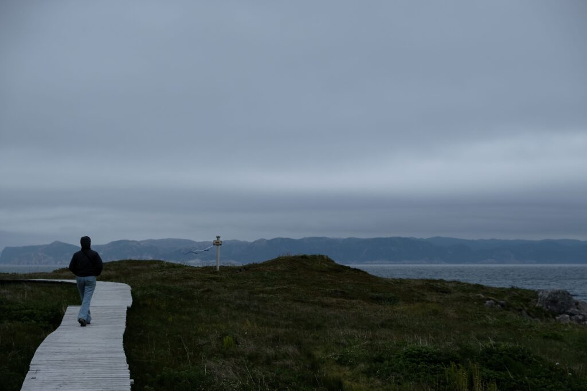

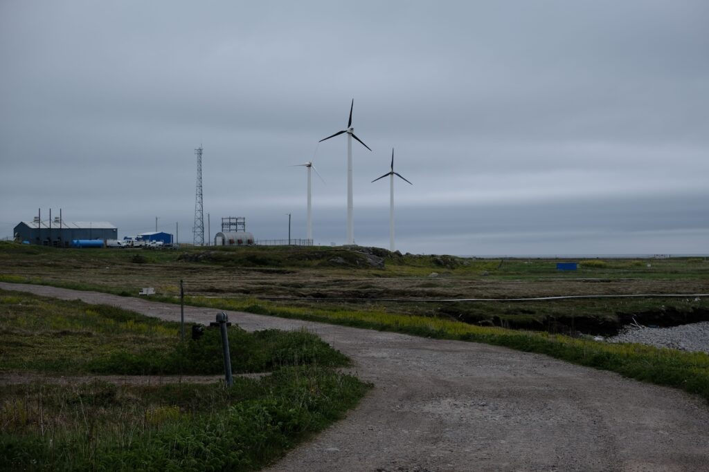

Vuurtorens zijn overal en zijn overal magische plekken. Sommigen staan er al eeuwen, of zelfs nog langer. Het zijn plekken waar zorg gedragen wordt voor de zeelieden, de bakens waar we op navigeren. Het ambacht vuurtorenwachter is een uitstervend beroep, met alle digitale aansturing die we tegenwoordig hebben, maar veel vuurtorens hebben nog altijd wachtershuizen. We kijken door het raam naar binnen en zien het welbekende interieur: een kleine eettafel met twee stoelen in een piepklein keukentje. Een leeshoek en wat prenten aan de muur. Het is eenvoudig, misschien wat eenzaam, maar tegelijkertijd knus. Het is een mooi exemplaar, die van Ramea, en zeker een bezoek waard. Ik mijmer nog wat vanaf het houten helikopterplatform, uitkijkend over zee en word dan geduldig gesommeerd of we verder zullen wandelen.

De route terug leidt ons door het lage dennenbos. Langs het pad zijn de bomen versierd met kerstballen en we hebben het gevoel dat de kabouters met ons meekijken. De geur van open haard kondigt onze terugkomst in het dorp aan. Voor een tuintje staan twee mannen te praten. Als we langslopen groeten ze ons en wijzen naar de lucht: over een half uur komt de mist. Wij kijken naar boven en zien een blauwe lucht met hier en daar een wolk, maar nog voordat we terug bij de boot zijn trekt de deken van mist weer over Ramea.

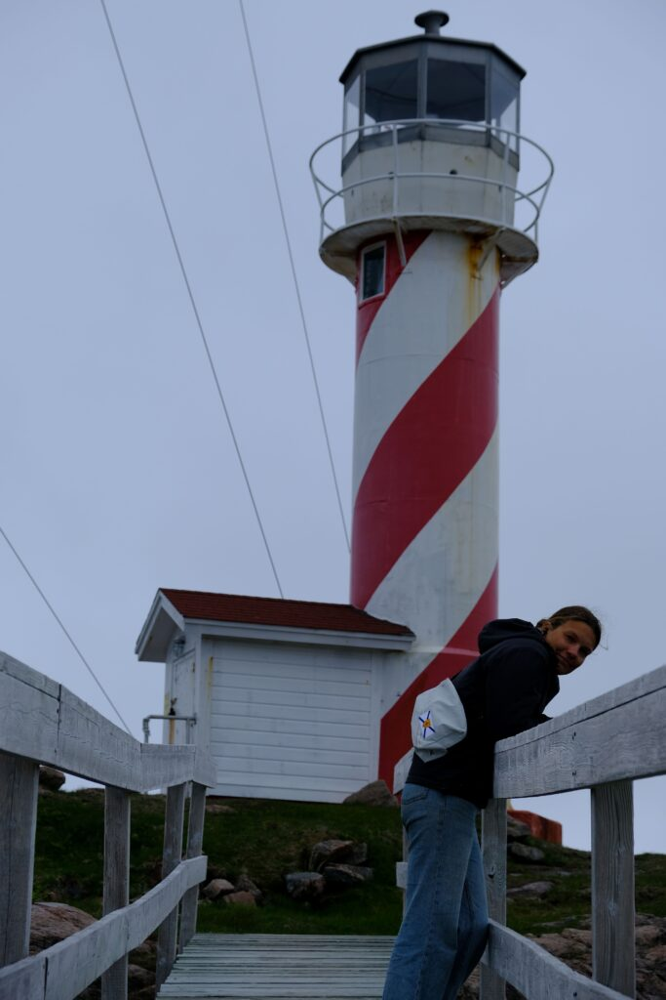

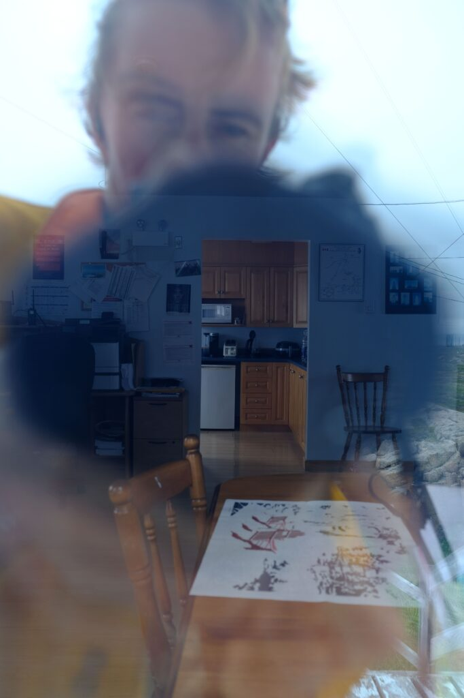

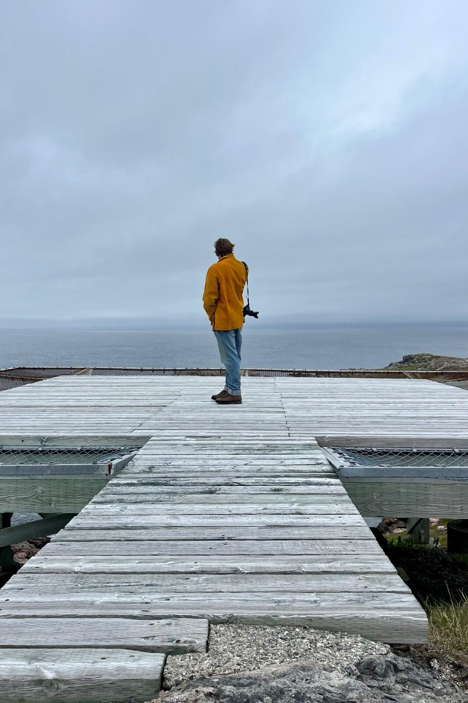

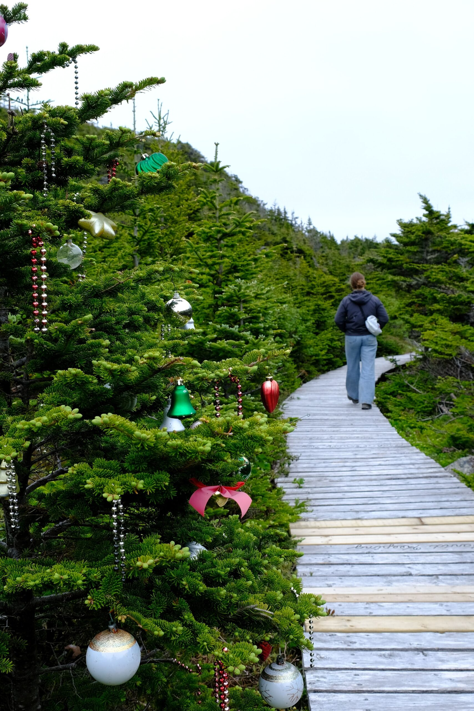

Het derde groene huis aan de Beachside Road ziet er, op zijn groene kleur na, hetzelfde uit als alle andere. We vermoeden dat de deur niet op slot zit, maar blijven toch netjes even staan nadat we hebben aangeklopt. We moeten vier poorten door voordat we binnen zijn: De voordeur, een hor, een binnendeur en een kralensliert. Het huis is klein en donker. De plafonds zitten op ongeveer 2.20 meter en op de vloer liggen overal tapijten. De ruimtes zijn klein en alles staat vol met spulletjes. In de zithoek zitten nog een paar andere mensen die ons verwachtingsvol aankijken. Daarop neem ik het woord en trek onze fles bubbels tevoorschijn. We bedenken een verhaal over hoe we traditiegetrouw bubbels drinken met de eerste mensen waarmee we borrelen op een nieuwe plek, en overhandigen de fles. In zekere zin is niets gelogen, alleen borrelen we meestal gewoon met onszelf.

Het gebaar wordt gewaardeerd, maar onze gastheer kijkt een beetje bedenkelijk naar de bubbels, alsof hij één glaasje per jaar met de kerst wel voldoende vindt. De fles gaat dan ook snel een kast in en er wordt bier uit de koelkast gehaald voor ons. We hebben ons best gedaan.

Het is vermakelijk gezelschap. Twee zeilersechtparen en onze gastheer zijn hier in de afgelopen jaren komen wonen en vertellen over hun ervaringen hier. We begrijpen al snel dat de winters hier koud en onguur zijn en dat ze allemaal wel eens in bed liggen terwijl het huis schudt en de wind door de kieren komt blazen.

## Niemandsland

Het is verleidelijk om hier nog een tijdje te blijven hangen, maar we hebben feestelijk nieuws in het vooruitzicht: Jen’s vader, Doeke, Map, Jools, Logan en Madelief komen ons opzoeken op de Azoren. Over iets meer dan een maand is het al zover. De tickets zijn geboekt. Voor ons heeft dat als direct gevolg dat we moeten doorvaren. Een maand klinkt nog ver weg, maar we moeten nog wel een halve oceaan oversteken.

Dus wandelen we naar het postkantoor om ons havengeld achter te laten, sjouw ik wat jerrycans met heerlijk Ramea-water heen en weer van de kade naar de boot en zorgt Jen er voor dat *Luwte* zowel binnen als buiten zeilklaar is. Vandaag is er geen zon te bekennen. Een dik pak mist omhult ons terwijl we ons klaarmaken en tenslotte de lijnen losgooien. Net als we de haven uit willen varen komt de veerpont vanuit Burgeo binnen en moeten we even ruimte maken, maar daarna is het water leeg en uitgestorven, voor zover we kunnen zien. Op radar en kaartplotter varen we tussen de eilanden door. Af en toe zien we de schimmen van rotsen vlakbij ons op het smalle kanaal, maar verder zijn we in een grijs niemandsland. We zijn door de mistige passages goed geworden in het interpreteren van de radar en vertrouwen onze AIS en GPS goed genoeg om daar zonder zenuwen blind op te varen. Toch blijven we alert en zitten we met gespitste oren in de kuip op wacht voor een verdwaalde visser.

Na een klein uur trekt de mist plotseling omhoog, alsof het hele wolkendek aan een touwtje zit en de goden er een rukje aan geven. Op een mijl of anderhalf voor ons doemen dan de muren van Newfoundland op. Het is een spectaculair gezicht. Met de toppen van de kliffen nog altijd in de wolken lijkt de muur nog hoger en imposanter dan met helder weer. Wij schieten onder de mist door, die langzaam verder omhoog trekt. We zijn op zoek naar Grey River, een groot en diep fjord dat hier ergens landinwaarts zou moeten steken, maar ondanks de heldere aanblik van de kustlijn nu, zien we nergens een ingang.

Pas als we vlak voor de ingang liggen zien we een rood-witte ton schommelen die de aanloopkoers aangeeft. Er staat weinig wind en de boei deint rustig mee op het ritme van de golven. De mistbel ding-dongt onregelmatig door het heen-en-weer bewegen. Het is een slim ontwerp, helemaal in lijn met mijn KISS principe (Keep It Stupid Simple). Geen toeters (wel bellen) of aangestuurde apparaten, maar een grote bronzen bel die in het midden van de boei hangt en door het bewegen van de golven tegen dikke metalen buizen wordt geslingerd. Zelfs op een rustige dag als vandaag is er op zee altijd wel wat beweging.

Vanaf de ton speuren we met de verrekijker de kustlijn af en zien tot onze opluchting een vuurtorentje op een uitstekende rots. Ons volgende baken. Het voelt alsof we recht op een vestigingsmuur afvaren, tot we vlakbij het vuurtorentje zijn, dan opent de Grey River zich en zien we het smalle strookje water waar we doorheen moeten slingeren. Aan onze stuurboordzijde rijst de klif zo’n driehonderd meter recht omhoog, aan onze bakboordzijde zien we schuimkoppen op de rotsen die net onder het wateroppervlak liggen. We hebben aan beide kanten een meter of twintig speling, maar het voelt smaller en spannender dan het invaren van onze box op Marken, waar we slechts een centimeter aan beide zijden hebben. Er staat in de *pilot* niets vermeldt over het vermijden van Grey River bij enige zeegang, maar wij zijn maar wat blij dat het vandaag rustig is. Eenmaal tussen de rotsen is het water direct vlak en pikzwart, de kleur van perfect schaatsijs als het hard gevroren heeft zonder te sneeuwen.

We voelen ons als het paard van Troje, dat de muren in wordt gesleept met ons aan boord. Het is overweldigend om zulke rotsformaties zo dicht naast de boot te hebben. Op elk niet-verticaal stukje rots staan bomen en planten. De mist verandert langzaam in een wolkendek en onthult de grootsheid van het fjord. We kachelen rustig naar binnen en nemen het in ons op. Noorwegen heeft ook fjorden, maar zo heb ik ze ook nog nooit gezien. Jen kijkt met open mond toe terwijl we door dit natuurwonder langs het dorp varen en onze heil dieper in het fjord zoeken. Ik laat de *drone* op en probeer boven het fjord uit te komen. Ik moet de instellingen aanpassen om hoog genoeg te kunnen komen, maar het aangezicht is magisch. Ons kleine gele bootje in een ongerepte kloof.

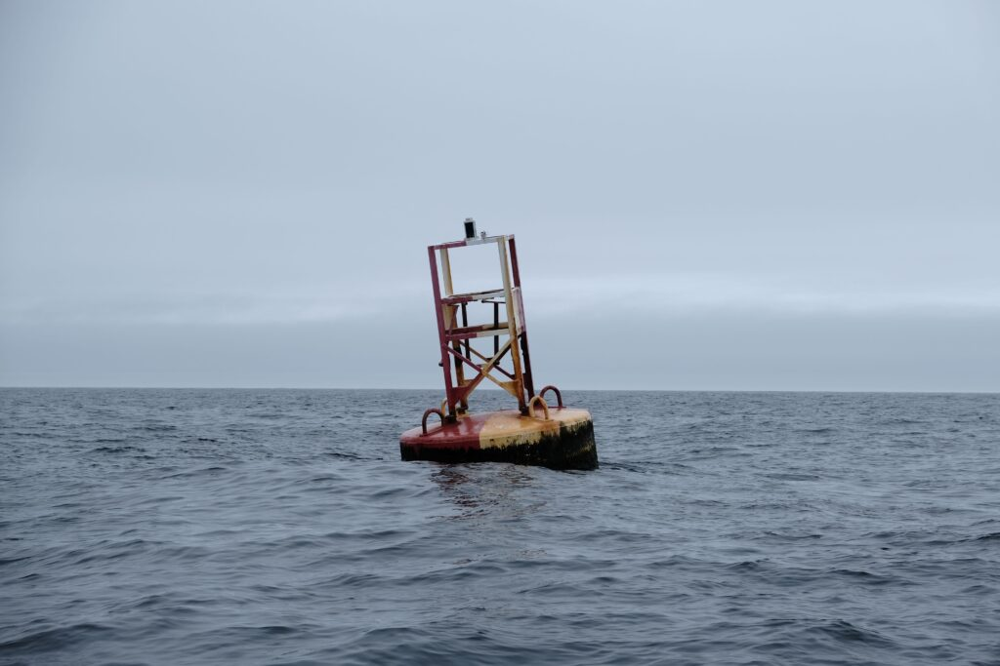

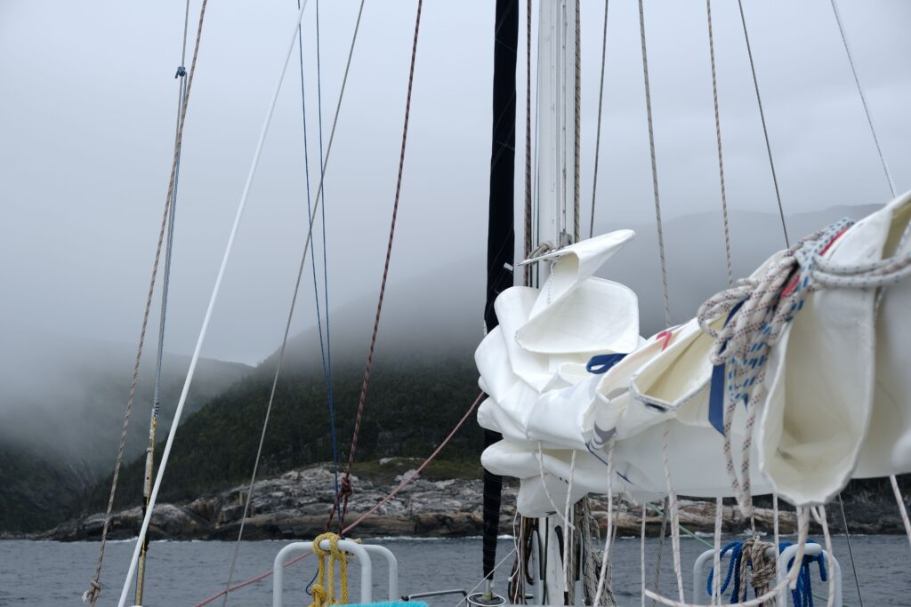

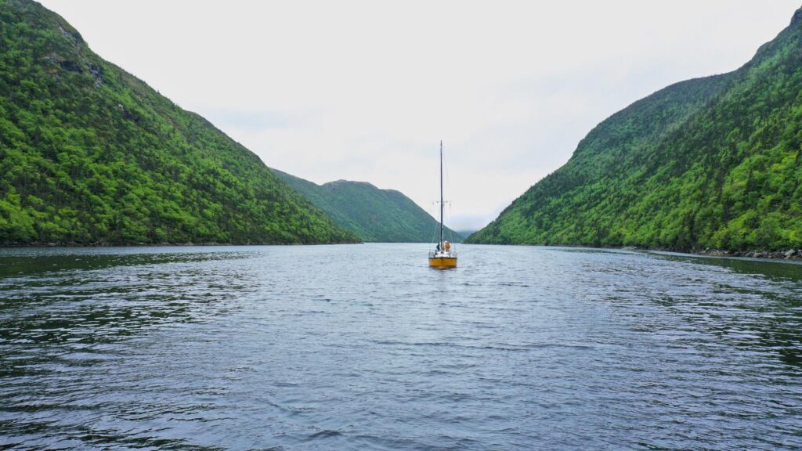

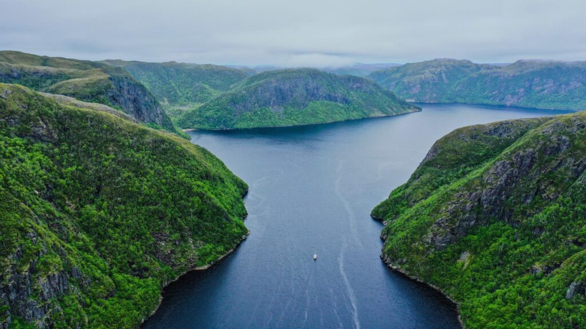

De dronelanding is zoals altijd weer spannend, maar succesvol. We rollen de fok open en zetten de motor uit. Geluidloos glijden we door het water. Verderop steekt een zeehond zijn kop omhoog. Het fjord breekt open en splitst op. Wij kiezen de *West Upper Arm*, waar het ondiep genoeg is om te ankeren.  Het is even zoeken, ons anker houdt niet meteen en dat hebben we niet vaak, maar bij de tweede poging zitten we direct muurvast. Er staat een redelijke bries en we liggen in het midden van het water, maar er is hier verder niets of niemand. Verderop zien we tussen de bomen een hut met een steigertje, maar verder is er hier geen enkel teken van menselijke invloed.

De wind gaat om een uur of vier liggen en in het zonnetje zitten we in de kuip. Jen leest een boek en ik rommel wat rond met kleine klusjes. We hoeven niet naar wal, het uitzicht is hier prachtig en we liggen op ons eigen eilandje in onze eigen bubbel. Jen begint vroeg met koken en daarna kruipen we tegen elkaar aan om een serie te kijken. De kachel blaast de kajuit warm en we drinken koppen thee.

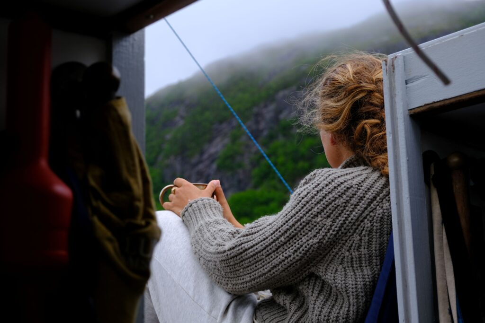

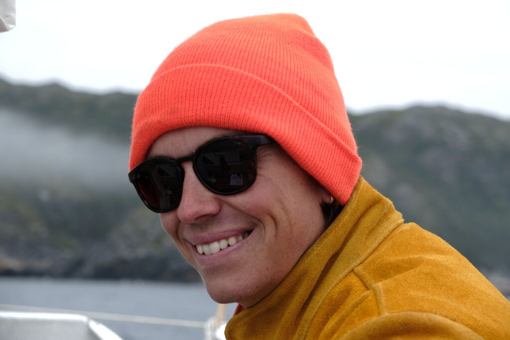

## Deadman's Cove

Onze volgende stop is maar een uur of drie varen, dus we doen het rustig aan. Deadman’s Cove, spreek je uit als Deedman’s Cove. Het is één van de namen die vreemd wordt uitgesproken door de *noofies*. Ik heb het idee dat ze hier ook allemaal *klemTOON* zouden zeggen, in plaats van klemtoon, maar ze zijn gelukkig direct genoeg om ons te verbeteren als we iets ‘normaal’ uitspreken.

Vandaag is het weer mistig. Potdicht. We zien de kliffen pas als we er tussendoor varen en al binnen zijn, maar dan breekt het langzaam open. Het gesteente is hier van een heel andere soort dan aan de Grey River. Rode rotsformaties vormen hier het beeld bij de ingang van het fjord. Deadman’s Cove is nog desolater dan de Grey River en in het totale niets vinden we de kom waarin we kunnen ankeren. Het is erg diep en we varen een paar rondjes op zoek naar een goed punt om het anker te laten zakken. Op plekken als deze was een elektrische ankerlier, of een bredere rug, wel lekker geweest. Uiteindelijk vinden we een hoekje waar het negen meter diep is, maar het loopt steil op en tegen de tijd dat de ankerketting strak staat en het anker zich heeft ingegraven ligt de boot nog maar op vier meter diepte. Het is zo goed als windstil en als de voorspelde zuidwesten wind inderdaad zuidwest wordt, dan zouden we redelijk beschut achter de heuvel moeten liggen.

Aan onze andere kant kijken we uit over de *El Capitan* van Newfoundland. Een enorme bijna overhangende klif die door weer en wind rond en glad is geworden. Ook hier komt de drone naar buiten en verken ik het gebied en schieten we unieke plaatjes van *Luwte in de wildernis.* Trots kijk ik de foto’s terug en kondig ik aan Jen aan dat we met oceaanoversteken, jungleavonturen, droogvallen, rivieren, Caraïbische stranden, zwaar weer en nu Deadman’s Cove goed op weg zijn om de status van *go anywhere yacht* te vervaardigen.

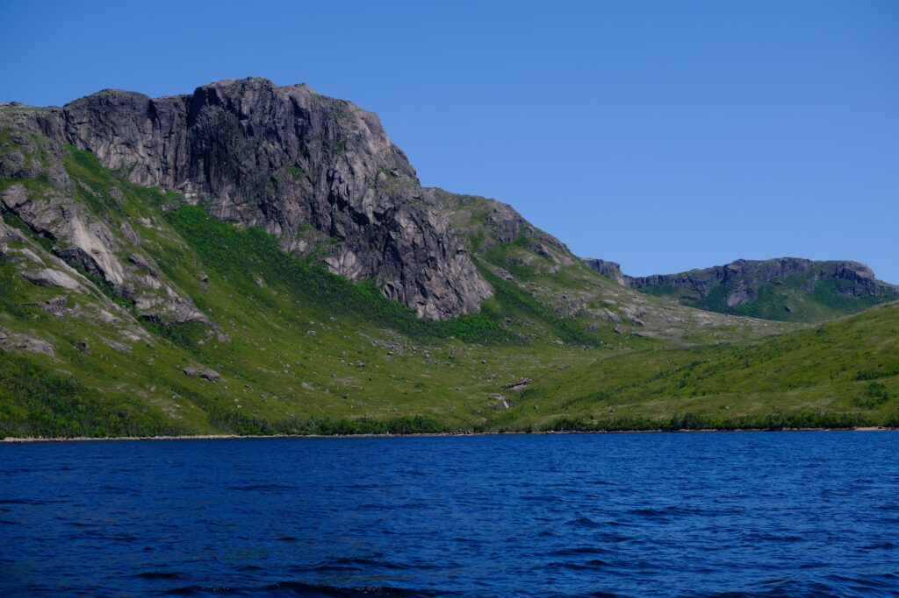

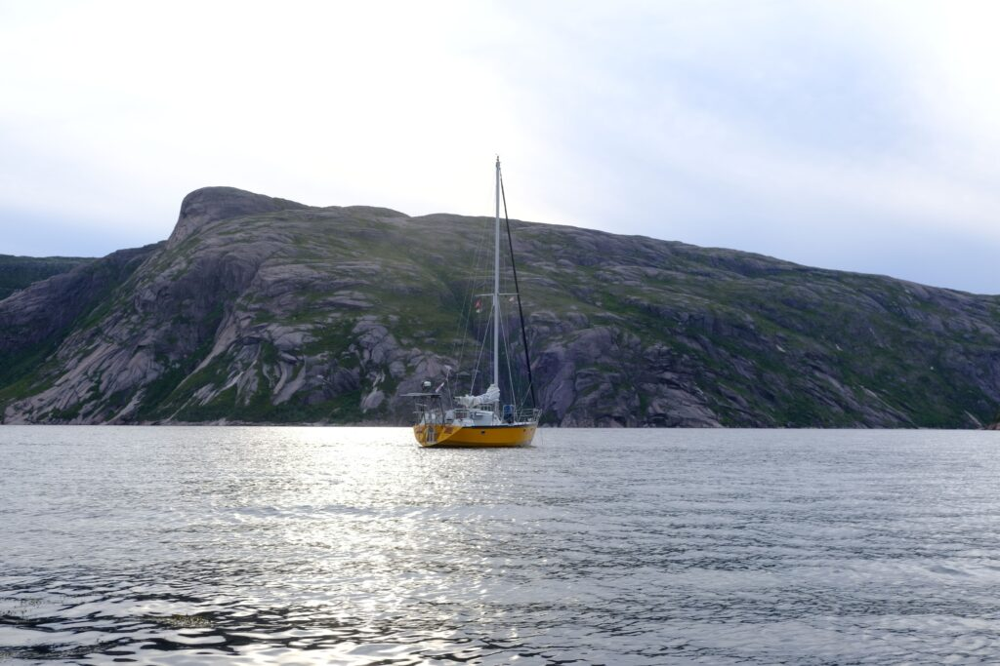

We worden wakker van de eerste windvlaag die de boot scheef duwt en de ankerketting strak trekt. We staan meteen maar op om te bepalen of we hier willen blijven liggen, of dieper het fjord in willen. Die beslissing wordt een paar minuten later gemaakt als de volgende windstoot over het water komt razen. Ik kan hem al vanaf een paar honderd meter verderop zien aankomen. De wind doet het water agressief rimpelen en de toppen van de microgolfjes waaien al af voordat de verstaging begint te suizen en we weer in ons anker getrokken worden. We liggen goed vast, maar het is eb en we liggen al akelig dichtbij de rotsen, aan lagerwal. Jen is net koffie aan het malen als ik de motor start en roep dat we *nu* weg moeten. We krabben nog niet, maar het zou pas vanmiddag echt hard gaan waaien en we liggen hier duidelijk in een acceleratiegebied, in plaats van in de beschutting.

Het wordt een van de spannendste manoeuvres van onze reis. Zowel aan bakboord, als aan onze achterzijde hebben we weinig ruimte, dus dat betekent dat het anker in één keer er uit moet komen als we de motor in zijn vooruit zetten en ik kan beginnen met binnenhalen. Als de punt door de wind naar bakboord wordt geblazen hebben we zo goed als geen ruimte om terug te draaien en liggen we op de stenen.

Alles gaat goed, tot we bij het anker komen, een harde windvlaag de boeg wegblaast en ik zit te knoeien met die verdraaide ankerbal. Het is de derde keer deze reis dat we een boeitje aan de voorkant van het anker hebben gebonden, om het anker los te kunnen trekken mochten we ergens achter blijven haken. En het is de derde keer dat het balletje ervoor zorgt dat we in de problemen komen. Jen moet van het gas af, omdat we anders het risico lopen de lijn in de schroef te krijgen. We liggen recht boven ons anker en moeten hier wegwezen. Met de pikhaak haal ik de boei binnen, maar dat is net op het moment dat de volgende windvlaag aan komt razen en dit keer de boeg wel naar bakboord duwt. “Gas! Gas! Gas!” roep ik. Het anker trek ik uit de grond en haal ik een paar meter op en Jen geeft gas met het roer dwars zoals ze nog nooit heeft gedaan. Resoluut en adequaat. We hebben er wel eens discussie over gehad, dat Jen naar mijn mening soms te weinig gas geeft en vandaag was dat funest geweest. Maar vandaag gaf ze gas. Tot de gashendel niet meer verder ging. En draaide onze neus weer door de wind.

De kramp in mijn trillende armen en rug komt pas nadat ik weer durf te ademen. Jen’s handen trillen. Dat was op het nippertje, maar we zijn er uit. We gaan dieper het fjord in onze heil wel zoeken.

We varen helemaal door naar het einde van het fjord. De naam van het smalle uiteinde van het fjord heet *Funnel Head* en dat baart ons een beetje zorgen, maar het is de enige plek waar de diepte goed is, er ruimte is en waarover is geschreven dat je er ook met veel wind goed ligt. Terwijl we naar binnen varen begint de zuidwester te loeien en wordt de wind op sommige plekken inderdaad sterk *gefunneld*. Enkele tientallen meters verderop kan de wind dan weer volledig wegvallen en we hopen dat *Funnel Head* ook zo’n vacuüm creëert in deze winden.

De werkelijkheid is minder rooskleurig. *Funnel Head* heeft gelukkig veel ruimte en het is er slechts vijf meter diep, dus we laten bijna de hele 50 meter ankerketting uitrollen en gaan dan binnen zitten nagelbijten. We zien dat het verderop in het fjord veel harder tekeer gaat en hopen dat de wind niet net zo draait dat dat zich naar ons toe verplaatst. Uiteraard gebeurt dat een klein uur later toch. We zien de vlagen aankomen rollen over het water en we kunnen ons schrap zetten voor de volgende. *Luwte* wordt scheef getrokken en de zonnepanelen op de reling klapperen. De ankerketting staat snaarstrak en om ons heen waait het water uit het water de lucht in.

Zo gaat dat de rest van de middag door. Ook hier liggen we aan lagerwal, zij het met wat meer marge, maar als we losslaan is het snel bekeken met deze wind. Jen probeert een boek te lezen terwijl ik kniezend uit het raam staar op zoek naar tekenen dat de wind gaat liggen. Dat gebeurt pas ’s avonds laat tegen de tijd dat het donker wordt. Maar we zijn al lang blij dat we rustig kunnen slapen.

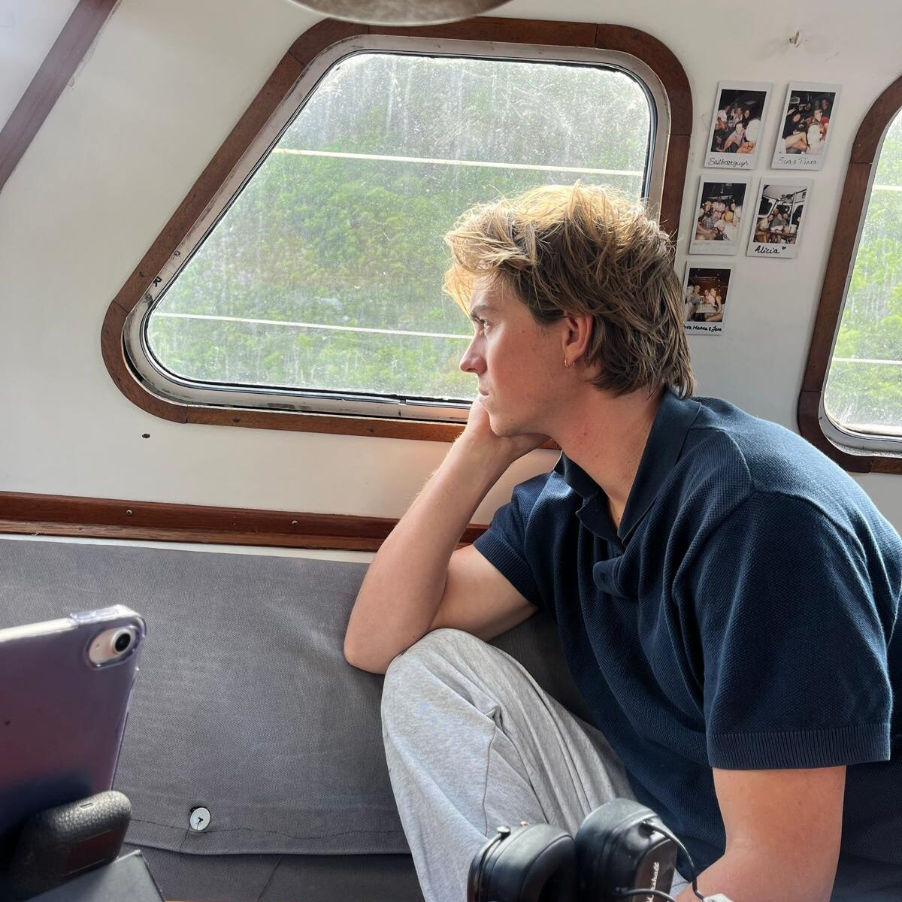

De volgende ochtend keren we terug naar Deadman’s Cove. De wind is nog altijd vlagerig, maar uit een andere hoek. Hier en daar ontstaan in het fjord weer sterke valwinden, afgewisseld met plotselinge luwtes. Deadman’s Cove ligt vandaag in zo’n luwte en hoewel we een paar honderd meter de schuimkoppen op het water zien staan, is het hier helemaal rustig. Kort nadat we het anker hebben laten vallen gaat de wind helemaal uit en kunnen we op avontuur. We roeien *Storm* naar de kant en beginnen de berg op te lopen. Ik ga recht op de top af, geen omwegen, want er is hier toch geen pad. Dwars door struiken waar we soms tot op onze heupen in zakken ploeteren we ons een weg. Pauzeren kan eigenlijk niet, want dan worden we direct aangevallen door een soort bijtende vliegen. Een kleine driekwartier later zitten we bezweet op een groot rotsblok met uitzicht op het fjord en *Luwte* die is veranderd in een klein stipje. Over de toppen van de berg aan de andere kant zien we St. Pierre en Miquelon liggen, onze laatste halte voor we terug naar Europa varen. We doen nog een poging om een kampvuurtje te sprokkelen, maar tegen de tijd dat we het hout hebben verzameld, hebben de vliegen ons gevonden en gaan we rennend en *deet* spuitend het eiland af. Het leven achter anker is toch een stuk prettiger.

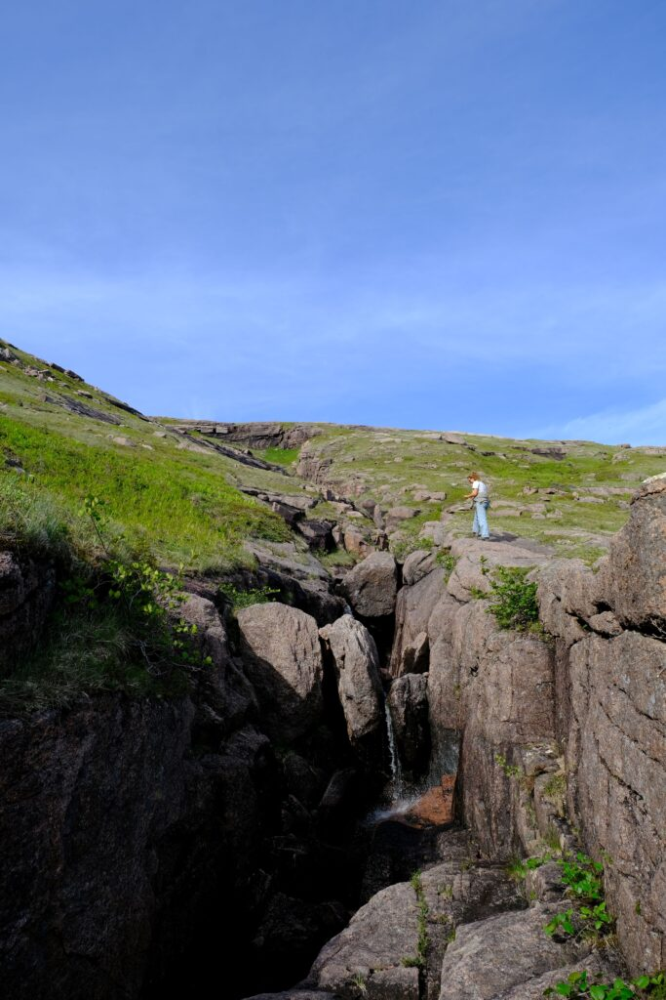

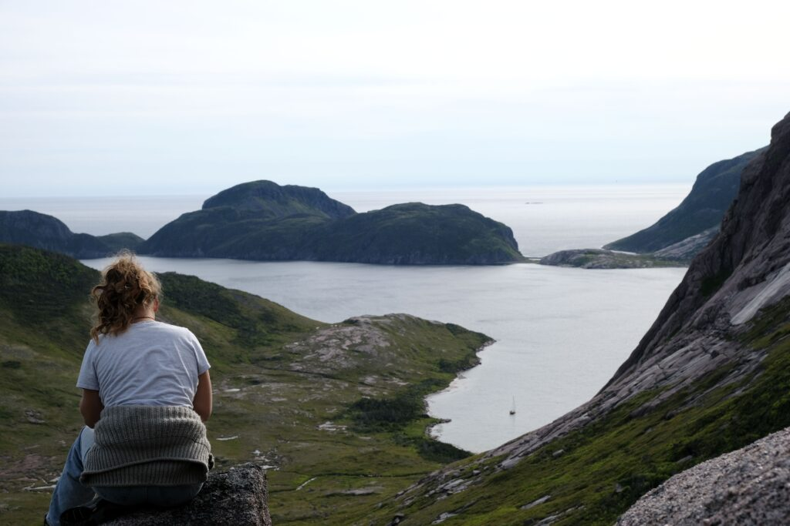

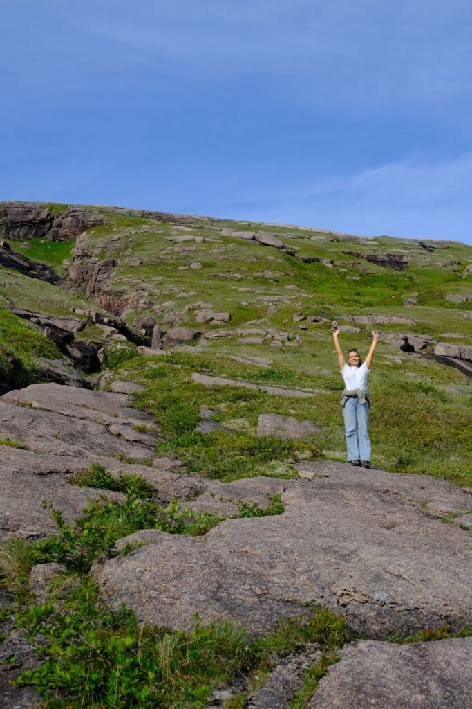

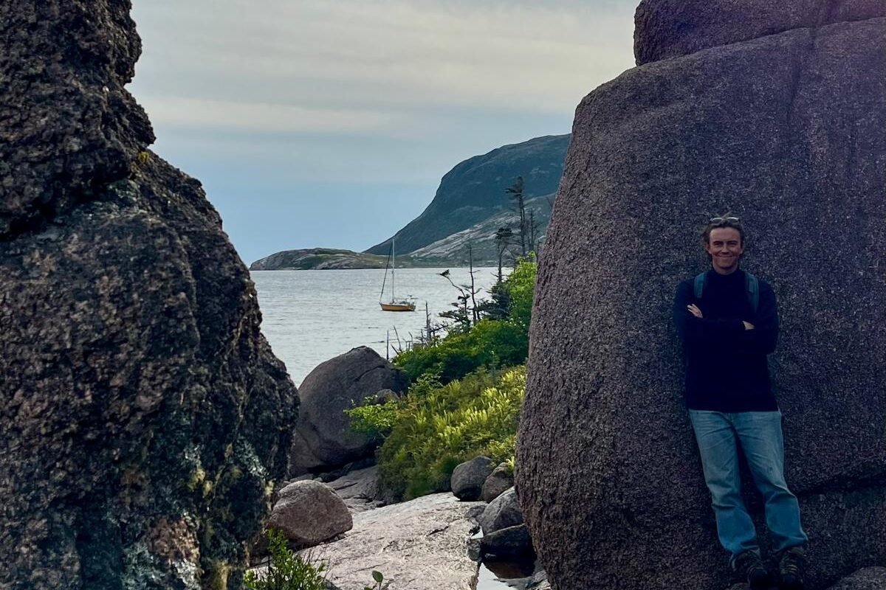

## Terug naar de EU

Aangezien St. Pierre en Miquelon niet te bezeilen is, maken we nog een tussenstop in Grand Bank, een slaperig vissersdorp waar alles gesloten is. We komen laat aan en vinden alleen nog een supermarkt die geen biertjes verkoopt, dus met een blikje fris wandelen we terug naar de boot. We zijn de enige boot in de verder stille haven. Er is ook niemand op straat, de restaurants zijn dicht en op een voorbij rijdende pick-up na lijkt hier niets te gebeuren.

Door de mist motorzeilen we verder naar St. Pierre. Zoals overal ter wereld hebben de Fransen ook hier weer een stuk territorium afgebakend. St. Pierre en Miquelon waren tijdens de grote drooglegging de handelsroute voor de *rumrunners.* Vanuit Frankrijk kon de rum gewoon legaal verscheept worde naar St. Pierre en verdween daar in de administratie. ’s Nachts gingen de grote jongens uit het dorp in kleine bootjes met kratten rum naar het vasteland om daar de handel te verkopen. Een handvol families is hier schathemeltje rijk mee geworden en runt nog altijd zo goed als alle nutsbedrijven op het eiland.

Wij worden begroet door grote scholen *puffins*, een soort vliegende pinguïns van het noordelijk halfrond. De mist trekt weg als we de pieren binnenvaren en direct zien we dat we terug zijn in Frankrijk. Overal wapperen Franse en EU vlaggen. Op de kades staan de oude kanonnen nog opgesteld om pogingen om de eilanden terug te veroveren af te slaan. De marina bestaat uit een reeks drijfsteigers voor kleine sloepjes en een vaste kade voor passanten. Wij knopen langszij bij een groot aluminium Duits jacht. Nog voordat we goed en wel liggen staat de immigratiedienst al op de steiger om onze papieren te controleren en krijgen we toestemming om de EU weer binnen te komen. Dat voelt toch een beetje gek, zo in Canada.

Dat ze hun status als Frans rijk serieus nemen is duidelijk te merken. De baliedame van de haven antwoordt resoluut *‘non’*  als we (in het Frans) vragen of ze ook Engels spreekt. Met handen en voeten leggen we uit dat we net aangekomen zijn en graag een paar nachtjes blijven liggen. Ze laat ons nog een tijdje spartelen en zegt dan plotseling in vloeiend Engels dat we welkom zijn. Ze voegt er nog wel even aan toe ‘*you are now in France, so you better start learning the language’.* De toon is weer gezet.

Bij het havengeld zit toegang tot de wasmachine, zonder muntjes of extra betalen. Jen gooit meteen de opgespaarde wasmand op z’n kop en stopt voor het eerst sinds lange tijd de wasmachine niet helemaal propvol, zodat onze kleren weer een keer echt schoon worden.

Het is hier wachten op een goed weervenster. De depressies die bij Nova Scotia ontstaan trekken nog altijd in een treintje langs, met weinig ruimte om er tussendoor te varen. Aan de kade liggen uiteraard een aantal Franse avonturiers waarmee ik een praatje over het weer probeer te maken. Zij willen ook naar de Azoren, maar als ik begin over een grote aankomende depressie kijken ze schouderophalend naar de lucht en zeggen ze dat de wind goed staat en de lucht blauw is, dus een prima moment om te vertrekken. Wat ze onderweg tegenkomen zullen we dan wel weer zien.

De houding is tekenend voor Fransen en hun zeilambities. Franse wereldreizigers blijven in zekere zin gewoon thuis, want ze doen zelden een andere plek aan dan eentje waar de Franse vlag wappert. De verhalen van de Fransen zijn wel uiteenlopender dan bij Nederlanders. Zo liggen we hier op de haven met een stel studenten, een ouder echtpaar dat het met enkel de AOW probeert te bekostigen en een varende tandarts die letterlijk van zijn kajuittafel een tandartsstoel maakt door er een handdoekje op te leggen. Hij biedt ons nog aan of wij ook een beurt willen, maar wij slaan toch maar even over. Verder ligt (naar alle waarschijnlijkheid) het kleinste zeilschip dat de wereld rond is geweest voor ons. Hij zou niet misstaan in de Pieremegoggel tocht tijdens SAIL en is zo’n 4 meter lang, net iets langer dan onze bijboot *Storm*. Hij heeft geen motor en het zeil van een *Laser*. Maar hij is nu wel al aan zijn tweede rondje bezig. Zijn overtocht vanaf St. Martin naar St. Pierre duurde bijna vijftig dagen.

De metgezel waarmee hij samen op St. Pierre zou eindigen hebben wij in Suriname ontmoet. Hij lag daar op de rivier zonder voorstag op een oud en uitgeleefd scheepje. Hij was uiteraard op weg naar Frans Guyana, maar moest onderweg naar binnen varen omdat zijn mast dus bijna naar beneden kwam. Toen wij hem later in de Carieb nog eens tegenkwamen en vertelden over ons plan om naar Canada te varen is hij geïnspireerd geraakt, want hij moest bij Canada meteen denken aan het Franse eiland dat daar voor de kust lag.

Het schip, onder de naam Valhalla is het oude schip van een Nederlandse jongen die op YouTube filmpjes maakt over zijn zeilavonturen. In de aanloop naar onze reis heb ik meer dan eens hoofdschuddend zitten kijken naar hoe hij, met alle gebreken die er bij kwamen, toch nog een heel eind vooruit kwam. Inmiddels verdient hij genoeg geld met het kanaal en is hij overgestapt naar een catamaran. Deze Fransman had een droom en kocht een nachtmerrie.

Vijf dagen voor ons vertrek vanaf St. Martin voer hij uit met bestemming St. Pierre & Miquelon. Zijn verhaal eindigt in de Golfstroom, waar zijn roer, giek, autopilot, zeil en tenslotte hijzelf na drie dagen handsturen kapot gaan. Hij wordt opgepikt door een vrachtschip en overleeft ternauwernood de sprong van zijn schip naar de tanker. Twee maanden later zit hij nog altijd vast, voor de kust van Afrika, waar het schip naar op weg was. Als “stowaway” kom je in een lastig juridisch rijtje liggen en uiteindelijk lukt het via een ambassade om voet aan wal te mogen zetten.

Het is een absurd en verontrustend verhaal. Een van de momenten waarop we niet blij zijn met de Starlink, is als hij ziet dat wij op weg zijn naar boven vanaf Bermuda en ons een berichtje stuurt om te vertellen wat er is gebeurd en dat zijn schip daar nog ergens drijft. Het schip was gelukkig al dusdanig toegetakeld voor vertrek, dat het weinig inbreuk doet op ons vertrouwen in *Luwte*, maar even slikken is het wel. Tot zover dus Fransen en hun *comme ci comme ça*.

Verder is de kade goed gevuld met een ander slag zeiler dan we veel gezien hebben in de Carieb. De kunststof schepen zijn voor de verandering in de minderheid en het staal en aluminium heersen. De meeste mensen die hier liggen houden van hun tijd op zee en deinzen niet terug om lange afstanden af te leggen. Het meest extreme geval is een schip van de Falkland Eilanden, voor de kust van Argentinië. Naar verluid liggen er slechts twaalf schepen en hebben wij er eentje van mogen zien. Omdat ze naar Canada wilden zeilen zijn ze daar maar in één stint naartoe gezeild…

Wie we ook tegenkomen op de kade is Tom, de zeiler die vastliep op de rotsen en een sleepje van ons kreeg. Helaas is ons weerzien niet in de goede gezondheid waarin we afscheid namen. Hij vertelt ons dat hij een paar minuten na het hele vastloop-avontuur struikelde en een misstap maakte. Hij had last van zijn enkel, maar als solozeiler moest hij toch echt zelf zijn schip bestieren. Toen hij 24 uur later op St. Pierre zijn sok van zijn voet trok, was die zwart, opgezet en bleek zijn enkel gebroken. Zes weken gips en voorlopig nog geen trip naar Groenland en IJsland. We helpen hem door de dagen heen met zijn was, de boodschappen en gooien af en toe een baguette in de kuip. Het is van de zijlijn maar weer eens duidelijk dat een ongeluk in een klein hoekje zit en dat een boot een uiterst onvriendelijke omgeving is voor botbreuken en blessures.

Wij blijven het weer in de gaten houden, besluiten last-minute om te wachten op de volgende depressie en zorgen ervoor dat *Luwte* klaar is voor een mogelijk zware tocht. Door het uitstel van ons vertrek landen we in een ontspanningsbubbel en genieten we nog een paar dagen van de Franse geneugten. Ik eet een eendenborst, Jen gaat een dag naar de spa, we lunchen met een glas witte wijn en bezoeken het museum over de geschiedenis van het eiland.

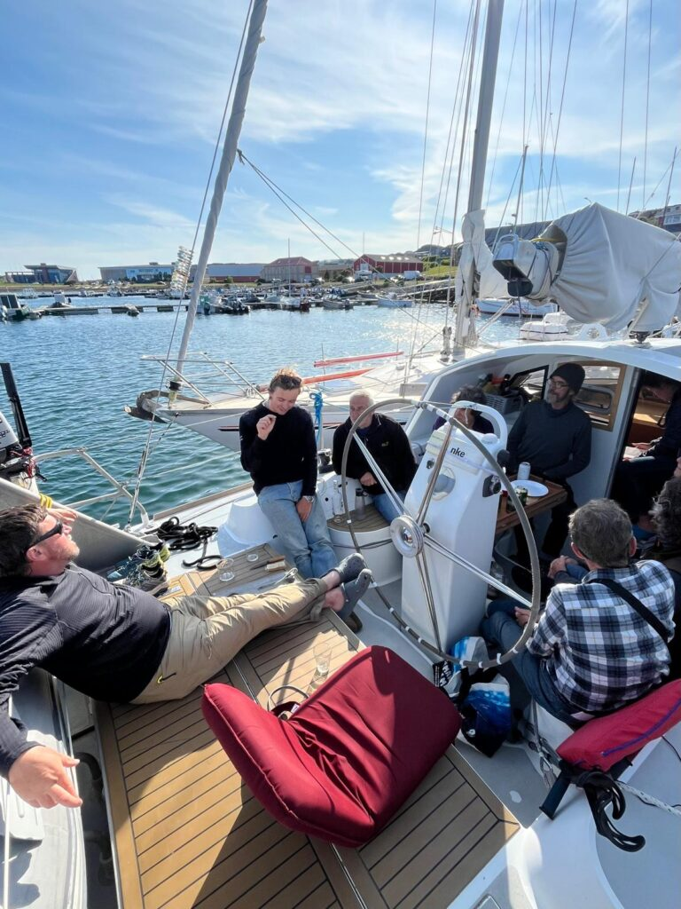

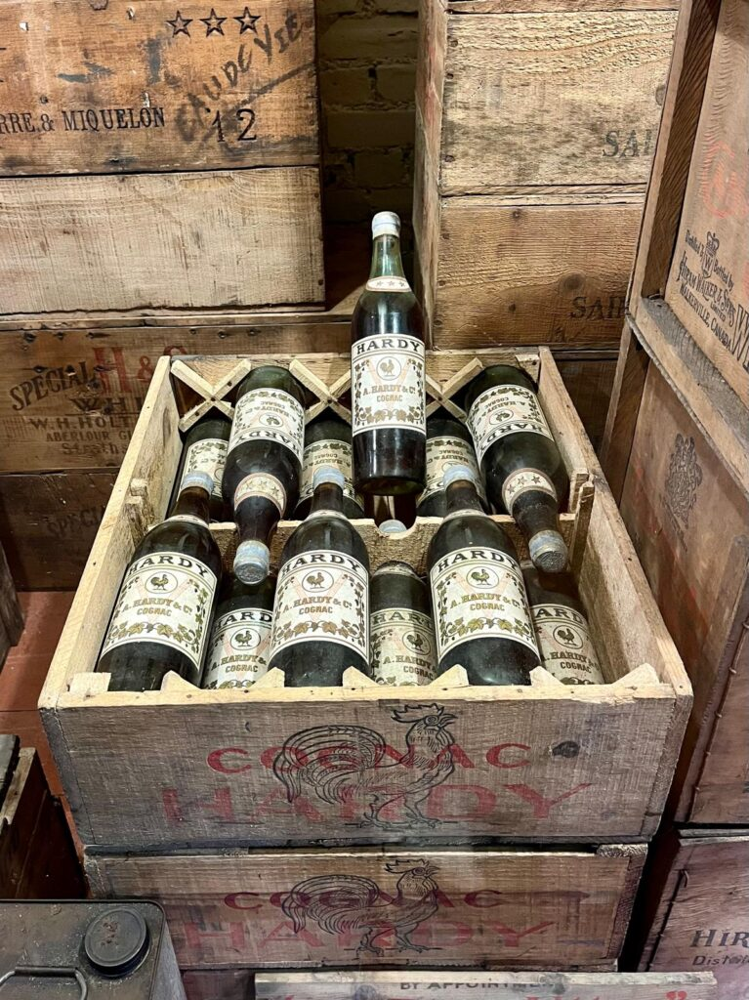

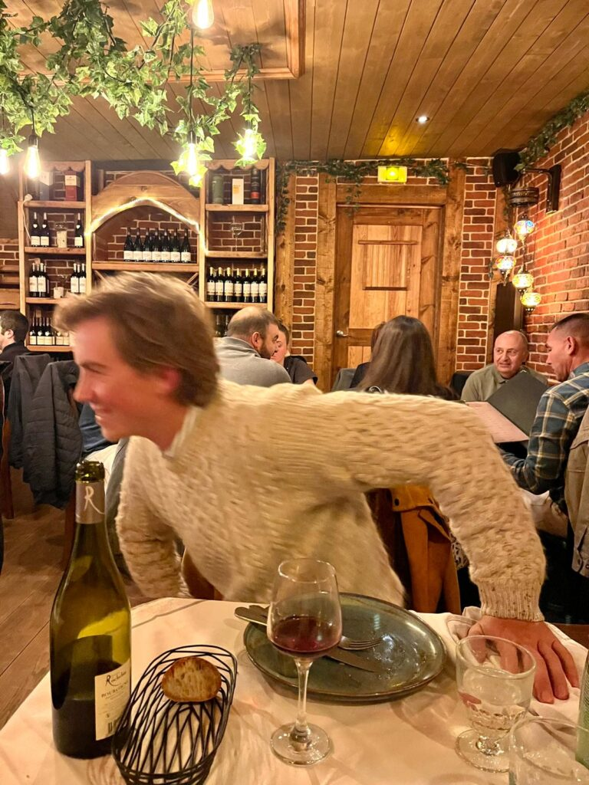

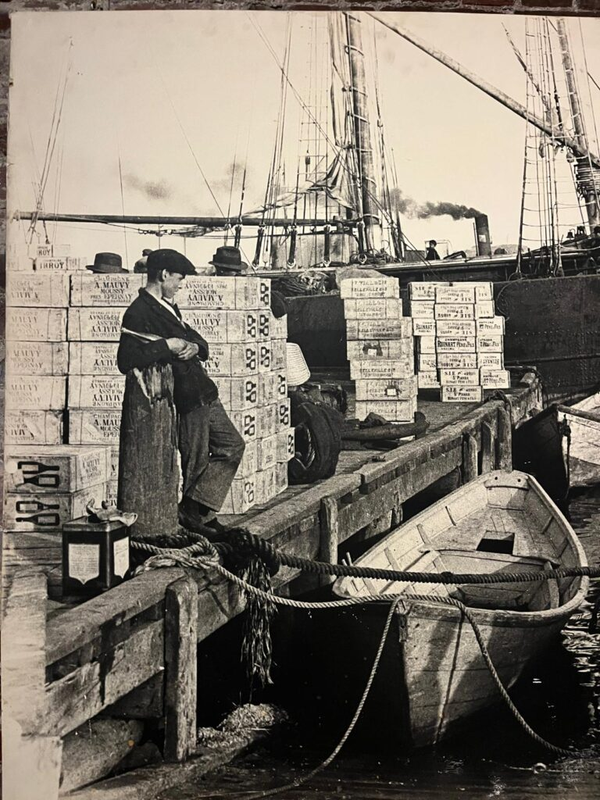

Op de wandelingen die we maken over het eiland hebben we het steeds vaker over wat we nou concreet willen gaan doen na onze terugkomst. Voor mij is sinds onze oversteek naar Suriname de kogel door de kerk. Ik ga terug om verder te studeren op het onderwerp waar ik al zo veel jaar mee bezig ben: Decentrale organisaties en het bereiken van groepsconsensus in een digitale wereld. Door de maanden heen heb ik contact opgenomen met verschillende professoren en PhD kandidaten om meer te weten te komen over dit proces en waar de mogelijkheden liggen. In Denemarken en Groningen zitten professoren die mij graag willen begeleiden, maar momenteel geen financiering hebben. Mijn scriptie supervisor is naar Sydney verhuisd, maar is een drijvende kracht in het leggen van contacten en het suggereren van mogelijke opties. Ze staat volledig achter mijn besluit en we hebben regelmatig contact over onderwerpen en passende universiteiten. Aan de VU is een speciaal voorprogramma voor mensen met een PhD-ambitie, dat is een plan-B waar ik tijdens de wandeling op St. Pierre vrede mee sluit.

Voor Jen ligt het iets ingewikkelder. Zij heeft juist besloten om eerst op veldwerk te gaan na terugkomst en nu nog niet van alles in gang te zetten. Ik denk dat niemand zal beweren dat dat een onverstandig besluit is, maar Jen is niet zo goed in op haar handen zitten en wisselt daardoor af en toe stuivertje tussen precies weten wat ze wil en een onzekerheid over of ze überhaupt een baan zal vinden. Praten over wat ze wil, wie ze is en wat deze reis ons heeft gebracht helpt. We zetten alles nog een keer op een rijtje en langzaam maar zeker worden de schouders weer lichter en het beeld op terugkomst minder spannend. We besluiten dat het een goed idee is om dit soort gesprekken ergens op te vangen, juist nu we nog de tijd en ruimte hebben om er zo bij stil te staan, en kopen allebei een notitieblokje om ons ‘persoonlijk manifest’ vanuit deze reis vast te leggen.

Het wachten op goed weer brengt ons dus in een goede modus. *Luwte* ligt klaar, zo klaar als ze nog nooit geweest is en wij hebben de tijd en de ruimte om te ontspannen en alles nog een keer na te lopen. Om boodschappen te doen, een tankwagen te bestellen die dacht dat we 2.000 liter diesel willen, in plaats van 200 en nog een paar wasjes te draaien.

En zoals altijd draait de wind, ziet het er onzeker, maar goed genoeg uit en gooien wij onze lijnen los van het continent Noord-Amerika. En ook dit keer ben ik de eerste twee uur niet om uit te staan, terwijl ik de zenuwen loslaat die horen bij het achterlaten van een veilige omgeving. We kiezen weer voor zee, met koers op Horta, waar zo’n zestien jaar geleden Jelle ter wereld kwam en de *pastel de nata* warm uit de oven worden geserveerd. Maar eerst nog een mijl of 1.200 voor de boeg.

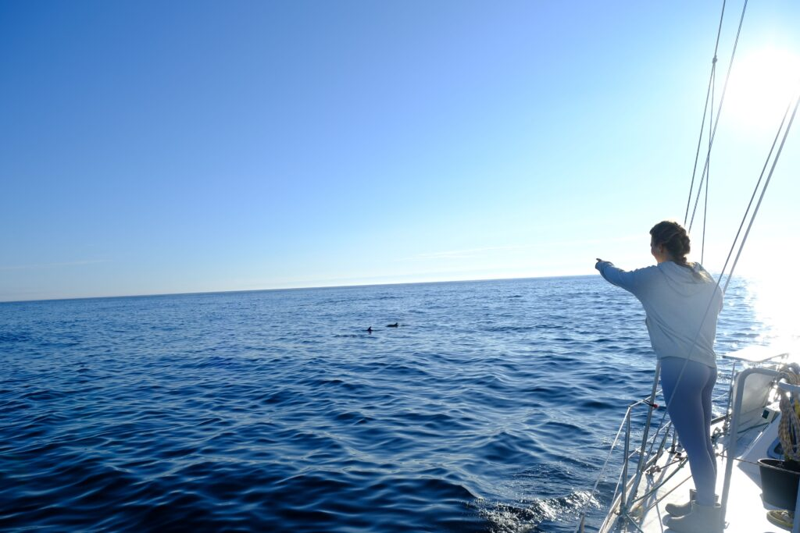
