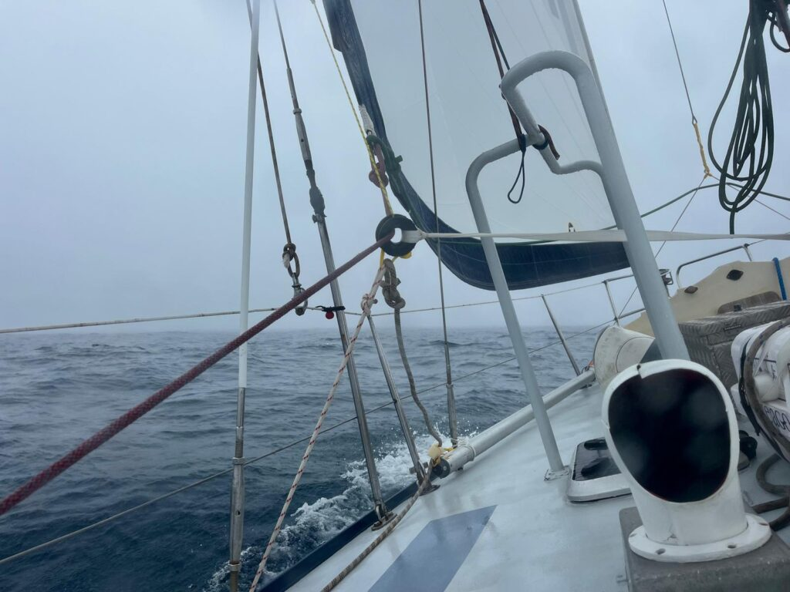
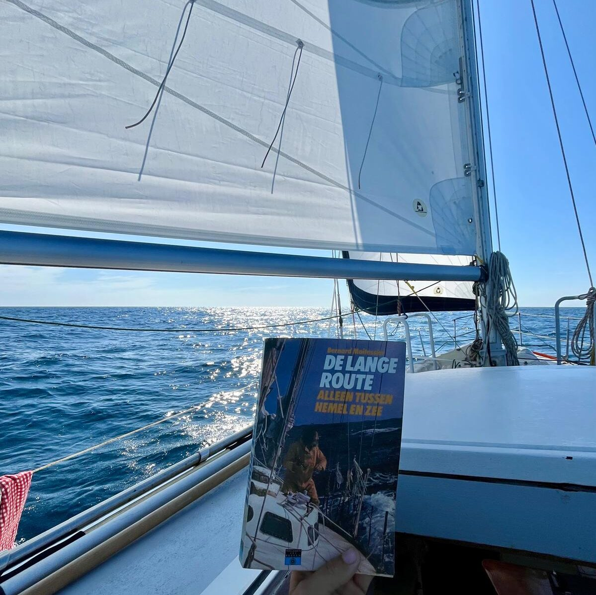
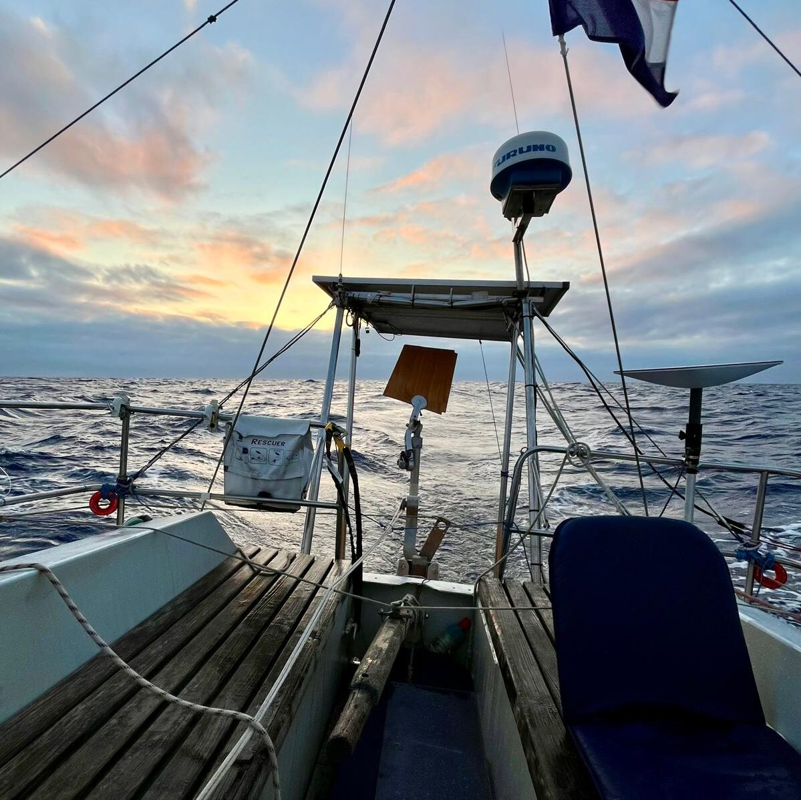
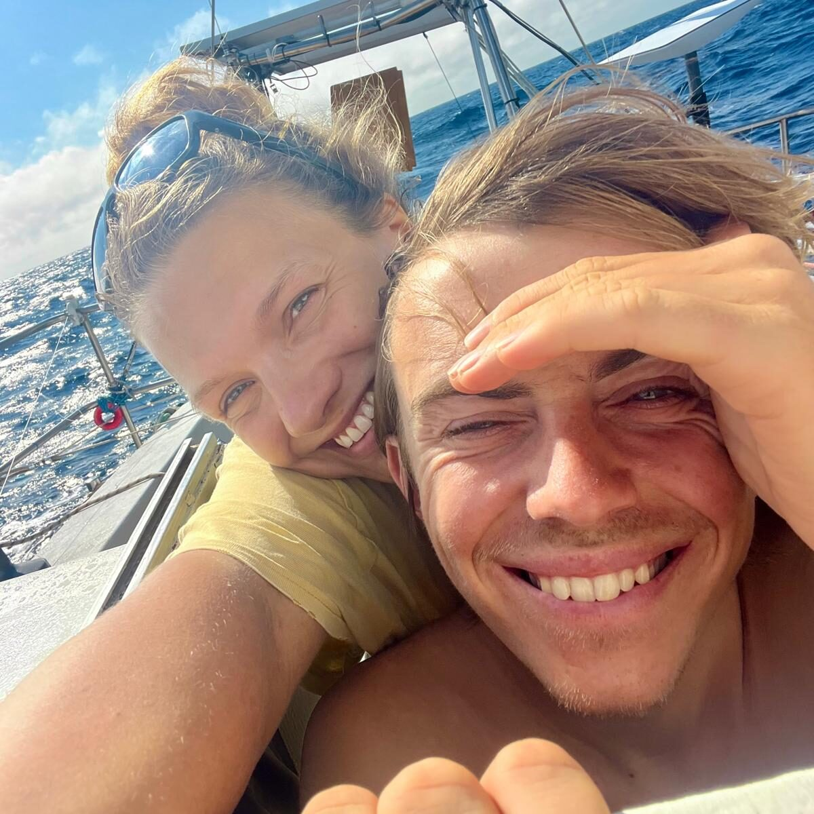
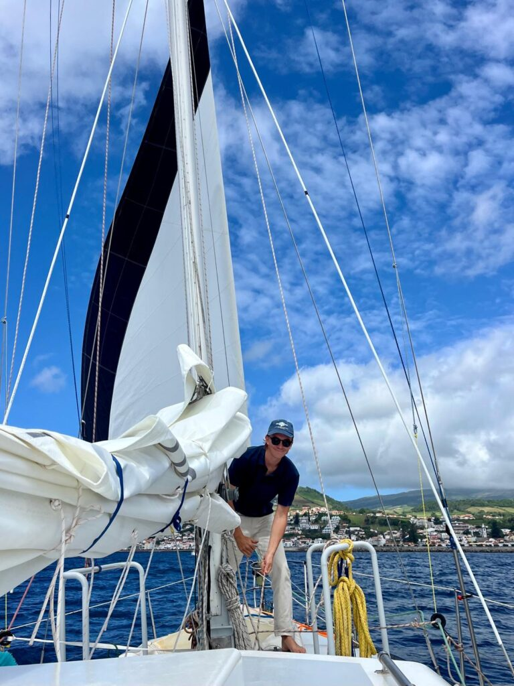
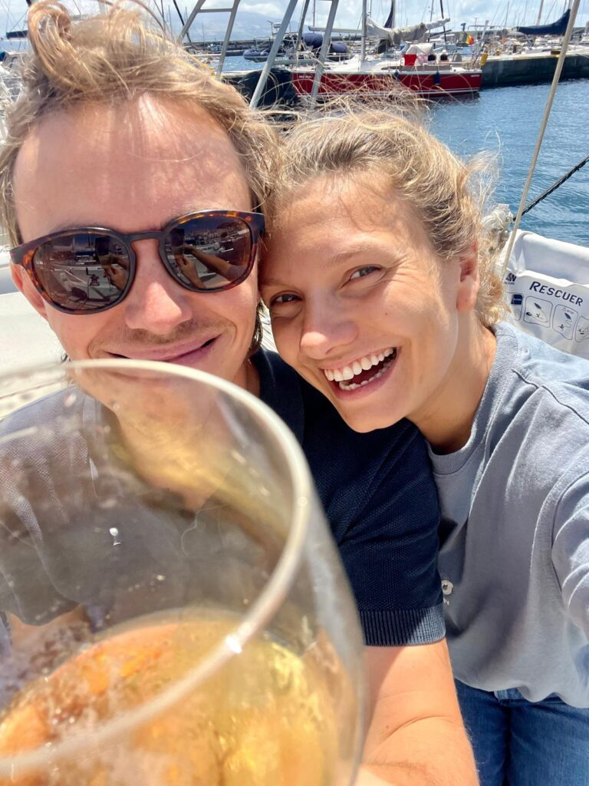

We liggen strak tegen de pier aangedrukt. Onze stootballetjes zijn platgedrukt en houden onze gele verf nog maar een centimeter van de groen uitgeslagen kadewand. De wind die het lagedrukgebied met zich meebrengt is koud en nat. De verstaging suist en hier en daar klappert een val tegen een mast. Jen gaat naar buiten om de watertank nog één keer te vullen en komt dan snel weer naar binnen als de slang in het vulgat hangt. Ik plot routes, kijk nog een keer naar de weerkaarten, zoom nog een keer uit om mijn mening over het grotere plaatje op te maken en neem Jen dan mee in Rorik's weerbericht. Het is tijd om te gaan. Als het volgende 'laag' voorbij is moeten we nog een paar uur op onze handen zitten om de ergste zeegang te laten rusten, maar dan varen we uit. De verwachtingen voor onze tocht naar de Azoren lopen uiteen, maar er lijken geen zware depressies op ons pad te komen. *Luwte* is op en top voorbereid. Ik heb sinds ons vertrek uit Nederland altijd wel wat aan te merken gehad als ik een rondje over dek loop, maar inmiddels loop ik mijn vijfde rondje zonder iets tegen te komen. Wij zijn uitgerust en ontspannen, voor zover dat kan vlak voordat je de haven verlaat.

Het is net licht en om ons heen is alles stil. Er staat geen zuchtje wind terwijl we onszelf van de pier afduwen en in alle stilte de haven verlaten. De lijnen en stootkussens gaan het vooronder in en rustig tuffen we naar buiten. St Pierre verdwijnt binnen een paar minuten achter ons in de dichte mist en wat ons rest is het geluid van de zee en het uitsproeien van het koelwater van de motor. Af en toe doemt er een school papegaaiduikers op uit de mist, scheert langs ons en verdwijnt dan weer.

Zodra we het hoekje om zijn komen we er achter dat het nachtje wachten verstandig is geweest, maar dat iets meer geduld ook geen kwaad had gekund. Er staat nog altijd ruim twee meter hoge deining en het duurt even voordat we op dieper water zijn en de golven langer worden. Op de motor ploeteren we de eerste twaalf uur door. Er staat te weinig wind om te zeilen en we zijn allebei voor het eerst sinds lange tijd kots- en kotsmisselijk. Er gaan een paar zeeziektepillen in en we vechten omstebeurt tegen de slaap die de pillen opwekken. We hebben ze gelukkig weinig nodig gehad tot nu toe, die pillen. Je slaapt er heerlijk op, maar ze onttrekken alle plezier en energie in het zeilen. Als de wind eindelijk oppikt en ons van opzij naar het oosten duwt, gaat Luwte rustig op een oor liggen en kunnen wij weer functioneren.

Gelukkig hebben we de afgelopen weken goed leren vertrouwen op onze apparatuur en is het rustig op zee, want we zien geen hand voor ogen. De mist ligt als een dikke deken over ons heen. 's nachts schiet ons toplicht een bundel de wolken in en is mooi te zien hoe strak de drie kleuren van elkaar gescheiden worden. Overdag is het toplicht soms aan het zicht onttrokken. We kunnen de volgende golf zien, maar wat daarachter gebeurt is een mysterie.

Dat gaat zo vier etmalen door. We kruipen in onze cocon en moeten onszelf bij de les houden om niet volledig door te draaien op het claustrofobische gevoel dat de mist geeft. Onze wereld is nog nooit zó klein geweest. Het is voelbaar in ons humeur en gedrag. We draaien onze wachten maar praten weinig, slapen veel en kijken op het scherm van de AIS en radar of er andere schepen in de buurt zijn. Na twee etmalen stop ik met geroutineerd mijn hoofd naar buiten te steken. Er is toch niets te zien. Jen blijft het wel doen, al is het maar om stapsgewijs de tijd door te komen. Binnen en buiten is alles vochtig. Na de zeilwissels zijn onze kleren nat van het vocht dat in de lucht hangt. Zelfs de wind is saai. Een stabiel zuidwesten bries van 12 knopen duwt ons de goede kant op. In zekere zin kwijnen we, hoe gek het ook klinkt, in een paar dagen al weg tot een schim in de mist.

Op dag vier gebeurt er eindelijk iets spannends. De AIS pikt een vrachtschip op en niet veel later horen we de eerste misthoorn. De tanker is dan nog op ruim vijftien mijl van ons af. Onze CPA (closest point of approach) is ongeveer anderhalve mijl en daarmee voldoende om ons geen zorgen te maken als we allebei koers en snelheid vasthouden. Een uur van het ritmisch blazen van de hoorn vult de mist terwijl we het schip op ons scherm dichterbij zien komen. Als het zover is klinkt de hoorn alsof hij bovenop ons zit en we elk moment de metershoge boeg van een tanker tevoorschijn zullen zien komen. En dan glijdt het geluid aan onze boeg voorbij. Vlak voor ons langs, maar zonder enig zicht op het schip te hebben gehad.

Het is diezelfde middag dat we de golfstroom vanaf het noorden naar het zuiden invaren en we binnen een paar uur in een totaal ander klimaat terechtkomen. En ik zie voor het eerst weer een stukje lucht. Een minuscuul vlakje blauw licht dat door het wolkendek heen breekt. Het blauw is het helderste stukje blauw dat ik ooit heb gezien en enthousiast maak ik Jen wakker. "We hebben weer lucht!".

Het wolkendek breekt daarna snel open en 's nachts zien we de eerste sterren weer aan de hemel. 's Ochtends is de lucht blauw en is de wind helemaal gaan liggen. De oceaan is vlak. Of zo vlak als ze zijn kan. De trage deining beweegt altijd door, als een grote vriendelijke reus. Hier en daar gaat een rimpeling over het water als er een zuchtje wind ontstaat. We baden onszelf in de kuip in het zonlicht. Eindelijk weer buiten zonder mutsen jassen en zeilbroeken. We zetten een muziekje op om het brommen van de motor te overstemmen en vinden snel onze vrolijke karakter weer terug. Een paar uur later kan de motor weer uit en glijden we op de gennaker geruisloos door rustig water.  
We zijn niet de enigen die zich zo voelen lijkt het. De hele dag door zijn we toeschouwer van de grootste zeezoogdieren trekking die we ooit hebben gezien. Ze surfen mee op de golfstroom naar het zuiden. Talloze soorten en aantallen dolfijnen, pilot whales en in de verte iets groters. Uren lang gaat er geen moment voorbij dat we ze niet zien. Af en toe komt een groep even bij ons kijken, zwemt een stukje mee en buigt dan weer af. Wij varen dwars op de golfstroom en gaan dus de andere kant op. 's Nachts gaat het spektakel verder, maar dan in discothema. Het is een onbeschrijfelijk gezicht als een dolfijn door de lichtgevende algen door het water heen schiet. Als torpedo's rond de boot. We zien de patronen, het spelen, de snelle bochten en de versnelling als ze een zwieper met hun staart geven. Met de algen als activator van het lichtspektakel. Boven water, hoog in de lucht laat de Melkweg haar aandeel zien. Het is een maanloze nacht, maar de sterren zijn zo helder dat je buiten bijna een boek kan lezen op het licht van die verre zonnen en planeten. Wij draaien onze wachten en zijn individueel tot tranen geroerd door het aanzicht. Het doet denken aan de beroemde scène uit Life of Pi.

Een kleine 24 uur later lijkt deze dag op een vaag verloren droom. Het weer is omgeslagen en we hebben meer dan 25 knopen op de neus. De grote vriendelijke reus van gisteren lijkt een por te hebben gekregen en de zee bouwt binnen een paar uur op tot een met schuimkoppen bedekt landschap. Ons tweede en niet lang daarna derde rif gaat in het grootzeil en we draaien de fok in tot we hard, maar in balans, over de golven schieten. In de keuken begint het al snel weer zout water te regenen. Kort geleden in Baddeck dacht ik het voor eens en voor altijd opgelost te hebben, door onze genuarails te demonteren en opnieuw waterdicht op het dek te zetten, maar het blijkt toch het raam boven de keuken te zijn. We zoeken de comfortabele hoekjes op en liggen meer dan we zitten. Ik kom in een staat van rustige slaaploosheid omdat we regelmatig koers moeten verleggen, de fok verder in moeten draaien, of juist een beetje meer zeil moeten geven. 's Nachts laat ik Jen grotendeels liggen en rijg ik mijn eigen slaap in stints van 12 minuten aan elkaar.

Gelukkig duurt ook dit maar een etmaal en keert dan ons vaste slaapschema en de stabiele ZW 4 weer terug waarop we met halve wind naar de Azoren bewegen. De weergoden lijken ons goedgezind. We hadden ons voorbereid op de mogelijkheid dat er halverwege de tocht ook zomaar een grote depressie over kon trekken, maar die blijft uit. Het is wat wisselvallig, maar we hebben het nog steeds bezeild en komen steeds dichterbij het Azoren Hoog, een groot hogedrukgebied dat vrijwel permanent bovenop de Azoren ligt en in die hoek zorgt voor rustig en stabiel weer. We zitten veel in de kuip en genieten weer van de warmte op onze lijven na de kou van Canada. Uitkijkend over de zee hebben we het over wat we belangrijk zijn gaan vinden en of er beloften zijn die we aan onszelf moeten doen voor als we terugkomen. Eentje die voor ons bovenaan het lijstje staat is dat we wat meer mogen omkijken naar de mensen om ons heen en mensen die het minder hebben. Onze stamkroeg op de hoek heeft om de week een buurtontbijt waar je voor €1,50 een uitsmijter met een kop koffie kunt krijgen. Jen neemt zich voor om daar bij te helpen. Ik zie mezelf daar ook wel eieren bakken, maar ben nog op zoek naar iets wat meer bij me past. *Open source* projecten helpen ligt misschien meer in mijn straatje. De onvoorwaardelijke vrijgevigheid die we op veel plekken hebben ervaren willen we in ieder geval eer aan doen door daar wat van door te slingeren.

De laatste drie dagen ben ik continu in de weer met onze kaartplotter. Onze AIS hapert wederom zonder duidelijke oorzaak of systematisch gedrag. Soms ligt ie er een uur uit, soms vijf minuten. Het lukt om de GPS data van de marifoon door te verbinden met de kaartplotter (vraag me niet hoe), maar ook dat brengt geen soelaas. Ik neem uiteindelijk contact op met Alan, de distributeur van het systeem en na enig heen-en-weer mailen besluiten we op de valreep van onze reis tóch nog de grote uitgave te doen van een nieuw systeem. Onze huidige plotter is meer dan vijftien jaar oud en repareren gaat voorlopig geen optie zijn en heeft weinig kans van slagen. Het is een rib uit ons lijf, maar met Het Kanaal in het vizier eigenlijk een onmisbaar stukje technologie.

En zo slijten we de laatste rustige dagen op zee tot er aan de horizon een grijzige punt tevoorschijn komt. Faial en daarachter de Pico dienen zich aan.

Onder begeleiding van een grote school dolfijnen draaien we om Faial naar de oostkant en glijden over de hoge deining langs de steile kliffen. Als Horta zich als pittoresk kustplaatsje ontvouwt halen we de zeilen naar beneden en starten de motor. Geen koelwater. Shit. Ik sta stijf van de adrenaline voor onze aankomst op Horta en schiet even volledig in de stress. Zonder na te denken spring ik naar binnen en begin Jen onsamenhangende bevelen te roepen terwijl ik de motorkamer open. Jen is vandaag de koele kikker en sommeert terug de tijd te nemen en haar haar gang te laten gaan aan het roer. In het zicht van de haven draait ze Luwte om, rolt de fok uit en kiest weer zee terwijl ik beneden de wierpot ontlucht en de impellerbehuizing openmaak. Het plaatje dat de behuizing afsluit heeft tekenen van slijtsporen waardoor er valse lucht ontstaat. Na het ontluchten starten we opnieuw en komt de welbekende straal in golven naar buiten. Later draai ik op aanraden van mijn vader het plaatje simpelweg om en is het probleem opgelost.

In de buitenhaven van Faial ligt de *Stad Amsterdam* aan de kade. Na een reis rond de wereld is ook onze stad op weg naar huis voor SAIL. Het is de derde keer dat we haar tegenkomen en we nemen ons voor om morgen even langs te lopen. Nu eerst de balletjes uit. De lijnen vast en die laatste fles Champagne uit het kistje naar buiten. Bestemming Azoren bereikt.

