Het is een mythische plek voor mij, voor ons en vele andere zeevaarders. De Azoren. Op de rug van Atlantis, midden in de oceaan verrijzen de punten vanuit de ruim 4.000 meter diepte. In zekere zin zijn dit dus geen eilanden, maar de toppen van een hooggebergte. De route terug vanaf het Caraïbisch gebied of Zuid-Amerika is altijd al lastiger geweest dan het stuk er naartoe. De weersystemen zijn complexer en de route is langer. Terwijl wij langzaam land in zicht krijgen, voelen we een klein beetje hoe de eerste ontdekkingen van deze eilanden moeten zijn geweest. Een oase midden op zee. Met een overvloed aan bloemen, planten en zoet water. Later, tijdens de industriële revolutie, werden de Azoren een van de springplanken voor de walvisvaart, waar ook Nederland een groot aandeel in had.

Voor ons blijft het sentiment van onontdekt land midden in de oceaan een beetje hangen. En dat terwijl het voor mij geen onbekend terrein is. In de winter van 2009 landden we hier met de *Palustris* om Jelle van een mooi geboortecertificaat te voorzien. Van die aankomst weet ik weinig meer, behalve dat we midden in de nacht wakker werden van het starten van de motor en niet veel later euforisch op de lege, koude en vooral verlaten kade stonden. Het verhaal van toen is dat van het Logboek van de *Palustris*. Het verhaal van nu start met een ander beeld. *De Stad Amsterdam* ligt met haar vlaggen zo groot als onze zeilen aan de kade te pronken en de baai ligt vol met andere geankerde zeilschepen. Aan de grote betonnen kade liggen ze drie rijen dik en ook de steigers lijken weinig lege boxen meer over te hebben. Wij melden ons over de marifoon en worden verzocht om bij het bunkerstation af te meren en ons te melden bij de immigratie en de havenmeester. Het is vlak voor lunchtijd, maar we mogen nog net mee in de laatste *to-do*.

<figure class="wp-block-image size-large">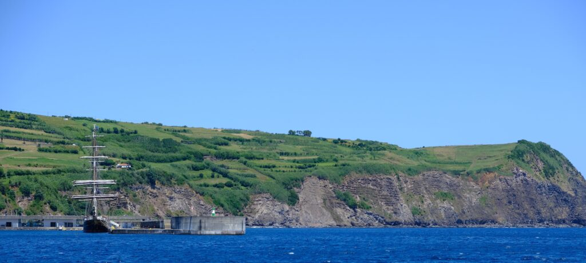<figcaption class="wp-element-caption"><em>De Stad Amsterdam</em> ligt op ons te wachten</figcaption></figure>

Op de vraag of we hier voor het eerst zijn, leg ik uit dat ik hier eerder was als kind en dat mijn jongste broertje ter wereld kwam in box 11. De havenmeester kijkt ons een beetje fronsend aan en begrijpt volgens mij maar de helft van wat ik zeg. Daarop praat ik maar verder over dat we hier wel even willen blijven liggen en graag in die ene box 11 willen komen als dat kan. Meer fronsen en gemompel over dat het hoogseizoen is en er eigenlijk überhaupt geen plek is. Maar toch pakt hij zijn *clipboard* met overzicht van de haven erbij. Van veel overzicht is geen sprake., overal staan namen doorgekrast, met type-ex beschilderd en in de kantlijnen planningen van schepen. Maar hij lijkt zijn eigen hersenspinsels goed te begrijpen en wijst ons een box toe waar we de komende drie dagen in kunnen tot de vaste ligger terugkomt. We voelen ons verwelkomd als de *rich* and *famous*.

Bij de immigratiedienst kijken ze ons verbaasd aan als we melden dat onze laatste *port of call* St. Pierre & Miquelon is. Ze kennen de meeste Franse kustplaatsen waarvandaan zeilers op de Azoren koersen, maar deze hebben ze nog niet eerder gehoord. Of in ieder geval niet vaak genoeg om te onthouden. Ze pakken *Google Maps* erbij en kijken waar dat dan wel niet is. Als ik vertel dat het een Franse kolonie is beginnen ze te lachen. Dat hebben ze wél vaker gehoord. Het maakt onze formaliteiten een stuk eenvoudiger. We reizen immers van EU-naar-EU en hebben dus alleen een keurende blik van de officier nodig om het Shengengebied weer te betreden.

En dan zijn we los. We varen de boot om naar onze box, beleggen onze landvasten en openen onze laatste fles *Pommery* terwijl we onze ouders bellen om het feestje te delen. Het zonnetje schijnt heerlijk en we proosten op onze behouden vaart naar dit verre oord.

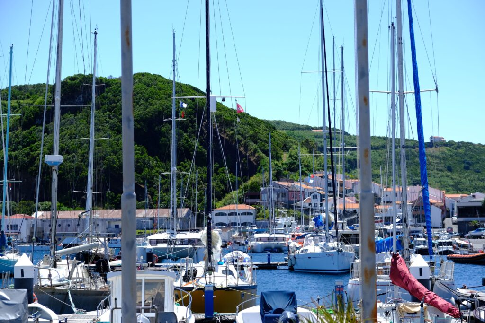

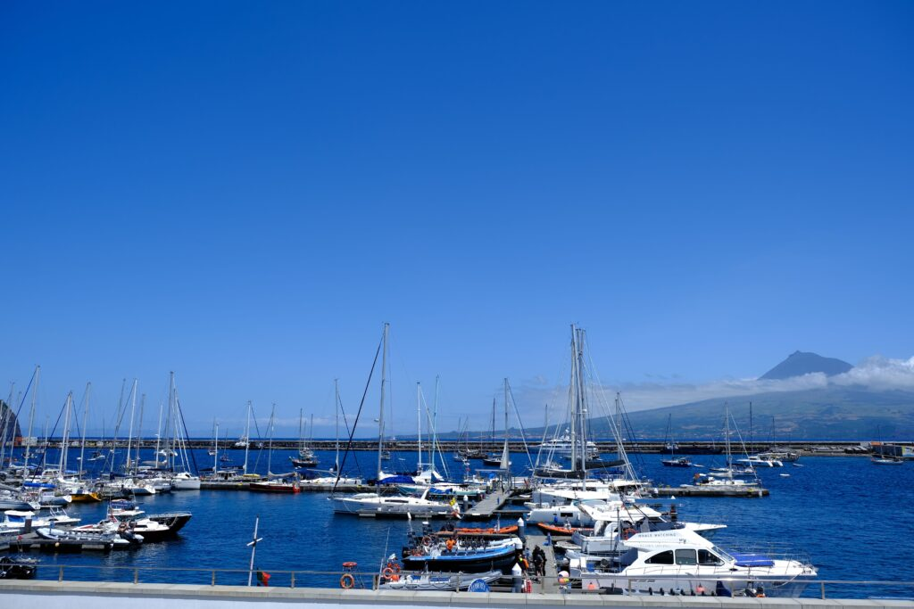

## Herontdekken

Er is hier zo veel te doen, zo veel te ontdekken en zo veel te laten zien, dat ik niet weet waar ik moet beginnen. Horta op zichzelf is al een prachtig aangezicht, maar de verhalen eromheen maken het zo veel specialer. We gaan de kade op en wandelen rond, onze ogen vastgekluisterd aan de grond die vol staat geschilderd door zeilers die ons voorgingen. Het duurt niet lang voordat we de *Palustris* tegenkomen. Zestien jaar geleden liet ik samen met ons gezin onze handtekening achter op de kademuur. Op een zorgvuldig uitgekozen hoek die weinig zonlicht vangt en het minste last heeft van regen en andere invloeden van het weer. In 2019, inmiddels ook alweer zes jaar geleden, was de *Palustris* hier weer om Jelle’s tiende verjaardag te vieren. De originele verf uit 2009 zit er nog nog goed op, maar het mos groeit er vrolijk overheen.

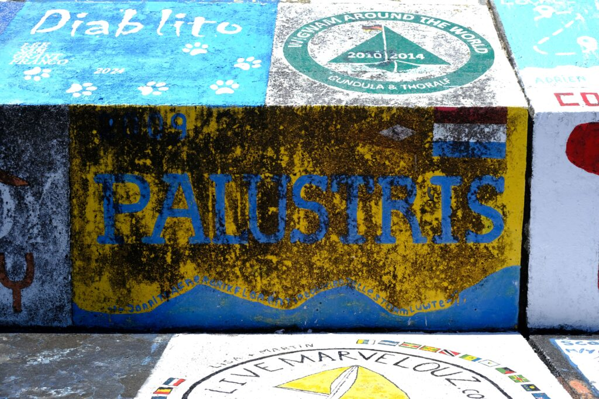

Voor mij is dit het een moment waarop veel puzzelstukjes van de afgelopen twaalf maanden op hun plek vallen. Ik zie de resten van mijn naam onder het mos vandaan komen en kan opeens voelen wat een prestatie we eigenlijk geleverd hebben om hier nu met z’n tweeën te staan, op eigen kiel. We wandelen verder en laten de verhalen en fantasieën van al deze avonturiers langs onze ogen glijden. Sommige schilderingen dateren uit de jaren '70 en zijn nog steeds zichtbaar. Andere zijn recenter en al bijna helemaal vergaan. Hier en daar is er een slimmerik die dacht te kunnen valsspelen door tegels te laten bedrukken en die met cement aan het beton te plakken. Die tactiek erkennen wij niet.

In het voorbijgaan van de schilderingen komen we die van oude- en nieuwe bekenden tegen. We staan stil bij de indrukken die ze bij ons hebben achtergelaten en verhalen die we met ze hebben gedeeld. En zo wandelen wij de avonden aan elkaar. Bijna elke avond doen we een rondje. Op zoek naar een specifieke plaat, of op zoek naar de oudste, zodat we weten waar we die van onszelf moeten achterlaten. De haven van Horta, die al enkele eeuwen door zeevaarders wordt aangedaan, heeft sinds de jaren ’60 van de vorige eeuw frequent zeilers op bezoek. Met de opening van de eerste Azoriaanse jachthaven in 1986 werd de aanlooproute voor zeiljachten definitief. Het wereldje van de zeevaarders kenmerkt zich van oudsher door rituelen en sages, en zo is ook het geloof ontstaan dat het *niet* achterlaten van je handtekening op deze tussenstop ongeluk brengt.  

We wandelen verder over de kade-kunstwerken en kijken naar de bootjes die hier uitpuffen of zich klaarmaken voor het vervolg van hun tocht. Sommigen zijn gehavend en missen hun mast, anderen liggen met mos overgroeid aan de ketting omdat de eigenaar een centje bij wilde verdienen met stoute producten, maar gepakt werd. Het is helder en in de ondergaande zon toont Pico zich verderop in allerlei pastelkleuren, met een streepje wolk vlak onder de top. Op de terugweg naar de boot komen we de schildering van Jelle tegen, want ook hij liet zijn stempel achter om van Neptunus een veilige doorgang te krijgen. Het is duidelijk dat hij twee soorten verf heeft gebruikt, want een deel van zijn schilderij zit er op alsof het gisteren geschilderd is, maar de andere helft is weggespoeld. We leggen alles vast wat we tegenkomen en daarna haal ik een sponsje om heel voorzichtig het mos van de plaat van de *Palustris* te verwijderen. Overschilderen kan niet, want daarvoor moet het schip natuurlijk zelf hierheen komen, maar schoonmaken vinden we wel door de beugel kunnen.

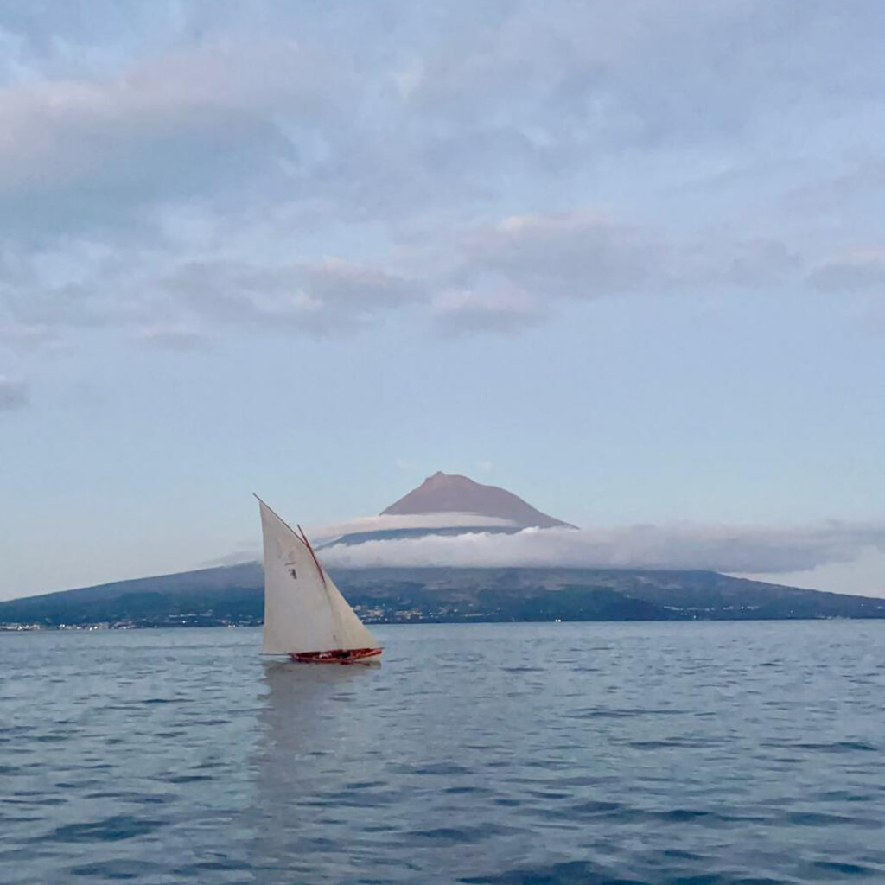

Tijdens een van onze wandelingen komen we op de grote kade een schipper van een Nederlands schip tegen die daar net zijn lijnen aan het beleggen is. We heten hem welkom, maar nog voordat we onszelf hebben introduceren worden we enthousiast begroet ‘ja, maar jullie ken ik van YouTube!’. Het is een wonderlijk en onwennig gevoel voor ons, om zo herkend te worden, maar we kunnen er wel om lachen. Sommige van de filmpjes die Jen maakt hebben een onverklaarbaar groot bereik gehad en Hans blijkt een van onze trouwe volgers die wij verder (nog) helemaal niet kennen.

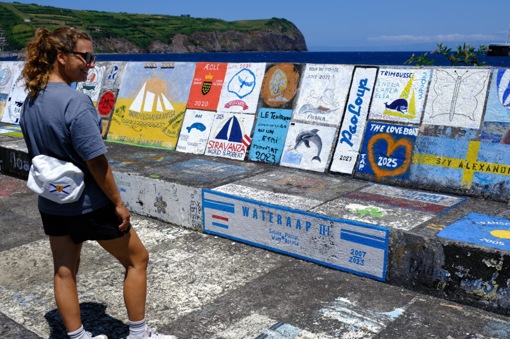

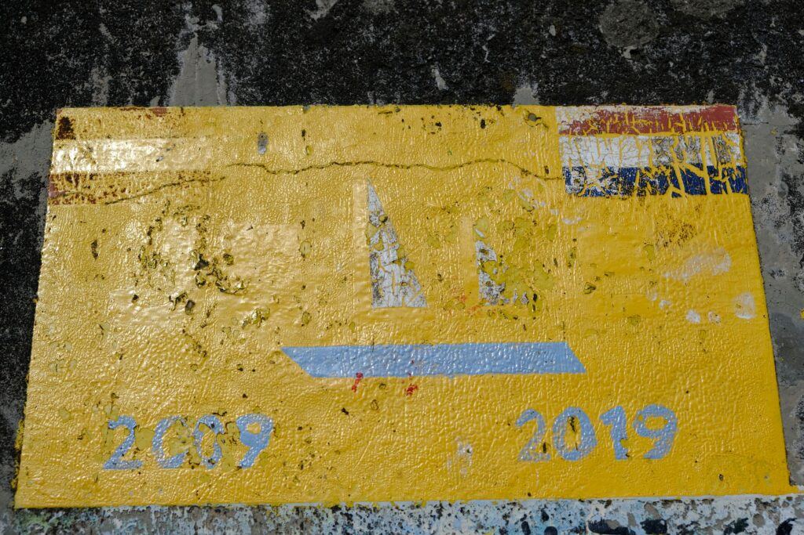

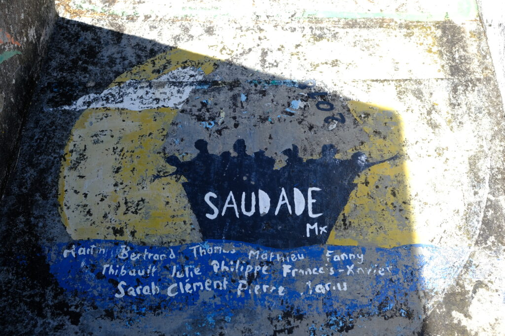

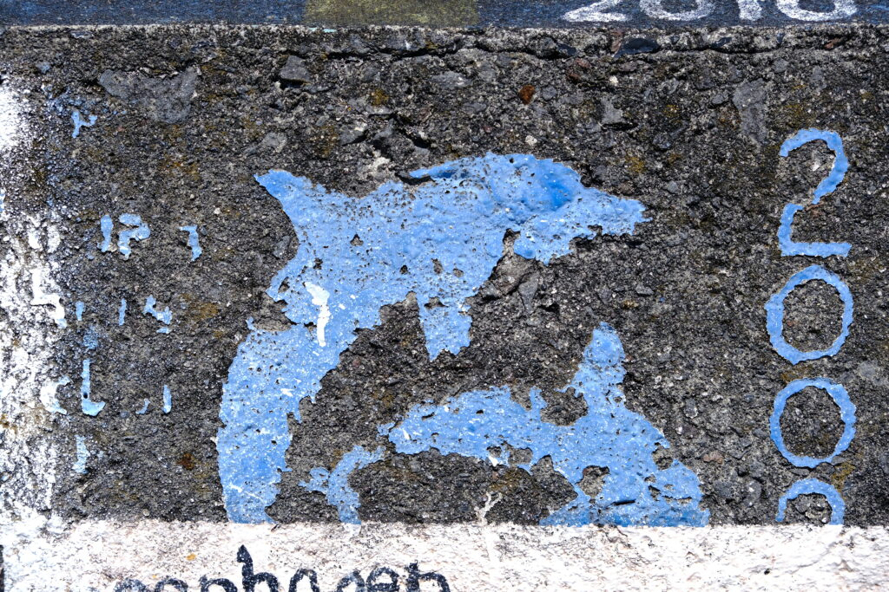

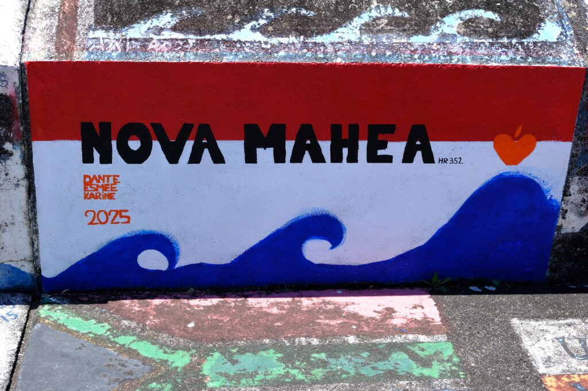

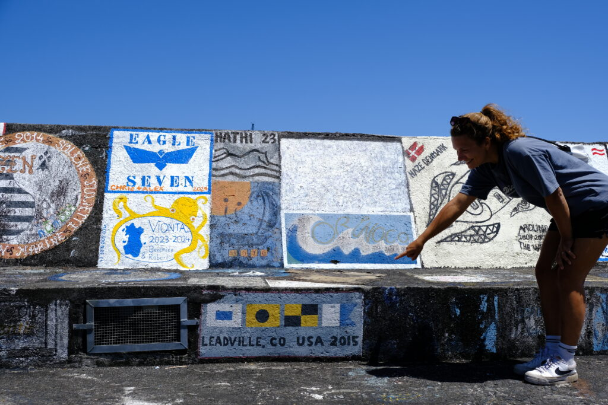

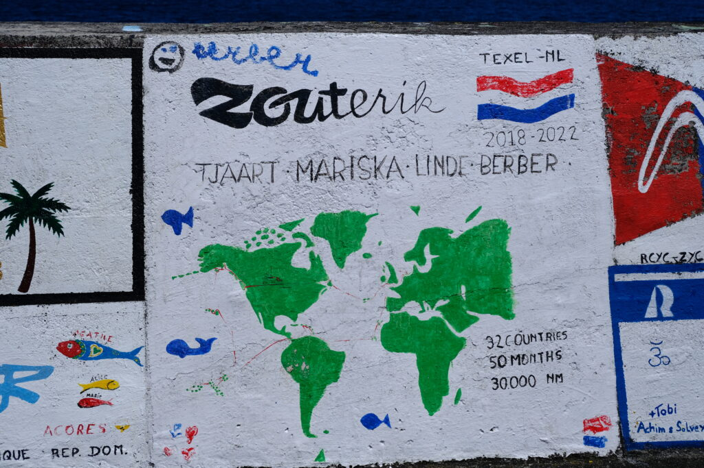

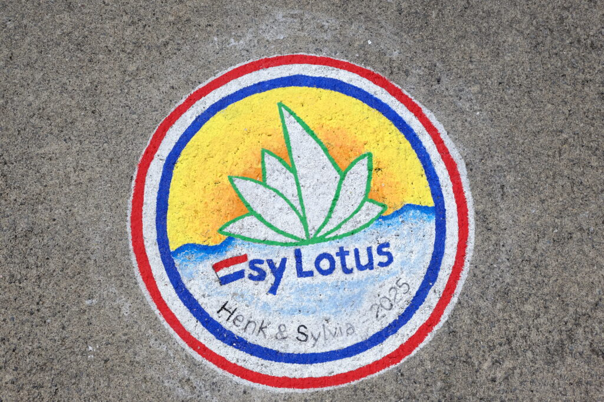

## Café Peter Sport

Die middag eindigen we met de bemanning van de *Seasoul* op het terras van Peter Café Sport en proosten we op hun behouden vaart. Nog langer en diepgewortelder dan de traditie van het schilderen, is het bezoek aan Peter Sport. Al lang voordat dit café het Mekka van het zeilen zou worden, kwamen de walvisvaarders en de (voornamelijk Nederlandse) sleepdiensten die op Horta gestationeerd waren, al als vaste prik bij Peter’s. Met een kop dampende koffie, of iets sterkers, deelden de scheepslui hun verhalen en groeide deze plek langzaam uit tot een van de meest iconische cafeetjes op aarde. De muren en plafonds hangen vol met vlaggen van schippers die, na het schilderen van hun schilderijtje, een eerbetoon komen brengen aan het café dat voor veel zeelieden een toevluchtsoord is geweest.

Het is zaterdag, begin van de avond en zowel het café als het aansluitende terras zitten bomvol. Ook de vliegende toerist weet deze plek inmiddels te vinden. Ik zie eigenaar José staan en na een kleine twijfel vanwege de drukte, spreek ik hem aan. Ik stel mezelf opnieuw voor en probeer in het kort uit te leggen dat we elkaar al kennen van lang geleden. Daarop roept hij zijn dochter erbij en geeft zijn werk even uit handen. We stappen opzij en beginnen midden in zijn café te praten over onze reis van 2009, onze lange winter op Faial, de geboorte van Jelle en nu mijn terugkomst naar deze plek. Op zijn beurt vertelt hij over de laatste jaren hier. Over het museum dat hij heeft gebouwd boven het café, over de uitbreidingen van zijn goedlopende zaak en over de coronaperiode die in zijn geheugen gegrift staat. Los van de omstandigheden waar zij op het eiland mee te maken hadden en het uitblijven van inkomsten van toeristen, was het José die eigenhandig de zeilers binnenhaalde toen de wereld in *lockdown* ging. Horta was een tijd lang de enige haven ter wereld waar buitenlandse schepen welkom waren om te schuilen voor slecht weer, of herbevoorrading te regelen. José vertelt over zijn discussies met de burgemeester, de douane en alle andere officials die er iets over moesten vinden, maar uiteindelijk lukte het hem om de zeilers te helpen.

Het enige mooie dat deze periode met zich meebracht, waren de vrije uren en verlaten kades. Een jaar lang maakte hij van bijna elke schildering een foto. Een verzameling van bijna 20.000 stuks. De collage, aangevuld met scheepsverhalen uit zijn jaren in het café worden gebundeld en binnenkort uitgebracht in een boek. Het verhaal van Jelle, onze aankomst op het eiland destijds, en mijn terugkomst nu, noemt hij een van de ‘*happy stories*’ die hij graag een plek zou geven in het boek. Ik beloof hem de dag erna een stuk op te sturen. We keren terug naar ons plekje en krijgen een paar biertjes later bij het vragen van de rekening te horen dat dat natuurlijk de grootst mogelijke onzin is en dat de drankjes van het huis zijn.

Diezelfde avond kruip ik achter de typemachine. Ik schakel mama en papa in om de details van het verhaal aan elkaar te knopen en we speuren de archieven af op zoek naar foto’s van nu en toen. Het resulteert in onderstaande stuk, dat denk ik goed beschrijft hoe het voor mij op dit moment is om op Horta terug te keren:

 <em>&nbsp;</em>**_Jelle Vasco Marinus Zorian – The boy who sailed to Horta before he was born_**

*January 2009 – We spent twenty-six days at sea, beating into winter depressions and currents against us. I can remember the waves being large enough to take the wind out of our sails as we landed in the valley in between waves. Mom was three months pregnant with unborn Jelle and we had a leak in the bow, so we had to scoop water every few hours. But we got there, first arriving sailing vessel of the 09 season. My little sister and brother, my parents, our dog and cat, and me.*

*Peter Sport was empty, but it was warm and cozy, the meals were delicious and José welcomed us into his pride and joy. José showed my parents the way to a gynecologist and activities to entertain us children, such as the fencing and sailing club. SY Palustris settled in the J pier and we quickly became acquainted with the local sailors. We signed up at the Clube Naval and I discovered that sailing your optimist out of port in Azorean wintery winds and swells teaches you how to avoid mistakes and rolling over in cold waters. Mom stood watch on the pier, with dry towels and a growing belly as Jelle grew bigger. I guess there are only a few unborn sailors with so many miles on their log.*

*Three months in, the early birds of 2009’s season started to land in Horta. Some dismasted, some untouched by the ocean, but all with their own stories and adventures. We became the welcoming party on the docks, pointing the sailors out where to find their first bite and drink after their crossing. We lived our family routine, getting Pão de Flamingo at the bakery, eating our daily pastel de nata, schooling, fencing, sailing our optimist at the Clube Naval and having a regular meal and drink at Peter Sport. Dad walked the painted piers with José, sharing stories of the many sailors they met who visited Horta too, and just as we started to become part of Horta’s appearance, new life enrolled on Palustris’ crewlist.*

*07 May 2009, Jelle Vasco Marinus Zorian takes his first breath into this world. My father gives him his first view of the ocean from the hospital da Horta window. And just a few days later, he is introduced to Peter Café Sport. Faial’s flowers are blooming, and the Azores High starts to establish itself stronger by the day. The docks start to fill up and Jelle is introduced as the new sailor in town. A strong boy, with hair red as a lighthouse and ready to make his first ocean passage back to The Netherlands a few weeks later.*

*Right before departure, we handed in our Palustris-branded flag at Peter Sport. The ladder was taken out and our flag got a special spot at the ceiling of the bar. A small Dutch flag, with a letter and some money for Jelle’s first meal and drink as a full-grown man hidden behind it. When Jelle is five weeks old, we say farewell to our beloved Faial and all the people we met, and are waved goodbye from the last pier of Horta by José. We leave behind a promise: the Azorean boy who will someday return to his birthplace.*

*A jump in time. It's April 2019 and Jelle is nine years old, soon to become a teenager. In the meantime, I am at university and my other brother and sister are well on their way in high school. Palustris is still in the family and ready to set sail again, to celebrate Jelle’s tenth birthday at Peter Sport. Me, my brother and sister signed off as crew, and therefore it becomes Jelle’s big voyage, back to the place he was born. The plan to celebrate his birthday in Horta is disturbed by Neptune, who sends unfavorable winds, but Jelle’s third name Marinus is honored as he celebrates his birthday at sea. Nevertheless, about ten days later, Palustris moored at Horta and Jelle finally shook hands with the man who provided us shelter during those wintery times in 2009. The flag on the ceiling still there, the letter still waiting. Our painting on the wall of the marina had become grown over with moss and awaited a much needed touch-up.*

*Our family grew close together over the years we sailed and getting a new sibling into our small bubble meant we all struck roots in Horta. I was busy studying when Jelle returned to Horta, but got into sailing and bought a vessel myself. Six years after Jelle’s visit, in July 2025, my world comes full circle as my partner Jenny and I sailed the North Atlantic circuit with our own vessel Luwte and landed in Horta after an eleven day sail from Newfoundland. For me, it’s sixteen years further in time, but Horta is still the same mythical place I remember as a kid. Peter Sport and José are still here. Jelle’s flag still on the ceiling and Palustris’ painting again overgrown with moss. At peak hour on a Saturday I step towards José to tell the story, and even though there would have been many reasons not to remember and not to pay attention to it, he steps out of his work. We share stories as we did back then and  have a look at the flag, which is losing its color, but is still hanging there fiercely. It will stay right there, on the ceiling, until Jelle comes of age, and will return to his birthplace to take it down.*

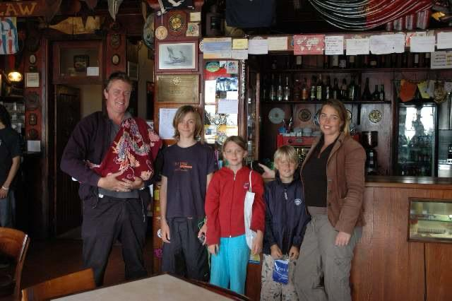

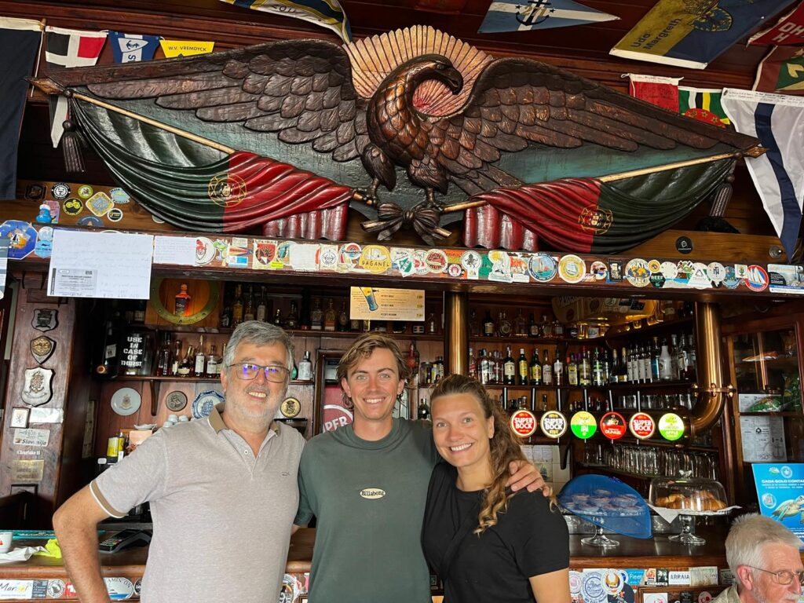

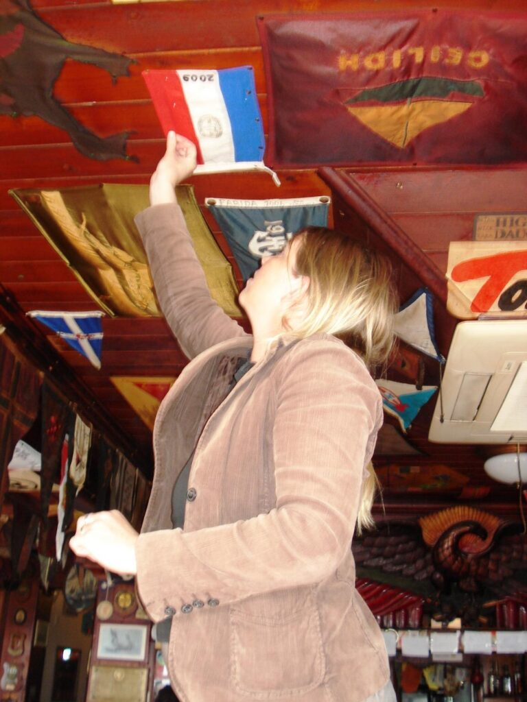

In de dagen die volgen spreken we José nog een aantal keer. Delen we het verhaal en de foto’s, ontmoeten we zijn kinderen, die ik me niet meer kan herinneren, maar die destijds ook rond moeten hebben gelopen en genieten we van de warme uitstraling die we even mogen voelen.

Naast café, beschermer van de zeelieden en verhalenschrijver, is Peter Sport ook een postadres voor zeenomaden. Uit een oud, met leer beslagen map komt een verfrommeld insteekhoesje met een lijst van bezorgde pakketten en brieven. *SY Luwte* heeft er twee ontvangen. Eentje van mama en eentje van papa. We lopen naar buiten en met trillende handen maak ik ze open. Eerst die van mama, daarna die van papa. De inhoud is voor mij en voor Jen, maar de trots die ze beschrijven zorgt ervoor dat de tranen over onze wangen lopen en wij ons ondanks de grote afstand even heel dicht bij huis voelen.

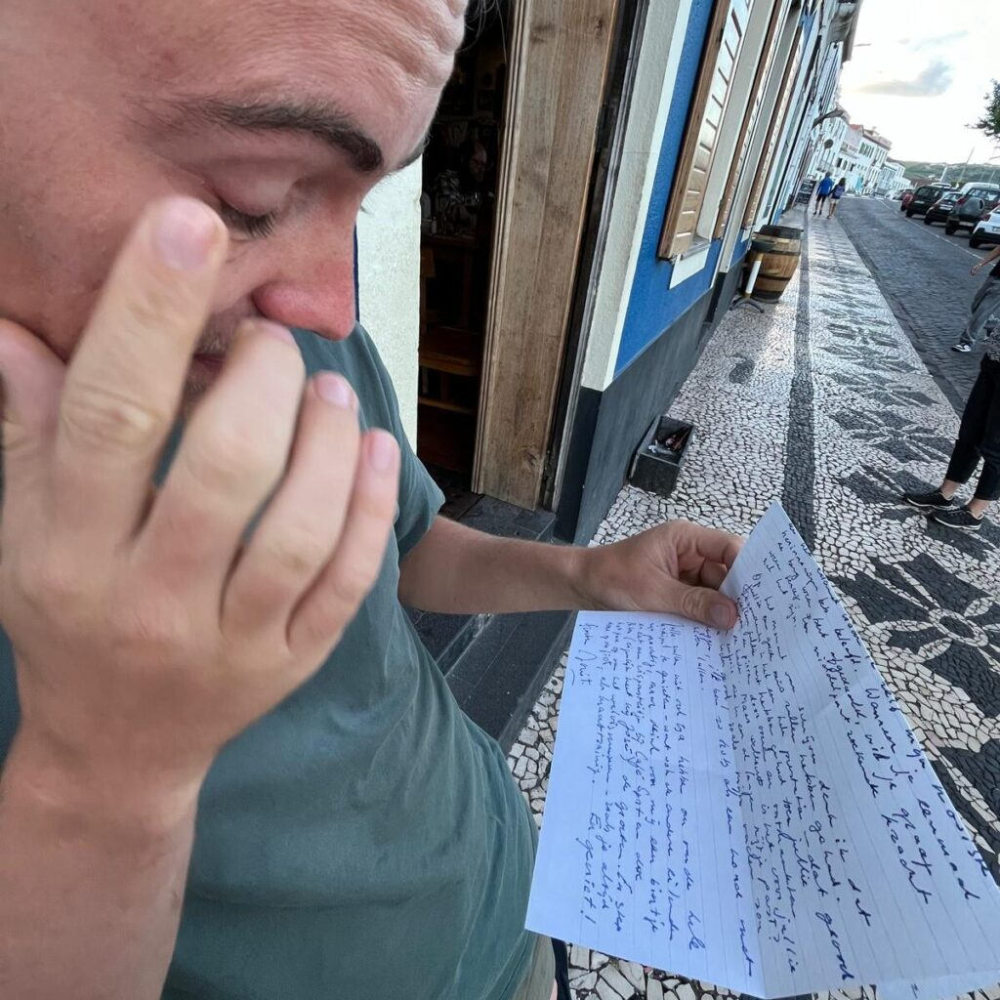

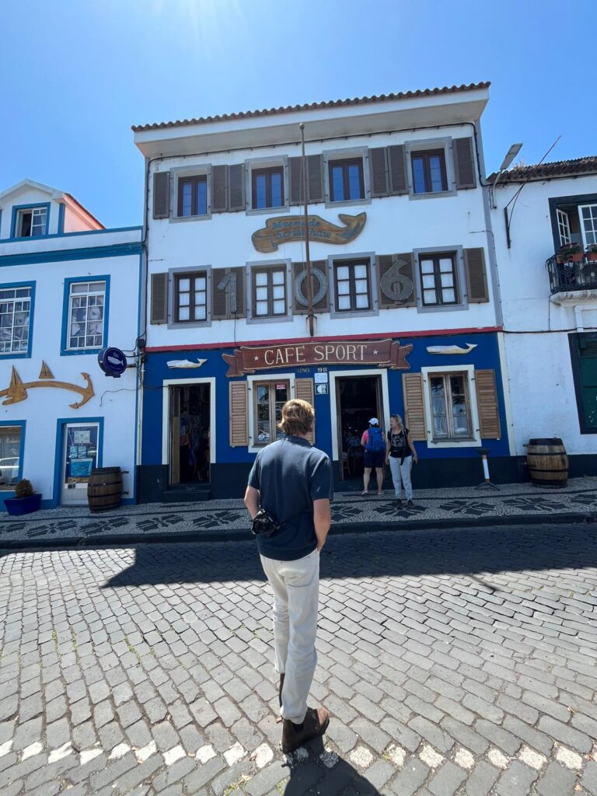

De dag erna nodigt José ons uit in zijn museum. Door een geheim deurtje wandelen we een smalle gang door met houten wanden. Achterin het pand zit een smalle trap omhoog. José’s dochter begeleidt ons terwijl we keuvelen over onze reis en ons volgende bezoek aan de Azoren. De bovenverdieping staat vol met vitrines, gevuld met honderden, zo niet duizenden potvistanden. Het plafond is laag en de houten vloer kraakt. Het is alsof we tweehonderd jaar terug in de tijd stappen, midden in iemands rariteitenkabinet. De kunst van het bekrassen en beschilderen van potvistanden werd in de tijd van de walvisvaart geïntroduceerd om de verveling (en daarmee gepaarde vechtpartijen) tegen te gaan. Potvissen werden rondom de Azoren op grote schaal gevangen voor hun *blubber*, die voor de vondst van aardolie als brandstof diende. Aangezien het potvissenvlees ranzig schijnt te smaken, stopte de jacht op potvissen abrupt na de komst van aardolie en sindsdien is de soort langzaam maar zeker weer in grotere getale te aanschouwen.

José besloot jaren geleden de tanden die nog in omloop zijn te gaan verzamelen. Met het stoppen van de jacht, daalt het aantal bestaande tanden (met of zonder schildering) snel. Inmiddels weet elke Azoriaan gelukkig van de verzameling en worden bij overlijden, verhuizen, of scheidingen, de op zolder gevonden relikwieën aan José verkocht of geschonken. De kunstvorm van het krassen en schilderen is uitstervend. José bewaart nog enkele tientallen onbeschilderde tanden en laat er jaarlijks een paar door de laatst praktiserende kunstenaar op het eiland bewerken. En toch. Hoe mooi en bijzonder de verzameling ook is, ik ben vooral onder de indruk van de enorme *narwaltand* die daar aan de muur hangt. De eenhoorn van de zee, waarvan ik nog steeds niet helemaal geloof dat ze daadwerkelijk bestaan.

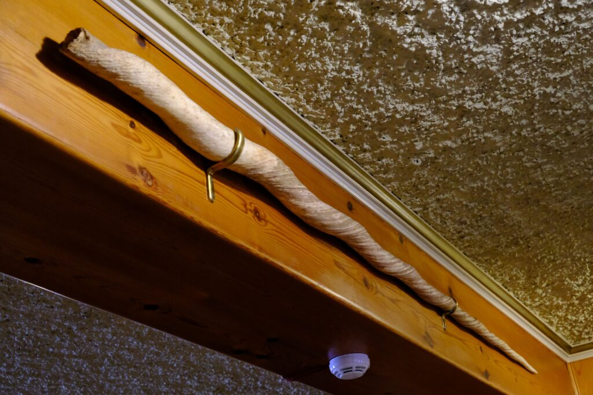

<figure class="wp-block-image size-large is-resized">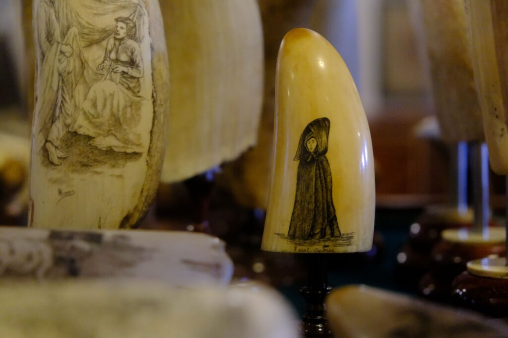</figure>

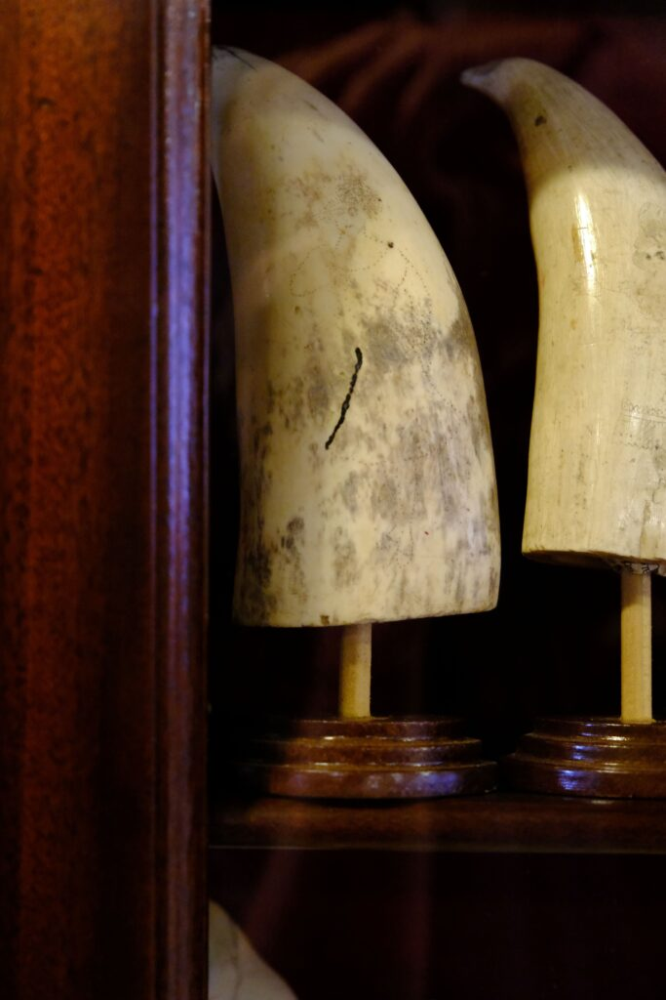

## **Onze handtekening**

Na twee avonden doorzakken is ons natuurlijke slaapritme weer terug naar ’s nachts slapen en overdag wakker en op pad. We vinden de bakker terug waar ik vroeger altijd *Pão de Flamingo* haalde. De destijds middeleeuws ingerichte bakker is gerenoveerd tot een moderne koffietent en gegroeid. Inmiddels hebben ze vier locaties, een grote fabriek buiten de stad en voorzien ze ook andere eilanden van brood. Voor €0,90 krijgen we een espresso en voor een extra €1,20 krijg ik er een *pastel de nata* bij. De rest van de ochtenden beginnen we de dag hier, met een kop koffie, een gebakje en soms een broodje. We hebben inspiratie kunnen opdoen bij de talloze andere schilderijen en nemen de iPad mee om ons eigen ontwerp te tekenen. Jen is daar eigenlijk beter in, maar ik wil ook heel graag helpen en mag de simpele vormen een kleur geven. We puzzelen met de lettergroottes, de lijnen en verhoudingen tot we tevreden zijn en gaan dan op zoek naar verf.

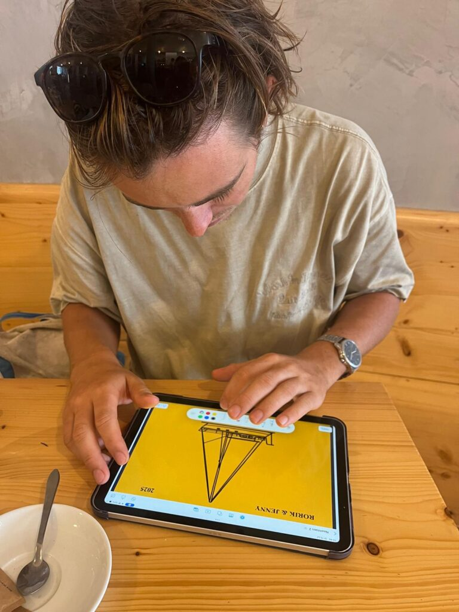

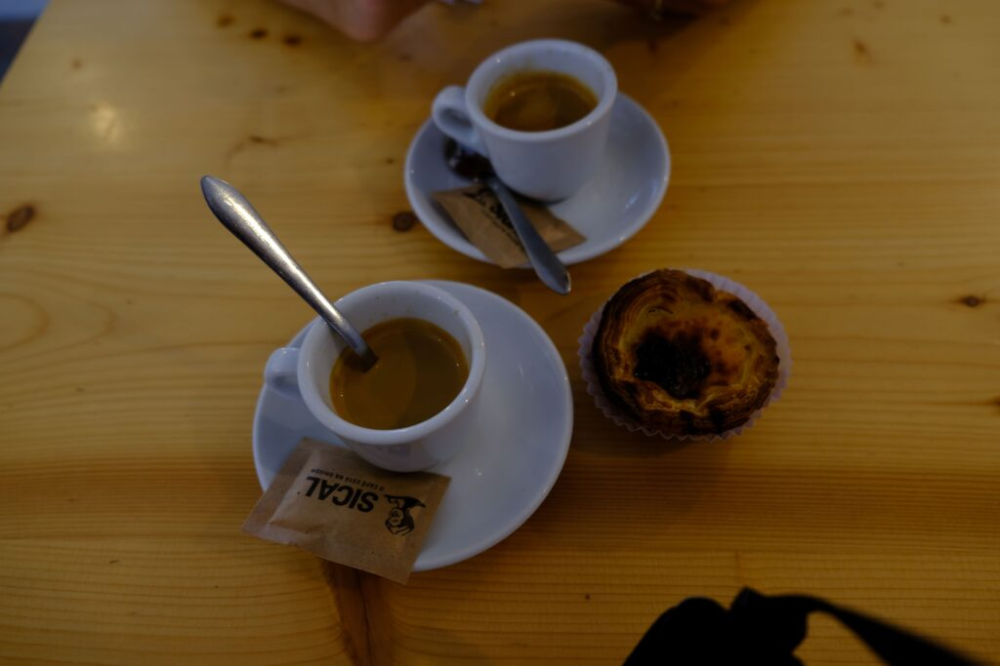

Gele twee-componenten polyurethaan verf en rood-bruine epoxyprimer hebben we in overvloed. Jen keurt het goed voor de basis, maar onze kleurcode is nou eenmaal geel met marineblauw. Bij de jachtwinkels word ik raar aangekeken als ik specifiek kom vragen om polyurethaan verf. Dat kennen ze niet. Kleine potjes oliegedragen verf hebben ze wel in overvloed, in alle kleuren, voor de zeilers die iets willen achterlaten. Die potjes zijn leuk, maar ééncomponent oliegedragen verf spoelt ook snel weer weg. Wij hebben langduriger plannen en bovendien koop ik liever potjes verf waar ik aan boord ook nog iets aan heb. Een lange zoektocht volgt, maar als we uiteindelijk in een bouwmarkt de juiste verf en kleurstof hebben gevonden, kunnen we richting de boot om voorbereidingen te treffen.

Jen spendeert de rest van de middag aan het maken van templates voor de letters van verftape. Het is een secuur en priegelig werkje, waarvan we allebei blij worden dat Jen het uitvoert in plaats van ik. Op een paar lagen verftape schrijft ze met potlood de teksten en snijdt ze met een molenmesje uit. Ik maak me nuttig met de haakse slijper op het beton. Met een staalborstel en schuurschijf maak ik het beton schoon op het stukje dat we willen claimen. De schildering van mama en papa zit even verderop, die van Jelle kan ik vanaf onze plek nét niet zien en een paar platen verder zit de oudste van de kade. Ik schuur na een schietgebedje de vergane resten van een vorige reiziger weg en blijf borstelen tot het beton weer lichtgrijs en als nieuw is. Als ik de MP-reiniger van de boot haal begint het te regenen en valt onze schildermiddag in het water. Morgen weer een kans. De rest van de middag besteden we aan het verzamelen van alle potjes, roerstaafjes, kleurstoffen, verfmengbakjes, verftape en de juiste blikken verf uit het ruim. Jen maakt voor de zekerheid nog wat extra templates en als het donker wordt gaan de luiken dicht en kijken we een serie van de NPO.

We worden allebei vroeg wakker en willen meteen aan de bak. Na een kopje koffie lopen we in de ochtendzon over de kade met onze tassen met verfspullen. Het beton is weer opgedroogd van de regen van vannacht en ons plekje is gelukkig niet snel door iemand anders gekaapt. Als we aankomen zien we een echtpaar aan de voet van het schilderij van de *Palustris* driftig boenen. Zij waren gistermiddag bijna klaar met hun werk, maar na de regen van gisteren lijkt het wel alsof alle mos over hún schilderij naar beneden is gekomen. Ik beken schuldbewust dat ik het schilderij van de *Palustris* heb schoongeboend en dat ik er helemaal niet bij had stilgestaan dat zij nog bezig waren met die van hun. Alle groene aanslag van de afgelopen zes jaar is natuurlijk naar beneden gelopen, over die van hun heen… Ze nemen het ons gelukkig niet kwalijk en al snel staan we te praten over de avonturen die wij en zij hebben meegemaakt, onze zeilplannen voor de toekomst en onze doelen in het leven.

Ons stukje beton bereiden we voor alsof het een stuk staal van *Luwte* is. Het borstelen heb ik gisteren al gedaan, dus vandaag hoeven we alleen nog maar te ontvetten met MP-reiniger en een net vierkant af te plakken. Terwijl Jen de tape plakt, begin ik met het mengen van de epoxyprimer. De eerste laag gaat er op met extra verdunner, zodat het beton de verf goed kan opzuigen, en daarna beginnen we laag over laag de boel op te bouwen. De zon staat inmiddels hoger en in combinatie met onze winterharder droogt de verf onder onze kwast. Daardoor schiet het aardig op en kunnen we vier lagen over elkaar zetten tot de ruwheid van het beton bijna verdwenen is onder de dikke laag uithardende kunststof. Het rood-bruin van de epoxyprimer is niet helemaal in <em>Luwte-</em>thema, maar dat komt later wel weer goed. We besluiten onze succesvolle eerste dag en wachten rustig af tot de verf goed is uitgehard.

De volgende morgen is het recept hetzelfde, maar de kleur anders. Ik schuur voorzichtig de bruine verf op en meng dit keer de gele verf. Ook die hard in de zon bijna onder onze kwasten uit en een uur later is ons rood-bruine vlak *Luwte-* (of voor de kenners *Palustris-)* geel. We nemen de rest van de ochtend om bij de bakker onze ontwerpen nog wat verder uit te werken en een eindeloze discussie te voeren over de vraag of er nou wel, of niet, een witte streep om het kader heen moet. Tussendoor doen we nog even de nodige boodschappen en wandelen we een paar keer langs ons gele vlakje om te voelen of de verf al ver genoeg uitgehard is voor de volgende stap. Tegen de schemering besluiten we om de verf nog een nachtje extra te geven en verlaten we de haven om op Praia Porto Pim een biertje te drinken.

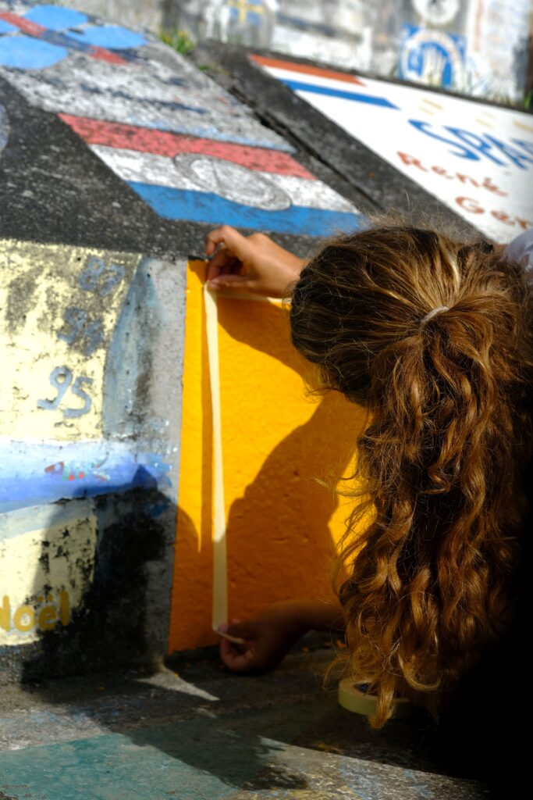

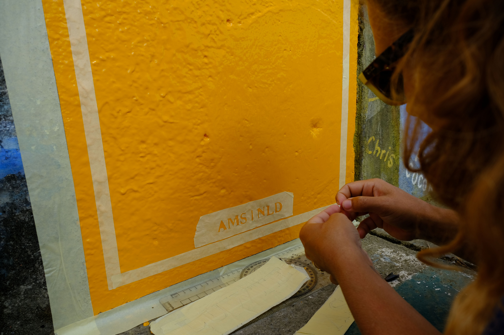

## Droomwereld

Porto Pim is een buitenwijk van Horta en ligt aan een oude vulkaankrater met een groot zwart strand. In 2009 zaten mijn ouders hier vaak op het terras, dat op het zuiden gericht is en de hele dag in het zonlicht baadt. Mama en papa hadden een fiets voor mij geregeld en ik fietste dan, in hun zicht, aan de overkant de weg omhoog naar de piek van de krater, om er vervolgens zonder te remmen van af te sjezen. Nu ik er aan terugdenk weet ik niet of dat nou zo verstandig was, maar ik ben er nog. Olivier en Flo schilderden op het strand stenen en probeerden ze te verkopen. Of ze veel klanten hadden weet ik niet. Volgens mij was het hier in de winter uitgestorven en gebeurde er weinig, maar mama en papa zullen ze wel hebben gesteund in hun ambitie om stenen-ondernemer te worden.

Nu is het zomer en gloeien de stenen in de avondzon na van de hitte van overdag. Op de kademuur hangen Portugezen en zeilers met glazen bier staan met elkaar te praten. Op een hoekje zit een herberg die herberg-achtige maaltijden verkoopt op een miniterras. Alles vertraagd op Porto Pim. Het is even alsof dit het epicentrum van het universum is en alles hieromheen draait terwijl we allemaal stilstaan. Wij kijken even naar de kinderen die spelen in de branding op de oude scheepshelling en in de verte de horizon. Het is een gek idee: als we nu maar ver genoeg rechtdoor blijven kijken komen we uit in Suriname.

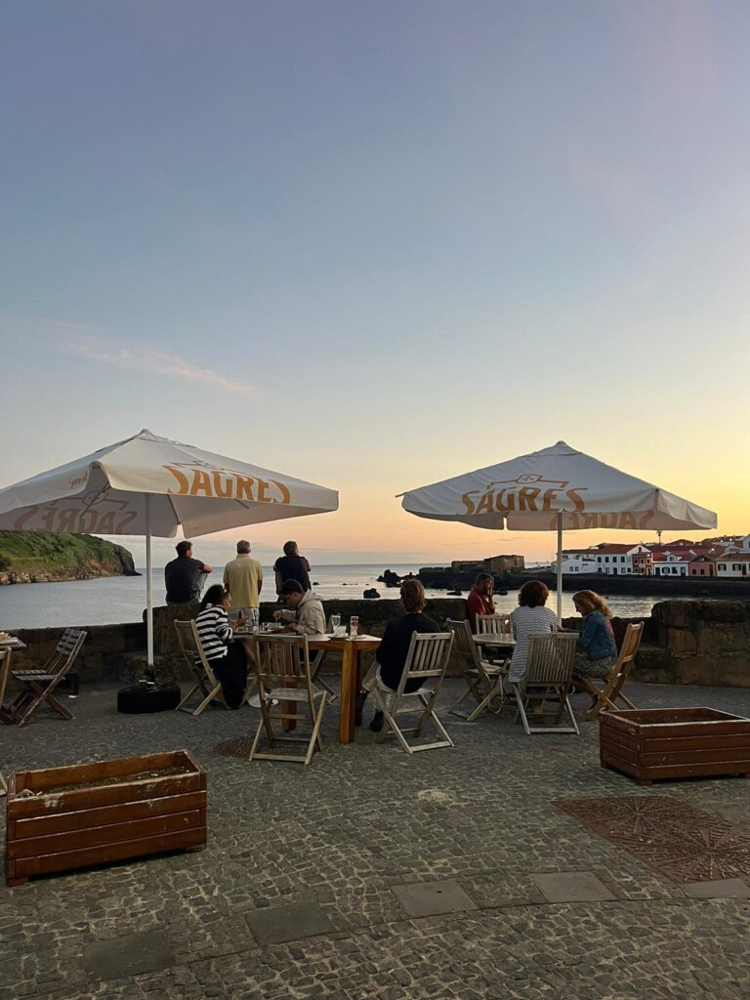

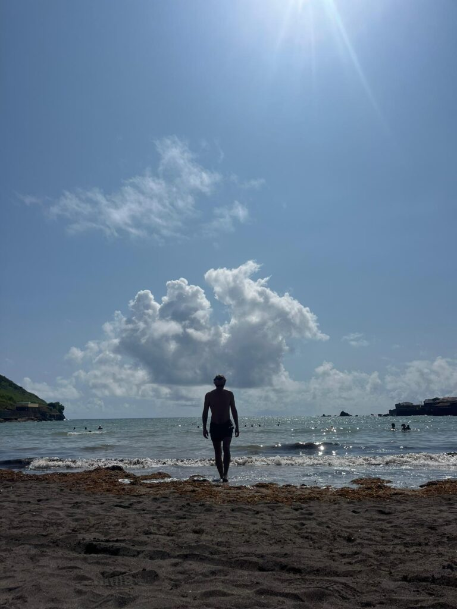

We struinen langzaam langs de kade en de wereld lijkt net weer in beweging te komen, als ik met stomheid geslagen blijf staan. Op het terras, hier aan Porto Pim, komen we de twee Fransen tegen die ik op de Kaap Verden op een dronken borrelavond tegen het lijf liep in de toiletten. De twee jongens die op een oud afgeschreven scheepje van 6 meter met zijn tweeën de oceaan over wilden. Die geen geld meer hadden voor benzine en dus maar naar de kant zwommen. Die een scheur in het dek hadden, maar van een *Imoca* kevlar en epoxy kregen om het te repareren.

Die jongens zitten hier opeens voor ons op het terras met een biertje. We herkennen elkaar en raken meteen aan de praat. Als ik ze vertwijfeld vraag of ze met hun eigen boot hierheen zijn gekomen beginnen ze te lachen en vertellen ze gelukkig dat ze als bemanning mee zijn gevaren op een groot Frans schip. Ze wilden even terug naar Frankrijk, maar vliegtickets waren te duur, dus dan maar op deze manier. Hun bootje ligt nog op Martinique en ze hopen dat er de komende tijd nog even geen orkaan overkomt. Hun Atlantische oversteek was avontuurlijk en er is veel kapot gegaan, maar ze hebben het gehaald. In de Carieb hebben ze bovendien nog een derde bemanningslid aan boord gehaald. De vriendin van een van de jongens is ingevlogen en vanaf dat moment hebben ze als driemanschap de Carieb verkend. Ik kan me er niets bij voorstellen, zelfs de romanticus in mij heeft blijkbaar grenzen.

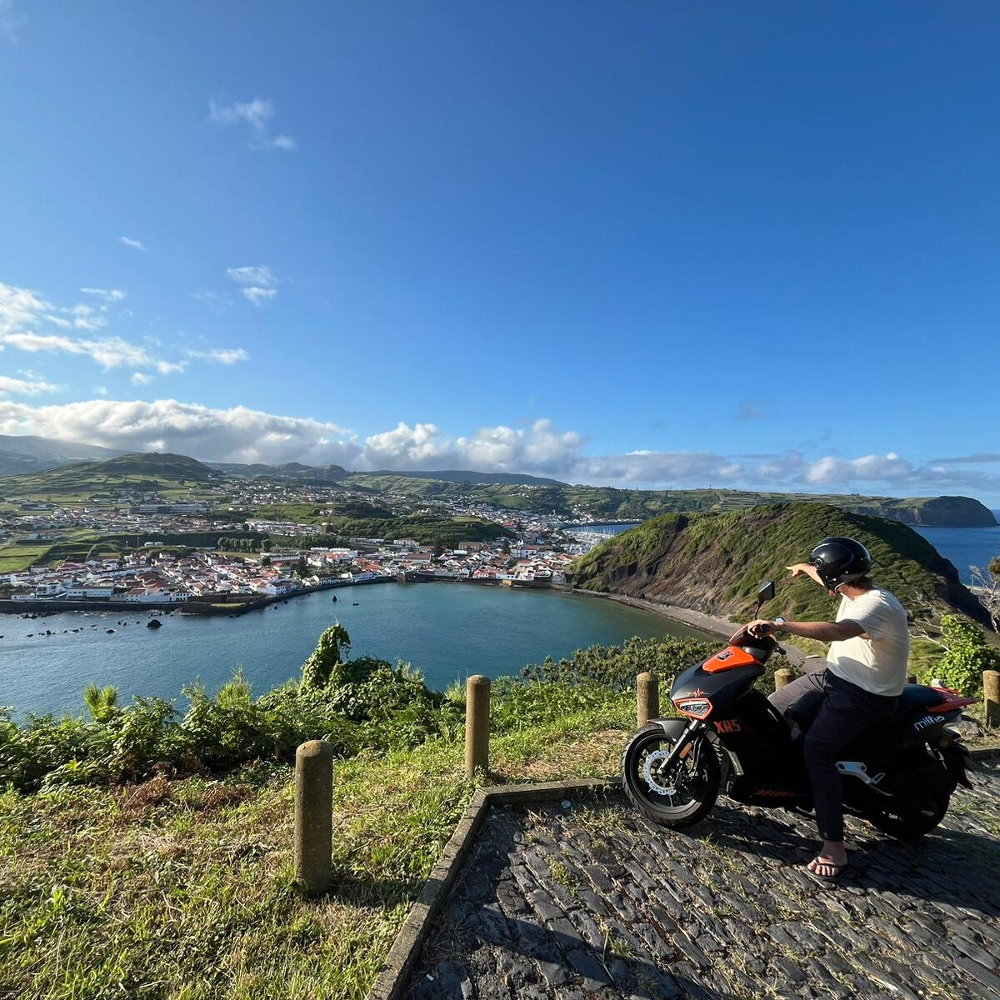

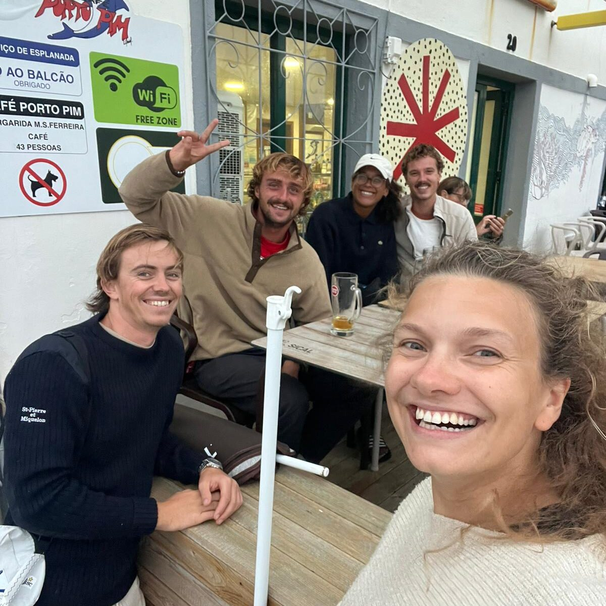

Wij verlaten Porto Pim weer alsof het een koortsdroom is geweest. We belanden bij de Clube Nautico waar het bier (letterlijk) goedkoper is dan het water en genieten van het uitzicht op de haven en *Luwte’s* kont. De Pico heeft weer zijn befaamde streepje wolk en de top, die nog net wat zon vangt kleurt oranje-paars. Jen en ik raken maar niet uitgepraat. We evalueren ons hele jaar. De pieken en de dalen. We diepen onze lessen verder uit en concretiseren onze ambities voor de komende jaren totdat we de laatste gasten zijn en giechelend onze weg terug naar *Luwte* zoeken.

Jen wordt vroeger wakker dan ik. Dit is haar schilderdag. De grote lijnen en vlakken zijn gezet, maar nu moeten we aan de slag met penselen en verftapejes en dan kijk ik liever van de zijlijn toe. Het goed loskrijgen en opplakken van de verftape-templates die Jen heeft gemaakt is een heel priegelwerk dat ons bijna in een relationele crisis trekt, maar als de stickers er goed op zitten zijn we tevreden. We ontvetten de ondergrond en gaan dan aan de slag met het mengen van de verf. Dit keer zit daar nog een stap tussen, want we hebben witte verf en blauwe en zwarte kleurstof om tot het *Luwte-blauw* te komen. Na een eeuwigheid mengen en alle kleurstof, komen we uit tot een soort donker babyblauw. We zijn eerst een beetje teleurgesteld, maar we moeten het er maar mee doen.

De zweetdruppels hangen aan Jen’s neus en haar lippen zitten stijf op elkaar. Ik verplaats de kussentjes onder haar knieën en geef als assistent de kwastjes en potjes aan die ze nodig heeft. Met een chirurgische hand kleurt ze de templates in en schildert daarna op basis van ons ontwerp uit de losse pols ons schip bij. Het moment van de waarheid volgt kort daarna, als we de tape los kunnen trekken en ons ontwerp tevoorschijn komt. De witte lijn waar we zo lang over hebben gediscussieerd komt er en maakt het een *eyecatcher*.

*Luwte was here*. En dat zullen ze voorlopig nog wel even weten.

Met kippenvel maak ik foto’s. Jen poseert tussen het schilderij van de *Palustris* en die van *Luwte*. Zoals zo vaak dit jaar ervaar ik ook hier een *Rite de passage*. Met onze stempel op deze plek markeren we ons eigen verhaal, en mag Jen vanaf nu het hoogste woord voeren aan onze familietafel.

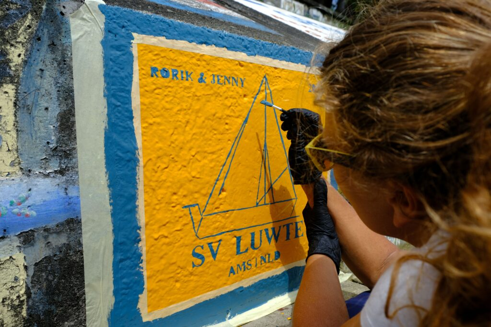

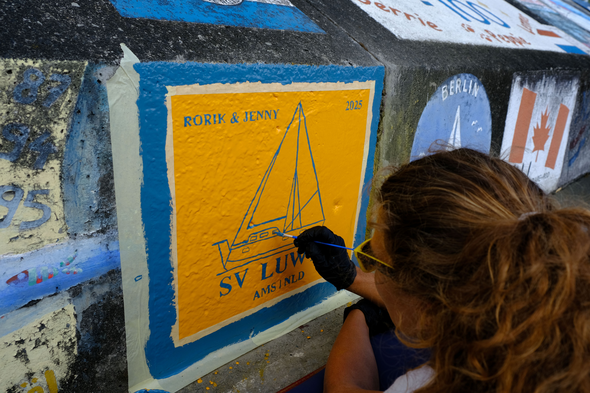

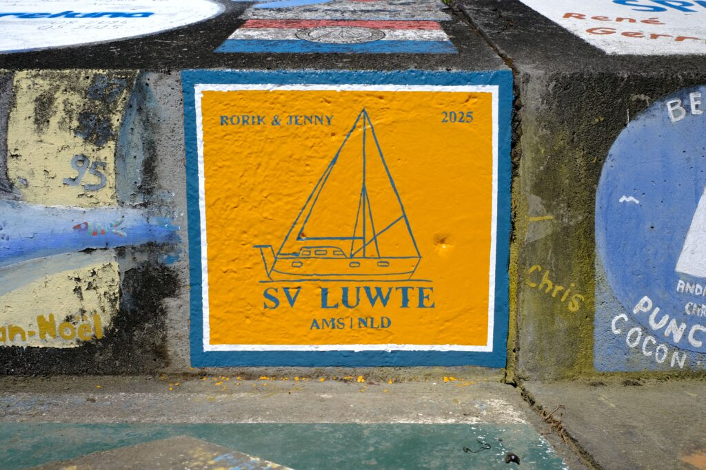

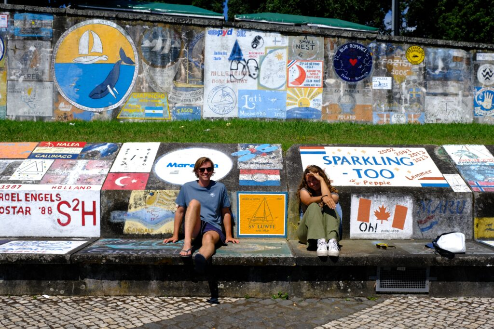

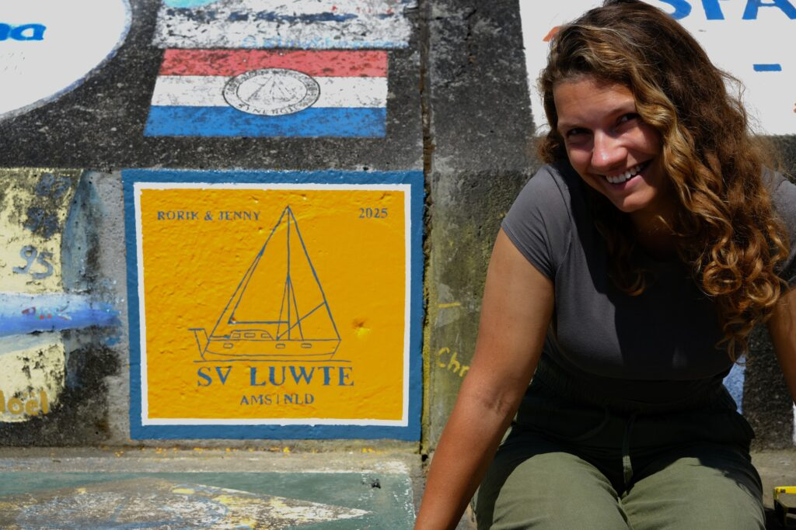

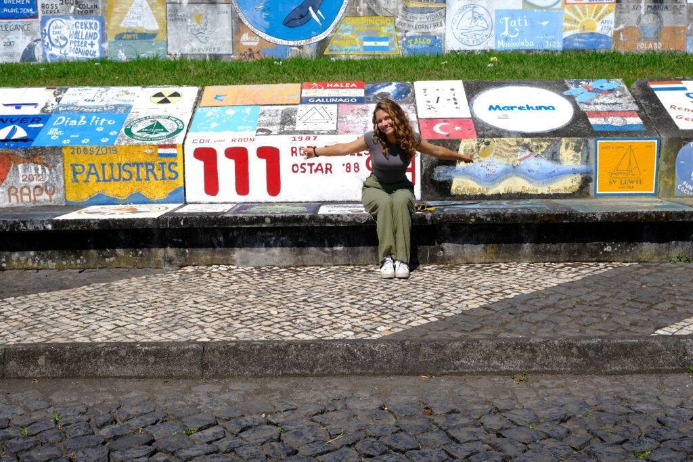

## Bakens

We hebben nog twee dagen hier op Horta, voordat er weer een beetje wind richting São Miguel komt en we besluiten nog even een scooter te huren om het eiland te verkennen. Met Jen achterop stuif ik door het glooiende, teletubby-achtige landschap. De Hortensia’s staan in volle bloei en groeien hier als “onkruid” langs de weg. Het lijkt de bloemenparade wel, maar dan gewoon langs alle wegen. De weilanden en velden worden met de bocht groener en groener, alsof de saturatie een paar tinten te hoog is gezet. We rijden langs de noordzijde het eiland rond door de één-straats-dorpjes en langs talloze kerkjes, totdat we het landschap plotseling zien veranderen in een pikzwart maanlandschap.

In 1957 kwam Faial plotseling weer tot leven. Aan de uiterste westpunt van het eiland begon het water te koken en de as uit het water te spuiten. Een jaar lang bleef de bruisende, puimspuitende vulkaan actief en verrees er zo’n 800 meter uit de kust een geheel nieuw stuk land. Een groot deel van de bevolking verhuisde tijdens de uitbarsting weg naar het beloofde land Amerika en aardwetenschappers van over de hele wereld stroomden in om dit wonder te aanschouwen. In een krantenkopie uit die tijd lezen we dat de taxichauffeurs hoogtijdagen vierden. In Peter Café Sport scheppen ze naar elkaar op over hoeveel ze wel niet hadden durven vragen voor de rit naar de vulkaan met een nieuwsgierige toerist: *"Genoeg om een jaar van te leven!*"

Nadat de vulkaan tot rust kwam en het nieuwe land werd veroverd doormiddel van het planten van de Portugese vlag, werd het ingelijfd bij Faial. De vlag verdween vervolgens voor ruim vijftig jaar op iemands zolder, maar werd een paar jaar geleden teruggevonden en is inmiddels een pronkstuk van het museum. De gehele begane grond van de vuurtoren verdween onder de as, en raakte haar functie kwijt omdat het nieuwe land het licht van de toren naar zee toe blokkeert. De vuurtorenwachter, die bijna het gehele jaar in zijn vuurtoren is blijven zitten om wacht te houden over de vulkaanuitbarsting, kreeg een eretitel en mocht de rest van zijn dagen op een erebaantje uitzitten, zo gaat de legende althans.

Het is, wat ons betreft, de mooiste en meest iconische vuurtoren ter wereld. In een pikzwart onherbergzaam landschap. Op een punt die niet meer de meest westelijke punt is. Het uitzicht op de nieuwe krater is spectaculair en je kunt nog altijd voelen hoe spannend het hier in 1957 moet zijn geweest. Ik schiet de foto die mij altijd is bijgebleven opnieuw, maar dan met zeevrouw Jen in plaats van met zeeman papa.

<figure class="wp-block-image size-full is-resized">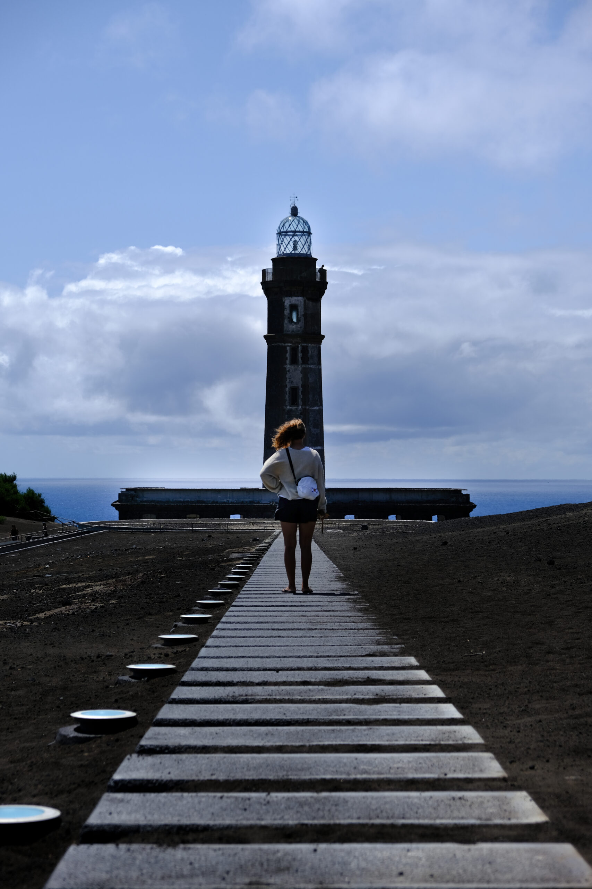</figure>

Na het museum dralen we wat rond in de ruïnes van de vuurtoren en staren we over zee. Door het zwarte zand lopen we terug naar de scooter. Ik kan mezelf niet bedwingen en neem een brok van de lava mee…

Op de terugweg dalen we af naar de kust en klauteren tussen de oude lavaresten naar een *natural pool*. De deining komt onstuimig binnenlopen en slingert ons heen en weer, maar we dartelen lekker in het water en ik oefen mijn schoonspringkunsten een paar keer voor de film. Afgekoeld drinken we nog een drankje en regelt Jen een supergrote hotdog voor mij en dan slingeren we weer terug op ons brommertje naar de boot.

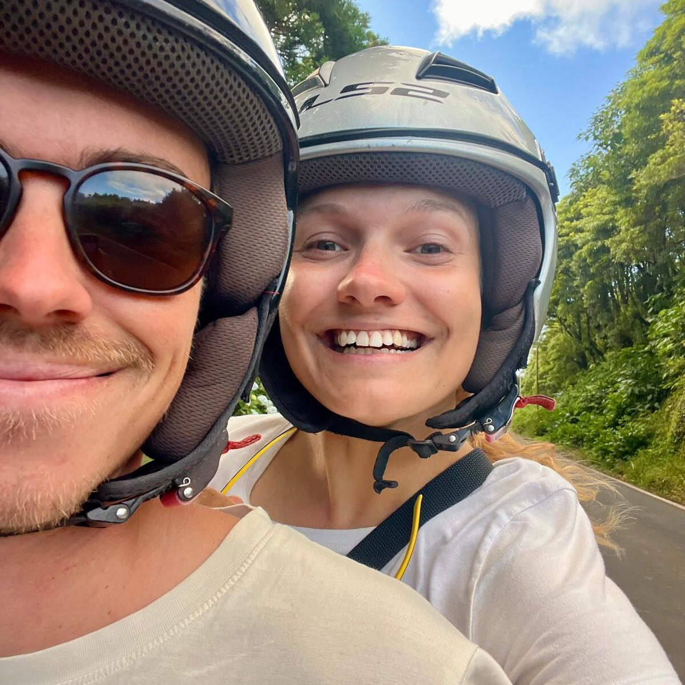

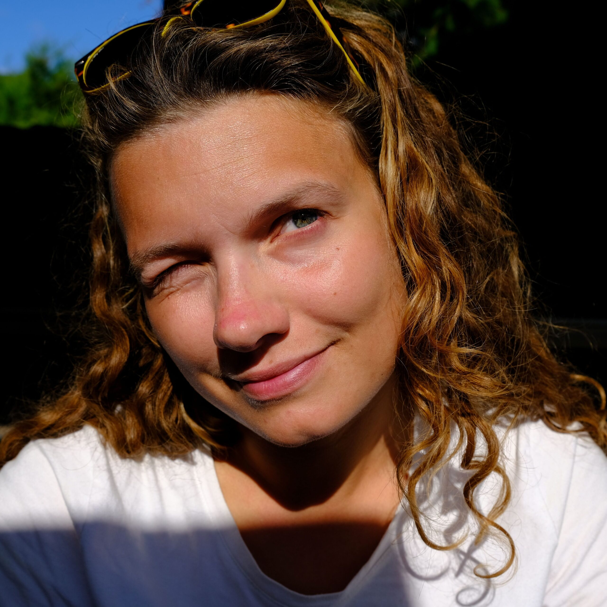

*Luwte* ligt weer klaar om uit te varen. We krijgen ons zegen van de havenmeester (nadat we onze rekening hebben betaald) en ontvangen ons stempel van de douane. We hebben nog één laatste missie bij Peter Sport: Het achterlaten en ruilen van onze verenigingsvlag voor de Peter Café Sport vlag.

We gaan op de koffie bij José en brengen hem ons beschreven vlaggetje met onze namen, bootnaam en jaartal. We keuvelen nog wat over zijn boek, Jelle’s stuk en de belofte om snel terug te komen. We krijgen de befaamde vriendenvlag van José en drinken een kopje koffie. Het is een mooie tijd geweest hier en een prachtige her-ontmoeting met de man die ons toen opving en nu het warme gevoel van deze plek heeft teruggegeven. We krijgen, met onze verenigingsvlag van Het Y, een ereplaats aan het plafond. Daar blijven we voorlopig wel even hangen, naast Jelle’s geboortevlag.

Wij zeggen tot ziens Horta, opdat we terug zijn voordat ons schilderij door de tand des tijds is overgenomen. Onze boeg gaat richting São Miguel en met de mooiste schemering van de Azoren varen we uit.

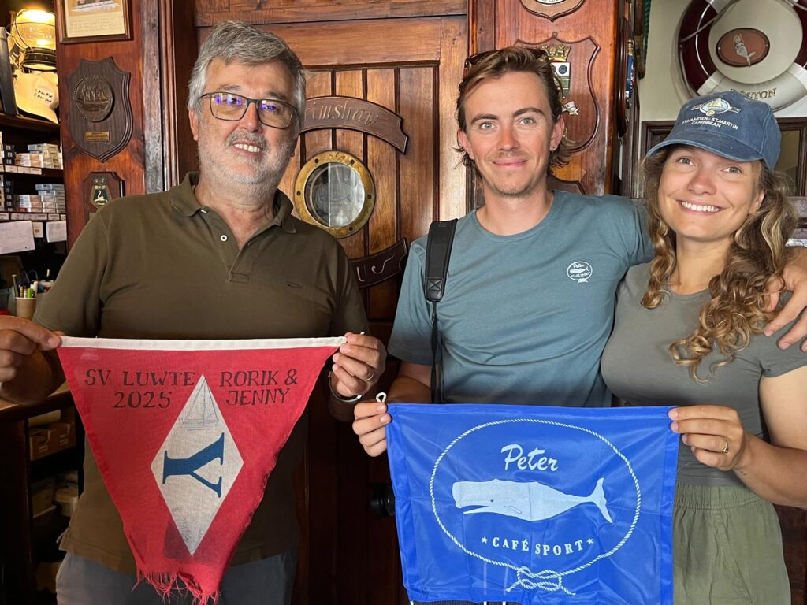

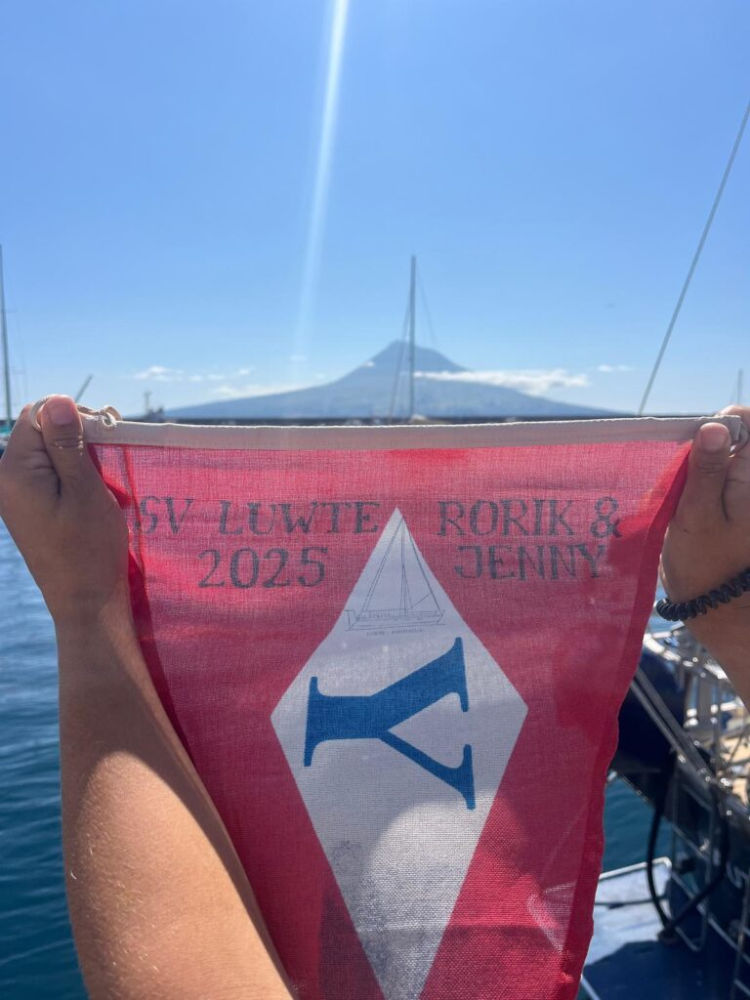

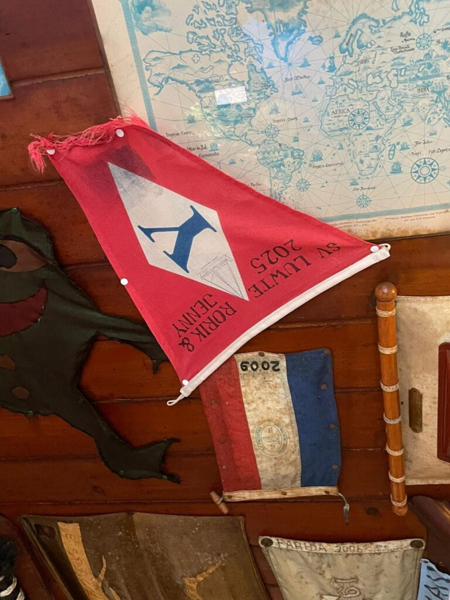

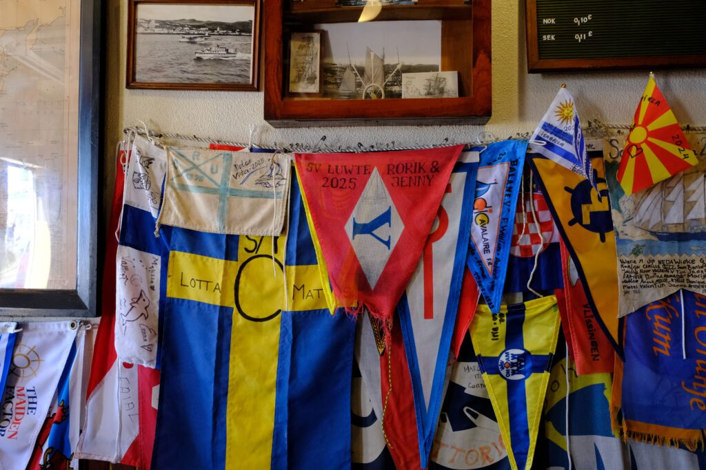
