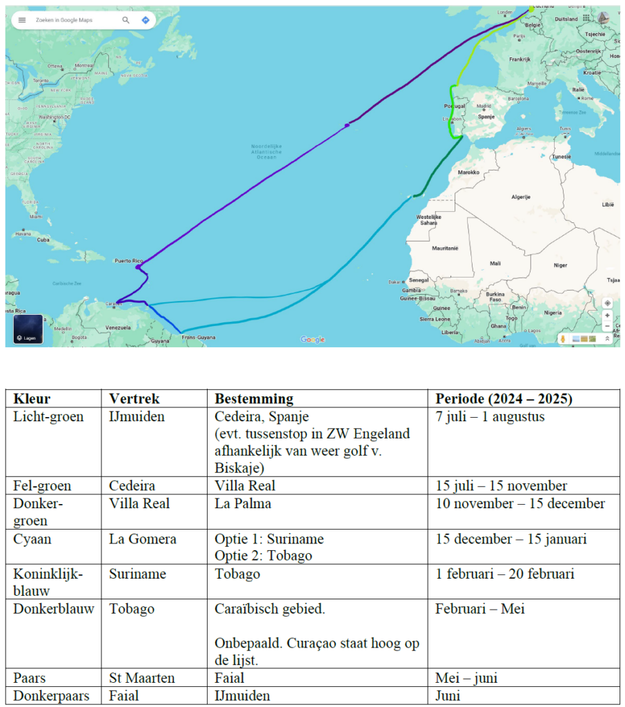

Inmiddels zijn we geworteld aan de Tasmanstraat. De gasten die langskomen kijken hun ogen uit en de opmerking "Maar nu je dit net hebt, weet je wel zeker dat je nog weg wilt?" is al meermaals de revue gepasseerd.

De realiteit van ons aanstaande vertrek is er echter niet minder op geworden. We waren even afgeleid door het hele huizen-gedoe, maar sinds we daar een punt achter hebben gezet werd direct de voorbereiding weer hoge prioriteit.

**Afgeronde taken:**

-   Rorik: Klein Vaarbewijs II (International Competence Certificate)
-   Lid geworden bij Jachtvereniging De Watervrienden
-   Aanvraag Zeebrief
-   Onderdelen autopilot
-   Rorik: Marcom-B theorie examen
-   DJI Mavic 2 drone gekocht (en aangemeld voor examen)

## De komende maanden

Het aftellen is inmiddels wel een beetje begonnen. Jen en ik maakten afgelopen week een trainingsschema om te sporten, want dat kan er ook nog wel even bij. We moeten er natuurlijk piekfijn en fit uitzien op alle foto's en video's die we de lucht in gaan sturen ;). Een fijne bijkomstigheid van die ambitie is dat we daarmee onszelf verplichten ons koppie erbij te houden en niet teveel afleiding in te bouwen. Ik vind dat eigenlijk een heerlijk idee, want er is niets beter dan rust, reinheid en regelmaat. Sporten dwingt dat af.

Bij het opstellen van dit schema gingen we vooruit tot 3 juli dit jaar. Dat wordt ons geplande moment van touwtjes doorsnijden. In de praktijk zal daar wel weer een weekje overheen gaan, want Jen levert 30 juni haar scriptie in en moet dan nog gaan kiezen welke jurkjes er wel en niet mee moeten. Een hele klus als ik naar onze kledingkast kijk... 13 weken dus nog maar. Dat is opeens wel heel dichtbij.

De komende weken ga ik (proberen) met grotere regelmaat berichten op te stellen. Vooral voor onszelf en ons eigen naslagwerk. Dat gaat ook over de wat 'saaiere' onderwerpen als verzekeren, bureaucratisch vogelvrij worden etcetera. Ik zal hiervoor niet elke week of dag een mail sturen, maar voel je vrij om zo nu en dan de site te checken op nieuws. Ze gaan onder de noemer: Havenkoorts.

## 7.1 Verzekeren

Los van zorg- en reisverzekeringen van Jen en mij hebben we momenteel één erg groot blok aan ons been hangen. Het verzekeren van de boot lijkt toch meer voet in de aarde te hebben dan ik had verwacht. Ik ben al sinds januari bezig met al het voorbereidend onderzoek naar bootverzekeringen en kwam er al snel achter dat ik een andere blik heb op verzekeren dan de meeste verzekeraars. En dat schuurt een beetje.

Het probleem dat verzekeraars zien in het verzekeren van schepen (zeker met een dagwaarde <€100.000) die Europa willen verlaten, is dat de potentiële schade bij een ongeval dusdanig hoog is, dat ze dat niet kunnen rijmen met de premie die ze er voor kunnen vragen. Daarbij kun je je het onfortuinlijke idee voor je nemen dat een verzekerd schip ergens op een koraalrif eindigt, met een tank vol diesel. Het schip moet dan geborgen worden door commerciële diensten en het rif zo goed en zo kwaad als kan hersteld. Daar bovenop moeten ze voor ons een nieuw schip aanschaffen (of de dagwaarde uitkeren) en in de tijd dat wij zonder schip komen te zitten hulp verlenen in reis- en verblijfkosten.

Verzekeringsnemers daarentegen, willen hun zaakjes goed gedekt hebben en het liefste zo min mogelijk premie betalen. Dat geld kun je immers ook aan leukere dingen uitgeven.

Op één of andere manier (ik heb nog niet helemaal ontdekt hoe en wanneer) is er een gat ontstaan tussen die twee dat niet te overbruggen lijkt. Verzekeraars willen hun premies bijvoorbeeld niet verhogen, of ons bijvoorbeeld 'oververzekeren'. Wij zouden best een beetje extra premie willen betalen, los van de dagwaarde van het schip, om alleen al de wettelijke aansprakelijkheid gedekt te hebben, maar daarvoor moeten we door wel heel veel hoepels springen.

Inmiddels lopen er twee trajecten. Het ene traject is bij één van de verzekeraars die wél dekking wil bieden, maar daar veel papierwerk aan hangt. Zo hebben wij ons zeilers-CV moeten opstellen, onze geplande route en planning moeten uitwerken en elk mogelijk miniscuul detail over de staat en uitrusting aan van het schip en bemanning moeten beschrijven.

### Route 1:

De laatste "officiële" taxatie van dit schip dateert uit 2003 en is dus verouderd. Ik heb de moeite genomen om alle bij mij bekende veranderingen sindsdien uit te werken, maar tot nu toe vingen we bot. Zonder taxatie, geen verzekering.

Nou zouden wij het niet eens zo erg vinden te taxeren, maar dit kost al gauw tussen de €550 en €1.000 en ik ben vrij stellig van mening dat het een nietszeggend oordeel is. Bij een dergelijke taxatie wordt alleen optisch naar de staat van het schip gekeken. Of hij er een beetje mooi gelikt bij ligt. Aangevuld met wat details over de uitrusting en bijzonderheden. Er worden hierbij geen huiddikte metingen verricht, proefvaarten gedaan, of andere diepgaande studies verricht naar het reilen en zeilen van de Luwte. Binnen een uur weet een taxateur een officiële dagwaarde te noemen en dat is dan de waarde van de boot.

### Route 2

De tweede route in verzekeringsland vind ik al dan niet nog verwonderlijker dan de eerste. Na heel wat belletjes ben ik in contact gekomen met een verzekeringsmaatschappij die ons *niet* wilde verzekeren, maar ons *wel* een adviseur tot onze beschikking wilde geven die ons nu helpt bij het vinden van de beste verzekering.  
Dat is al helemaal een raar obscuur wereldje. Want deze adviseur is veel minder direct geïnteresseerd in onze taxatie, maar wil juist wel weten wat we de afgelopen jaren allemaal hebben geïnvesteerd om het schip zeewaardig te krijgen. Met datzelfde pakket aan informatie leek hij te laten doorschemeren dat een taxatie niet per sé nodig is.  
En het meest verwonderlijke? Deze adviseur kost ons niets. Hij wordt door de verzekeraars betaald om voor ons te bemiddelen naar het meest geschikte pakket en de beste premie. In ons belang. Of in dat van de verzekeraar? Ik snap hem niet helemaal, maar ik lijk voor een van de eerste keren ooit blij te kunnen zijn met hulp...

### Een voorlopige conclusie

Sinds ik begon met het schrijven van dit verhaal is er alweer een week of twee overheen gegaan en hebben we weer een hele rij aan belletjes en mailtjes erop zitten. We hebben nu twee offertes liggen met verschillende voorwaarden:

1.  De eerste offerte behoeft geen taxatie, gaat akkoord met een waarde €57.500,- en vraagt daarvoor een premie van €1.000 per jaar. Geen gezeur, lekker gaan varen en een beetje betalen. Deze premie ligt overigens precies op wat ik begroot had voor dit avontuur. Ter vergelijking: Onze huidige premie voor de Noordzee wateren t/m Noorwegen bedragen €125,- per jaar.
2.  De tweede offerte vraag wél een taxatie. Daar staat tegenover dat de premie die zij vragen €450 euro per jaar is. Inmiddels hebben we een taxateur gevonden die voor €450 euro de boot wil taxeren.

Appels en peren dus.

Wij zijn nu, tegen mijn zin in toch maar met een taxateur in zee gegaan om een waardebepaling te laten doen. Als het verzekeren onder de streep op hetzelfde neerkomt met, of zonder taxatie, doe er dan maar een officieel document bij met een stempel en een handtekening, kunnen we die leuk inlijsten.

In dit verhaal mogen wij ons wel gelukkig prijzen met een zoektocht die ons via via bij Daan Hamburger uitbracht. Een taxateur gevestigd in Monnickendam voor wie het niet de 'core-business' is. Hij denkt graag mee en is bereid om met de werklijst voor komende maand erbij alvast vooruit te kijken naar de boot in pico-bello staat, in plaats van vlak-voor-de-werf staat. En dat tegen een redelijk tarief.

## Zeilplan van de Luwte

Wat alle verzekeraars gemeen hebben, is dat ze onze zeilplannen willen weten. Wanneer je in welk gebied bent is natuurlijk van belang voor deze partijen, aangezien ze niet willen dat je bijvoorbeeld tijdens het orkaanseizoen in het Caraïbisch gebied verblijft.

Een leuke bijkomstigheid van deze eis, is dat we nu een heel mooi plaatje hebben van ons zeilplan. Ook leuk voor het thuisfront om bij de hand te hebben, dus hierbij.

Net zoals bij verzekeraars de dikke disclaimer: Dit overzicht geldt indicatief. Stem niet je vakanties hierop af, want de wind, onze ambities en ons tempo bepalen ons lot. Wie weet keren we na Noord-Spanje wel weer om en gaan we naar IJsland omdat we het te warm vinden!

---

## Reacties

> Geweldig Rorik en Jen, zo grondig als jullie de grote reis voorbereiden. Het is wel een ingewikkeld , maar zeker ook een leerzaam proces. Wij hebben alle vertrouwen in jullie. Liefs van Opa Jan en Oma Yvonne
