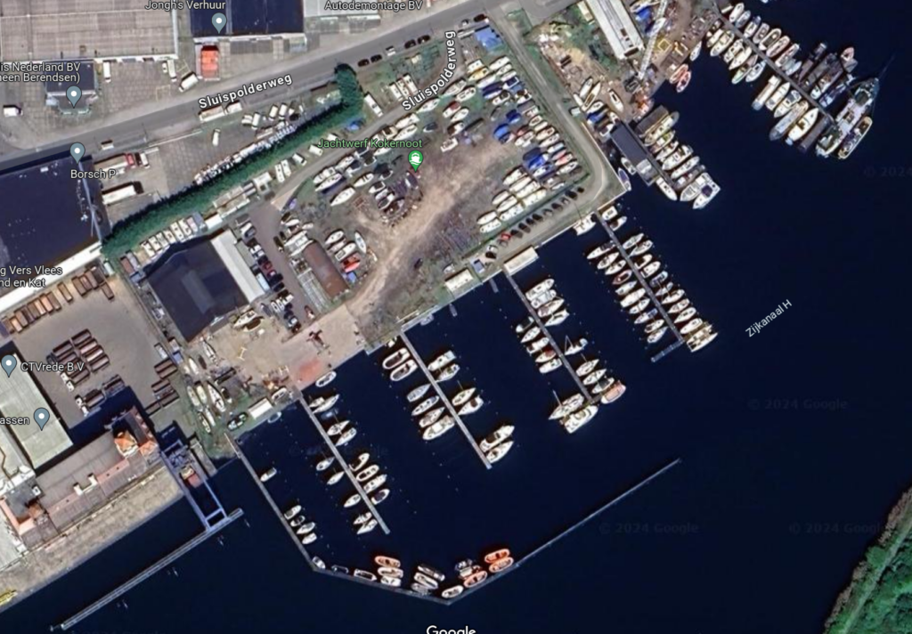
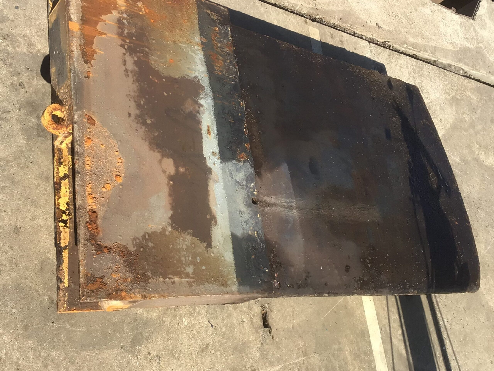
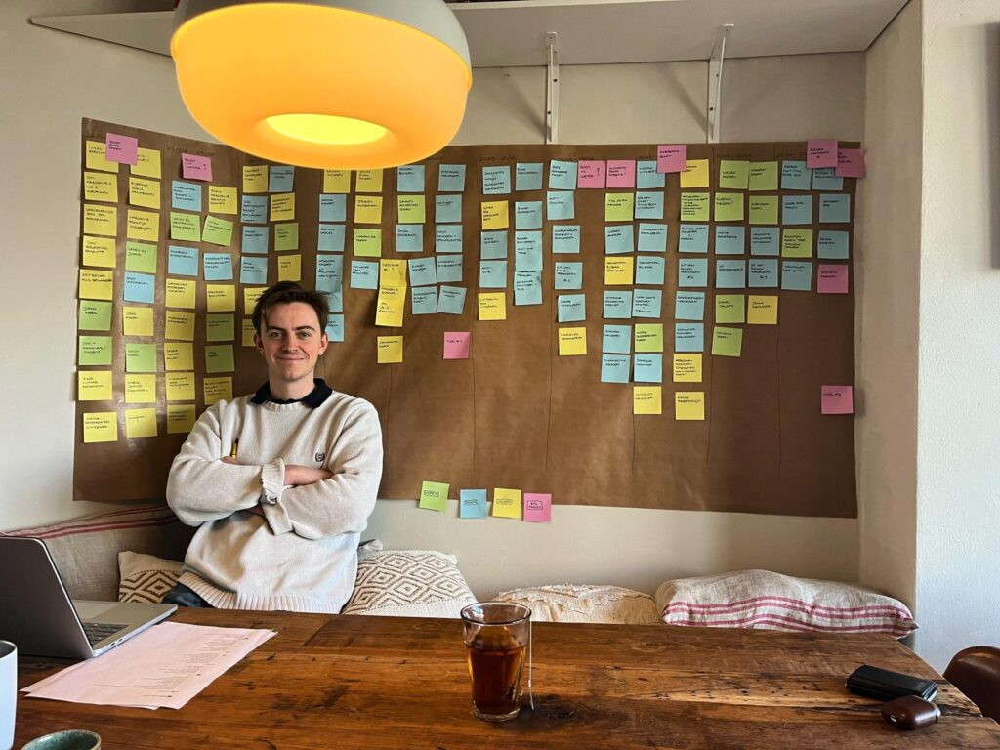

Doordat we een beetje afgeleid waren met verhuizen, is het er een bij ingeschoten om vroegtijdig op zoek te gaan naar een plek om de boot nog een keer de kant op te krijgen voor onderhoud. Nederland kent talloze werven, maar er zijn er maar een handvol die stalen schepen op de kant willen met autonome, zelf-klussende eigenaren. De commerciële jongens verdienen er namelijk vooral aan als ze kunnen werken aan de boten die het water uitgaan bij ze.

Naast de commerciële jongens heb je de verenigingen. Daar is meer vrijheid, maar er zijn er maar een paar in de omgeving Noord-Holland die ook een eigen kraan hebben staan. En daarbij moet je bij verenigingshavens natuurlijk eerst lid worden.

Bij Z.V. Het Y, waar wij op Marken liggen, hebben wij een aantal buren die in de winter altijd de kant op gaan bij hun tweede vereniging: Jachtvereniging De Watervrienden. De JVW huisvest zich aan het Spaarne in Haarlem. Zo ongeveer onze buren dus, want als je bij ons de straat uitrijdt en alsmaar rechtdoor blijft gaan is het zo ongeveer het eerste stukje Haarlem dat je tegenkomt.

Ik durf wel te zeggen dat zowel Jen en ik inmiddels in de categorie "verenigingsmens" vallen. Ik heb vanuit het schaatsen en roeien eigenlijk nooit anders gekend en daarna rolden wij beiden onze studievereniging binnen, spookten wat rond bij Nereus en werd ik afgelopen zomer gekroond tot een van de mythes van Marken toen ik in een 12 BFT storm de haven op ging om losgeslagen schepen, zeilen en tentjes te redden. Voor buitenstaanders (dat geldt ook voor mij als ik naar andere verenigingen kijk) is het vaak lastig te bevatten waarom je je bij zo'n sekte zou scharen. Een bewonderingswaardige organisatievorm. Lastig te peilen. En allemaal samengevat in de zin "De vereniging heeft als doel het behartigen van de belangen van de leden in de ruimste zin van het woord".

In mijn ervaring groeien de baten van een vereniging (plezier, financieel, materieel etc.) exponentieel ten opzichte van de lasten. Dat wil zeggen: hoe meer je je betrokkenheid toont, hoe meer extra deuren er opengaan. Een heel simpel voorbeeld hiervan is de borrel van Subliem, onze studievereniging. Op de borrel betaal je daar als lid nog altijd een schamele €1 euro voor een tulpje, no strings attached. Ga je bij de BorrelCie achter de tap staan zo nu en dan? Dan betaal je nog maar €10 voor de hele avond versnaperingen. Daarbij komt dan ook nog eens het geluk dat je ervaart uit het feit dat je meer aanspraak hebt bij andere leden, door de jaarlagen heen én je allerlei levenslessen leert over het aan- en afkoppelen van fusten, omgaan met dronken lui en het op gang helpen van feestjes.

## Lid worden

Maarja. Er is één belangrijke voorwaarde om van de voordelen gebruik te maken. Je moet lid worden. Toen ik om en nabij anderhalve maand geleden naar de werf van de JVW reed om een van de leden van Het Y te helpen met zijn elektra aan boord, werd ik voorgesteld aan de voorzitter van de Commissie Logistiek van de JVW, die over het hijsen en stallen van boten op de kant gaat. Zijn antwoord was, zoals te verwachten, simpel: Zolang je geen lid bent, kan ik niet met je praten.

Klinkt hard. Maar geef hem eens ongelijk. Een vereniging heeft het doel "het behartigen van de belangen van de **leden** in de ruimste zin van het woord". Dus niet "Het helpen van gezellige jonge jongens die onrealistische vragen stellen omdat ze onrealistische dromen willen vervullen". We waren een beetje verbolgen, maar kunnen er ook hard om lachen als we terugdenken aan welke taal we destijds zelf uitkraamden naar externen die probeerden mee te liften op de voordelen die we als bestuur voor de leden van Subliem organiseerden.

De volgende dag belde ik de voorzitter van het bestuur van de JVW om even te bespreken wat hij er van vond als wij lid zouden worden en wat zijn verwachting dan was met betrekking tot het hellen. Dat was een heel positief gesprek waarin mogelijkheden op tafel kwamen te liggen. Uiteraard sloot ook hij af met: Je zult je eerst moeten inschrijven.  
Zo gezegd, zo gedaan. Die avond ging onze inschrijving via de website naar het secretariaat.

#### 12 maart 2024

Twee dagen later ontvangen we van het secretariaat een welkomstbericht waarin ze vertellen dat onze inschrijving in goede orde is ontvangen. De volgende stap is een kennismaking met het bestuur, waarna zal worden besloten of wij passen bij de vereniging en haar leden. Of we 10 april op gesprek kunnen komen.

10 april! Dat is veel te laat. Ik wist inmiddels al dat hun werf uiterlijk 21 april zou sluiten voor het zomerseizoen, dus dat ging ons niet lukken. Na wat heen en weer mailen kwam er een tweede optie op tafel: Morgen, 13 maart kunnen we ook kennismaken.  
Dat was wel even jammer. Ik gaf op 14 maart mijn laatste blockchain college aan de Universiteit Utrecht en kon dat niet zomaar afzeggen natuurlijk. Jen kon wel, maar had zich tot dan toe nog niet echt bemoeid met het hele kennismaken en aanmelden.  
Het belang om lid te worden overwon. En dus besloten we dat Jenny naar de JVW zou afreizen om kennis te maken met het bestuur.

### 13 maart 2024

Ik maak een documentje op met punten waarvan ik verwacht dat ze belangrijk zijn om te bespreken. Onze doelen, ambities, redenen om lid te worden en gedachten over hoe we ook aan de JVW een bijdrage kunnen leveren natuurlijk. Daarnaast hadden we wat praktische vragen, want we moesten wel spijkers met koppen slaan, om op tijd op de wal te kunnen. Daarbij spelen afmetingen, gewicht van de boot, het feit dat de mast er af moet etcetera een rol. Jen was er niet zo van onder de indruk wat ik had verzameld en ging onder het mom van een kennismaking onbevlogen op gesprek.

> "Ik heb klotsende oksels en moest allemaal vragen beantwoorden die ik niet wist. Maar volgens mij vonden ze het wel heel leuk dat we erbij komen en willen ze ons graag helpen om op de kant te kunnen"

Zo luidde de spraakmemo van Jen aan mij toen ik naar buiten liep aan het eind van mijn college. Het bleek dat mijn verwachtingen van het gesprek toch iets dichter bij de realiteit lagen dan die van Jen. Die werd in een kleine bestuurskamer op de vereniging het vuur aan de schenen gelegd met vragen als "En dan willen jullie dus knippen en scheren?". Met een beetje bluf en geluk kwam Jen er in dat gesprek achter dat dat niet betekent dat de vereniging een kapper heeft die iedereen knipt, maar dat knippen en scheren de term is die wordt gehangen aan een kortdurende werfbeurt aan het begin van het vaarseizoen.

## Welkom bij de JVW!

En zo werden wij binnengehaald. De dag na het gesprek met het bestuur ontvingen wij bevestiging dat ook zij het een leuk gesprek vonden en dat ze ons wel bij de JVW vinden passen. Omdat ons werfvraagstuk wel wat kortdag en uitzonderlijk was (normaal hoor je namelijk eerst drie werkbeurten te doen voordat je de kant op gaat) had het bestuur direct even geschakeld met de logistieke commissie en stuurde ik daar voor de zekerheid ook nog een berichtje achteraan om kennis te geven dat onze inschrijving voltooid was.

Zonder succes helaas. Zoekend naar een goed moment en met groot onderhoud van de machines in het vooruitzicht moesten ze toch terugkoppelen dat dit niet ging lukken dit jaar en we komend seizoen meer dan welkom waren om de kant op te gaan. Te laat dus!

In eerste instantie waren we vooral teleurgesteld dat het ondanks onze inzet, de goede bedoelingen en positieve geluiden vanuit de vereniging niet gelukt was. Ik ben nog even langs gegaan bij de werf om het er over te hebben en begreep ze uiteindelijk wel. Een gemiste kans, een bedrag aan lidmaatschap gelden en natuurlijk best wat tijd en energie die er in was gegaan.

## Blessing in disguise..

En toen kwam april. Volgens mij moeten wij de goden op onze blote knietjes bedanken voor de afwijzing van de JVW. Tussen dat moment en vandaag (de laatste dag dat er op de werf van de JVW gewerkt kan worden) zaten welgeteld drie dagen zonder regen, wind en met temperaturen boven de 15 graden. Van al dat werk was dus helemaal niets terecht gekomen.

Maar goed. De zoektocht naar een fijne plek om de boot er uit te krijgen stond wel nog open en we waren inmiddels wel weer twee weken verder. Terug naar de tekentafel dus. Of in dit geval Google Maps.

De meeste werven hebben namelijk niet echt de prioriteit bij online vindbaarheid. Daar kom je via via terecht. Degenen die wél goed vindbaar zijn, hebben vaak ook een veel concreter winstoogmerk. Een lastige situatie dus.

Als laatste redmiddel hadden we wel één mogelijkheid in onze achterzak: Lelystad. Daar ben ik de vorige keer ook het water uit geweest en dat is een prettige werf met aantrekkelijke prijzen. Het enige nadeel is... Het is in Lelystad. Op een plek die het OV niet aandoet (niet dat dat heel erg veel had uitgemaakt) en op ca. een uur rijden vanaf ons huis. Het geld dat je dus bespaart met de kant op gaan, geef je vervolgens weer uit met heen- en weer rijden.

Het werd een hele speurtocht, waarin ik, à la Saroo Brierly in het boek Lion, minitieus de satellietbeelden in de regio moest afgaan op zoek naar een werf. Tot ik op het onderstaande stukje Google Maps stuitte:

En daar zag ik een aantal zaken die mijn hart even deed versnellen. Deze werf in Zijkanaal H is namelijk goed bereikbaar (met de mast omhoog en de kiel omlaag) en dichtbij ons huis. Belangrijker nog, is het zanderige pad dat je tussen de bootjes ziet en het feit dat er aan de pier allerlei kleine bootjes in drie rijen tegen elkaar liggen.

Mijn 'spidey-sense' ging aan op die zaken, omdat het in mijn hoofd de voortekenen zijn van een plek waar niet alles wit en plastic-fantastic is. De vloer niet van hagelwit marmer en de werfbaas een gezellige man waarmee je een afspraak kunt maken. En niet te vergeten: Jachtwerf de Kokernoot dat klinkt toch te gek? Voor iedereen die onder een palmboom wil gaan liggen is dit toch dé plek waar je dan aan je boot wil klussen?

En zo geschiedde. Wij gingen op pad om eens kennis te maken met Max. De werfbaas van de Kokernoot. Max zullen we vast nog een stuk beter gaan leren kennen, maar die woont en leeft voor de werf, die door zijn ouders is opgezet. Hij vond het een schitterend verhaal dat wij een jaar willen gaan zeilen en heet ons welkom. Alleen... zijn kraan kan maximaal 9.000 kilogram uit het water takelen.

Op papier is de Luwte zo'n 8.500 kilogram zwaar, maar dat is zónder uitrusting, spullen, anker, ankerketting, etcetera. Aanvankelijk zei Max dat hij er altijd tenminste een ton bij optelt en dat 9.500 boven zijn grens ligt. Maar toen konden wij de troefkaart trekken: De hefkiel.

De Luwte is namelijk anders dan de meeste schepen volledig plat van onderen. De kiel (het onderdeel dat bij de meeste schepen de boot overeind houdt) is bij ons namelijk inneembaar, waardoor wij op hele mooie plekken kunnen komen en bijvoorbeeld droog kunnen vallen zoals je hieronder kunt zien.

")

Als je de kiel helemaal omhoog trekt komt er een groot hijs-oog tevoorschijn waarmee de kiel, nadat de mast er af is gehaald, uit het schip getakeld kan worden door een kraan. Op die manier kunnen we onderhoud plegen aan de kiel, wat tot nu toe elke keer ook wel echt nodig bleek, aangezien we er niet bij kunnen als de boot in het water ligt.

De kiel hijsen we om droog te vallen op met een zware elektrische lier en staalkabels. Afgelopen zomer ging ik Jen uitleggen hoe dat werkte zodat zij die knop ook weet te vinden, maar toen brak een van de hijsogen af... Sindsdien zijn wij dus een diepstekend jacht geworden, maar daar brengen we voor vertrek graag weer verandering in.

Zie daar de troefkaart. Voordat wij het water uit gaan, willen we namelijk dat de mast er af gaat zodat we de verstaging kunnen vervangen (de staalkabels waarmee de mast overeind gehouden wordt) en de kiel moet er uit getakeld worden. Dit zwaar uitgevoerde beest is volledig van staal en zal ook al wel om en nabij 1.000 kilogram wegen. De mast en tuigage wegen ook al snel een kilo of 150 en dan zitten we alweer binnen de marges van de Kokernoot.

## Overzicht houden

Dus dat is waar we nu zo ongeveer staan. 10 weken nog tot vertrek en een boot die nog altijd in het water ligt. Komende week varen we richting Zaandam en gaan we de hele boot leeghalen. Daarna begint het klussen.

Omdat er zoveel lijntjes en beslissingen tegelijk vallen, overvalt het mij soms een beetje wat er allemaal nog moet gebeuren. Zoiets simpels als het uitzoeken van een werf blijkt een hele onderneming te zijn en dat is slechts één van de projecten die we hebben lopen. Dus Jen kwam met het goede idee om eens lekker te gaan Scrummen. Voor degenen die het niet kennen: Scrum is een werkmethode die in software ontwikkeling wordt toegepast en valt onder de categorie "Agile" werken.

Als product owner bij UGURU en andere projecten doe ik dit aan de lopende band. Mijn hoofd denkt in post-its, afhankelijkheden, timeframes etcetera. Maarja, bij de loodgieter lekt het, dus ik had Scrum-master Jenny nodig om te bedenken dat we dat ook op ons eigen leven zouden kunnen toepassen. En wat is dat toch heerlijk.

Een overzicht van alle taken, administratief, fysiek, aankopen, events en meer, weggezet in de komende 10 weken. Uit mijn hoofd, op het bord. Nu loslaten wat nu geen aandacht nodig heeft en focus houden op wat er nú moet gebeuren!

We waren hier de hele middag mee bezig, maar het resultaat mag er zijn. 10 weken, 122 taken. Let's go.

