Zelf heb ik er nooit zo heel veel mee gehad. Het hele idee van yoga. Dat komt misschien wel omdat iedereen met het begrip aan de haal is gegaan en je je dus kunt afvragen of er nog iets bestaat zoals yoga.

Onze grootmeester Google weet dat ik deze mening heb, want toen ik net ging zoeken naar "Wat is Yoga", werd er als eerste hit gesuggereerd mijn zoekterm te veranderen in "Wat is het doel van yoga". Een vraag die ik mij altijd maar weer blijf stellen als er over yoga gesproken wordt.

Eerlijk is eerlijk, mijn lichaam gedijt er niet goed bij ingewikkelde poses aan te nemen om een staat van geestelijke en goddelijke eenheid te vinden. Dat verandert al gauw in de nog niet erkende "zwangerschapyoga voor mannen" waarbij je volledig vanzelf begint te puffen en steunen van ellende.

Hoewel de Nederlandse wikipedia pagina zeker 49 soorten yoga beschrijft, mist er onder de letter B toch echt eentje die wél bestaat en erkend zou moeten worden: Boot yoga. Het gaat hier om een goddelijke vorm waarin er geen ruimte is om vals te spelen, de elementen je uitdagen en je totaal zen moet zijn om niet na twintig minuten gillend gek te worden. De zwarte band van yoga als het ware.

Elk vaarseizoen kent wel een aantal van deze sessies. Ze zijn enorm bevredigend, maar wel pas vanaf het moment dat je een biertje kunt opentrekken en het project als "klaar" bestempelt.

Dit seizoen gaan we een boot-yoga-marathon doen.

Boten, anders dan huizen, zijn niet vierkant, niet waterpas en al helemaal niet toegankelijk op de plekken die dat het hardste nodig hebben. Zodra het harder dan 10 knopen waait (als je op de fiets voelt dat er wind is) begint alles te bewegen en te schommelen. Onder de 10 graden condenseert alles en krijg je het koud. Boven de 20 graden heb je geen last meer van condensatie, maar wel van vallende (zoute!) zweetdruppels op je werkgebied. Stalen boten hebben daarbij als extra bijkomstigheid dat staal de neiging heeft om te roesten zodra het aan daglicht wordt blootgesteld.

Ik kan er inmiddels een boek over schrijven, maar voordat we in die rabbithole duiken houden we voor nu de volgende definities aan:

<blockquote class="wp-block-quote">
<strong>Boot yoga:</strong> Jezelf in ongemakkelijkste posities brengen, waarin je ingeklemd zit in een kast, onder een kast, tussen twee spanten, op z'n kop hangend, met zwaar lawaaierig gereedschap boven je hoofd bedienend.  <strong>Boot yoga</strong>+<strong>: </strong>Bovenstaande definitie + een door weer verzwaarde situatie waarin alles schommelt, de temperatuur te hoog, danwel te laag is en er geen directe lichtinval van buitenaf is, waardoor je met een zaklamp of hoofdlamp moet bijschijnen, of op de tast moet werken.

<strong>Boot yoga zwarte band:</strong> Boot yoga+ met als toevoeging dat je een gasmasker, handschoenen en (beslagen) bril dient te dragen in verband met het werken met sterke zuren, giftige dampen, vluchtige koolwaterstoffen, stof en verf.
<cite>Rorik de Boer, 2024</cite></blockquote>

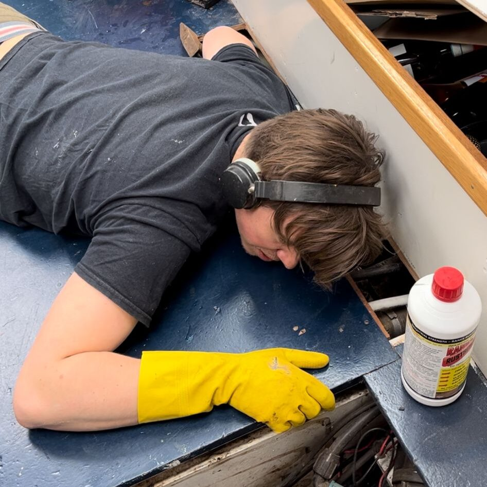

## Alle hoeken van de Luwte

Sinds we over zijn naar de Kokernoot hebben we gelukkig niet stilgezeten. De boot ligt, as we speak nog steeds in het water en dat is wat anders dan we voor ogen hadden. De scherpe kijker heeft in de vorige post gezien dat we eigenlijk afgelopen week het water uit zouden gaan. Dat werd afgelopen maandag en is inmiddels verschoven naar "binnenkort". Overigens niets ten nadele van de werf hierin. Ik heb te kennen gegeven dat ik in tegenstelling tot de meeste klanten die hij heeft wél flexibel ben en gerust nog even wacht tot er een mooi plekje voor mij kan worden vrijgemaakt waar we wat meer onze gang kunnen gaan. Er is genoeg te doen in de tussentijd.

De vorige keer dat de boot in Lelystad eruit ging was een heel andere ervaring, vooral in het pendelen tussen werk, huis, studie, boot en randzaken. Met de boot zo dichtbij kan ik aan het eind van de middag in 10 minuten naar de boot rijden, een klusje doen en weer terugrijden. Dat maakt alles een stuk aangenamer en minder gepropt in een bepaald tijdslot waarin het moét gebeuren.

De eerste grote klus afgelopen twee weken was het leegmaken van de boot. Na de eerste auto vol geladen te hebben dacht ik dat we er wel bijna waren. Nog één keer op en neer naar de garage van de vader van Jen en dan zouden we er wel zijn.  
Inmiddels ben ik er achter gekomen dat we de afgelopen zeven jaar toch best veel zooi hebben verzameld. Het blijft (ja nog steeds) maar komen. Elke dag rijd ik wel weer weg met een halve auto vol spul...

Het leeghalen van de boot heeft drie redenen: 1) De boot zit op de grens van de capaciteit van de kraan en moet dus zo licht mogelijk zijn. 2) We kunnen alles doorspitten, irrelevante zaken weggooien en zoals ze dat in de botenwereld noemen "Schoon schip maken". 3) Nu alles echt helemaal leeg is, is dit een uitgelezen moment om alles helemaal netjes te maken, te schilderen en klaar te maken voor volstouwen met weer nieuwe zooi die hopelijk ietsje meer functie heeft. Dit laatste punt is de sterspeler in het creëren van yogaklasjes.

De lijst met spullen hebben we nog niet opgemaakt, maar een van de eerste echte uitdagingen was het leeghalen van de punt. Los van de ankers, zwemflippers, hangmatten, barbeque, en trossen die er lagen, kwam ik er achter dat er ook nog wat broodjes achter een schot lagen. Niet het type dat schimmelt, maar het type dat gemaakt is van massief lood, zo groot als een klassieke broodtrommel.  
Één broodje weegt tussen de 20 en 30 kilogram en we hadden er 11 van liggen. Achter een schot. Onder het bed. Inmiddels zijn we een paar stappen verder, maar om een idee te krijgen heb ik het schot in de foto hieronder ingetekend.

<figure class="wp-block-image aligncenter size-large">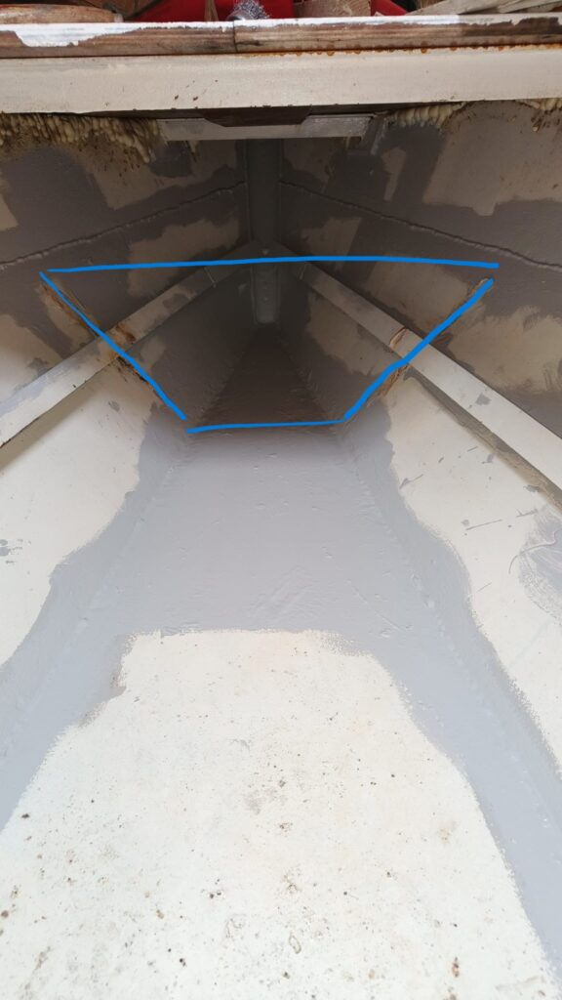<figcaption class="wp-element-caption">Boot yoga zwarte band sessie: Eerst het lood uit de punt halen, daarna roest bikken, daarna met zuur en ontvetters aan de slag en tenslotte 6 dagen elke dag een laagje verf.</figcaption></figure>

De daaropvolgende yoga-sessies zijn in deze foto mooi te zien. Na het verwijderen van het schot kwam er namelijk een vervelende hoeveelheid bruin staal tevoorschijn. Op mijn zij in foetushouding kan ik net in het onderste deel van de foto terecht. Vanuit daar was het passen en meten om te bikken, zuren en schilderen de afgelopen week.

Om de serie af te maken heb ik nog een paar kiekjes genomen van de hoekjes waar ik nu zoal mee bezig ben. Het worden straks de door mij meest gewaardeerde stukjes van het schip, waar de minste ogen op zullen vallen, dus ik neem van deze gelegenheid gebruik om mijn eigen ego even te strelen:

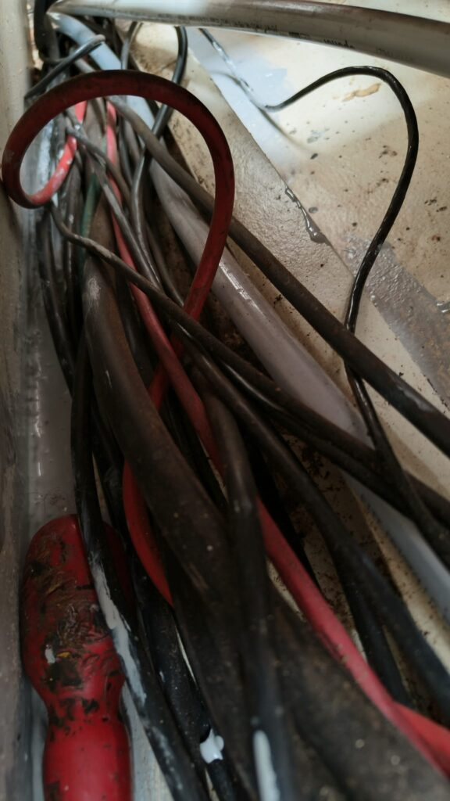

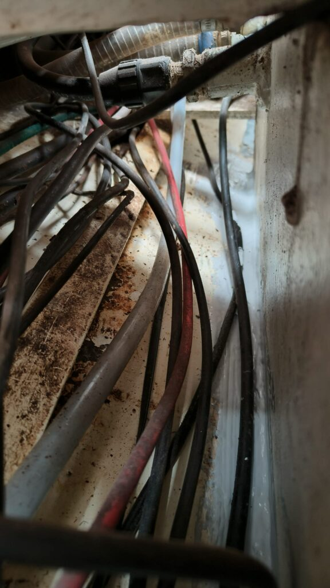

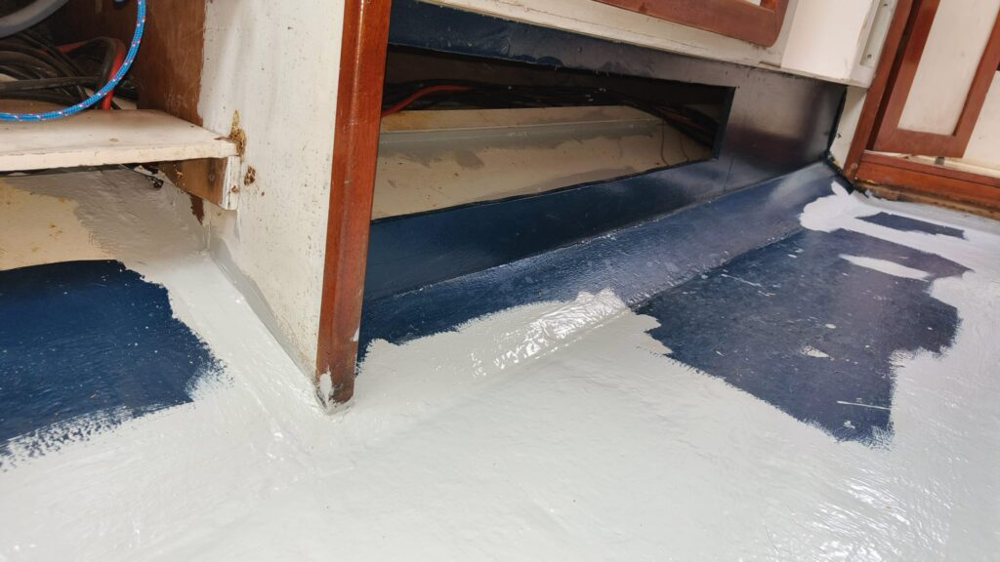

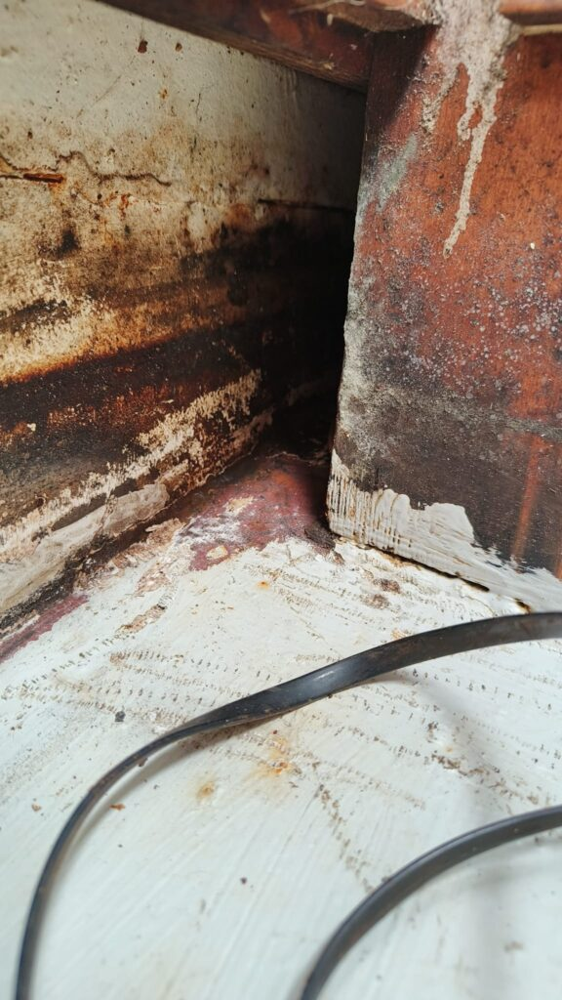

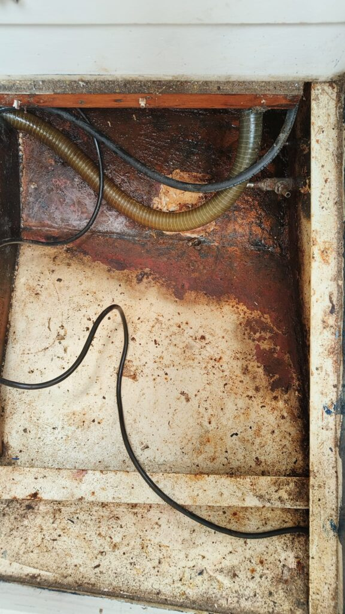

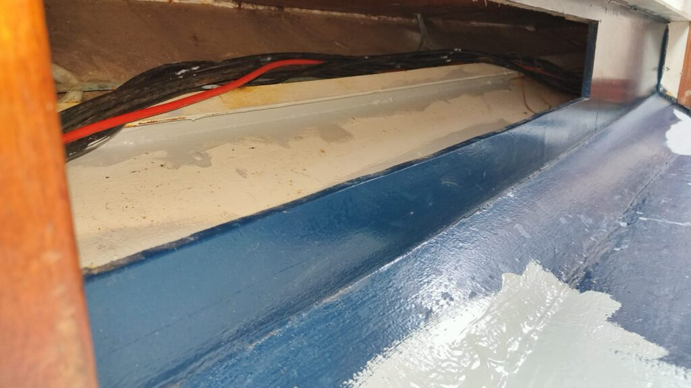

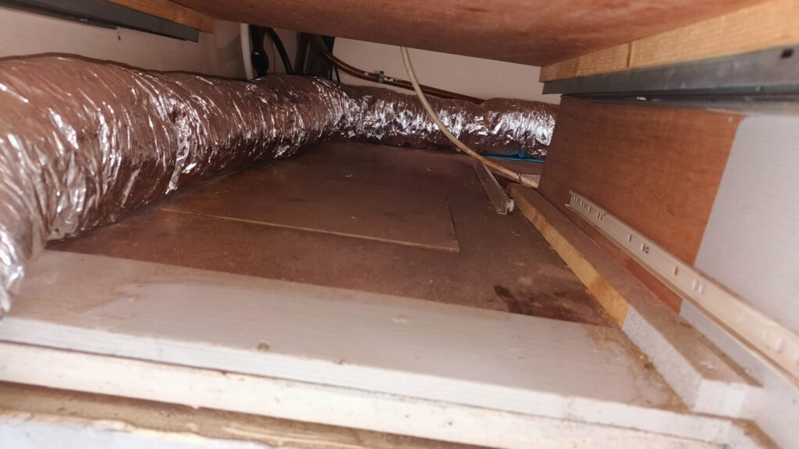

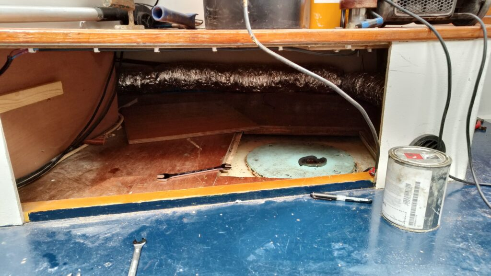

Mocht je nou nog eens bij ons aan boord komen en benieuwd zijn naar de ware grootte, ik geef met liefde rondleidingen.

Gelukkig sta ik in deze strijd niet alleen. Jen heeft zich tot ware meesteres van de boterhammen omgedoopt. Dat klinkt misschien wat traditioneel, maar hier hebben we een gezamenlijk belang bij. Het stelt mij in staat om langere dagen te maken die Jen in staat stellen om alleen in de weekenden te klussen en voor de rest focus te houden op de scriptie.  
Zoals de meesten van jullie waarschijnlijk gezien hebben op de [Instagram](https://www.instagram.com/sailingluwte/) is Jen in de weekenden een yogaprinses waar ik nog veel van kan leren. Slechts één keer moest ze nota bene achteraf bekennen dat ze *bijna* gevloekt had. *Bijna*.

## Vinkjes zetten

Ook deze en afgelopen twee weken zijn we weer hard bezig geweest om post-its van de muur te trekken, bij te plakken en te verschuiven. Voor de compleetheid van ons (b)logboek kunnen wij vermelden dat de volgende taken zijn volbracht:

-   Dieseltanks leeghalen, openen, inspecteren en schoonmaken
-   Tankmeter in dieseltank installeren
-   Radarbeugel kopen
-   Handboek noodsituaties opstellen (V1)
-   Contract huisbewaarderschap opstellen
-   Marcom-B (Global Marine Distress & Safety System)
    -   operationele vaardigheden cursus volgen
    -   Marcom-B praktijkexamen (Gehaald!)
    -   Marcom-B bedieningscertificaat aanvragen
    -   Marcom-B registraties apparatuur & noodcontacten bijwerken
-   Reddingsvlot:
    -   Uitzoeken hoe je een reddingsvlot test
    -   Reddingsvlot testen
    -   Reddingsvlot inventaris opstellen
    -   Keuze nieuw reddingsvlot maken
    -   Nieuw reddingsvlot kopen
    -   Grabbag inventaris maken
-   Belastingdienst bellen ivm toeslagen
-   Beslissing nieuwe marifoon maken
-   Vlogcamera uitzoeken / kopen
-   Bubbelglazen laten graveren
-   Wasmachine overwegingen maken
-   Ankeren:
    -   Ankerbak inspecteren
    -   Ankerketting uitmeten + markeringen maken
    -   Nieuwe ankerketting zoeken
    -   Ankerketting kopen (50 M)
-   Extra zonnepanelen aanschaffen
-   Al het houtwerk binnen schuren (dank Jen en Lauren!)
-   Offertes voor verstaging aanvragen
-   Huik kopen
-   Antifouling kopen

## Maritieme radio communicatie

Wie mij op een feestje tegenkomt, heeft in de loop van de avond grote kans een pleidooi van mij aan te horen over de vrijheid van de zee. *Mare Liberum* is niet voor niets het grondbeginsel van de internationale wet- en regelgeving in de scheepvaart.  
Maar gaandeweg ben ik er achter aan het komen dat *Mare Liberum* een zogenaamde contradictie in terminus is geworden. Het grondbeginsel dat het ooit is geweest is al lang niet meer en hoewel het zeerecht met 168 participerende landen een van de meest succesvolle en standhoudende internationale verdragen is, kun je niet echt spreken van een "vrije zee". Voor de geïnteresseerden onder ons [raad ik deze scriptie aan](https://libstore.ugent.be/fulltxt/RUG01/002/782/711/RUG01-002782711_2019_0001_AC.pdf) eens te lezen, over de juridische kaders voor kapiteins ten aanzien van het wel, of niet, hulp verlenen aan (in nood verkerende) bootvluchtelingen op zee.

Één van de pijlers waarop het zeerecht rust is de erkenning dat je elkaar als schippers nodig hebt op zee, los van economische, of geopolitieke belangen die daarmee gemoeid gaan. Iedereen heeft er belang bij om niet tegen elkaar aan te varen en hulp te krijgen als er wel iets misgaat. Wil je meedoen aan die voordelen, dan moet je wel binnen de lijntjes kleuren. Daarom stonden de afgelopen twee maanden eerst het Klein vaarbewijs II, daarna het GMDSS theorie examen en vervolgens het Marcom-B praktijkexamen op de planning.

Die drie hebben allemaal gevolg in elkaars verlengde. Waar Klein vaarbewijs I zich vooral richt op verkeersregels op het water, het herkennen van boeien en weten wie er voorrang heeft, richt deel II zich op de (kust)navigatie, het begrijpen van kompasafwijkingen en het verrekenen van stroming- en wind verzet op de kaart. Zoals de schippers dat al honderden jaren doen met passer en kompas. Dit bewijs geldt tevens als het zogenaamde *International Certificate of Competence* (ICC) waarmee ze in Europa en daarbuiten vaak kunnen erkennen dat je de juiste vaardigheden bezit om je schip te besturen.

Het GMDSS staat voor *Global Marine Distress & Safety System*. Dit examen heeft te maken met alles dat betrekking heeft tot nood- en reddingsoperaties op zee. Welke apparaten zijn er? Wat doen ze? Wie schakel je daarmee in? Wanneer werken ze wel, en wanneer niet? Plus nog een stuk of honderd afkortingen en hun betekenis.

Na het behalen van deze kennistoets mag je op voor je *Beperkte Maritime Radiocommunicatie* (Marcom-B) praktijk toets. In mijn geval bij vaarschool de Albatros in Hoorn. Tijdens dit examen laat je zien hoe dat je de GMDSS apparaten kent en kunt gebruiken op de juiste manier. Het is wat lastig oefenen met dat gebruik als je het apparaat niet mag gebruiken. De cursus à €80 vond ik te duur, dus werd het toch maar YouTube filmpjes kijken, foto's en plaatjes bestuderen en eens bij mijn ouders aan boord spieken hoe de knopjes werken.

04 mei was het zover. In het zaaltje dat zowel wachtkamer, als examenkamer was met een prikbord als scheidingswand, kon ik van tevoren nog even op de computer oefenen met apparaten op de virtuele brug:

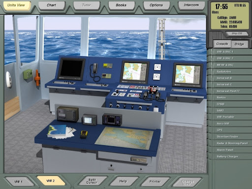

Terwijl ik een beetje aan het rondklikken was kon ik meeluisteren naar hoe het er aan de andere kant van het prikbord aan toe ging. Dat was best fijn, want omdat ik zo vroeg was kon ik zo goed als het hele examen meeluisteren en zelf snel nog even wat vragen opzoeken.  
Minder fijn was hoe het met de kandidaat ging. De al wat oudere man zat voor het eerst sinds zijn studietijd weer in een examenbankje en er was aan hem te horen dat hij vroeger ook al niet zo'n kei was in de spanning die hoort bij examens. Toen hij een verkeerd antwoord gaf en de examinator dat liet blijken liepen de gemoederen snel hoog op tot het punt dat de examinator hem moest geruststellen. Ik ben blij dat we niet bij hem aan boord zitten als er een keer een stressvolle situatie voorbij komt..

Gelukkig verliep mijn eigen examen wat gemoedelijker. De medekandidaat waarmee ik tegelijk zat was een stuk zenuwachtiger en maakte wat meer foutjes. Het is vervelend om te erkennen dat ik dit zo ervoer, maar ik werd er eigenlijk ontzettend rustig van dat ik het nét iets beter had voorbereid en het als vanzelf ging.

Bijna acht jaar lang heb ik mij lopen opwinden over het halen van tentamens. Meestal niet in één keer, laat staan met goede voorbereiding. En nu schud ik ze uit mijn mouw alsof het niets is en vind ik het nog leuk ook. Ik hoop niet dat het komt doordat ik eindelijk verstandig aan het worden ben, maar ik begin nu eindelijk te begrijpen waarom Jen altijd van die hoge cijfers kan en wil halen..

## Mayday Mayday Mayday

Naast de Marcom-B en de bijbehorende kennis over het vragen en verlenen van hulp op zee, moet je als schipper uiteindelijk ook voor jezelf kunnen zorgen als het fout gaat. De afgelopen twee weken heb ik daarvoor alle avonduren besteed aan een zoektocht naar wijsheid op het gebied van *worst case scenarios*.

Niet het leukste onderwerp, wel een belangrijke.

Zo'n drie jaar geleden kreeg ik de *Offshore Cruising Encyclopedia* van mijn vader. Volgens hem staat alles wat je moet weten er in.

<figure class="wp-block-image size-large is-resized">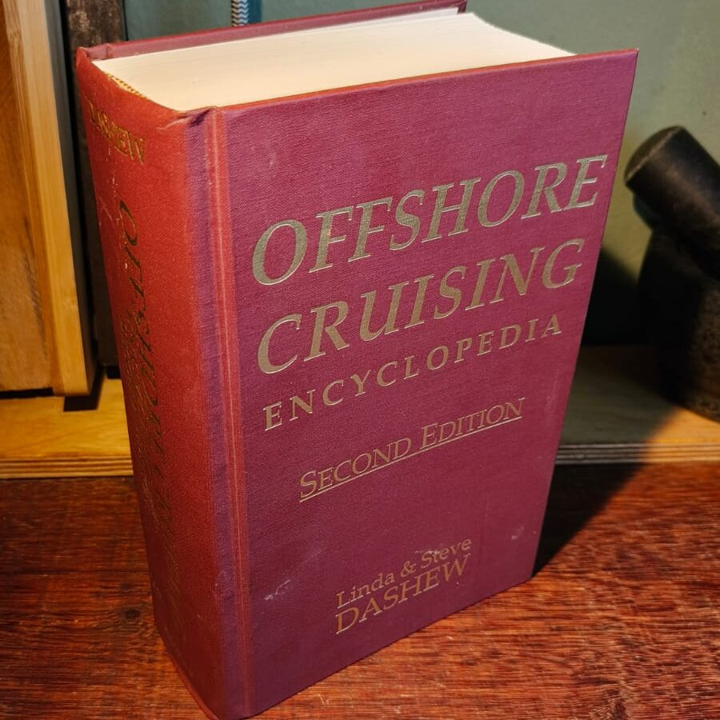</figure>

Ik ben nooit echt een lezer geweest, dus dit ruim 1.200 pagina tellend exemplaar heeft vooral heel lang heel intimiderend in de kast gestaan. Af en toe openslaan, om daarna toch maar weer dicht te slaan was tot voor kort wat ik er mee heb gedaan. Tot twee weken terug.

Inmiddels ben ik beste vrienden met deze encyclopedie en laat ik mij graag informeren. Het boek is niet directief geschreven, maar beschrijft eigenlijk alleen welke overwegingen je zou moeten maken. Laat dat nou net de stijl zijn die deze autodidactische anti-autoritaire jongeman erg aanspreekt.

Vanuit de overwegingen en terminologie in dit boek heb ik overigens vele uitstapjes gemaakt naar het internet om op specifieke onderwerpen mijn eigen mening verder te vormen. De focus van afgelopen twee weken lag bij het *last resort*: Het moeten verlaten van het schip.

De scenario's waarin je daarmee te maken krijgt zijn nooit rooskleurig. De hoofdstukken in de offshore bijbel op dit gebied besteden dan ook veel meer aandacht aan het niet hoeven verlaten van het schip, dan over het wél verlaten van het schip. Misschien dat ik wat doorgedraafd ben, maar door hier volledig in te duiken en een visie op te vormen, ben ik veel sterker gaan voelen hoe belangrijk het is dat je uit die situaties blijft en dat je daar alles voor moet inrichten. De bereidheid om over dit onderwerp na te denken is voor mij dan ook een belangrijke factor in het straks aan boord bereid zijn om scherp te blijven in het voorkomen van deze situaties.

### Het Reddingsvlot

Als je onverhoopt dan toch in de situatie komt dat je je schip verlaat, is het fijn als je niet hoeft te zwemmen of, zoals in de goede oude tijd, je vast te moeten klampen aan een stuk wrakhout. Hiervoor zijn al decennia reddingsvlotten op de markt. Compacte kisten of tassen met daarin een opblaasvlot dat zichzelf ontvouwt als je aan het touwtje trekt.

De Luwte heeft sinds onze eerste zeetochten een oud reddingsvlot dat mijn ouders nog hadden staan aan dek. Deze deed bovenal dienst als opstapje naast de mast zodat ik goed bij de zeilen kan bij het hijsen (omhoog trekken), strijken (omlaag halen) en reven (kleiner maken). De stickers waren er al lang af gevallen voordat deze bij ons aan boord kwam en over de werking was eigenlijk niet heel veel bekend. Stiekem hoopte ik dat hij nog in topconditie zou zijn en we deze mee konden nemen, maar voor de zekerheid stond een nieuw vlot al wel een tijdje op de begroting.

Er zijn twee manieren om er achter te komen of een vlot nog goed is: 1) laten keuren en 2) zelf keuren.

Zoveel schippers zoveel meningen waarschijnlijk, maar zowel mijn vader als de Offshore Encyclopedia stellen vragen bij de kwaliteit van het laten keuren. Je stelt jezelf daarmee afhankelijk van de kwaliteit van de keurmeester en het werk dat hij verricht, zonder dat je er zelf bij bent. Er zijn legio verhalen over "gekeurde" reddingsvlotten, die eigenlijk niet aan de kwaliteitsverwachtingen deden van de eigenaar. Dat staat nog even los van of het vlot zichzelf wel of niet zou opblazen in geval van nood.

Had ik al genoemd dat ik een lichte vorm van anti-autoriteit wel kan waarderen?

Het onderzoek naar hoe je en vlot keurt heb ik deze winter al eens uitgevoerd en is redelijk eenvoudig, al dien je wel secuur te werken. Het voordeel van dit zelf doen is dat je zelf je kwaliteitskeurmerk kunt bepalen. In ons geval: extreem streng.

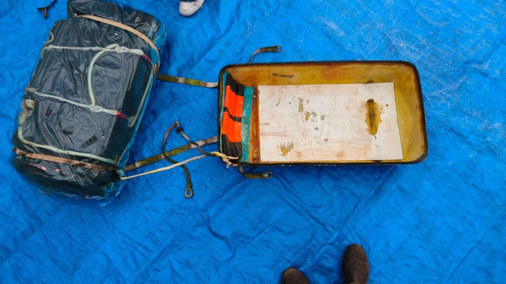

Eigenlijk al direct toen we het kistje openmaakten was onze keuze gemaakt: Er komt een nieuwe voor in de plaats. Het is lastig vast te leggen op een foto, maar er waren veel details die niet lekker zaten. Alles zag er oud uit, de CO2 cilinder die voor de lucht zorgt was volledig gecorrodeerd en het rubber was plakkerig, wat mij de indruk gaf dat het rubber aan het degraderen was.

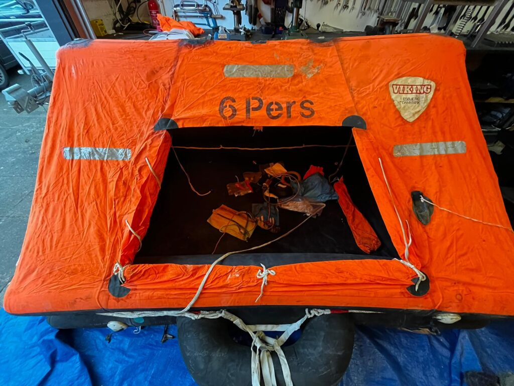

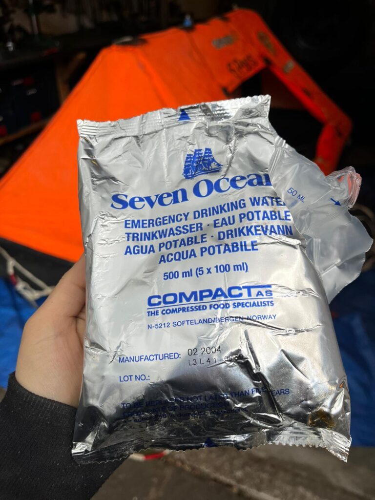

Desalniettemin hebben we het vlot wel even opgeblazen met de compressor en van top tot teen uitgeplozen. Dat was een heel leerzame ervaring, waarbij we even konden bekijken wat je zoal in een reddingsvlot aantreft. Wat mij bijvoorbeeld verbaasde was dat er in dit vlot helemaal geen visgerij aanwezig was en ook niets te eten. Alleen 2 liter water dat een houdbaarheidsdatum van 2009 had..

Goed. De keuze voor een nieuwe is dus al gemaakt, maar de grootste les die we hier uit trekken is dat we ook goed moeten nadenken over de zogenaamde *Grabbag*. Het woord zegt het al: Je handtasje voor noodsituaties. Wat stop je daar allemaal in?

### De *bag*\-up van de back-up van de back-up

Je hebt ruimte voor één tas met de belangrijkste items die je bij je kunt hebben. Wat geef je prioriteit? Als je niet te dun bent kun je bijvoorbeeld prima een week of twee zonder eten. Zonder water is een groter probleem.

Prettiger is natuurlijk als je wel binnen twee weken wordt opgepikt, dus je kunt ook prioriteren naar middelen die dat proces versnellen.

In de tijd van de Offshore Cruising Encyclopedia waren de middelen nog niet zo compact en toegankelijk als ze nu zijn. We varen tegenwoordig met breedband internet waarin continue communicatie mogelijk is. Destijds had je nog wel eens een verdwaalde schipbreukeling die 40 dagen op zee dobberde, wachtend op een voorbij varend vrachtschip. De reddingsoperaties midden op de oceaan die ik heb kunnen vinden van de afgelopen drie jaar waren allemaal binnen 48 uur succesvol opgelost dankzij directe satellietverbindingen en EPIRB (*Emergency Position Indicating Radio Beacon*).

In dat licht hebben we er toch maar voor gekozen om naast de al aanwezige middelen (2x marifoon, 1x portofoon, 1x Starlink internet, EPIRB) óók nog een *Garmin Inreach Messenger* aan te schaffen voor in onze grabbag.

<figure class="wp-block-image size-large is-resized">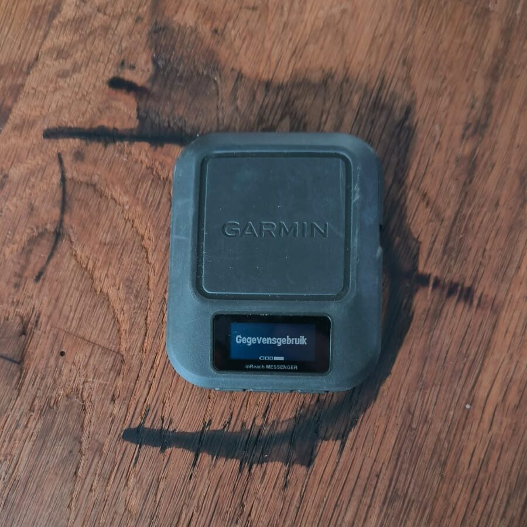</figure>

Dit apparaatje is kleiner dan een pakje kaarten en kan, met of zonder telefoon via de satelliet berichten versturen en ontvangen. De back-up van de back-up van de back-up dus. En eentje die gemakkelijk mee te nemen is in geval van nood.

Ik vermoed eigenlijk dat we deze nog een tweede functie gaan geven en dat is het verzorgen van een internet-loos leven, zonder onze familie helemaal in het duister te laten tasten. Met dit apparaatje kunnen wij bijvoorbeeld dagelijkse updates versturen inclusief onze locatie en een statusupdate, zonder dat we direct gebombardeerd worden door de wereld van WhatsApp, Instagram, Facebook en E-mail. Dat houden we wel weer bij als we ergens voor anker liggen.

Voor de nieuwsgierigen onder ons hieronder nog een lijstje van de andere items in onze grabbag (onder voorbehoud):

-   Vuurpijlen
-   EPIRB
-   Marifoon portofoon
-   Garmin Inreach Messenger
-   Powerbank met zonnepaneel, lamp en kompas
-   Zaklamp / hoofdlamp kleuren
-   Pot pindakaas
-   Water (jerrycans op dek 80% gevuld zodat ze drijven)
-   Mes naast reddingsvlot
-   Zipbags
-   Batterijen
-   Hoorn
-   Visgerei
-   Vitaminen / ORS
-   Notitieboek + potlood + pen

## Op een behouden vaart

Om dit onderwerp toch nog even wat luchtiger te maken moet ik nu weer wat aandacht besteden aan de leuke zaken. Anders krijgen we weer allemaal bezorgde mensen op de lijn.  
Zoals ik eerder beschreef ben ik het belangrijk gaan vinden om wél bewust in het gevoel van noodsituaties te stappen, om ook te voelen hoe belangrijk het is om er niet in te komen. Uiteindelijk gaan we uit van een zeiltocht zonder al deze vooraf uitgestippelde scenario's en willen we vooral veel gaan proosten op een behouden vaart.

Het is een gewoonte die niet moeilijk is in ere te houden om bij een goede aankomst een borrel te drinken. Of je nou een oceaan oversteekt, of je boot van de ene box naar de andere moet verleggen (wat een stuk ingewikkelder kan zijn!), een behouden vaart is een behouden vaart.

De jonge romanticus in mij gaf Jen voor haar 21e verjaardag alvast onze trouwglazen. Verpakt in een met schuim ingelegde KLM stewardess flightcase.

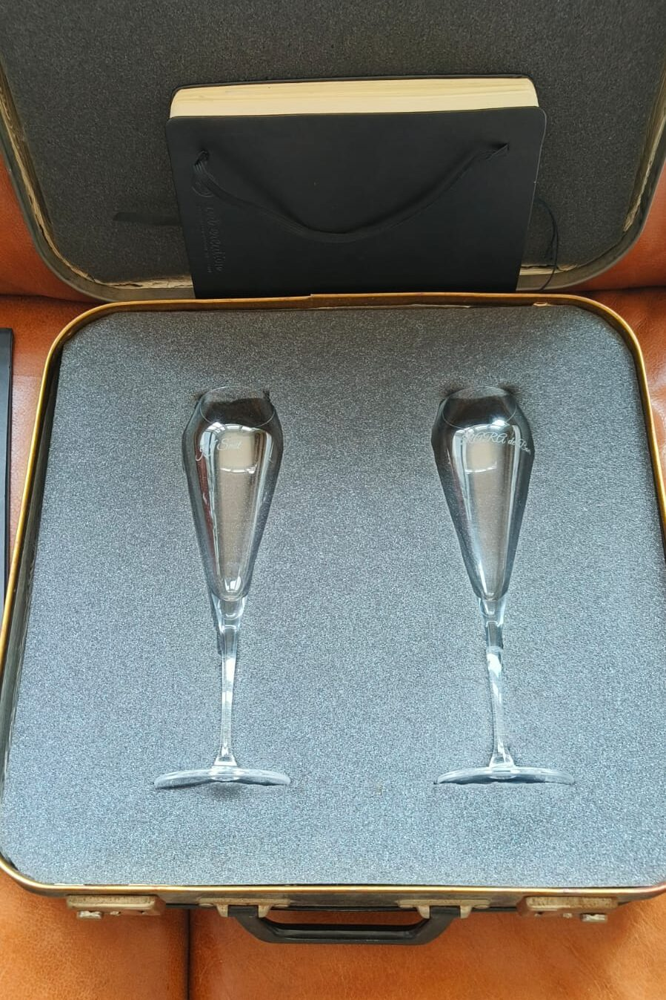

Van trouwen is helaas nog geen sprake, maar we maken wel al met enige regelmaat gebruik van onze glazen om de grote momenten in onze levens te vieren. Afstuderen, verjaardagen, jubilea etcetera. Ons bubbelboek begint zich al aardig te vullen met de (vaak aangeschoten) bijbehorende verhalen.

De momenten dat de glazen tevoorschijn komen zijn natuurlijk áltijd leuk, maar ook altijd een tikkeltje spannend. We moeten wel voorzichtig blijven met die glazen!  
Jen brak gelukkig die spanning bij ons vorige bubbelmoment en moest met het schaamrood op haar kaken bekennen dat het glas met haar naam toch gebroken was..

De jonge romanticus in mij was gelukkig wel al pragmatisch genoeg om te voorspellen dat we niet ons hele leven met deze twee glazen zouden doen. Scherven brengen immers geluk. Dus kocht ik naast de twee gegraveerde, ook twee ongegraveerde glazen als reserve. Inmiddels is er een nieuwe JJ Smit in de flightcase en zijn we klaar voor nieuwe viermomenten. Deze glazen gaan samen met een kistje bubbels mee op reis om op de grote bestemmingen te kunnen proosten op een behouden vaart.

Maar nu eerst over tot de orde van de dag: Tijd voor boot-yoga zwarte band.
