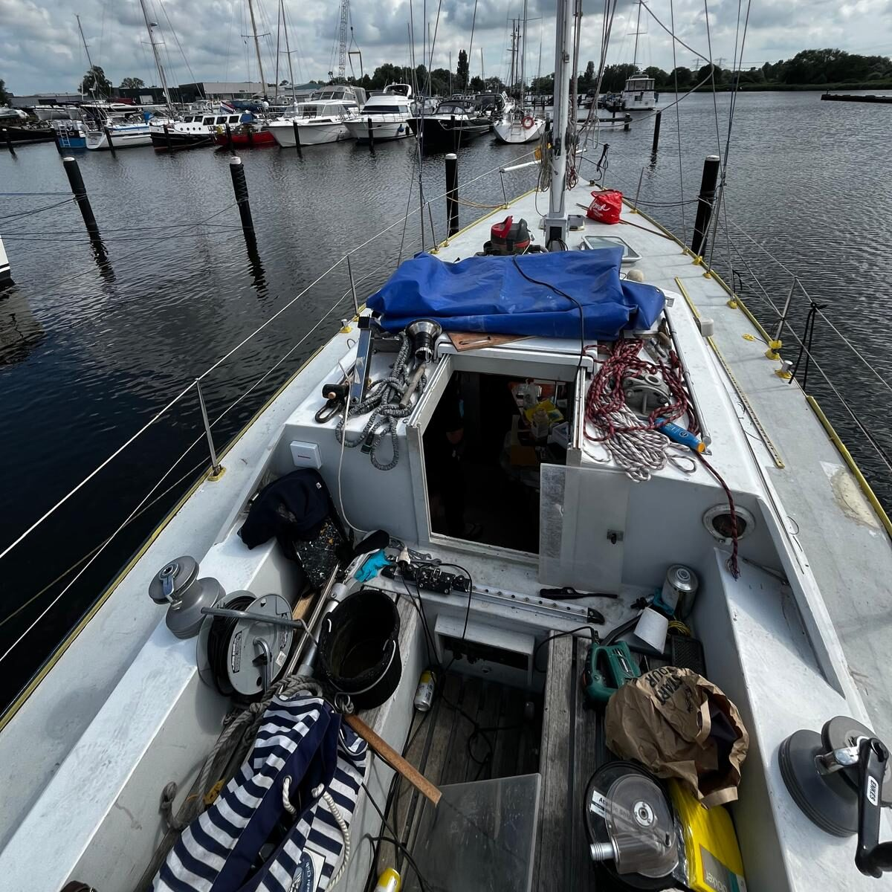
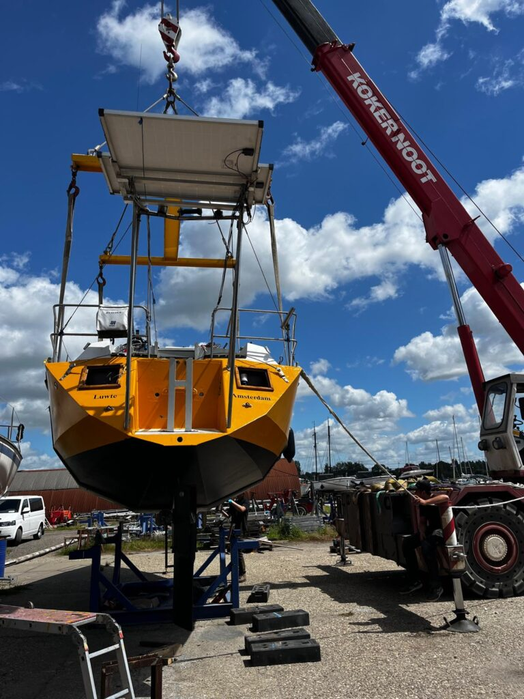
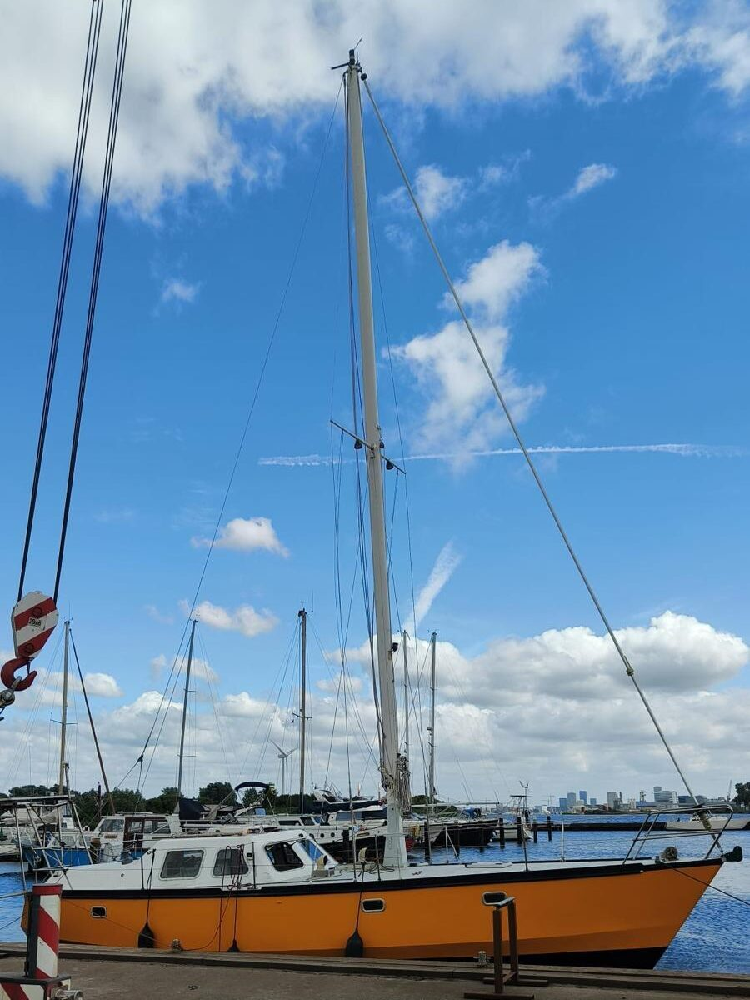
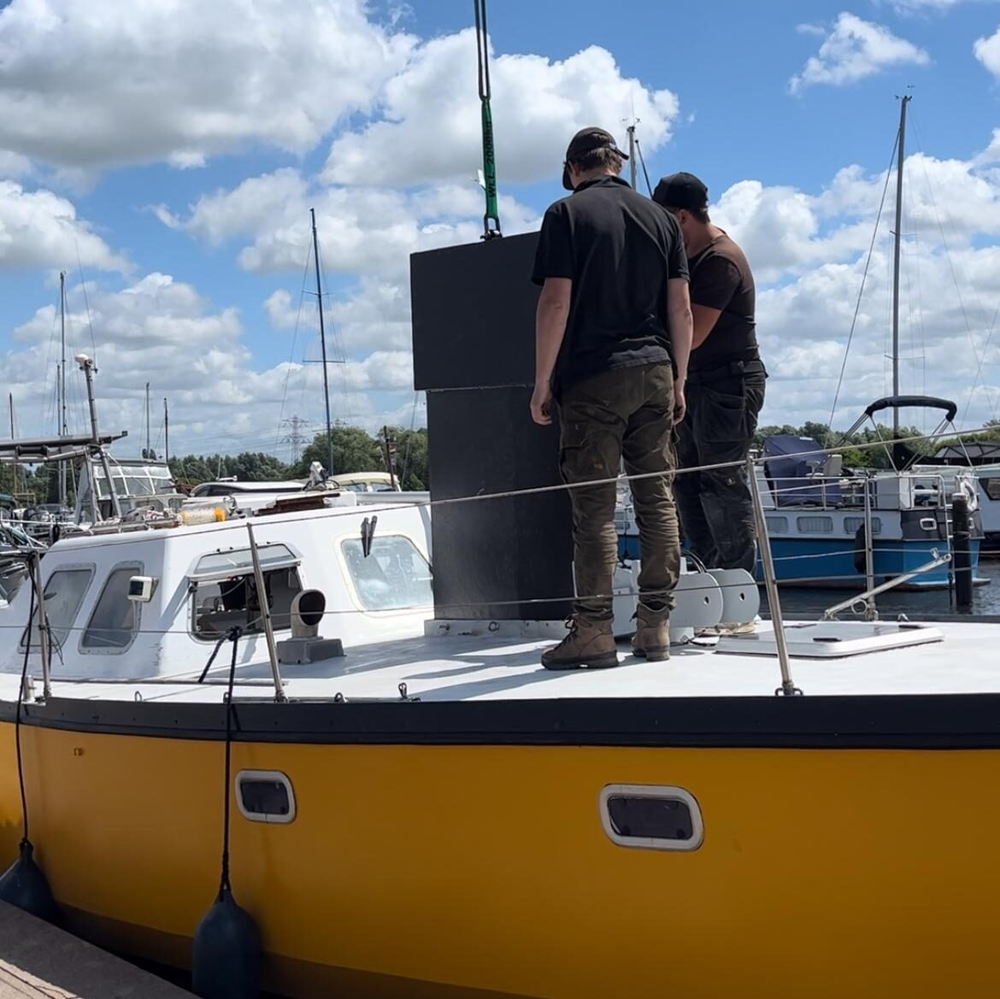
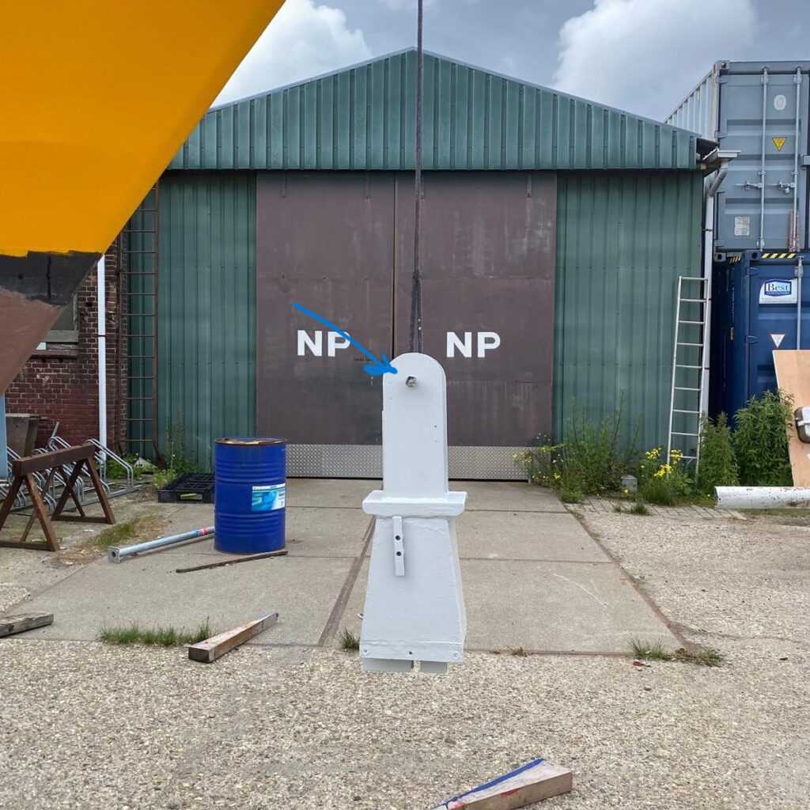
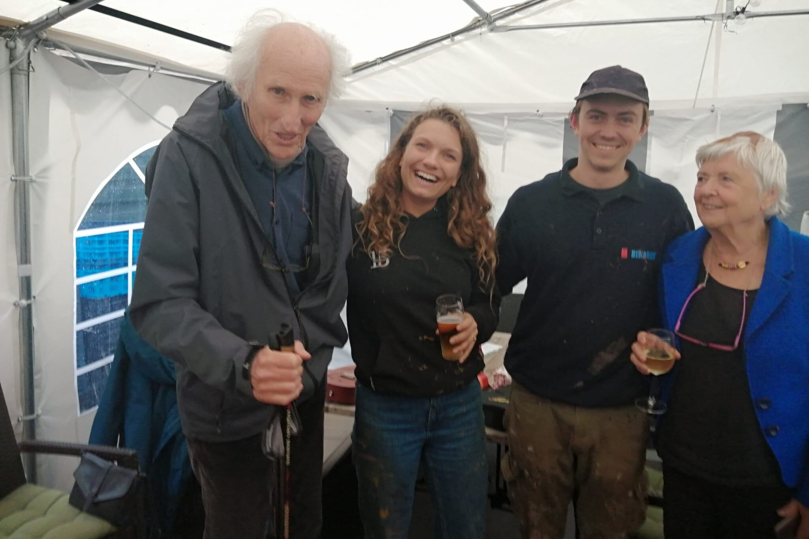
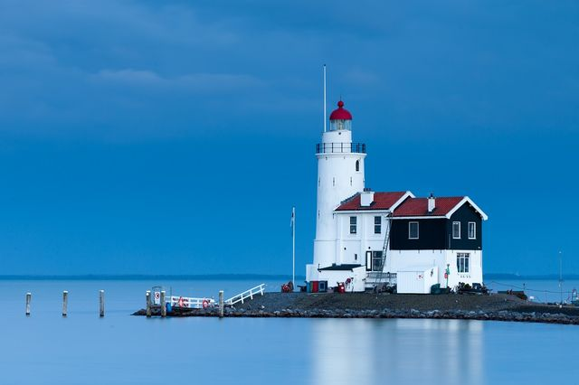

De laatste loodjes wegen het zwaarst, maar zijn tegelijkertijd het leukst. Al het harde werk aan het goed klaarmaken van het schip komt uiteindelijk samen in de afwerking: De laatste laag geel, de laatste laag zwart, vernieuwde mast(voet), een nieuwe laag antislip en ga zo maar door.

Enigszins beurs maken we grote klappen. Het schip ligt inmiddels weer in het water, waar ze hoort, en de afsluiters en schroefas bleven lekvrij. De laatste dingen doen we lekker in het water.

Dat kan ook niet anders, want morgen verhuizen we naar de boot en laten we de Tasmanstraat voorlopig achter. Ons huis is tegelijkertijd leeg en vol. Lege planken en kasten, alles netjes schoongemaakt (credit naar Jen) en tegelijkertijd vol met dozen. Zowel die van onszelf, als die van onze huisbewaardster Tink.

De boot is daar nog niet helemaal klaar voor, maar wel bijna. We haalden we dit weekend eventjes alle ramen eruit om ze opnieuw te kitten, maar net toen we klaar waren om de kozijnen goed af te werken was het weer klaar met het mooie weer. De Luwte ligt inmiddels met een tentzeiltje over het dekhuis nog even goed door te luchten.. Dat gaan we tussen de buien door wel afmaken de komende dagen.

## Takeldag

Zo ook bij het op de bok zetten beschreef ik al dat het altijd wat ongemakkelijk voelt, zo'n boot takelen, en nu was dat niet anders. De werfbaas begon de ochtend met uitspreken dat hij vond dat ik niet zenuwachtig moest zijn... Daar word je vanzelf zenuwachtig van.

Het stelt in de praktijk niet zo heel veel voor, maar het zijn veel stappen achter elkaar die je wel allemaal in de goede volgorde moet zetten. Dat in combinatie met hoeveel werk er in is gegaan, maakt het toch wel een beetje een zenuwslopende dag voor mij. Zo'n dag waarop je 's avonds weer richting huis gaat en er achter komt dat je de gesmeerde broodjes die je mee had helemaal bent vergeten. En dat water drinken er ook niet echt van gekomen is.

Onze takeldag werd nog even een dagje uitgesteld. De kraan werd gestart, maar al meteen was te horen dat deze geen toeren wilde draaien. Een defecte spoel in de leiding die de gashendel aanstuurde bleek de boel te dwarsbomen. De monteur was er binnen een half uur bij, maar kon niet voor borreltijd op een oplossing komen. We moeten er maar aan wennen dat de dingen niet altijd strak gepland kunnen worden. Een goede oefening dus.

Van de bok naar het water was zo gebeurd. Daarna begon het ingewikkeldere werk. De kiel en mast zijn onderdelen die een stuk preciezer komen en waar veel tussenstappen bij komen kijken. Daarbij zijn dit ook de onderdelen waar de krachten op komen te staan. Een beetje opletten dus.

Nadat de Luwte weer in het water lag, was het tijd voor de kiel. Zoals je ziet gaat deze vanaf boven de boot in en zakt vervolgens naar beneden. Behalve dat er door de beweging van het rijden en de wind een 1.000 kg zwaaiend gevaarte boven de boot kwam te hangen, ging dit helemaal als gepland. Het terugplaatsen van de kabels waarmee we kunnen hijsen ging goed en daarna kon de mastvoet worden teruggeplaatst. Allemaal van een leien dakje.

Maar toen de mast.

Ook hier ben ik de afgelopen weken vrijwel continu mee bezig geweest. Alles nalopen, nieuwe verlichting installeren, nieuwe verstaging, nog een keer alles nalopen, nog een keer alles nalopen, schoonmaken, schilderwerkjes, nieuwe vallen, noem maar op. De mast is, eenmaal op de boot geplaatst, namelijk een stuk lastiger te bereiken en te onderhouden.

Om de mast een goed fundament te geven is mijn vader in de weer geweest met staal- en laswerk aan de mastvoet. Dat komt allemaal vrij precies. Een hoek van 2 graden naar voren of naar achteren betekent over 12 meter een halve meter verschil.

Ondanks onze metingen en her-metingen, zat er toch een halve centimeter hoogteverschil op het oog waarmee de mast aan de mastvoet wordt geborgen. Dat betekende dat bij het plaatsen van de mast, deze dus niet goed kon worden vastgezet op zijn plek, en we de mast weer van boord konden halen, op de schragen leggen, de kiel omhoog moest, de kabels losgemaakt, de mastvoet afgekoppeld, om daarna het hele pakket passend te maken op de wal. Duwen, trekken, zagen, schaven.. Maar uiteindelijk paste ook de mast in de mastvoet..

## Petje af.

Naast de boot zitten we op een sneltrein met afscheidsborrels, laatste etentjes en bezoekjes aan opa's en oma's. Één van de hoogtepunten in die reeks was onze afscheidsborrel op Marken bij Z.V. Het Y. Zoals de meeste evenementen van dit voorjaar, viel ook deze in een regenbui, maar dat mocht de pret niet drukken. 's Middags nog een laatste laagje antifouling en toen direct in de auto naar "De Verkeerde Wereld". De plek op Marken die wat mij betreft het ultieme midden houdt tussen snackbar, restaurant, café en ijszaak. Het vaste bier van de tap is Texels Skuumkopke. De rest laat ik aan de verbeelding over.

De Markenliggers, onder leiding van Margriet en Aleid hadden groots voor ons uitgepakt en waren ook in grote getalen aanwezig. Ik denk dat ik op de piek wel een stuk of 30 - 40 mensen telde. Dat moet bijna de hele haven zijn, inclusief twee nieuwe liggers die ons nog nooit gezien hadden, maar toch op hun eigen huwelijksdag even kwamen meegenieten.

Er was gekookt, er waren oneindig veel haringen (door Margriet zelf schoongemaakt), we werden bezongen, kregen goede raad en moesten na alle opvoeringen met onze nieuwe mondharmonica en ukulele met de pet rond om een zeilersloon binnen te halen. Voor mij was het mijn eerste echte betaalde optreden, al weet ik niet zeker of het was om mij zo snel mogelijk te laten stoppen, of omdat ik zoveel talent heb...

Jen werd nog even ondervraagd door de meest ervaren mensen van Het Y. Eerder schreven we al over hoe de Anna P. afscheid nam van de haven en haar bemanning geniet van de oude dag zonder de zorgen van een boot. Voor ons afscheid reisden zij speciaal af naar Marken en zo stonden de oudste (ex-)liggers en de jongste liggers weer even naast elkaar.  
Ik werd direct tot stilte gemaand toen Jan aan kwam lopen, want die wilde even goed met Jen praten over dat hele vertrek. Hij deed een poging om Jen te overtuigen dat zeilen op zee helemaal niet zo'n pretje is, maar daar bleek Jen helemaal niet gevoelig voor. De conclusie van Jan: *Ze heeft aanleg.*

<figure class="wp-block-image size-large is-resized"><figcaption class="wp-element-caption">Corrie en Jan op onze afscheidsborrel</figcaption></figure>

Onze dank is groot voor alle energie en gulle giften vanuit de Markenliggers. We hebben de dag erna meteen besloten om tóch maar een serieus bootmanstoeltje te kopen, waarmee ik veilig naar de top van de mast kan klimmen, mocht ik toch wat vergeten zijn afgelopen weken.

Daarnaast mochten wij nog twee grote cadeaus in ontvangst nemen die ons gaan helpen veilig weer thuis te komen. Het Paard van Marken is één van de bekendste vuurtorens van de Nederlandse wateren en stamt uit 1700. De felle witte kleur en ligging op een uitloper van het eiland, zorgen ervoor dat het Paard vaak één van de eerste bakens als referentie is bij tochten over het Markermeer. Om onze route uit te stippelen op de terugweg, kregen wij een miniatuurversie mee, zodat we altijd weten welke koers we moeten houden op weg naar de thuishaven.

Het andere cadeau maakte mij een beetje sprakeloos. Aleid overhandigde ons een certificaat van de KNRM (Koninklijke Nederlandse Reddingmaatschappij, www.knrm.nl). Deze organisatie bestaat grotendeels uit vrijwilligers die, al dan niet met gevaar voor eigen leven, de levens van mensen op zee of op het strand redden. De KNRM is afhankelijk van donaties en organiseert dus verschillende acties om geld op te halen om het water veilig te houden. Het certificaat dat mij overhandigd werd, verklaart dat er een significante donatie is gedaan aan de KNRM en dat mijn naam daarom wordt vereeuwigd op een van de nieuwe schepen in aanbouw. Samen met Bouke, onze voormalig havencommissaris, zal ik dus toch een beetje in Nederland blijven hangen, om de zeilers en zwemmers hier in de buurt te hulp te schieten waar nodig.

## Dankjewel.

Alle gebaren, klein en groot voelen voor ons als groot en groot. Hoe je daar gepast dankjewel op zegt vind ik soms wat lastig, omdat we onze aandacht moeten verdelen en ook gewoon door moeten met het klaarstomen van de boot. Daarnaast ontvangen we inmiddels ook uit anonieme bronnen giften die we niet direct kunnen bedanken, maar dat willen we via deze weg wel doen. We gaan er wat moois van maken.
