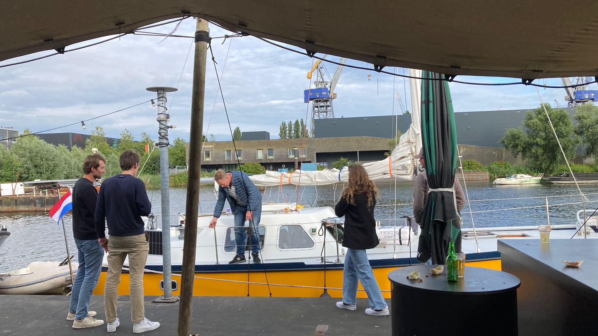
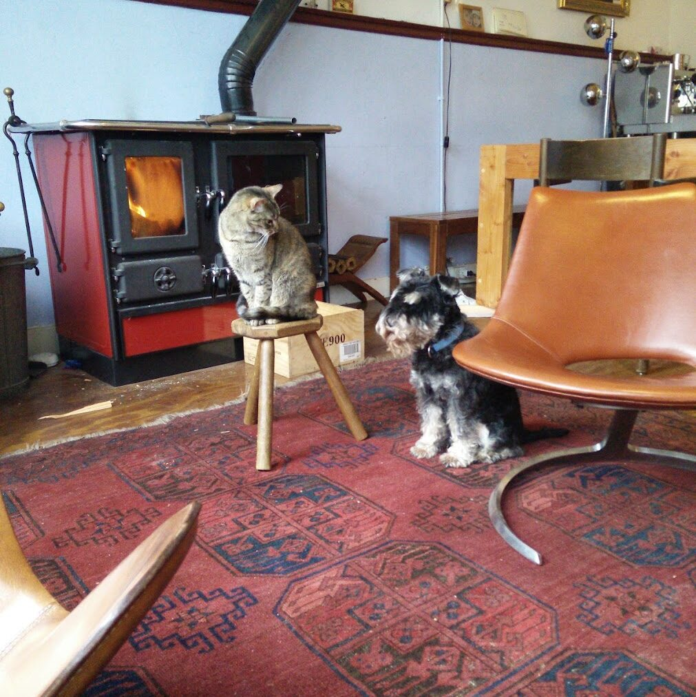
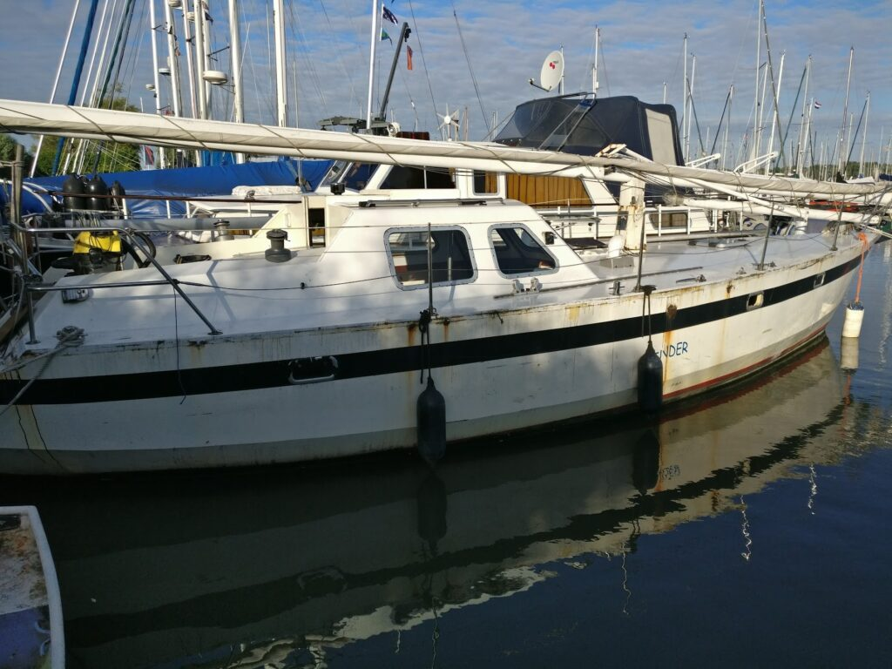

We zijn (bijna) vertrokken. De laatste twee weken voor onze afscheidsborrel waren hectisch, met korte nachten en lange, intensieve dagen. Onze uitzwaaiborrel begon om 18.00 en ik besloot, op lang aandringen van Jen rond 18.10 te stoppen met de laatste klusjes, maar wat lag ze er mooi bij. Iedereen had even de kans om binnen te snuffelen in wat voorlopig ons thuis zal zijn. Voor sommigen een grote meevaller, voor anderen een schok dat we met zo'n scheepje de woeste zee gaan bestieren.

Met een flinke kater stonden we de dag erna op en maakten ons in alle rust klaar om westwaarts en vervolgens zuidwaarts te varen. Gesterkt door alle prachtige verhalen in een voor ons gemaakt tijdschrift was er één ding heel definitief: Dit schip en haar bemanning zijn voorlopig niet meer in Amsterdam.

Dus werd het Haarlem. De goede kant op, maar ook dichtbij genoeg om alle laatste rafelige eindjes af te branden. Hier lagen we inmiddels alweer bijna vastgeroest als nieuwe leden bij onze tweede vereniging: De Watervrienden, met uitzicht op de Mooie Nel.

En hoewel dat uitzicht bevalt, borrelt het bij ons. We willen weg, maar moesten nog laatste klusjes doen en nog belangrijker: Wachten op goede wind. Die goede wind laat net zo lang op zich wachten als de Nederlandse zomer, dus tussen de regenbuien en vlagerige 'zomerstormpjes' rommelen wij verder aan de boot.

## Een stukje geschiedenis

Luwte, volgens de Van Dale een "windvrije plaats" dankt haar naam niet alleen aan de knipoog naar een nautische term. Tussen 2007 en 2009 voer ik als jongetje al eens de oceaan over met de Palustris (www.palustris.nl) en haar bemanning: Mijn ouders, broertje, zusje en scheepshond Storm. Dit laatste bemanningslid, onze scheepshond, kreeg het naar verloop van tijd wel een beetje op zijn heupen. Terwijl wij elke keer leuke dingen gingen doen op de kant, moest hij het fort bewaken en dan voelde hij zich erg in de steek gelaten. De buren in de baaitjes konden meegenieten van zijn niet zo geweldige huilpartijen en dat maakte de overweging om een maatje erbij te zoeken dus steeds dringender.

Zo kwam het dus dat op Curaçao scheepskat Luwte bij de bemanning aanmonsterde. Het was direct duidelijk dat katten een flinke overhand hebben op honden, en dat is altijd zo gebleven.

De foto spreekt boekdelen. Een kat zou namelijk nooit, maar dan ook nooit haar kont op de grond zitten en voelt zich verheven boven al het andere. Als het even kon, zou ze in de nok van het dak slapen, maar dat was bij ons thuis iets te ver van de kachel en wasdroger vandaan.  
Storm had er in het begin wat moeite mee, dat de jongste telg van de bemanning andere privileges had, maar ontdekte al snel dat de nagels van een kat een stuk scherper en sneller zijn dan zijn trotse gelaat. Uiteindelijk at Luwte liever hondenbrokken uit zijn voederbak, op het moment dat hij mocht eten, dan dat ze haar eigen visbrokjes tot zich nam.

### From the ashes..

Ondanks de grote zee-avonturen, waarop Luwte onder andere op zee ontembaar rondjes over het dek rende en zich probeerde vast te klauwen in het stalen dek en Storm zijn behoeftes (niet zo) heldhaftig deed in het gangboord, overkwam beiden een ongelukkig noodlot.  
Luwte is nooit echt geaard in het huiselijke leven in Amsterdam, waarin ze vooral te vinden was in- of op de warme wasdroger. De uitstapjes met de boot waren een verademing, waar ze op avontuur kon en vogels, muizen en andere kleine diertjes als trofee in de schoenen van mijn moeder bracht. Storm was waar hij was, als trouwe hond en viervoeter. Wat dat betreft een omgekeerde ying en yang.

De thuishaven van de Palustris op Marken bracht een avontuurlijk einde aan Luwte. 's Avonds in de regen ging ze op stap en kwam niet meer terug. Een paar dagen later werd ze in de haven gevonden en moesten we er van uitgaan dat ze is uitgegleden en niet meer aan boord is gekomen. De vele zwemlessen die ze kende waren voor anker, waarbij de ankerketting als zwemtrap diende en ze altijd weer bibberend aan boord kwam. In de haven lag die er niet. Een pot met kattenas en de warme herinneringen is wat bleef.

Hoewel ze een beetje een haat-liefde verhouding hadden, ging Storm in de maanden daarna heel snel en vervelend achteruit. Mijn (en ik denk onze) overtuiging is dat hij van liefdesverdriet verbolgen was en haar is gaan opzoeken in het huisdieren-hiernamaals. Een paar jaar later vond ik haar terug:

<figure class="wp-block-image size-large is-resized"></figure>

Onder de naam "Tender" in Comic Sans. Net zoals we Luwte in het asiel op Curaçao vonden. Schattig, van de straat geplukt en op zoek naar een nieuwe verzorger. In werkelijkheid met pit en karakter. Ik ben toch meer een kattenmens en besloot Luwte nieuw leven in te blazen. Katten hebben er immers 9 en ik had er zo op haar avonturen slechts 8 geteld.

Storm mag niet vergeten worden. In werkelijkheid was Storm namelijk eigenlijk veel meer *tender* dan hij deed voorkomen. Die tekortkoming is weer in ere hersteld met de uitbreiding van onze vloot. Ze zitten er nog niet op, maar de stikkers "Storm" voor op onze bijboot liggen klaar voor onze eerste klus in Spanje.

## Havenkoorts

Een hele reeks berichten heb ik inmiddels geschreven onder de titel "Havenkoorts", maar ik moet concluderen dat dat een soort mannen-havenkoorts was. Net zoals mannen "mannengriep" kunnen hebben.  
Vrouwen-havenkoorts is veel, veel heftiger. Ook als je er naast staat. Dan verdwijnt elke potentiële reden om nog even het volgende weather-window af te wachten en moeten we gewoon nú gaan.

Zoals je begrijpt overkwam mij het niet, maar Jen. Het is tijd om uit te varen. Geen gedoe meer, geen vertraging. Al moet het roeiend of zwemmend.

### Zuid-west

Dus vertrokken wij vanmiddag zuid-west vanuit Penningsveer. Niet richting zee, maar dieper het land in naar Haarlem. Wij dronken nog een laatste borrel met onze ouders en aanhang en namen een plotseling heel definitief afscheid, niet wetende of we elkaar in IJmuiden nog tegen het lijf lopen. Morgenavond staat onze bestemming IJmuiden ingepland en donderdagochtend met zonsopgang kiezen wij het zeegat.

## AIS voor starters:

Voor de actieve volgelingen wil ik een kleine disclaimer schrijven. Op onze homepage vind je een tracker die onze 'live' positie doorgeeft via AIS (Automatic Identification System). Zo kun je ons volgen. Met nadruk op de **''** van 'live'. Dit is *niet* een livestream die continue uploadt. Het kan zomaar zijn dat deze maar eens in de paar dagen uploadt. De laatste positiebevestiging staat er altijd wel bij. Wij weten nog niet wat ons update-ritme op zee gaat zijn, maar maak je geen zorgen, als er iets misgaat hoor je het pas als het weer goedgekomen is.

Wij wensen iedereen hier die elke dag het gevaar van de Nederlandse openbare weg opzoekt een behouden vaart. Wij zoeken het wat ruimere sop. Bestemming onbekend, het kan Scheveningen, of Spanje worden. Of alles er tussenin.

Over and Stand-by.
