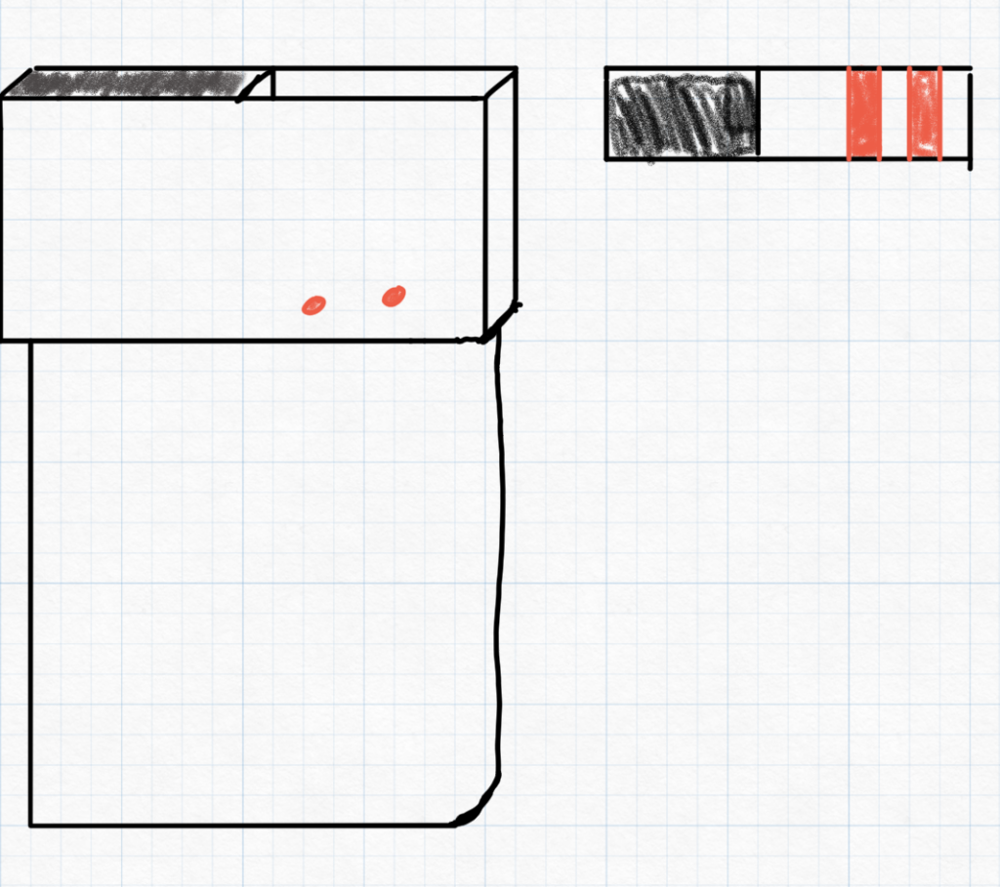
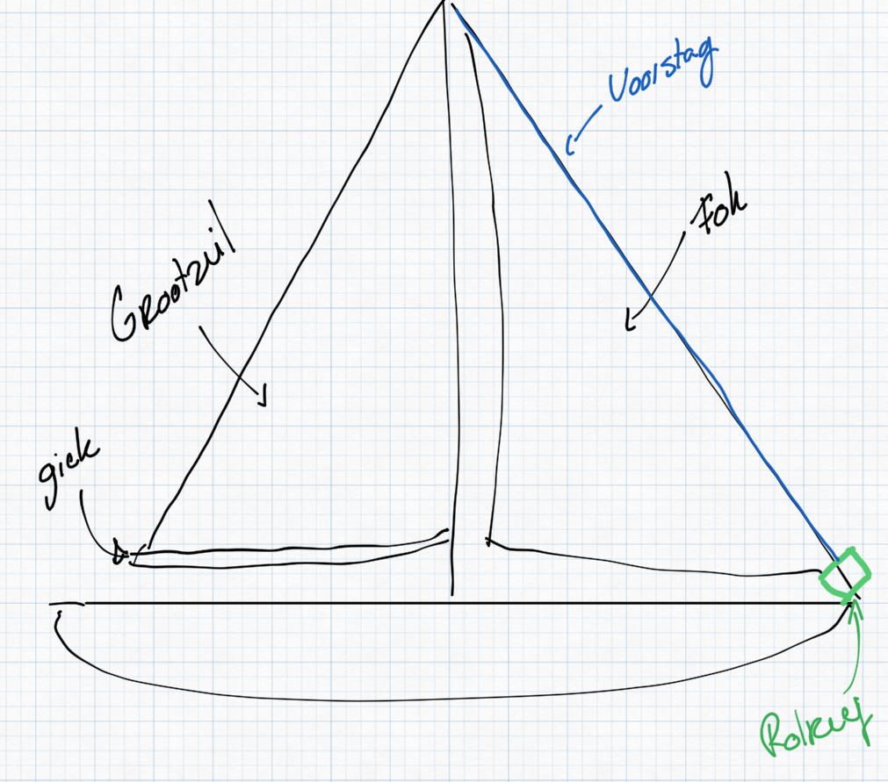
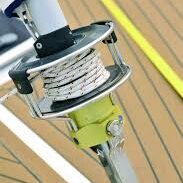
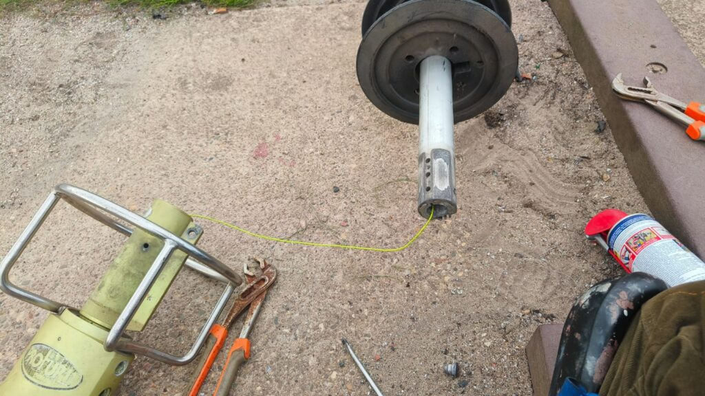
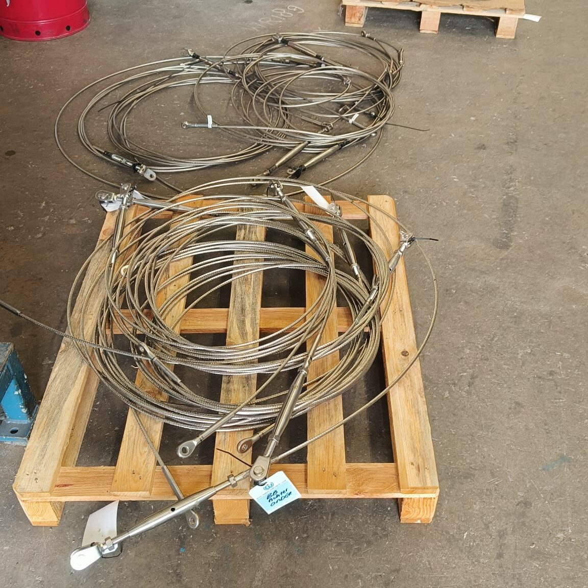
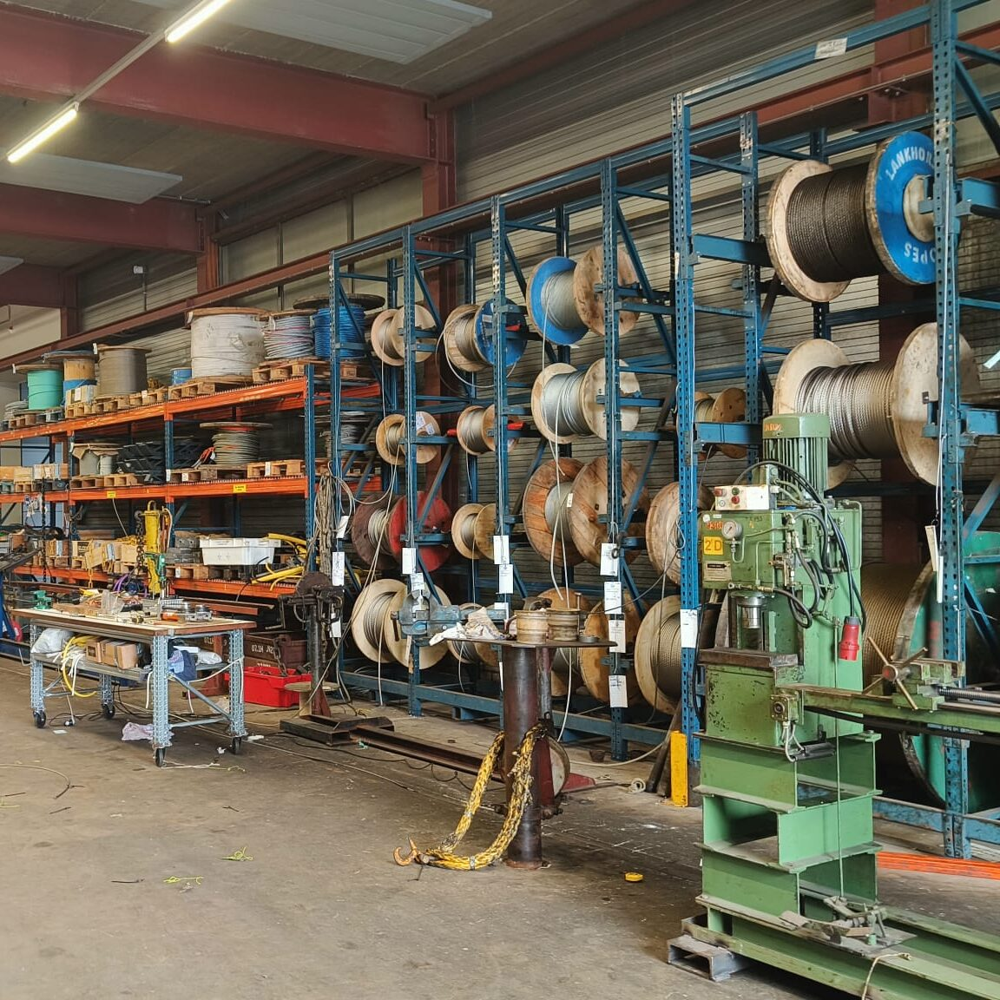
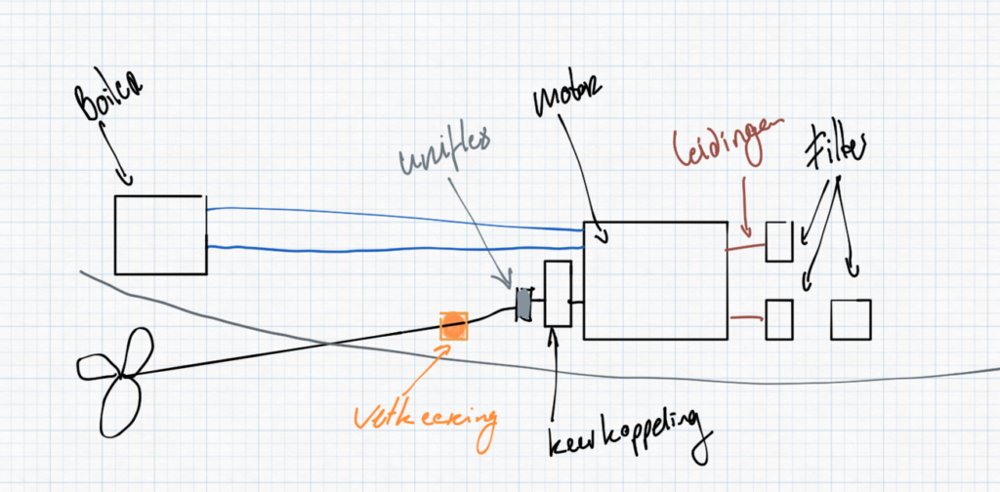
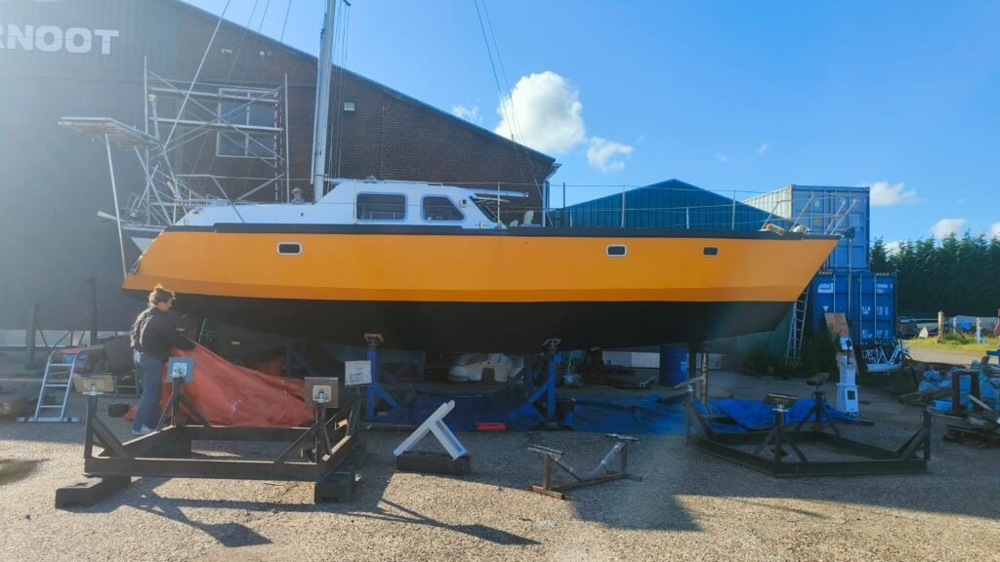
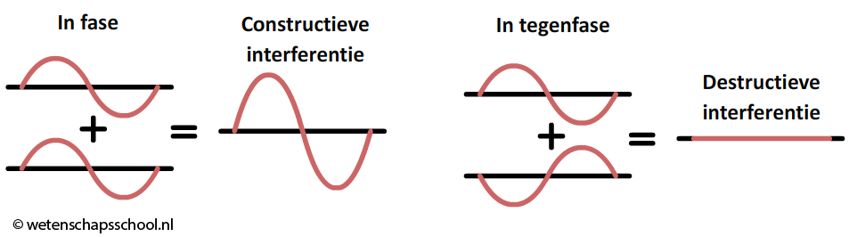

Als ik wat tijd over had zou ik nu een soort anonieme stembus inlassen waarin iedereen zijn of haar eerste gedachte bij 'die allereerste' zou kunnen insturen. De verhalen kunnen vaak maar beter anoniem blijven, maar mijn allereerste mag gewoon zo op het internet.

Die allereerste las.

Lees je het goed, las? Yes. Degenen die mij de afgelopen maand nog zijn tegengekomen zal het wellicht opgevallen zijn dat ik opeens een niet-alledaagse, toch door de meesten gewaardeerde, gele leren jas droeg. In de kleur van de Luwte: Mijn Lasjas.

Niet omdat ik lezen helemaal heb afgeschaft en daarom een Lasjas heb gekocht, maar omdat ze bij Gideon de Italiaander in de aanbieding waren, en ik het wel een leuk ding vond voor een prikkie. Maarja. Wat is een lasjas zonder lasser... Daar moest verandering in komen en laat een werfbeurt nou een uitgelezen kans zijn om dat op te pakken.

Dacht ik.

Maar ook de (jacht)werven van deze wereld zijn inmiddels verstrikt in wet- en regelgeving voor onderhoud aan boten en aan ijzer werken is daarom op de meeste werven niet de bedoeling. Uiteindelijk heeft mijn vader het meeste laswerk gedaan in de piepkleine fietsenstalling beneden in ons huis.

Ook hier sta ik weer voor een raadsel. Want deze regelgeving komt uit de portefeuille van milieu-achtige argumenten, maar als mij iets slecht voor het milieu lijkt, dan is het wel om bestaand ijzer te laten vergaan tot roest. Mijn studie naar dit onderwerp is zeer kort geweest, dus de berekening wat eenvoudig, maar als ik het doorreken staat de productie van 7.000 kilo staal (gewicht aan staal op de Luwte) gelijk aan zo'n 12.600 kilo CO2. Ter vergelijking: Één retourtje naar Curaçao staat gelijk aan zo'n 5.000 kilo CO2 uitstoot, per persoon. En dan houd je niets over, want dat zit alleen maar in de verbranding van kerosine. In die zin zou je kunnen zeggen dat wij in dit ene jaar zeilen onze boot al in CO2 uitstoot dubbel en dwars gaan terugverdienen. We rijden geen auto meer, we stoken geen gas, we gaan niet meer op vakantie én we bereiken plekken waar de meeste mensen misschien wel 10 vliegtripjes à 5 ton CO2 voor nodig hebben.

Of we gaan Luwte-CO2 certificaten uitgeven zodat jullie je uitstoot bij ons kunnen afkopen. Uiteraard zullen we dat dan super eerlijk doen ;)

Het zal kortzichtig zijn, en het is zeker volledig *biased*, maar ik denk dat die milieuregels helemaal niet passen bij de portefeuille 'milieu' en eigenlijk een handig gelobbyde uitkomst zijn van rijke bootbezitters die er niet tegen kunnen dat hun glanzend witte plastic boten vies worden als ze op de kant staan. Werken aan ijzer geeft namelijk wat meer stof en vuiligheid en als je daar naast ligt op de werf, kán jouw boot ook een beetje vies worden.

Ik zie een vergelijkbare denkfout vaak bij (de meeste) mensen als ze voor een brug staan die open gaat. Dat levert tijdsdruk op. Waarom moet die brug nu nét open gaan als ík er voor sta terwijl ik zo op een afspraak moet zijn?! Dat is in mijn ogen verkeerd om geredeneerd. Die open brug zit er namelijk niet voor de scheepvaart, maar voor het overige verkeer dat graag dat water oversteekt.

De volgende keer dat je dus voor een open brug staat, moet je daar even bij stilstaan. We hadden het logischerwijs eigenlijk andersom moeten organiseren: De brug zou altijd open moeten staan, want er zit daar een waterweg en als overstekende partij mag je blij zijn dat hij zo vaak dicht is!

## Terug naar die eerste keer

De afgelopen weken zijn er veel 'eerste keren' voorbij gekomen. Terwijl de taken zich opstapelden en de tijd korter werd, begonnen de drempels ook hoger te worden. De eerste keer lassen was met name een leuke en succesvolle ervaring. Langzamerhand begin ik handiger te worden in handig zijn. Ik heb ontdekt dat creatief zijn met de spullen die je ter handen hebt veel problemen doen verdwijnen, maar dat dat vaak ook hoofdpijn oproept. Als je een vastzittende schroef moet loskrijgen en je hebt nét niet de juiste maat schroevendraaier, kan het zomaar dat je slaagt. De kans is alleen ook groot dat je de schroef dol draait en verder van huis bent. Het uitboren van boutjes zit inmiddels óók in mijn arsenaal van vaardigheden, maar dat kost je ook zomaar twee extra dagen werk. En die dagen worden schaarser.

Handiger worden in handig zijn is dus niet alleen een kwestie van de schroevendraaier in je gereedschapskist goed kunnen gebruiken, maar ook zorgen dat je de juiste schroevendraaier voor handen hebt.

### De juiste boor

De vorige keer heb ik uitgebreid uitgelegd dat onze kiel een bijzonder exemplaar is. Eentje die je namelijk omhoog kunt hijsen zodat onze diepgang van een dikke 2.10 meter, wordt gereduceerd tot minder dan een meter. De hijsogen waaraan we de kiel omhoog takelen zijn afgelopen zomer doorgescheurd en daar moest dus een nieuwe constructie voor gelast worden. De onderstaande afbeelding is een schematische tekening van onze kiel, met in het rood de constructie die we wilden maken.

De hersenkraker hierin zat hem in de twee gaten vanaf de zijkant die op precies dezelfde hoogte geboord moesten worden, zodat daar een buis doorheen kon (rood). Alleen de afstand tussen die twee gaten was ruim 15 cm (bovenaanzicht). Goed meten op de zijkant was de eerste gedachte, maar later bedacht ik me dat ik ook gewoon aan de ene kant kon beginnen met boren en met een lange boor dóór dat gat precies naar de andere kant kon komen.

Het vinden van de juiste boor, met de juiste diameter én een lengte van circa 20 cm bleek niet voor de hand liggend, maar uiteindelijk kon ik hem bij Het Ijzerhuis (mijn nieuwe lievelingswinkel) krijgen voor een schamele €38,00. Met die prachtige boor heb ik uiteindelijk dus twee gaten geboord. En waarschijnlijk was dat de laatste keer dat ik deze zal gebruiken...

Het risico van verkeerd boren was echter een stuk pijnlijker geweest dan €38,00. Dat had zomaar twee dagen extra herstelwerk kunnen opleveren. Mocht je dus nog eens zo'n boor nodig hebben, bel dan gerust.

### De juiste bout

Het gaat niet altijd om het juiste gereedschap voor de taak. Soms is de juiste *manual* voor de taak nog veel belangrijker. De Luwte voert één mast en daarmee twee zeilen. Het "grootzeil" en de "fok". Als je ooit zeilles hebt gehad, weet je dat het grootzeil het achterste zeil is en vast zit aan de *giek*, die buis waar je voor moet oppassen, want als je die tegen je hoofd krijgt, krijg je in het beste geval hoofdpijn. De fok zit alleen vast aan het voorstag en zit daarmee aan de voorkant van het schip. Onderstaande plaatje laat dat wel een beetje zien denk ik.

Wat per schip verschilt, is hoe je de fok voert. Sommige schepen hijsen die vanaf het dek en andere hebben een zogenaamd *rolreefsysteem*. Daarmee rol je het zeil om het voorstag heen als je hem wil opbergen, of kleiner maken. Een stuk praktischer en sneller, zeker op zee. De techniek daarachter zit in het groene blok rechtsonder en ziet er bij ons ongeveer zo uit:

<figure class="wp-block-image size-full is-resized"><figcaption class="wp-element-caption">Profurl rolreefsysteem</figcaption></figure>

Omdat wij onze verstaging wilden vervangen (daarover zo meer), moest deze trommel uit elkaar.

Daar ben ik om en nabij een maand bijna dagelijks mee bezig geweest. De titanium, rvs en aluminium onderdelen waren over de afgelopen 25 jaar in elkaar gegroeid (corrosie) en wilden niet meer los. Kruipolie, slagschroevendraaiers, hefbomen, heet stoken, hameren, uitboren, ik heb het allemaal geprobeerd (en veel van deze dingen voor het eerst), maar zonder succes.

Deze week hadden we er een kleine inzinking over. Een nieuw systeem kost zo'n €3.500 en loskrijgen is vereist om het stag goed te kunnen vervangen.

Een frisse blik gaf uitkomst. Na weer een paar uur fora afstruinen kwam ik terecht bij een heel oude manual van dit type rolreef systeem. Zo eentje uit de tijd dat er nog geen kleur bestond. En vandaag hadden we succes: Het bleek dat de constructie in de nieuwe modellen veranderd is en dat die vastzittende schroeven helemaal niet los hoeven om te bereiken wat ik wilde bereiken. De drie schroeven die wél los moesten kwamen er zonder enige moeite of twijfel uit en voilà:

### De eerste wals

Vorige keer schreef ik een heel betoog over het verschil tussen walsen en persen. En hoe blij ik wel niet was dat wij gingen persen en niet gingen walsen.

Ik moet daar op terugkomen helaas. Onze verstaging, gemaakt door de CIV in Den Oever, is uiteindelijk gewoon gewalst, omdat zij het niet vonden kunnen dat ze nette jachttuigerij zouden leveren met de afwerking van een vissersschip.

Zelf hadden zij helemaal geen wals, maar deze mannen hebben geregeld dat ze bij een collega in het veld een walsmachine konden lenen om mijn verstaging te maken.

Nadat ik eerst een keer langs ben geweest om onze oude verstaging af te leveren en de bestellijst door te lopen, was het vorige week tijd om de verstaging dan ook echt te gaan maken. De telefoongesprekken die er aan vooraf gingen herkenden ze mij niet aan mijn bestelnummer, type opdracht, of scheepsnaam, maar aan het feit dat ze direct konden horen dat ik uit Amsterdam kwam afreizen. Zij waren heel blij te horen dat ik er bij wilde zijn om regie te voeren over welk stag welke lengte moest worden, en ik was dáár weer heel blij mee, omdat ik graag van dichtbij wilde zien dat dit essentiële onderdeel goed gemaakt werd.

Ik krijg wel eens te horen van mensen om mij heen dat ik slecht ben in het uitbesteden van eigenlijk alles en dat ik altijd alles zelf wil begrijpen voordat ik het los kan laten. Dat is niet altijd positief en kost ook veel tijd en energie. Voor de verstaging had ik mij eigenlijk voorgenomen deze verantwoordelijkheid uit te besteden, maar eindstand stond ik samen met de mannen van de werkplaats kabels te slijpen, in te meten en te walsen.

De eerste walsen waren wat zenuwachtig van mijn kant, want opeens lag niet alleen het werk, maar ook de verantwoordelijkheid voor de kwaliteit weer in mijn vingers: Dit moet recht en sterk zijn.  
Een paar stagen verder had ik hem door. Verstagingen maken is een eitje. Je moet goed opletten wat je doet, het feit dat tijdens het walsen je stagen 2 cm langer worden, en de ruimte hebben. Maar het werk zelf is echt eenvoudig. Als we terug zijn ga ik bij onze zeilvereniging eens opperen om zelf een wals aan te schaffen voor de vereniging, want dat zou iedereen veel geld kunnen besparen én daarmee de veiligheid bevorderen. Je kunt immers voor hetzelfde geld veel hogere kwaliteit materialen gebruiken.

Ik ben erg tevreden over het resultaat. Alles ziet er heel netjes uit en alle materialen die we hebben gebruikt zijn van de hoogste klasse.

### Olie en vet

Een enorm uit de hand gelopen project van deze werfbeurt is het onderhoud aan de motor. Dit kán grotendeels ook in het water gedaan worden, maar er zijn een aantal punten die niet in het water goed kunnen en we waren inmiddels toch in bouwmodus. Op papier is het allemaal vrij overzichtelijk:

-   Blauw: De hitte van de motor gebruiken we om ons water in de boiler te verwarmen. De slangen van de motor naar de boiler en terug waren toe aan vervanging. Een mooi moment om meteen de koelvloeistof te spoelen en verversen (dat loopt immers door die slangen).
-   Oranje: Onze vetkeerring lekte vet. Het hele idee van een keerring is dat die *niet* lekt. Die moesten we dus vervangen en voorzien van nieuw vet.
-   Grijs: Om de keerring te vervangen, moest de scrhoefas los, die zit vast in een zogenaamde conische 'uniflex' koppeling.
-   Zwart Keerkoppeling: De Uniflex koppeling steekt in de *keerkoppeling*. Het woord zegt het al, de keerkoppeling regelt of de beweging van de motor rechtsomkeert wordt gemaakt, of linksomkeert (en daarmee bepaalt deze dus achteruit en voorruit).  
    Hiervan moest de olie worden ververst.
-   Bruin: De huidige situatie dieselleidingen zat in de weg, was oud en vies. Tijd voor nieuwe leidingen dus.
-   Zwart filter: Twee brandstoffilters, een oliefilter en het luchtfilter moeten schoongemaakt worden, evenals de bijbehorende olieverversing etcetera.
-   Zwart motor: De startmotor moest gereviseerd worden, de impeller vervangen (die het water rondpompt) en de v-snaar was aan preventieve vervanging toe.

Over elk van deze onderdelen kan ik inmiddels boeken schrijven. Dat zal ik jullie besparen, maar tot voor kort had ik alleen de brandstof- en oliefilters van de boot en auto wel eens vervangen. Ook bij dit project zat eigenlijk elke bout vast en de bouten die wél los kwamen, vielen in een bad met olie en raakten zoek onder de motor. De Hornbach is ons dankbaar, want ik heb deze voorbereiding maar aangenomen als het ultieme excuus overal maar het goede gereedschap aan te schaffen voor elk project.

Bootyoga was nog nooit zo leuk, want de extra dimensies waren hierbij dat de boot binnen ontplofte aan gereedschap, olie, glibberpartijen en een half interieur dat er uit moest..  
Inmiddels zit het er op en is alles afgerond wat ik wilde doen. We zullen nog even geduld moeten hebben met het resultaat en de boel een beetje in de gaten moeten houden op de eerste tochtjes, maar ik verwacht dat onze Yanmar weer zal draaien alsof ie net uit de fabriek komt rollen.

### Breaking bad

IJzer is van nature sterk en robuust, maar ook zeer instabiel. Als je een stukje ijzer kaal haalt, en er wat water en lucht op loslaat, heb je een kwartier later al een bruin laagje er overheen zitten. Dat is dus ook de grote uitdaging van een stalen schip: Het conserveren van het staal.

Onder water gebeurt er dus weinig. Er is wel water, maar geen lucht. Boven water is een ander verhaal. Mijn overtuiging is dat je voor dit soort werk naar de offshore moet kijken: Wat gebruiken ze op boorplatformen, containerschepen en windmolens om er voor te zorgen dat die niet uit elkaar vallen?

Deze chemie studie heb ik gelukkig inmiddels wel redelijk in de hand. Eerst bouw je vanaf het kale staal tenminste 4 lagen *epoxyverf* op. Epoxy is heel goed in het afsluiten van water en lucht, maar kan niet tegenzonlicht. Om de epoxy dus te beschermen, voeg je vervolgens nog een laag of 3 aan poly-urethaan toe, of onder water een antifouling. De aanbieders zijn talloos en hebben allerlei voor- en nadelen.

Anders dan je huis- tuin- en keuken schilderwerk, heb je hier eigenlijk niet te maken met verf, maar eerder met kunststof. De verf bestaat uit twee delen, die samen een chemische reactie aangaan en uitharden tot een kunststof. Dingen als olie, thinner, kwastenreiniger of wasbenzine hebben dan ook geen enkele invloed meer op deze kunststof als hij eenmaal is uitgehard, wat een veel duurzamere levensduur geeft.

Het grote nadeel hiervan is dat ik niet zomaar onze hulptroepen een pot verf en een rollertje in de handen kan drukken. Je moet secuur zijn in de mengverhoudingen, jezelf goed beschermen tegen de gassen die er af komen en bovenal rekening houden met luchtvochtigheid, temperatuur en het type verf waar je mee bezig bent. De ene kun je lekker dik smeren, terwijl de ander juist veel aandacht nodig heeft. Daarnaast begint de chemische reactie te werken zodra je ze bij elkaar gooit, dus *time is not on your side*.

Gelukkig is Jen inmiddels ook een kleine chemicus en kan zij alle soorten verf die we hebben zelf mengen. Dat scheelt ons veel tijd, want ik was bij schilderdagen vooral aan het faciliteren in verf en kwam dan zelf niet echt ergens aan toe. Het resultaat mag er wezen. Dankzij onze vrienden, ouders van Jen, Mark en een beetje onszelf mogen we trots zijn op het resultaat. De Luwte ligt er weer bij als nieuw:

## Grillige weken

Alles aan deze periode is een beetje grillig. Onze gemoedstoestand volgt het Nederlandse weer nauwgezet. Van bui naar bui en windvlaag naar windvlaag, of van zonnestraal naar zonnestraal. Het is maar hoe je er naar kijkt. Toen we afgelopen week op een terrasje zaten kreeg ik een soort pavlov reactie op de wapperende oranje vlaggetjes die voor het EK waren opgehangen. Die maken namelijk precies hetzelfde geluid als een dekzeil dat door een windvlaag wordt opgetild en begint te klapperen totdat je er weer naartoe gesneld bent om er nóg een extra steen op te leggen.. Op zich geen slechte reactie om aan te leren: Met klapperende zeilen gaan we de overkant niet halen.

We beleven hoge pieken in alle successen die we neer weten te zetten, genieten van de oneindige reeks borrels (we hebben sinds kort eigenlijk nooit meer een leeg avondprogramma) en beginnen de havenkoorts nu wel echt te voelen.  
Daar tegenover staan net zulke intense dalen: Het hooghouden van werk, boot, scriptie, afscheidborrels, voorbereidingen, inkopen, onderzoeken en to-do's afvinken vergt best veel energie en we zijn dan ook allebei wel toe aan vakantie. Ik vermoed dat we in deze modus nog wel een beetje blijven hangen tot we onze eerste haven aandoen en in de zon een biertje drinken.

Gelukkig zijn Jen en ik in onze dalen altijd in tegenfase en met de pieken (meestal) in fase. Een kleine les natuurkunde ter afsluiting:

Golven in fase versterken elkaar, terwijl golven in tegenfase elkaar platslaan. Dat geldt voor geluid, voor golven op zee, en dus ook voor de golven van ons twee. Het lukt ons tot nu toe aardig om elkaar een beetje overeind te houden en de dalen lekker ondiep te houden.

Oh en had ik al vermeld dat Jen sinds kort zowel haar Marcom-B, als vaarbewijs II heeft gehaald? Allebei in één keer? Het ziet er naar uit dat ik een heel rustig jaar krijg en Jen eerste stuurvrouw wordt aan boord van de Luwte.

Volgende week gaan we het water in. De week erna zwaaien we uit. Nog even wat klussen afmaken en dan *even helemaal niets*.

### P.S.

We hebben voor nu besloten om onze fotobeeldbank bij te gaan houden op instagram (zie link in menu bovenin, of @sailingluwte). Daar kun je ons dus ook volgen voor foto's en video's.

