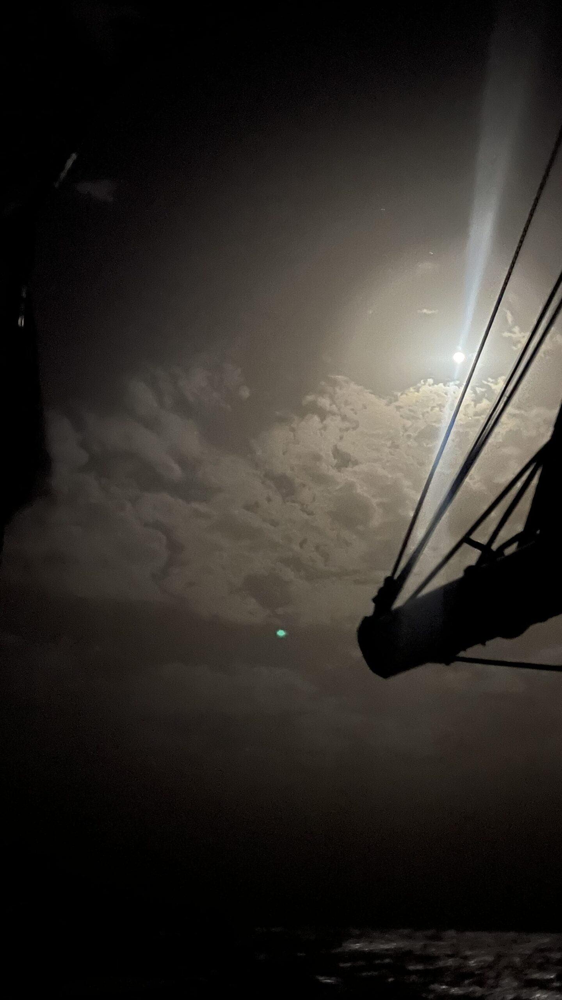

26°20.106N 019°11.830W

Inmiddels zijn we 40 uur geleden vertrokken vanaf Santa Cruz La Palma, richting Mindelo op de Kaap Verden. Met zo’n 850 mijl de langste tocht tot nu toe. Na twee dagen weinig slaap en veel (cosmetische) schade door een uitzonderlijke swell in de haven van La Palma - waarover later meer - overheerst een gevoel van opluchting wanneer we dinsdagavond uitvaren.

Die opluchting maakt snel plaats voor ontzag: het venturi effect, waar Rorik eerder al over schreef, moeten we niet onderschatten. Veel wind, stevige windvlagen en bovenal: een verwarde zee. De eerste 100 mijl staan we op standje doorbijten.

Inmiddels zijn we zo’n 80 mijl onder El Hierro en is de wind iets minder hard en de deining langer. Op een puntje fok varen we nu al een etmaal op 214 graden. Een koers die we als het goed is precies kunnen aanhouden tot aan Mindelo. Recht zo die gaat. De golven vechten af en toe nog om de aandacht van Luwte, maar als een ware femme fatale blijft ze er stoïcijns doorheen dansen. Doris - de windvaan - staat nog stoïcijnser aan het roer. En met de overige crew gaat het na een nacht betere slaap gelukkig ook een stuk beter.

De oceaan is hier groots en wijd. Vanochtend zagen we op de AIS voor het eerst sinds vertrek een schip opkomen, zo’n 50 mijl verderop.. Dat voelt soms wat alleen, maar maakt het wachtlopen wel kinderlijk eenvoudig.

Over stand-by.

