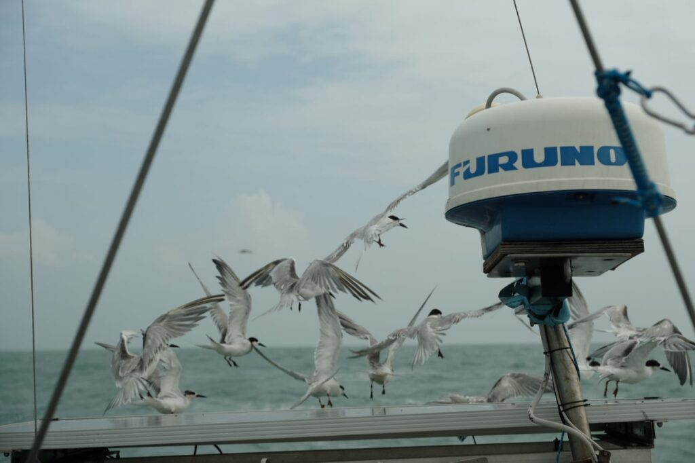
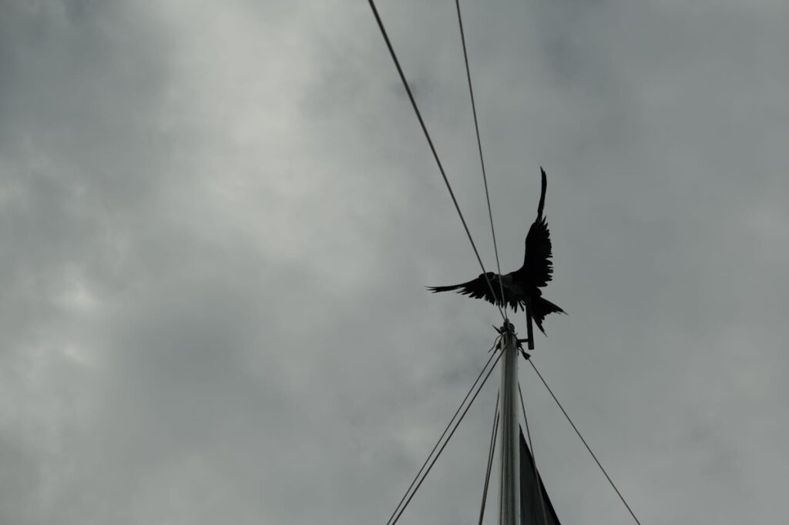
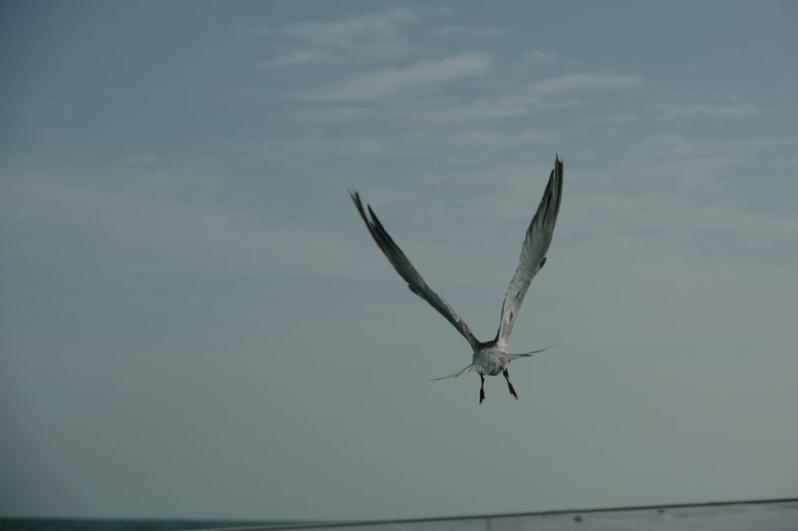
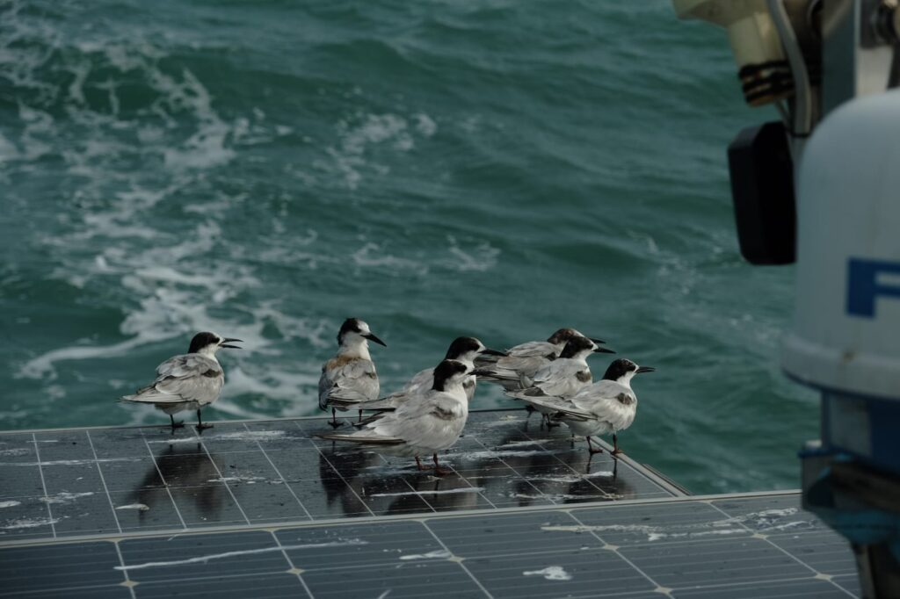

06° 04.9609'N, 055° 13.0378'W - Uiterboei Surinamerivier

29-01-2025 14.34

Na twee bewogen etmalen vol met squalls, windvlagen van over de 45 knopen en een oceeandeining het langzaam moest opgeven ten opzichte van het continentaal vlak, kunnen we stellen dat het is gelukt: *Luwte* heeft de grote plas overgestoken en draait haar boeg de bruine Surinamerivier op.

Sinds de laaste update is het weer grillig geworden. We hebben zo lang mogelijk een noordelijke koers aangehouden rond de 10 graden noorderbreedte, maar op een gegeven moment moesten we toch echt zuidelijker aanhouden en het instabielere gebied rond de evenaar invaren. De zon verdwijnt over het verloop van twee etmalen langzaam achter een volgepakt wolkendek en de lucht wordt broeierig. Zelfs zittend barst het zweet ons uit, laat staan na het koken, reven of ander huishoudelijk klusje.

De *squalls* die we over ons heen krijgen worden naarmate we dichterbij komen intenser en frequenter. We hebben er al snel een goede routine in, maar komen er ook achter dat de ene *squall* de andere niet is en het altijd opletten geblazen blijft. Gisterochtend kregen we de door *Belafonte –* die zo’n 50 mijl achter ons vaart – omgedoopte *Mothersquall* op ons dak en gingen we binnen een minuut van een rustig passaatje naar een knoop of 45 met rondvliegend schuim en spontaan opvliegend water. Ik moest *Doris* toch even aflossen en zat in mijn gele oliejas een uur aan de helmstok voordat het weer iets rustiger werd. Nog een etmaal werken, alsof Neptunus ons vraagt of we zeker weten dat we terug naar land willen…

Zo grillig als de dag, zo rustig is de afgelopen nacht. De oceaandeining vlakt uit over het continentaal vlak en een bescheiden zee zoals we die al maanden niet hebben gezien blijft over. Ondanks de havenkoorts slapen we allebei goed. Jen staat elke twintig minuten naast de kooi omdat ze denkt dat ze alweer wacht moet lopen en ik rek mijn wakkere uurtjes wat langer om er zeker van te zijn dat we mooi op koers blijven liggen.

Halverwege de nacht klaart het op en zie ik onder een spectaculaire sterrenhemel in de verte al de lichtvervuiling van een grote stad: Paramaribo dient zich aan. Tegen het vallen van de ochtend is Suriname al lang weer verdwenen in een dicht pak wolken. Pas als de oceaan van diepblauw naar Noordzee-groen en daarna choco-bruin begint te veranderen, dient een smalle streep land zich aan. Het zou ook Stavoren kunnen zijn, waar we eigenlijk ook altijd verwaaid en verregend aankomen, al dan niet wat kouder.

We passeren de uiterboei vergezeld door een hele school vogels en een zeearend die meeliften terug naar het vaste land. We roepen de Maritieme Autoriteit Suriname op om ons kenbaar te maken en draaien dan de rivier op. Onze nette Nederlandse vlag gaat op het achterstag en de vriendenvlag in het want. We zijn er. Nog een stukje de rivier op en dan is het tijd voor bubbels!
