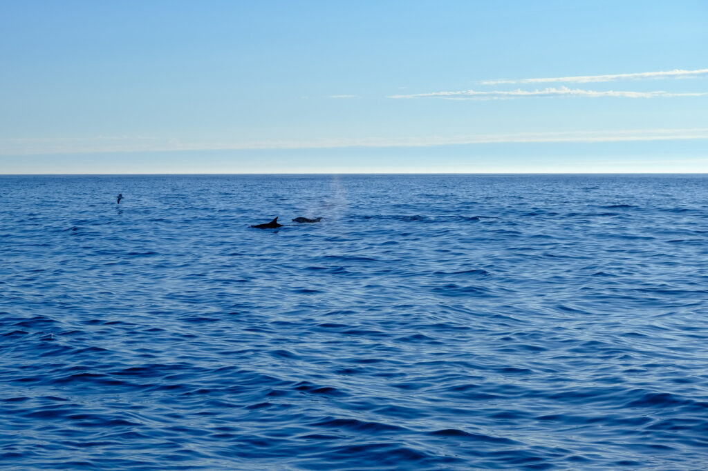
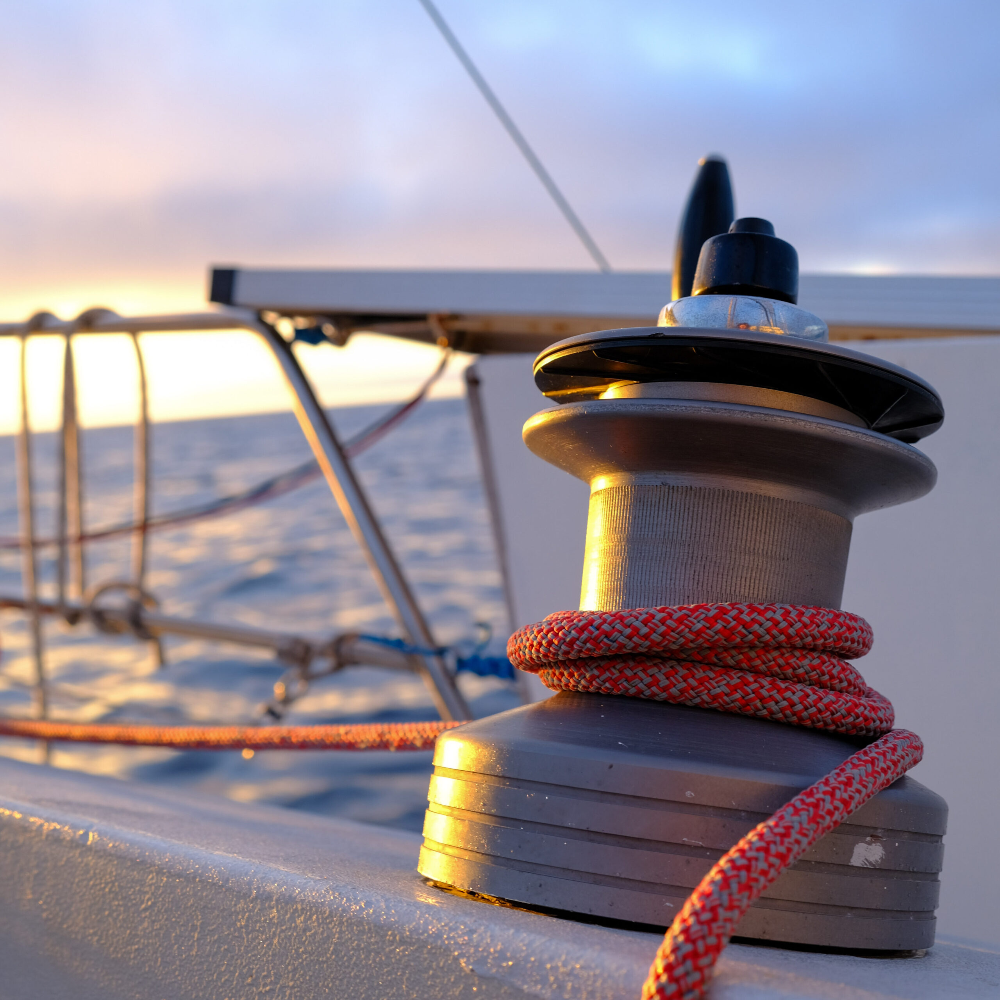

Gisterochtend doorbraken we ons westelijke avontuur en voeren we het “Europese kaartgebied” weer in op onze kaartplotter. Na drie etmalen potdichte mist breekt de lucht open en zien we voor het eerst weer een vlekje blauw hier en daar. Wat heeft de lucht een intens blauwe kleur als je hem zo lang niet hebt gezien!

De mist, die ontstaat omdat de warme Atlantische lucht over het koude, arctische smeltwater wordt geblazen, trekt direct op als je de warme golfstroom weer doorvaart. De prettige zuid-westelijke wind is gaan liggen en een rustige, lome dag midden op de Atlantische dag volgt. Tegen zonsondergang zijn we getuige van een spectaculair stukje natuur: honderden dolfijnen, van verschillende soorten en grootte, trekken haaks op onze koers voorbij. Voor zeker drie a vier uur lang hebben we continue de vrolijke dieren wel om ons heen. We zien zelfs baby-dolfijnen en ware stoeipartijen. Met een vol hart gaan we de nacht in.

De dag die volgt geeft het tegenovergestelde. De wind draait naar het zuid-oosten en trekt aan. Hoog aan de wind stuiteren we door de golven. Er komt continue water over en tegen het eind van de ochtend varen we met het derde rif en een halve fok. Hoogte maken, in dit geval naar het zuiden, is lastig en *Luwte* verandert in een wilde kermisattractie. Bij een controlerondje op het voordek zie ik dat de borging van het anker niet meer goed zit. Net op tijd. Verder is het behelpen, liggen, slapen, je ronde doen. Voor het koken vallen we af om op ruime wind rustiger op de golven te liggen. *Luwte* geeft zoals altijd geen krimp en springt vrolijk over de golven.

Vandaag en gisteren zijn rustiger. Dat voelt altijd heel even heel prettig, maar terwijl de wind snel kan gaan liggen, blijft de zee nog lang hobbelig en mis je de druk in de zeilen. Springen door de golven wordt rollen door de golven en het blijft altijd maar de vraag wat nou prettiger is…

De komende dagen zien er goed en rustig uit. We gaan nog even genieten van de wij(d)sheid van de oceaan.

Over stand-by

