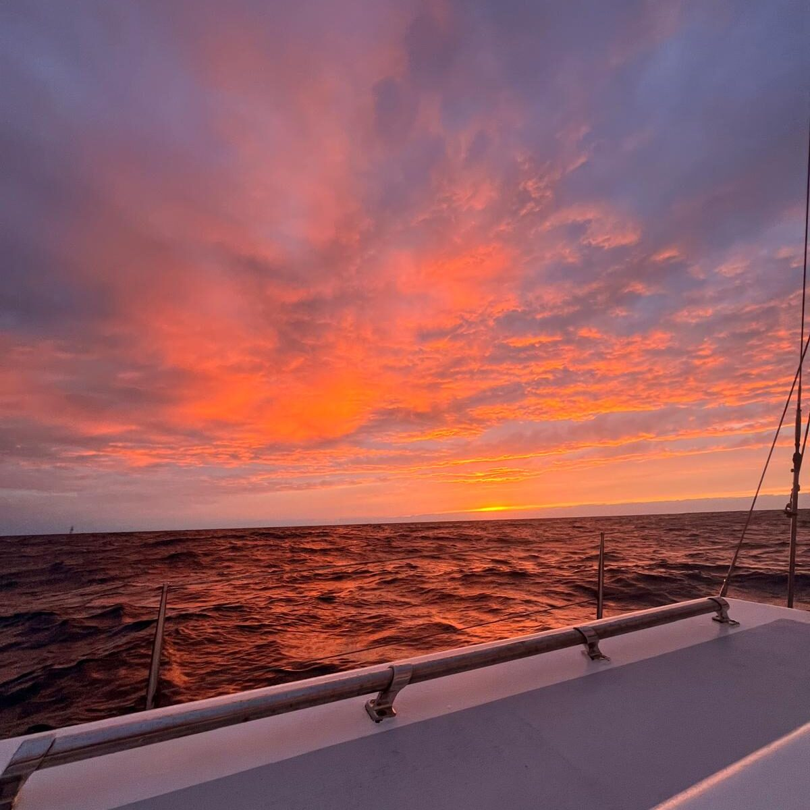

*41°12.600N, 62°09.722W*

Onze lakmoesproef van het zeezeilen kun je wel zeggen. Inmiddels zijn we vier dagen verder vanaf Bermuda, wat voelt als een vage herinnering die niet helemaal meetelt. Voor ons gevoel zitten we twee weken op zee vanaf Sint Maarten, in ons ritme en in het lot dat daar bij hoort.

Hoewel we van tevoren wisten dat we onze tanden er in zouden moeten zetten, geeft Neptunus vooralsnog niet mee. In de afgelopen vier etmalen hebben we onder het voorbij trekkende laag omhoog gezeild naar de enigszins beruchte Golfstroom. Inmiddels zijn we die zonder veel klachten gepasseerd en kunnen we wel stellen dat we zo goed als alle weersomstandigheden gehad hebben die je je kunt bedenken. Van een kabbelende zee met een waterig zonnetje, tot full-force koufronten en troglijnen die ’s nachts over trekken. Uiteraard met nieuwe maan en dus in pikzwarte nachten. In de oversteek van de golfstroom daalde de temperatuur binnen een uur of twee van 25 naar 8 graden Celsius, inmiddels zitten we dan ook met de kachel aan behaaglijk binnen en draag ik bij het reven handschoenen.

We hebben de tel niet volledig bijgehouden, maar in de afgelopen 48 uur denk ik dat we zeker 20 zeilwissels hebben gedaan, van vol tuig tot kale mast en opgerolde fok. We zitten strak in de routine en *high-fiven* tevreden als we binnen een paar minuten de wind weer de baas zijn, we binnen onze jassen afpellen en een kop thee drinken. De afgelopen twaalf uur liggen we stabiel op één oor tegen de wind in te stampen, derde rif en halve fok. De zee is vrij mild. We hebben geen toppen van boven de 2,4 meter gezien en de heksensoep die ons was beloofd in de golfstroom bleef gelukkig uit. Dat maakt het al met al erg behapbaar, al is slapen een aaneenschakeling van korte dutjes in zeilpak geworden.

De komende 24 uur neemt de wind (als het goed is) af en kunnen we met een beetje valsspelen op de motor genoeg mijlen maken om woensdagavond of donderdagochtend binnen te lopen in Lunenburg, Nova Scotia.

Jen en ik maken het allebei goed. We zijn vrolijk en trots op deze tocht. Ons vertrouwen in *Luwte* groeit met de golf en zelfs in deze stampende zee weet Jen in een druipende kombuis heerlijke dampende maaltijden te bereiden. Het dieptepunt tot nu toe is een glas dat aan stukken vloog boven het net bereidde eten. Standvastig als ze is heeft Jen een nieuwe portie gemaakt en een paar uur later konden we het voorval onderdompelen als een luxeprobleem. We hebben immers genoeg aan boord om een nieuwe maaltijd te maken. Midden op zee. Terwijl we bijna onze elfde maand reizen ingaan. Wij tellen onze zegeningen.

Over stand-by.

**Tracking link (update elke 4 uur):**

[https://share.garmin.com/svluwte](https://share.garmin.com/svluwte)

