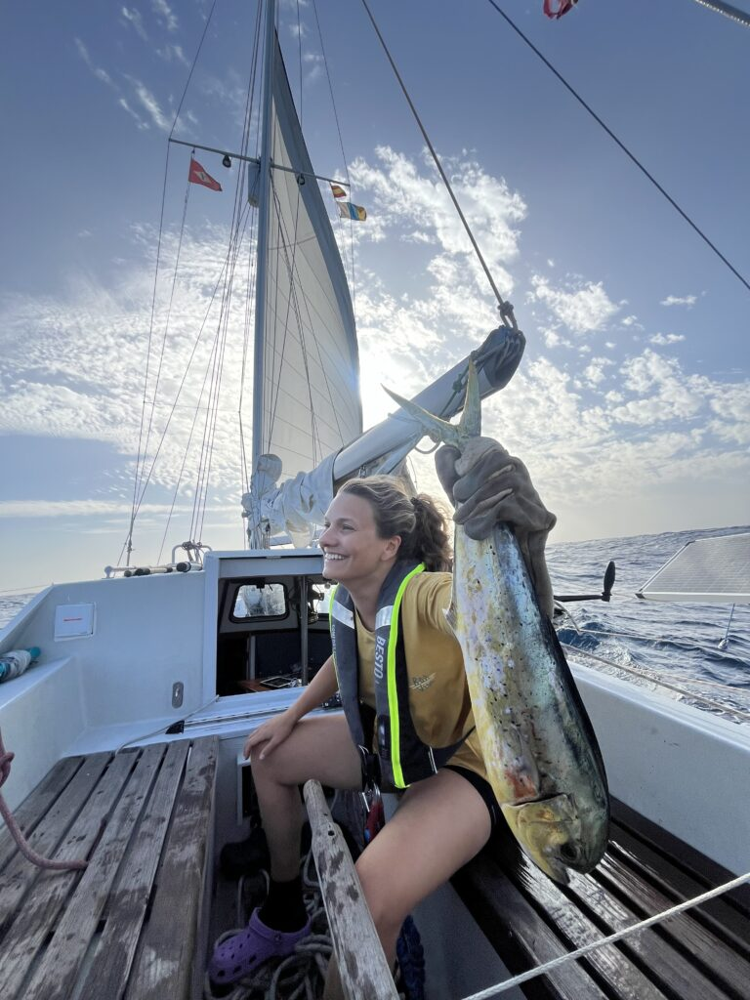

22°36.328N 021°27.484W

We zijn inmiddels bijna halverwege onze oversteek naar de Kaap Verdische eilanden. Alles gaat tot nu toe goed. Het duurde wat langer dan normaal voordat we er allebei helemaal lekker in zaten dit keer. 

Met name ik had een beetje kopzorgen over de “haast” waarmee we La Palma verlieten en het gevoel dat we niet alles dubbel gecontroleerd hadden. Daardoor zijn de kleine probleempjes die horen bij lange zeetochten (een lekkend raamrubbertje, of een verstopte handlenspomp) opeens geen losse uitdagingen meer, maar problemen die zich in mijn hoofd boven op het gedachtenlijstje storten. Het weinige slapen vooraf in de haven en de eerste twee dagen op zee zullen ook niet geholpen hebben.

Inmiddels is de wind gunstiger gedraaid en glijden we rollend het tweede deel van de Atlantische Oceaan over, richting Mindelo. De komende 24 uur zal de wind nog wat aantrekken, maar vooralsnog liggen we er erg comfortabel bij. Sinds ons vertrek is het grootzeil niet op geweest en draaien we de fok in en uit naar 4.5 tot 5.5 knopen. We kunnen sneller, maar op deze snelheid vinden we het zelf het meest gecontroleerd en comfortabel.

De zee is hier leeg en groot. We zien zo’n eenmaal per dag een bootje verschijnen en weer verdwijnen op de AIS, ver buiten zicht. De Modus Vivendi, waarmee we in La Palma een steiger deelden (en zij heerlijke boterkoek met ons) kwam ons op dag 2 voorbij vliegen. Vanochtend hadden we een vissersschip op drie mijl en ergens voeren we nog een tijdje parallel aan een ander zeilschip.

Jen heeft een flinke Mahi Mahi aan de haak getrokken en die is inmiddels alweer verteerd. Heerlijke vis! Een deel hebben we gebakken en de rest de dag erna als Ceviche. Haar volgende missie is een tonijn vangen en dan sushi op zee. Ik zie daarbij de beroemde scène van Sex & the city voor me, maar dat zal op een rollend schip wel een beetje tegenvallen. Wordt vervolgd…

ETA Mindelo Rorik: Eerste kerstdag 12:00 UTC.  
ETA Mindelo Jen: Eerste kerstdag 14:00 UTC.

Laat hieronder jouw voorspelling achter, de winnaar(s) krijgen een prijs vanuit Mindelo! (Positie bovenaan was om 21-12 om 16:30 UTC)

Over stand-by.
