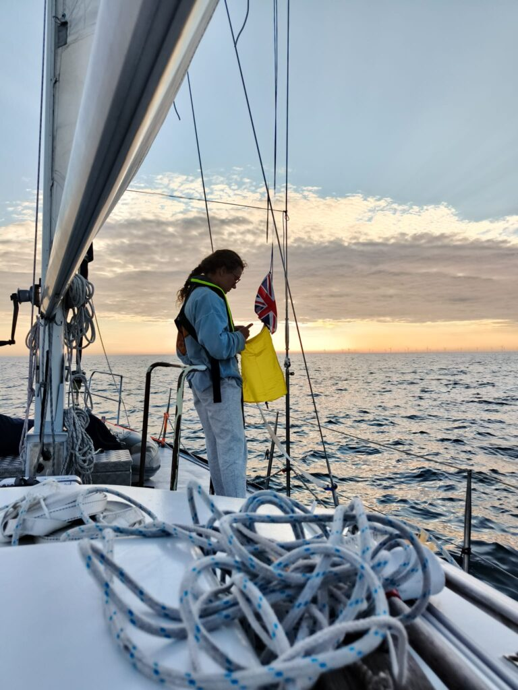

50°39.445'N, 000°04.323'W

Twee rustige dagen met weinig wind achter de rug en we bevinden ons inmiddels op de Westelijke helft van deze aardbol. Motor heeft een aantal uren gedraaid, maar we hebben ook grote stukken kunnen zeilen. Zuid-wester wind zorgt wel voor extra mijlen, maar we hebben de tijd.

Nu voorbij Dover en richting Isle of Wight. Weinig wind. Komende dagen wordt er meer wind voorspeld, maar we maken ons daar geen zorgen over. Vanochtend een paar uur flinke vlagen gehad en die gaven ons meteen een goed beeld van waar we kunnen verbeteren, komende uren kleine klusjes dus.

Dinsdag lijkt de wind gunstig te draaien om naar het zuiden af te buigen. Vooralsnog dus koers op Noord-Spanje. We houden onze opties nog even open voor een Britse pint met het vriendenvlaggetje in ons want.

Jen heeft haar eerste dolfijnen gespot, al was het nog op afstand. Ik vloog de drone en verloor hem bijna. Dat moeten we nog even oefenen op het strand.

ETA Spanje Jen: Vrijdag 20.00 UTC  
ETA Spanje Rorik: Zaterdag 10.00 UTC

Wat denken jullie? Gaan we naar Spanje?

