We gaan een beetje hoppen en plakken in de tijd en ruimte. Luwte ligt inmiddels in het Spaanse A Coruña, maar het (b)logboek moest nog vanaf Plymouth worden bijgewerkt.

## Aanloop Plymouth

Ons vrij plotselinge besluit naar Engeland om te keren, betekende dat we ons dus niet moesten voorbereiden op een aanloop in een Spaanse ria, maar op een aanloop in een Engelse baai.  
Dat is sinds Brexit niet meer een kwestie van binnenvaren, je anker uitgooien en de eerste de beste pub zoeken om je welverdiende *pint* te drinken. Bij het binnenvaren van de Engelse territoriale wateren verlaat je de EU en het Shengengebied en dien je dus in te klaren bij customs & immigration. Daarnaast moet je, tot je expliciete toestemming hebt, de gele Q vlag voeren om aan te geven dat je nog in quarantaine zit.

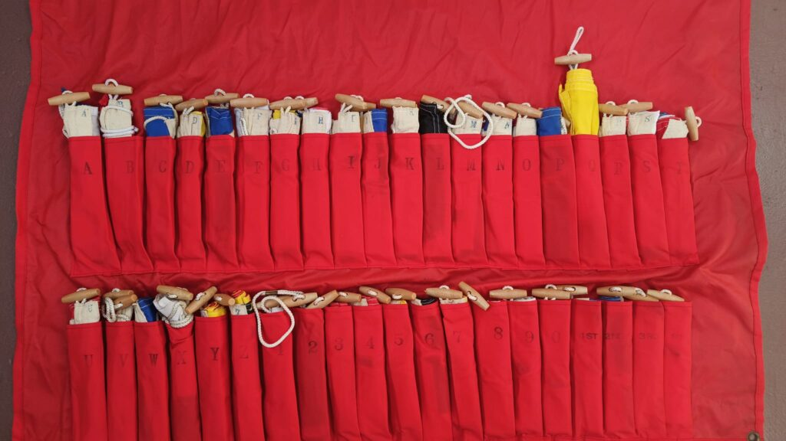

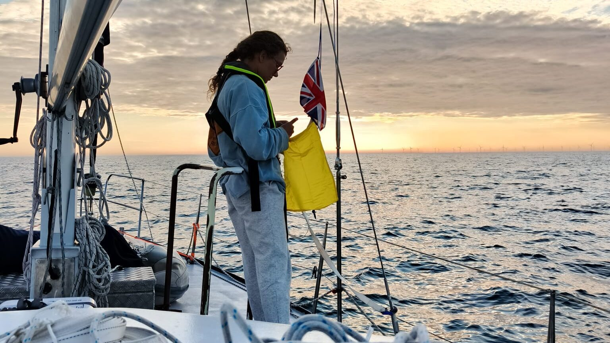

Zoals je ziet hebben we naast de gele Q-vlag nog een heel alfabet aan andere vlaggetjes die we kunnen hijsen. Die vlaggen hebben natuurlijk een betekenis, maar voorbij de letter Q ben ik vooralsnog niet echt gekomen. Naast de enkele-letter-enkele-betekenis vlaggen, kun je natuurlijk ook combinaties maken. Zo kwam ik in het boek van Bernard Moitessier, een avonturier die non-stop 1,5 keer de wereld rond ging in 1967, een passage tegen waarin hij beschrijft hoe hij door het voeren van de letters MIK en met behulp van een spiegel om aandacht te trekken, vrachtschepen in zijn buurt het verzoek deed zijn positie door te geven in het LLoyd's scheepvaartregister. Dat register kon dan weer worden geraadpleegd door de thuisblijvers en zo wisten zij toch dat hij in goede doen was en waar hij dobberde. Zijn eerste vrachtschip kwam hij tegen na twee weken op zee te zijn geweest...  
Een heel andere ervaring dan nu dus. De tweemaaldaagse updates naar onze ouders toe zijn inclusief live positie, soms een foto en als we het hebben een filmpje. Ook Moitessier kreeg destijds door de *Sunday Times* aangeboden om de allernieuwste van het nieuwste mee aan boord te nemen, zodat ze onderweg in ieder geval tekstberichten konden uitwisselen, maar dat weigerde Moitessier wijselijk, omdat hij niet gestoord wilde worden als de zee tegen hem sprak.

Met de gele vlag gehesen en onze douanedocumenten aangeleverd voeren we dus richting de Engelse kust. Met de eerste streepjes mobiele verbinding belden we de douane op om toestemming te krijgen om de haven binnen te lopen en van boord te gaan. Dat bleek geen probleem: Welcome to the UK.

Voordat je de voormalige piratenstad binnenloopt vaar je om een indrukwekkende "breakwater" heen. Het woord zegt precies wat het is. Een *breakwater* breekt de binnenlopende golven van zee. Het voelt als een frontlinie tussen Poseidon en zijn broer Zeus. Zodra je om de muur heen bent wordt alles vlak en rustig. Buiten zie je de golven stukslaan op de *breakwater* en voel je direct dat je op open water zit.

Eenmaal binnen zijn er een aantal havens om uit te kiezen, naast de mogelijkheden om voor anker te gaan natuurlijk. Onze keuze viel op een haven, omdat we behoefte hadden aan voldoende stromend water om te ontzilten. Door de nog koude zee van het kanaal, een paar lekkende raamrubbers en zout water dat de afgelopen dagen over ons schip vloog, was zowel binnen als buiten alles langzaam klam en plakkerig geworden. Met name 's nachts, als de vochtige lucht begon te condenseren, voelde alles - zowel binnen als buiten - vies.  
Volgens onze pilot (een soort *lonely planet* van het zeilen) was de haven in het centrum een stuk duurder dan die vlak naast het centrum, dus kozen we de tweede optie. Het budget dat we reserveren voor havens is beperkt en één van de makkelijkste manieren om kosten te drukken tijdens het reizen.

Na onszelf, de boot, onze kleren en alles daar tussenin te hebben gewassen en gespoeld, liepen we jubelend over de steiger naar het havenkantoor om ons te melden. Met het dikke pakket aan officiële documenten onder de arm maakten wij ons kenbaar. Ik ben klaar voor alle vragen en weet zeker dat we van alles moeten laten zien, maar het enige wat ze nodig hebben is onze scheepsnaam, een telefoonnummer en een e-mail adres...

Op de vraag hoeveel nachten we willen blijven kijken Jen en ik elkaar vragend aan: Eigenlijk nog helemaal niet over nagedacht. Twee? Doe maar één om mee te beginnen. Is dat genoeg? Ik heb geen zin om te haasten.. Maar bijboeken kan altijd nog morgen. Prima.  
Toen we een minuut later twee wasmachinemunten, een drogermunt en recht op een nachtje rijker waren brak mijn begroting even in tweeën. Dat werd bij elkaar dan 67 pond (zo'n 75 euro). Dit was toch de goedkope haven van de stad?! Op deze manier moet ik toch nog even gaan graven in onze excel hoe we deze reis ook alweer wilden gaan bekostigen...

Beduusd en tevreden komen we terug aan boord en pakken de websites van die havens er bij. Ongelooflijk genoeg klopt de pilot, al is het verschil marginaal. Het pondje dat we 4 keer hebben genomen naar de stad maakt het verschil tussen de twee verwaarloosbaar.

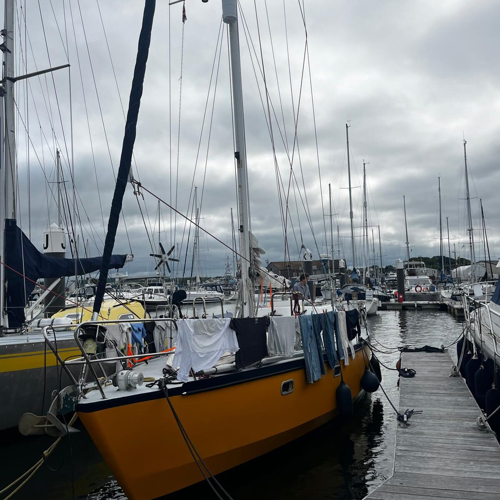

## Plymouth?

Doordat Plymouth eigenlijk niet op onze radar lag als plaats om aan te doen, en onze gedachte nog altijd in de Noord-Spaanse zon was, gaat Plymouth vooral de boeken in als stop-and-go voor ons. Bijtanken, zowel qua slaap, in water en wat boodschappen en dan de trossen weer los. Wel laten we in de campingwinkel nog even onze transactiebehoefte even helemaal los. Jen loopt naar buiten met een waterfles à la *Love Island*, met zo'n tepel er bovenop waar je de hele dag aan kunt lurken en ze bemachtigd na enig aandringen van mij roze Crocs. Je leest het goed. Twee woorden die samen een verbod op vertoeven in de samenleving genereren: Roze Crocs. Verschrikkelijk lelijk, maar het ultieme schoeisel voor aan boord wat ons betreft!  
In dezelfde campingwinkel pas ik een gepolariseerde zonnebril, waarop een oude man van achter zijn rollator opmerkt dat geld uitgeven aan zonnebrillen in de UK "*a waste of money"* is. De zon is hem niet bekend in dit gebied.

We drinken nog een pint of drie, eten ons vol aan een *Seaman's platter* fish & chips en slapen dan diep in om de volgende ochtend de touwtjes los te gooien. Helemaal klaar zijn we nog niet. Er wachten nog een paar belangrijke klusjes om de boot weer in zee-staat te krijgen en het weer laat nog twee dagen op zich wachten. Daarom ankeren we in Cawsand Bay, even buiten Plymouth en zeer beschut in zuidwest tot noordelijke wind.  
Als de dieptemeter 4,5 meter aangeeft loop ik naar voren en gooi het anker er in. Zoals we in Nederland al honderden keren voor anker gingen. In Cawsand bay wil het anker niet plakken en dat betekent dat ik de 30 meter ketting en het anker weer omhoog moet trekken, maar geholpen door een paar sterke worden en getrainde armen van het werken op de werf is die zo weer boven. De tweede keer wil het anker wel blijven hangen en liggen we mooi vast.

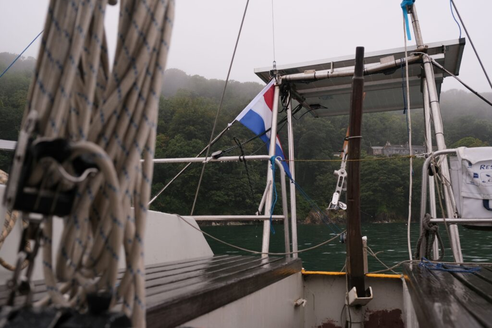

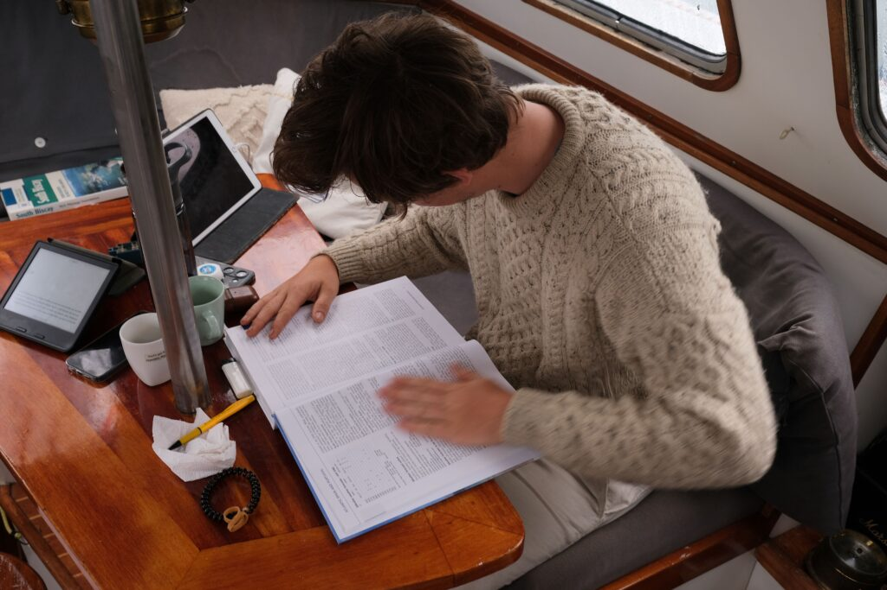

Ondanks de beschutting tegen de wind, komt de deining wel binnenrollen en die staat dwars op de wind. Dat zorgt ervoor dat we zelfs achter ons anker alles netjes zeevast moeten houden, want glazen blijven niet op tafel staan en alles wat rolt gaat heen en weer. Wel meteen ingeslingerd voor de golf van Biskaje.

## De Golf van Biskaje

De Golf van Biskaje, het stukje zee tussen het meest westelijke puntje van Frankrijk en de noordkant van Spanje, is berucht onder menig schipper. Plotselinge mistbanken, onstuimige zeeën en tegenwoordig ook nog hapgrage Orka's die het leuk vinden om (kleine) zeilschepen aan te vallen.

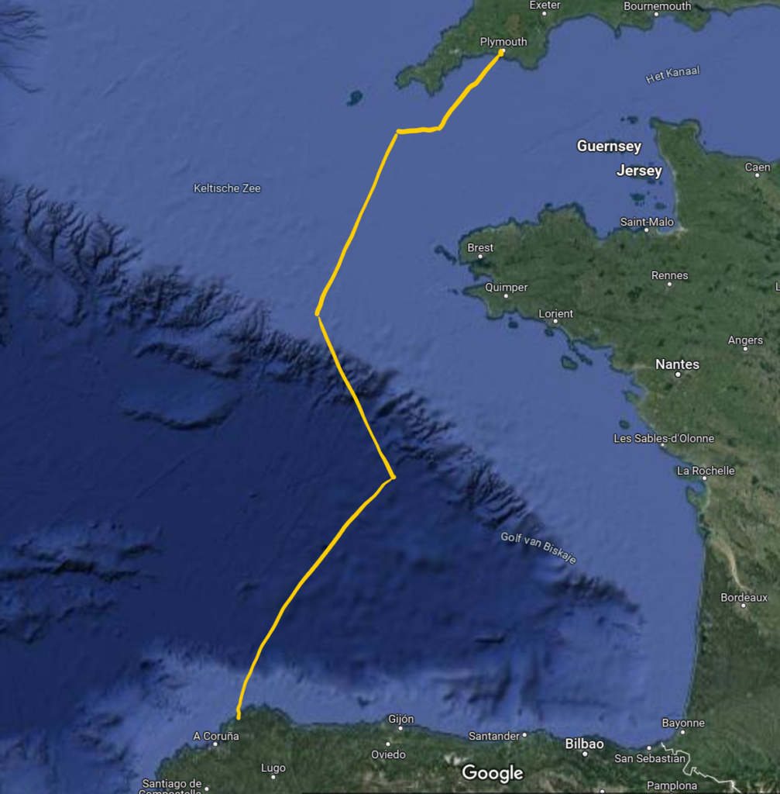

Op de satellietkaarten van Google is het mooi te zien hoe de zee van lichtblauw naar donkerblauw overgaat. Die overgang wordt het "Continentaal vlak" genoemd en is in werkelijkheid een 4 kilometer hoge muur des onheils. Althans, zo denk ik dat het er uit ziet als je er naartoe zou gaan met een duikboot.

Over een afstand van slechts enkele kilometers hemelsbreed valt de bodem letterlijk onder je vandaan en vaar je plotseling niet meer in 80 - 100 meter diepe zee, maar in 4.000 tot 4.500 meter! Je kunt je misschien voorstellen wat er met de massa water gebeurt die vanuit het westen richting land beweegt. Die kan maar één kant op, en dat is naar boven.

In een paar uur tijd zie ik het water om ons heen veranderen van de inmiddels bekende kanaal-golven, die zich kort en steil achter elkaar melden om hun energie in Luwte te stoppen, naar een lange, reusachtige, maar kalme oceaan. Golven veranderden in deining en deining verandert langzaam in een heuvelachtig helder blauw teletubbie landschap waar wij overheen glijden.

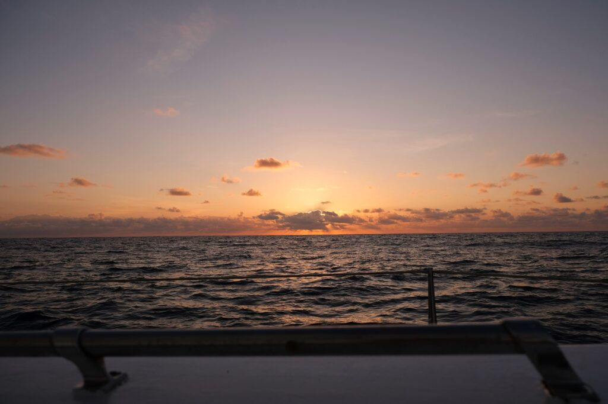

In de meeste gevallen ben ik blij voor het thuisfront dat golven zeer slecht te filmen of fotograferen zijn en op beeld altijd minder uitkomen. In dit geval baal ik voor jullie. Ik gun het iedereen om het eens mee te maken hoe reusachtig en tegelijkertijd sereen het water kan zijn. We zullen haar keerzijde vast ook nog meemaken, maar tot die tijd is dit wat mij betreft de definitie van ultiem geluk.

<figure class="wp-block-image size-large is-resized">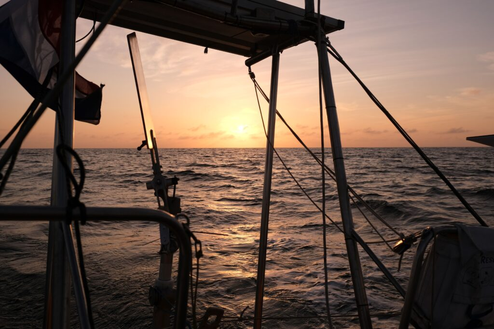<figcaption class="wp-element-caption">"Dit verveelt eigenlijk nooit" - Jen</figcaption></figure>

<figure class="wp-block-image size-large is-resized">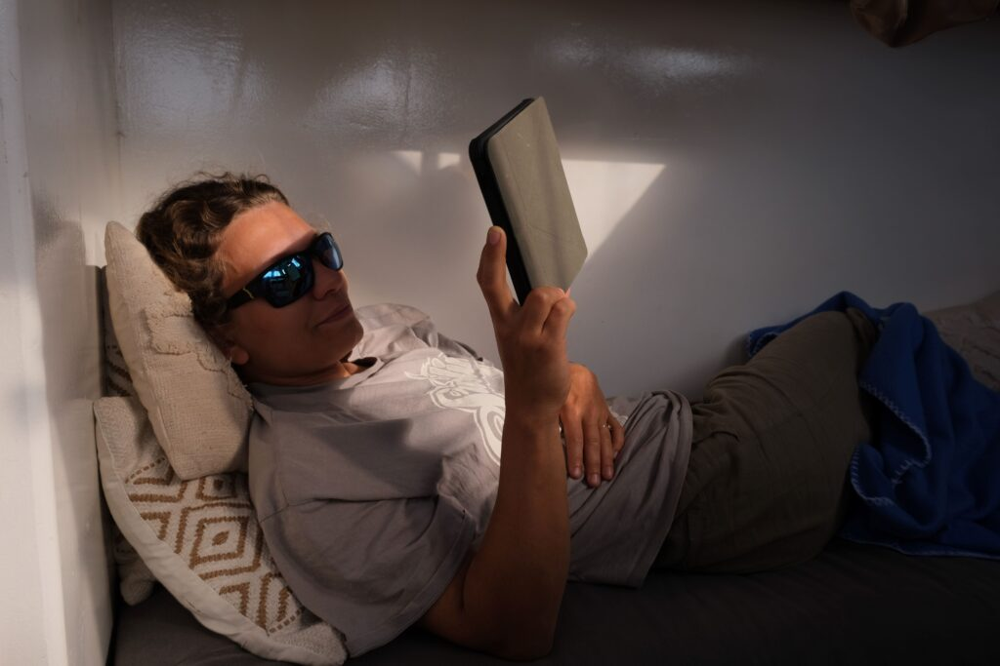<figcaption class="wp-element-caption">Dit is hoe we het voor ons hadden gezien: Boeken verslinden en turen naar de horizon.</figcaption></figure>

## Cedeira - Spanje

Na zo'n 4,5 etmaal op zee overvalt ons een hete, vochtige lucht die sterk naar aarde en kruidentuintjes ruikt. Het is 04.00 's nachts en plotseling zijn er overal lichtjes om ons heen. De wind valt weg en de vissersbootjes slingeren ondefinieerbaar om ons heen. Sommigen met AIS, sommigen met alleen verlichting en af en toe meen ik er eentje te zien die überhaupt geen verlichting voert. Opletten geblazen dus.  
Jen slaapt, en heeft die uren nog echt even nodig en ik heb moeite mezelf in bedwang te houden continue alleen naar het voordek te gaan om nog even een zeil te trimmen, de boom er in te zetten (of er uit te halen). Havenkoorts in haar omgekeerde vorm. Ik ruik de stal, letterlijk.

Met de motor bij slingeren we tussen de vissersbootjes. De windvaan heeft niet genoeg wind meer om te sturen en de autopilot heeft kuren. Ik moet het dus met de hand doen en dat is door de deining vrij actief werk. Af en toe schiet ik even naar binnen voor wat te eten, of drinken, maar daar kom ik niet ver mee.

### Windvanen en autopilots

Op zee sturen we eigenlijk nooit zelf. Alleen tijdens zeilwisselingen, overstag gaan of gijpen. De rest van de tijd stuurt dat automatische piloot. We hebben voor het simpele werk een elektrische autopilot, die aan de hand van een elektronisch kompas en een elektromotortje probeert te zorgen dat we altijd dezelfde kant opgaan ten opzichte van het noorden. Na zo'n 20 jaar dienst werkt hij nog altijd prima, al komen er af en toe wat haperingen voor en dan weet hij even niet meer wat voor en achter ook alweer was. Ik heb hem nooit echt vertrouwd, maar als er weinig wind is, of de motor staat aan, dan is dit lawaaiproducerende computertje (met ingebouwde AI die zelflerend zijn algoritme aanpast aan de golven, jawel, ook 20 jaar geleden!) een prima hulpmiddel.

Een veel belangrijker, eleganter en vooral effectiever middel is de windvaan. Misschien is hij je al opgevallen op de filmpjes van Jen op Instagram, maar dat heen-en-weer bewegende futuristische ding achterop ons schip is alles behalve futuristisch.

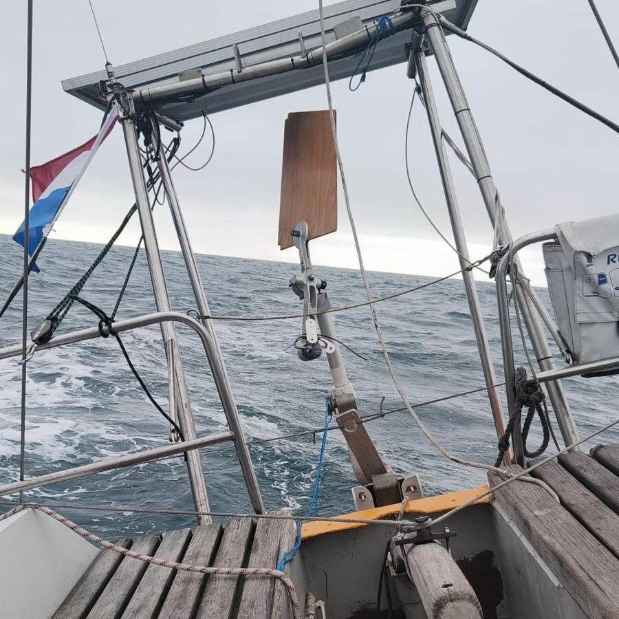

Zonder in detail te treden over de werking (voor de liefhebber, het betreft hier een Windpilot) is het wel leuk om te begrijpen dat deze installatie eigenlijk belangrijker is dan één van ons twee. In tegenstelling tot de elektronische autopilot stuurt een windvaan niet ten opzichte van het magnetische noorden, maar ten opzichte van de wind. Als de boot draait ten opzichte van de wind, klapt het plankje de ene, of de andere kant op en zet daarmee een trekkende, of duwende beweging in gang naar ons roer. De boot draait dan weer terug naar de ingestelde hoek ten opzichte van de wind en dan komt het plankje weer omhoog in zijn neutrale positie.

De voordelen zijn eigenlijk onuitputtelijk: De windvaan gebruikt geen stroom, maar de kracht van de wind om te sturen, hij stuurt ten opzichte van de wind, waardoor je niet continue je zeilen opnieuw hoeft te stellen, hij gaat steeds beter werken naarmate het harder gaat waaien (hij gebruikt die kracht immers), hij maakt geen geluid én er zijn vrijwel geen onderdelen die stuk kunnen gaan.

Deze zelfde windvaan bracht mij eerder in 2007 al naar Cedeira en deed dat nu weer. Vóór mijn ouders hem kochten, deed hij al decennia dienst bij iemand anders aan boord en nu duwt hij Luwte de goede kant op.

### 04.45

Het begint te schemeren en ik zie naast de knipperende lampjes en de geur van land ook de contouren langzaam opdoemen voor de opkomende zon. Omdat afstand inschatten in het donker lastig is, tuur ik veel naar de GPS om te controleren of we niet te dichtbij komen en op de klippen slaan. Dat begint al als we nog zo'n 5 mijl uit de kust zijn en eindigt eigenlijk pas als we achter ons anker liggen. Later bij daglicht zien we dat die smalle ingang naar de haven ongeveer even breed is als de Gouwzee en dat het allemaal wel meeviel. Tijd voor bubbels en vakantie. Dat is het gevoel dat overheerst.

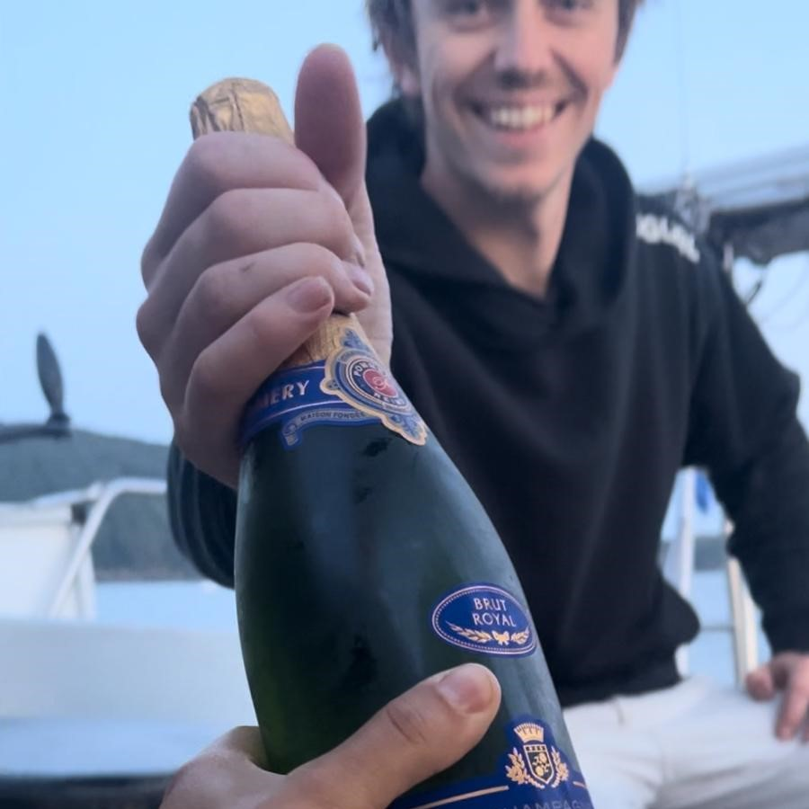

## Cedeira

In Cedeira leeft het. Dit vissersstadje zit vol met mensen, families, kinderen, (groot)vaders die met hun (klein)kinderen op de kade vissen en terrassen die vanaf 10.00 's ochtends al vol zitten met bier (?!) drinkende Spanjaarden. We leven heerlijk in de anonimiteit. Geen in korte broek gehesen melkflesbenen met kinderen die zeuren om een ijsje en moeders die vinden dat het te duur is. Hier, in Galicië, ver buiten de Nederlandse invloeden, stond ons het schaamrood op de kaken toen we voor 3 flinke biertjes, olijven, een fles water en chips slecht €8,40 moesten afrekenen en we niet konden geloven dat het onze rekening was. Hier spreekt niemand Engels en zijn we weer terug bij onze handen en voeten en een beetje vertalingen opzoeken.

Waar Cedeira mij in 2007 bijna de nek omdraaide en mij terug naar zee stuurde, is dit Cedeira vriendelijk en rustig. In 2007 landden we hier met de Palustris en werd ik samen met mijn broertje en zusje op pad gestuurd om de vuilnis weg te gooien. Als kersverse schipper van de bijboot vond ik dat machtig mooi, maar ook retespannend. Mag je gewoon overal aan wal? Kan het bij zo'n steile kade? Toch maar even verderop kijken.  
Een kade verderop werd een strandje verderop en voor we het doorhadden waren we aan de andere kant van de baai toen de motor uitviel en de benzine op was. Ik was toen nog schaatser en geen roeier, dus tegen de stroom en wind in dobberden wij zo het zeegat weer uit. Pa en ma hadden het gade geslagen, maar bij het ophalen van het anker brandde er een draad door in de ankerlier en moest het takelen met de hand gebeuren.  
Net toen we richting een ondiepte met rotsen aan het bewegen waren snelde een Engelsman toe. Die had ook gezien dat het niet goed ging en dat er geen redding nabij was. Dus kinderen: *Altijd* een reserve tankje benzine mee! Het zou niet de laatste keer worden dat ik daarop strandde helaas...

Ook in 2007 beklommen we de nabij gelegen klif richting het fort. De legendarische foto die daar werd gemaakt toonde een Surinaamse witte knul in een Spaans Armada fort met een shotgun in zijn denkbeeldige armen. We konden deze kans natuurlijk niet voorbij laten gaan en schoten precies hetzelfde kiekje nog eens. Nog altijd met een geel schip in de baai, al dan niet een andere. Zoek de verschillen:

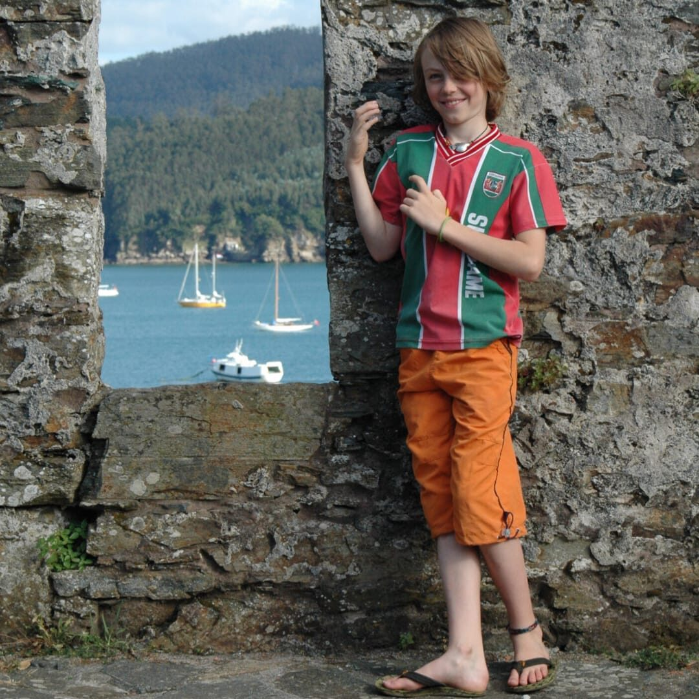

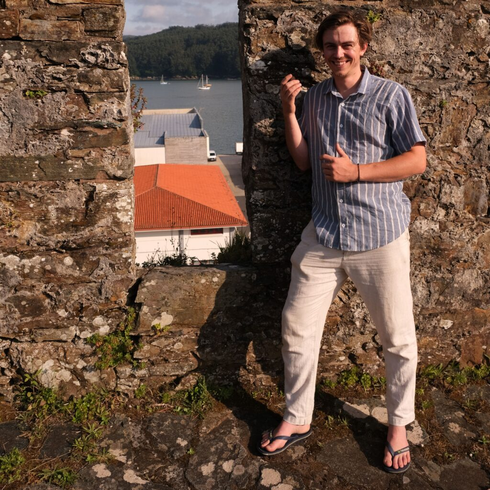

Tegenwoordig heb ik mijn eigen benzine in beheer en zorg ik dat de grote tank altijd goed vol zit. Genoeg om te verkennen dus. Richting Cedeira hebben we op zee continu gevist, maar niets gevangen. De supermarkt hier had duidelijk meer succes en levert ons een overvloed aan sardientjes.

De BBQ is aangesloten en we dartelen een beetje om en rond de boot. Het lukt aardig om te landen en we bereiken een door mij al zeer lang geambieerde *Status Opgeruimdus.* Zo goed als alles heeft inmiddels een eigen, zeevaste plek en dat geeft veel rust. Wij wanen onszelf eigenlijk al met één been in het Caraïbisch gebied en komen tot de conclusie dat onthaasten nu ons grootste goed wordt.

<figure class="wp-block-image size-large is-resized">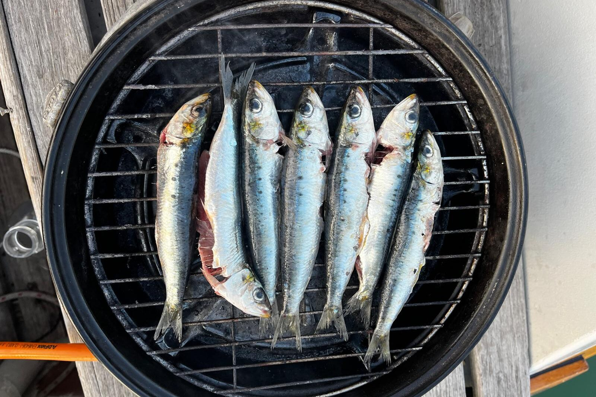</figure>

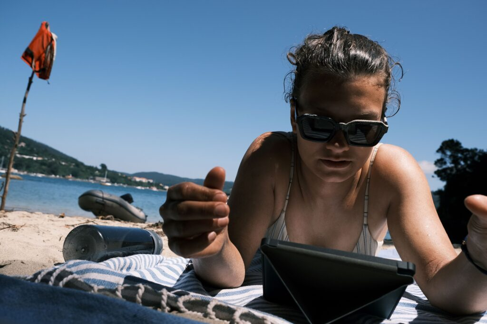

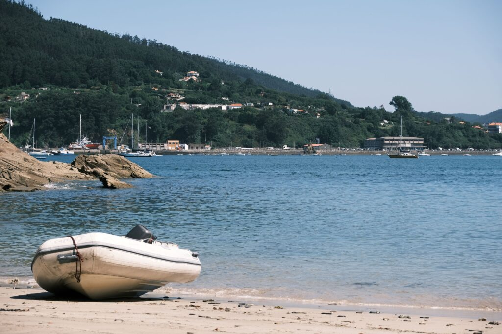

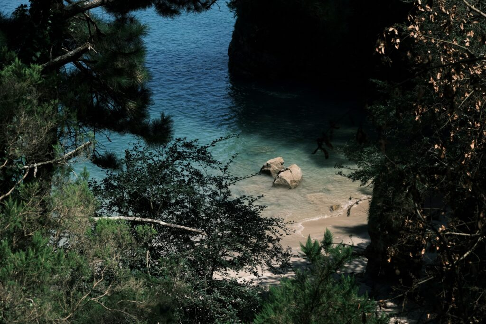

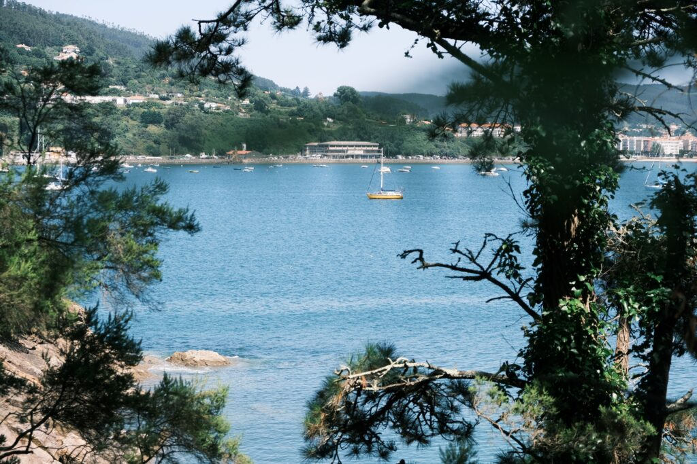

Nog geen 48 uur nadat we tegen elkaar zeggen dat we geen haast moeten hebben, komt er vanuit het noord-westen een zoute zeewind de baai in waaien en begint het alweer te kriebelen. We willen varen. In de pilot markeren we A Coruña als volgende bestemming. Daar hebben we mooie verhalen over gehoord en kunnen we nog wat klusjes uitvoeren aan de boot. Een grote stad met festiviteiten, barren en borrels. Zijn we daar wel naar op zoek?
