Het is me toch echt overkomen: Een *writersblock*. Zo erg, dat Jen mij zelfs heeft moeten aanmoedigen weer verder te schrijven. Het stukje waaraan ik begonnen was over het deel na Fisterra wilde maar niet opschieten en ik kon me er eigenlijk niet eens meer toe zetten.

CTRL-A-DEL gaf de doorbraak. We zijn even verder en kunnen dus misschien ook anders naar het vervolg kijken. De stroperigheid van mijn verhaal over Ria de Muros weerspiegelt ook onze nasmaak van Muros. Het was er niet lelijk, maar ook niet mooi. Het was mistig en grauw die dagen en dat zal het aangezicht niet hebben geholpen. Verder gebruikten we Muros met name om bij te tanken. Diesel en benzine werden afgetopt, Jen was de weg even kwijt in de mist en ik kon met de jerrycan op de step wederom mezelf overtuigen dat de step die ik Jen voor haar verjaardag gaf, het beste cadeau ooit is geweest.

Het grootste event van Muros was de her-introductie van ons *partneroverleg*. Toen wij eind vorig jaar de plannen opmaakten en wisten dat we echt allebei heel hard gas moesten gaan geven, besloten we eens in de twee weken letterlijk met elkaar om de tafel te gaan om het ook tussen ons een beetje gezellig te houden. De meeste van deze avonden vonden plaats in onze stamkroeg *Café Heilig Leven* (aanrader!). Daar mochten we afgehaalde thai van de overkant op hun bordje met een biertje erbij tot ons nemen.

Sinds vertrek zijn we daar niet zo bewust mee mee bezig geweest en nu, een paar partner-overleggen verder, merken we hoe fijn het is af en toe ruimte te nemen om zowel de goede, als slechte kanten van een varend bestaan te bespreken. Ons grootste struikelblok is, zoals het thuis ook was, het huishouden. Ik ben een natuurlijke rommelkont en zie rommel letterlijk niet. Over tijd beginnen al onze spullen wel een plek te krijgen, maar de boot zeilklaar versus leefbaar behoeft door ons ruimtegebrek wel altijd wat extra tijd en aandacht..

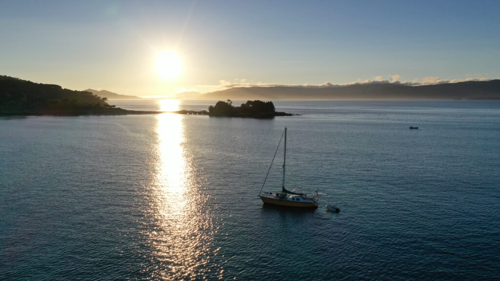

## Ria de Arousa

We laten de mist van Ria de Muros achter ons en varen richting Ria de Arousa. Uit de pilot en op basis van de kaarten ziet deze er het meest spectaculair uit. Met eilandjes, kleine baaitjes, steden en dorpen.

Terwijl de Ria zich aandient komt Jen haar allergrootste meisjesdroom uit. Nog ver boven het worden van prinses (naar mijn mening al aardig gelukt), moeder of wereldverbeteraar staat de interactie van mens, schip en dolfijn.

Een school van zeker dertig Gestreepte Dolfijnen komt aanvliegen en zwemt met ons mee. Jen kan alleen maar lachen, gilletjes uitslaan en huilen. Net zat ze nog aan het roer, maar *Luwte* moet maar even stuurloos verder. Ik neem over en geniet nog meer van het aanzicht van deze blije Jen, dan van het spelen van de natuur. Om de droom nog verder te overtreffen stuur ik Jen naar de punt. Aangelijnd zit ze op de trommel van de rolfok, met een been bungelend boven het water. Om haar tenen spelen de dolfijnen en kan de show beginnen. Ze komt nog even terug om haar telefoon in te leveren. Genoeg filmpjes gemaakt en tijd om nu helemaal met de dolfijnen te genieten. Zeker een uur spelen de dolfijnen *Wie het dichtstbij durft te komen!* rond onze boeg. De zon komt wat omlaag en ik sta als een tevreden mannetje toe te kijken als Jen uitkraamt dat ze nu rustig kan sterven.

Als we de vuurtoren ronden draait de Ria bijna 180 graden landinwaarts en verandert ons rustige windje op de kont in een flinke wind op de kop. Jen is het met mij eens dat we een zeilschip blijven en toch zullen moeten opkruisen. Een half uur motoren of anderhalf uur opkruisen is een beetje als kiezen tussen de lift en de trap, maar degene die de trap pakt heeft boven in de skylounge wel echt dat biertje meer verdiend.

<figure class="wp-block-image size-large">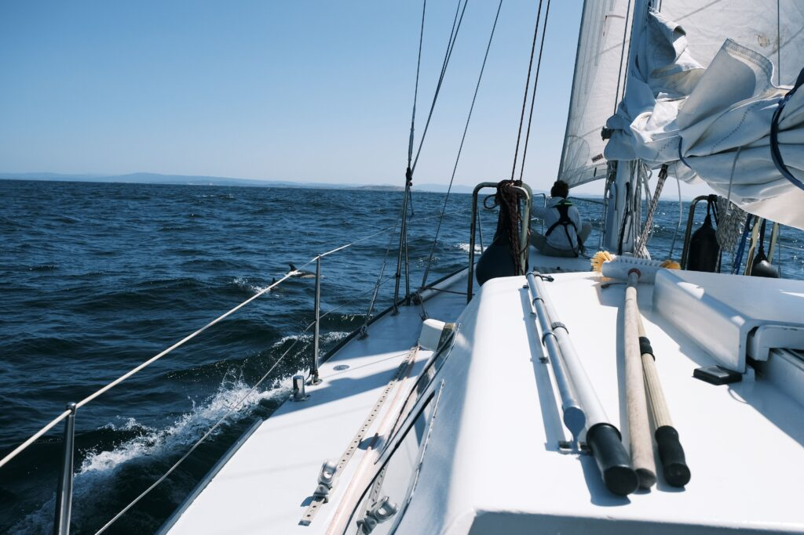<figcaption class="wp-element-caption">Dolfijnen spelen <em>Wie het dichtstbij durft te komen!</em></figcaption></figure>

## Communicatie aan boord

Het is een berucht onderwerp, met name onder de mede-vertrekkers: communicatie tussen de man en de vrouw tijdens het manoeuvreren van het schip. Ieder heeft daar zo zijn eigen methoden voor. Bij de één staat de vrouw achter het roer en houdt de man zich bezig met het beleggen van de lijnen. In een traditionelere verhouding staat de man achter het roer en doet de vrouw het belangrijke werk.

Los van de rolverdeling, is een veel heikeler punt de manier waarop mannen en vrouwen communiceren. Een vriendje van mij op de basisschool wist het mij al in de kleuterklas uit te leggen. Het grote geheim van zijn vader dat beslist nooit tegen een vrouw gezegd mag worden, maar een stukje kennis waar mannen wel degelijk iets aan hebben: *Alle vrouwen spreken Vlaams.*

Ik ga nu extreem generaliseren en chargeren, maar de situatie waarin wij ons vaak bevinden gaat over een dunne lijn waarop moet worden gebalanceerd. Het verschil tussen *Schatje, kun je misschien die lijn op die kikker leggen?* en *Schatje kun je die lijn op die kikker leggen?*! is voor mannen verwaarloosbaar, maar voor de dame die dit tot uitvoer moet brengen een reden om tot ontploffing te komen. En als je bedenkt dat bij het aanleggen in een haven vaak wel zes lijnen worden uitgezet, kun je misschien iets voorstellen bij de uitspraak dat de meeste relaties eindigen in de sluis.

Een mooi voorbeeld hiervan dient zich aan als wij Ria de Arousa zijn binnengevaren en onze borrelplek vlak voor zonsondergang in het vizier hebben. Tussen twee enorme rotspartijen ligt een klein strandje met plaats voor één, hoogstens twee zeilboten en er liggen er op dat moment nul. Bij het dekschrobben in Muros heb ik een emmer water over onze dieptemeter gegooid en deze bleek niet meer zo waterdicht te zijn. Binnen zit gelukkig een tweede klok, dus ik sommeer Jen om binnen te staan en de diepte op te noemen terwijl we de plek zoeken om ons anker neer te laten komen.

Het geluid van de motor overstemt Jen's zachtaardige stemgeluid en ik heb al een paar keer moeten vragen om een herhaalbericht. Mijn behoefte aan informatie wordt steeds dringender naarmate we in ondieper water komen en op een zeker punt reageer ik met "Wat?!" op één van haar peilingen. De grens is bereikt. Ik heb Jen haar stress-tax geschonden en we zijn het duidelijk niet eens over de decibels die nodig zijn om boven het geluid van de motor uit te komen. Het ankerproces wordt stopgezet en niet veel later lachen we onszelf uit om ons onbenullige gedrag. Het anker plonst en we kunnen een flesje opentrekken op een behouden vaart.

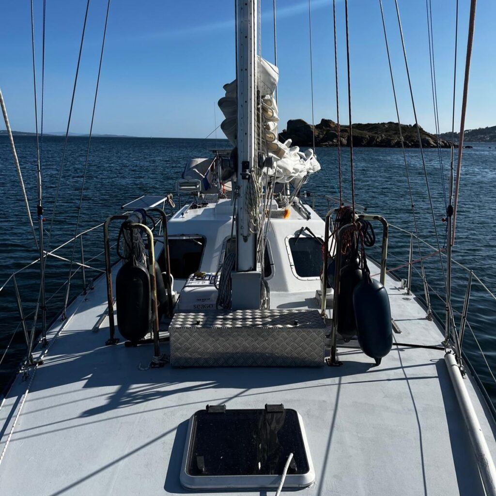

<figure class="wp-block-image size-large is-resized">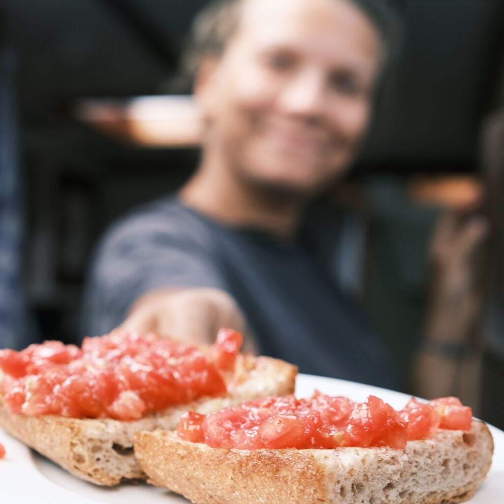<figcaption class="wp-element-caption">Een broodje tomaat a la Jen maakt veel goed...</figcaption></figure>

## Boiro

Twee dagen later varen we verder. Als een kind in de snoepwinkel overvalt de keuze aan baaitjes en stranden ons een beetje. We besluiten gewoon zo diep mogelijk naar binnen te varen en vanuit daar weer terug te hoppen richting zee.

Het tochtje naar Boiro is weer eens fantastisch zeilen. De gennaker gaat op en het grootzeil kan ook bij omdat we bijna halve wind varen. Het rustige water van de Ria verstoort *Luwte* niet in haar gang en we stuiven met ruim zeven knopen op één oor naar Boiro. De wedstrijdzeiler in mij komt weer een beetje naar boven en ik verplicht mezelf om de gennaker in één haal naar beneden te halen na het uitrollen van de fok. En dat lukt. Het laatste stuk zeilen we tussen de *viveros* hoog aan de wind naar het strand. De *viveros* zijn grote vlotconstructies waaraan mossels worden gekweekt en die nemen veel ruimte in de Ria's in beslag.

De wind valt weg terwijl we het strand naderen en we besluiten de zeilers in ons te ontketenen. Dit keer geen gepruttel van de motor, maar zeilend het anker uitgooien. Bij het ten anker gaan wil je achteruit varen en hoewel een zeilschip gemaakt is om voorwaarts te bewegen, kun je je zeilen ook tegen de wind in de verkeerde kant op zetten, waardoor je de verkeerde kant op beweegt. We draaien door de wind, laten de fok aan de verkeerde kant en duwen het grootzeil met de hand tegen de wind in. Ik sprint naar voren en gooi het anker uit. De ketting ratelt en *Luwte* luistert naar ons enthousiasme. Even voelen we ons ontdekkingsreizigers.

### On top of the Ria

Boiro is een beetje een kneuterig plaatsje, maar van alle gemakken voorzien. Er zijn veel winkels en terrasjes. We vinden een bakker die het lekkerste brood tot nu toe bakt en kijken op de wandelkaart of we een mooie tocht kunnen maken. Inmiddels durf ik mijn wandelschoenen aan en besluiten we naar de top van de bergen in de verte te wandelen. De KindsWijs canvastas wordt bij de Chinees ingeruild voor een goedkope rugzak, waarvan de rits al voor de uitgang van de winkel breekt. We lopen terug naar binnen en leggen met handen en voeten uit dat we dit niet gewend zijn van zo'n groots handelsland. We mogen een nieuwe uit het schap pakken en kiezen er een waarvan de sluitingen er ietsje beter uitzien.

Na twee uur ploeteren bereiken we de top van de berg en kijken uit over de hele Ria, inclusief *Luwte* die rustig achter haar anker hangt. We eten een empañada van de bakker en drinken een kop koffie terwijl we onze voeten even laten rusten. Aan de voet van de berg hebben we afgesproken bij wijze van experiment in stilte te wandelen, dus al die tijd hebben we voor de verandering geen woord gewisseld. We vinden elkaar in de stilte, af en toe wijzend naar volgende afslag, een mooie vlinder, en bij de wandeling naar beneden omhoog kijkend naar de top die we zojuist overwonnen hebben.

Als we, inmiddels weer sprekend, beneden aankomen en ik naar de bijboot zwem die inmiddels een stukje van het strand drijft door de vloedstroom, zien we in de verte een mastje de baai in draaien. Eenmaal dichterbij gekomen zien we een Nederlandse vlag wapperen en lezen we *Drifter* op de boeg. Jen herkent de naam van eerdere berichten in de vertrekkersgroep: De *Drifter* heeft bij een andere vertrekker wat lege bierblikjes achtergelaten en daar was een foto van geplaatst. Daar moeten we kennis mee maken!

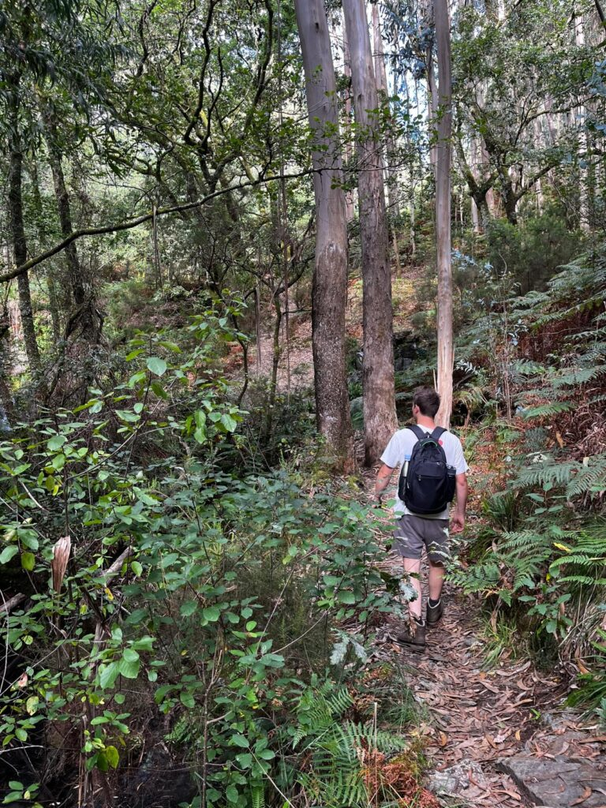

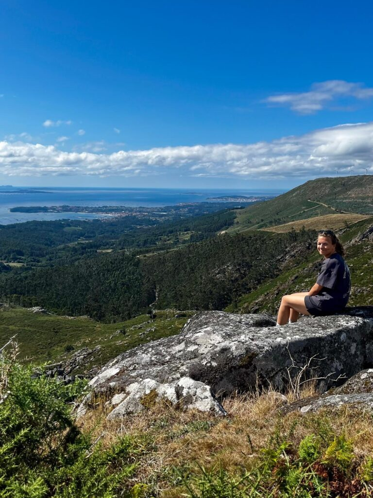

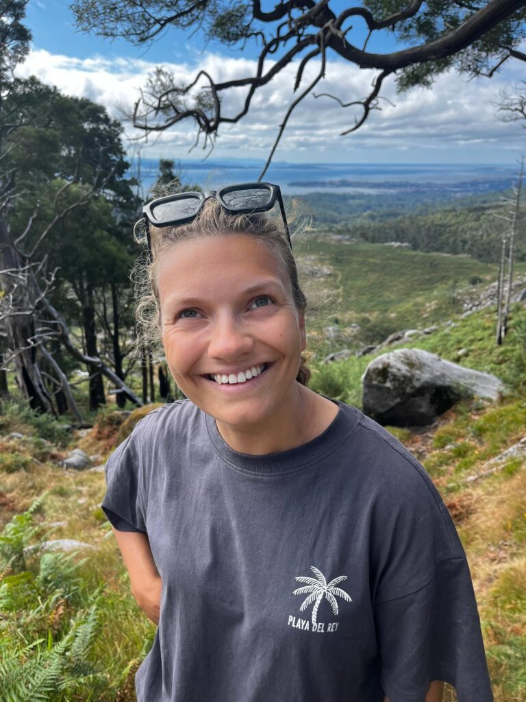

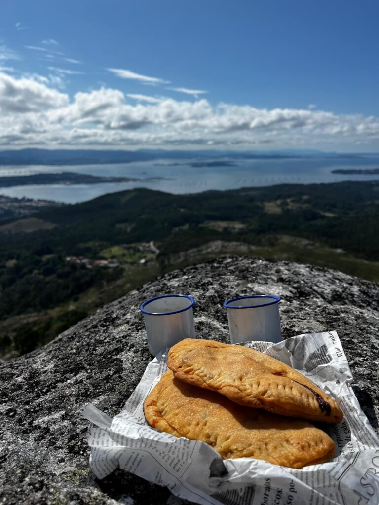

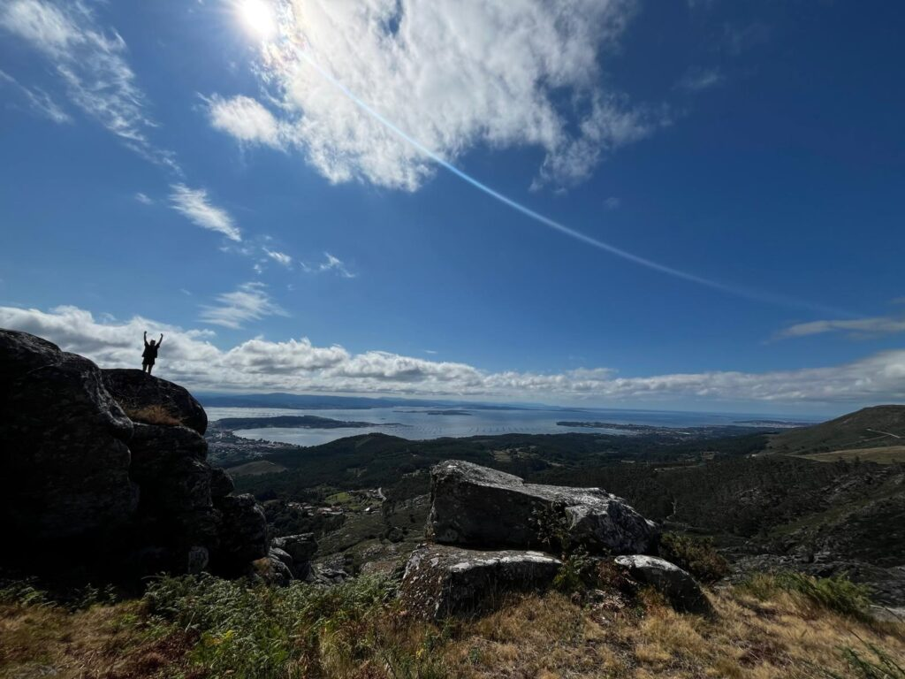

### De Nederlandse Caravaan

In de dagen die volgen spenderen we veel tijd aan boord van Nederlandse schepen. Naast de *Drifter* volgen de *Eva Kristina* en nog een heel aantal andere schepen die in naam van de Koning de wereld verkennen. Sinds Coruña zijn Jen en ik voornamelijk met zijn tweeën geweest, in een soort niemandsland tussen vertrekkers voor ons en vertrekkers achter ons, dus we genieten van alle borrels, standsessies, etentjes en kopjes koffie bij elkaar aan boord.

Na een paar dagen van verhalen uitwisselen hijsen we, net zoals we gekomen zijn, zeilend het anker en varen we tussen de *viveros* verder. Inmiddels vind ik het wel welletjes met die platformen. Tot nu toe voer ik er telkens netjes omheen, maar op een rustige dag als deze vind ik dat we er wel tussendoor mogen. We zijn de enige die dat doen, maar worden niet op de vingers getikt, dus ik neem aan dat het geen probleem is.

Een stukje dieper de baai in varen we naar Villagarcia de Arousa. De grote stad waarnaar deze ria is genoemd. Niet omdat we nou per sé behoefte hebben aan een grote stad, maar er ligt een eilandje naast dat erg mooi schijnt te zijn. Daarnaast heb ik in Boiro een poging gedaan om onze dieptemeter open te maken en schoon te maken, maar zonder succes. Bij het heraansluiten bleek ik meer kapot gemaakt te hebben dan al was, want de kapotte meter maakte kortsluiting met de tot nu toe nog werkende meter binnen... Geen dieptemeter meer dus. Misschien in de grote stad een bootjeswinkel?

Een zeilboot zonder dieptemeter is toch wat behelpen, zijn we inmiddels achter. Ik maak een lijntje van acht meter vast aan een hamer, waarmee we dan vanaf de punt de diepte kunnen inschatten. Elke meter een knoopje meer om bij te houden hoeveel knopen (en dus meters) de diepte is. Vanuit binnen de diepte oplezen was al een hele uitdaging, maar nu moet Jen op het voordek gaan staan, de hamer in het water gooien en mij dan de diepte doorseinen. Wederom hebben we wat communicatieproblemen bij het ankeren en wederom lachen we er daarna hard om.

## Illa de Arousa

De stad blijkt niet zo bijzonder. De stad trekt ons inmiddels sowieso een stuk minder. Veel prikkels, winkels met spullen die we niet nodig hebben en stoplichten. Snel door dus naar een plek die beter bij *Luwte* past.

Illa de Arousa doet bijna Caraïbisch aan. Met strandjes om ons heen, een klein, maar prachtig dorp met lekkere restaurantjes en wederom een goede bakker en bovenal een fijn strand om de dinghy achter te laten. Jen gaat uit hardlopen, we maken mooie wandelingen en worden uit eten meegenomen door Ton en Lonneke van de *Drifter*, die inmiddels ook dit mooie eiland hebben ontdekt.

In de tussentijd bestel ik wat spullen op Amazon, waaronder een *fishfinder*. Dit is een gadget die door vishobbyisten kan worden gebruikt om op basis van sonar te kijken of er vissen in de buurt zwemmen. Het leuke van deze apparaatjes is dat ze vrij goedkoop zijn én een stuk makkelijker dan een hamer aan een touwtje, want ze geven ook de diepte aan. De levertijd is slechts twee dagen. Daarin komen ze het dan wel niet naar je boot brengen, maar Amazon heeft in zo ongeveer elke uithoek wel pakketpunten waar je je spullen naartoe kunt laten sturen. Aan het thuisfront zet ik mijn Marktplaatsalgoritme weer aan het werk op zoek naar vervangende dieptemeters. Die liggen een week later bij mama en papa thuis om binnenkort onze kant op gestuurd te worden.

<figure class="wp-block-image size-large">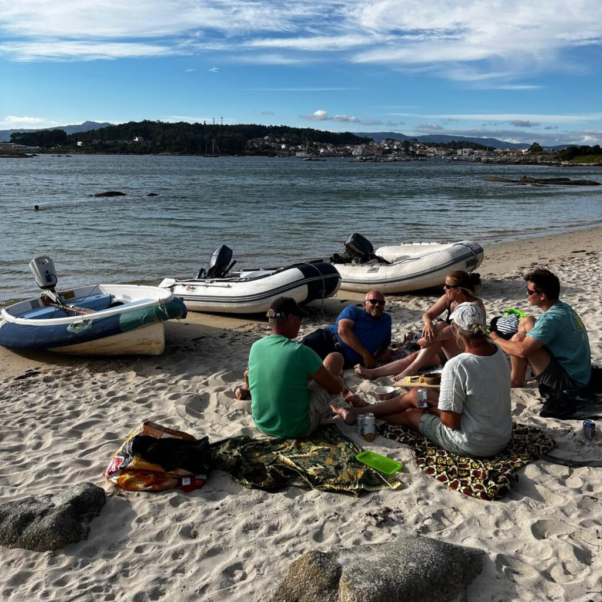<figcaption class="wp-element-caption">Strandborrel met de <em>Eva Kristina</em> &amp; <em>Drifter</em></figcaption></figure>

## Cíes en Orca's

Met onze fishfinder op zak kan de tocht worden voortgezet en maken we ons klaar om deze Ria weer te verlaten. We hebben het hier naar ons zin gehad en willen graag met die herinnering door. Een stukje zuidelijker liggen namelijk een aantal eilanden voor de kust van Spanje waarvoor we vergunningen hebben aangevraagd. Deze maken deel uit van een natuurgebied en mogen dus niet zomaar betreden worden. De procedure is snel en soepel en geeft ons de rest van ons leven recht op tien toegangsdagen per jaar.

Er is aan ons plan weinig veranderd sinds het ontmoeten van nieuwe vertrekkers. Het is soms wel verleidelijk om te fantaseren over het volgen van één van hun plannen. Iedereen die wij tot nu toe hebben ontmoet vaart namelijk een andere route en met een andere bestemming. Daar blijven wij dus ook maar bij. Wat wél een beetje onder onze huid is gekomen, is de berichtgeving over orca's voor de Spaanse en Portugese kust.

Sinds een paar jaar hebben deze majestueuze dieren namelijk besloten dat het best een leuke sport is om voorbij varende schepen aan te vallen. Voor zover bekend zijn er twee groepen die dit spel actief spelen. Terwijl wij diep in de Ria liggen, zijn er bij de monding twee andere jachten aangevallen. Tot dat punt had ik de overtuiging dat ze alleen ver op zee zaten, maar dit was daadwerkelijk ín de Ria en niet midden op zee.

De schade die ze aanrichten varieert. Bij de meeste schepen beperkt de schade zich tot krassen en een traumatische ervaring, maar bij sommigen worden roeren afgebroken. In een extreem geval is een hennegatskoker naar binnen gedrukt en zonk het schip. *Luwte* is zwaar gebouwd en bovendien zwaar gebouwd van staal. Ik rationaliseer dus dat echte schade niet aan de orde zal zijn, maar dat opletten ook geen kwaad kan. Een andere theorie die ik zelf heb bedacht (en door andere zeilers ook is bedacht) is dat het uitlaten van de dieptemeter wel eens zou kunnen helpen. Die zendt namelijk een sonar geluid uit en daarop communiceren orca's ook. Voorlopig dus geen probleem, want die van ons is sowieso stuk.

Maarja, de zee roept en we zullen toch verder moeten. Het anker wordt opgehaald en wij laten ons naar buiten voeren richting Cíes, waar we tegen de schemering aankomen. Aangezien er zuidelijke wind is voorspeld, kunnen we naast het hoofdeiland gaan liggen. Veel idyllischer dan dit kan het eigenlijk niet. Achter het witte strand waar wij liggen rijst een hoge berg steil boven het water uit. Op zeven meter diepte kan je de bodem zien. Er is hier niets anders dan het ruisen van de branding op het strandje.

Aanvankelijk was het plan hier één nachtje te liggen en daarna nog een nachtje bij het hoofdeiland, maar we voelen meteen dat we hier wel even willen blijven liggen. We plakken er nog twee nachten aan vast. Het wordt steeds rustiger, want de werkweek begint weer en op maandagochtend liggen we als enigen in dit paradijs. We roeien de rubberboot naar de kant en rollen een yogamat uit. Jen begeleidt mij bij de eerste yogasessie van mijn leven. Ik sluit de sessie af met een minuut of vijf Wim-Hoffen in het ijskoude water en daarna zitten we op een steen en laten we ons drogen door de zonnestralen. *Luwte* ligt trots en tevreden honderd meter van ons vandaan en laat zien hoe ze zonnestralen kan uitzenden.

Het hoofdeiland, dat door The Guardian is uitgeroepen tot het mooiste strand ter wereld, is een heel ander verhaal. Met je boot voor anker lig je eigenlijk altijd wel rustig, maar zodra we daar voet aan wal zetten zien we de eerste *ferry* met toeristen aanmeren. Niet veel later wemelt het overal van de mensen. We lopen gelukkig een beetje voor de stoet uit naar de vuurtoren, maar lopen terug door een oneindige stroom mensen die dit wonderlijke natuurschoon ook willen zien. Ik kan het ze niet kwalijk nemen, het ís mooi, maar de mens is soms zo lelijk...

De voorspellingen zeggen dat de wind gaat aantrekken en dan liggen we niet meer beschut tegen de deining voor Cíes. Na drie nachten komt er een eind aan dit sprookjesparadijs en zeilen we richting Moaña. Vanuit Vigo komt een veerpont dwars op onze koers richting de overkant van de baai. We lijken er prima voor langs te kunnen, maar vlak voordat we voor hem langs glijden valt de wind volledig weg. Onze resterende bootsnelheid en een oplettende schipper op de pont voorkomen brokstukken, maar we schrikken van de snelheid waarmee dit soort situaties komen en dan weer verdwijnen.

Onze watertanks zijn leeg, dus we willen even bij de marina aan de steiger om te vullen, maar de wind neemt verder toe en de steiger ligt aan lagerwal (waardoor je tegen de kant wordt gedrukt en niet meer weg kunt varen). We halen de balletjes weer binnenboord en de lijnen gaan weer naar binnen. Inmiddels gaan we met harde wind liever de zee op, of ten anker, dan lastige manoeuvres maken in een krappe haven. Ik strijk over mijn hart en stel voor dat we vanavond gewoon bier en wijn drinken, dat hebben we immers nog genoeg.

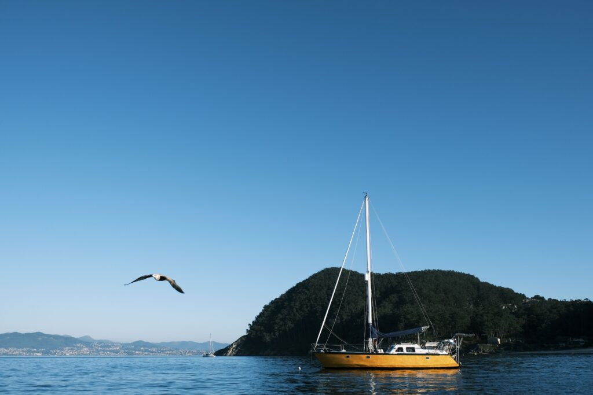

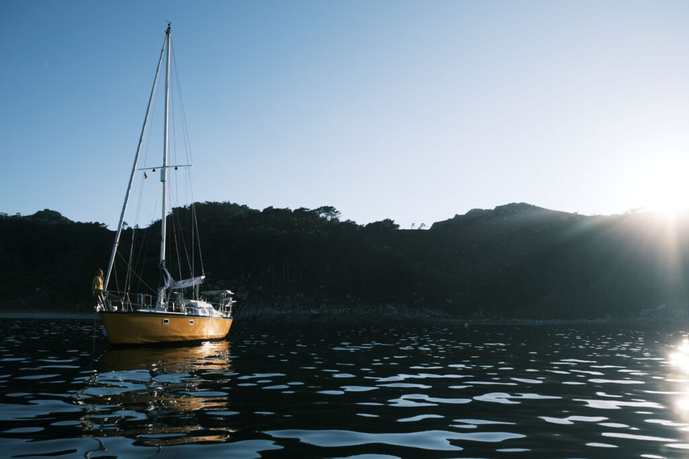

<figure class="wp-block-image size-large is-resized">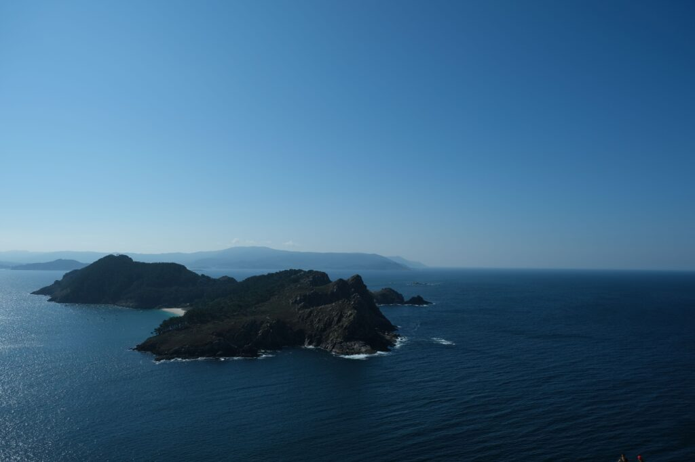</figure>

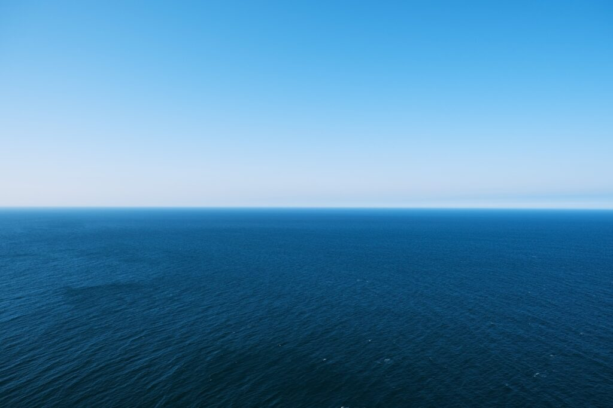

## Nederlands kolonialisme in Spanje

We hadden het op de AIS al gezien, maar hier liggen nog andere Nederlandse boten. Vijf stuks, en door de dagen heen komen er steeds meer bij. Het borrelseizoen begint weer. We schudden handjes, drinken biertjes en stelen bovenal de show met onze ijsblokjes. De machine draait bijna elke dag wel en hoewel de meesten ons eerst uitlachen, krijgen we de volgende ochtend driemaal de vraag waar we die machine vandaan hebben, hoeveel stroom hij verbruikt en hoe lang hij al meegaat. Kopers dus.

Die middag wordt er een berichtje in de groep gegooid dat iedereen in Moaña welkom is op de *Chillalot* voor een biertje. Jen en ik staan in de supermarkt en overleggen even of we er zin in hebben. We zijn ook benieuwd naar het schip, want inmiddels liggen we hier met zeker zeven Nederlandse schepen de baai te veroveren. Zie die maar eens te huisvesten.

Als we terugkomen met onze boodschappen varen we even langs om onze aanwezigheid te bevestigen en even na te gaan wat voor vlees we in de kuip hebben. Twee jonge blije koppies komen ons met een Brabants accent een schuchter handje schudden: Guus en Joep. Geerte en Kevin nodigen ons nogmaals van harte uit om zo langs te komen. Als we wegvaren zijn we een beetje beduusd. Dit gaat dus gewoon passen. Dit schip is gigantisch!

De borrel wordt later en later. Jen wordt bijna direct vrienden met Joep en Guus. Binnen de kortste keren zit ze met de jongens op bed en kijkt ze haar ogen uit hoeveel ruimte de jongens hebben. Ik sluit niet veel later aan en vermaak me met Guus rondom de playstation. We discussiëren over de beste Formule 1 coureur (Max natuurlijk). Met Geerte raak ik snel in gesprek over mijn eigen herinneringen als kind. Ze is blij en opgelucht te horen dat het toch best goedgekomen is met een kind dat langer geleden een vergelijkbare tocht maakte.

Terwijl iedereen hun eigen schip weer opzoekt en ook wij aanstalten maken om nog even snel wat te gaan snacken en dan onder de wol te kruipen, worden we door Kevin en Geerte uitgenodigd om te komen *Airfryen*. En ik dacht dat ik het op orde had met mijn ijsblokjes... Voor we het doorhebben is het half drie en wéér heel wat biertjes verder. We kennen inmiddels de voetbalvrienden van Guus van de teamfoto en worden de oren van het hoofd gevraagd door Joep. Ik heb hem proberen uit te leggen hoe eb- en vloed werken en wanneer springtij en doodtij ontstaan, maar ik kan met niet meer zo goed herinneren of mijn uitleg helder was...

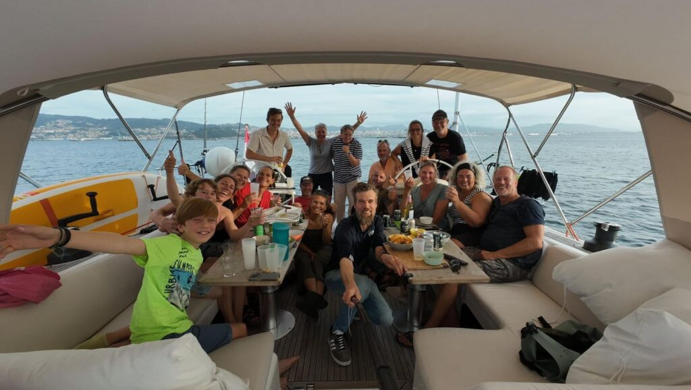

De volgende ochtend besluiten we katerig dat we naar Vigo willen om een Supboard te kopen bij de Decathlon. Er gaat een pontje van Moaña naar Vigo, dus die willen we halen, maar de pont vaart door ons trage ochtendtempo vlak voor ons weg. Onbekwaam als we nog zijn besluiten we dan maar gewoon met de bijboot naar de overkant te scheuren. Het water is vlak, dus dat zal wel gaan. Halverwege controleer ik de benzine en voelt het toch wat spannend of we genoeg hebben om de overkant te halen, maar we halen het. Een wandeling en taxi brengen ons naar de Decathlon waar de meest vriendelijke verkoper die we ooit hebben ontmoet ons helpt om de beste set bij elkaar te verzamelen. Jen vindt ook nog een paar hardloopschoenen en ik verlies het van de kater. Ik koop een echte sufdude-handdoek en een flesje water, waarna we ons naar de bushalte begeven. We stappen in de verkeerde bus, waarin een Spaanse man ons met handen en voeten probeert uit te leggen dat we op het juiste moment moeten uitstappen en het laatste stuk dan wel te lopen is..

Borreldag drie vindt plaats op de Kolibri, die we eerder al in Coruña ontmoette. Hun middenkuip biedt ruimte voor veel mensen, maar moet zelfs tot het achterdek worden uitgebreid. Jen voelt zich vandaag meer kind dan volwassene en speelt kaartspelletjes met Guus, Joep en wie maar mee wil doen. Niet veel later plonst ze met de jongens op het supboard en spelen ze tot de zon onder gaat en hun lippen blauw worden door het koude water.

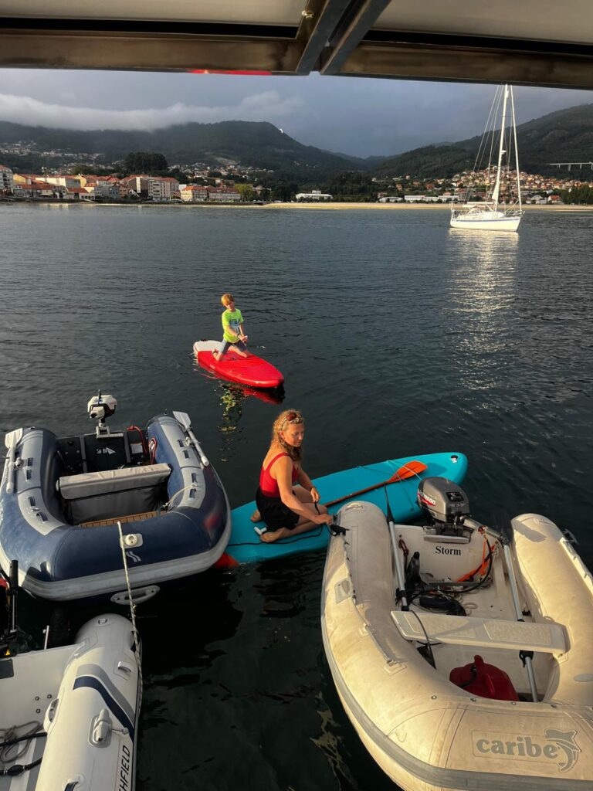

Ook besluiten we die avond dat het tijd is om verder te varen. Spanje is goed voor ons geweest, maar Portugal roept. Een nieuw land met nieuwe indrukken en onontdekte ankerplekken. We duiken op tijd ons bed in om morgen voor het daglicht te vertrekken, dan varen we hopelijk voor zonsondergang weer binnen op de rede van Porto..

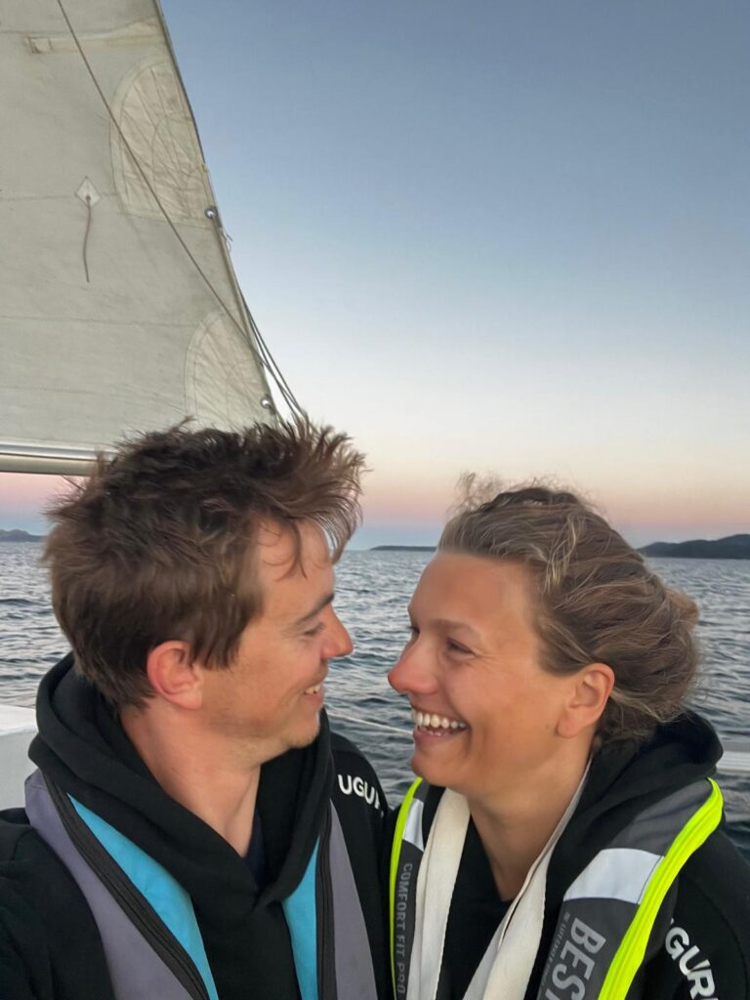
