Cascais verwelkomt ons hartelijk. Een stukje daarvoor zijn we Cabo Raso gerond en voelen we hoe de Noord-Westelijke deining in rap tempo afneemt. De wind en de resterende deining draaien met ons mee en we glijden door een glooiend landschap van rustige golven de goede kant op. 

We hebben inmiddels geleerd dat je rondom de kapen beter conservatief kunt zijn met de hoeveelheid zeil die je op hebt staan, dus we stellen mijn geduld een beetje op de proef. Vlak voor het ronden was namelijk eigenlijk al het punt dat ik het laatste rif eruit wilde halen en de kaap blaast minder hard dan verwacht. *Luwte* loopt nog altijd ruim boven de vijf knopen, maar ze wil best nog een beetje meer. In plaats van het half uur dat ik meestal reken tussen *willen* ontreven en *doen* ontreven wordt het een kwartier en de breuk met die gewoonte krijgen we niet veel later om onze oren. 

Naast de kapen zijn er namelijk nog meer weerfenomenen waar je altijd op kunt rekenen en één daarvan is de zogenaamde avondwind. In Nederland hebben we daar in de zomers ook wel eens mee te maken. Met het intreden van de schemering, wordt de bovenste laag van het water niet meer actief verwarmd door de zon en wordt het water snel zo koud als het bij je voeten is als je zwemt. Het land echter, blijft nog even nagloeien. Dit contrast tussen warm en koud is zo groot, dat de warme lucht van land naar het koude water begint te stromen. Avondwind. 

Het net uitgehaalde rif er weer inzetten is niet echt aantrekkelijk, maar Jen herinnert mij er aan dat ik continue verkondig dat alle zeilers kunnen hijsen, en slechts goede zeilers kunnen reven... Ik ga dus het voordek weer op en steek voor het laatste stukje alsnog een rif in het grootzeil.

We glijden de baai in en vinden dat het zo lekker zeilt, dat we besluiten op te kruisen tot we tussen de geankerde boten doorvaren. De fok inrollen en het grootzeil strijken gaat inmiddels binnen een minuut en we vinden een mooi plekje vooraan bij het strand. De BBQ gaat aan en we eten met een serie gegrilde pompoen en een sterrensaus van bonen uit Jen's kombuis.

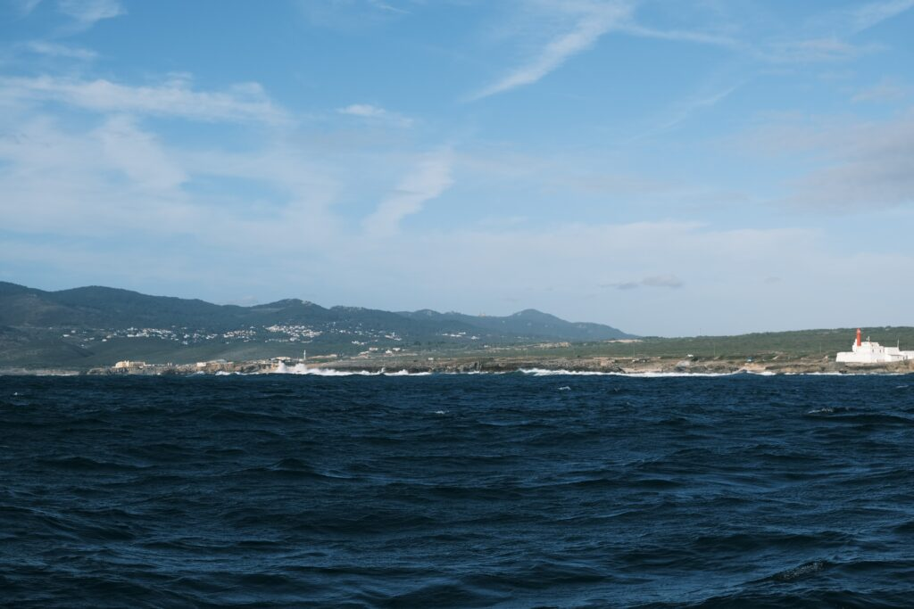

## Visitaties

De volgende ochtend gaat Jen een rondje hardlopen en scharrel ik aan boord om wat op te ruimen en een klusje te doen. Als ze terug is gaan we samen op pad en struinen we door toeristisch Cascais richting de markt. We zien een leuk en levendig stadje dat perfect is voor de terraslievende vakantiegangers. Een groep van zo'n 10 roodverbrande vrouwen van onze moeders leeftijd loopt ons luid kleppend voorbij. Niet veel later lopen wij langs hen terwijl ze zich op het terras tegoed doen aan witte wijn en feestsigaretjes. Jen ziet zichzelf hier over een jaar of twintig ook wel rondparaderen met een vriendinnengroep. 

De markt is fantastisch. We hebben alleen eigenlijk alles al in huis, maar oh my.. Het is Jen's kombuisdroom die uitkomt: Zelfs een bos bosui hebben ze hier! Ik vermaak me intussen met de talloze pasteleria kraampjes en onderzoek welke Pastel de Nata hier het lekkerste is tot ik overprikkeld raak en op zoek ga naar een bos blonde krullen. 

Met genoeg verse kruiden, bosjes bosui en één tomaat die ik zo mooi vond struinen we terug naar de bijboot. Onderweg schieten we een antiekwinkeltje in en breiden ons emaille servies uit met twee bordjes. De tassen beginnen inmiddels aan mijn schouders te hangen en het tempo gaat dan ook omhoog om zo snel mogelijk weer bij de boot te zijn. Altijd een opluchting als je het laatste hoekje om loopt en je ziet dat ze er nog ligt. Rustig achter het anker. 

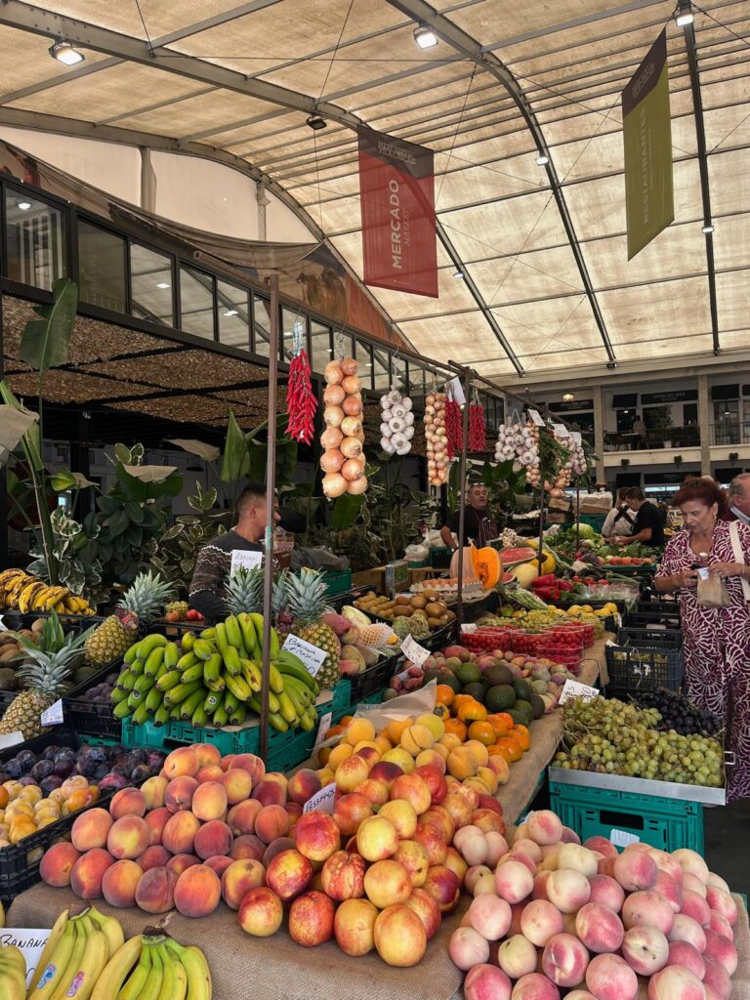

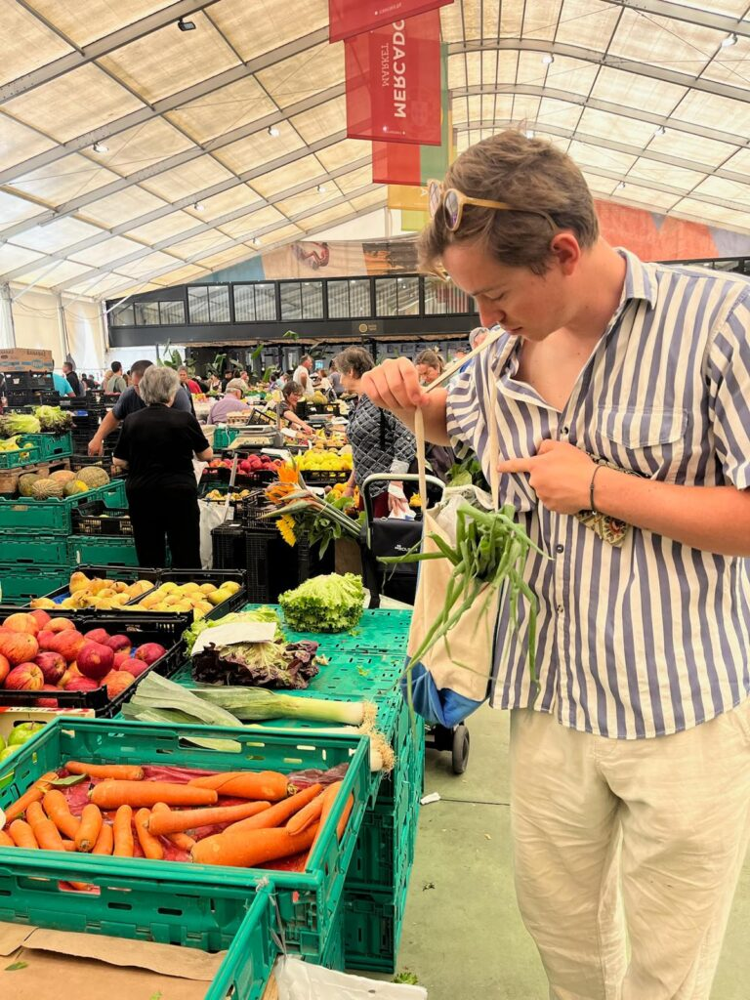

We laden de boodschappen in aan de achterkant van het dieselstation, waar de bijboot niet teveel in de weg ligt en varen tussen de geankerde boten terug naar *Luwte*. Onderweg kloppen we aan bij een catamaran die we eerder hebben gezien. Een jonge jongen van Oostenrijkse afkomst, met een Tsjechisch schip en varend onder Poolse vlag wil binnenkort graag een biertje samen doen, maar krijgt vanavond visite. De boot naast *Luwte* huisvest meer mensen dan we kunnen tellen. Als we aankloppen komen er overal jonge koppen tevoorschijn. Vier Zweedse jongens van tussen de 21 en 24 hebben samen een schip gekocht in Noord-Spanje en varen de horizon tegemoet. Één van de jongens heeft geen oog voor ons, want die zit op het voordek aan zijn gitaar en een Portugese schoonheid vastgeplakt. Opgepikt in Porto en die vaart sindsdien ook mee. Een laatste vriend die een stuk meezeilt maakt de groep compleet. Vanavond zijn we welkom voor een biertje.

Het wordt een interessante avond. We kruipen bij ze in de kuip en praten over hoe ze hier gekomen zijn. Een paar jaar geleden hebben ze gezamelijk besloten te gaan werken en sparen voor deze grote droom en nu zijn ze die eindelijk aan het verwezenlijken. Ze kunnen allemaal wel een beetje zeilen, maar hebben geen ervaring met een eigen schip en navigeren. Wij blijken ook hun eerste borrelgezelschap sinds vertrek te zijn en ze vragen ons de hele avond de oren van het hoofd: Bij hoeveel knopen wind zet je je eerste rif? En bij hoeveel het tweede? Moeten we ook zwemvesten kopen? Wat doe je als er iets stuk gaat? Er komt geen einde aan. Ik ben op de spreekstoel gezet en krijg geen kans van ze om er weer af te komen.

Na twee liter sangria en talloze biertjes bied ik ze aan morgen nog even langs te komen als we het allemaal iets helderder hebben. Dan kan ik even meekijken naar hun zonnepanelen en de motor, die toevallig hetzelfde is als die van *Luwte*. Hun dank is groot. 

Als we onszelf in *Storm* storten en wegvaren komt de realiteit mij hard achterna. We staan nog niet bij *Luwte* aan boord of ik hoor een plons en een hoop gejoel en gegil. Ze waren net allemaal nog zo serieus? En nu skinny-dippen ze met z'n allen? Voor het eerst deze reis voel ik mij oud en saai.

De volgende middag kruip ik samen met twee katerige schippers het motorruim in en loop alle slijtage-onderdelen langs. Één van hen heeft uit een hoek een A4 getrokken en pent driftig mee welke onderdelen ze moeten zien te vinden. De v-snaar bungelt er slap bij en van een impeller hadden ze nog nooit gehoord, maar tot nu toe draait het motortje prima en ze hebben allemaal wel eens filters vervangen. Het originele handboek van de motor ligt aan boord en daar staat in principe alles in. Ik stuur ze de pdf van de workplace manual later nog even toe. We hopen ze nog eens tegen te komen en kijken uit naar alle bizarre avonturen die ze met hun aanstekelijke naïviteit beleefd zullen hebben.

Die avond loopt de *Simon Hendrik* de baai van Cascais binnen. We zien Mirjam, Edwin en Philou voor het eerst, maar het voelt alsof we al een hele poos samen optrekken door al het contact dat we hebben gehad over de Instagram over de leukste baaitjes en de goeie momenten om door te kachelen. De borrel die we met ze drinken (gin-tonics met de nadruk op gin) rolt als vanzelf door in avondeten. Jen wordt direct door Philou omarmt en stopt haar in met een voorleesverhaal. Ik weet niet meer precies hoe het idee tot stand kwam, maar op een gegeven moment staan een halve fles rum en twee shotglaasjes op tafel en die gaan pas weer van tafel tegen de tijd dat de fles leeg is... 

Jen wordt opgewekt wakker en terwijl ik moed bij elkaar raap om mijn hoofd op te tillen peddelt ze een rondje op de sup. De zon schijnt en er staat een lichte bries. Een hele verademing en veel meer in lijn met onze verwachtingen voor dit gebied. 's Middags komt er een rood Nederlands schip even verderop liggen. Ook met *SYA* hebben we al geruime tijd contact over WhatsApp. Zij voeren een tijd voor ons uit, maar een opdracht hield ze een even bezig rondom Cascais. Robin en Kayleigh komen bij ons aan boord een borrel drinken en laten hun ouders, die ook een weekje meezeilen op hun 10 meter korte thuis, even achter. 

De gelijkenissen tussen mij en Robin zijn bijna eng. We zijn even oud, zeilden met onze ouders als jong kind de wereld over (oké, zij vijf jaar, wij twee jaar) en koesterden de droom van vertrek al heel lang. Een mooi fundament om mee te starten, maar we vinden elkaar (niet alleen Robin en ik, maar alle vier) nog veel meer in de overwegingen en keuzes met betrekking tot het zeilen, het schip en de essentials om oceanen mee over te steken. We wisselen onze overzeese ervaringen en vriendschap met de windvaan uit. Verbindingen tussen staal zijn van nature nou eenmaal sterker dan polyester.. 

De volgende avond kruipen we, samen met Robin's ouders in de kuip bij SYA. Ook bij hun kruipt het bloed nog altijd waar het niet gaan kan: ze kwamen net uit Nederland waar ze alles verkocht hebben en hun bezittingen hebben teruggebracht tot een paar verhuisdozen en een vrachtauto waarmee ze wereld over willen. Ik bewonder de 3D-printer en kortegolfradio die ik ook graag aan boord van *Luwte* had gezien en hoewel het er vast zal zijn, kan ik geen spatje roest ontdekken... 

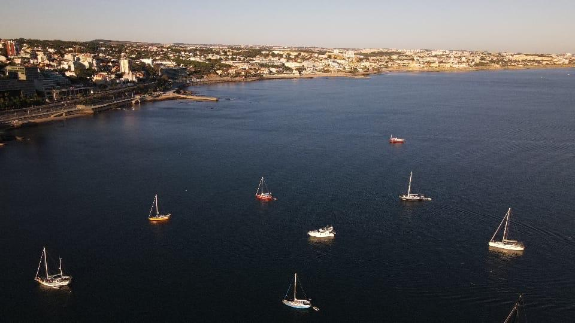

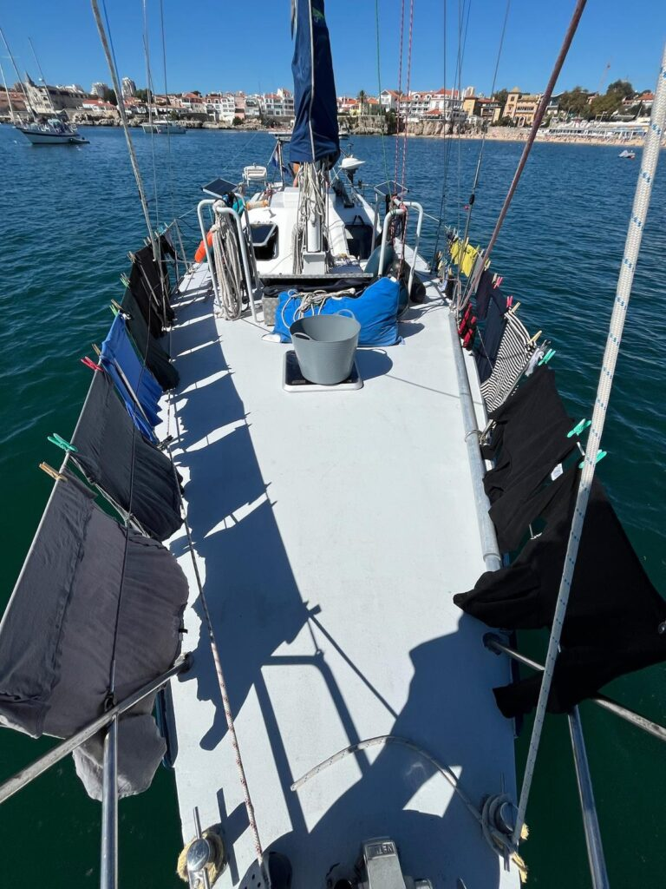

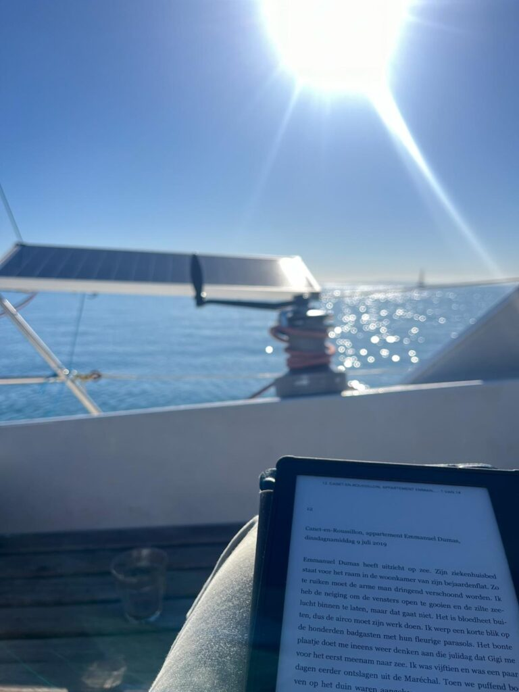

## Stedentrip

Na een paar dagen zon komt het volgende lagedrukgebied vanuit het westen richting Europa. De temperaturen blijven hoog en de luchtvochtigheid rijst de pan uit. *Luwte* begint weer te zweten op haar stalen huid en wij voelen bij elke beweging dat we het haar niet kwalijk mogen nemen. Het mag de pret niet drukken. Het is namelijk 2 oktober.

Ik sluip 's ochtends ons bed uit en hijs een slinger seinvlaggen de mast in. "JEN BDAY" is precies uit te vlaggen zonder dubbele letters. Ik hang de slingers die we op ons afscheid van Jurjen en Willemijn hebben gekregen binnen op en begin met het maken van een ei- en melkloos pannekoekenbeslag. We zijn eigenlijk gestopt met koolhydraten eten en dat bevalt ons goed, maar er gaat ook niets boven een pannenkoekenontbijt. Met spek uiteraard.

De stereo gaat aan en ik zoek de verjaardags-party-afspeellijst van Spotify op. Door de dag heen komen we er achter dat het eigenlijk best een prima lijstje is, want er staat maar één verjaardagsliedje "happy birthday" in. Daarnaast bestaat de lijst uit top 40 hits uit de tijd dat wij op de middelbare school zaten. Zingend en dansend maak ik Jen wakker, die nog aan het dromen was over het uitserveren van een glas sinaasappelsap bij Zuidam. Iets met jeugdtrauma's denk ik.

De supplank van Vigo was haar 'grote' verjaardagscadeau die ze al eerder had uitgepakt. Jen kan daar tegen en er ook echt blij van worden om verjaardagscadeaus eerder te krijgen dan haar verjaardag, maar ik heb daar een beetje moeite mee. In een handdoek gewikkeld op tafel ligt dan ook een nieuwe koekenpan die we gisteren samen hebben uitgezocht in de hypermaché. Inpakpapier was ik vergeten te zoeken en blijkbaar blijft plakband op geen enkele manier aan bakpapier plakken.

Als klap op de vuurpijl vertel ik Jen dat ik een grote verassing heb: We gaan op citytrip naar Lissabon! Met de boot! Het feest is compleet en we maken *Luwte* klaar voor vertrek. 

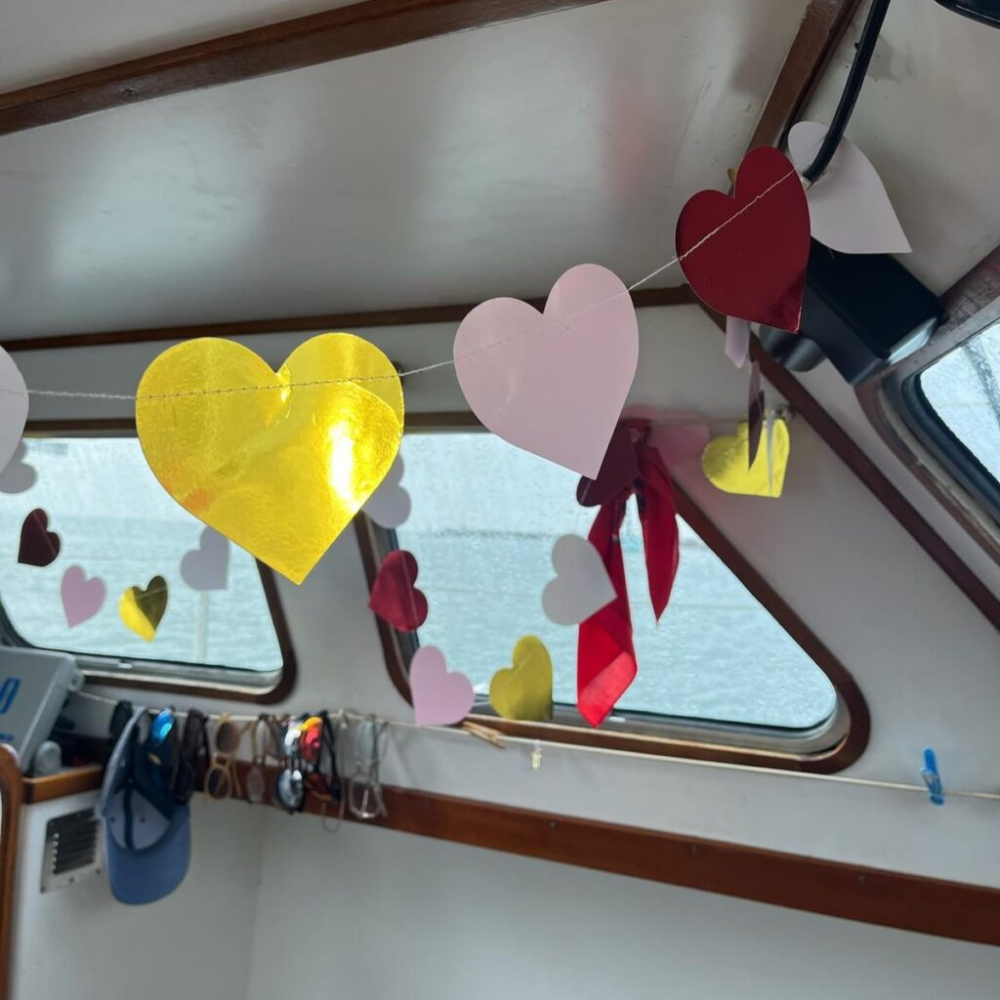

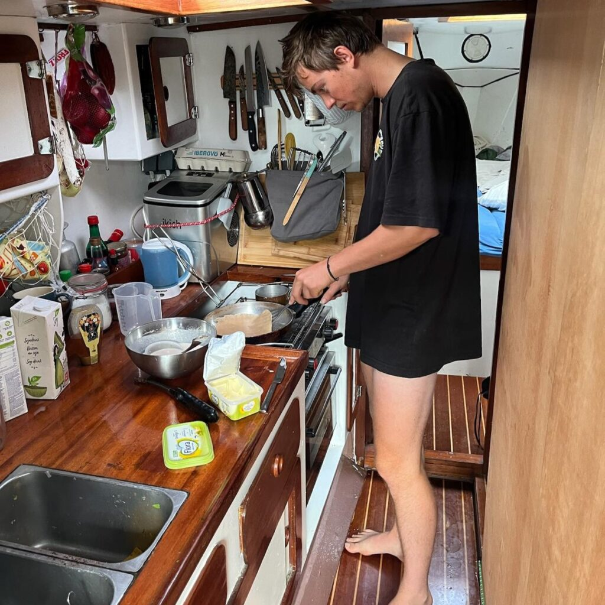

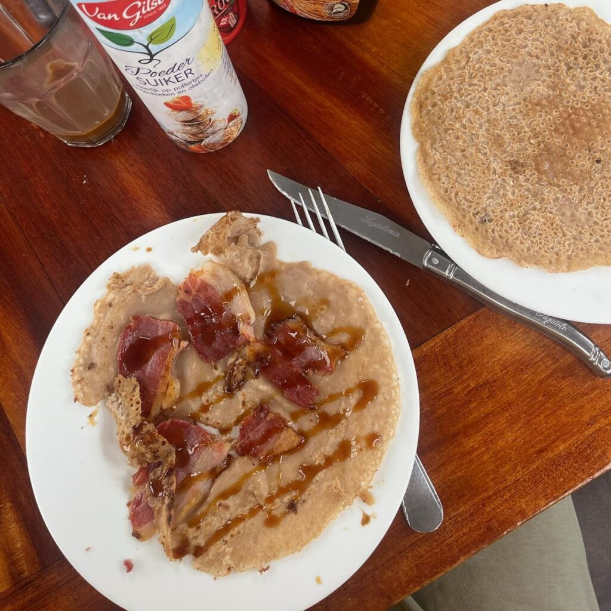

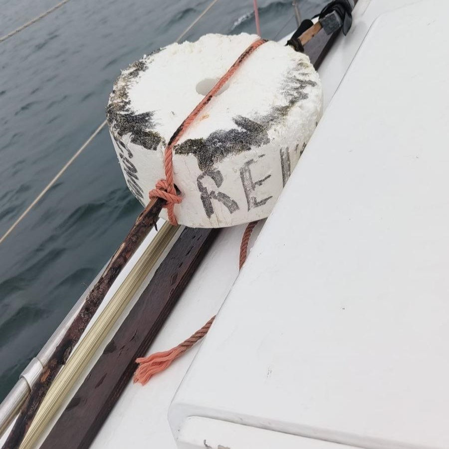

Met een rustig windje draaien we de Taag op en laten ons door de stroming naar binnen duwen. Door het water gaan we bijna niet vooruit, maar de GPS geeft toch 7,5 knoop aan. Het loont om hier een beetje rekening te houden met het tij.

De brug, model golden-gate, wordt groter en groter. Het jezusbeeld dat aan de stuurboordoever staat ook. Die rijst groots boven de heuvel uit. Als we bijna bij de brug zijn check ik op de kaart voor de laatste keer de hoogte. Tachtig meter zou genoeg moeten zijn met onze dertien meter mast, maar als je er recht van onder naar kijkt lijkt ons topje toch akelig dicht langs de onderkant van de brug te schrapen. We zien de eindeloze stoet auto's over ons heen rijden. De brug heeft roosters in plaats van asfalt, dus je ziet letterlijk de auto's boven je. Een eindeloze stoet de stad in en een eindeloze stoet de stad uit. Dat voelt netto nogal als verspilde energie. 

Onze blik wordt weer omlaag getrokken als we aan stuurboord een lange strook oude fabriekspanden met grafiti zien. Ik zie meteen hoe Lissabon en Amsterdam op elkaar lijken, dit is gewoon de overkant van het IJ met ondergrondse clubs en feestjes die het hele weekend doorgaan. Jen is inmiddels alleen al 26 en voelt zich te oud en bejaard om daar nog naar op zoek te gaan. 

Als we opdraaien om naar de overkant te steken, waar de haven zich bevindt, merken we hoe sterk de stroming is. De motor moet bij om koers te houden en we varen direct in stedelijk gebied. Vrachtschepen draven voorbij en snelvarende veerboten schieten langs ons. De jachthaven ligt aan de binnenzijde van zeecontainerhaven en we manouvreren ons tussen pilotboten en aanmerende containerschepen door. Geen haast hebben en afstand bewaren zijn hier noodzakelijk, maar alles gaat goed zonder gevaarlijke situaties. 

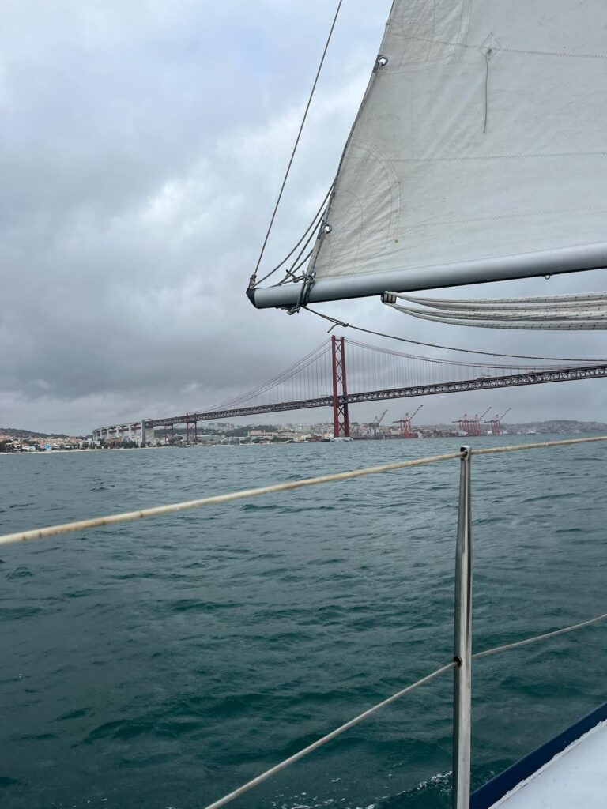

<figure class="wp-block-image size-large">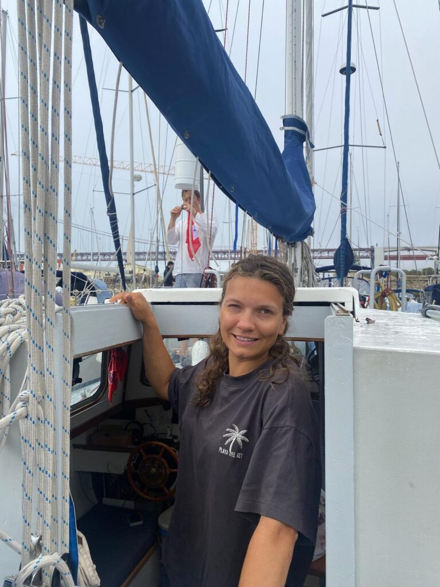<figcaption class="wp-element-caption"><em>Luwte</em> in Port of Lisboa</figcaption></figure>

## Lissabon

We varen een box in, sluiten de stroom aan en zetten de ijsblokjesmachine aan het werk. Ons bubbelkistje gaat open en we proosten op een behouden vaart én de eerste overzeese verjaardag. Ik heb een rooftop en een restaurantje gevonden waar we onze stadse kleding voor aantrekken en we struinen Lissabon in, over de kade waar ik 17 jaar geleden als jongetje nog verwoed heb geskeelerd om mijn schaatsconditie op orde te houden. Olympisch goud op de 10 is het niet geworden, maar hier nu terugkomen met Jen is ook geen slecht resultaat.

We lassen deze avond in als vervroegd partneroverleg plus verjaardag en besluiten dat we vanavond niet teveel op de kleintjes letten en gewoon gaan genieten. De rooftop halen we niet, want al voor die tijd landen we in een plantsoen op een terrasje. We bellen mijn ouders nog even in zodat ze een liedje kunnen zingen. Terwijl de avond valt noemen we even op hoe blij we zijn met waar we zijn en wat we doen. Als de zon ondergaat lopen we verder naar het restaurant en laten we ons verwennen door onder andere de lekkerste spitskool die Jen ooit gegeten heeft. Die spitskool heeft inmiddels een vaste plek in de kombuisvoorraad gevonden, naast de flespompoen, zoete aardappel en uien. Ze gaan oneindig mee en, als je weet wat je er mee doet, zijn ze allemaal ontzettend lekker.

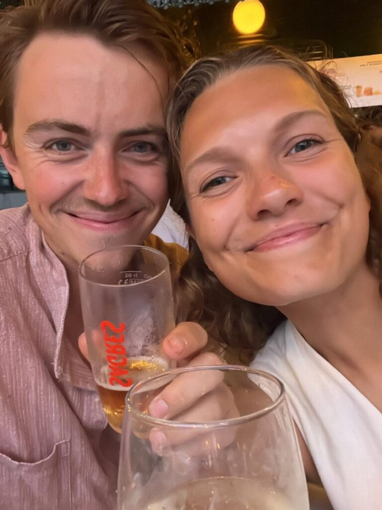

De volgende dag staan we loom op en ruimen de boot nog wat verder op. Vandaag is de volgende grote dag. Dag twee van Jen's 27e levensjaar wordt namelijk verrijkt met een bezoek van haar vader en Map. In de zoektocht naar een verblijf zo dicht mogelijk bij de haven is er per ongeluk een surfhostel geboekt en een beetje uit proportie borrelen we in de gezamenlijke keuken met bubbels, kaasjes en serranoham. Het weerzien is tegelijkertijd bijzonder en direct alsof we nog maar net weg zijn. Al snel komen de gesprekken op gang zoals we die thuis ook hebben en, zoals we merken, die je over de FaceTime minder hebt. De gezamenlijke keuken wordt verruild voor een restaurant verderop en zo zetten we onze avond voort tot we allemaal moe genoeg zijn om meteen bij het raken van het kussen in slaap te vallen. 

De volgende ochtend drinken we koffie bij ons aan boord. Piet en Map zijn even overvallen door de aanblik van *Luwte* in deze Portugese haven. Ze ligt er echt, fier en sterk, met twee verstekelingen die veilig meegekomen zijn. De DE koffiemolen ratelt en niet veel later pruttelt de perculator. We ontbijten en er zijn Pastel de Nata's. 

In plaats van de stad in, pakken we een taxi de stad uit naar de Decathlon. Daar krijgen Jen en ik als verjaardagscadeau een zwempakket. Inclusief neusknijper, badmuts en oranje drijver. Nu we in steeds warmer water zullen vertoeven is het tijd om eens te gaan proeven aan het zwemmen als sport. Ik scoor nog 80 meter schootlijn en Jen trekt nog wat shirts uit het schap. Als we naar buiten lopen gaat het alarm en blijkt een derde van de spullen niet door de automatische zelf-scan kassa te zijn gegaan.. We worden gelukkig niet opgepakt, maar moeten wel nog even met het schaamrood op de kaken terug naar de kassa. 

We laten ons hoog in de stad afzetten en wandelen na de lunch naar beneden. Ik maak een navigatiefout en moet daar even van bijkomen, maar uiteindelijk komen we uit op de Dam van Lissabon. Overprikkeld vinden we in de luwte van een pleintje een bar waar we even kunnen zitten. Hier komen we tot de conclusie dat de combinatie stedentrip, verjaardag én elkaar na zo lang weer echt kunnen spreken toch wat intensief is. Jen en ik stellen dan ook voor om morgen uit te checken bij het hostel en de stad uit te varen. Nog even twee dagen mee aan boord van ons bootleven.

En zo staan Piet en Map de volgende ochtend klaar om aan te monsteren. Jen snijdt vlak daarvoor nog even een stuk nagel er af met een scherp mes, maar de wond is gelukkig oppervlakkig en hebben we snel onder controle. Na een kop koffie zijn we klaar om te gaan en varen we tussen de containerschepen door weer de Taag op richting Seixal. De zon breekt door en er staat een lekker windje. Het water is rustig en *Luwte* loopt al snel 6 knopen over de grond. Het is een tochtje van nog geen anderhalf uur, maar wel een anderhalf uur zoals je die graag met je bezoek beleeft: Zonnetje, lekker zeilen en geen rare fratsen. We pikken een mooring op en lunchen tot er weer wolken voor de zon schuiven. 

Om de ervaring compleet te maken laten we de bijboot in het water zakken en varen we naar de kant op zoek naar een leuk café. Als die na ons eerste drankje dicht willen, keren we terug naar de boot en zetten de borrel daar voort. 

De volgende ochtend staan we allemaal langzaam op en keert de rust in de tent. We zijn weer *in sync*. Jen leest een boek, ik probeer de meegebrachte dieptemeter aan de praat te krijgen en Piet en Map beantwoorden wat mailtjes en genieten van het uitzicht. Ruim bij tijds hijsen we de koffers in de bijboot en varen we naar de kant. We zoeken een plekje om te lunchen met uitzicht op *Luwte*. Ik zie dan hoe ze helemaal niet meer ontspannen achter de mooring hangt, maar alle kanten op schiet. Doordat stroom en wind tegen elkaar in staan begint ze enorm heen- en weer te scheren, om dan met een klap tegengehouden te worden door de mooring. Ik snel dan ook terug naar de boot om de kiel op te halen (dan stroomt de stroming gewoon onder de boot door in plaats van de boot in beweging te brengen) en alle lijnen nog een keer goed na te lopen. Met de step ben ik gelukkig op tijd terug om nog een hapje mee te eten en de conclusie van het bezoek mee te maken. 

En dan gaat alles op eens snel. Er is een taxi die stopt en Piet en Map stappen na een knuffel in. Deur dicht en de taxi is weg. Boten glijden en geven de mogelijkheid om nog heel lang te zwaaien, taxi's niet. Die zijn gewoon opeens weg. Jen blijft in tranen en met een leeg gevoel achter. De rest van de dag en de volgende dag springen de tranen continue in haar ogen. Bij ons vertrek uit Nederland hebben we eigenlijk helemaal geen tijd gehad om stil te staan bij wat we zouden missen, daarvoor waren die laatste weken te hectisch. Maar nu is heel voelbaar waarvan we weg zijn en wat er net in de taxi naar het vliegveld is gestapt. Ik besluit alles maar even buiten te sluiten en als rotsje in de branding van Jen haar emotie te gaan liggen. 

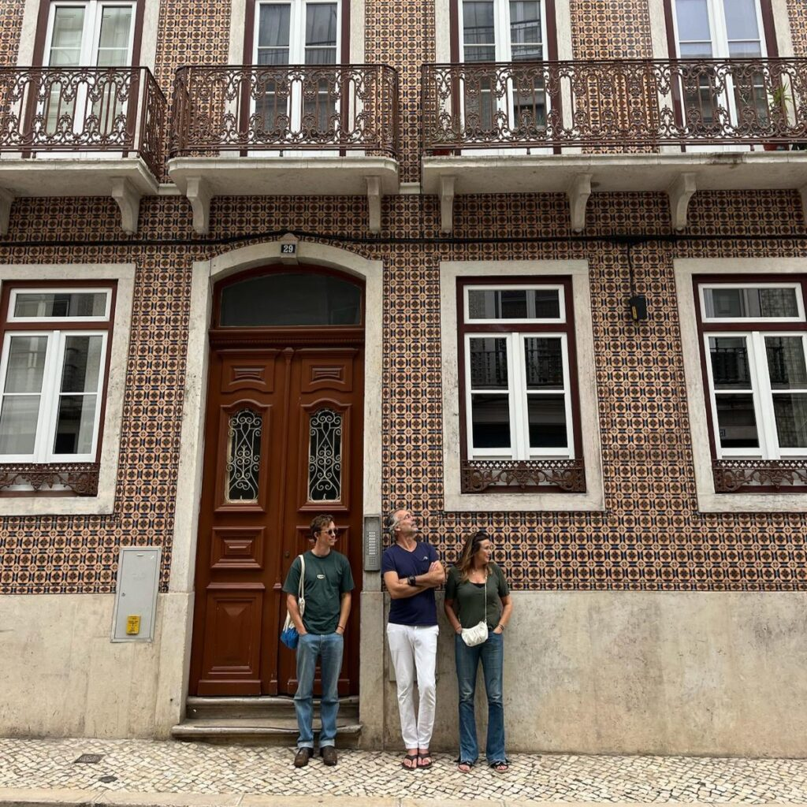

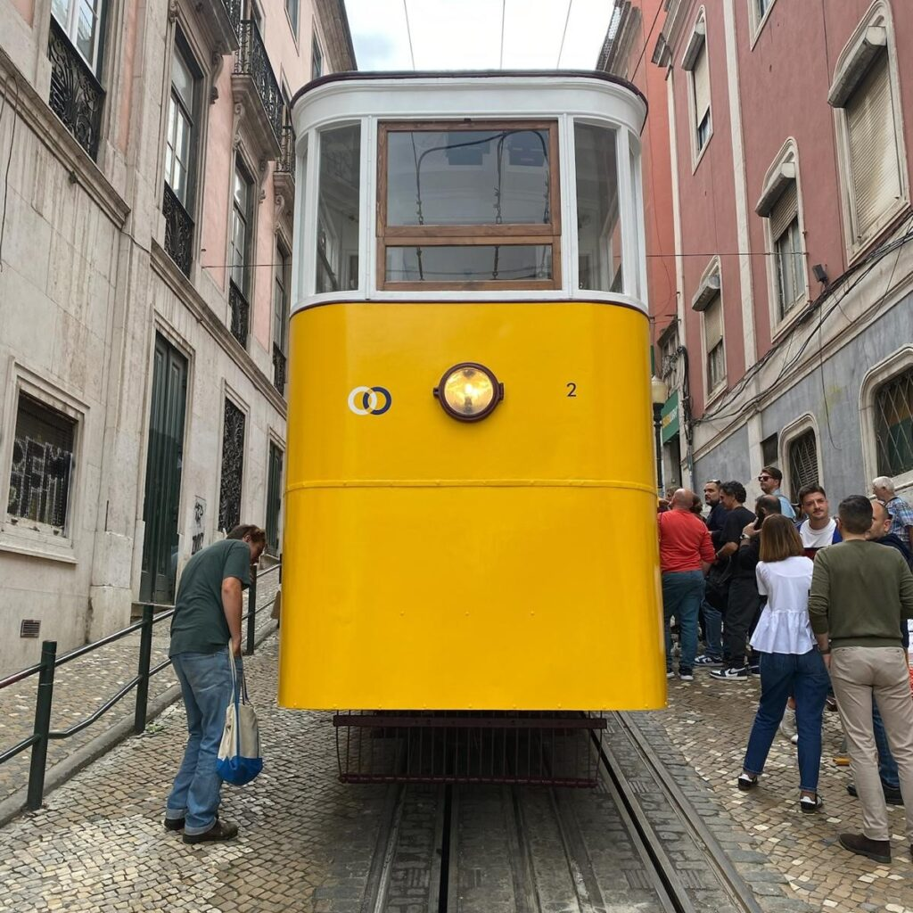

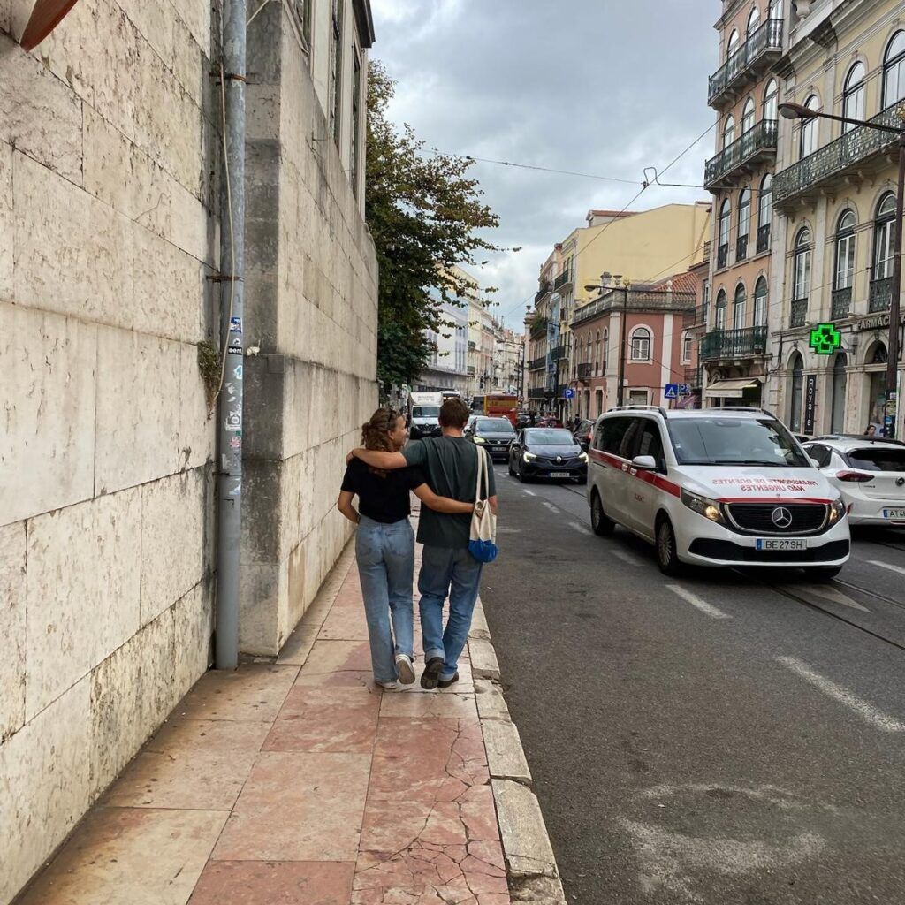

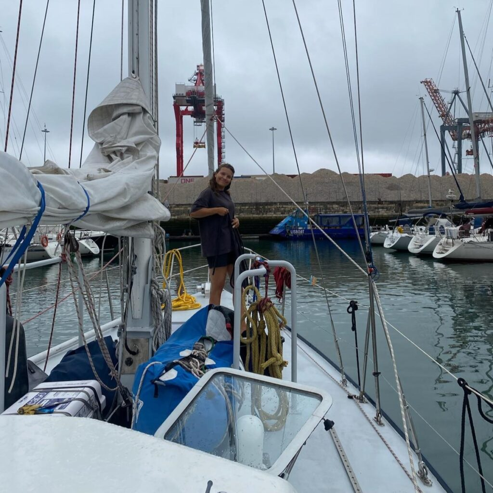

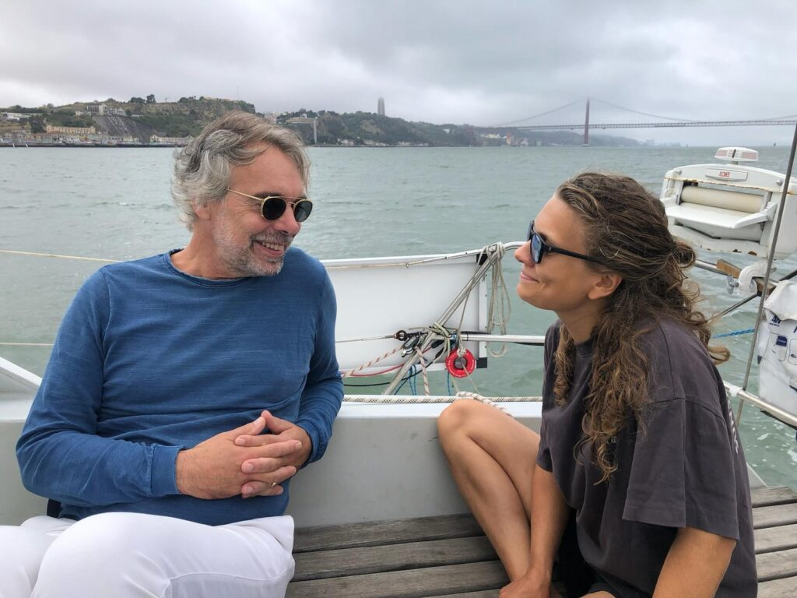

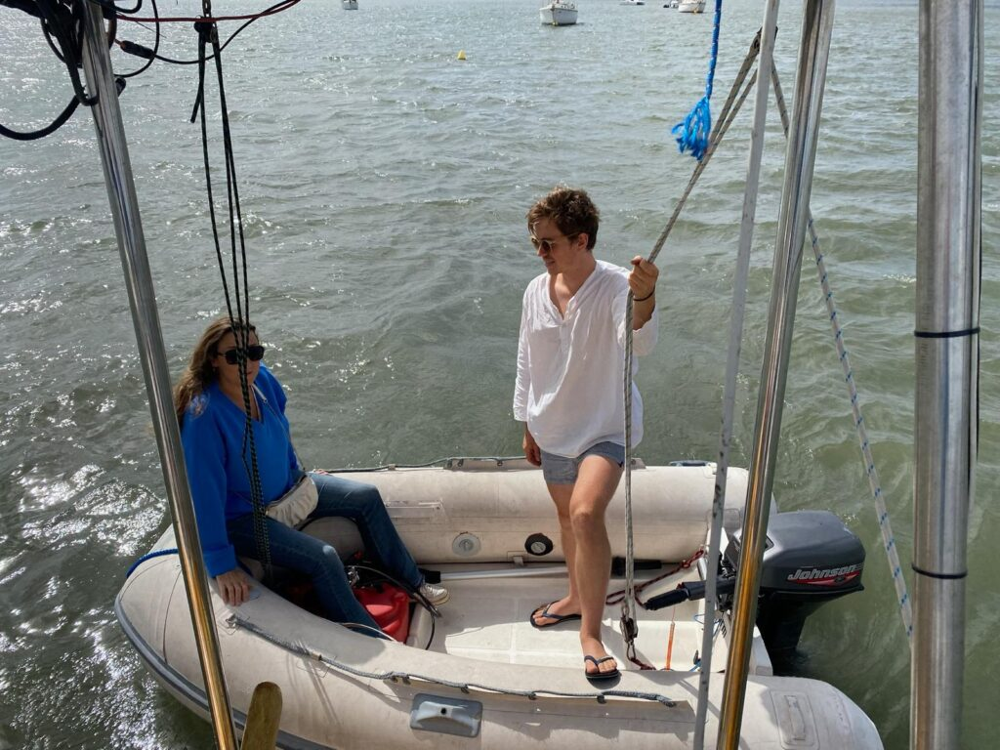

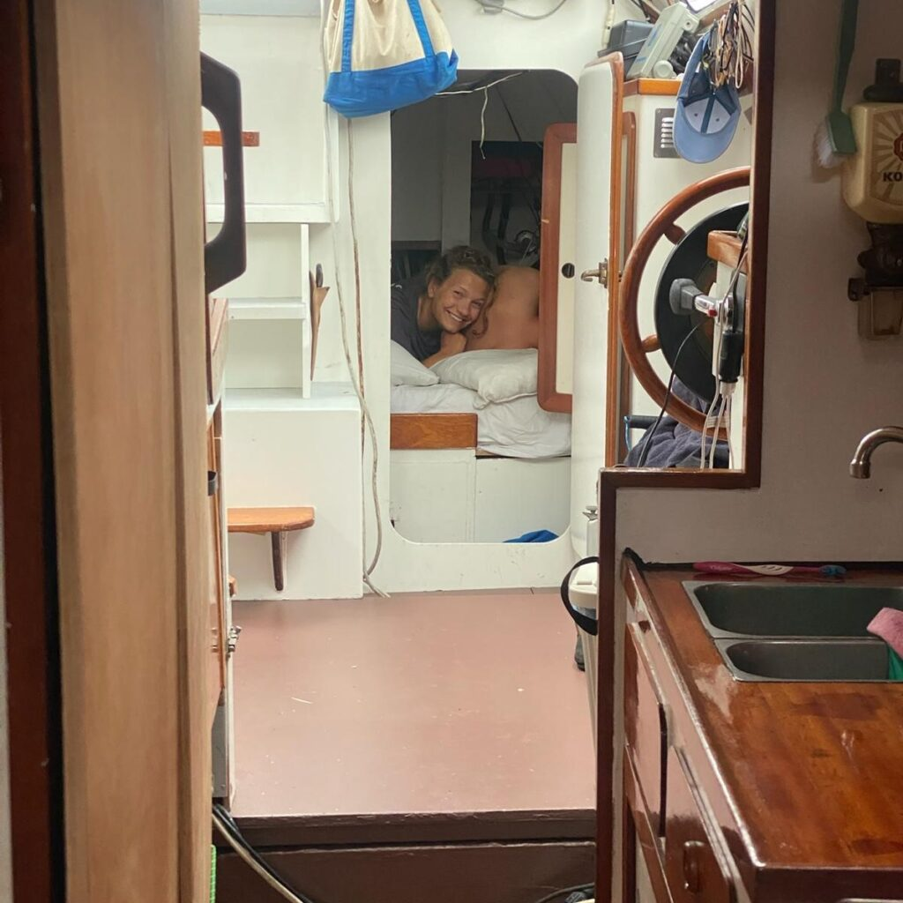

<figure class="wp-block-image size-large is-resized">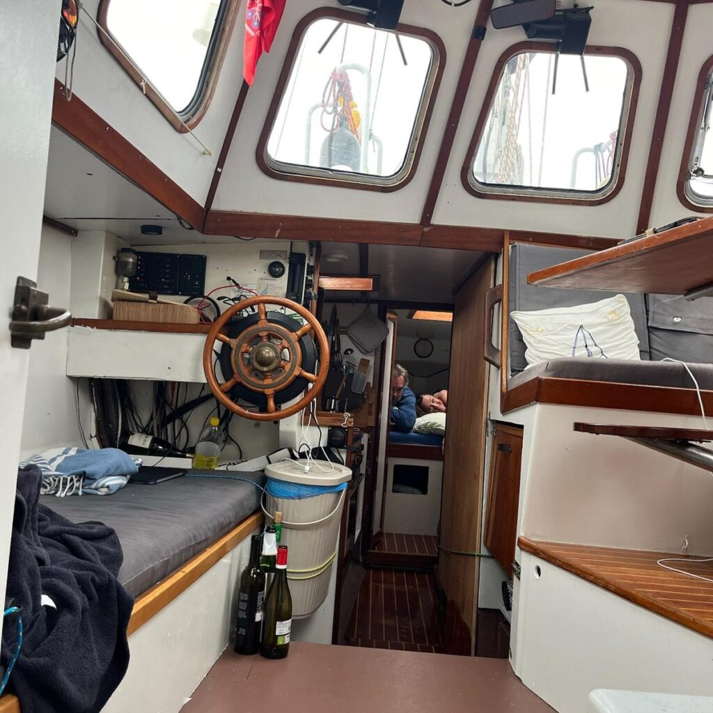<figcaption class="wp-element-caption">Van achter naar voor</figcaption></figure>

Die middag kijken we ter afleiding naar het weer en bespreken we ons vervolg. We willen door naar het zuiden van Portugal, de atlantische kust hebben we wel een beetje gezien. Er zijn op dit stuk alleen veel interacties met orka's geweest en die willen we zelf liever vermijden, zeker na de verhalen die we van *SYA* meekregen over hun ervaringen met orka's op zee. 

Het leefgebied van de groepen orka's die boten aanvallen concentreert zich hier met name tussen de twintig en driehonderd meter diepte. Dat betekent dat je óf bijna op het strand moet varen, of heel ver uit de kust. Wij prefereren ver weg te varen en zien dat er een heel klein weervenster is richting het zuiden van Portugal. De vraag is of het bezeild is, want stroom en deining zullen ons de verkeerde kant op duwen, maar als we het zo zien zal het nét gaan. Voorwaarde is wel dat we de volgende ochtend direct vertrekken, want over twee dagen komt er een storm over Portugal heen. We maken *Luwte* dus klaar voor een nachtelijke overtocht over zee. 

Terwijl wij de volgende ochtend het zeegat kiezen naar het zuiden begint de stroom berichten over zeilers die zich opmaken voor storm *Kirk* op gang te komen. Het is grappig wat de personificatie van een lagedrukgebied doet met diens perceptie bij mensen. Een storm met een naam zet om één of andere reden meer in gang dan een storm zonder naam, al kan de wind net zo vervelend zijn. 

Op de voorloper van *Kirk* zeilen we hoog aan de wind naar buiten en stuiven we over de golven. We zitten al snel op het eerste rif en als we niet veel later weer boven de zes knopen gaan komt het tweede rif er in. Tegen de tijd dat die er in zit is de wind dusdanig toegenomen, dat we zelfs met het tweede rif ruim boven de zes knopen blijven varen. De deining heeft nog een noordelijke component, dus hoewel we scherp op de wind varen, zijn de golven nog vriendelijk. 

Met het vallen van de nacht begint het dan toch wat ongemakkelijk te worden. We moeten eigenlijk iets hoger sturen dan we willen en krijgen daardoor alsnog de golven op ons dak. Ik voel me niet zo lekker en maak Jen vervroegd wakker om het over te nemen zodat ik wat kan slapen. Achterin voel ik me snel beter en luister ik hoe *Luwte* feest viert in dit weer. Af en toe breekt een golf tegen de romp aan en hoor je een waterval over het dekhuis heen vallen. In mijn halfslaap vlieg ik als een drone boven ons en zie ik hoe ze als een Imoca over de golven vliegt. Zo nu en dan duiken we en siddert alles even, maar we verliezen geen hoogte en geen snelheid. De windvaan stuurt, zoals altijd, onverstoorbaar door. Zuidwaarts.

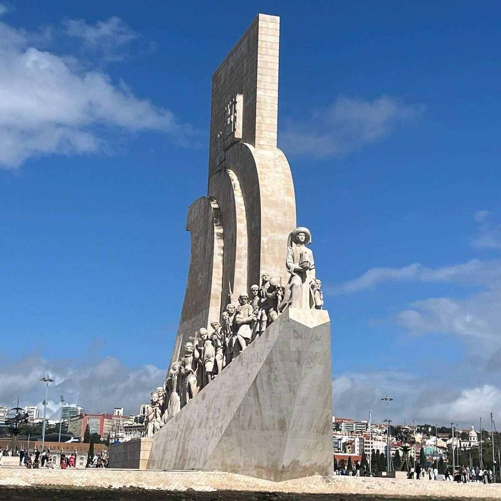
