Terwijl *squall* na *squall* over ons heen trekt turen we naar de horizon. Sinds een paar uur beginnen er schepen op de AIS te verschijnen. We spotten een vissersboot op ramkoers die niet zichtbaar is op AIS en ook geen antwoord geeft als we hem oproepen over de marifoon. Uiteindelijk verleggen we onze koers maar en zien we de boot slingerend vlak langs ons tuffen. Met behulp van de radar kunnen we de buien in het donker goed aan zien komen. We draaien preventief de fok een beetje in en als de ergste wind is overgetrokken zetten we hem weer bij om de snelheid er in te houden.

Tegen het ochtendgloren hebben we het gevoel dat we de buien wel in de vingers hebben. We zijn handig geworden met de radar en met een beetje daglicht erbij zie je een bui natuurlijk ook gewoon mooi aankomen. Door de nacht heen hebben we steeds preciezer kunnen bepalen welke buien over ons heen trekken en welke net langs ons glijden. De donkere wolken die vanaf ons bakstag binnen komen rollen betekenen opletten geblazen. Alles wat recht van achter komt, of aan onze bakboordzijde te zien is, kan wel dichtbij komen, maar zal langs ons trekken.

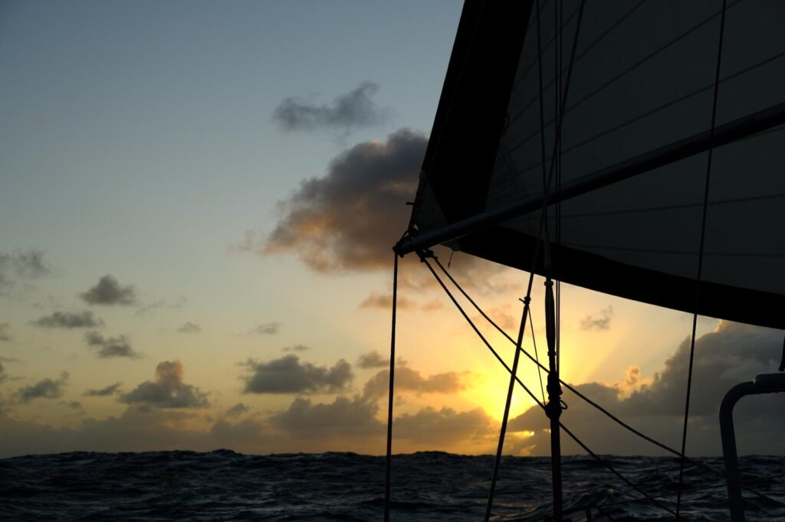

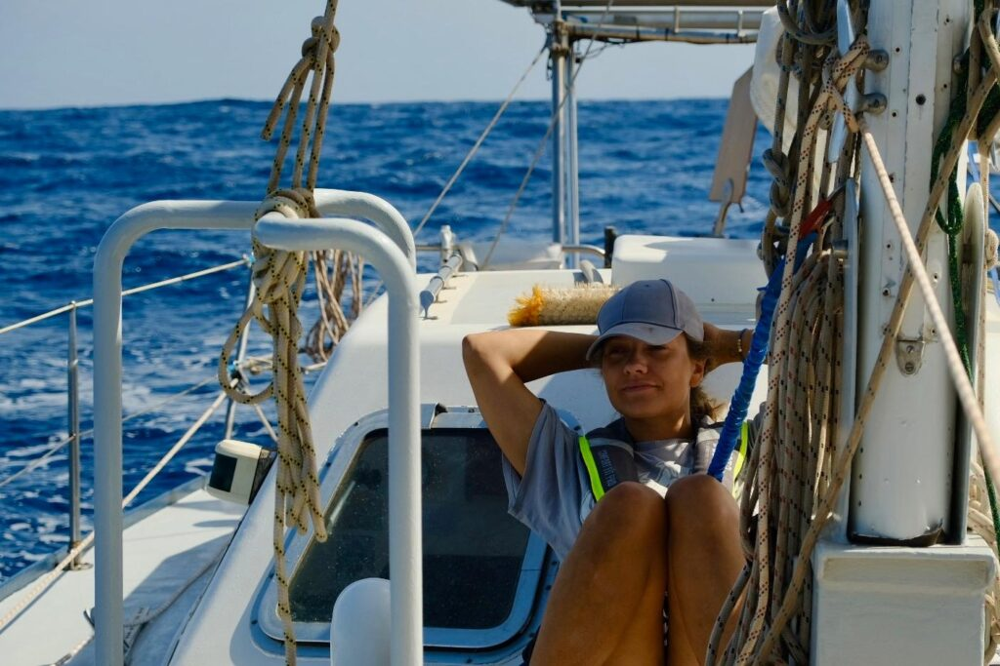

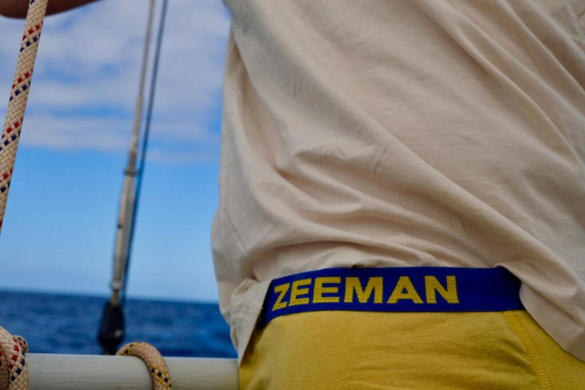

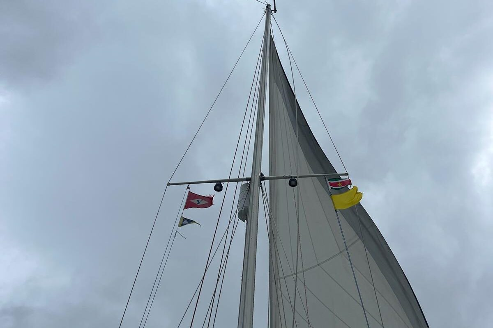

Rond een uur of tien in de ochtend wisselen we van wacht en kruip ik moe in bed. Ik val snel in slaap en droom weg naar onze aankomst op de Surinamerivier. Jen houdt de wacht en speelt met de overtrekkende buien. Ik slaap er inmiddels doorheen als ze zelf reeft- en ontreeft. Een vreemde golf en het geluid van aansterkende wind zijn nog wel genoeg om mij uit slaap te krijgen. Terwijl ik in mijn half slaap mijn ogen open zie ik Jen naar buiten stappen en nog voor ze haar hoofd buiten heeft gestoken hoor ik “*Moppie, ik denk dat ik even hulp nodig heb”.* In de nog geen 15 seconden die ik nodig heb om vanuit diepe slaap uit bed te klimmen, een paar keer te knipperen en ook naar buiten te klimmen is Jen al begonnen met de lijnen klaarmaken om te reven. Tegen de tijd dat Jen de schoot viert en ik aan de reeflijn ga hangen blaast de wind ons om de oren. Pas als we de fok op een klein badlaken na hebben weggerold hebben we het idee dat de boel redelijk onder controle is. Ruim 45 knopen gieren langs ons heen in wat later door *Belafonte* zal worden omgedoopt tot *The MotherSquall*. Ik stuur Jen naar binnen, trek mijn gele oliejas aan en neem het over van *Doris* de windvaan.

Om ons heen zien we de zee snel veranderen. Het lange, glooiende landschap verandert in een schuimende massa. Zo nu en dan breekt een top die dan direct als schuimparty horizontaal door de lucht gaat tot het water tegen de volgende golf aan waait. In de windstoten is het zaak *Luwte* met de kont in de wind en golven te houden. Een paar keer raak ik haar kwijt en komen we dwars te liggen. Dan pas is goed te voelen hoe hard het waait. Zelfs zonder noemenswaardig zeil op komen de gangboorden dichtbij de waterlijn. Een golf breekt tegen onze zijkant. Ik zie het water weg en omhoog spatten van ons af, in de lucht van richting veranderen en de golf waait over onze boot heen zonder het dek te raken. Het raampje van het dekhuis, dat nog op een halve centimeter open stond zuigt de golf naar binnen en later vinden we zelfs in de kastjes achter de bank zout water…

Ondanks de harde, vlagerige wind en het opvliegende water voelen we ons niet onveilig. Jen zit binnen met de luiken dicht en voelt zich een beetje schuldig dat ze alleen maar binnen kan zitten wachten. Ik zit buiten met twee handen aan het roer. Op alleen onze mast, tuigage en het puntje fok is *Luwte* goed in bedwang te houden en voel ik dat de boel heel blijft. De regen is warm en het zeewater dat af en toe over komt waaien nog warmer. En tot nu toe hebben de buien niet langer dan 15 à 20 minuten geduurd.

Deze deed er iets langer over, maar na ongeveer een uur begint de wind minder vlagerig te worden en begint het zicht te verbeteren. De regen houdt aan en het duurt nog even voordat we de fok wat verder uitrollen en *Doris* het weer over kan nemen, maar dan kan ik naar binnen. Mijn handen zijn rimpelig en het eelt gebarsten, maar wij, en *Luwte* hebben ook dit maar weer mooi zonder kleerscheuren opgelost.

De *squalls* die volgen zijn we wel wat huiverig en conservatief. Terwijl we vóór *The MotherSquall* het idee hadden de boel wel onder controle te hebben met hoe snel ze komen, hoe ver je moet reven en wanneer het klaar is, blijkt dat er toch grote verschillen in zitten die op het eerste gezicht niet altijd te zien zijn.

Gelukkig is Suriname niet ver meer. Het water is groen geworden en begint zich langzaam om te kleuren naar bruin. De dieptemeter geeft een piepje om te laten weten dat hij weer een meting kan doen en dan gaat het snel. Het continent Zuid Amerika dient zich onder ons aan en we zien de diepte snel afnemen van honderd meter tot een meter of twintig en dan komt het in zicht: Een streep. Geen wolk, maar een streep land. Land in zicht!

De uiterton van Suriname komt niet heel veel later in zicht en we koersen op de smalle vaargeul naar de monding van de rivier als er twee geankerde tankers hun motoren starten en tegelijk het kanaal in willen varen. Ik zit midden in mijn euforische piek. De uiterton was het doel waar we op af voeren, vanaf hier hebben we het gehaald. Laat die twee tankers maar komen, daar wurmen we ons wel tussen. Ik pak de verrekijker om de ton van dichtbij te bekijken, maar zie door de wazig beslagen glazen slechts een gele contour. “*Hij was toch rood-wit? Hij zal wel gezonken zijn en toen hadden ze zeker alleen nog maar gele over”*  denk ik nog hardop.*.*

Later blijkt dat we niet de uiterton, maar een nieuwe wrakaanduiding gepasseerd zijn… Gelukkig was ik ook eigenwijs genoeg om een stuk vaargeul af te snijden en niet te dichtbij te komen. Ook dat bleek later met laag water een risico. Het leven aan land is gevaarlijk, zo blijkt maar weer…

We voegen ons achter de eerste tanker de in geul en zien op de AIS dat de tweede tanker zich achter ons voegt en zijn snelheid aanpast naar die van ons. Dat is vriendelijk. Zo varen we in escorte de rivier op, voorbij Braamspunt en de jungle in. De Maritieme Autoriteit Suriname (MAS) instrueert ons plaats te maken voor onze achteroploper en we halen bij Nieuw Amsterdam even het gas er af om hem te laten passeren. Vanuit de vissersboten wordt enthousiast gezwaaid en glunderend zwaaien we terug. Een bui trekt over, maar we zitten samen buiten en genieten van de warme regen, de geur van het bos en de bewegingsloosheid van *Luwte* na zeventien dagen rollen over de oceaan. Als we de eerste korjalen voorbij zien komen komt het bij Jen ook binnen dat we er zijn. Dat we naar de andere kant van de oceaan zijn gevaren met dit gele bootje en dat we nu in Suriname zijn. De zoete regendruppels vermengen zicht met zoute tranen en we tuffen verder de rivier op. Een speedboot komt vlak naast ons varen. Achterop ligt een mevrouw op een plastic ligstoel te hangen. Haar echtgenote komt in het gangboord staan en heet ons van harte welkom in Suriname.

Paramaribo dient zich aan en de geur van het bos vervaagd tot de geur van stad. Uitlaatgassen, rot voedsel, riool en vuilverbranding introduceren de metropool Paramaribo, waar meer dan 90% van de Surinaamse bevolking zich huisvest. De overige 93% van het land zijn nog in handen van het bos. Het groenste land ter wereld, maar zonder roetfilters.

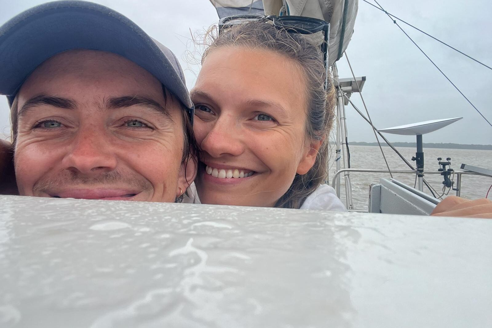

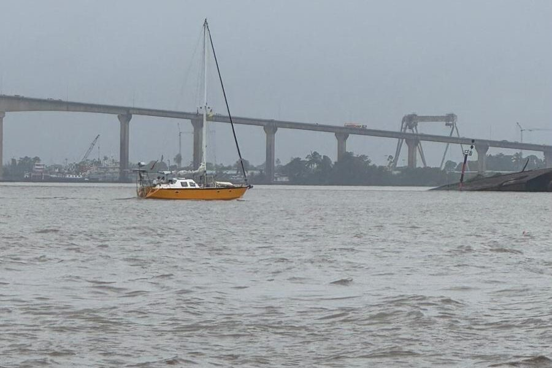

De *Goslar*, het Duitse marineschip dat in de Tweede Wereldoorlog tot zinken kwam in de Surinamerivier, ligt nog altijd roestig op dezelfde plek. We stuiven er met acht knopen voorbij en varen niet veel later de enorme brug onderdoor, de stad weer uit. Tegen het vallen van de avond knopen we met wat hulp van de *Modus Vivendi* aan een moorring te Domburg en kan de fles Pommery open.

## **Suriname: Land van vriendelijkheid**

Na een fles bubbels, onze resterende biervoorraad, wat borrelnootjes en een doosje crackers worden we wat verkreukeld naast elkaar wakker. Samen slapen is fijn, maar we liggen nog in onze hondenkooi en die is wel heel gezellig met deze temperatuur. In de vroege ochtend besluit Jen de kooi te verlaten en slaapt de laatste uurtjes op de bank in de kajuit. Als de zon opkomt worden we allebei wakker. Of nouja, ik schrik wakker, uit een *lucid dream* dat we weer op de kant in Amsterdam staan en niet in Suriname zijn. We liggen zo stabiel dat ik naar buiten moet snellen om te kijken of we niet op de bok staan, maar we drijven nog altijd gewoon op de Surinamerivier die langzaam ontwaakt. De brulapen schreeuwen de zon omhoog. Het geluid is mechanisch, het meest te vergelijken met een voorbij rijdende vrachttrein en nadat de zon zijn warmte begint te geven gaan ze te ruste tot ze de zon weer onder kunnen schreeuwen.

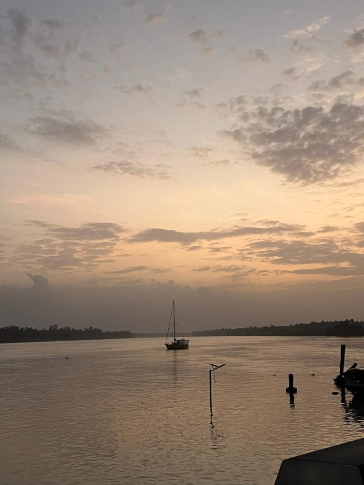

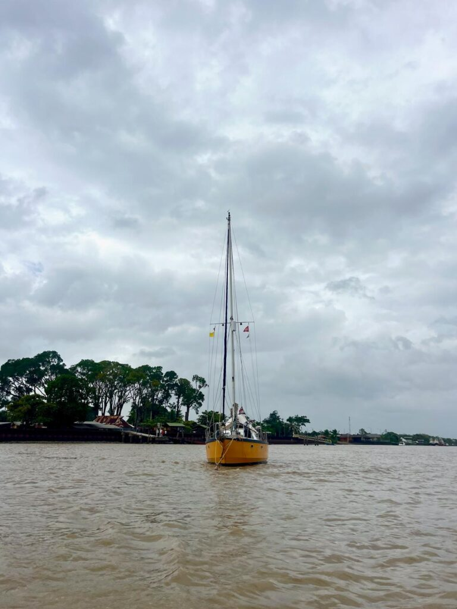

Met onze papieren onder de arm en onze nette kleren aan varen we met de bijboot naar de kant en zetten we voet aan wal. Dat is lekker. En gek. Om nu de boot weer even achter te laten en wat anders te gaan doen.

We maken kennis met Eric, die de kersverse uitbater is van de *River Breeze*. Het café aan de rivier en tevens de uitbater van de moorringen waar we aan liggen. We komen er achter dat we te laat zijn voor het inklaren, want de militaire politie en MAS schijnen alleen in de ochtend te werken. Het deert ons niet en we besluiten dan maar naar Rita te wandelen, die haar café-restaurant een stuk verderop heeft tegenwoordig. Zestien jaar geleden bestond de *River Breeze* nog niet en was *Rita* *the place to be* met haar heerlijke bami, nasi en saoto soep en vele, vele *djogo’s*.

Wat er precies is gebeurd weet ik niet, maar het in mijn herinnering bruisende Domburg doet, op het gerenoveerde plein na, erg verlaten en vergaan voor. De meeste horecatentjes zijn vervallen en eigenlijk het enige wat niets, maar dan ook niets veranderd is, is *Cheng*, de Chineese mini-supermarkt op de hoek van het plein.

Op zondag leeft het nog een beetje op. Dan wordt er op straat gekookt en zijn een paar van de vervallen zaakjes toch open voor afhalen. De grote jongens uit het dorp zetten hun auto met de achterklep open en laten zien hoeveel decibels ze kunnen produceren. Aan de bakboordzijde de javaanse en indiaanse jongeren, aan stuurboordzijde de creoolse muziek. In de hutjes in het midden van het plein zitten de ouderen met een *Djogo* (grote literfles bier die je dient te delen). De meesten keuvelen wat en anderen spelen een potje domino of kaart. Aan de waterkant, waar het donkerder is, zitten de tieners stiekem sigaretjes te roken naast een grote JBL toren. Hun scootertjes maken geluid alsof ze grote 6 cilinders onder kun kont hebben als ze voorbij brommen.

Door de week gebeurt er weinig. Wel is er elke dag een veegdienst van een man of vijf in gele hesjes die het plein bijhouden. Ze zitten het grootste deel van de dag in de hutjes in het midden van het plein, maar dat kun je ze niet kwalijk nemen. Een hartslag doet zweten hier.

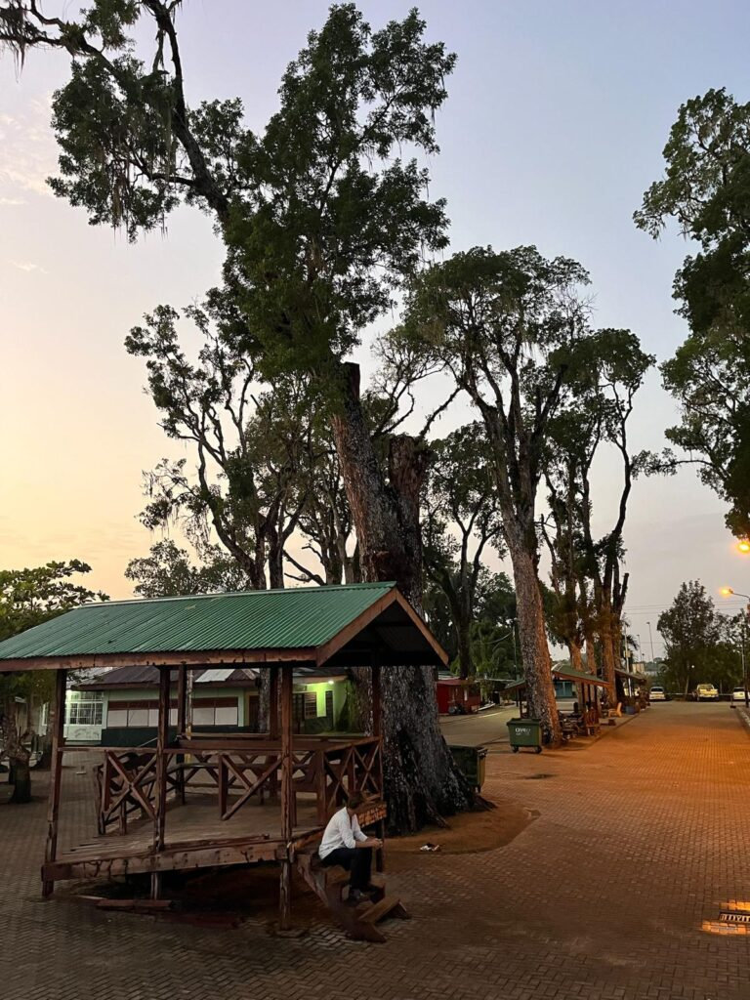

Wij lopen, in onze nette lange kleren en dichte schoenen (volgens de kledingvoorschriften van de MAS en militaire politie) over de Domburgse straatweg richting Rita. Het is zo’n veertig minuten lopen, maar we hebben na zeventien dagen zitten wel zin om de benen te strekken. Als het halverwege begint te regenen stopt er een auto die ons wel een lift wil geven. Onze eerste ontmoeting is tekenend voor de vele die er zullen volgen: Het gaat slecht met het land en het is de schuld van de president.

Rita herkent mij natuurlijk niet, maar ik haar wel meteen. Ze is weinig veranderd, misschien wat ouder geworden. Haar dochter is ook niet veranderd en heeft, net als destijds een kind op de arm. Het is een absurdistische déjà vu die ik niet kan bevatten, maar ik weet het zeker en als we er later nog eens naar vragen blijkt inderdaad dat het haar vierde kind is en dat de tweede destijds inderdaad in de luiers zat. Ze vraagt waar onze auto is en als we vertellen dat we zijn komen zeilen en het laatste stuk gelopen hebben worden we breed uitgelachen. Maffe Hollanders ook…

Maar de bami en de nasi zullen ons smaken. Wat is het heerlijk om weer verse kousenband, ingelegde komkommer en kip te eten! De groene Fernandes ernaast maakt het smaakballet compleet: We zijn in Suriname.

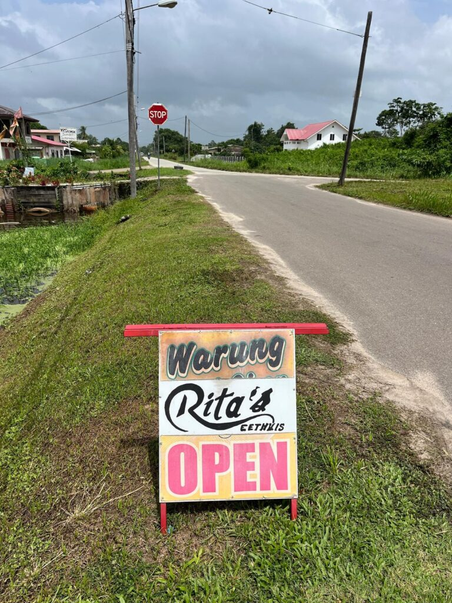

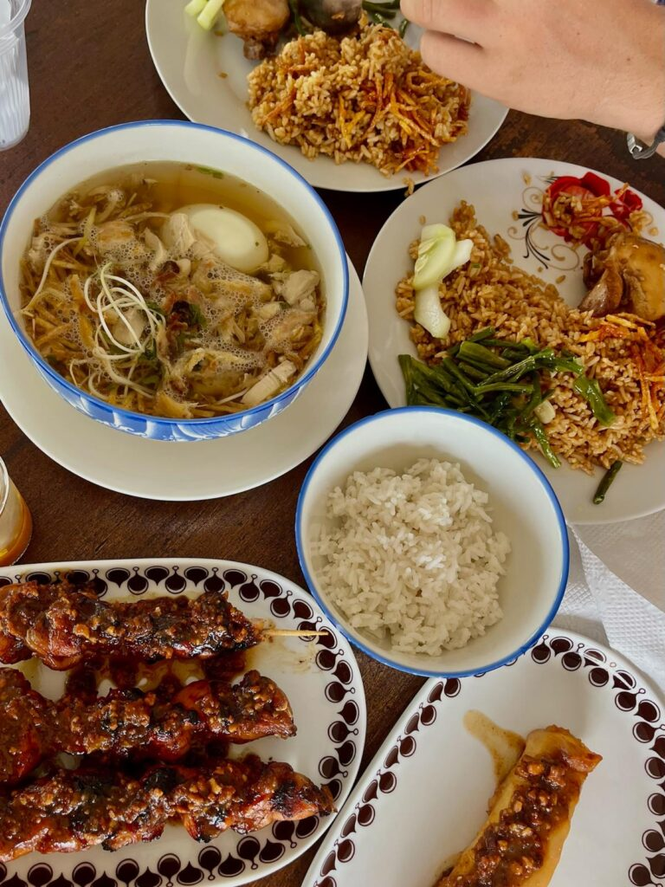

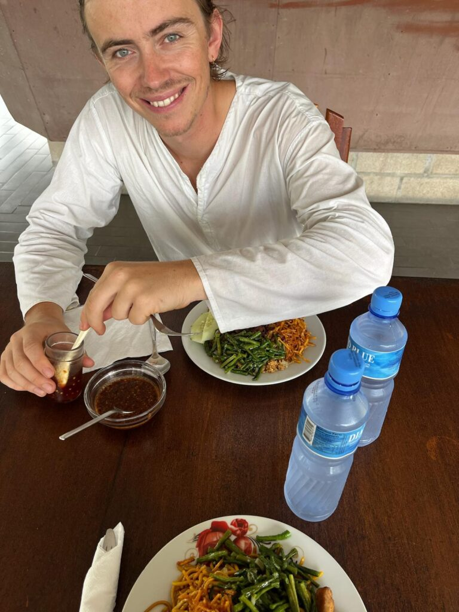

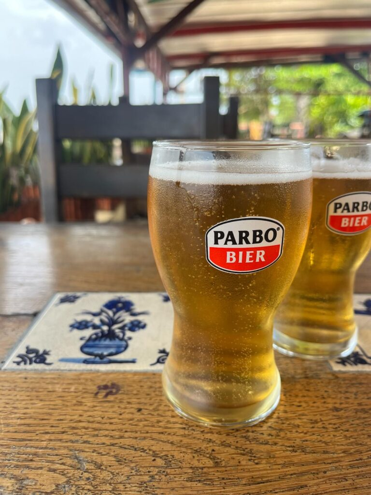

We wandelen terug langs een supermarkt en laden onze tas vol met groenten, fruit, en natuurlijk onze eerste *Djogo*. Verderop lopen we langs de school, die net uit is en worden we met open mond aangestaard, begiecheld en door de brutalen een vraag of opmerking toebedeeld. Een groepje giechelende meisjes weet van de overkant van de straat te roepen dat we er wel heel mooi uitzien en rent dan gauw de andere kant op. Het moet ook een beetje een gek gezicht zijn: Twee opgedofte witte mensen met verwilderde haren, modieuze zonnebrillen en tassen met groenten die op het heetst van de dag in the middle of nowhere *over straat wandelen*.

## **Op naar de stad**

Met de vrouw van Eric spreken we af dat we de volgende ochtend om 06.00 met haar kunnen meerijden richting de stad tot een plek waar we een bus kunnen vinden. We vinden het wat aan de vroege kant, maar ons slaapritme is nog zo ingesteld op wachtlopen en halverwege je droom opstaan, dat een dagje extra vast geen kwaad kan. In het donker trekken we de volgende ochtend dan ook onze nette kleren weer aan, stappen in de bijboot en wandelen naar de straatkant. We hebben geen specifieke plek afgesproken, maar gaan zo staan dat ze ons wel moet kunnen vinden.

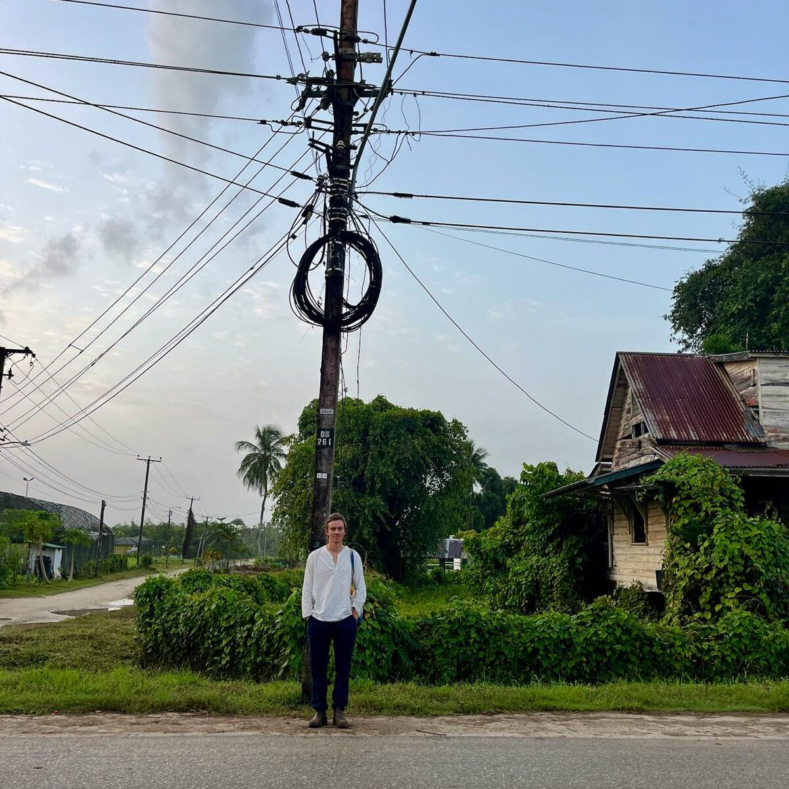

Om 06.30 begint het licht te worden en staan we nog steeds, inmiddels een beetje zenuwachtig-geïrriteerd langs de kant van de weg. Net als we er *bijna* aan toe zijn om de handdoek in de ring te gooien, komt er een bus voorbij, maar we besluiten niet in te stappen. Even later komt een man op de fiets voorbij die ons vertelt dat de volgende bus pas over anderhalf uur gaat en zo staan we dan langs de kant van de weg. Rond 07.30 gaan we bij de supermarkt wat eten halen en hopen we op een bus de goede kant op als er een man stopt die ons we naar de stad wil brengen als taxi. Of hij echt taxi is, blijft vaag, maar we gaan in ieder geval de goede kant op. Ik moet een broodje uit zijn dasboardkastje eten waarvan ik denk dat hij hoopte dat ik in tranen uit zou barsten van de peper, maar ik weet me groot te houden. Niet veel later stoppen we bij wat volgens hem *de* *broodjeszaak* is langs de Highway. Voor tachtig cent heeft Jen een broodje kip kousenband en voor nog eens tachtig cent krijg ik er eentje met kippenlever.

Veel omwegen, tussenstops en geklaag over de president verder komen we tot de kern van het gesprek: Het klimaat. Deze toch vrij simpel ogende en klinkende man houdt er een mooie filosofie op na. Volgens hem is het klimaat helemaal niet in de war, maar wij mensen. Want, zo stelt hij, jij en ik kunnen als mens veranderen toch? Door de tijd, je omgeving, wat je meemaakt. Waarom zou de natuur dan niet van karakter kunnen veranderen? We lachen om zijn redenering, maar kunnen hem ook niet in het ongelijk stellen. Misschien zit er wel meer waarheid in zijn zienswijze dan wij initieel denken..

Nadat we ons verrijkt met een nieuw filosofisch vraagstuk hebben laten afzetten lopen we naar het ontvangstgebouw van de MAS. We willen op de deur kloppen als een dame het raam opent en zegt dat we bij het raam moeten komen staan. Er staat inderdaad een plakkaat op de muur met “Hier melden”. Het betreffende raam is zo’n 30 centimeter hoog en bevindt zich zo’n beetje ter hoogte van onze bovenbenen. Om het praten wat makkelijker te maken zitten de scharnieren in de bovenkant van het raam en gaat hij niet verder dan 45 graden open. Het is dus kiezen tussen hurken, knieën, of heel ver voorover bukken om te kunnen praten.

Als Jen net heeft gekozen voor hurken en ik vooroverhangen, komt er vanaf binnen een dame naar buiten met twee tuinstoelen waar we op kunnen zitten. We zijn duidelijk niet de eersten die zich bij “Hier melden” komen melden, maar ons naar binnen vragen lijkt een absolute no-go. Zittend op de tuinstoelen voelen we de walm van de airco in ons gezicht blazen, terwijl de zon op ons achterhoofd brandt. Het raam komt nu tot onze borst, dus hoeven we wat minder ver voorover te buigen. Gelukkig heb ik van tevoren uitvoerig formulieren ingevuld op de recent vernieuwde site van de MAS, waarop alle formulieren netjes als webform beschikbaar zijn. Als ik de dame in kwestie uitleg dat we alles digitaal hebben ingevuld trekt ze bleek weg en zegt ze dat dat een groot probleem is. Ik moest de documenten toch echt aan háár aanleveren en *niet* aan de jongens van het IT department! Die hebben een systeem gebouwd waar niemand buiten de IT in mag kijken!

Na heel wat heen een weer wandelen, bellen en overbrengen hoe groot het probleem is, wordt een formulier van een ander schip voor onze neus leeggemaakt, geprint en mogen we het met pen en papier ter plaatse invullen. Gelukkig hebben we onze eigen pen mee. We worden afgestempeld en *Luwte* en haar crewlist zijn nu officieel erkend in Surinaamse wateren. Op naar de militaire politie voor een stempel in ons paspoort. We wandelen door het oude gedeelte van Paramaribo, waar koloniale huizen langzaam aan het vervallen zijn en de weelderige palmentuin nog altijd groeit en bloeit. Het is een vervreemdend beeld. Veel staat leeg, een deel huisvest de ontelbare “ministeries” die Suriname kent en een deel staat op het punt van instorten afgezet onder de noemer *hier herstelt Suriname het UNESCO werelderfgoed.*

<figure class="wp-block-image size-large">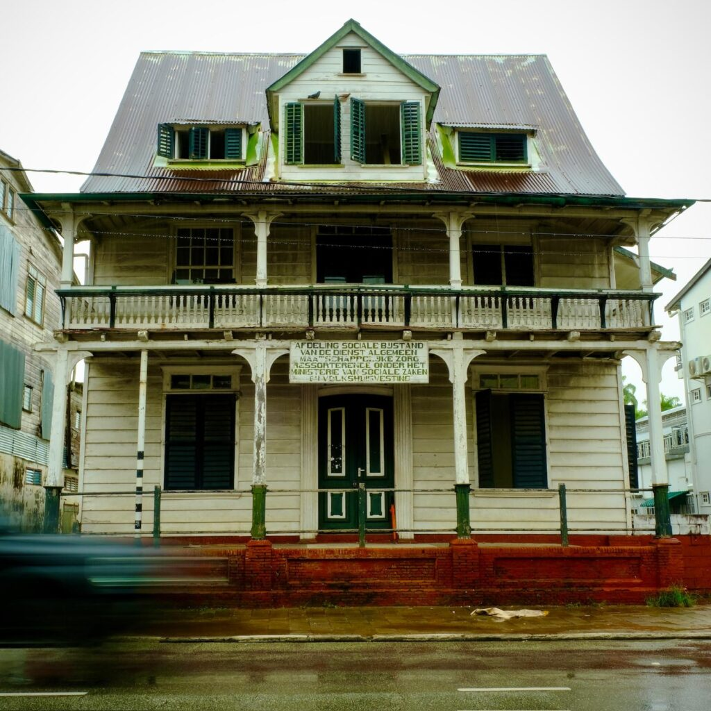<figcaption class="wp-element-caption"><strong><em>AFDELING SOCIALE BIJSTAND VAN DE DIENST ALGEMEEN MAATSCHAPPELIJKE ZORG RESSORTERENDE ONDER HET MINISTERIE VAN SOCIALE ZAKEN EN VOLKSHUISVESTING</em></strong></figcaption></figure>

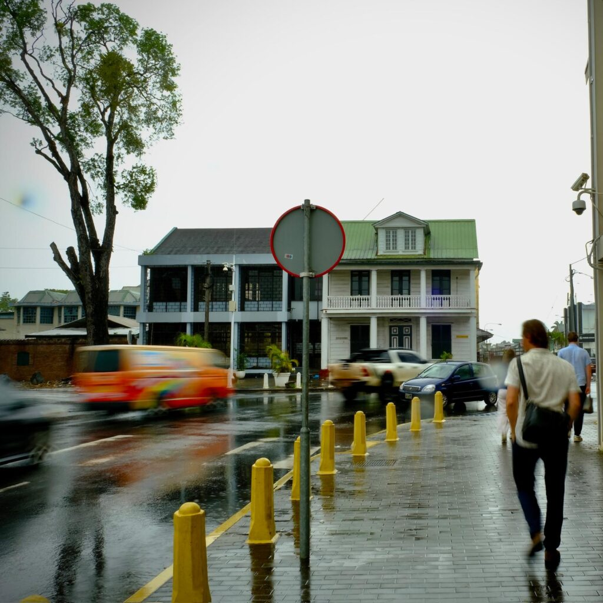

<figure class="wp-block-image size-large">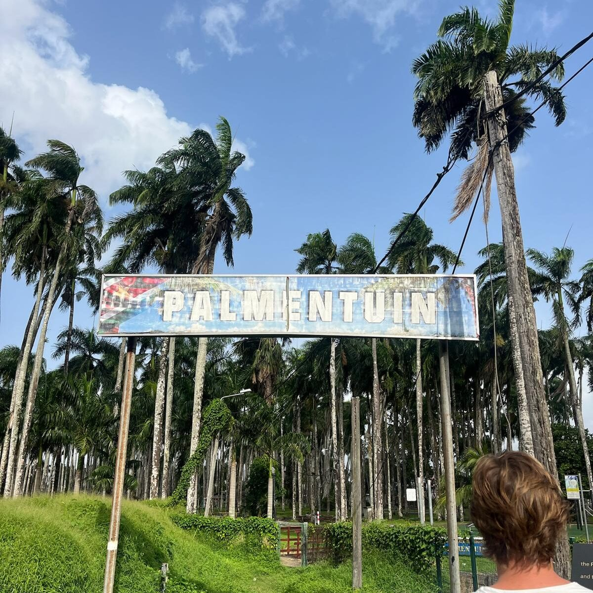<figcaption class="wp-element-caption">     </figcaption></figure>

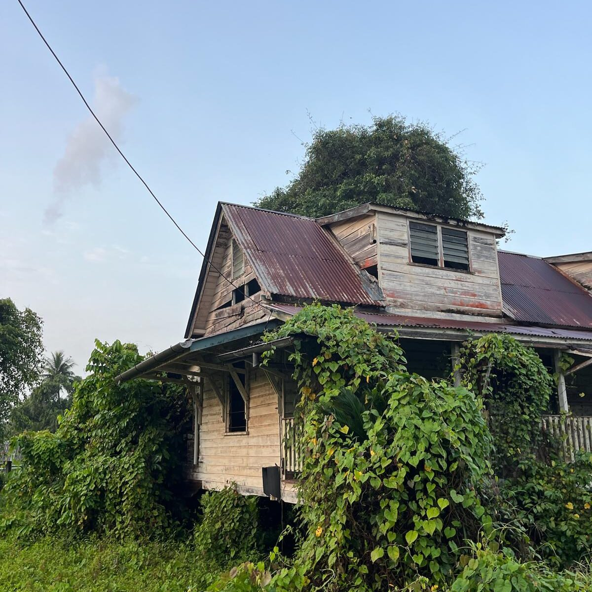

Na een half uurtje wandelen komen we aan bij het gebouw van de militaire politie. De verf bladdert aan de buitenkant van de muren, maar als we binnenkomen, begeven we ons in een overdaad aan geolied tropisch hardhout. Een jongeman in uniform bewaakt aan een ouderwets schooldressoir de portier. In een schriftje noteert hij met doktershandschrift onze namen, paspoortnummers en binnenkomsttijd waarna we in de hoek op het strafbankje mogen plaatsnemen. Niet veel later komt een oudere heer strak in uniform met verschillende onderscheidingen op zijn borst ons streng toespreken. Ik probeer uit te leggen dat we bij de MAS geweest zijn en graag een stempel in  ons paspoort willen, maar krijg terug “U bent verboden!”. We schrikken, snappen het niet, maar nadat hij een stuk of drie keer heeft gezegd dat we verboden zijn, begrijp ik dat hij zegt “voor boten!” en dat we naar de Nieuwe Haven moeten.

Dat is zo’n 3.5 kilometer lopen en we hebben nog iets meer dan een uur. Ook nu besluiten we maar te gaan lopen, zo zien we namelijk nog wat van Paramaribo. Tegen de tijd dat we het paleis van de president passeren, waar op het plein de trotse mannen van Suriname op zondag hun vogeltjes in wedstrijden laten fluiten, gutst het zweet over onze ruggen. We snakken naar een drankje bij de Waterkant, maar die blijkt in renovatie en de tentjes zijn daarom weg. Bovendien ligt ons wandeltempo niet zo hoog en worden we tegengehouden door de hitte. We passeren de Centrale Markt, waar het krioelt van de mensen en lopen dan de stad weer uit richting de Nieuwe Haven. We hadden absoluut een taxi moeten nemen, want we lopen meer dan de helft van de tijd over een industriegebied, maar hier nog een taxi scoren is lastig.

We komen in de buurt en vragen rond. Militaire Politie? Daar hebben ze hier nog nooit van gehoord.. Met het lood in onze schoenen volg ik de indicatie die we op *Noforeignland* hebben gevonden tot we tegen een toegangshek van de haven lopen en niet verder kunnen. Als we ons melden bij het portier weet die ons te verwijzen: De volgende groene deur!

Het gebouwtje is nietszeggend. Niet groter dan een flinke schuur en staat ingebouwd in het hek, zonder ramen. We kloppen op de deur en openen hem en jawel, daar zit een man in uniform met stempelkussen te wachten op varende zielen die toegang tot Suriname willen. Onze papieren zijn op orde en we mogen iets meer dan een maand in het land blijven.

Met die last van onze schouders lopen we vermoeid terug door de zon. We besluiten dat het hele stuk teruglopen geen optie is en wandelen naar de grote weg waar vast een bus voorbij zal komen. We vinden een ware bushalte en blijven wachten. Het duurt even, maar uiteindelijk stopt een felgekleurd busje met veel afbeeldingen van schaars geklede meiden (zowel binnen als buiten) voor ons. Er zijn nog twee stoeltjes, eentje naast de chauffeur en eentje achterin het gangpad. Zonder verdere communicatie staan de mensen om ons heen op om ons op onze plek te krijgen, waarna de gelederen weer sluiten en het busje nu écht propvol zit. Ik kijk naar achter en zie Jen, die net nog aan het mokken was dat ze geen zin meer had, geboeid en verwonderd om zich heen kijken vanaf het krukje in het gangpad dat haar is toebedeeld. We worden in het centrum afgezet en wandelen dan eindelijk zonder haast naar de *River Side*¸ waar we onder het genot van meerdere flesjes Markoesasap en knoflookpinda’s onze avonturen overzien en even bijkomen van deze exercitie.

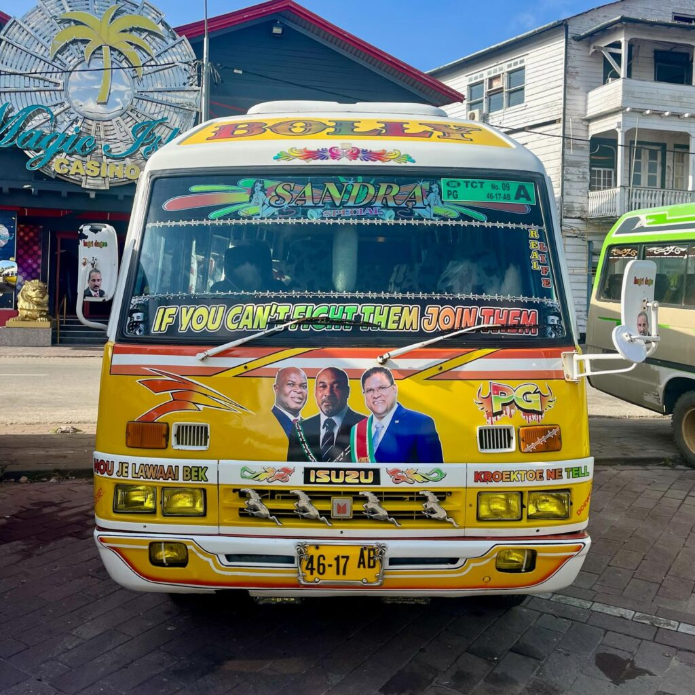

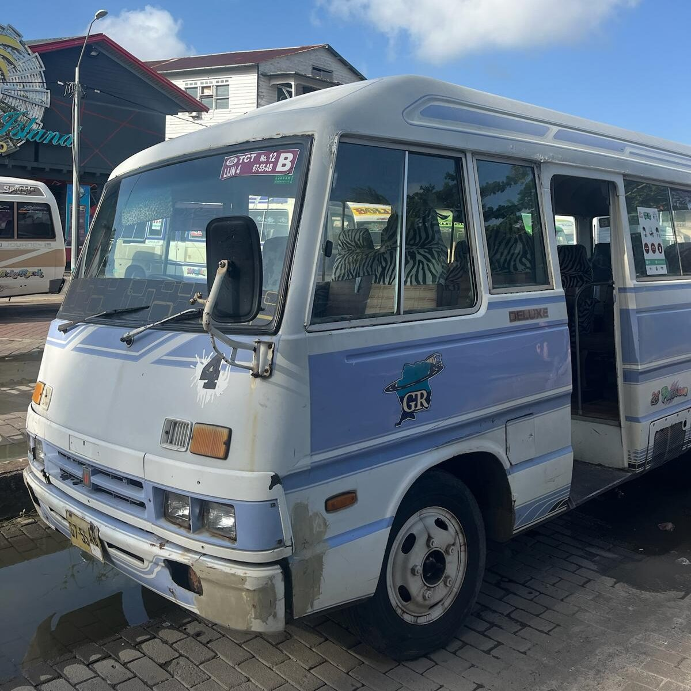

We vinden een taxi die ons brengt naar wat volgens de taxichauffeur de *elitewijk* van Paramaribo is: Paramaribo-Noord. Tussen de vooral veel grote villa’s-In-aanbouw vinden we *Mike’s Motor*. Ik had bij *Mike* een beetje een foute, grote Surinamer verwacht, maar tot onze verbazing komt Annegien, die vanuit Friesland haar scooterfascinatie (specifiek Kymco Vitality 50 CC *tweetakt)* mee heeft genomen naar Suriname. De scootertjes die in Nederland al lang niet meer door de beugel kunnen zijn hier de heilige graal in het straatbeeld. Ook zij, hoe Hollands ook, verklaart ons voor gek dat we met de boot helemaal hierheen zijn gekomen, maar vindt het leuk dat we bij haar een scooter komen huren. Jen krijgt een gele racehelm en ik een pindadopje. Mijn helm past in die van Jen..

En zo bewegen wij ons in den vreemde op levensgevaarlijke wijze weer terug naar Domburg. Eerlijk is eerlijk, echt gevaarlijk heeft het niet gevoeld, maar niet alle Surinamers kunnen even goed rijden en ik kan me wel voorstellen dat er zo nu en dan een ongelukje gebeurt. Wij kiezen dan ook de wat rustigere wegen en zien op die manier nog onontdekte stukjes van Suriname.

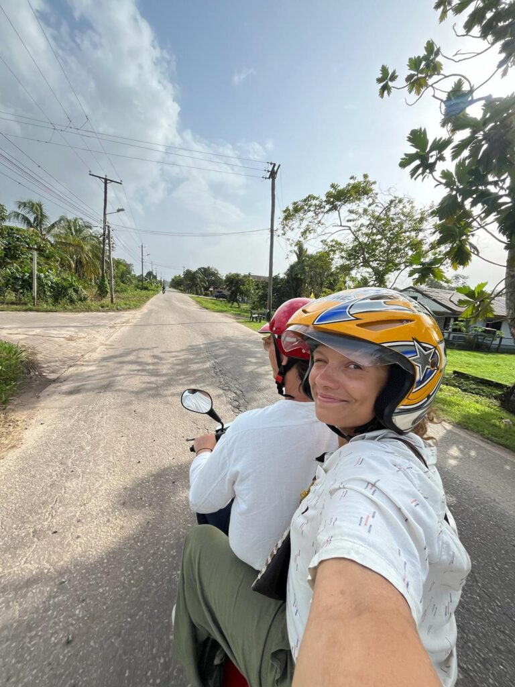

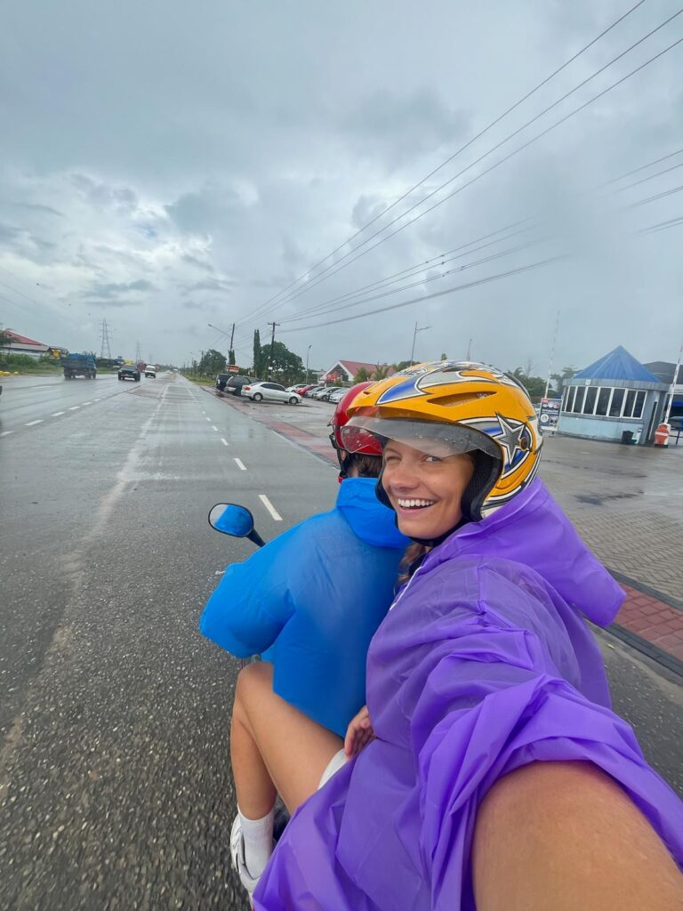

Met deze scheurbak onder onze kont kunnen we eindelijk de boer op. Boodschappen doen, *djogo’s* inslaan en een bezoek brengen aan de oase die Waterland heet. Suriname kent namelijk eigenlijk maar twee plekken waar je met je zeilboot goed terecht kunt: Domburg, waar wij aan de ankerboei liggen, en Waterland. Een luxe resort dat alleen in het weekend open is en waar ze een haven hebben aangebouwd. Het is een vreemde plek, naast de compound van de zoon van een voormalig president die daar een eigen dierentuin, glijbanenpark en armada aan speedboten schijnt te stallen. Het waterlandresort voelt een beetje troosteloos en verlaten aan, maar leeft in de weekenden, net als Domburg op. Dan komen de welgestelde Surinamers op een strandbedje liggen, pootjebaden en een hapje eten. De rest van de week maken de zeilers de dienst uit en wij noemen het dan al snel gekscherend de landingsplaats van *het drijvende dorp*. We haken aan voor een borrel en een BBQ, maar vinden het ook wel lekker om daarna weer terug te mogen naar Domburg en op de rivier ons bootje weer op te zoeken. Over het vlakke, bruine water scheurt *Storm* ons door de donkerte van de nacht terug. De boot begint een paar uur na zonsondergang met alle ramen open weer een beetje behaaglijk te worden en we vallen in een diepe slaap. Het worden drukke dagen…

## **Hoog bezoek**

De volgende ochtend beginnen we onze zoektocht naar een auto. *Rishi* schijnt dé man te zijn die je daarvoor moet hebben. Zowel de zeilers, als een aantal lokalen raden ons aan met hem contact op te nemen en verder krijgen we geen andere adresjes of via-via regelingen losgepeuterd, dus we wagen het er maar op. Eric van de *River Breeze* zou het voor ons regelen, maar als we daar na twee dagen niets van terug hebben gehoord nemen we het heft maar weer in eigen handen en bellen we *Rishi* met onze nieuw gescoorde simkaart zelf op.

*Rishi* is vriendelijk, maar leeft in een andere versnelling. Letterlijk. Hij neemt zijn telefoon niet op met “Met Rishi”, maar met stilte. Na een seconde of tien begin ik dan maar “Hallo?”, waarna een heel rustig “jaaa, hier ben ik” terugkomt. Ik probeer uit te leggen dat we graag een grotere en hogere auto willen, het liefste 4x4 waarmee we ook een beetje op pad kunnen. Ik voel *Rishi* aan de andere kant van de lijn in elkaar krimpen als ik begin over Jodensavanne en Brownsberg. Daar heeft hij geen wagen voor, maar hij heeft wel gewoon een mooie hoge auto voor ons. 

De Toyota Rav4 die we uiteindelijk voorgeschoteld krijgen ziet en klinkt stoerder dan hij daadwerkelijk is. Het huurcontract suggereert dat je beter geen ongelukjes kunt hebben, maar door alle taal- en spellingsfouten is het lastig om er iets uit op te maken. De vering is slap, de schokkenbrekers doen niets meer, de banden zijn glad en de ruiten zijn afgeplakt met de donkerste tint folie die er bestaat, waardoor we de wel meegeleverde airco eigenlijk niet kunnen gebruiken. Met de ramen dicht zie je praktisch niets. Maar hij rolt en er passen met wat duwen en trekken vijf mensen in. Vijf?

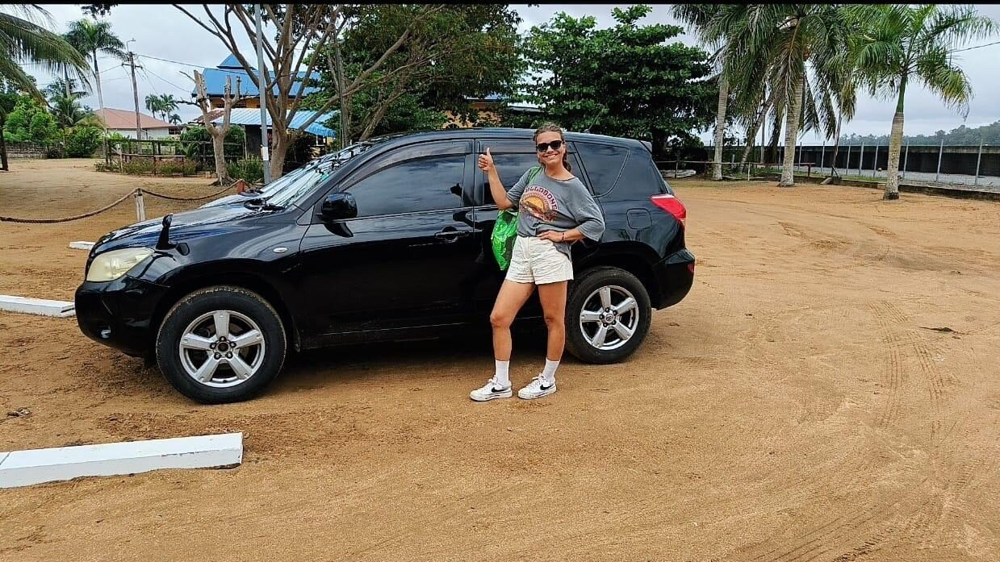

Nog twee nachtjes en dan is het zo ver. Na meer dan een half jaar moeten behelpen met WhatsAppjes en wat videobellen komen mijn vader, moeder en Olivier ons opzoeken. Terug naar het land waar mijn ouders afstudeerden, ons naar school lieten gaan, bijna naartoe emigreerden en bovenal heel veel absurde avonturen beleefden. Terug naar Suriname en even een kijkje nemen bij een van de kinderen die daar toevallig ook naartoe is gekomen, met de boot. Jen en ik bereiden het huis voor, vullen de koelkasten en zorgen dat er het een en ander te smikkelen is. En dan is het plotseling nog maar 20 minuten tot de landing en moeten we nog 40 minuten rijden. Een half jaar zijn we aan het zeilen naar dit punt en dan tóch nog haast en bijna te laat op het laatste moment..

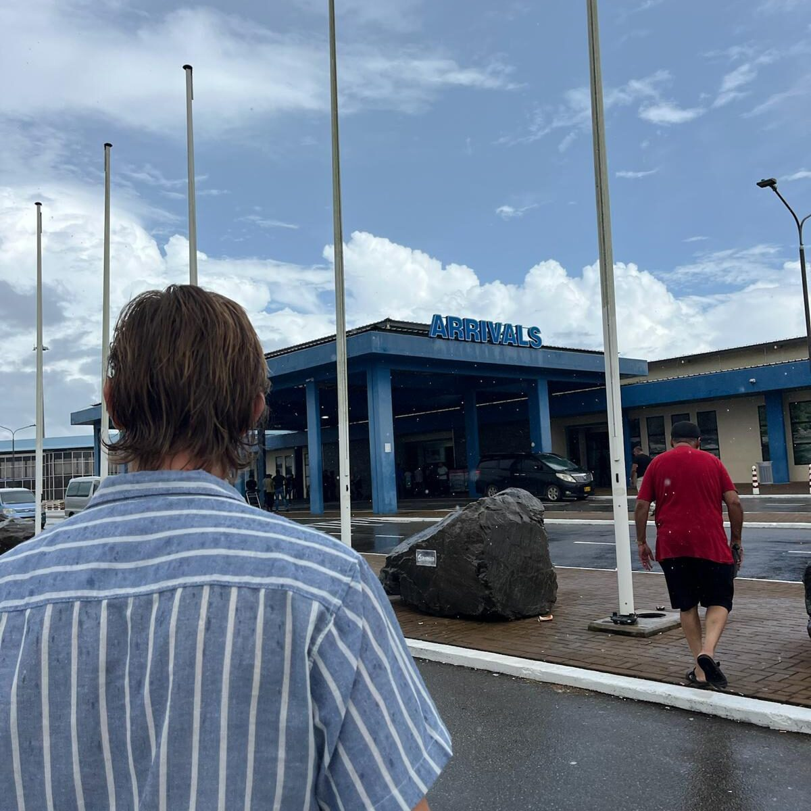
