Bijna de hele dag zijn we bezig met verhuizen. Door de week met mijn familie heen hebben we de boot leeggehaald en alle spullen naar het huis getrokken waar we logeerden. Gelukkig hebben mijn ouders het huis een dagje extra gehuurd en kunnen wij nog een laatste wasje draaien en alles naar de boot verslepen. Het is heet. In Suriname is het al snel heet, maar een dagje verhuizen is wel weer andere koek.

Die avond koelt het gelukkig wel weer wat af, maar liggen we te woelen in het vooronder van *Luwte*. Nu zijn we weer met z’n tweeën op het bootje en is dit plotseling weer ons leven. Voor tien dagen lang waren we op vakantie en even helemaal uit ons varende bestaan. Een beetje rouwig om de mooie tijd die ten einde komt, maar ook blij om ons rustige tempo weer op te zoeken.

We hebben nog één ochtend de auto tot onze beschikking en maken daar dankbaar gebruik van om nog een grote ronde boodschappen te doen. In Suriname zijn maar weinig plekken waar gepind kan worden - zeker met buitenlandse passen – en ons cash geld is bijna op. De twee pinautomaten te Domburg hebben er de brui aan gegeven, dus gaan we het verderop proberen. Uiteindelijk zitten we ruim twee uur in de auto en staan we bij zeker zeven automaten in de rij. Soms zien we voor ons mensen geld uit de automaat krijgen, maar met onze Nederlandse passen worden we geweigerd.

De supermarkt voor de grote boodschappen accepteert gelukkig wel onze pas en met de laatste SRDs die we hebben kopen we bij een groentekraampje langs de weg nog wat groenten. Terug bij de *River* *Breeze* rekenen we onze moorring af en niet veel later gooien we de boei die meer dan twee weken *Luwte*s huis was los. We glijden verder stroomopwaarts naar Marina Waterland, waar we water kunnen tanken, ons weer even kunnen onderdompelen in de zeilgemeenschap en we ons kunnen klaarmaken voor een groot avontuur de Surinaamse jungle in. Met eigen boot.

De manoeuvre bij de marina is op z’n zachtst gezegd opwindend. Er staat een sterke stroming die diagonaal loopt op de steigers en door een afgebakend stuk zwemstrand moeten we een raar bochtje maken vlak voor de box. Al bij het toenaderen bespreek ik met Jen dat we het heel rustig aan gaan doen en ik eerst naast de steiger de manoeuvre een paar keer wil oefenen op de rivier, voordat we voor het eggie gaan. Zoals in elke haven denken de mensen op de kant daar anders over en staan ze al klaar om onze lijntjes aan te nemen als we in zicht komen. De druk die dat met zich meebrengt is niet prettig, maar zolang we een beetje buiten gehoorafstand blijven, kunnen we nog even samen overleggen en aanvoelen of dit gaat lukken. Ik steek achteruit tegen de stroming in, met wind op de kop. *Luwte* komt meteen dwars op de stroom te liggen en we zien de haven met een noodgang voorbij schieten. Gelukkig dat we dit eerst even proberen. Poging twee gaat beter en het lukt aardig om de boot op z’n plek te houden en ons als een soort krab zijwaarts heen en weer te bewegen over de rivier.

We hebben in Portugal ook op rivieren met sterke stroming in kleine ruimtes gewerkt, maar daar stond de stroming altijd netjes in het verlengde van de steiger. De diagonale variant met een flinke wind op de kop maakt dat ik bij kleine stuurbewegingen soms grote draaiingen maak, die niet zomaar te corrigeren zijn met een flinke dot gas vooruit, of achteruit. We blijven nog even balanceren en willen *bijna* de handdoek in de ring gooien, als ik zie dat we er perfect voor liggen en dat dit hét moment is om te gaan. Inmiddels staan er een stuk of tien mensen om de box heen om te ramptoeristen en een uitzondering om te helpen. Terwijl ik trefzeker de boeg de box in duw en op het juiste moment de kont bijdraai door in de achteruit te slaan, herhaal ik nog één keer naar Jen: Eerst de spring en de achterlijn. De voorlijnen doen nu toch niets. Een man op de kant gebaart dat hij de spring van Jen wil aannemen en vastleggen. Ik bekommer me om de achterlijn. Ik hoor Jen uitleggen om welke kikker de lijn moet, om vervolgens stuurboord-voor vast te leggen. Als ik omhoog kom staat de man nog altijd met een slappe lijn in zijn handen voor zich uit te staren. Soms (meestal) heb je pech als je je lijn uit handen geeft… Maar we liggen en we hebben geen krassen en geen krassen veroorzaakt… Even bijkomen.

<figure class="wp-block-image size-large">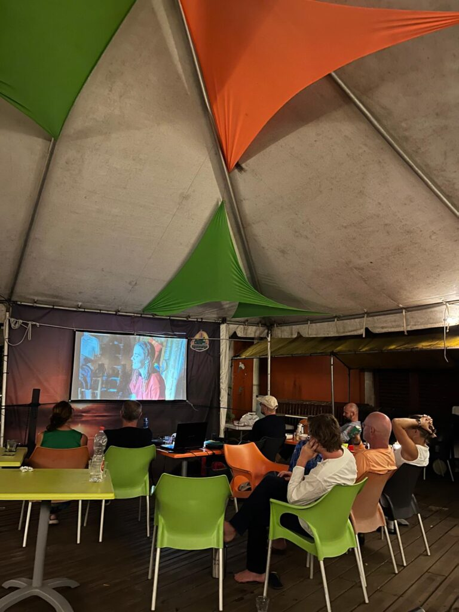<figcaption class="wp-element-caption">Op de Marina Waterland maken we onze eigen walk-in scheepsbioscoop met de <em>Kolibir, Marije </em>en <em>Belafonte</em></figcaption></figure>

## Rivieravonturen

De klik met de mannen van *Belafonte* is op Sao Vicente bevestigd en in de loop van de oversteek versterkt door het dagelijkse contact dat we hadden over onze *ups* en *downs* op zee. Al kort na onze aankomst in Suriname hebben we daarom bedacht dat we na het vertrek van de familie met z’n vieren op expeditie de jungle in willen. We bereiden ons voor op een tocht over de Commewijne en de Cottica, twee grote zijrivieren van de Surinamerivier. Een officiële toestemming krijgen voor de tocht blijkt erg ingewikkeld en we krijgen eerst geen gehoor op onze aankondiging bij de autoriteiten en vervolgens een omslachtig en vaag bericht over verschillende personen die toestemming zullen geven en wanneer.

Het is ook vaag in hoeverre er nou sprake is van de noodzaak tot overeenstemming. Op de zeekaarten staat niets aangegeven over een beperkt vaargebied, maar het beetje goed zeemanschap dat we inmiddels in de vingers hebben, vertelt ons dat er diep het land in op de Cottica een dorp is waar grote zeetankers voor de bauxietwinning naartoe varen. De Cottica is wél overal diep, maar niet overal even breed.

Wij besluiten de volgende dag eerst naar Nieuw Amsterdam te varen en daar een nachtje door te brengen. Dat is toch zo’n 25 mijl naar buiten toe en dus kunnen we met de kentering losgooien en rond de volgende kentering de zijrivier opvaren. Mooi het hele stuk stroom mee dus. Op *Navily*, één van de apps waar veel informatie in te vinden is over ankerplekjes, staat Nieuw Amsterdam aangegeven als prima ankerplek om de nacht door te brengen, of te wachten op het goede tij. Daar mikken we dus op. We pruttelen de rivier af, passeren Paramaribo en zien dan in de verte het zeegat weer verschijnen. In plaats van doorvaren gaan we stuurboord uit, de monding van de Commewijne in. Meteen op die hoek ligt Nieuw Amsterdam, het fort dat de toegang tot de Surinamerivier en de Commewijne lang verdedigde.

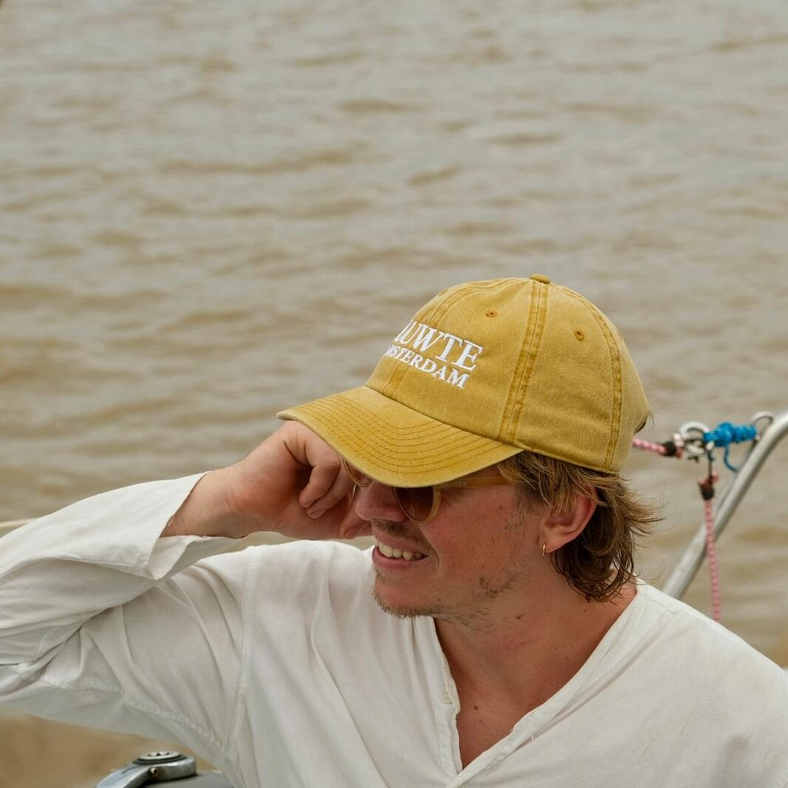

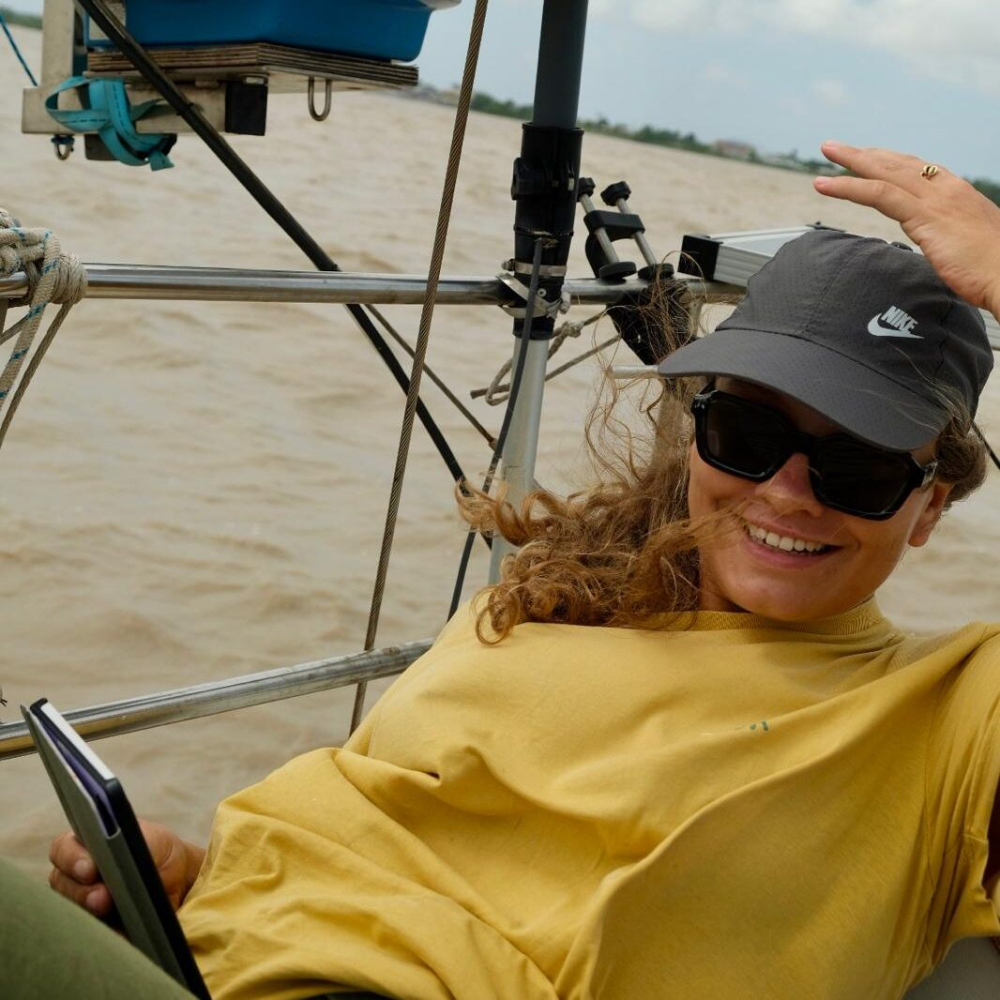

We ankeren een stukje naast de geul, maar als we eenmaal liggen houden we de motor nog even aan. Jen en ik hebben er allebei niet helemaal een lekker gevoel bij. Het stroomt hier genadeloos hard en we liggen met een redelijke bries aan de lagerwal (zie volgende afbeelding). Ons anker hield gelukkig meteen, wat een fijn gevoel is, maar ik weet ook direct dat het een hele korte nacht voor ons wordt als we hier zouden blijven liggen. Ik ben bijna blij als ik zie dat ze op *Belafonte* van een afstandje zichtbaar met dezelfde vertwijfeling op de boeg naar hun ankerketting staan te staren om tekenen van krabben te vinden. Vanaf deze plek zal alles onbekend terrein worden en de kaarten zijn summier en ontoereikend om op af te gaan, maar alles schreeuwt dat we weg moeten bij deze lagerwal en er betere plekken zijn om de nacht door te brengen.

We stemmen kort af op kanaal 77 met *Belafonte,* en zijn blij van elkaar te horen dat we er hetzelfde in zitten. Enigszins jaloers kijk ik toe hoe bij hun de grote teen een knopje indrukt en de ketting met de elektrische lier ratelend naar binnen komt. Gelukkig weet Jen dat ik daar een beetje jaloers op ben en word ik na het ophalen van het anker altijd getrakteerd op een kus en een complimentje dat mijn rug er goed uitkomt als ik het anker ophaal.

Nog geen half uur stroomopwaarts ligt Frederiksdorp. Hier toont de rivier haar andere kant. Ze kabbelt rustig, het is windstil en de kantlijn suggereert een mooie stevige kleigrond van het type “anker er in gooien en vastzitten als een huis”. Zo hadden we het voor ons gezien.

<figure class="wp-block-image size-large">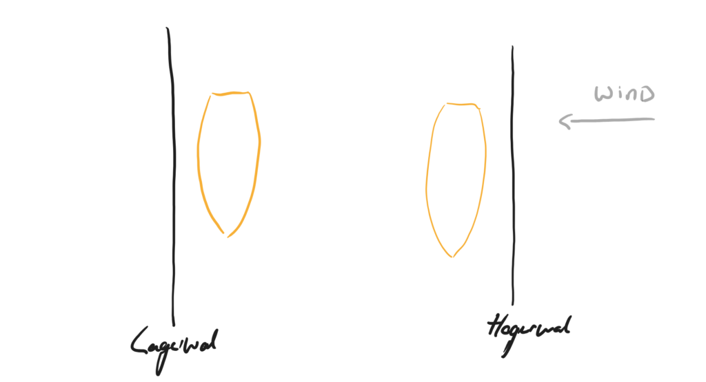<figcaption class="wp-element-caption"><strong>Lagerwal</strong>: Waar de wind van het water het land op waait. <strong>Hogerwal</strong>: Waar de wind van het land af waait. De voorkeur is (bijna) altijd om aan hogerwal te ankeren/manoeuvreren, omdat je dan tijd en ruimte hebt als er iets misgaat (je wordt dan immers van de kant af geblazen) én er minder wind en golven staan.</figcaption></figure>

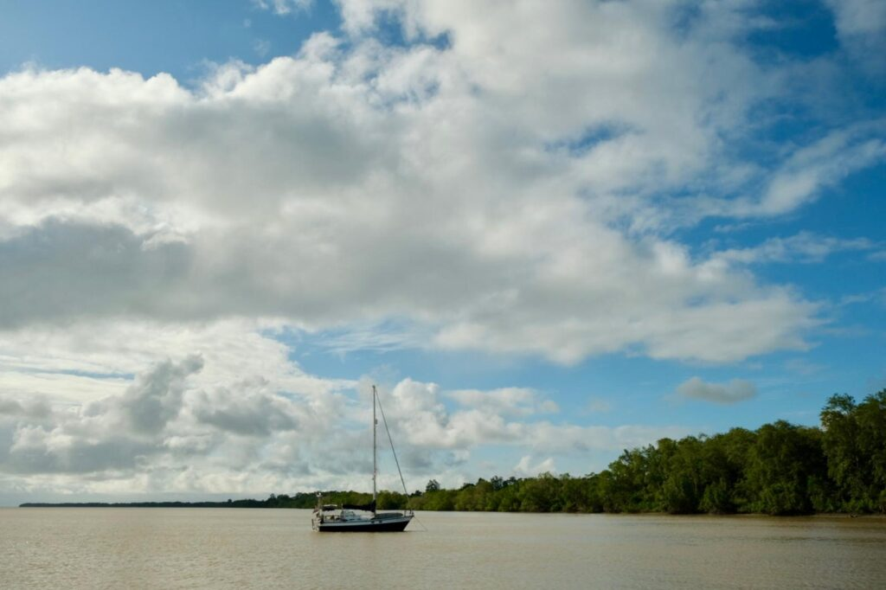

We moeten duidelijk bijkomen van ons vertrek uit Waterland, onze mislukte ankerpoging bij Nieuw Amsterdam en onze eerste succesvolle ankeroverwinning bij Frederiksdorp. Vanavond zijn wij het borrelschip en wordt er bij ons aan boord gegeten. De opvouwbare *Portaboat* van *Belafonte* wordt uitgeklapt en ze roeien het kleine stukje naar onze boot. De euforie is groot omdat we hier zijn en het avontuur begonnen is. Met bijpassend tempo vieren we dat tot we geen koude drankjes meer hebben. Het is laat en tijd om naar bed te gaan als we morgen nog iets voor elkaar willen krijgen. De mannen stappen weer in hun bootje en zodra we ze losgooien is duidelijk dat het kabbelende stroompje van net, is veranderd in een snelstromende rivier. Dit hebben we eerder gezien. Toen zaten Jen en ik samen in het bootje dat losgooide en roeide ik tot de dol brak, waarna we door de *Chillalot* gered werden die wél een motor hadden achtergehangen.

Jen sommeert mij dan ook vrij snel nadat ze zijn weggeroeid om in onze bijboot te stappen en er achteraan te gaan om te controleren of alles goed gaat. Het is niet een heel ingewikkeld stuk. Rechtuit stroomafwaarts. Maar in het donker met z’n tweeën coördineren wie wanneer welke haal moet maken is moeilijk. Ik moet terugdenken aan de vroege ochtenden in de winter van 2017/2018 toen we met een boot vol onervaren roeiers de Amstel op moesten. Tot zonsopgang was het altijd een hele stoeipartij om daar wat van te maken.

Nu is het warmer, het bootje logger en is er geen stuurvrouw achterin die het nadenkwerk doet. Ik kom dichtbij en geef ze een kontje met onze bijboot. Inmiddels zijn we ter hoogte van *Belafonte*, maar een stuk afgedreven en moet er hard gewerkt worden om tegen de stroom in te roeien. Ik bedenk dat ik beter wat op afstand kan blijven en laat me wat afzakken voor als ze het toch niet halen, maar het lijkt de goede kant op te gaan.

In een flits verandert het speelveld. We weten allemaal niet waardoor en hoe het kon, maar van het ene op het andere moment ligt de *Portaboat* op z’n kop en komen er twee beduusde hoofden boven water. Gelukkig zijn we alle drie meteen bij de les en help ik ze onze bijboot in. Hun bijboot keren we om en binden we aan de spiegel vast. Tegen de tijd dat we de boel onder controle hebben en tegen de stroom in gas kunnen geven, zijn we enkele honderden meters verderop afgedreven. Gelukkig hebben we de pk’s achterop hangen om met een volle badkuip, twee verzopen katten en mijzelf terug te tuffen naar *Belafonte*. Als ik vol ongeloof van het voorval terugkom aan boord ligt Jen al in een diepe slaap en heeft er niets van meegekregen…

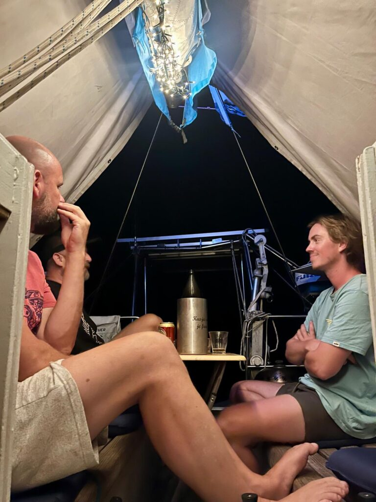

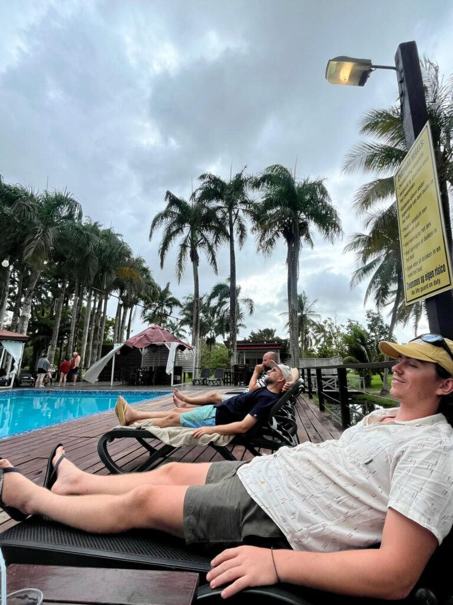

De volgende dag zijn onze hoofden zwaar en gaat alles erg langzaam. We besluiten vrij snel dat we nog een nachtje bij Frederiksdorp blijven hangen en vanmiddag de plantage bezoeken die “in volle glorie” is herstelt en nu dient als resort. We maken even dankbaar gebruik van het zwembad, het lekkere eten en de ligbedjes, maar verlaten het terrein aan het eind van de middag met een wrang gevoel. Suriname heeft niet de middelen, het belang en het politieke veld om plantages als deze vanuit publieke middelen te onderhouden als deel van de geschiedenis en daarom zijn de inkomsten als resort nodig voor de onkosten.

Het resultaat is een compound vol met rijke Europeanen die zich laten verwennen aan het zwembad, een stukje over de aangelegde paden fietsen en zich aan het eind van de dag met de andere gasten in het restaurant laten bedienen. Het is bijna alsof de toeristen zelf deel zijn van een pijnlijk decor, zonder het zelf door te hebben. Het is een prachtig onderhouden en nagebouwde plek, met veel verhalen en historie, maar wij vinden het vrij ongemakkelijk om er rond te lopen.

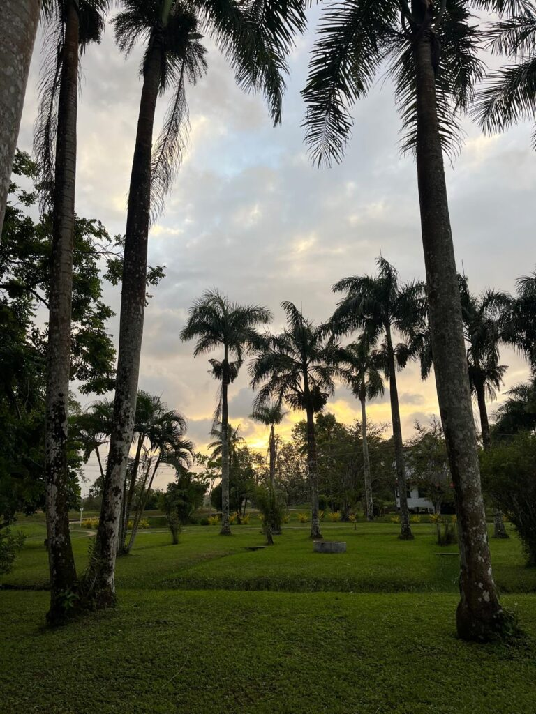

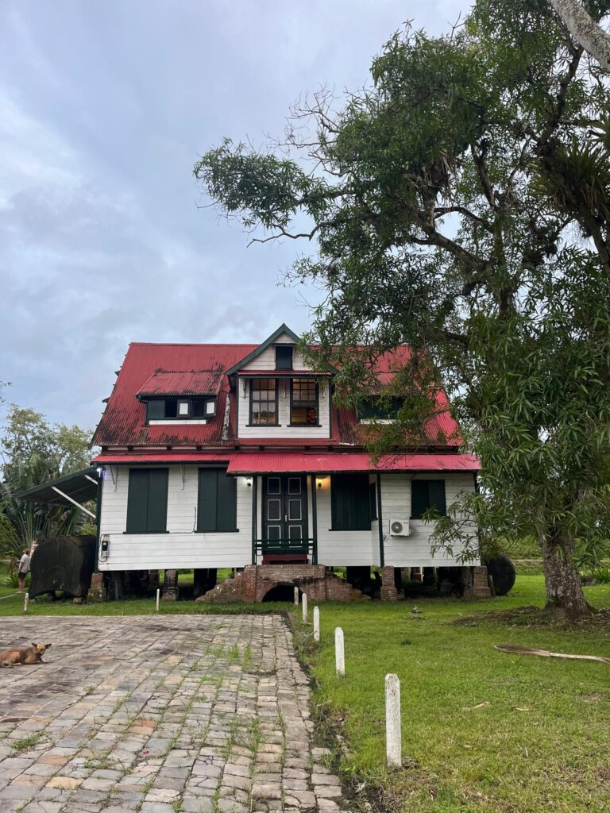

## **Kreken**

De volgende ochtend staan we vroeg op om met het tij mee verder te varen. De kreek van Alliance, met het verderop gelegen *Bakkie* is ons doel voor de dag. Met een kop koffie tuffen we door de ochtend heen verder de bewoonde wereld uit. Delen van de rivier zijn afgezet met visnetten, maar de geul laat zich redelijk makkelijk lezen. Als we verder komen stoppen de visnetten en begint het bos. We varen door en dan zien we in de bocht een opening verschijnen: Onze eerste kreek. Behoedzaam, maar niet onzeker varen we naar binnen. We weten dat hier vrij recent nog andere zeilschepen naar binnen zijn gevaren, dus dat moet wel lukken.

We worden meteen verwelkomd door enorme groepen Rode Ibissien, die zich in hun fluorescerend-rood uit de bomen laten vallen, over het water scheren en telkens honderd meter verderop weer neerstrijken, totdat we weer te dichtbij komen. We laten ons stapvoets langs Alliance drijven en gaan de vogels achterna tot we in de verte een pier zien opdoemen.

Op de oude poststeiger staat Bas, de man van Mascha, die samen plantage en museum *Bakkie* runnen. Hij heet ons welkom en wijst ons aan waar de boten meestal ankeren. Hoe ze dat doen weet hij niet precies, maar wel dat ze vaak aan elkaar vastgeknoopt zitten. Wij komen niet geheel onbeslagen ten ijs en hebben in verschillende blogs gelezen dat het raadzaam is om met twee boten twee ankers uit te gooien en vervolgens met lijnen van achter aan elkaar, of naast elkaar vast te knopen. Op die manier lig je bij beide getijden (ook hier wisselt de stroom nog van richting) mooi achter een anker en eindig je niet in de bosjes.

Het is even passen en meten, een paar keer het anker opnieuw uitgooien en voor Jen met name een hele stoeipartij in de bijboot om de lijnen van onze boot naar *Belafonte* te brengen, maar uiteindelijk trekken we onze boten achterstevoren naar elkaar toe, koppelen we de kettingen tussen de boten en liggen we als een blok op de rivier.

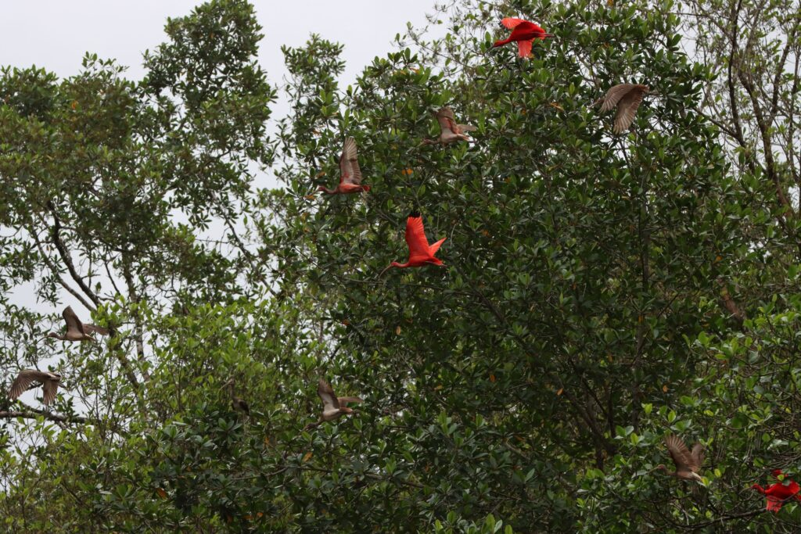

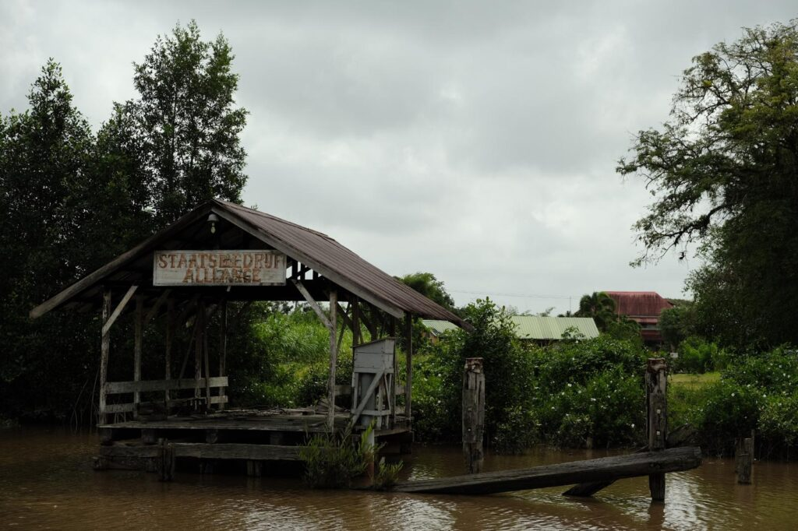

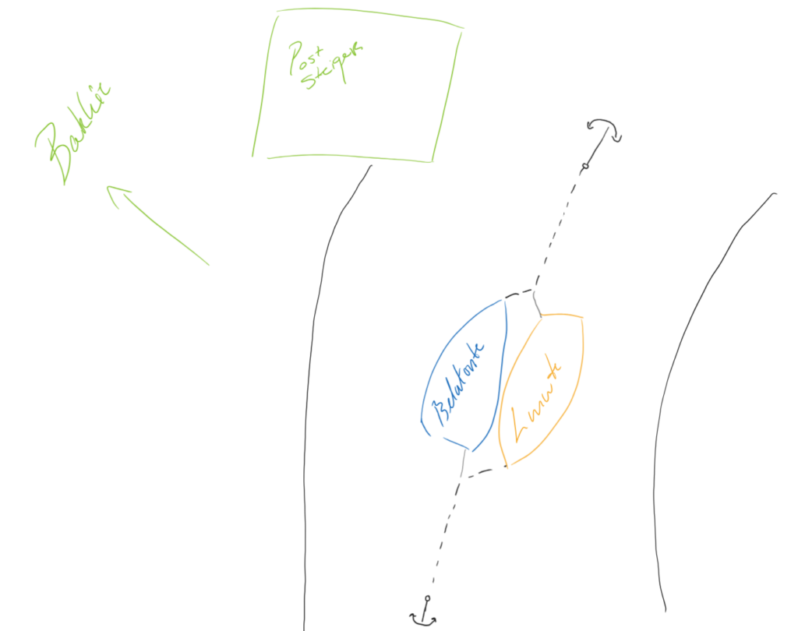

Die middag krijgen we een rondleiding door het indrukwekkende privé-museum van Bakkie, met oude drukprenten, handgeschreven boeken met administratie en opgegraven werk- en straftuigen die in de klei van de kreek heel goed bewaard zijn gebleven en een unieke blik geven op het slavernijverleden. De bronnen die voor de geschiedschrijving worden gebruikt zijn veelal de administratieve boeken en door plantagehouders bijgehouden brieven en dagboeken. De slaven op de plantage hadden officieel geen bezittingen en die overdracht is dus grotendeels oraal (en staat daarmee veelal niet in onze boeken). De kralen, geïmproviseerde dobbelspellen en werktuigen die hier uit de klei naar boven zijn gekomen bieden een glimp van wat er zoal gaande was op de plantages. Het verhaal wordt extra gewicht gegeven door het verhaal van Mascha, wiens overgrootvader nog meemaakte hoe hij “vrij” verklaard werd op plantage Bakkie.

We zijn de enige bezoekers en raken onder het genot van een heerlijke lunch verder aan de praat met Mascha, Bas en hun zoon Alejandro. Hun zoon werkt in de toerismesector als gids en weet *alles* van de dieren in het bos. Welke paadjes ze volgen, waar je welke zeldzame vogel moet spotten en waar welke kikker zich verstopt als het regent. Mascha weet alles over planten. Zij groeide in Nederland op, maar haar moeder en grootmoeder brachten alle details over de planten, kruiden en vruchten in Suriname over. Toen ze zelf naar Suriname trok wist ze alles, maar had veel van wat ze wist nog nooit gezien of geroken. Inmiddels staat er een enorme botanische tuin naast het museum met geneeskrachtige kruiden, talloze vruchtenbomen en sierplanten. Ik hoop dat Alejandro op een dag zijn fauna-fascinatie uitbreidt met de flora en dat de kennis niet verloren gaat in een stoppende lijn van moeder op dochter..

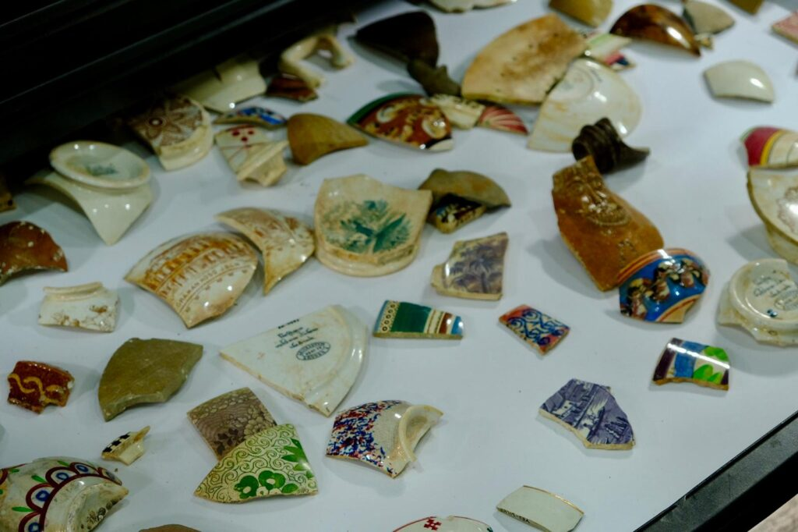

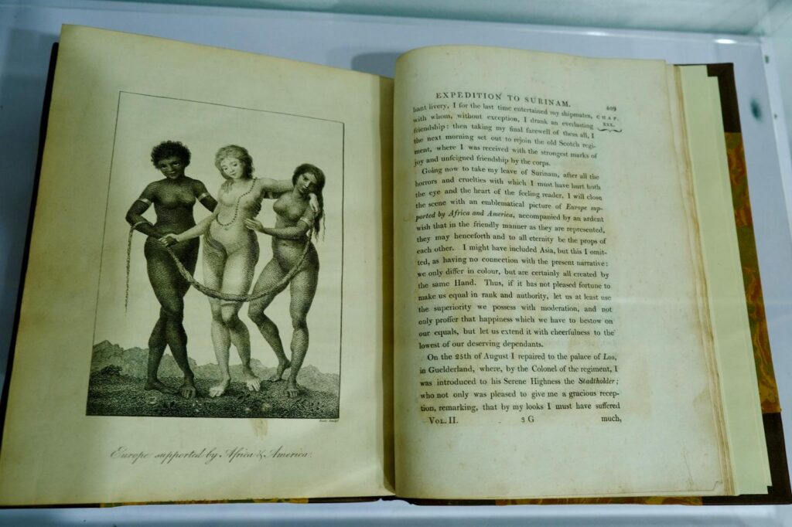

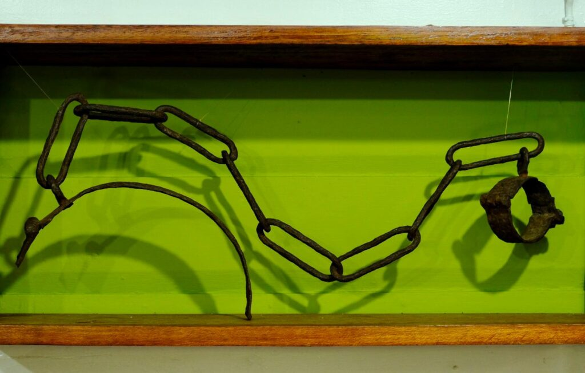

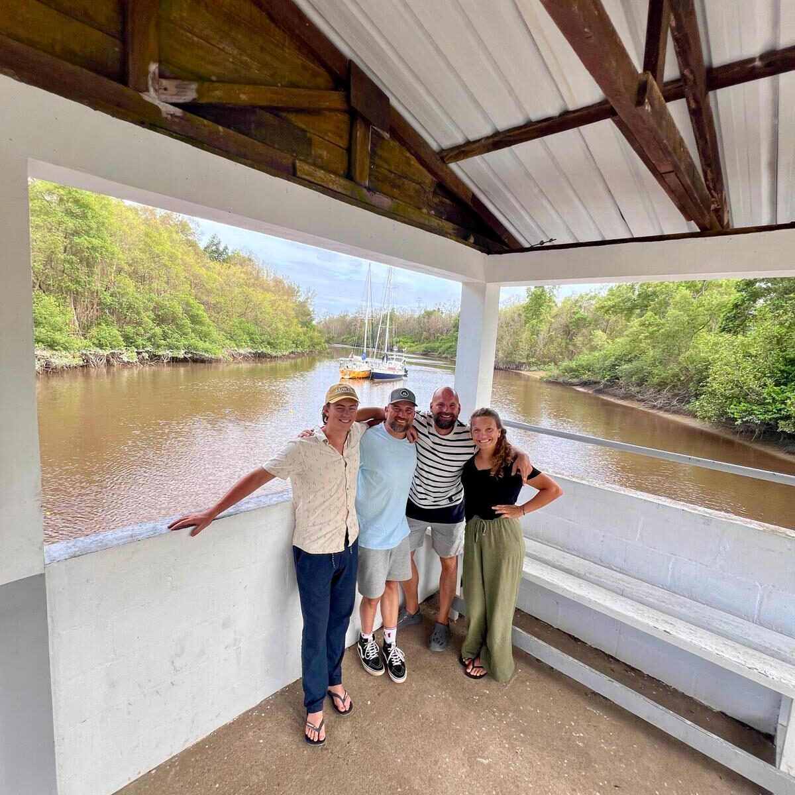

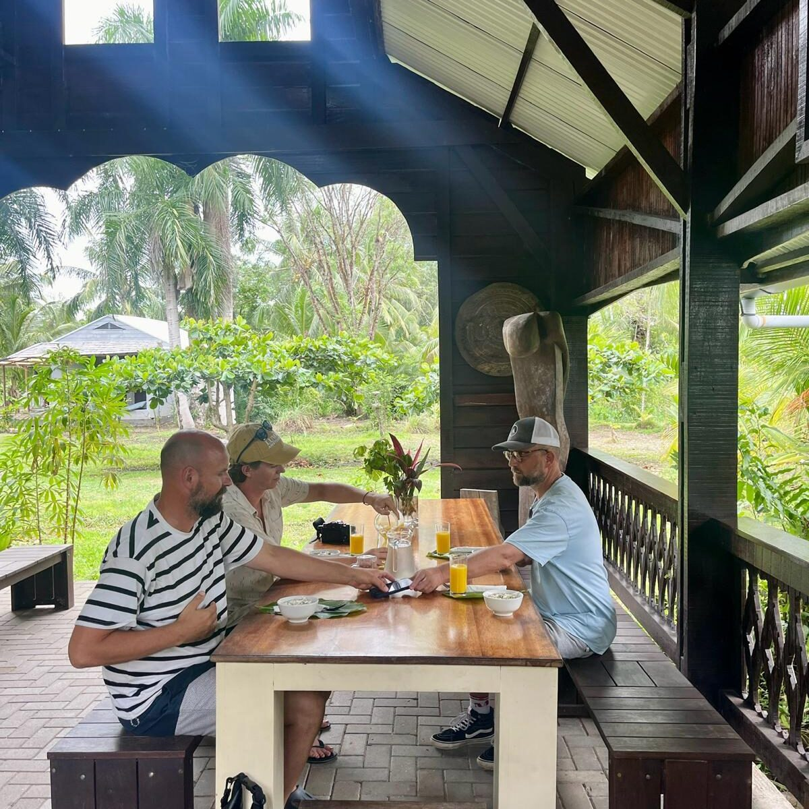

De volgende dag wordt de *Portaboat* volgeladen en stappen we met lichtelijk trillende knietjes in, omdat de laatste keer de boot op z’n kop kwam te liggen. We gaan op avontuur. Vanuit Bakkie loopt een zijkreek helemaal naar zee door een mangrovebos. Dwars door het bos slingeren we achter de rode ibissen aan, zien de apen over ons hoofd heen door de bossen slingeren en varen we door ware tunnels van mangrovebos. Op een gegeven moment opent het bos zich en kijken we zo de Atlantische Oceaan op. Door de zandbank voor de kust staan er geen golven, maar het is een magisch gevoel dat je je boot achterlaat op de kreek, door een bos vaart en dan plotseling uitkijkt over zee.

Als we omdraaien merken we dat de ebstroom sterk is en komen we met de 8 paardenkrachten op de spiegel toch nog maar langzaam vooruit. Tot overmaat van ramp spot Julien dat de koelstraal van de motor geen water meer geeft. Zonder koeling zal de motor snel vastlopen, dus we duwen onszelf aan de rand van de eerste begroeiing de kant in om de motor uit te kunnen zetten en te onderzoeken. De zon brandt fel bij gebrek aan schaduw. Ik probeer uit te stappen om een lijn om een tak te leggen, maar zak direct tot mijn heupen de klei in en voel dat mijn benen vastzitten. Terwijl Julien zich zorgen maakt over de motor, ziet Jen haar man het drijfzand in zakken. Ik voel een ferme greep rond mijn bovenarm terwijl mijn eerste been weer loskomt. Ik laat me voorover zakken om meer oppervlak te hebben en weet mijn andere been ook los te zuigen. De Croc die er aan vast had moeten zitten is diep in de klei blijven hangen. Die wordt over een paar honderd jaar waarschijnlijk als curiositeit ergens tentoongesteld. Zwart van de blubber klim ik terug aan boord en dan draait Julien zich euforisch om: er komt weer water uit de motor!

De terugtocht is een stuk spannender dan de heenweg, want het water staat een stuk lager. Met regelmaat zien we de motor omhoogklappen op een boomstam, of moeten we roeien. Halverwege verspert een omgevallen boom onze weg en kan Julien eindelijk zijn machete eens goed laten werken. De takken worden doorgehakt en we kunnen verder tot we aan het eind van de middag voldaan weer terugkomen bij Bakkie. Alejandro zwaait naar ons dat we even moeten langskomen en we borrelen bij Bas en Mascha. Zij dachten dat we verdwaalt waren geraakt, of vastzaten, want we waren veel te laat weer terug! Het bleek dat we de kreek die we in hadden moeten gaan hebben gemist, maar dat dat ook meteen onze redding is geweest, omdat onze fout ons naar een diepere kreek bracht die ook met laag water nog te bevaren is…

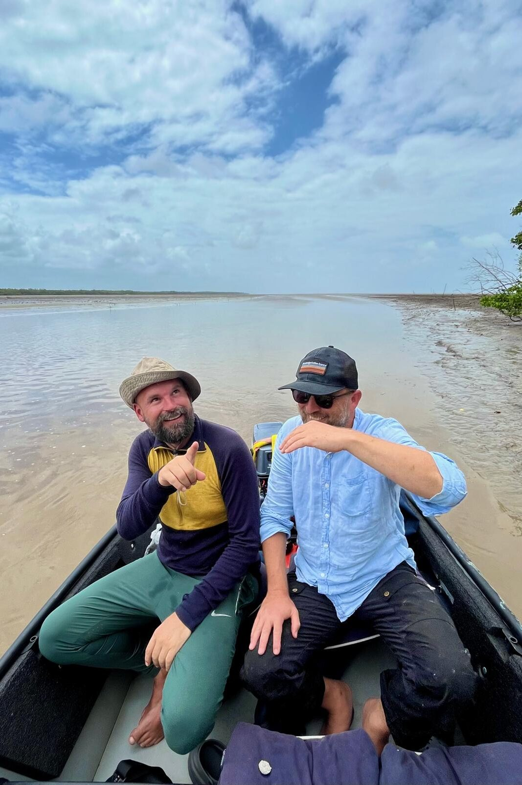

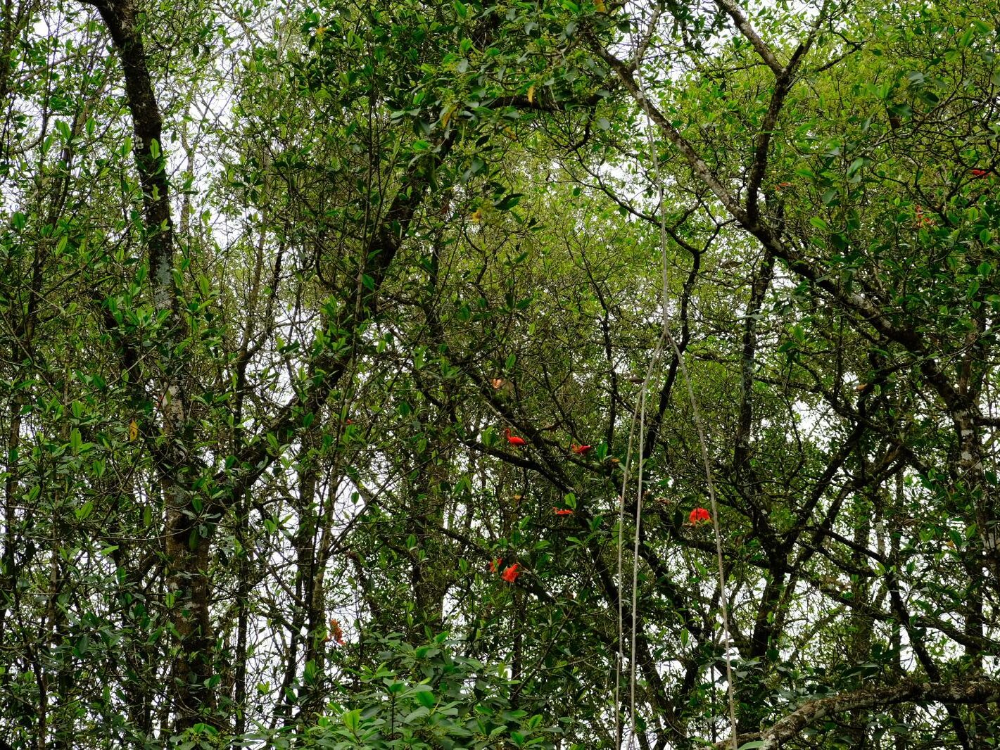

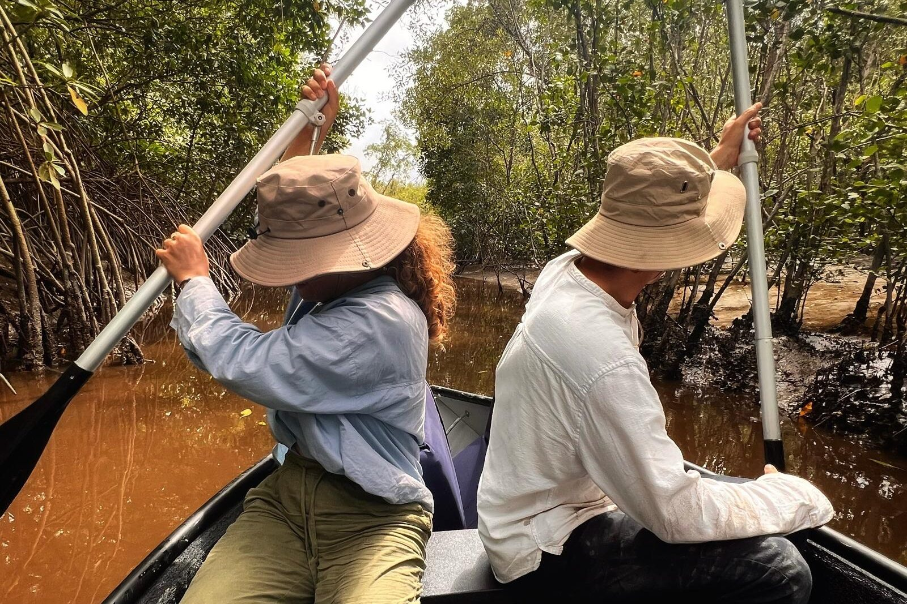

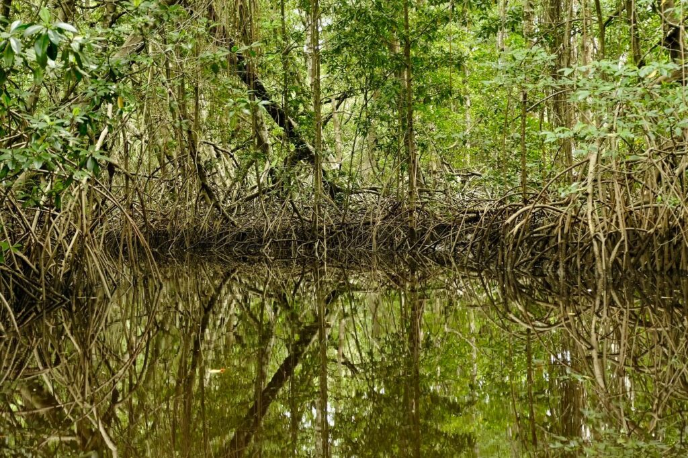

## **Het bos in**

De volgende ochtend staan we met zonsopgang op om verder de rivier op te varen. Het is windstil en de zon komt net boven de bomen uit als we de kreek af komen en de brede Commewijne opvaren. Ik zie een mooie kans en laat de drone opstijgen. Het is een sereen schouwspel. Twee boten, het bos en een brede rivier met zonsopkomst. We hebben stroom mee en kunnen het toerental en daarmee het geluid van de motor laag houden. We zitten op onze *comfortseats* in de kuip en genieten van het tochtje, terwijl het bos om ons heen langzaam maar zeker dichterbij komt en de rivier versmalt.

Na een uur of vijf varen komen we bij “de eilanden” in de Cottica. Door het meanderen van de rivier zijn zogenaamde hoefijzereilanden gevormd. De rivier steekt dan door de bocht heen en snijdt daarmee een stuk van het originele verloop af, waardoor de eilanden overblijven als restant van waar de rivier ooit liep. De eerste ingang van het eerste eiland is dichtgegroeid en onbegaanbaar, maar de tweede ingang lijkt open. Omdat we niet in de weg willen liggen voor eventuele grote scheepvaart hebben we besloten dat we de boten in de kreken willen ankeren, en niet op de Cottica zelf.

We varen naar binnen en zien boven ons hoofd het bos snel dichter worden. Normaal kijk je tijdens het varen voor je, maar hier kijk ik naar boven, naar de top van de mast en de takken waar dat topje tussendoor moet zien te komen. Er staat een lichte stroming, maar die kunnen we in ons voordeel laten werken en zo varen we door tot een omgevallen boom ons de doorgang weerhoudt. Het is te smal om net als bij Bakkie zij-aan-zij te liggen hier, dus ankeren we allebei in tegensgestelde richting en verbinden onze schepen met lange lijnen naar onze achterstevens. Als de motoren uitgaan blijven de geluiden van het bos over. Een krakende tak in de verte, vogels die elkaar uitfluiten en zo nu en dan brulapen die in de verte hun territorium afbakenen. *Luwte* en *Belafonte* liggen ingesloten in het bos. Onzichtbaar en verdwenen van de wereld in een eigen bubbel.

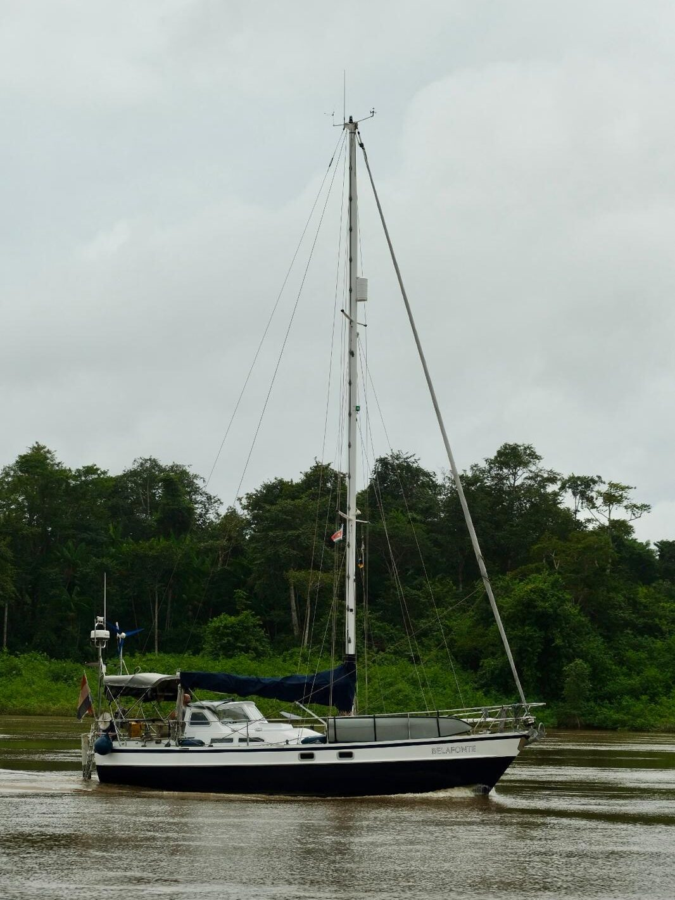

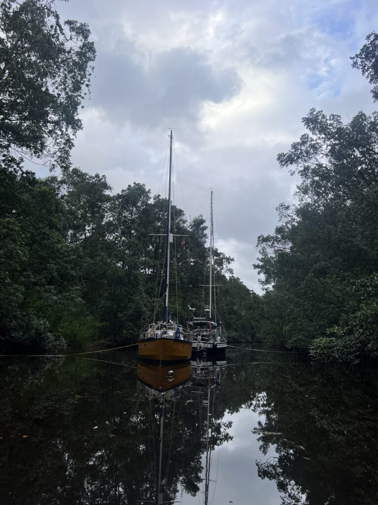

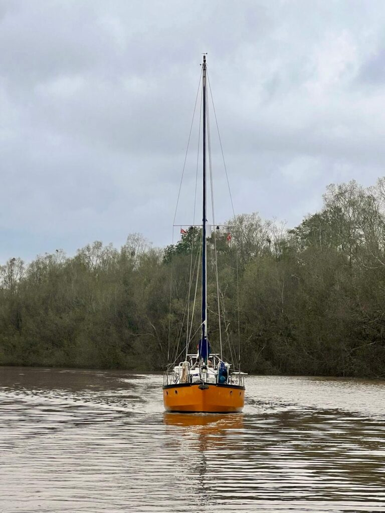

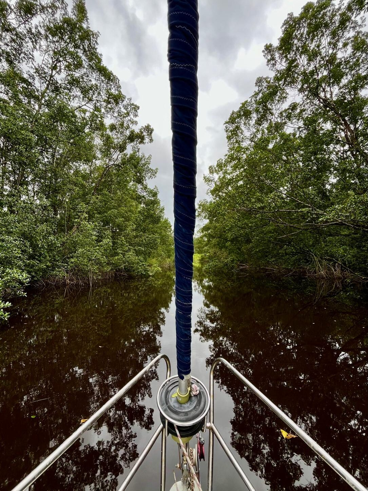

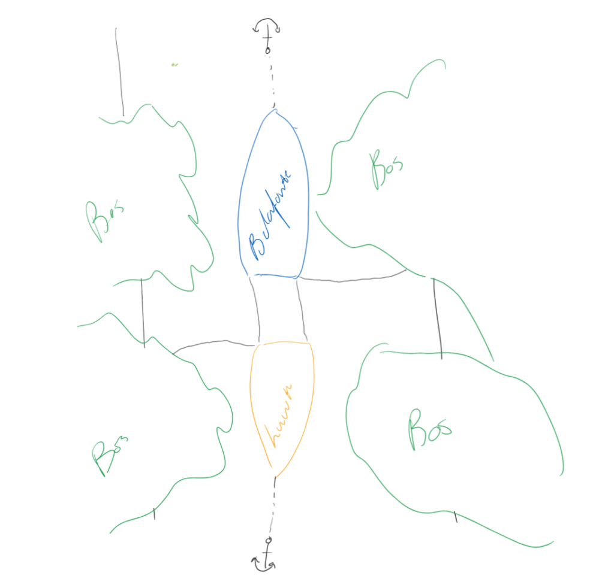

Met de bijboot kunnen we dieper het bos in en gaan we op expeditie het eiland rond. Bij een smalle opening in het bos denken we nog een aftakking te zien, maar als we dichterbij komen blijkt het de *Tree of Souls* te zijn, de enorme moederboom uit de film *Avatar*, maar dan in het klein. We roeien het laatste stuk naar binnen en komen dan in een soort grot van vegetatie, die vol met doodskopaapjes zit. Boven ons, naast ons, overal zitten ze. Moederaapjes met baby’s op hun rug schieten voorbij en een paar jonkies komen nieuwsgierig naar ons toe, om dan snel achter de groep aan weg te schieten. Voor wat een eeuwigheid lijkt zitten we in stilte te kijken naar het tafereel. Het voelt bijna intiem, alsof we bij ze op bezoek zijn.

Verderop zien we wel een zijkreek en die gaan we in. Het bosdak is hier dichter en op de grond groeit bijna niets. We kunnen diep het bos in kijken tussen de stammen. Aan de takken boven het water hangen kolibrinestjes en als we er eentje van dichtbij willen bekijken schrikken we ons een hoedje als er bij de eerste aanraking meteen allerlei schreeuwend gekwetter uit komt. De pasgeboren, blinde vogeltjes denken dat wij mama zijn en eten komen brengen. We draaien ons om als de bomen ons tegenhouden en roeien met de stroom mee in stilte naar buiten. Langs de oever zien we stenen restanten van wat een verlaten plantage moet zijn geweest, met een sluisje en gegraven slootjes (of het is een drugslab dat verstopt zit in het bos).

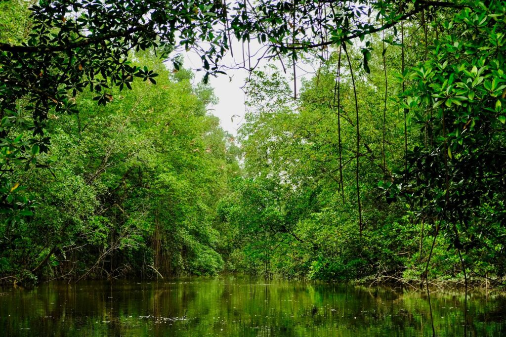

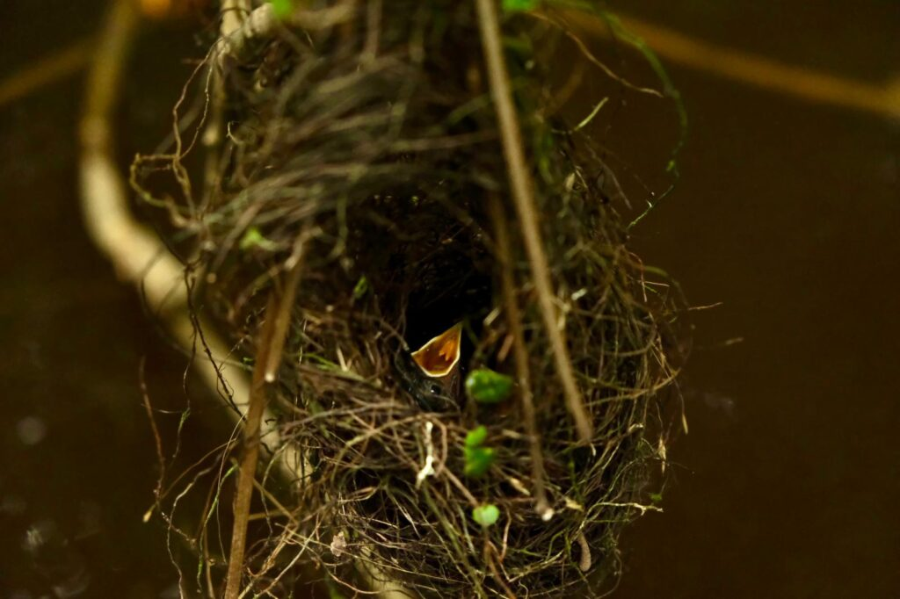

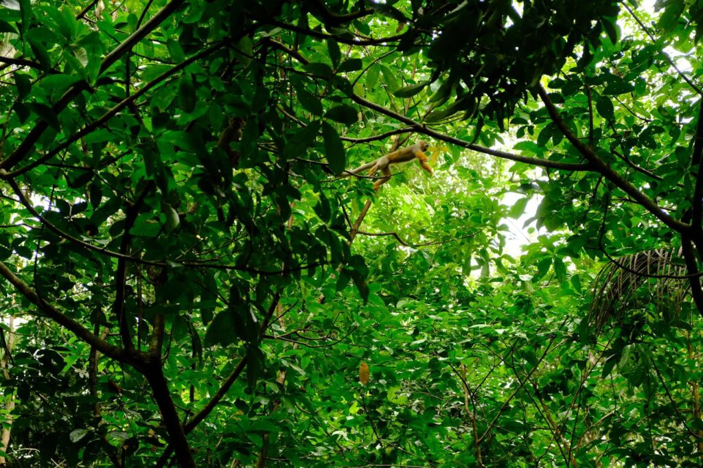

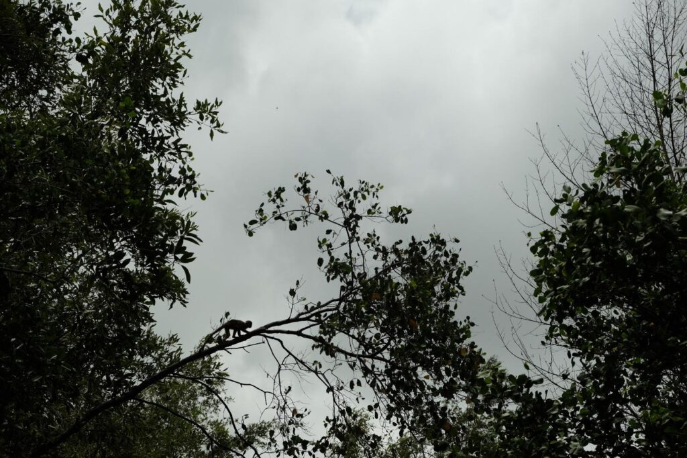

## **Disco op de Koopmanskreek**

De volgende ochtend duik ik onze motorruimte in omdat onze vetpot - die er voor zorgt dat het water niet via de schroefas naar binnen kan lopen – leeg is en opnieuw moet worden gevuld. Terwijl ik daarmee bezig ben inspecteer ik onbewust alles waar mijn vingers en ogen langskomen en kom ik er tot mijn schrik achter dat de afdichting van de schroefas (die het vet  op zijn plek houdt zodat wederom het water niet kan binnenkomen) half loshangt en op het punt staat om er helemaal uit te floepen. De zijkreek van het eerste eiland, zestig mijl op de rivier, is niet de ideale plek voor dit soort problemen…

Naargeestig maak ik alles schoon om het goed te inspecteren. Jen helpt me met doeken, gereedschap en schoonmaakmiddelen terwijl ik zwetend in een vreemde hoek op m’n kop hang. Het systeem dat bij ons geïnstalleerd is, is vrij ouderwets en in principe *bulletproof*, op twee slangenklemmen na die de boel wel goed op hun plek moeten houden. Één van de klemmen lijkt niet genoeg geklemd te hebben en de mechaniek is door de trillingen van de motor en druk van het buitenwater langzaam naar binnen gekomen. Het lastige van dit probleem is: Ik weet niet hoe lang het al gaande is. Misschien dat we al weken of maanden zo varen en dat het heel langzaam gaat? Of is dit gisteren gebeurd en valt hij er vandaag helemaal uit?

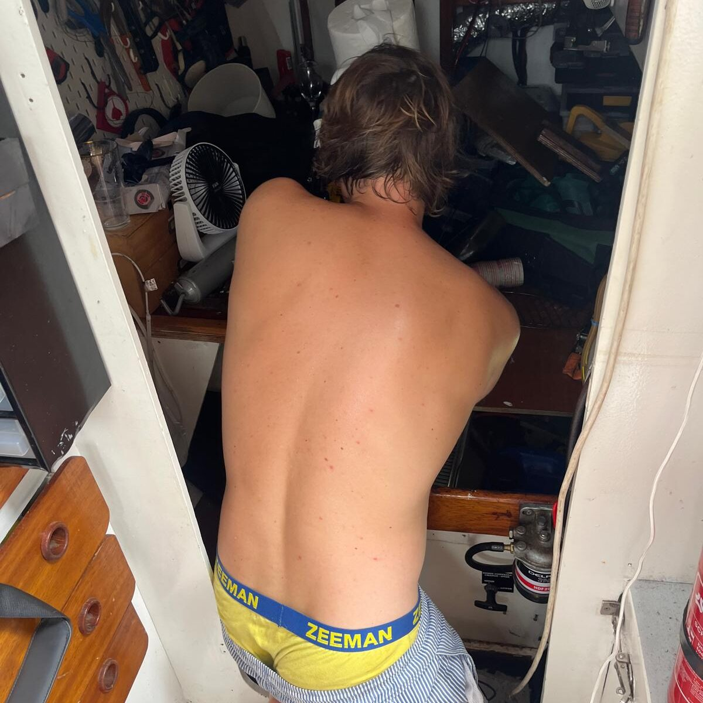

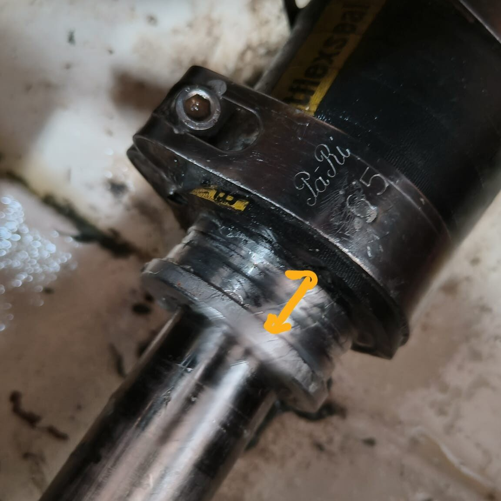

We besluiten door te varen en het in de gaten te houden. Voor ons vertrek ben ik met de afdichting bezig geweest, maar dat was op de kant, zonder druk van buiten en ik vind het lastig in te schatten wat er gebeurt als ik nu de slangenklem losmaak terwijl we in het water liggen. We halen de ankers op, manoeuvreren tussen de bomen het bos uit en vervolgen onze weg richting Wanhatti, een Marrondorp dat is gesticht door vrijgevochten slaven en nog altijd als hechte community met eigen regelgeving, uitvoerende macht en tradities leeft. Ik heb op Google Maps gezien dat ze een strandje hebben bij het dorp en zie dat als de beste optie voor als het toch echt misgaat met onze schroefas. Dan kunnen we de kiel omhoog halen en de boot daar droogleggen.

Echter, nog voor we daar zijn, constateer ik dat de afdichting er wel degelijk verder uit aan het schuiven is. Ik vermoed daarbij dat het laatste stukje sneller zal gaan dan de eerste millimeters. We hangen onze fenders uit en leggen lijnen klaar om in geval van nood langszij bij *Belafonte* te kunnen komen. Jen en ik maken een plan voor als we plotseling op de stromende rivier de motor uit moeten zetten en ik naar binnen moet om de afdichting te redden. Tenslotte besluiten we de Koopmanskreek in te duiken, waar we dan bijna zijn.

We varen een stuk naar binnen, gaan de bocht om en zien dan veel omgevallen bomen in het water hangen. Om te voorkomen dat we met ons anker vast komen te zitten in een boom, besluiten we in de bocht te ankeren. Daar is redelijk de ruimte. Bij zowel ons aan boord, als bij *Belafonte* is het nogal ploeteren. Het anker houdt niet goed, er staat stroming en dan komt er opeens een flinke windvlaag opzetten die ons de bosjes in duwt. Ik sommeer Jen in de bijboot te gaan en als boegschroef onze boot zijwaarts te duwen, maar dat lijkt niet te lukken. Jen stapt gefrustreerd uit, en ik stap gefrustreerd in. Terwijl Jen de 47 paarden van *Luwte* op volle kracht laat werken, duw ik met 15 paarden tegen de zijkant van *Luwte* vanuit de bijboot. *Luwte* helt over en we horen een harde knak, waarna we losschieten. Onze zorg over vast komen te zitten met het anker blijkt niet ongegrond en hoewel het gelukt is om ons anker boomvrij te houden, waren we met de kiel van *Luwte* wel vast komen te zitten in een boom…

Als we eenmaal rustig aan *Belafonte* vast liggen schiet ik naar beneden om met de afdichting aan de gang te gaan. Van een aantal onderdelen van de hengelhouder fabriceer ik een schacht om de schroefas en met een stuk aluminium maak ik een passende hefboom om een rechte kracht uit te kunnen oefenen op de afdichting. Het is een beetje passen, meten en zweten, maar dan schroeft Jen voorzichtig de slangenklem los terwijl ik de afdichting naar buiten duw en we krijgen hem zonder al te veel problemen terug op zijn plek in de mof. Voor nu lijkt het gevaar geweken en zit alles weer goed. De komende dagen en weken zullen we regelmatig blijven controleren.

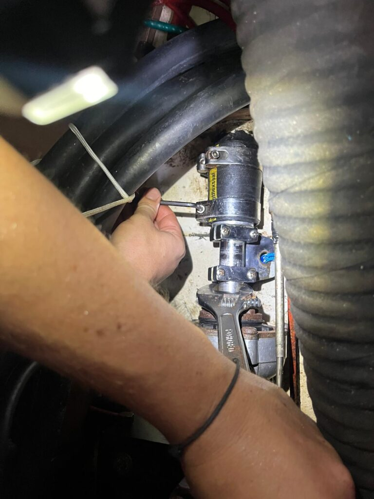

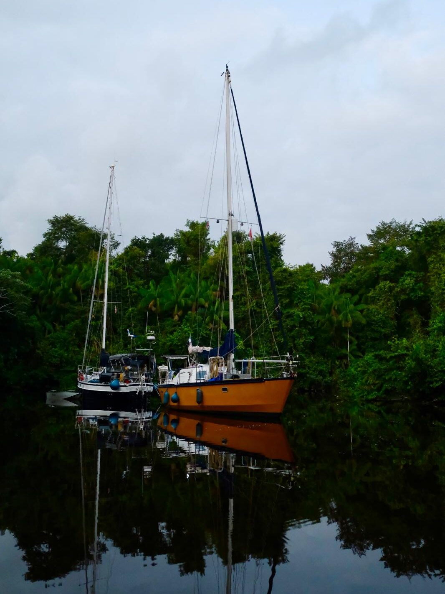

Het feit dat we liggen ondanks de ankerheisa, dat we drijven en dat we weer op één van de mooiste ankerplekken uit ons leven zijn beland, maakt voor een vroege en euforische borrel aan boord bij *Belafonte*. Als het donker wordt verandert het geluid van de jungle en voor een uur worden we slachtoffer van een ware muskietenaanval. Daarna blijven de voorbijvliegende vuurkevers als vallende sterren over. In Jens ogen zijn het geen kevers maar daadwerkelijk horizontale vallende sterren die over het water schieten. Er gaat een wereld voor haar open als ze er achter komt dat dit beestjes zijn. Af en toe landt er eentje onder de bimini (de zonnetent boven de kuip) en zien we het oplichtende lijf knipperen. Als we alle lichten uit doen en de muziek aan verandert onze wereld plotseling in een disco. Er blijken tientallen kevers onder de bimini te schuilen en zodra het licht uitgaat beginnen ze allemaal te seinen naar elkaar dat hier *the place to be* is. Pas als zowel wij, de muziek en de vuurkevers uitgespeeld zijn, keren we terug naar *Luwte* en vallen we vol met indrukken en avonturen in slaap.

’s Ochtends is het windstil en worden we gewekt door een salvo aan vogels die op zoek zijn naar soortgenoten. Over een spiegel glijden we de Koopmanskreek over, op zoek naar een jaguar in een boom of een luiaard. Die krijgen we niet te zien, maar heel erg is het niet. Het bos is hier weer heel anders dan bij de eilanden. Groener en diverser. Als we terugvaren komen we een hoek om en liggen *Luwte* en *Belafonte* gespiegeld in het water. Als je op je kop gaat staan zie je hetzelfde beeld als rechtop.

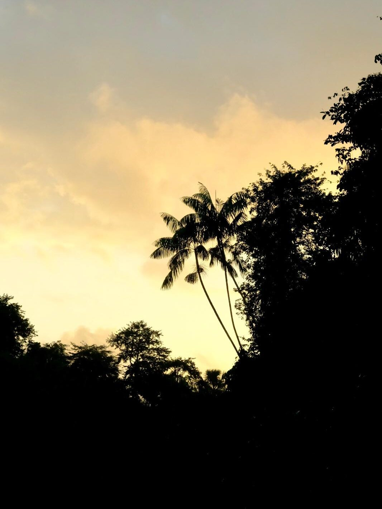

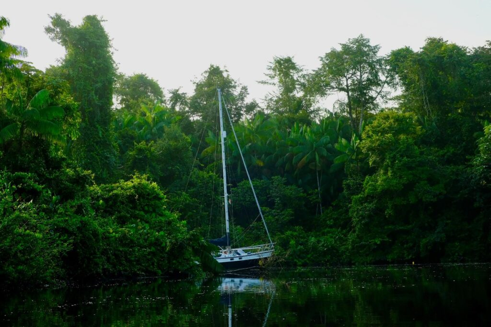

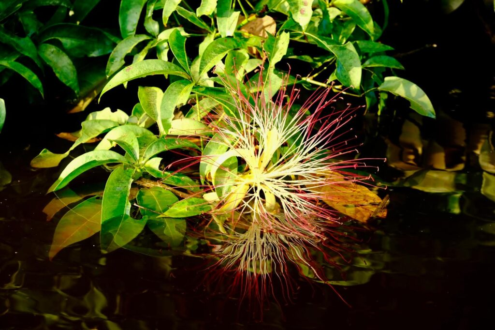

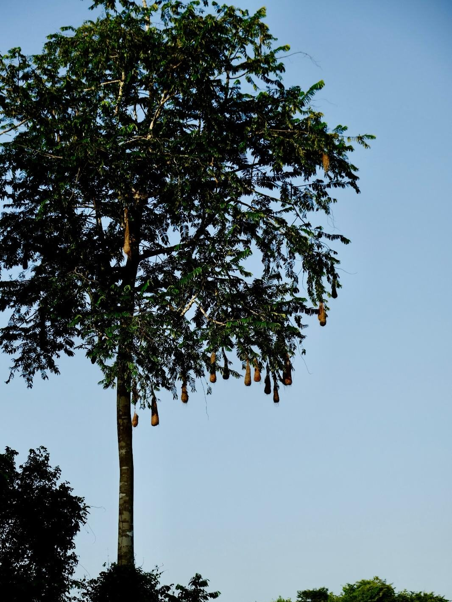

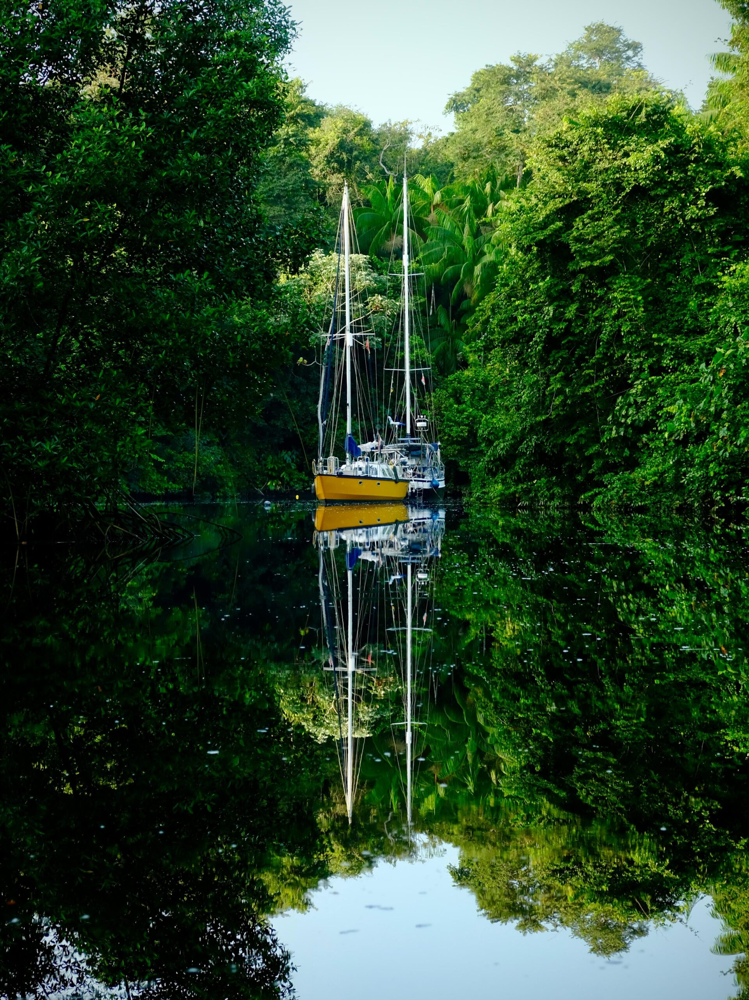

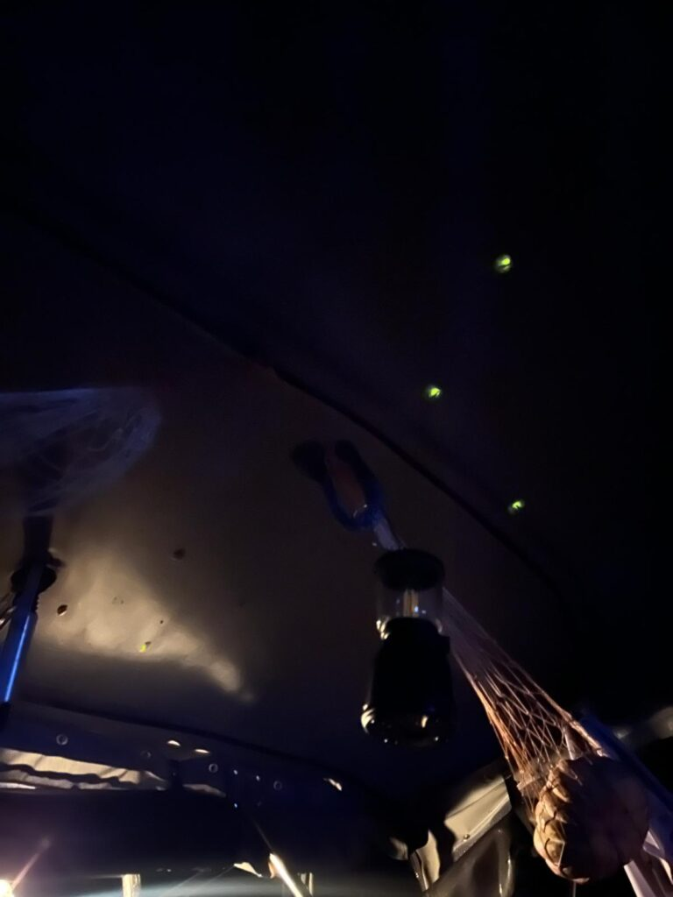

## **Wanhatti**

’s Middags halen we de ankers weer op en varen we de laatste mijlen stroomopwaarts naar Wanhatti. Onderweg zit ik elke paar minuten op de schroefasafdichting, maar die lijkt goed te blijven zitten. Het is weer een heel gek gezicht. Na drie dagen in volledige isolatie in het bos, opent het oerwoud zich en ligt er plotseling een dorp voor onze boeg.

We ankeren tegenover het dorp. Als wij goed liggen, zien we dat het bij *Belafonte* niet vanzelf gaat. We pakken de nieuwe verrekijker erbij en zien dat ze een boom naar boven hebben getrokken en dat de ankerketting zich om de takken heeft gewikkeld. Om precies deze reden zijn we met twee boten de rivier op gegaan. Wij kunnen de bijboot in springen en vanaf de waterlijn helpen. Het is even puzzelen, maar uiteindelijk komt de boom los en kunnen de mannen het anker verderop laten ingraven.

Jen en ik varen door naar de kant om ons te melden bij de kapitein. Van onze eerdere ervaring bij Santigron hebben we meegenomen dat dat erg op prijs wordt gesteld en dat ze in deze afgezonderde dorpen niet per sé zitten te wachten op allerlei bezoekers. We varen de bijboot het strandje op en spreken een jongen aan die zijn korjaal met palmbessen aan het legen is. Het blijkt een kleinzoon van de kapitein te zijn en hij zal ons de weg wijzen. Onderweg vertelt hij over de bessen, waar hij sap van maakt, om dat vervolgens naar Frans Guyana te smokkelen. Daar betalen ze in Euro’s en zijn ze gek op het sap, dus het levert daar bijna vijf keer zoveel op als in Suriname. De grens over komen is altijd lastig, want als de douane je pakt moet je alles inleveren en met lege handen weer terug.

Hij laat zien dat er midden in het dorp een stuk onaangeroerd bos staat waar ze de overledenen begraven, waar de school is en dat ze sinds een aantal jaar een kliniek hebben waar eens in de week een arts zit om vanuit de reguliere geneeskunde kwalen te verhelpen. Binnenkort komt er ook stroom naar het dorp. Dat hebben ze nu maar een paar uur per dag vanuit een centrale generator.

Achterin het dorp in een heel klein hutje zit de kapitein met zijn vrouw. We stellen ons kort voor, vertellen dat we met de boot zijn gekomen en dat we later op de dag graag kennis komen maken samen met de bemanning van *Belafonte*. De kapitein kijkt ons bedenkelijk aan, knikt en zijn vrouw neemt het gesprek over om af te stemmen dat we voor het donker langs moeten zijn geweest.

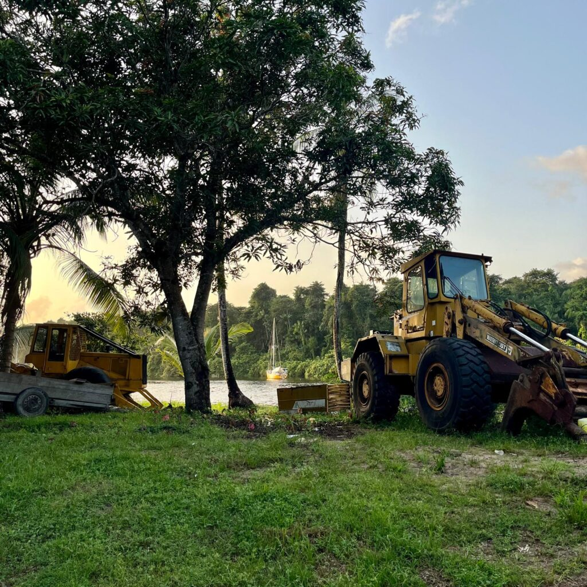

We wandelen terug en zien hier en daar nieuwsgierige kinderen op een afstandje volgen. Aan boord verzamelen we een paar giften en keren dan samen met *Belafonte* terug naar het huis van de kapitein. In de tussentijd hebben ze hun voortuin netjes geharkt en staan er stoelen voor ons klaar. De kapitein heeft zich verkleed van zijn legerjack naar een glimmend Real Madrid shirt en we worden hartelijk ontvangen. Het gesprek dat volgt is enigszins opgelaten, maar wel interessant. De kapitein is een afwachtend man die zijn antwoorden overdenkt en stiltes laat vallen. Als hij spreekt is het zacht. Ik beeld mij zo in dat het de bedoeling is dat je stil dient te zijn als hij spreekt en dat hij zijn stem dus niet hoeft te verheffen om verstaanbaar te zijn. Zijn vrouw houdt het gesprek gaande en vertelt over het reilen en zeilen in het dorp, de school en de ontwikkelingen van de laatste jaren.

Wij vertellen op onze beurt over de zee, het zeilen, de plekken waar we allemaal geweest zijn en de lange overtocht om naar Wanhatti te komen. Het idee van hoge golven en sterke wind staat ze niet echt aan, maar wekt wel een zeker wederzijds respect. We overhandigen ter begunstiging een fles rum, een paar notitieblokken en waterverf die we aan boord hadden liggen. Als Jen vraagt naar de ontstaansgeschiedenis van het dorp valt de vrouw van de kapitein stil en lijkt er even wat spanning in de lucht te hangen (al kan dat ook volledig mijn eigen projectie op de vraag en de situatie zijn). In zekere zin vraagt Jen voglens mij naar een antwoord in de richting van “*jouw voorouders brachten mijn voorouders hierheen om te werken en die zijn daar van losgebroken. Zo is Wanhatti ontstaan”*. In plaats daarvan begint de kapitein te tellen. Niet in tijd, niet in jaartallen, maar in kapiteins. Zeven hoofdkapiteins gingen de huidige hoofdkapitein voor. Daarvoor bestond Wanhatti ook al een tijdje, maar de geschiedenis die nog wordt overgedragen in het dorp begint bij de eerste hoofdkapitein, naar schatting iets minder dan 200 jaar geleden.

De vrouw van de kapitein is tevens docente van de lagere school in het dorp en loopt met ons mee naar de school, waar in een bijgebouw de andere twee leraren wonen. Ook zij zijn benieuwd naar onze zeiltochten en wij naar hun ervaringen als docent in het dorp. Jen vraagt tussen de gesprekken door of ze nog ergens echt behoefte aan hebben en het blijkt dat pennen, potloden en schriftjes een lastig punt zijn voor de armere gezinnen in het dorp. De schriftjes die we hebben we zijn al ingeleverd, maar aan boord we hebben nog een bak vol 123-inkt pennen voor het schrijven van ansichtkaarten, die we de volgende dag nog even naar de school zullen brengen.

Als we de volgende ochtend rond half negen naar de kant varen voor de pennen zien we langs de oever wat kinderen in schooluniform zitten. Even denk ik dat ze spijbelen, maar dan schiet me het ochtendritueel van de Surinaamse scholen mij weer te binnen en sta ik weer als negen-jarig jongetje op het plein van de Sloteschool in Paramaribo het volkslied te zingen. Elke ochtend begint centraal met de hele school op het plein. De vlag wordt gehesen onder het zingen van het volkslied en daarna spreekt de directeur enkele woorden om de dag te openen. Als je te laat bent, dien je buiten de schoolmuren te wachten om het ritueel niet te verstoren. Daarna krijgen de kinderen die te laat zijn meteen een bezem in hun handen gedrukt en moeten ze voor straf de stoep vegen. Ik vermoed dat ze er die ochtend goed mee wegkomen omdat wij er bij staan om de pennen te overhandigen…

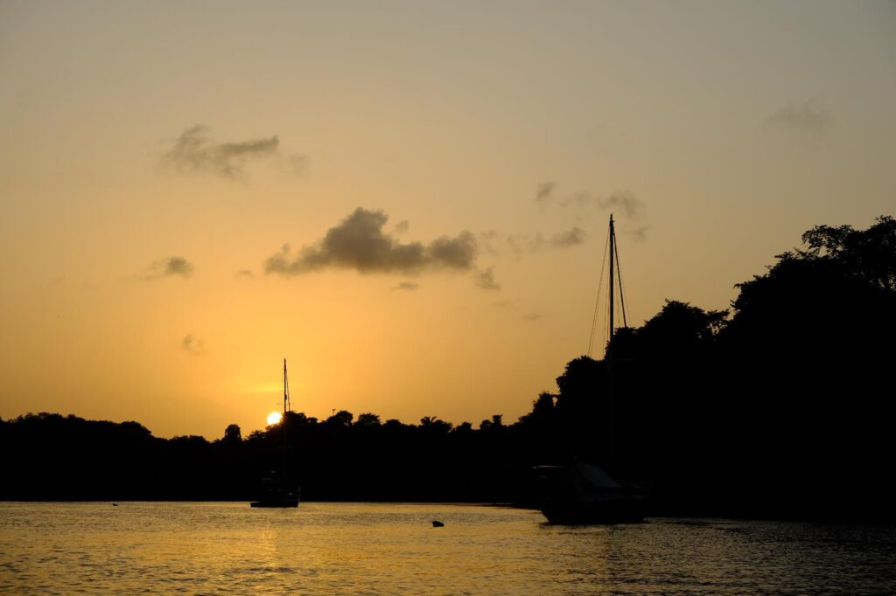

## **Terug naar Waterland**

Dan halen we ons anker weer op en begint de terugtocht naar beneden, richting zee. We varen terug voorbij de eilanden. Jen staat buiten met muziekjes in te dansen met een voetje op het roer. Ik zit binnen en probeer onze avonturen van de Atlantische Oceaan nog vorm te geven achter mijn laptop. We varen bijna de hele dag door zodat we in twee klappen terug kunnen naar Waterland. Bij de aftakking van de Pericarivier begint de kentering in te zetten en besluiten we daar naar binnen te schieten voor een ankerplek. Omdat de rivier best ver breed blijft besluiten we nog even door te tuffen op zoek naar meer wilde dieren en een mooie ankerplek. Als we die hebben gevonden begint het volgende spektakel.

Aangezien wij onze kiel omhoog hebben getrokken en *Luwte*s ontwerp sowieso erg wendbaar is, laten we *Belafonte* eerst ankeren, waarna wij ons anker afstemmen op waar zij uitkomen. Er gaat bij hun aan boord alleen het een en ander mis. De stroming duwt ze telkens dwars tijdens het ankeren en dan blijkt er iets mis te zijn met de lier, waardoor het anker niet meer soepel omhoog en omlaag wil. Uiteindelijk besluiten we na overleg dat wij ankeren en een lijn naar de kant brengen, *Belafonte* langszij nemen en dan nog een tweede lijn naar de kant trekken om mooi in het midden van de rivier te blijven.

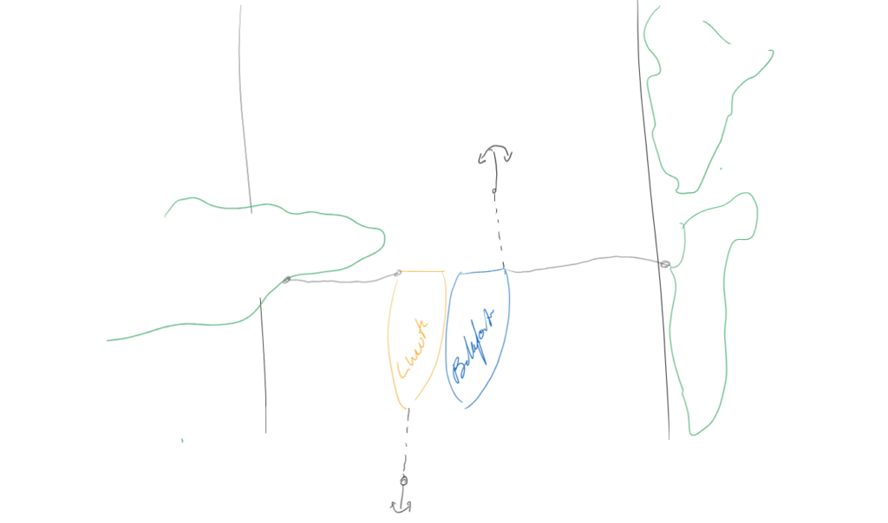

Het ankeren gaat goed, maar de lijn naar de kant brengen is al lastig en zorgt ervoor dat we naar de bosjes worden getrokken. Het is even ploeteren, maar dan lukt het om met de motor in z’n achteruit en het roer dwars in het midden van de rivier te blijven liggen. *Belafonte* komt langszij en we brengen de lijnen over. Terwijl ik met de achterlijn in mijn handen sta valt er een bosje lijnen in het water en nog voordat ik of Julien hebben kunnen nadenken over de lijn gauw optrekken, wordt mijn arm hard over de reling getrokken en valt onze motor stil. Lijn in de schroef. Arm gelukkig alleen maar geschaafd en blauw.

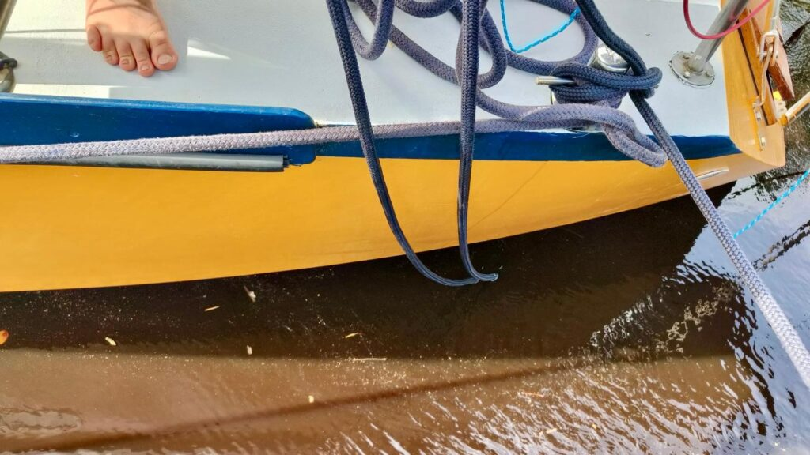

Een lijn in de schroef en een motor die erdoor vastloopt. Het betekent dat alle kracht die de motor naar de schroef overbrengt, opeens moet worden opgevangen door de keerkoppeling, de motorsteunen en de onderdelen in de motor zelf. Het hoeft niet fataal te zijn, maar als je de fora er op naleest zijn er ook legio voorbeelden waarbij er onderdelen stuk gaan die in de jungle niet te vinden zijn.

Ik kruip wederom weer in mijn lievelingshol, dat door het lange motoren van vandaag is verandert in een echt hot-yoga paradijs. Voor zover het kan controleer ik de uitlijning, alle rubbers, de koppeling en alles dat visueel terug te vinden is. Intussen wordt aan boord van *Belafonte* de drijvende compressor tevoorschijn gehaald, waarmee zonder flessen gedoken kan worden. Julien gaat het water in en verdwijnt onzichtbaar onder de boot. Af en toe zien we een voet tevoorschijn komen in het donkerbruine water en weten we dat hij er nog zwemt. Een paar minuten later komt er een hoofd boven water en komt de lijn die net nog vastzat in de schroef ook omhoog.

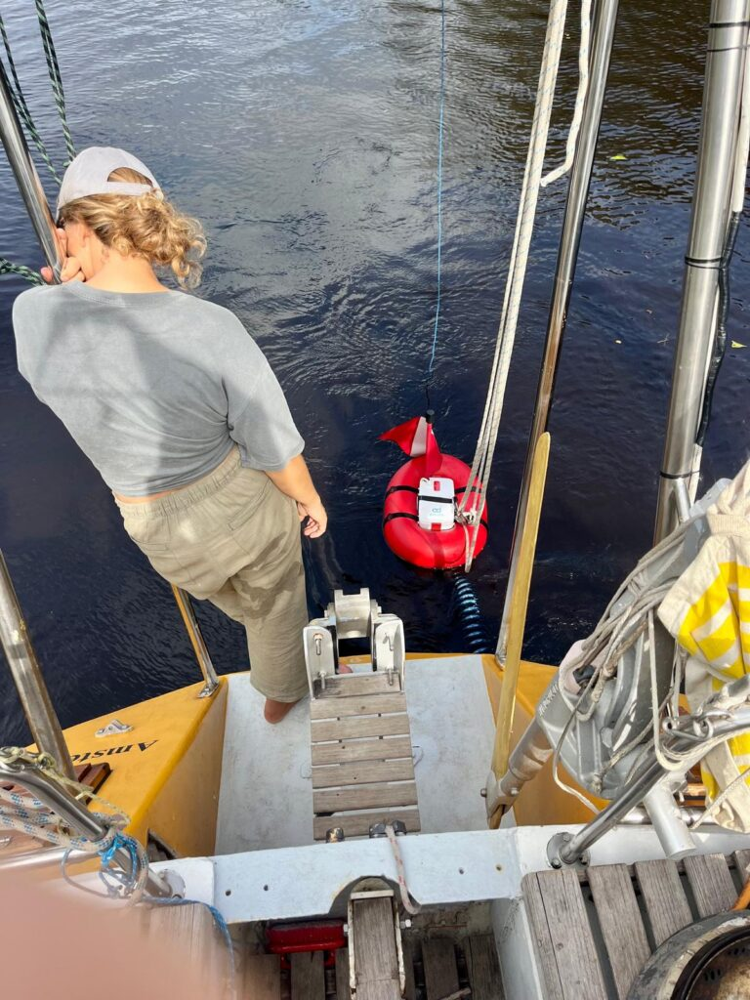

Ik ga zelf ook nog even onder de boot. De wereld is er donker en je ziet niets. De stroming trekt hard aan me, maar ik weet mezelf aan het roer naar voren te trekken en zo de schroefas te controleren op speling of restanten lijn. Alles lijkt in orde en nadat we weer aan boord zijn en de motor weer soepel gedraaid heeft, kunnen we concluderen dat alles nog heel is. Ook concluderen Jen en ik dat we blij zijn dat het avontuur ons morgen ook gewoon weer terugbrengt naar de bewoonde wereld. Het grote avontuur en de spanning die er een paar keer mee gemoeid ging wordt die avond wel afgesloten met de meest bijzondere zonsondergang ooit. De lucht, het water en het bos kleuren bloedrood terwijl wij nog één nachtje op een kabbelende kreek dobberen.

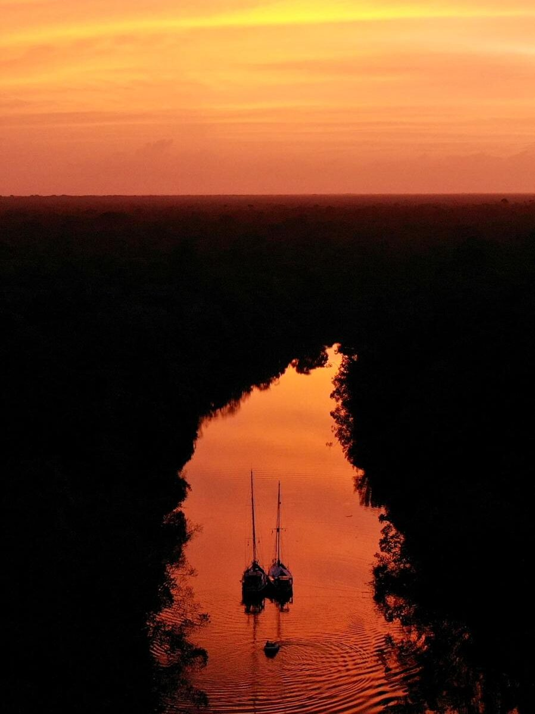

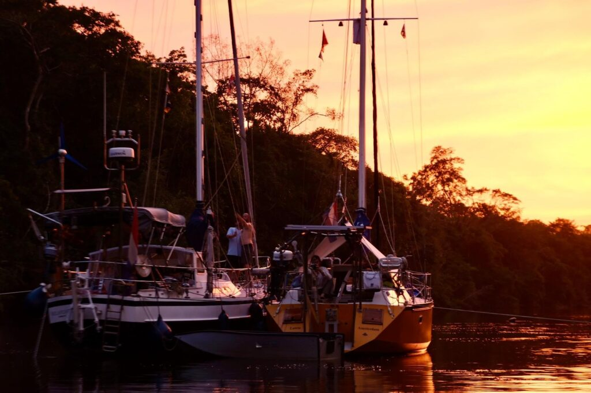

## **Terug op waterland**

Na weer een hele dag motoren komen we ’s middags terug aan bij Marina Waterland, waar we gewoon aan een steiger aanmeren en de stekker in het stopcontact kunnen steken. Op een ligbedje mijmeren we met z’n vieren nog een beetje na over alles wat we gedaan hebben en alle ongelofelijke indrukken die we moeten verwerken. Het is teveel om op te noemen en absoluut een verrijking van onze tijd in Suriname. We concluderen dat iedereen die Suriname aandoet met de boot dit zou moeten proberen en dat je vanaf je boot op de rivier nóg een bijzondere kant van Suriname leert kennen.

Maar nu is het ook tijd om de verzengende, vochtige hitte achter ons te laten en de chocoladebruine rivier met piranha’s in te wisselen voor azuurblauw water met koraal en kleurrijke vissen. *Luwte* wordt volgestopt met eten, we tanken water en maken ons klaar om het Caraïbisch gebied te verkennen.

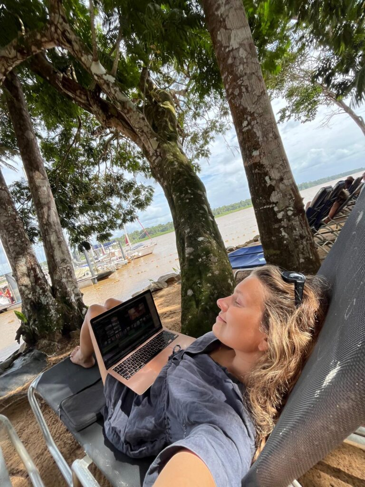

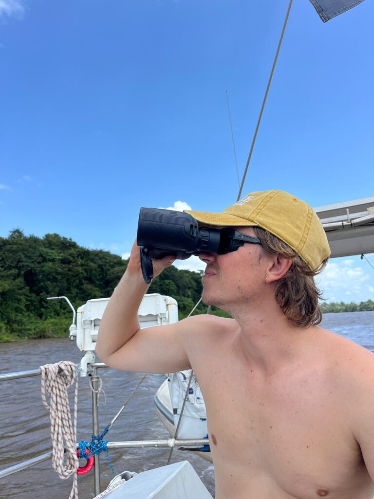
