Een nieuw hoofdstuk ontvouwt zich. We maken ons klaar om weer naar zee te gaan vanuit Suriname. De boot heeft voor een maand haar plicht vervult als ‘woonruimte’ en dat betekent dat veel spullen niet meer zo zeevast staan als ze eens stonden.

Ik krijg er letterlijk en figuurlijk havenkoorts van en ga plat terwijl Jen de boot schoonmaakt. Af en toe help ik in een opleving, maar het merendeel van de tijd lig ik koortsig op bed. Mama en papa vinden het maar eng, met die tropische parasieten en rare steekbeesten waaraan we ons hebben blootgesteld. Na drie dagen overwegen we even om de huisarts in Nederland om advies te vragen, en daar reageert mijn lichaam goed op. De volgende ochtend word ik fris wakker en lijkt mijn gestel de vreemde zware hoofdpijn overwonnen te hebben. We besluiten wel nog een dagje langer te blijven hangen om goed uit te zieken.

Jen heeft in de tussentijd niet stilgezeten. Samen met Julien is ze flink op pad geweest voor boodschappen, uitklaren en wat bootonderdelen. Dat laatste klinkt als een simpele opdracht, maar er is in Suriname niet zoiets als een “bootjeswinkel”, dus er worden een hoop *automotive* en industriële magazijnen aangesproken voor hele specifieke onderdelen. Uiteindelijk vinden ze wonderbaarlijk genoeg de meeste spullen.

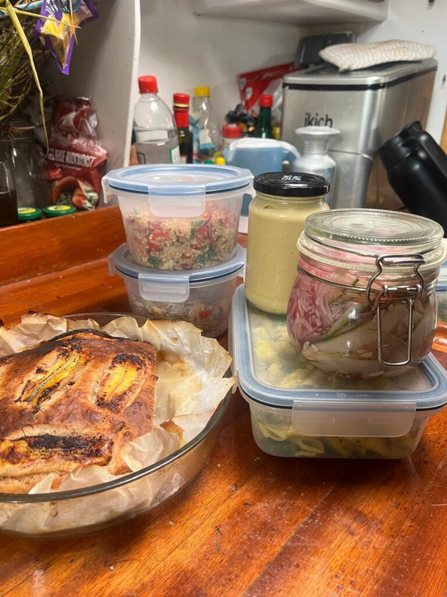

Met een groot oliedrum wordt voor ons diesel naar de steiger gebracht en overgepompt. Later hebben we een beetje spijt van deze actie, want op de Kaap Verden was onze dieseltank nog brandschoon bij inspectie, en inmiddels (real-time) komen er flubbers mee omhoog in het filter van de opvoerpomp naar de dagtank. Die drum met diesel zal wel de nodige bacteriegroei hebben.

*Luwte* ligt de volgende morgen klaar voor vertrek en de motor gaat aan. Het is precies kentering, dus het wegvaren zal niet ingewikkeld worden. We nemen afscheid van de Kolibri die we niet meer zullen zien. Zij blijven nog een tijdje in Suriname hangen en varen dan langzaam naar de Carieb, maar dan zijn wij al weer onze klapper naar het noorden aan het maken. Van *Belafonte* nemen we nog geen afscheid. Die varen ook uit richting Tobago en zien we hopelijk in Charlotteville met onze aankomstborrel.

De rivier, die we inmiddels voor de tweede keer afzakken, voelt als bekend terrein en wordt daardoor vooral een lange zit van bijna zes uur. We evalueren wel onze tijd in Suriname terwijl we uitkijken op de laatste stukjes bos en de waterkant van Paramaribo. Deze stop is goed geweest en we hebben onwijs veel indrukken meegenomen die de boeken in zijn gegaan. Maar nu roept de zee en het zoute water weer. De oceaandeining zal hopelijk rustig zijn en volgens de voorspellingen staat er een heerlijke bries van opzij. De riviermonding is wat onstuimig, maar als we bakboord uit slaan richting het noorden vullen de zeilen zich en glijden we over de golven.

Het is een fantastisch stuk zeilen. We gaan hard en reven het grootzeil om wat rustiger aan te doen. De oceaandeining is door het continentaal vlak uitgesmeerd tot lange golven van nog geen anderhalve meter hoog die als een heuvellandschap onder ons door glijden en er staan nauwelijks windgolven. *Luwte* beweegt op deze golven rustig tussen bijna rechtop en een stukje schuiner, maar zet vooral elk zuchtje wind om in snelheid. Op onze bank aan bakboord lig je met je oor bijna tegen de huid aan en hoor je een paar centimeter bij je vandaan het ruizen van de zee. De windvaan doet het werk terwijl wij wat omhangen.

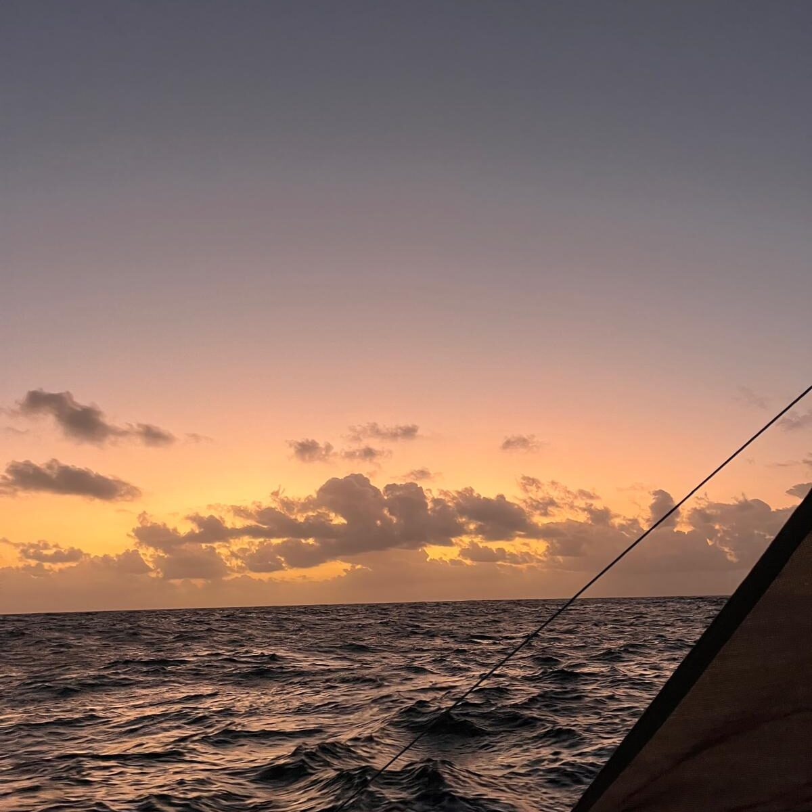

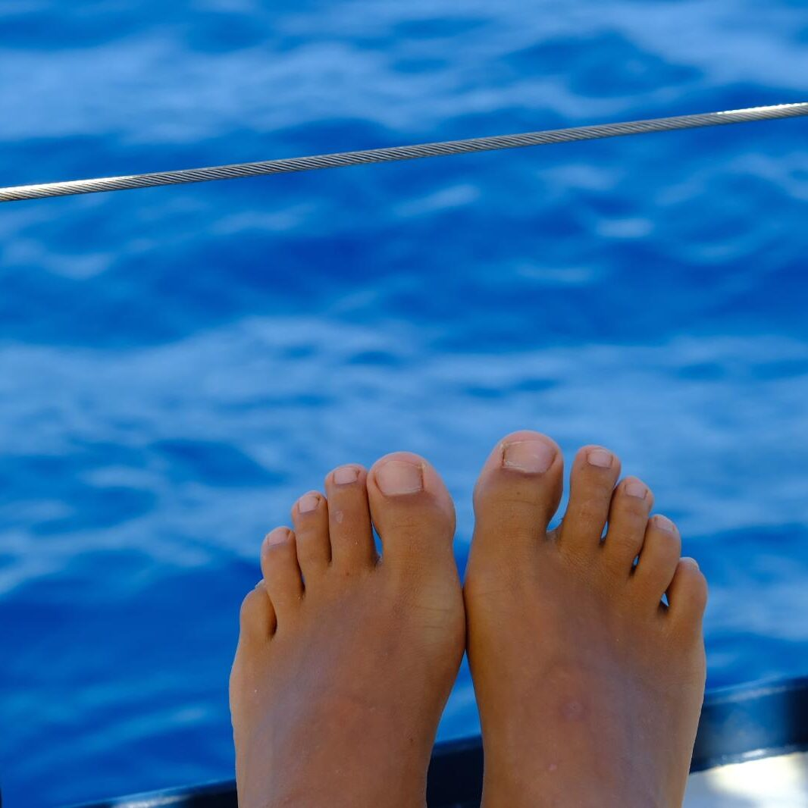

De tropische havenkoorts waarvan ik dacht dat ik hem verslagen had, keert weer een beetje terug. Gelukkig geen echte koorts meer, maar wel barstende hoofdpijn die mij onbekend is. Het is daardoor lastig om echt te genieten van het mooie zeilen en ik besteed alle tijd buiten mijn wachten om met slapen. Jen heeft een betere overtocht, maar moet op een gegeven moment bekennen dat het wel een stuk ongezelliger is als ik alleen maar slaap. We hebben in de kuip een schaduwtentje geconstrueerd waar ze achter kan schuilen tegen de brandende zon overdag en zo zit Jen de hele dag boekjes te lezen, sudoku’s te maken, of sargassowier van de vislijn te trekken.

<figure class="wp-block-image size-large">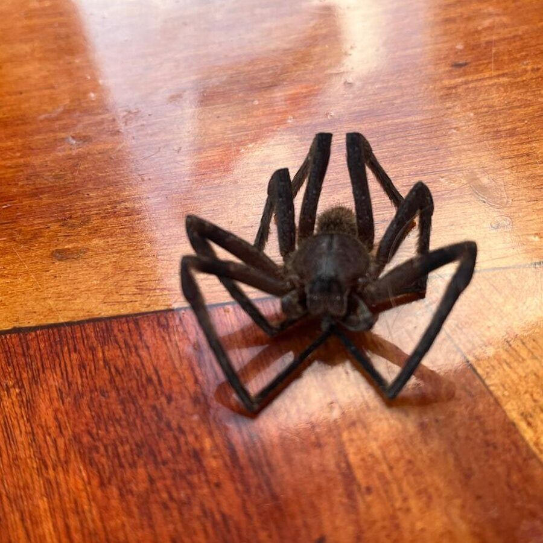<figcaption class="wp-element-caption">Hitchhiker uit de jungle: Op dag drie ligt deze joekel van een spin plotseling in onze keuken.. Jelle (mijn broertje) weet meteen te vertellen dat hij ook eens zoiets heeft gevonden in Italië en dat het een <em>vervelling</em> van een spin bleek te zijn....</figcaption></figure>

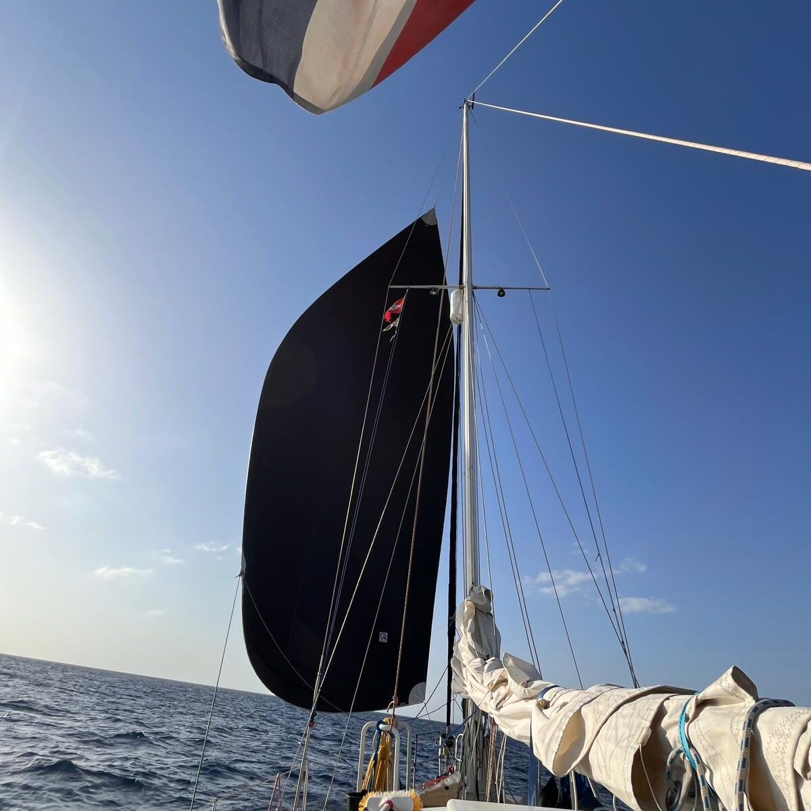

Voor de kust van Guyana wordt het ’s nachts opeens heel druk. Overal zien we lampjes, schepen op de AIS en boorplatformen. De olie- en gaswinning draait hier op volle toeren en de schepen varen kris-kras door elkaar. Gelukkig berekent de AIS voor ons of we op ramkoers liggen en zien we verschillende tankers op een mijl of twee voor ons langs schieten. De enige uitzondering is het militaire schip van de kustwacht van Guyana. Die ligt de hele avond stil, maar begint vlak voor onze wachtwisseling plotseling met twaalf knopen op onze koerslijn af te stuiven.

Ik ben slaperig en moe van de wacht en Jen neemt de marifoon ter hand om ze even op te roepen over hun intenties. Het is alweer even geleden, aan de andere kant van de oceaan, dat we voor het laatst een schip opriepen en het feit dat het ook nog eens een militair schip is, geeft toch een beetje klamme handjes. Als de schipper antwoordt dat hij ons niet ziet floept Jen er pardoes uit dat wij dan wel koers verleggen. Hij bedankt en meldt daarna dat hij ons nu wel in zicht heeft… Ik zit intussen met mijn handen in het haar te mokken. We varen namelijk al hoger aan de wind dan we hadden verwacht, dus oploeven wordt vervelend en afvallen gaat ons dure meters kosten. Een militair schip dat niet in een actieve operatie zit, is gewoon een motorboot en die moet voor ons aan de kant. Totdat je voorrang verleent natuurlijk..

Uiteindelijk draaien we de fok weg en halen we alle snelheid eruit tot hij voor ons langs schiet. Het geeft ons even de tijd om de rituelen en vragen op de marifoon nog eens door te nemen voor de volgende keer, en dan kan ik lekker gaan slapen.

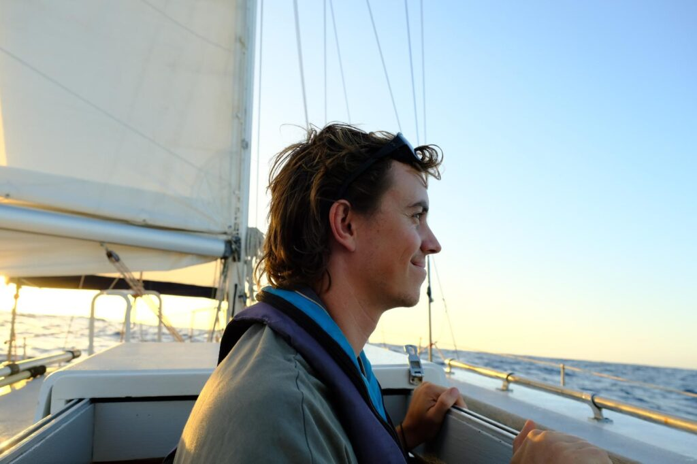

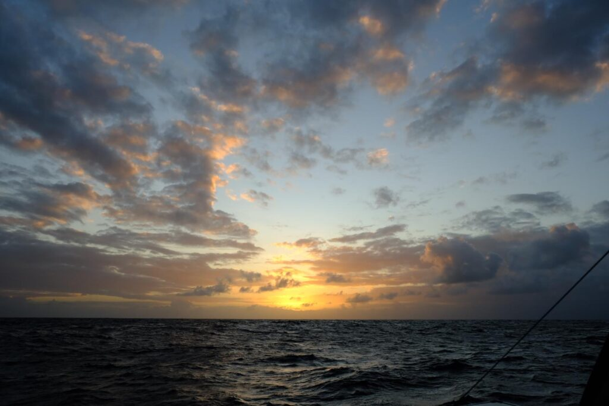

Daarna blijft alles rustig, al moeten we steeds ietsje hoger aan de wind gaan varen om Tobago te halen. De zee blijft rustig, dus erg veel last hebben we er niet van. Zo’n 24 uur van tevoren berekenen we onze aankomsttijd en komen we er op uit dat we - zoals we juist niet bedacht hadden - midden in de nacht zullen aankomen. Heel erg versnellen gaat niet lukken en met de aankomstkoorts alweer in ons bloed hebben we ook geen zin om te vertragen.

Ik praat mezelf maar aan dat ik Tobago toch al ken en weet waar we terecht komen, dus dat in het donker aanvaren geen probleem zal zijn. Bovendien is het in tegenstelling tot andere Caraïbische eilanden een erg overzichtelijke aankomst met diep water, veel ruimte en geen grote riffen waar we tussendoor moeten.

De nacht van tevoren al zien we het lichtschijnsel als een vage gloed voor ons liggen. Overdag verdwijnt Tobago weer in de wolken aan de horizon, om bij het vallen van de avond weer zijn licht te schijnen. Het is volle maan, wat helpt om de contouren van het eiland waar te nemen. North East Rock en The Saint Giles Islands die om de Noord-oostelijke punt van het eiland liggen zien we vaag. We zorgen dat we een mijl of anderhalf uit de kust blijven. Op de kaart staat aangegeven dat er op dit stuk sterke stromingen staan en dat er brekers kunnen zijn, maar terwijl we naderen is het zo rustig dat ik denk dat dat wel iets zal zijn voor als het weer slechter is.

We worden dan ook een beetje overvallen als we het noordelijkste puntje om komen, overstag gaan en plotseling in een sterke stroom komen met harde wind. We gaan nog maar twee knopen over de grond en de oceaandeining die vanuit het oosten naar het eiland toe loopt wordt door de sterke uitgaande stroming omhooggestuwd. De brekers en schuimkoppen zoals ze op de kaart staan zijn hier, ook met rustig weer dus daadwerkelijk een ding. Het feit dat het donker is, we dachten dat we er bijna waren en dat we zo verrast worden, maakt dat het plotseling toch best spannend is. We zien vaag de contouren van het eiland dat we net gerond zijn en hebben de GPS nodig om uit te maken of we niet teveel weggezet worden door de stroom. De motor gaat bij en ik stuur Jen voor een minuut of tien naar binnen omdat het water om ons heen toch wel erg wild wordt. Daarna wordt het snel rustig. Gelukkig hebben we inmiddels wat ervaring met riviermondingen, want dit was heel vergelijkbaar. We roepen *Belafonte*, die een uurtje of anderhalf achter ons vaart nog even op om ze aan te raden een iets ruimere boog om het puntje te nemen dan wij en dan zien we de enorme kliffen van *Pirate’s Bay* om ons heen omhoog komen.

Behoedzaam varen we de baai in en zoeken in de felle verlichting van het dorp een vrije moorring op. Als we liggen en de motor gaat uit blijft de branding op het strand en ons gevoel van wéér een succesvolle tocht over. Het is midden in de nacht en alles om ons heen is rustig en vredig. We openen een fles bubbels en proosten op de Carieb, en - ondanks mijn naziekte – een mooie tocht waarin we lekker in ons ritme zaten en we weer even voelden hoe het nomadische leven op zee is. Of het water hier wel echt blauw is en het strand wit kunnen we niet zien, maar we kunnen er wel alvast over fantaseren. We duiken te kooi en Jen voelt zenuwen alsof ze bijna jarig is en morgenochtend allemaal cadeautjes krijgt waar ze eigenlijk niet op kan wachten.

En die krijgt ze. Vlak na zonsopkomst worden we wakker en kijken we om ons heen. We zijn in het paradijs! Het is groen, het is imposant en er is verderop een wit strand met blauw water. De temperatuur is een stuk aangenamer dan een paar breedtegraden zuidelijker en we hebben weer van alles te ontdekken. We beginnen met een kop koffie, na een verfrissende duik.

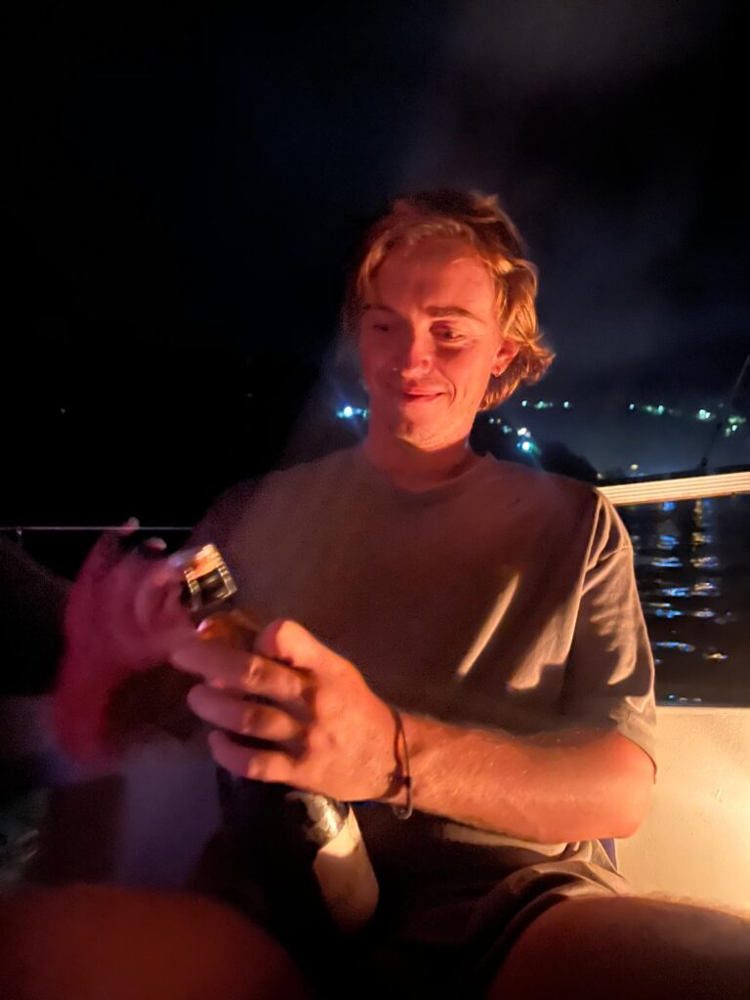

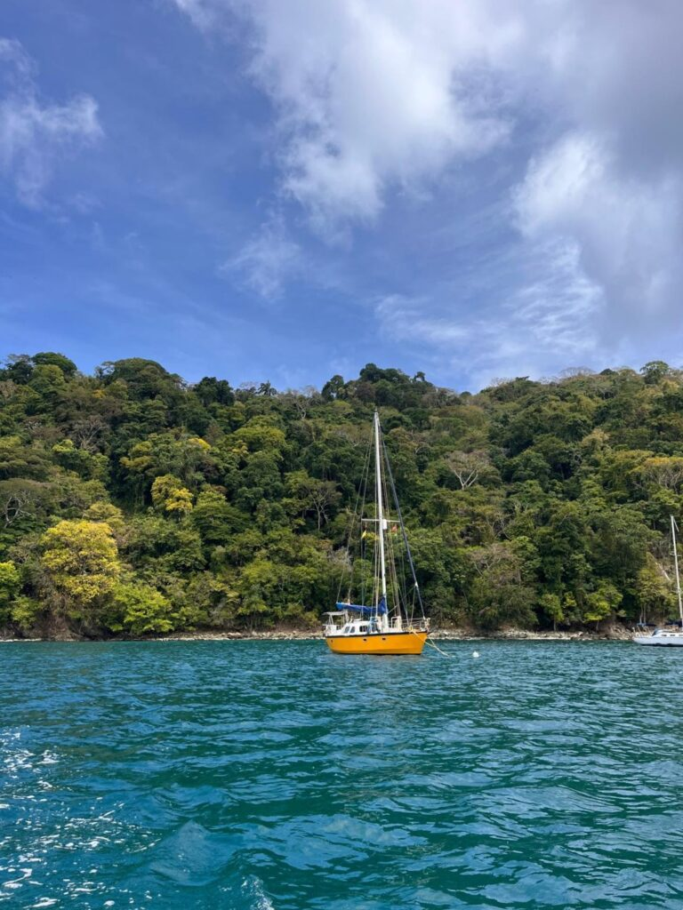

Het inklaren op Tobago is één van de meest achterhaalde processen die we tot nu toe hebben meegemaakt. Daarbij is het ook verreweg de duurste procedure. We betalen zo’n €100,- voor het inklaren en bij vertrek moeten we nog eens dertig US dollar betalen voor het uitklaren. Maar daar krijg je wel ook een ervaring voor terug. Mrs. Pragg, de customs-officer van Charlotteville heet ons met een brede en lieve glimlach welkom op de bovenverdieping van een uitgewoond ziekenhuis. De ventilator die ze naast haar bureau heeft staan is zo groot als twee kliko’s en blaast continue al haar papierwerk omhoog, maar hij is hard nodig, want het is snikheet in het kleine kantoortje. We krijgen de eerste stapel formulieren mee, die we moeten invullen. Mooi ouderwets carbonpapier met drie doordruklagen. De titel bovenaan het blad weet ons te herinneren dat dit proces (en waarschijnlijk het papier) dateert uit 1974. Ik fantaseer direct dat er toen een corrupte president aan de macht was die een vriendje had met een carbonpapier-fabriek. Die heeft toen een mega-order gekregen om voor de komende 50 jaar alvast alle overheidsformulieren te printen en daardoor zitten ze nog steeds vast aan dit systeem.

Na ons papierwerk te hebben ingeleverd mogen we ons melden bij “*health clearance*”. Dat zit in het nog verder uitgewoonde kamertje aan het einde van de gang. De dame die daar in een lege kamer aan een tafel zit neemt ons mee naar de vergaderzaal waar een enorme conference-meeting tafel staat met grote leren bureaustoelen. De mannen van de *Belafonte* zitten achter het bureau met hun stapel papieren en heten ons welkom bij de vergadering. We krijgen wederom carbonpapieren voor onze gezondheidsverklaring, een zesvoud van de crewlist en nog allerlei andere dubbele formulieren (ook in drievoud door het carbonpapier). Als we het willen inleveren blijkt dat we ook nog twee kopietjes van ons paspoort moeten aanleveren. De kopieermachine die ze daar hebben staan kan daarvoor niet gebruikt worden en dus moet ik het dorp in op zoek naar iemand met een printer. De bibliotheek is open en heerlijk koel door de airco, maar de bibliothecaris heeft vandaag geen zin om te helpen en beweert dat hij gesloten is. Uiteindelijk kan ik in een achterkamertje van een supermarkt terecht en kunnen we weer naar immigratie om ons papierwerk compleet in te leveren.

We ontvangen de stempels in ons paspoort, krijgen een officiële ankervergunning (zonder vergunning ankeren kan een boete van €20.000 opleveren!) en zijn dan officieel welkom op Tobago. Jen heeft in de tijd die ik besteedde aan kopietjes maken aangepapt met Mrs. Pragg en haar jongere assistente die de belangrijke functie als getuige lijkt te hebben. Inmiddels weten we waar we een feestje kunnen meepakken, dat we echt *doubles* moeten eten en dat de mensen op Tobago super vriendelijk zijn. Mrs. Pragg komt inmiddels over als onze tourguide en vertelt ons over het eiland. Als we pakketjes willen laten komen kan dat en zal zij zorgen dat het allemaal geregeld wordt. Wij balen een beetje dat onze zeilen nog niet klaar zijn, want dit was een toplocatie geweest daarvoor…

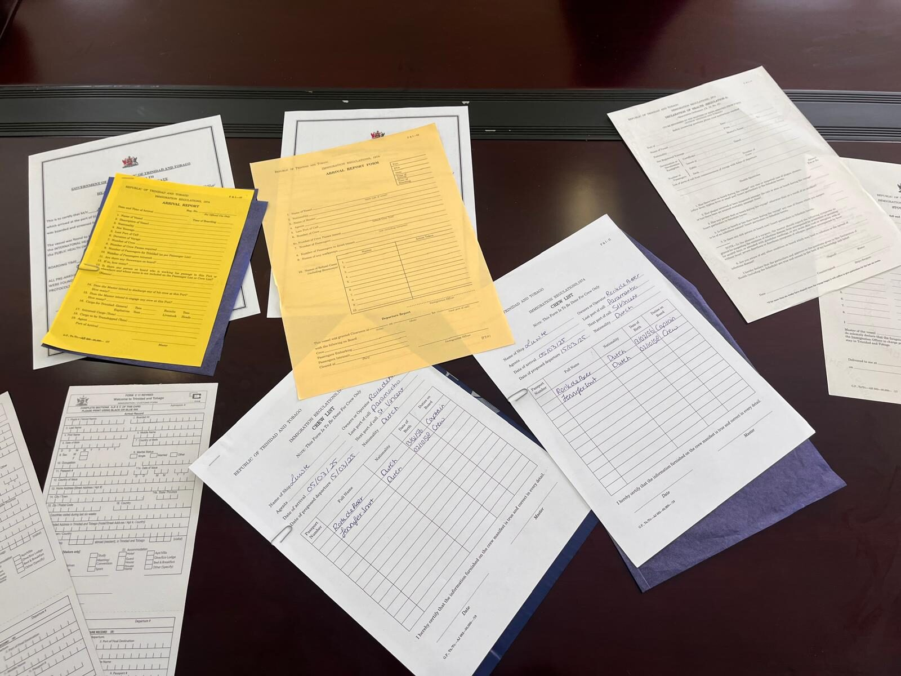

<figure class="wp-block-image size-large">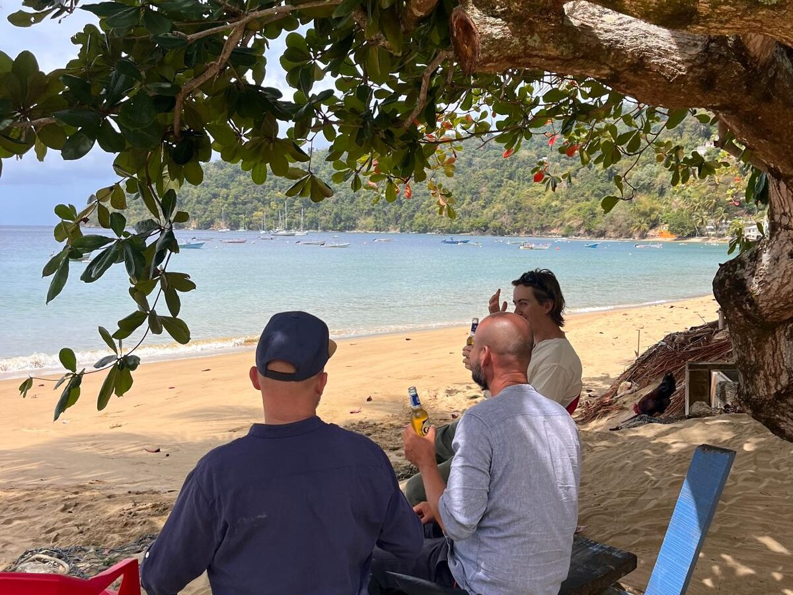<figcaption class="wp-element-caption">We vieren onze <em>clearance</em> met de Belafonte</figcaption></figure>

Terug op de boot gaan we“chillen”. We bespreken wat onze Caraïbische dromen zijn en besluiten daar vanaf morgen zo snel mogelijk werk van te gaan maken. Er moet gesnorkeld en gedoken worden, we willen ergens een kampvuur op een strand maken, eindeloos in het water springen, lekkere dagtochtjes zeilen, kleine baaitjes aandoen en gezond rif zien. Jen wil een zeeschildpad zien en ik wil in de hangmat liggen en niks doen met een rum-punch in mijn handen. En we moeten onze borstcrawl nodig weer oppakken. Daar zijn we in Portugal een keer mee begonnen, maar dat is nooit echt van de grond gekomen. Genoeg te doen dus.

We blijven bijna een week aan de boei in *Pirate’s Bay* hangen. Maken onze ambitie van het kampvuur meteen waar met *Belafonte* in de inham bij *Boobie Island*, waar we een heerlijke visstoof maken in de *Dutch oven* op driepoot boven het vuur. Voorafgaand daaraan hebben Jen en ik een tonijn weten te scoren van een visser die we als sashimi en sushi laten smaken. Het strand is niet toegankelijk vanaf land en dus zitten we daar met z’n vieren over de baai uit te kijken waar verderop onze boten dobberen terwijl de zon de lucht rood kleurt. Als we laat op de avond onze dinghy’s weer hebben volgeladen moeten we de branding nog door. Dat is een heel spektakel. Ik help eerst Julien en Pieter om er doorheen te komen en houd hun bootje nog even vast terwijl ze de motor starten. Daarna zwem ik terug en slepen we die van ons naar de rand van de branding. Het is even afwachten. Elke zes a zeven golven is er even een piek en daarna wordt het rustiger. We denken de goede golf te kiezen, maar als Jen net in de boot is geklommen breekt er een golf precies over ons heen en is ook Jen van top tot teen doorweekt. Gelukkig start de motor soepel en zijn we daarna gauw weg…  

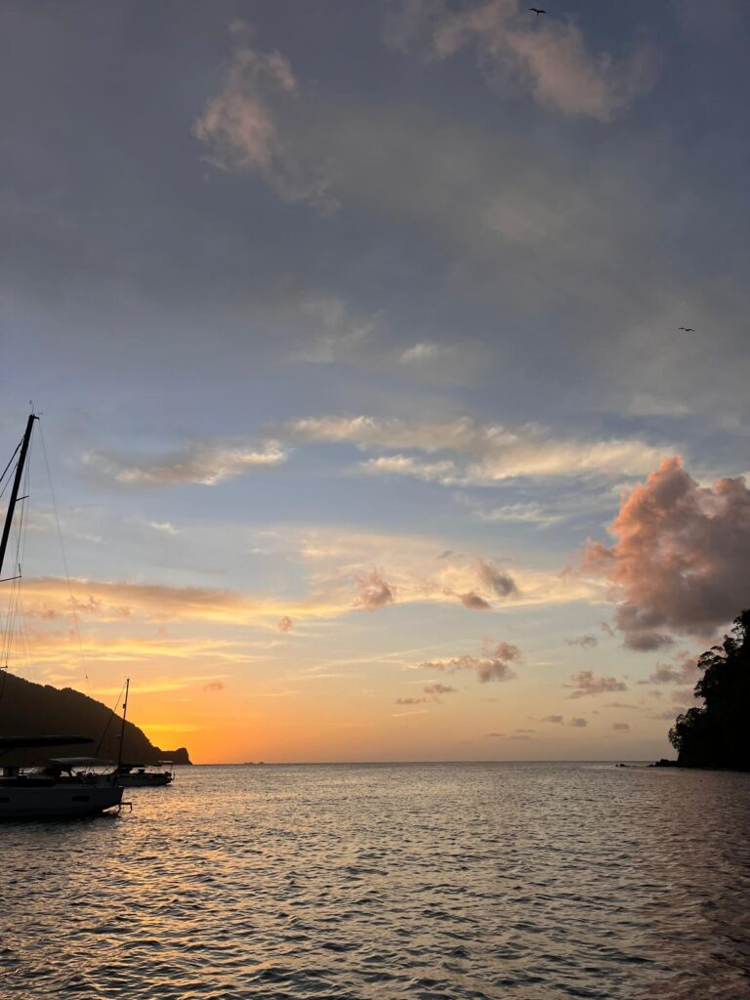

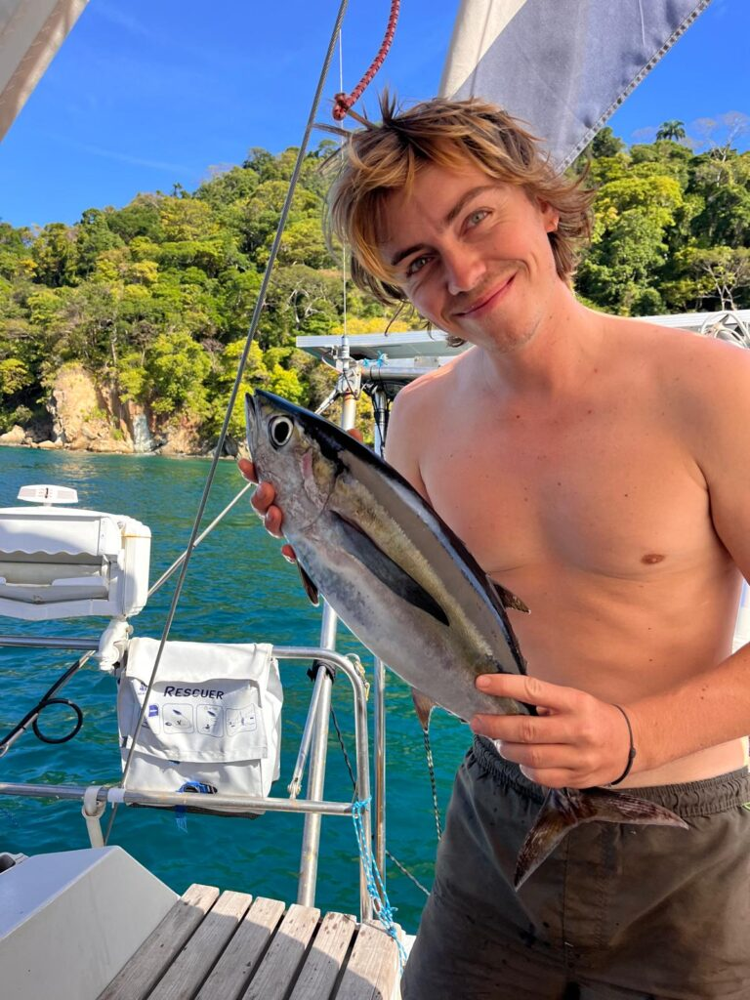

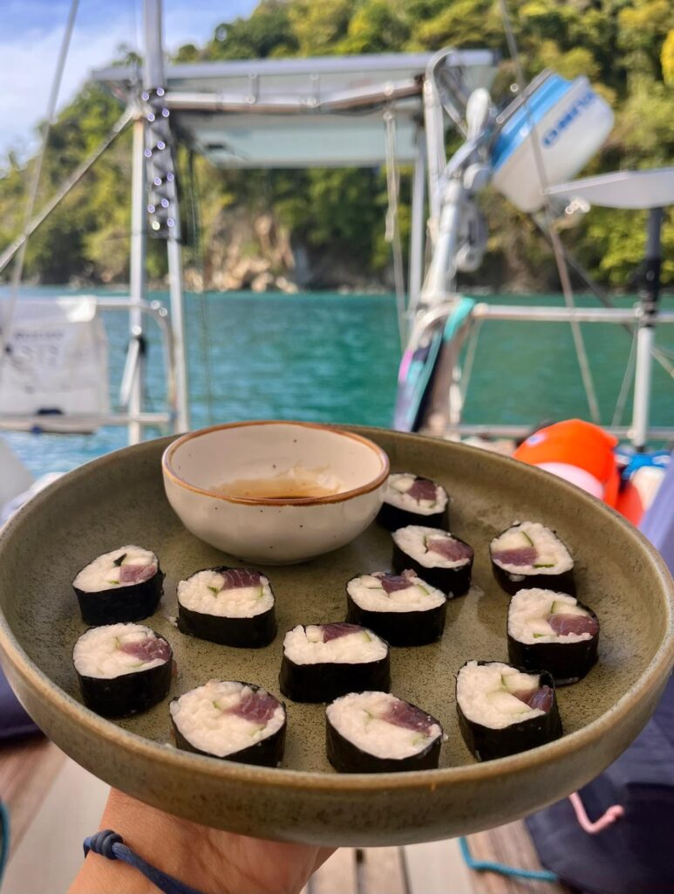

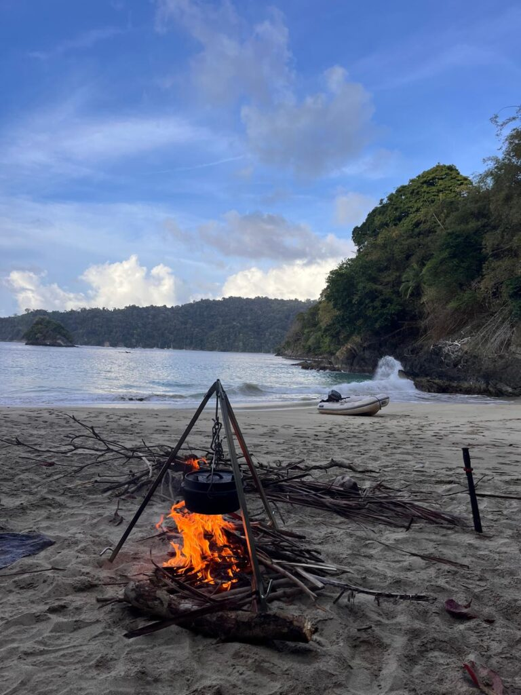

De volgende ochtend staat onze eerste duik gepland. We besluiten hier een *refresher course* te boeken, want voor mij is het ongeveer zeventien jaar geleden dat ik voor het laatst dook. Ik lees naargeestig het cursusboek nog eens door, zet onze eigen duikset in elkaar en prent mezelf in dat je altijd moet blijven doorademen en rustig omhoog moet. Voor Jen is het wat recenter en haar vertrouwen in instructeurs is wat groter, dus zij vindt gaandeweg wel weer uit hoe alles werkt en stelt al haar vragen op de boot terwijl ze de uitrusting aantrekt.

Het is weer even wennen, dat leven onder water, maar zo fantastisch sereen. Het kost mij even om mijn holtes te klaren, maar eenmaal beneden is alles goed. We oefenen met de instructeur nog eens het op- en afzetten van de bril onder water en het terugvinden van je mondstuk mocht die uitvallen. En dan vertrekken we. Gewoon daar in de baai van Charlotteville op een meter of zeven diep zwemmen we tussen de koraalkliffen door en zien we een weelde aan vissen en planten. We moeten allebei weer een beetje inkomen met het vinden van onze *bouyancy* en het rustige ademen, maar als we na bijna een uur weer boven komen hebben we de smaak weer flink te pakken! Dit gaan we vaker doen.

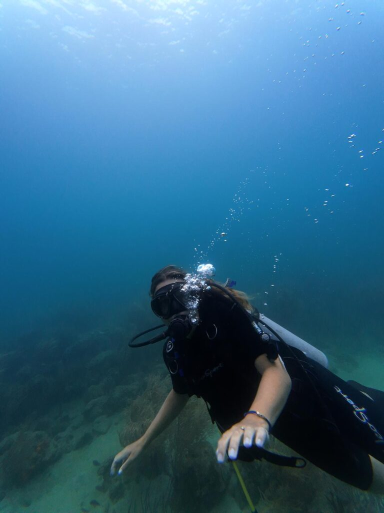

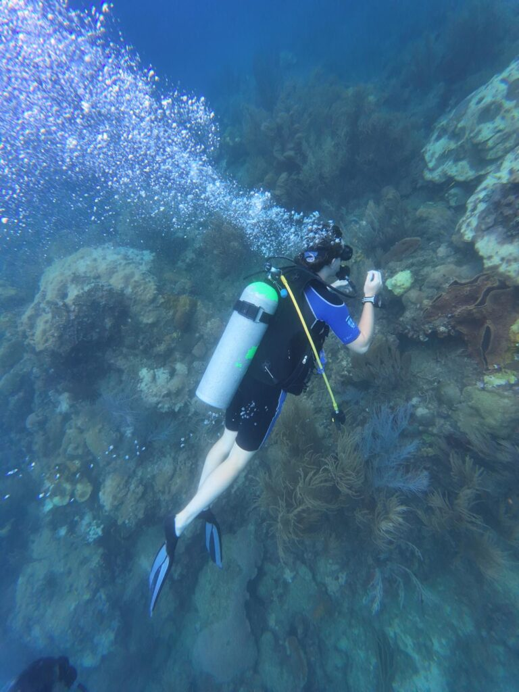

Inmiddels hebben we onze weg binnen het kleine Charlotteville wel gevonden. We hebben ons groentetentje, een visser die ons vis wil verkopen en een supermarkt waar we kokospoeder vinden dat het heel goed doet in de rum-punch. Dat gevoel betekent voor mij dat ik me lekker op mijn gemak begin te voelen en voor Jen dat het tijd is voor een nieuw avontuur. Dat hoeft niet groots of meeslepend, maar gewoon ergens zijn waar we de weg kennen doet ze liever in Amsterdam. We besluiten vanaf Charlotteville een hike uit te zetten naar de top van de berg, waarvandaan we hopelijk een mooi uitzicht hebben op de baai en het eiland. Jen probeert mij nog zo ver te krijgen om naar de andere kant van het eiland te wandelen, maar ik ben inmiddels ervaren genoeg om te weten dat tien kilometer berg op en berg af al snel genoeg is om voldaan terug te keren. Het wordt dus de “korte” route gelukkig.

We verlaten het dorp en klimmen omhoog. Eerst nog een weg, maar die wordt snel smaller en smaller tot er nog een paadje over is waar we met z’n tweeën achter elkaar overheen wandelen. Het pad loopt net niet op dezelfde plek als de kaart en in het dichte bos werkt de GPS niet zo goed als normaal. Voor we het doorhebben, lopen we op een steeds steiler en dichter begroeid pad tot we bij een rotsachtig stuk komen waar het óf met handen en voeten naar boven klimmen wordt, óf met handen en voeten naar beneden. We vinden vlakbij een open stukje bos en zien dan op de GPS dat we al een half uur de verkeerde kant op lopen. Inmiddels hebben we allebei blaren en bij Jen zijn ze zo erg dat ze besluit liever op sokken te lopen dan op haar wandelschoenen. Ik denk dat onze voeten aan het vergroeien zijn naar teenslipperstand en dat we niet meer passen in dat voorgevormde keurslijf.

We vinden gelukkig het goede pad terug en beginnen aan het laatste stuk van de klim. Ook die is bijna met handen en voeten te beklimmen. Na elke bocht komt er nog een bocht en na elke piek komt er nog een piek. We zijn door onze twee liter water heen en moeten nog beginnen aan de terugweg. Maar gelukkig opent het bos dan plotseling en staan we aan de rand van een geasfalteerde weg naast de zendmast op de top van de berg. In de brandende zon vinden we een muurtje en persen de laatste druppels water uit onze waterfles als er een auto met vier mensen stopt die vraagt of we iets nodig hebben. Wij hebben ons lot als onverstandige jongelingen al omarmd en slaan het aanbod vriendelijk af, maar als ze blijven aandringen durft Jen te vragen of ze iets te drinken hebben met suiker. Niet veel later staan we met deze *Trini’s* (bewoners van Trinidad) te kletsen over wat ze doen, waar wij met de boot vandaan komen en hoe onze culturen misschien een beetje verschillen. Zonder dat we er iets tegenin kunnen brengen wordt onze rugtas volgeladen met chips, verschillende drankjes, vers gebak, watermeloen en extra water. Als we met ze op de foto zijn geweest en nummers hebben uitgewisseld voor als we ooit nog op Trinidad komen, stappen ze weer in en blijven wij positief beduusd achter. Hier zouden wij saaie Nederlanders nog wat van kunnen leren. Met een volle maag en gehydrateerd lichaam kunnen we onze wandeling naar beneden voortzetten.

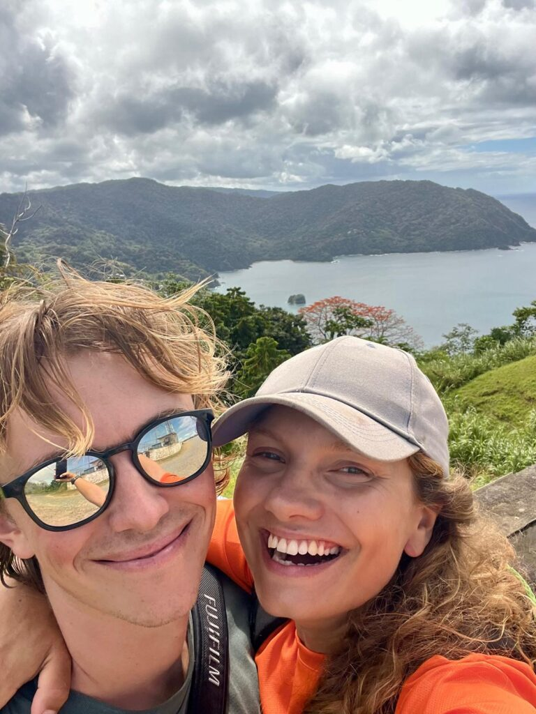

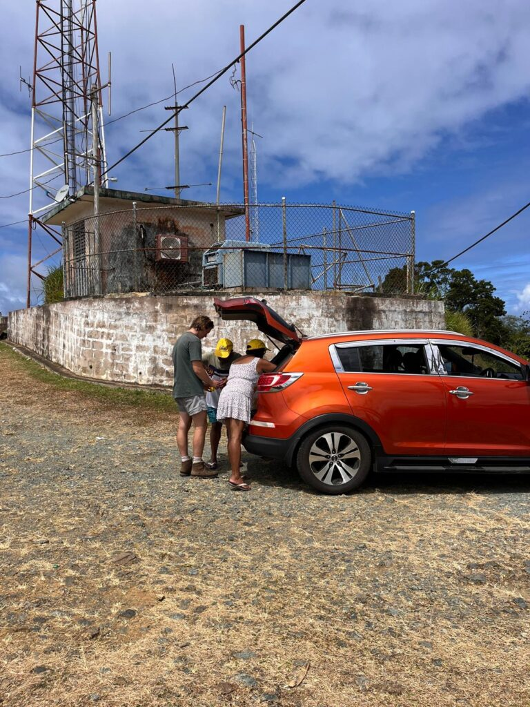

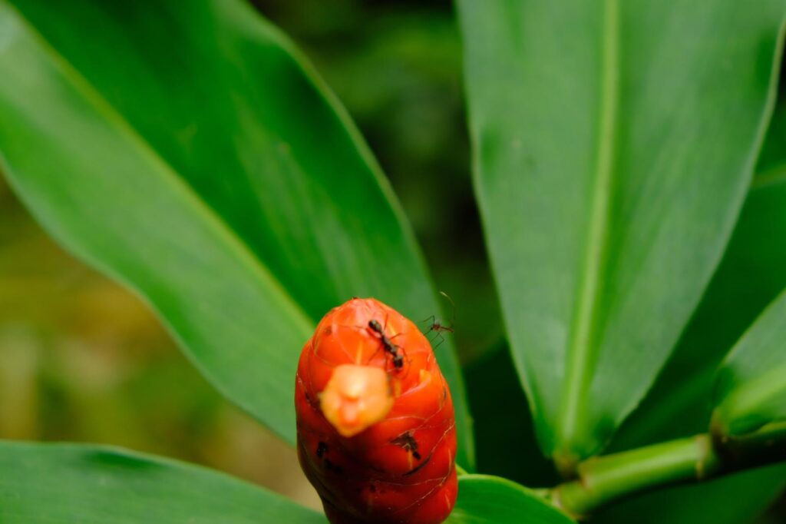

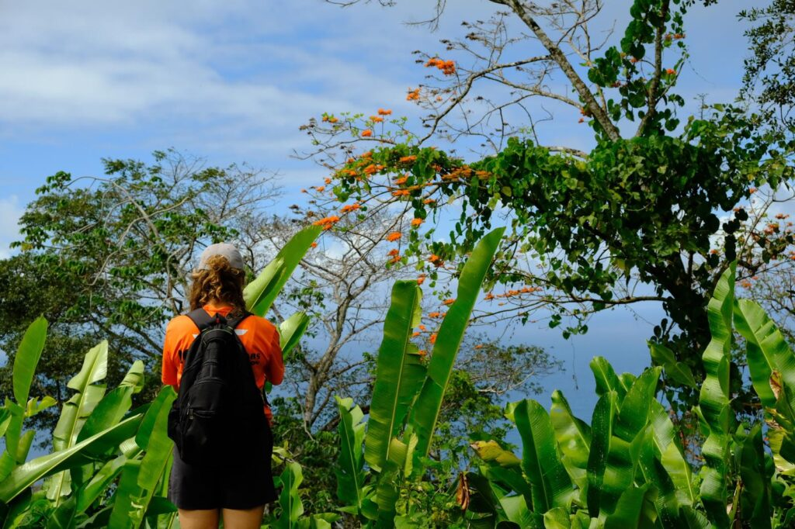

Een uur of anderhalf later wandelen we Charlotteville weer in. We vinden dat we wel een biertje hebben verdiend en wandelen richting de kade met een café als we op een terras van een restaurantje de mannen van de *Belafonte* zien zitten. We blijven aan de overkant van de straat geduldig staan wachten tot ze ons opmerken, want ze zijn duidelijk druk bezet door iemand die ze hebben ontmoet. Als Pieter ons opmerkt wenkt hij ons of we alsjeblieft willen komen helpen zich los te krijgen van de spraakgrage *Trini*. Hij is niet onvriendelijk, maar als we horen dat hij al een WhatsApp groep heeft aangemaakt met zichzelf en *Belafonte* en hij vraagt of wij er ook in willen, houden we het maar op ons Instagram profiel…

Niet veel later stapt er een groep lokale mensen het terras op. Een van de dames vraagt ons waar we vandaan komen en we raken snel aan de praat. Vijf minuten later zitten we bij ze aan tafel en worden we geïntroduceerd in het gebruik: *Limen*. *Limen* is niet ingewikkeld, maar wel buiten onze Westerse comfortzone. Ze beschreven het als *Random besluiten te drinken met wildvreemden en niet over werk of kinderen praten.* Met name die laatste twee zijn van belang en worden ook daadwerkelijk door de groep afgestraft als ze toch boven tafel komen.

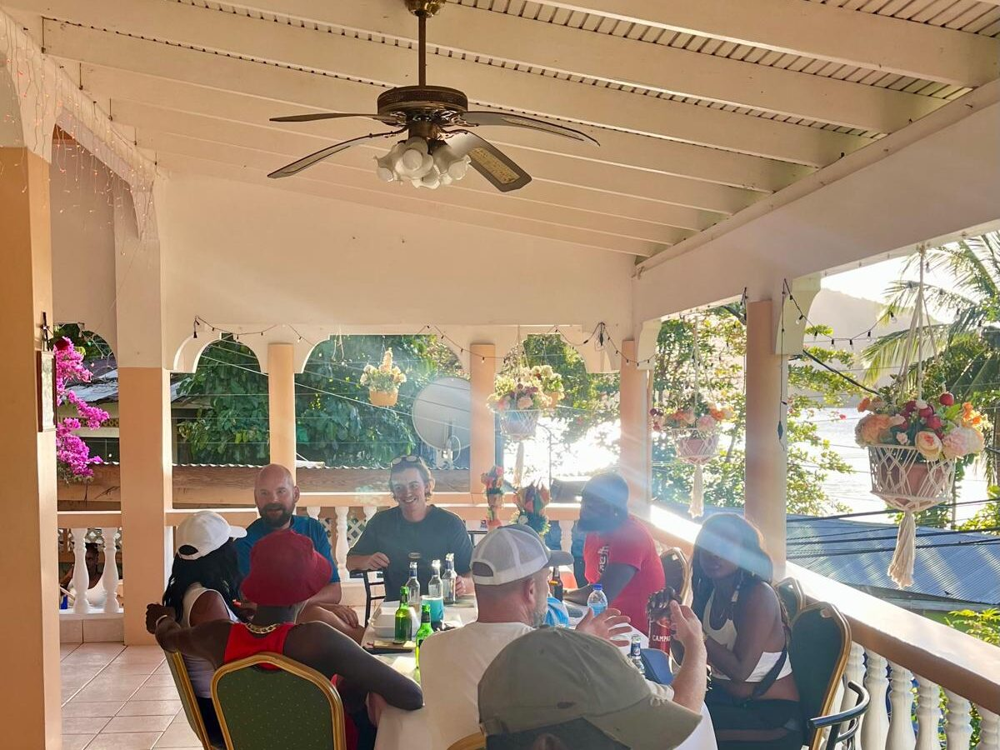

<figure class="wp-block-image size-large">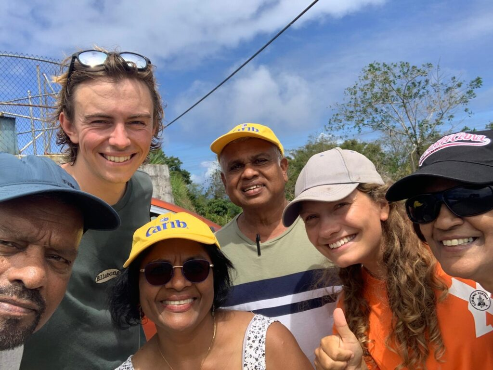<figcaption class="wp-element-caption">Met de <em>Trini's</em>!</figcaption></figure>

Hoewel we weten dat we op Tobago de tijd moeten nemen en moeten genieten van de rust en mensen op dit eiland, willen we op een gegeven moment ook de rest van de Carieb verkennen. We stellen die drang nog heel even uit door gebruik te maken van onze officiële *bay hopping permit* en we zeilen in een paar uurtjes naar Castara. Onderweg hebben we een flinke vis aan de haak, maar die weet helaas voor ons te ontkomen..

Castara is weer een heel ander dorp dan Charlotteville. Dit dorp lijkt voor een groot deel te draaien rondom vliegende toeristen. Langs het water en op de berg staan verschillende accomodaties en het het witte strand wordt gevuld met rood-witte Amerikanen en Britten die hier hun vrije dagen besteden. Verder zijn er geen andere zeilboten. Tussen de vissersbootjes vinden we een plekje dat redelijk beschut ligt voor de deining en gooien we ons anker uit. We gaan samen op de *sup* naar de wal en drinken een biertje met uitzicht op onze boot in de baai. Dat uitzicht verveelt nooit. Zeker als het wordt verrijkt door een van de mooiste zonsondergangen die we op onze reis hebben gezien. *Luwte* verandert van geel naar oranje-rood met het vallen van de nacht en als we in het laatste beetje licht weer naar haar terug peddelen, zijn we voor de zoveelste keer weer trots op ons gele monster dat ons zonder al te veel geklaag helemaal hier naartoe heeft gebracht.

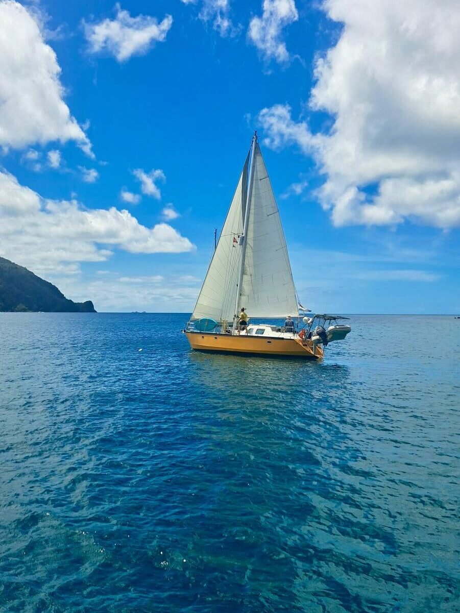

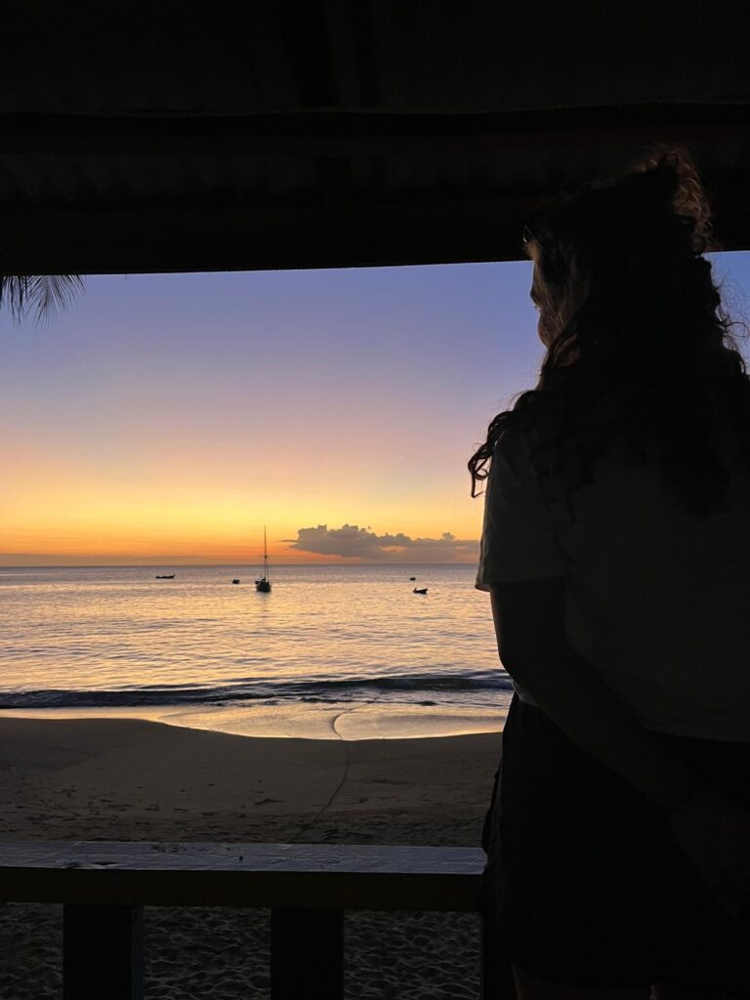

Aan de rand van de baai halen we ons hart verder op met een prachtig stuk snorkelen. We hangen nog even op het strand en duwen *Storm* dan weer het water in, terug naar de boot. ’s Avonds is het feest in Castara en dreunt de immense stereotoren over het strand. Een paar stapels bamboestokken worden opgebouwd en tot grote kampvuren omgetoverd. We gaan na een hapje eten nog even kijken, maar voelen ons snel wat ongemakkelijk tussen de witte vrouwen op leeftijd, die zich met een lokale gespierde man aan de arm dronken laten voeren.

’s Ochtends besluiten we dan ook dat we Castara wel hebben gezien en onze tijd op Tobago op aan het raken is. Op onze weg terug varen we eerst nog naar Englisman Bay, waar we zo goed als alleen op de wereld zijn. Er staat een bar-restaurant voor lunch op het strand, maar dat is het dan ook wel. De bodem bestaat uit oude koraalplaten met daaroverheen zand en onze ketting komt even onder een van de platen te steken. We herankeren en liggen dan goed. Jen paddelt met de sup naar de kant terwijl ik met snorkel en flippers er achteraan kom. De bar is al aan het afsluiten als we ons melden voor een sundowner, maar we kunnen nog wel een blikje mierzoete fris krijgen. Op het gesloten terras en aan een leeg strand drinken we onze *soft* terwijl we weer uitkijken over *Luwte*.  Idyllischer dan dit wordt het gewoon niet!

We plakken er toch nog een nachtje aan vast. *Belafonte* komt ook deze kant op en Mrs. Pragg van de douane voelt zich vereerd als ze hoort dat we graag nog een paar dagen langer blijven dan op ons aankomstformulier vermeld stond. We hopen roti mee te kunnen pakken in het restaurant, maar als we aan de beurt zijn om te bestellen is net de laatste portie vergeven. Alleen de laatste stukjes (flink doorgebakken maar heel lekkere) vis zijn er nog. We beloven morgen terug te komen en krijgen de belofte terug dat ze een paar porties voor ons achterhouden. Met zijn vieren genieten van twee bootjes als ansichtkaart voor je is misschien wel net zo leuk als met z’n tweeën genieten van één boot, en de volgende dag lukt het ons eindelijk om de roti te bemachtigen. En eerlijk is eerlijk, het was de moeite waard om er nog een nachtje extra voor aan vast te plakken.

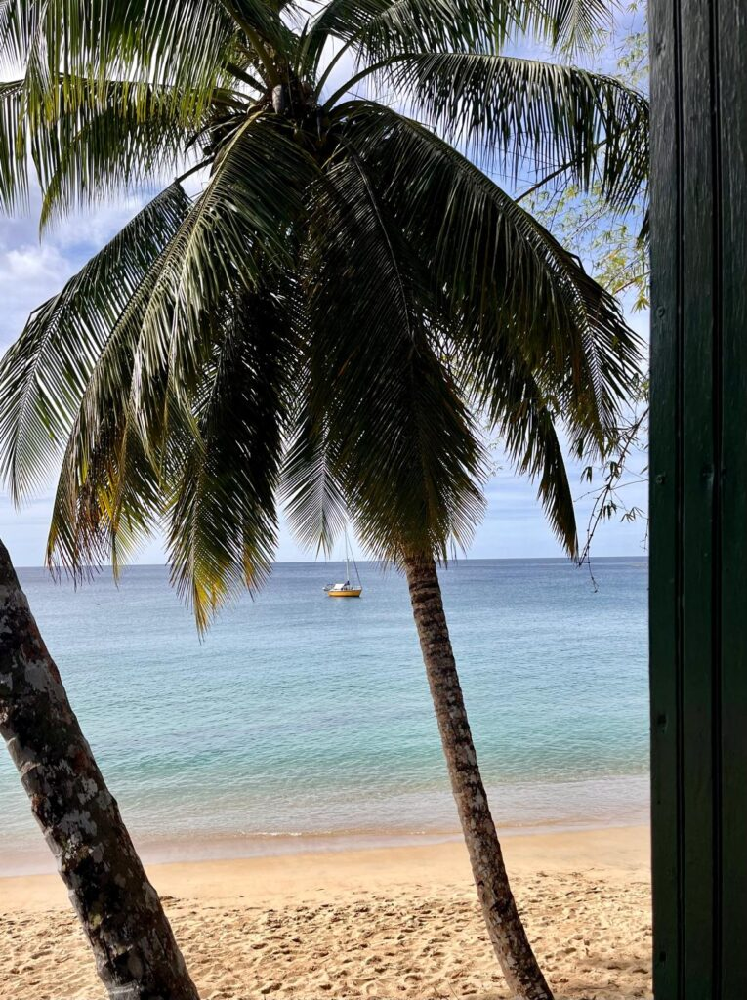

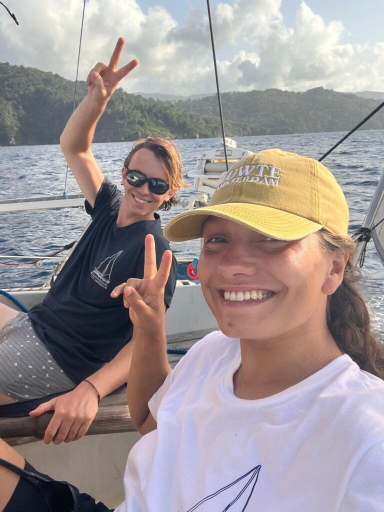

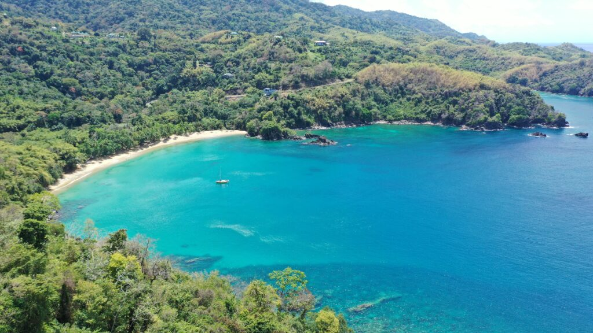

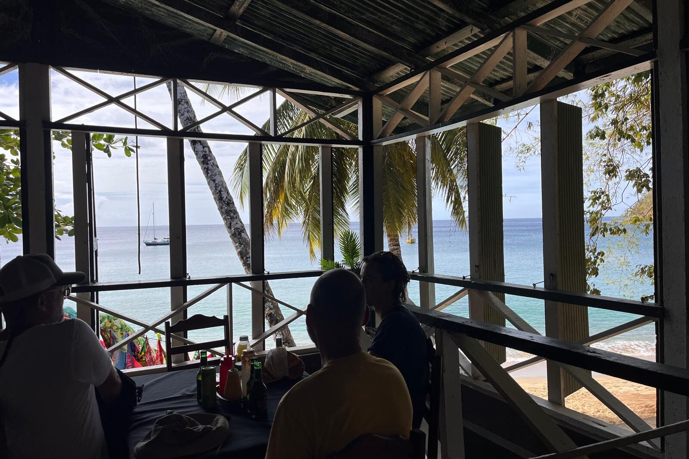

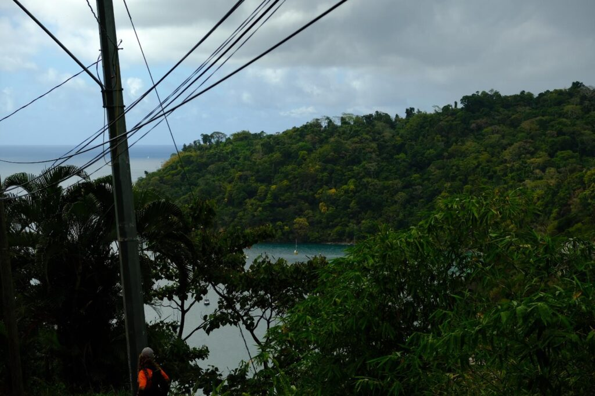

Terug in Charlotteville hebben we direct havenkoorts en voelt het als tijd om verder te trekken. Bij het uitklaren blijken we nog eens dertig USD uitklaringskosten te moeten betalen en met ons laatste cash geld weten we nog wat groenten te kopen. De ATM in het dorp is nog steeds kapot, maar de mevrouw van de supermarkt helpt ons aan wat extra centen die we deels bij haar weer uit kunnen geven. En dan is het nog inpakken en water vullen geblazen. We weten niet zo goed of er betere alternatieven komen, dus we slepen heel wat jerrycans heen en weer met de bijboot om de watertank weer te vullen. Het is een beetje behelpen, maar als ook die horde is genomen, het zweet van onze kinnen druipt en *Luwte* klaar is voor vertrek halen we het anker op en kiezen we het ruime sop. Er staat weinig wind en van opzij, dus we trekken de gennaker uit zijn hoes en varen onder fantastische omstandigheden de nacht in richting onze volgende stop: Union Island, Saint Vincent & The Grenadines.

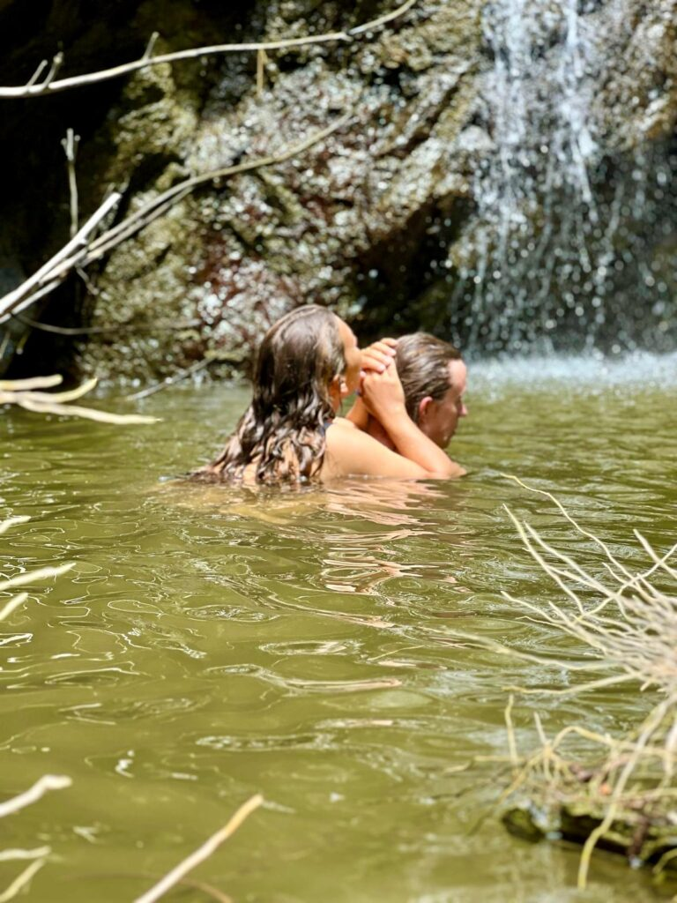

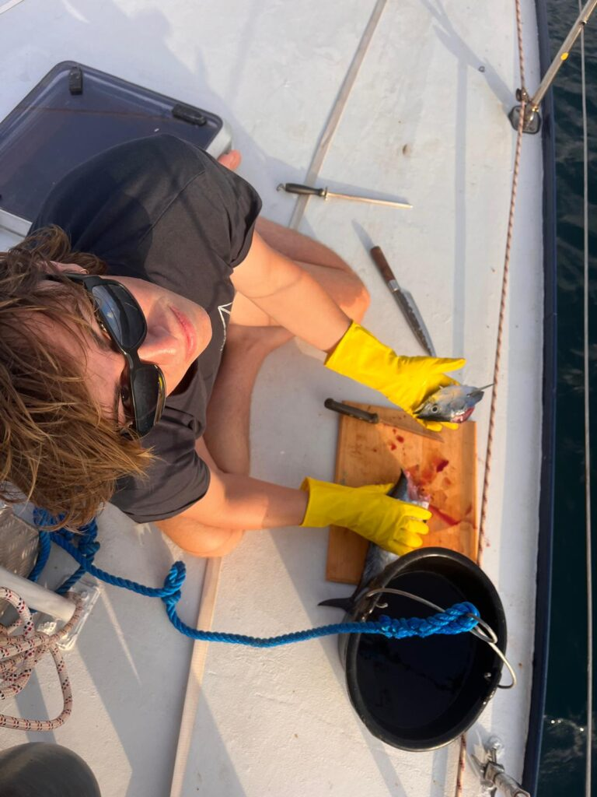

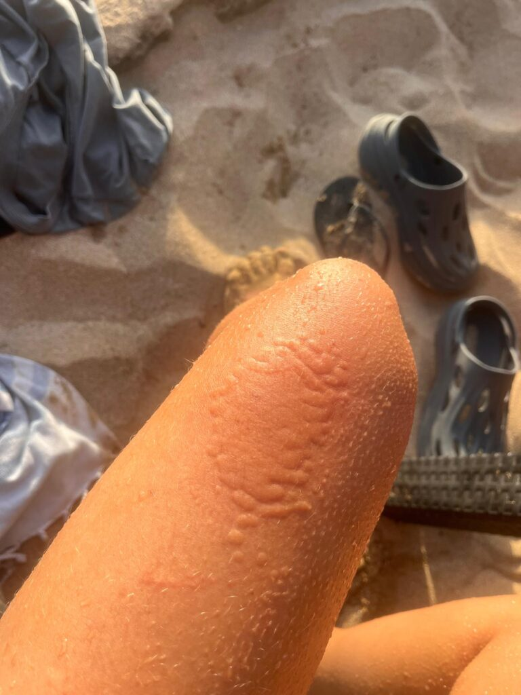

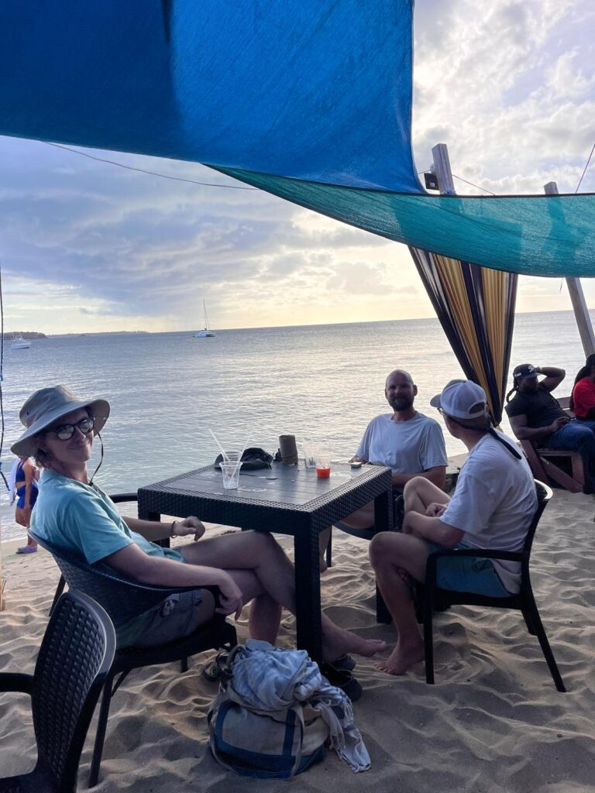
