In de luwte van de eilanden zeilen we in een strakke lijn naar boven. We zien de oude vulkaantoppen aan ons voorbijglijden en zijn hier en daar wel benieuwd hoe het er uit ziet, maar dat hebben we van zo veel plekken op de wereld nog. Het is ruim anderhalve dag zeilen naar Sint Maarten en vooralsnog loopt alles soepel. ’s Nachts waren we ver uit de kust en buiten bereik van de visboeien en andere scheepvaart, lekker rustig. Een beetje katerig zijn we er wel van de volgende ochtend, zo’n nachtje doortrekken, maar als de zon goed en wel op is, zien we Statia in de verte al liggen.

Dat is het moment dat er toch dingen beginnen te piepen en kraken. En hoewel ik snel rationeel genoeg ben om blij te zijn dat het op ons laatste *in-shore* tochtje voor de oceaanoversteek naar het noorden gebeurt, had ik liever een vlekkeloos laatste zeiltochtje gehad. Onze AIS begint te haperen. En dat is niet best. Hij is al wel eens ter sprake te gekomen, maar dit *Automatic Identification System*, laat ons alle andere scheepvaart om ons heen zien die ook zo’n kastje hebben, inclusief naam, snelheid, koers en een berekening van hoe dichtbij we bij elkaar komen. En hoewel er tot twee decennia geleden geen gebruik van werd gemaakt, is het een van de weinige systemen aan boord die onmisbaar zijn.

Wat het euvel precies is, blijkt nog lastig te achterhalen. Onze positie valt met horten en stoten weg, om daarna weer een fix met de satellieten te vinden. Daardoor werken alle functies van de plotter eigenlijk niet meer. We hebben er met name last van als we over bakboord boeg liggen. Als we overstag gaan lijken we aanzienlijk beter bereik te hebben. De stroom van de plotter af halen en hem resetten lijkt het probleem tijdelijk te verhelpen, maar kort daarna begint hij weer te haperen. Ik beredeneer hoe de AIS module zijn signalen waarschijnlijk zal verwerken en structureer mijn gedachten door hardop tegen Jen te praten. Zo bedenken we welke componenten we af kunnen strepen. Uiteindelijk kunnen het maar vier onderdelen zijn: De GPS antenne, de kabel er naartoe, een softwareglitch, of een onderdeel in de AIS module. Eerstgenoemden kun je bij Ali krijgen voor een paar tientjes, maar een nieuwe AIS module kost op Sint Maarten vanaf $1.000.

We zien Sint Maarten al liggen, maar doordat we vandaag minder wind hebben gehad dan verwacht, wordt het waarschijnlijk pas ergens vannacht of morgenochtend de haven aanlopen. Ik zie op MarineTraffic dat er verschillende tankers *en route* zijn die nacht, en als het met de schemering traditiegetrouw harder begint te waaien, zijn we het er over eens dat we geen behoefte of reden hebben om onszelf in een zorgen-opwekkende nacht te storten. Statia ligt voor onze neus. En een klein uurtje later rolt de ankerketting af voor een donker strand dat we nooit zullen betreden.

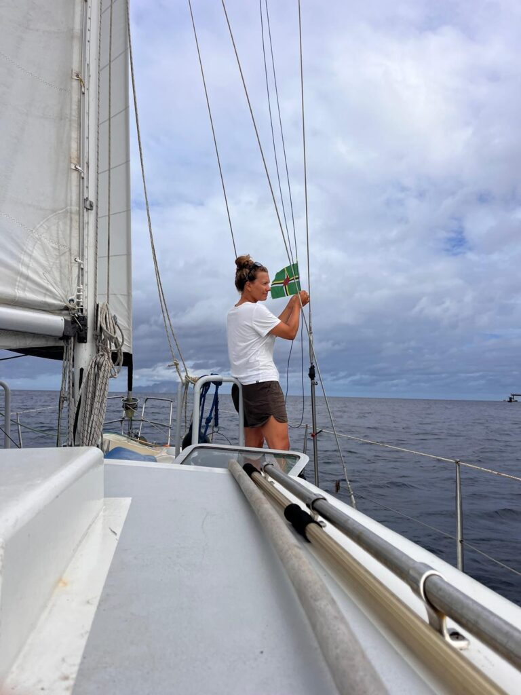

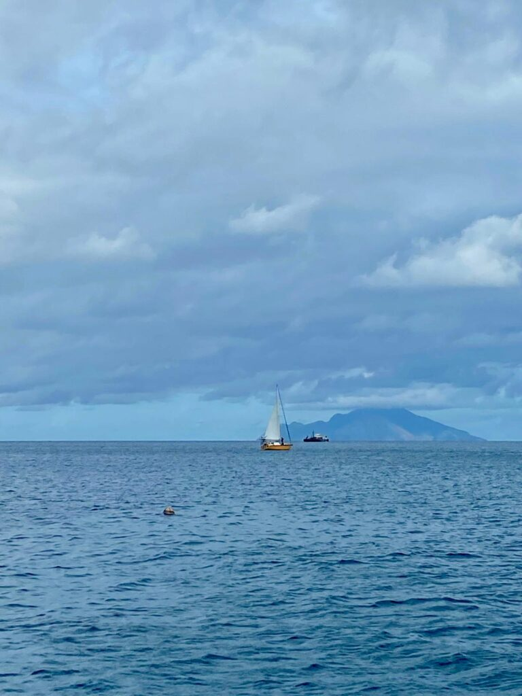

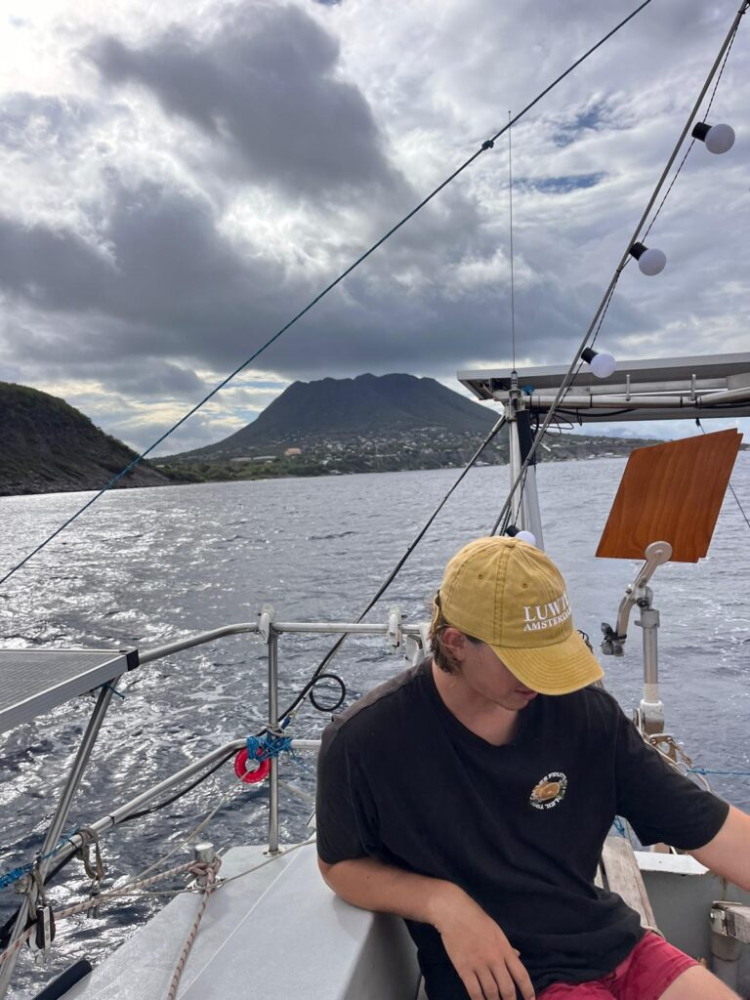

## Marigot

Sint Maarten heet in ons geval Saint Martin. Het eiland is in twee helften verdeeld onder de Fransen en de Nederlanders en is daardoor een vreemde plek. Wij kiezen de Franse kant, omdat het inchecken daar online gebeurt en in een paar minuten geklaard is. Er schijnt nog één of andere Franse havendienst te zijn die vindt dat je ook nog bij hun langs moet komen, maar ik concludeer dat die eerder zichzelf hebben uitgeroepen tot prinsjes van het inchecken, dan dat er ook echt juridische gevolgen aan het niet-melden zitten. Bovendien hangt onze Nederlandse vlag in het achterstag toch diagonaal en denken zelfs de Fransen vaak dat we een Franse vlag voeren.

De baai van Marigot is groot. Er staan wat kleine golfjes door de wind die de ritjes met *Storm* wat sportief kunnen maken, maar het is lekker ondiep en het anker graaft zich direct prachtig in. Aan onze stuurboordzijde zien we het *Sya*\-rood al liggen en achter ons ligt de *Nova Mahea*. *Jonathan* staat verderop op de werf en *Sunset* komt een paar dagen ook langs. Die hebben we allemaal al sinds de Kaap Verden niet gezien, het is dolle boel hier!

Voor we het weten zijn we al snel een kleine week verder met borrelen, shoppen (voor *Luwte)* en staren naar de UPS tracking link. *Storm* heeft zich al op veel plekken en manieren bewezen, maar is echt gemaakt voor dit eiland. De afstanden met de bijboot zijn groot en *Storm* vliegt met zijn vijftien paarden op de spiegel vol gas over het beschutte binnenwater waar meer dan vijf bootwinkels aan gelegen zijn. Jen vindt het na een paar dagen wel een beetje saai worden als we helemaal naar de andere kant van de baai moeten, maar voor mij is het geen straf als ik tóch nog een verfmengstokje vergeten ben.

Zo bereiden we *Luwte* voor op de route terug naar de westerse wereld. We vinden een – ietwat dure – GPS antenne die ons AIS probleem direct verhelpt en we knijpen in onze handjes dat hiermee het euvel opgelost lijkt te zijn. Voor de zekerheid doe ik met de antenne in mijn handen alsof we aan het zeilen zijn. Het wordt een soort dans met de antenne, om te zien of de AIS module in de war raakt door schokkerige bewegingen. En zelfs met mij als danspartner doorstaat de plotter de test.

We lopen alle lijnen, verstagingen, voorraden, en kleine ditjes en datjes na op slijtage of mogelijke problemen die we op zee liever niet oplossen. Gelukkig hebben we op Martinique onze grotere klusambities al verwezenlijkt, dus naast een grote lading boodschappen, die hier gewoon op de kade worden afgeleverd, hebben we al vrij snel het gevoel dat *Luwte* op stootgaren kan. In aantocht van onze nieuwe zeilen halen we onze oude doeken alvast naar beneden en ziet *Luwte* er kaal en helemaal niet vertrekklaar uit…

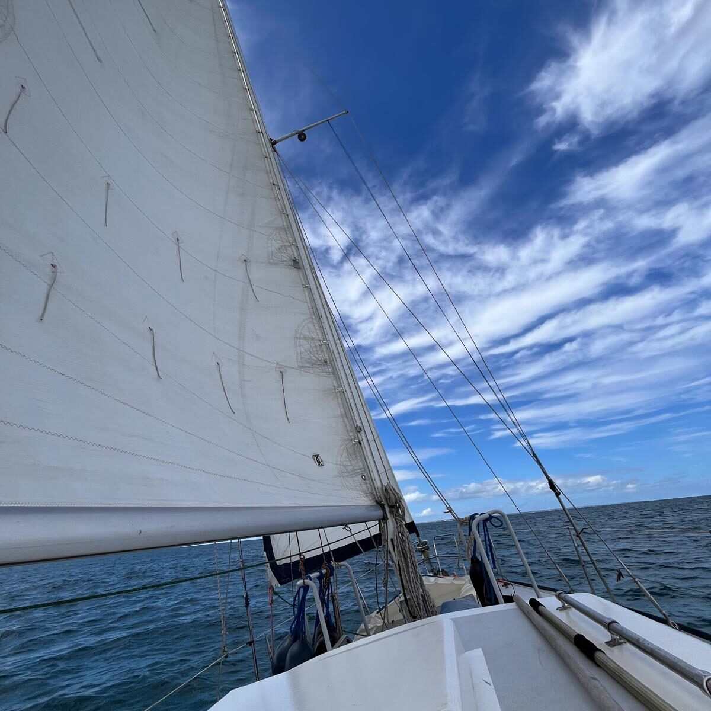

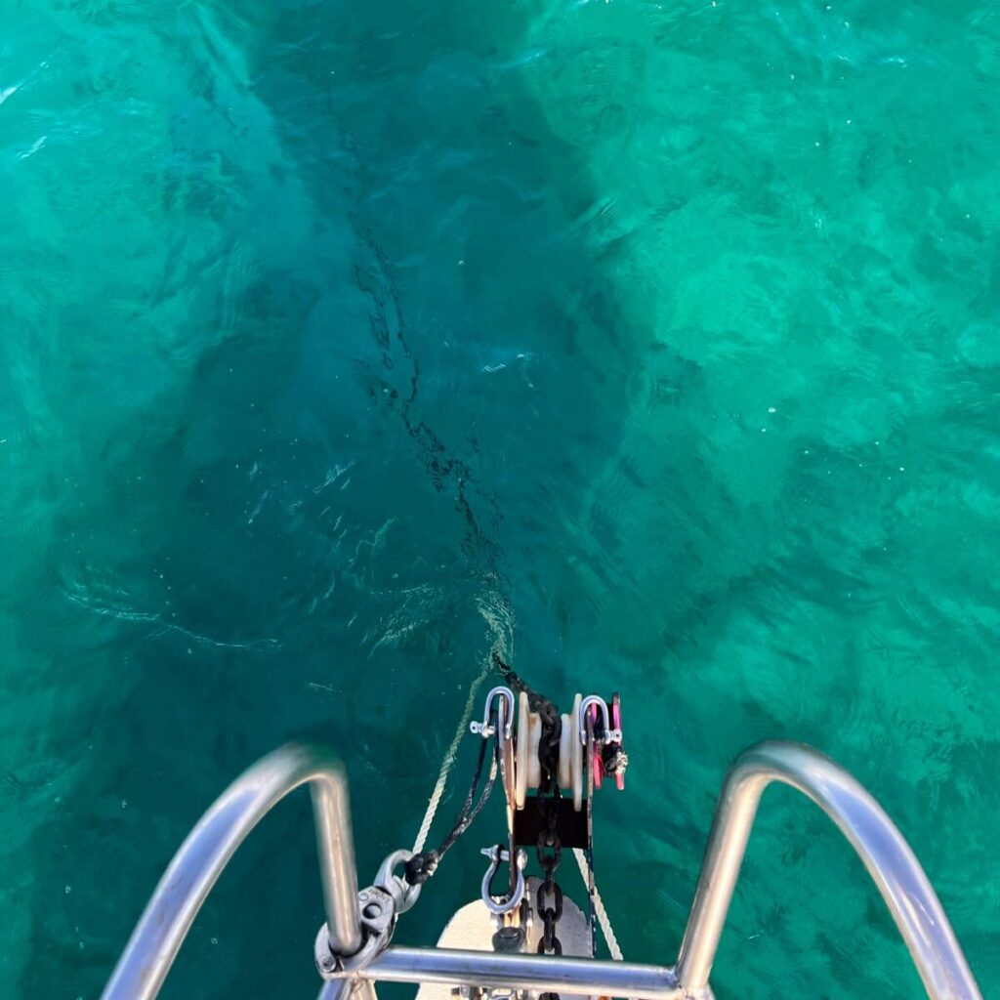

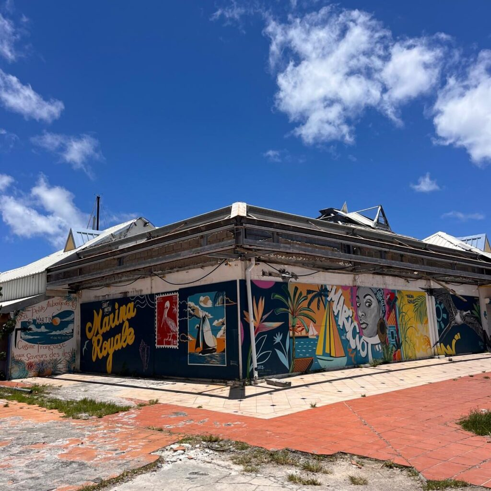

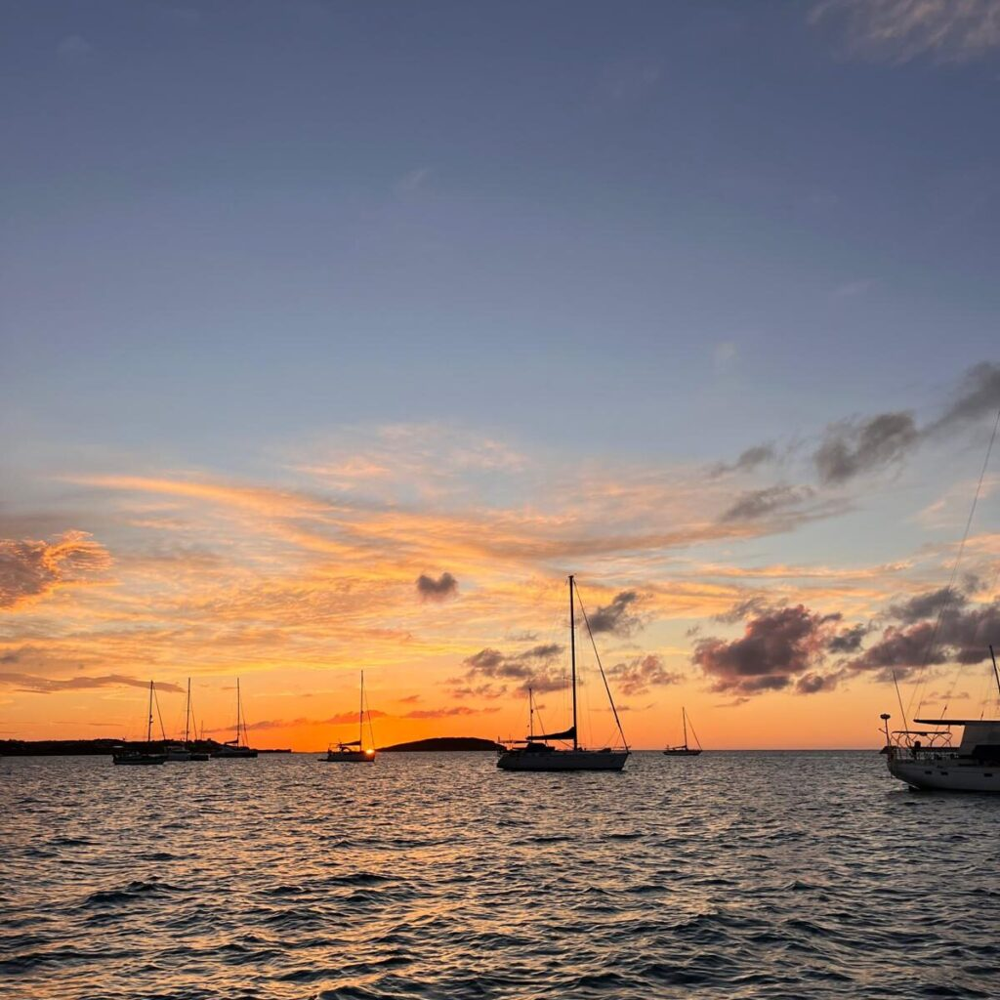

## Moment van de waarheid

En dan breekt de ochtend aan waar we al maanden naar uitkijken: UPS is op bezoek geweest bij ons afleveradres en heeft inderdaad twee dozen afgeleverd! Diezelfde middag staat Leo (onze held!) langs de baai met in zijn achterbak onze cadeautjes. We snellen jubelend weer terug met onze grootste gezamenlijke investering ooit, en kunnen niet wachten om het karton er af te trekken.

We hevelen de zeilen over van *Storm* naar *Luwte* en hoewel ik ergens nog het geduld vandaan trek om Jen te vragen of zij de dozen wil openen, ben ik als een kind zo blij als ze zegt dat ik die eer mag nemen. Voorzichtig snijd ik de tape door en vouwen we de dozen open. Het *navy blue* van de hoezen komt tevoorschijn en als ik met trillende handen het touwtje heb losgeknoopt komt een maagdelijk wit licht ons toeschijnen. Strak opgevouwen, zonder kreukels, stijf en knisperend *dacron.*

De lange zeillatten, die in het zeil worden gedaan om het zeil te vormen, zitten strak in elkaar opgerold en worden met heel veel *tiewraps* bij elkaar gehouden. Ik maak ze één voor één los en dat gaat heel lang goed, tot de laatste. Die knapt spontaan door alle spanning die hij opeens in zijn eentje bijeen moet houden en de ruim drie meter lange latten schieten met een enorme klap open. We houden het maar op een wat enthousiast “hallo hier zijn we!”, waarvan er eentje in mijn gezicht eindigt…

We rollen het grootzeil uit over ons dekhuis en ik inspecteer alle details waarvan ik bang was dat ze zouden zijn overgeslagen, of verkeerd zouden zijn geïnterpreteerd door de producent in Hong Kong. Maar alles ziet er goed uit. De stiksels zijn doorgevoerd zoals ik had besteld en de vele lederen details die slijtageplekken beschermen zijn netjes met de hand opgezet. Er zijn een paar details die ik anders in mijn hoofd had, maar daar worden de zeilen niet slechter om. We knopen de val aan de top en hijsen hem de mast en de giek in. Hij past! Geen meetfouten.. Een pak van mijn hart. De fok is zo mogelijk nog mooier. De tri-radiale snede is keurig afgewerkt voor *off-shore* werk en de UV-bescherming zit er strak op. Als we hem oprollen wordt het een keurig gevormde, strakke koker om ons rolprofiel heen.

Er zijn een paar dingen nét anders waardoor we er nog wel een halve dag mee bezig zijn om alles op z’n plek te krijgen. Zo passen onze oude harpen niet lekker en zijn onze reeflijnen voor het nieuwe grootzeil te kort. Bij het doortrekken van de nieuwe reeflijnen schieten die natuurlijk de giek in, en zijn we een paar uur pielen verder. Dat is een beetje als kabels trekken zonder het juiste gereedschap. Uiteindelijk tape ik de harpoen en een paar stukken aluminium buis aan elkaar om een lange grijphaak te maken die in de giek de lijn kan pakken. Jen is op dat moment aan het bellen met een oude kennis die bij een bedrijf werkt waar Jen haar oog op heeft laten vallen voor na terugkomst. Ik probeer zo stil mogelijk te zijn, maar dat is net als stiekem je huis binnensluipen als je te laat bent. Dan valt alles natuurlijk continue uit je handen…

Ze zitten er op. En ze lijken te passen. Van verschillende kanten krijgen we aangeraden om wel nog een proefvaart te maken, maar er is overmorgen een weergaatje naar boven en dat betekent dat we in de riedel van standaard laatste klusjes voor vertrek komen. Nog een keer boodschappen, nog een keer langs de bootjeswinkel, water tanken, diesel tanken, bijboot op het voordek, windvaan er weer op, et cetera et cetera. Ze passen en het zal wel goed zijn. Onze oude zeilen liggen zo strak als maar kan opgevouwen in het vooronder, dus als er tóch nog iets niet goed is kunnen we in geval van nood op zee de zeilen wisselen. Eerst maar eens weg zien te komen.

Wie overigens denkt dat we weer veel op onze hals halen, zo vlak voor vertrek: De *Jonathan* staat hier op de werf en die halen *en passant* de kiel onder hun schip uit om die opnieuw te monteren. Een klus die op zichzelf al spannend is, maar hier, ver van je bekende adresjes en alternatieven voor als het niet lekker uitpakt, een heldendaad op zich. Ik had graag mijn handen uit de mouwen gestoken, maar met onze eigen voorbereidingen erbij kunnen we niet veel meer doen dan ons metaalbewerkingsgereedschap en kitspuit uitlenen, en aan het eind van de werkdag die kant op scheuren om koud bier te brengen.

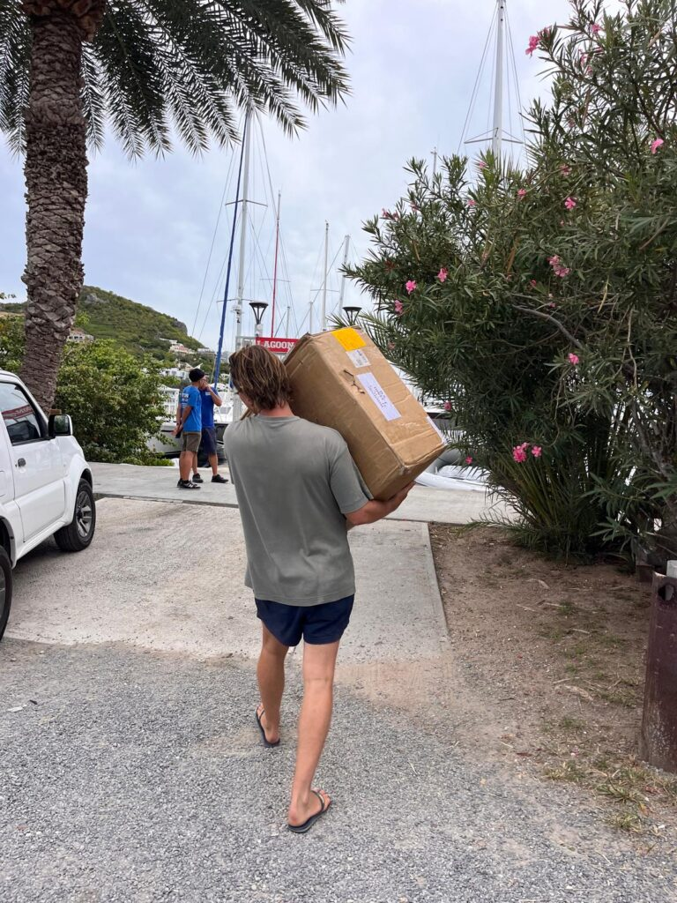

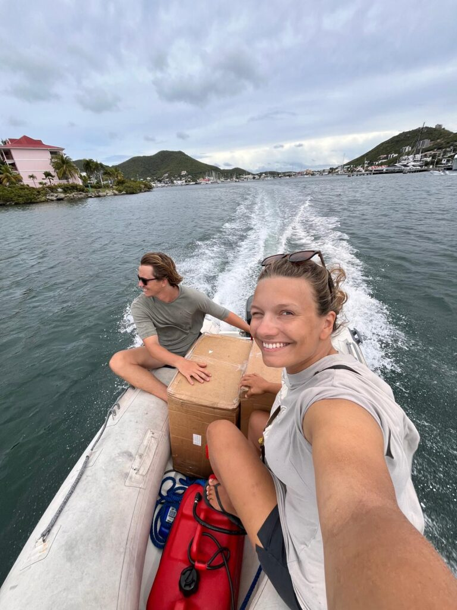

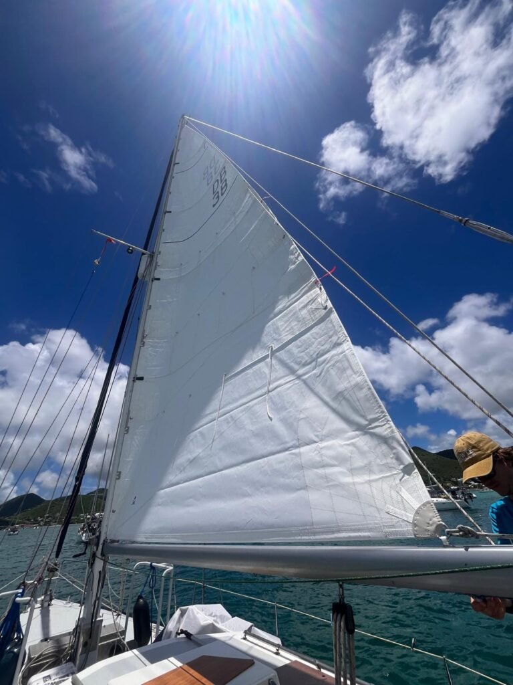

## Tijd voor zee

Morgenmiddag willen we uitvaren. Het heeft lang genoeg geduurd en het weer naar boven toe ziet er perfect uit. We weten nog niet precies waar we heen willen. Jen wil naar Canada. En ik vind het helemaal geen straf om daar in mee te gaan. Maar de route naar de Azoren ligt met het voorspelde weer veel beter voor de hand. In beide gevallen varen we de eerste twee dagen ongeveer recht naar het noorden, richting Bermuda. We besluiten dus uit te varen zonder plan, en met drie mogelijke bestemmingen voor ogen.

Voordat we kunnen uitvaren willen we nog even de haven in om de watertanks te vullen, de accu’s vol te laden en diesel te bunkeren. De haven schijnt geheel naar Franse cultuur erg rigide te zijn en alleen plek te hebben voor schepen die hebben gereserveerd. Dat de haven voor meer dan driekwart leeg staat verandert daar niets aan. Echter, op de aanvraag voor reserveren wordt niet gereageerd, dus varen we na overleg met een portier die verder geen idee heeft, toch maar gewoon binnen en leggen we onze lijntjes nog even aan de kade.

Als we de waterslang uitrollen en de stroomkabel uit de knoop hebben, krijgen we te horen dat er tot morgenmiddag voor ons geen faciliteiten zijn. Water en stroom worden per ligplaats geactiveerd en de dame die de schakelaar van *uit* naar *aan* mag omzetten is vandaag niet op kantoor. De bewaker maakt ons duidelijk dat het ons probleem is en of we hem niet meer willen storen, want hij is op zijn telefoon een voetbalwedstrijd aan het kijken. Het is maar goed dat Jen deze gesprekken voert, want ik sta inmiddels witheet op onze boot op te ruimen om maar iets voorhanden te hebben. Ze toont maar eens te meer aan iets meer veerkracht te bezitten dan ik, en struint de haven op, op zoek naar een ander schip met mensen aan boord. De paar boten die wel in de haven liggen, zijn namelijk allemaal voor de verhuur.

Een half uur later komt ze met verbrande voetzolen terug. Ze was vergeten schoenen aan te trekken en de steigers worden gloeiend heet in de brandende zon. Aan het eind van de haven ligt een boot met oudere Franse mannen die het prima vinden om hun water en stroom te delen. We gooien los van de kade en kiezen zelf ons plekje wel uit aan de steiger verderop, die bij nader inzien een stuk hoger blijkt te zijn dan verwacht. Het is wel duidelijk dat deze haven niet is ingericht voor het standaard plezierjacht. Enfin, de watertanks lopen vol en de accu’s krijgen stroom. Daarvoor kwamen we.

Normaal gesproken halen we in dit klimaat niet meer dan een handvol activiteiten en klusjes per dag. Op een goede dag. Dus met de afgelopen dagen in ons kielzog zijn we een beetje afgepeigerd, maar hijsen we onszelf toch nog één keer *Storm* in voor een afscheidsborrel met alle jongelui hier in de baai. We hebben moeite om onszelf los te weken in het speciaalbiercafé, maar met slechts één teveel op, knuffelen we iedereen die we misschien wel, of niet meer gaan zien binnenkort, en wandelen samen terug naar de kade waar *Storm* ligt te wachten.

In de koelte van de ochtend laden we Storm aan dek, hijsen we de motor naar binnen, en ruimen we de laatste zaken op. Volgens de dame van het havenkantoor is het druk bij de tankkade en kunnen we pas om 11.00 uur terecht. Er komt inderdaad nog één jacht naar binnen voor ons, maar we vinden het wel best. We willen gaan, maar nog even een uurtje rust in de tent en tijd om de allerlaatste puntjes op de *i* te zetten is ook wel lekker. We gooien daarna de tank vol en dan gaan de lijnen los en naar het vooronder. We zijn op weg naar hoge breedte.

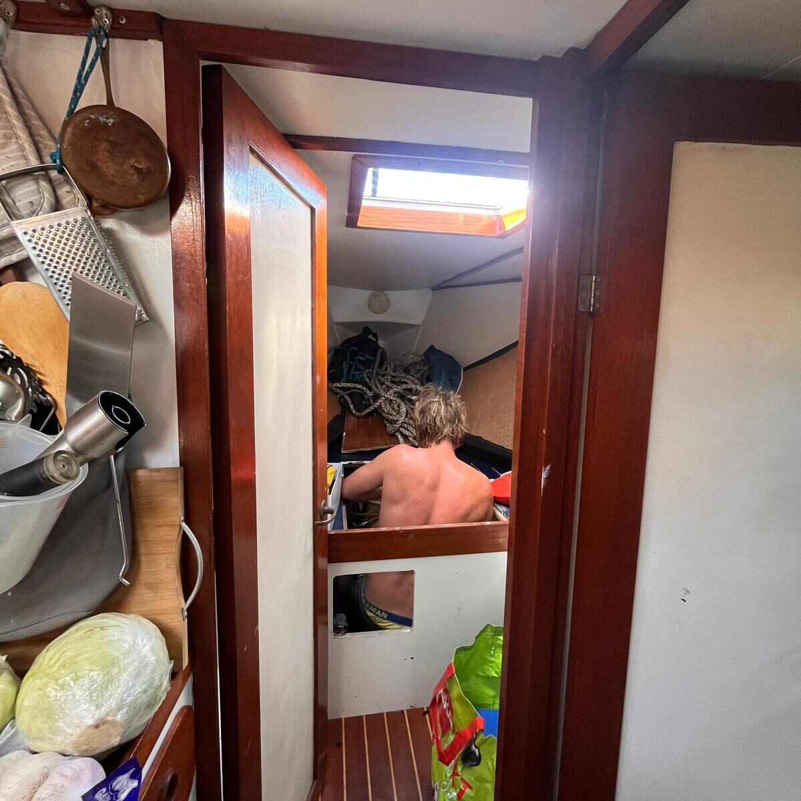

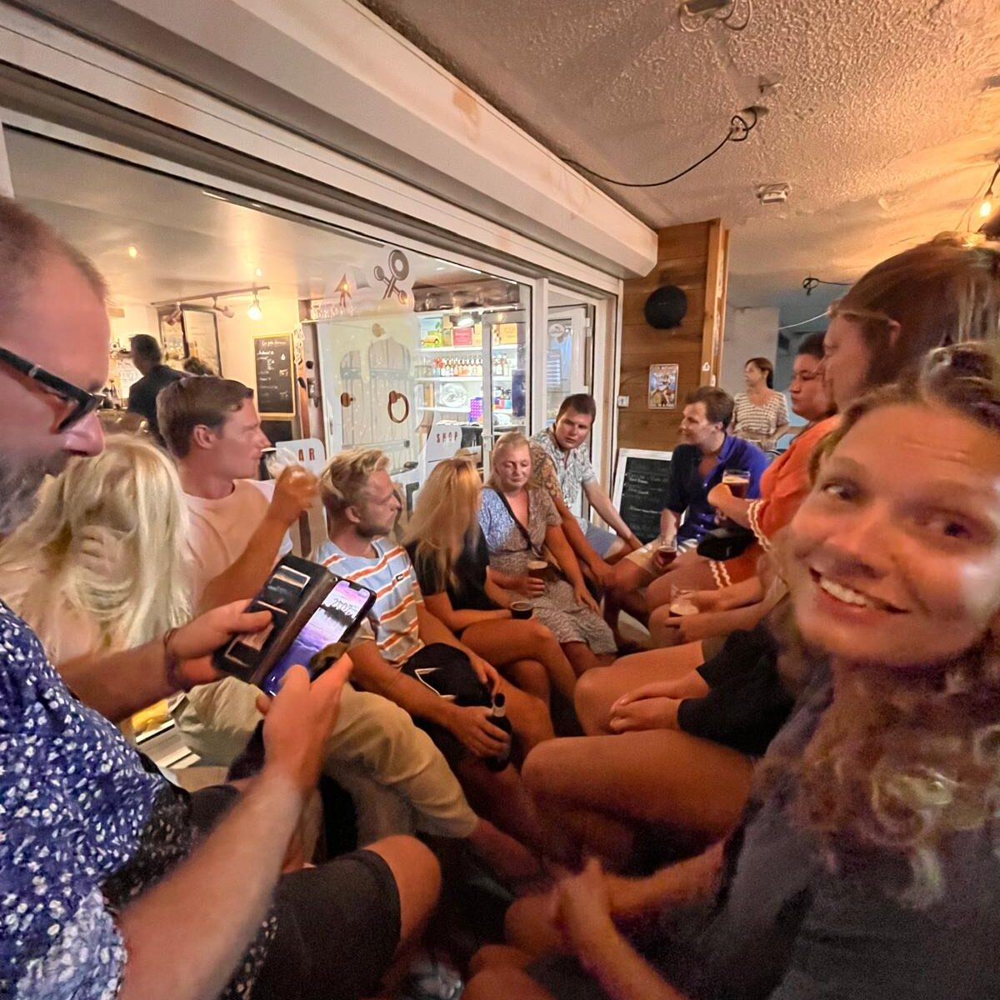

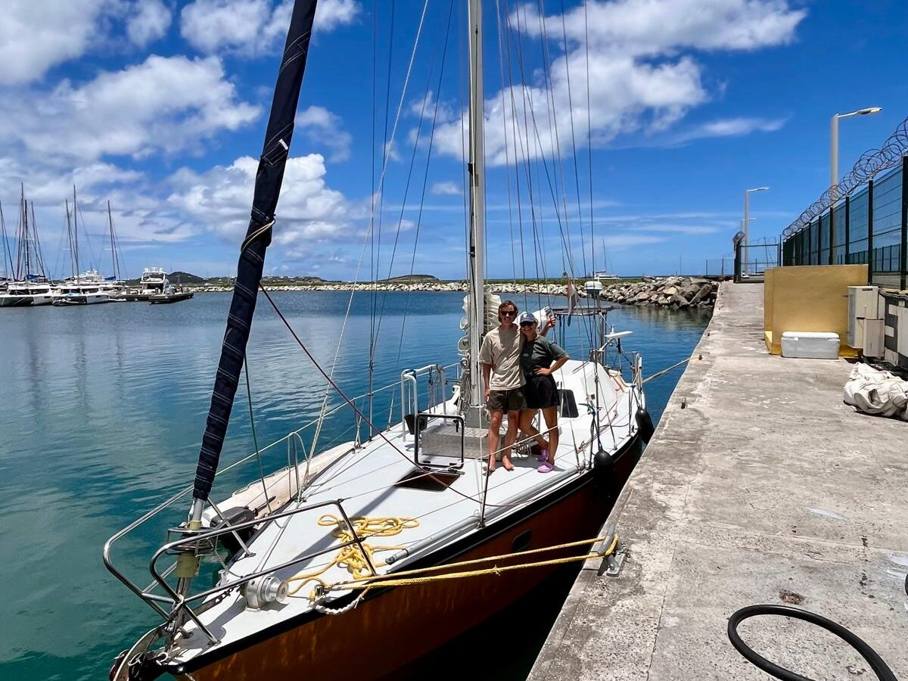

## **Mee op de wind**

Er staat een rustig passaatwindje langs St Martin en we hijsen onze zeilen. Ze staan stijf en mooi in vorm, en zodra we onze boeg van de wind af draaien en de wind wordt gevangen, voelen we *Luwte* versnellen. In de vlagen merken we verschil in het “uit het roer lopen”, makkelijker snelheid maken en als we achter het eiland uitkomen waar de passaat wat begint te blazen, hoeven we niet eens te reven! Het gaat gewoon sneller en sneller, zonder dat we enorm aan de helmstok hoeven te hangen om de boot in bedwang te houden.

Zo inspecteren we onze aankoop in de eerste mijlen. We gaan overstag, verstellen nog wat schootblokken en richten dan onze punt op de noordkant van Anguilla. Hoog aan de wind trekken we *Luwte* op één oor en springen we door de golven. Het gaat wat hard, maar we hebben liever nu een goede test van de materialen, dan halverwege de oceaan. Alles blijft mooi staan en we zijn dik tevreden. Hiermee willen we wel oversteken!

Het noordelijke puntje van Anguilla is nét niet bezeild en we moeten nog een klap terug naar St Martin maken. Het begint langzaam te schemeren en we merken dat de golven al langer beginnen te worden als we van het continentaal vlak af komen en de zeebodem op een kilometer of anderhalf onder ons ligt. Met behulp van de kaarten maak ik een schatting van hoe ver we door moeten varen om de punt te halen, en als dat zover is gaan we overstag. Ik wil van de gelegenheid gebruik maken om even te toetsen hoe alles staat als we gaan bijliggen, dus laten we de fok staan en komen we stil te liggen. De fok moet nog een stukje verder in om mooi in balans te komen. Dat is goed om te weten, mocht het echt hard gaan waaien.

Als laatste test voordat we het bereik van land achter ons laten wil ik de motor nog een half uurtje laten draaien. Ik heb gisteren alle filters en de impeller vervangen en wil zeker weten dat alles goed zit. Bij het starten merk ik meteen dat er geen koelwater uit de motor komt. We zetten de motor weer uit en halen de kappen er af. Dat we zijn gaan bijliggen is mooi meegenomen, want alles is binnen rustig en beheerst. Ik maak de impellerbehuizing nogmaals open en controleer of de o-ring netjes op zijn plaats zit, maar dat lijkt allemaal goed te zitten. Nog maar eens starten, maar weer geen koelwater. Dan alles stap voor stap nog maar eens nalopen. En wat blijkt: ik ben de *wierpot* vergeten te ontluchten. De wierpot is en soort plastic emmer met gaas erin die er voor zorgt dat eventueel zeewier dat je naar binnen zuigt met het koelwater, niet in de motor terecht komt. Voor het wisselen van de impeller is die leeggelopen en hoewel we in de haven bij wegvaren nog wel koelwater hadden, liggen we nu onder helling en zuigt hij zichzelf niet goed vol. Vijf minuten later zit Jen vol ongeloof te kijken als er weer water uit de uitlaat komt en ik het mysterie heb opgelost.

We ronden de kaap van Anguilla rond zonsondergang en kijken nog één keer achterom naar onze laatste aanblik van het Caraïbisch gebied. De ochtend er na worden we wakker op open zee. In de eerste vijf logboeknotaties van deze trip vullen we bestemming “Canada” in. De dagen lopen snel in elkaar over op een vrij vlakke zee. De route die we hebben uitgestippeld loopt in alle gevallen eerst recht naar het noorden en daardoor hangen we sinds het puntje van Anguilla rustig over bakboord met halve wind. De oceaandeining is lang en traag en we glijden, geholpen met de stroming, met meer dan zes knopen over de golven. Inslingeren op deze manier is helemaal geen straf en we slapen allebei veel.

Het is wel heet. Heel heet. De lucht is blauw en de zon is fel. Zo nu en dan komt er een beetje spatwater over het dekhuis en al is het maar eens in het half uur, het raam moet daardoor dicht blijven. Ondanks de raamluiken, die we tegen de golven hebben gemaakt, maar vooral hun waarde hebben bewezen als schaduwluiken, verandert het binnen een beetje in een broeikas. Buiten zitten in de in de felle zon is niet veel beter. Het bijkomende voordeel is dat de nachtwachten fijn en rustig zijn in vergelijking met de dag. We eten de laatste verse *poulet-rôti* op en zien op de weersvoorspellingen dat het voorlopig alleen maar beter wordt.

Dagen en nachten zijn nog altijd even lang. Om zes uur komt de zon op, en om zes uur gaat hij ook als een vallende ster weer onder. Verder is de zee leeg. Na een uur of twaalf is het laatste schip van onze AIS verdwenen en sindsdien hebben we geen teken van leven meer gezien. Het sargassowier, dat ons al zoveel ellende heeft bezorgd, is tegen onze verwachting in snel aan het uitdunnen en de windvaan doet haar werk. We hebben elke dag e-mail contact met *Belafonte*, die een stuk westelijker van ons ook omhoog vaart richting New York, en de *Nova Mahea*, die ten noord-oosten van ons over het water vliegen naar de Azoren.

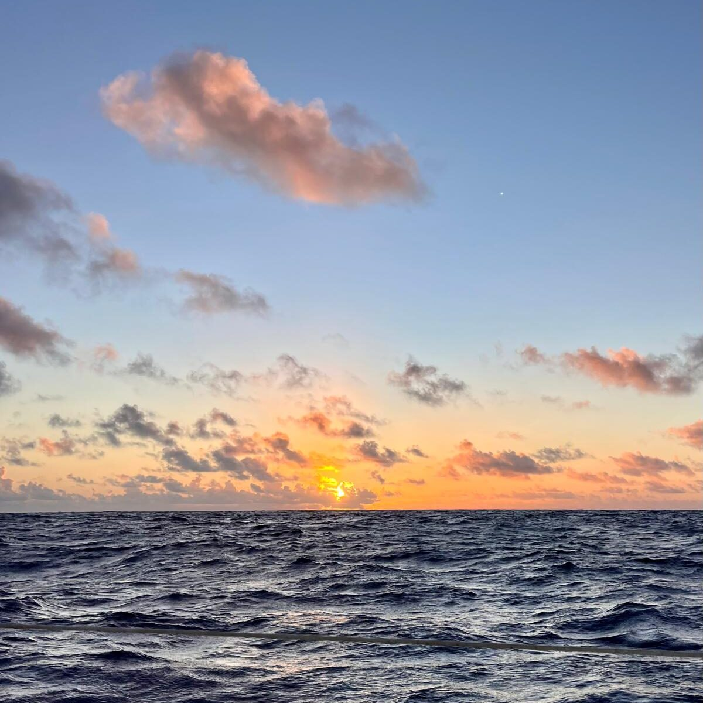

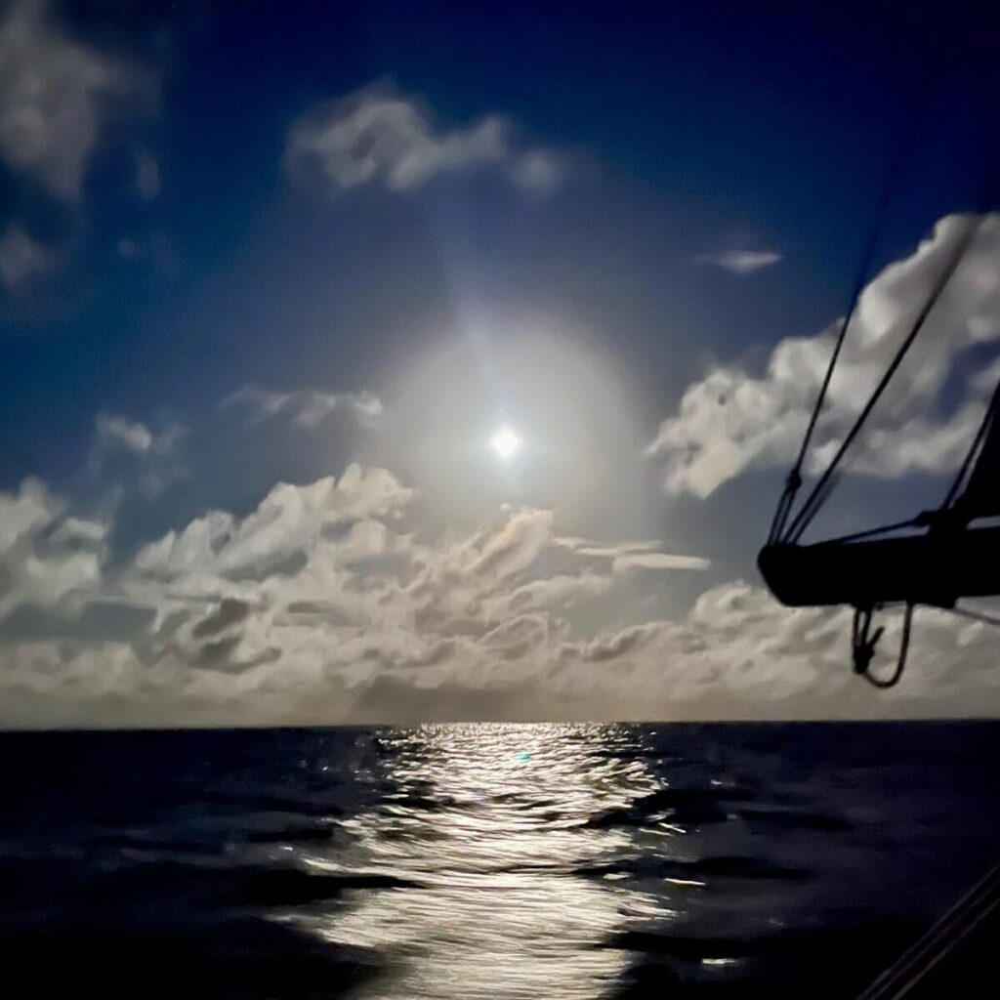

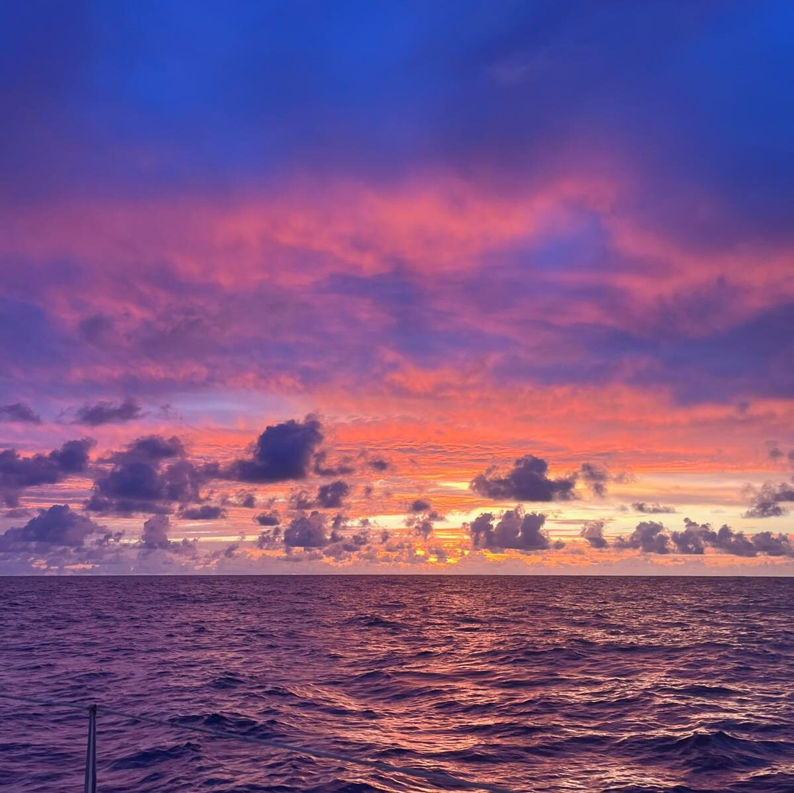

Al vanaf de tweede dag hebben we, in de paar uur dat we samen we wakker zijn, een doorlopend gesprek over onze bestemming. Het weervenster om direct naar Canada te varen lijkt zich niet de goede kant op te ontwikkelen, terwijl de route naar de Azoren helemaal op een presenteerblaadje wordt klaargelegd. Vanaf de wal kijkt papa mee en probeert ons te verleiden om de behouden keuze te maken richting de Azoren. Ik neig in die school mee te gaan, maar mijn wederhelft heeft haar zinnen gezet op het ruige Canada en het avontuur om daar te komen. Op 13 mei, vier dagen na vertrek maken we onze definitieve keuze en verandert onze notatie in het logboek naar “Bermuda”. We geven Canada anderhalve week de tijd om een weervenster open te zetten en als zich voor die tijd geen mogelijkheid aanbiedt, varen we naar het oosten richting de Azoren.

Met die keuze gemaakt, verandert ons tempo volledig. We hoeven ons alleen nog maar zorgen te maken over de vierhonderd mijl voor ons en die ziet er de komende week prachtig en rustig uit. De wind valt weg en we zetten de gennaker bij om toch rond de drie knopen de goede richting in te blijven gaan. De zee is volledig vlak en het voelt alsof we op vakantie naar de Markerwadden aan het zeilen zijn op een lome zomerdag. De temperatuur is merkbaar aan het dalen naar een hele comfortabele 24 graden Celsius en de dagen beginnen langer te worden. Ik verveel me voldoende om nog eens achter mijn oren te krabben waarom we nou al enige tijd moeite hebben om genoeg stroom op te wekken, en na wat geschuif in stekkers en prikken met de multimeter kom ik er achter dat één van de kabels is ingewaterd en vrijwel geen spanning meer doorlaat. Aangezien de zonnepanelen met elkaar doorverbonden zijn, komt het er op neer dat het eigenlijk een wonder is dat we überhaupt nog wat opwekken. Een uurtje knutselen later gaat de schakelaar weer om en komt er in plaats van 8 opeens 30 ampère over de toonbank. De ijsblokjesmachine gaat aan en het leven is weer gemakkelijk.

De acht potten rode biet met appel, die al sinds vertrek naast hun gewicht als ballast geen enkele functie hebben, worden met kikkererwten gemalen en door Jen omgetoverd tot falafelbolletjes. We vangen een vis, maar die laat ik uit mijn handen glippen en glijdt zo terug de oceaan in. Toch nog maar een broodje falafel dan. Ook geen straf.

Na een dag dobberen afwisselen met de motor draaien, steekt er ’s nachts een klein briesje op. Het grootzeil stond al op tegen het heen-en-weer rollen op de golven en Jen rolt de fok erbij uit. De motor wordt stil en terwijl ik in een nog diepere slaap beland knutselt Jen met de windvaan totdat ze goede vriendinnen zijn geworden en de elektrische stuurautomaat ook uit kan. De rust keert weder en een paar uur later word ik uitgeslapen wakker gemaakt. Slapen met het geronk van de motor gaat ons allebei wel prima af, maar de ontstane stilte vlak na het stoppen van de cilinders is het mooiste en diepste stilte die er bestaat.

Aangezien onze eigen weersvoorspellingen en navigatie inmiddels rechttoe rechtaan naar het noorden zijn, stort ik mij maar op *Belafonte* als zeevarende-wal-weerman. Zij liggen vlak onder een lagedrukgebied dat zich gaat ontwikkelen en moeten eigenlijk afremmen, terwijl de wind niet ongunstig is om door te stoten. Met behulp van *Starlink* kan ik de onweerswolken goed in kaart brengen en kan ik niet anders dan concluderen dat hun eigen plannen de juiste zijn.

## Bermuda aan zee

En zo dobberen wij voort richting het noorden, totdat er weer schepen om ons heen verschijnen op de AIS en sporadisch de kustwacht doorkomt op de marifoon. Pas als we op een mijl of vijftien zijn, zien we in de verte een platte pannenkoek midden in de oceaan opdoemen: Bermuda. De restanten van een oude vulkaan die nog net een paar meter boven de zeespiegel uitsteken. We maken contact met de kustwacht en raken even verstrikt in een misverstand als zij vragen naar kanaal 26 over te schakelen. Daarop blijken zij mij wel te kunnen horen, maar ik hen niet. We handelen ons gesprek verder af op kanaal 16 en we krijgen toestemming om binnen te varen. De miscommunicatie blijkt een verschil in programmering van de frequenties te zijn tussen Nederland en Bermuda (en veel andere landen). Het is in de Nederlandse *ether* wat drukker dan hier, en daardoor is een deel van de marifoonkanalen opgeofferd om een betere dekking te verzorgen voor mobiele telefonie en andere verbindingen. Ik ben vlak voor vertrek nog speciaal naar de watersportwinkel geweest om onze marifoons te “updaten”, maar concludeer uiteindelijk dat het vooral een *downgrade* van onze apparatuur is geweest. Gelukkig staan er in de twee uur tussen de ontdekking van het probleem en onze binnenkomst op Bermuda een aantal Y-leden van de vereniging klaar om ons te helpen achterhalen waar het probleem in zit, en kan ik al voor het donker wordt deze hersenkraker achter me laten.

“Het venijn zit hem in de staart”. Mama waarschuwt ons elke tocht weer op het laatste stukje voor de haven. En ook hier komt haar voorspelling weer uit. Het is niet écht erg, maar na drie dagen sukkelen op een vlakke oceaan is een smalle aanloop met riffen opeens best venijnig als de wind plotseling weer opsteekt en ons op één oor drukt. Gelukkig zijn de golven meteen weg zodra we aan de oostkant van het eiland komen en kunnen we in redelijk kalm water de zeilen laten zakken en door het smalle geultje de *lagoon* in lopen. Het is een vrij bizarre sensatie. Net zaten we midden op de oceaan en vijf minuten later liggen we in een van alle kanten beschutte baai met ondiep water. Er liggen enkele tientallen andere boten voor anker. Een deel met ARC-vlaggen, die hier gezamenlijk hun tussenstop maken richting de Azoren. Wij zoeken een plekje naast de geul en laten de ketting ratelen. Er gaat een flesje bubbels open en we bellen het thuisfront om te melden dat we goed en wel zijn geland op de plek waar we eigenlijk niets te zoeken hebben, behalve dan een stukje ankergrond voor de komende dagen..

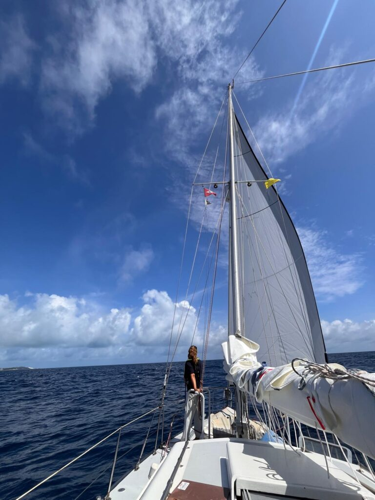

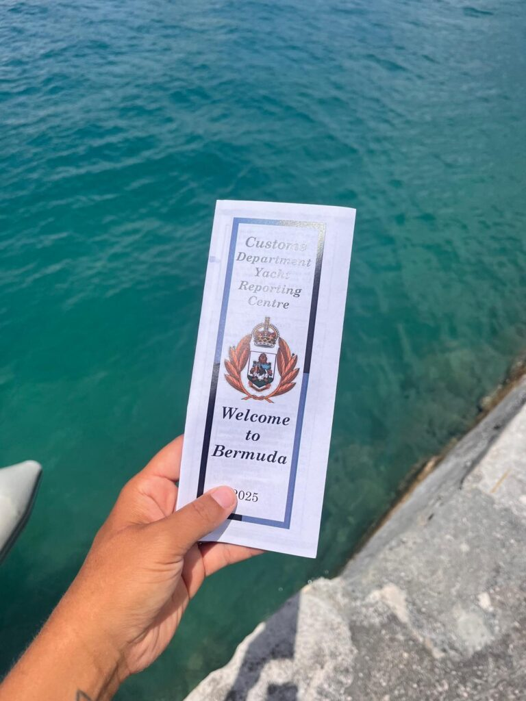

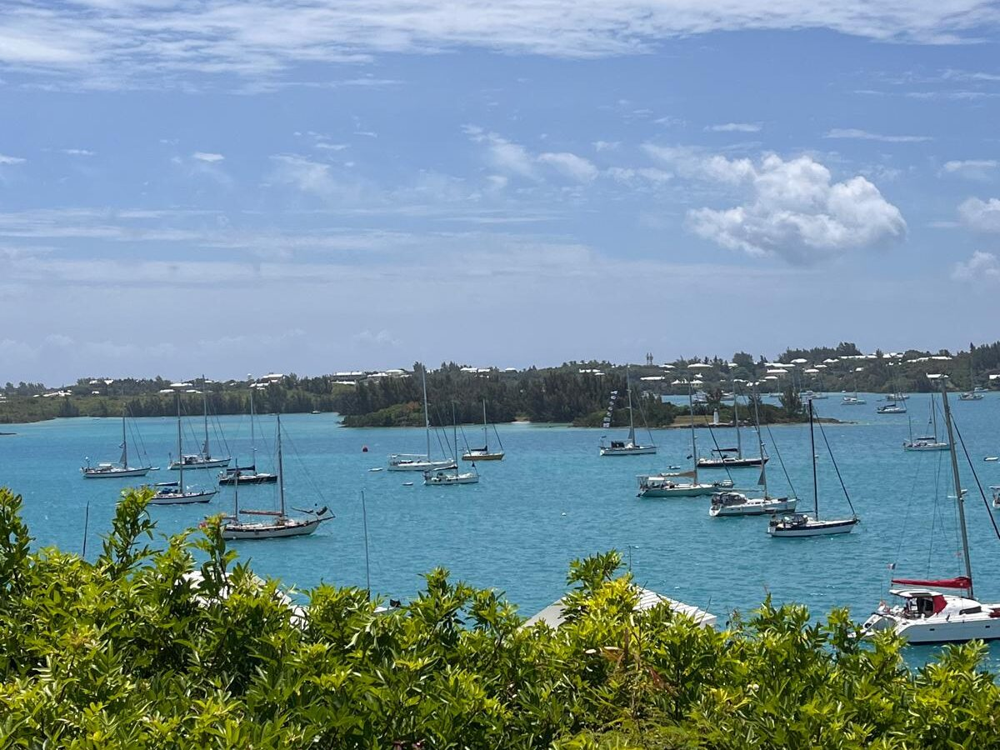
