’s Nachts plot ik onze route aan de lopende band opnieuw. Nog altijd een beetje vertwijfeld over onze keuze. Er zijn twee routes door de golfstroom heen. Via het westen, of via het oosten. De Engelse buurman van de *Aura,* die op Bermuda naast ons lag, heeft een weerman ingehuurd om hem te adviseren en kreeg de westelijke route aangeraden, terwijl ik zelf tot de conclusie was gekomen dat de oostelijke route beter te doen was voor ons.

Ik lees de informatie nog eens door en besluit dan bij mijn eigen standpunt te blijven. Ik snap het advies van de weerman, maar het verschil tussen *Aura* en *Luwte* is een gemiddelde bootsnelheid van 7 vs. 4.7 knopen. Op een etmaal maakt dat een groot verschil en daarmee kunnen wij dus het advies simpelweg niet volgen. De oostelijke route is wat complexer, maar ook een stukje korter.

Als het om een uur of half zes begint te schemeren wisselen we van wacht. Er staat nog steeds niet genoeg wind om te zeilen, maar hier en daar beginnen de rimpelingen over het water te ontstaan. Dat we de eerste twaalf tot veertien uur afhankelijk zouden zijn van de motor wisten we bij vertrek, maar we zijn zoals altijd maar weer wat blij als het geronk een paar uur later ophoudt en *Luwte* over een rustige zee door het water glijdt.

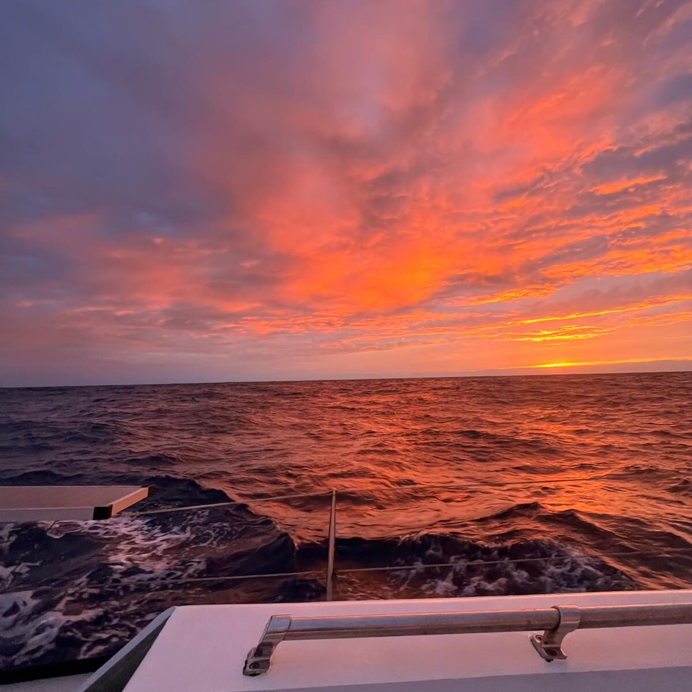

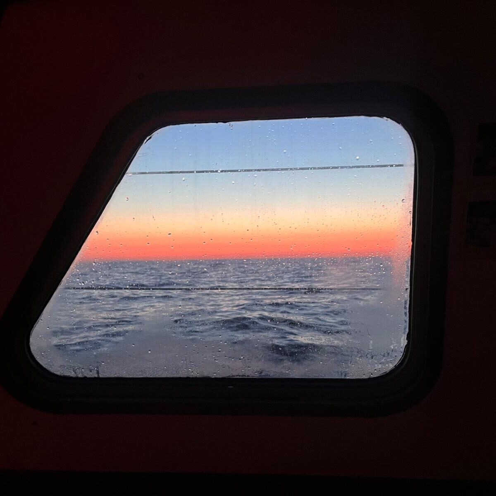

Op aanraden van een Nederlands echtpaar dat ook richting Nova Scotia gaat, hebben we ons wachtschema aangepast en draaien we de eerste dagen continue wacht. Hierdoor slapen we meer en kunnen we er voor zorgen dat we uitgerust zijn als we slecht weer, of de golfstroom door moeten kruisen. De dagen en nachten lopen vanaf het eerste moment door elkaar heen, maar al snel liggen we stabiel met halve wind op onze stuurboordzijde en is het een kwestie van omhangen en genieten van het laatste restje mooi warm weer dat we hier hebben. ’s Middags zien we elkaar in de uurtjes dat we allebei niet echt lekker slapen door de hitte. Na elf maanden zeuren lukt het me eindelijk om Jen zo ver te krijgen mijn haar te knippen. Vlak voor vertrek kreeg ze van mijn vader een kappersschaar cadeau om onszelf een beetje toonbaar te houden, maar tot dusver hebben we beiden onze poot aardig stijf gehouden en is mijn haar lang geworden. Op Martinique ben ik voor het laatst naar de kapper geweest, maar die weigerde mijn haar kort te knippen omdat ze het te mooi vond. Inmiddels hangt het weer continue in mijn ogen en word ik er tureluurs van tijdens zo’n beetje alles wat ik moet doen. Ik neem dus plaats op de kuipvloer en de nog nooit gebruikte, maar inmiddels wel verroeste kappersschaar laat de plukken in het rond vliegen. En kapper Jenny kijkt een half uurtje later erg tevreden naar haar versgeknipte man.

Een lagedrukgebied dat langs Nova Scotia, zo’n 400 mijl verderop, raast heeft een grote uitloper met een koufront achter zich aan hangen. ’s Nachts zien we ver aan de horizon een lange rij flitsende wolken voorbij trekken, maar bij ons is het gelukkig nog droog. Het is de derde ochtend sinds vertrek en we worden wakker zonder blauwe luchten. Hier en daar breekt de zon door, maar het is duidelijk dat het weer aan het veranderen is. De barometer zakt in een paar uur van 1020 naar 1012 hPa en we maken ons klaar voor slechter weer. Tegelijkertijd varen we de golfstroom in. Daar is gelukkig weinig aan te merken, behalve dat we een stukje sneller en oostelijker varen dan eerst. Jen maakt nog een kopje thee voor me en duikt dan snel in bed om nog even lekker te slapen. De golven beginnen wat hoger om ons heen te worden en hier en daar zien we een schuimkop.

Niet veel later sta ik op het voordek. Jen zit met slaperige ogen in de kajuitingang om mijn stappen aan dek in de gaten te houden. De wind is gedraaid en komt nu meer van achteren, waardoor grootzeil en fok elkaar de wind ontnemen en er bovendien een risico op gijpen ontstaat. Ik trek het grootzeil naar beneden en klim op het dekhuis om de flappen over elkaar te vouwen. Jen geeft vanuit de kuip de bandjes aan en een minuut of drie later zitten we weer binnen en is de rust wedergekeerd. Een half uur later danken we onszelf voor ons preventieve gedrag en rol ik de fok een stukje in bij het overtrekken van de eerste regenbui. Daarna schuif ik de luikjes dicht en ga verder in mijn boek. Alle boeken van zeilavonturiers die we mee hebben zijn inmiddels uit, maar Jen heeft mij zover gekregen om te starten aan *De Glazen Troon*, een soort Harry Potter voor volwassenen, en die leest op zee lekker makkelijk weg.

Eens in de tien minuten steek ik mijn hoofd uit het raam om in te schatten of de donkere wolken om ons heen langstrekken, of over komen. Zo gaan we de wisselvallige dag door. De wind is nog altijd goed te behappen en op alleen de fok en een beetje hulp van de golfstroom lopen we 5.7 knopen gemiddeld. ’s Middags halen we het weer nog eens op en zien we dat het voorspelde koufront in de komende 24 uur wel over zal trekken. We eten, slapen, lezen en kijken omstebeurt wat films om de tijd door te komen. Die nacht trekken de onweersbuien vlak langs ons en zien we hier en daar bliksemschichten door de wolken schieten. Ik trek de *Offshore Cruising Encyclopedia* nog maar eens open en lees het hoofdstuk over schade door onweer door. Het hoofdstuk eindigt met onderstaande citaat:

 *One of the advantages of a metal boat is that it offers a huge amount of area in contact with sea to both relieve static charge and dissipate lightning energy. In fact, I have yet to hear of a metal boat being hit.*

Goed. De rationele ik is weer gerustgesteld. Maar met dikke bewolking voor de sterren en de maan, een aanzwellende zee en wind, en een lucht die elke anderhalve minuut door Thor wordt opgelicht, voelt *Luwte* maar klein en kwetsbaar, en in zekere zin het enige doelwit in de wijde omgeving. Voor de zekerheid gaan de *Garmin tracker*, een volle powerbank, de handmarifoon en een telefoon de oven in. Hoewel ons hele schip een *kooi van Farraday* zou moeten zijn bij inslag, is mijn gedachte dat het maken van een *kooi van Farraday in een kooi van Farraday* een kleine moeite is, en zo zekerheid biedt om in ieder geval te kunnen blijven communiceren en onze positie te bepalen. De rest van de nacht blijft wisselvallig. Hier en daar trekt wat regen over. Jen rolt de fok een paar keer een beetje in- en uit tussen de buien door en dan is het alweer ochtend en lijkt het helderder te worden.

Als we ’s ochtends de Starlink aanzetten om het weer op te halen, staan er een paar bezorgde ouders op onze digitale stoep. Of we nog leven en alles goed gaat. De tracker geeft al de hele nacht geen update meer. Dat is natuurlijk het nadeel van je tracker in de oven leggen… Een zenuwachtig nachtje voor beide kanten van de oceaan dus.

Jen gaat slapen en ik zit weer lekker in mijn boek als ik een frisse windvlaag naar binnen komt zetten. Het is op dat moment rustig, dus ik word uit mijn boek getrokken en steek mijn hoofd uit het raam. De lucht lijkt letterlijk in tweeën gesplitst. Aan onze stuurboordzijde zien we blauwe lucht met hier en daar een wolk. Aan bakboord is de wereld zwart en lijkt Hades zijn aanstalten te maken om ons een bezoek te brengen. Er staat nog altijd niet veel wind, maar ik besluit de fok voor de zekerheid maar wat op te rollen. Onze snelheid gaat daarmee terug naar 3.5 knoop, maar het lijkt er niet op dat het front toevallig net langs zal trekken.

Tien minuten later trek ik Jen uit bed terwijl ik mijn zwemvest vastklik. Vanuit het niets raast de wind over het dek. Hard genoeg om op alleen de gereefde fok het gangboord in het water te trekken en de windvaan uit haar roer te laten lopen, tot de fok hard begint te klapperen. Het waait hard genoeg voor mij om de knop om te zetten en rustig aan te doen. Je zwemvest goed aantrekken en aangelijnd naar buiten stappen is nu belangrijker dan het redden van onze gloednieuwe fok. We zullen het nooit weten, maar ik denk achteraf dat alleen deze ene situatie de beslissing om nieuwe zeilen te kopen al verantwoordt. Eenmaal buiten vieren we de schoot een stukje en ga ik aan de reeflijn hangen, maar ik krijg hem niet binnen. Uiteindelijk krijgen we hem ingerold door samen aan de reeflijn te hangen en eenmaal opgerold pakt windvaan *Doris* de boel weer op en stuurt ons weer mooi op de golven, zeilend zonder zeilen. Het waait nog altijd onverminderd hard en hier en daar zien we golftoppen die worden afgeblazen, maar aan boord is het rustig. We gaan met zes knopen de goede kant op en alles, inclusief wijzelf, is heel gebleven. Het enige waar ik me nog zorgen over maak zijn ze zonnepanelen, maar ook die blijven zitten waar ze zitten. We gaan naar binnen, doen de luiken dicht en drogen onszelf af. We laten de boel maar even uitrazen zo.

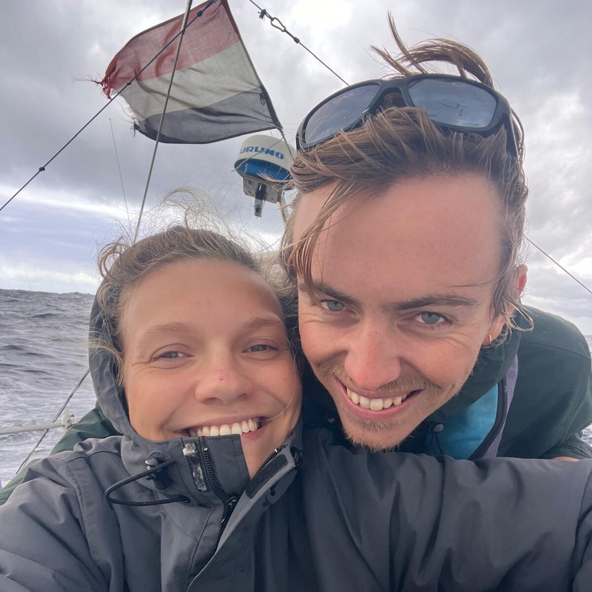

Gelukkig duurt het niet lang. Een klein uur later neemt de wind wat af en rollen we voorzichtig een klein puntje fok uit om gang te houden. Af en toe rolt er een golf van achter of opzij tegen ons aan, maar boven dek blijft alles, op wat sproeiwater na, droog. Het etmaal dat volgt is meer van hetzelfde. In buien trekt de wind aan en wordt het hier en daar wat wild. Er tussendoor blaast de wind met zo’n 25 knopen goed door en is het sportief. Achter het front aan is de wind van zuid-west naar west gedraaid en hebben we het grootzeil weer nodig om koers te kunnen houden. We varen aan de wind en springen door de golven van de golfstroom. Het is kouder aan het worden en het water verandert in een paar uur tijd van blauw naar groen en de temperatuur gaat zo’n vijftien graden achteruit. Jen heeft vandaag dienst op oproepbasis vanuit bed. Ik ben zelf niet ontspannen genoeg om te slapen en lig in zeilpak op de bank. Met kattenslaapjes rijg ik de kwartiertjes aan elkaar. We zijn zo’n veertien uur verder sinds het front, als ik in het logboek noteer dat we op twintig zeilwissels zitten en we nog altijd vlagen van ruim boven de dertig knopen over krijgen.

Jen staat eind van de middag tussen een paar buien door te koken. Er zit toch nog ergens een lekkage in het dek boven de keuken, dus het regent zout water en ze houdt haar jas maar aan. Haar haar is aan het veranderen in een zout vogelnestje, maar ondanks de omstandigheden is ze in haar sas en staat er kokosrijst met ketjappompoen uit de oven op het menu. *Luwte* dartelt in de golven en daagt Jen uit, maar ze speelt het spelletje mee en heeft alles onder controle. Ik wil eigenlijk een rif uit het grootzeil halen, omdat de wind iets is afgenomen, maar eerst even eten. De geur van een lekker warm maal komt naar buiten terwijl ik in de kuip zit en alle lijnen bekijk op schavielplekken. En dan komt er een hoop gerinkel en gevloek van benedendeks. De bordjes waren al opgemaakt en alleen de pindasaus moest nog worden overgoten. Maar *Luwte* maakt een sprongetje en een van de *duralex*glazen stoot daarmee het keukenkastje open, valt om en spat spontaan als een granaat uit elkaar. Overal zit glas.

Het huilen staat Jen nader dan het lachen. Twee uur werk voor niets én een keuken die onder het glas zit. We vissen de splinters uit het eten en overwegen of we het niet alsnog op kunnen eten, maar Jen krijgt een visioen dat we allebei met interne bloedingen liggen te creperen midden op zee. Ze wendt haar blik af als ik de borden en pannen mee naar buiten neem en alles overboord veeg. Daarna haal ik de windvaan los en gaan we bijliggen. Het glas zit echt overal. Jen kruipt op de bank met haar e-book en ik probeer het glas zo goed en zo kwaad als het kan op te ruimen. Daarna stel ik voor dat ik wel even iets kook, maar Jen is nog steeds kwaad op de situatie en maakt resoluut duidelijk dat ze koste wat het kost kokosrijst met ketjappompoen zal eten. Dus begint het proces opnieuw. Een uur later zitten we dan eindelijk met twee heerlijk gevulde borden aan tafel en laten het ons smaken. De neus gaat weer door de wind en we stuiteren verder.

De nacht is koud. Veertig uur geleden sprintten we nog naar buiten in onze onderbroek toen het front overkwam, nu staat de kachel aan en pakken we onszelf in in onze zeilkleding om warm te blijven. Het is letterlijk en figuurlijk verfrissend. Hoewel het nog steeds een beetje ruw is en we moe zijn van de afgelopen dagen, zijn we allebei in goeden doen en voelt het alsof we het nieuwe hoofdstuk succesvol hebben geopend. We zijn de golfstroom door en in de komende uren gaat de wind draaien en afnemen. Het is nog driehonderd mijl tot de kust, maar het voelt alsof we de hobbel naar binnen wel gehad hebben.

De voorspelling komt keurig uit en tegen de ochtend is het bijna windstil en draait de motor bij. De zee is nog wel hobbelig en ruw, maar we vinden het allemaal wel best. Ik slaap weer in bed en Jen loopt wacht. Als ik een paar uur later uit een diepe rust ontwaak is de zee al aan het afnemen en eind van de middag zijn de golven glooiend geworden en tuffen we de goede kant op. Wat volgt is een etmaal windstilte waarvan we dankbaar gebruikmaken om bij te komen van de twee etmalen die er aan vooraf gingen. We ruimen op, maken een beetje schoon en we nemen stiekem een warme douche. De kachel blaast de boot van binnen warm en droog. Met de thermometer meet ik ’s nachts een buitentemperatuur van twee graden Celsius en een watertemperatuur van zes graden.

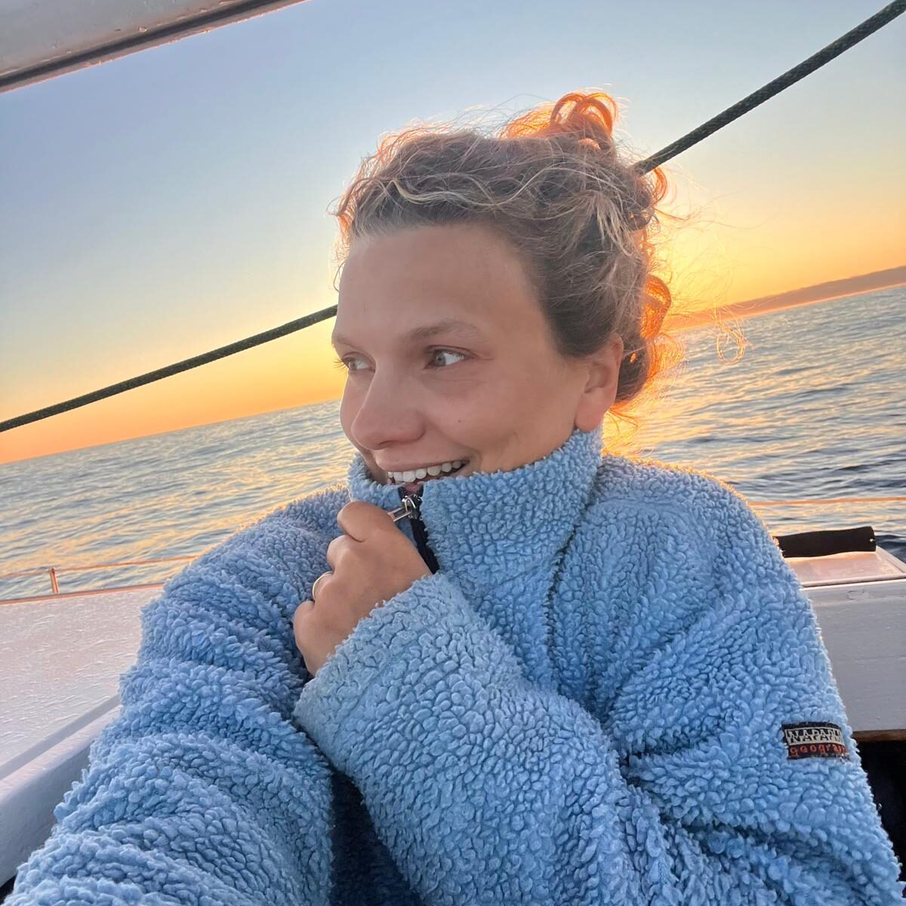

Met nog zo’n honderdtwintig mijl voor de boeg komt er een stabiel, maar ijskoud windje opzetten over de vlakke zee. Het is te weinig om de zee te laten opbouwen, maar voldoende om mooi op te zeilen. We hijsen de gennaker en het grootzeil en vliegen op vol tuig door het water. De wind zuigt ons naar Nova Scotia. Mooier dan dit wordt zeilen niet. De voldoening die we voelen na de afgelopen dagen, de blauwe luchten, de ijskoude wind langs onze wangen. We drinken koppen stomende thee in de kuip terwijl we naar de horizon turen op zoek naar de eerste walvis. Ik loop naar voren en ga op de preekstoel zitten. De gennaker torent hoog en bol boven me uit, het grootzeil staat als een strakgespannen vleugel in vorm en een hoge boeggolf slaat als een kolkende rivier om en klettert terug in het water. Zo zit ik even op de punt. Met uitzicht op mijn twee grote liefdes: Jen en *Luwte*.

<figure class="wp-block-video"><video controls="" src="/wp-content/uploads/2025/07/Clip_to_NS.mp4"></video></figure>

De nacht die volgt is rustig en brengt een stralende sterrenhemel boven ons. Achter ons is de melkweg goed te zien, voor ons kondigt een vage lichtgloed aan de horizon het vaste land van Nova Scotia aan. De dieptemeter springt weer aan en meet plotseling een diepte van ‘slechts’ 120 meter. In zekere zin hebben we onze bestemming, het continent Noord-Amerika, dus al bereikt. Over de marifoon komt krakend de omroep van *Halifax Radio* over en met het opkomen van de zon tekenen in de verte de contouren van Nova Scotia zich al af. Ik doe een poging Jen wakker te roepen met een “*Land in zicht!*”, maar die ligt zo lekker in het warme bed, dat ze besluit dat het land zo meteen ook nog wel in zicht zou moeten zijn.

Ons welkomstcomité is opgeroepen. Op twaalf mijl uit de kust ligt de grens van de territoriale wateren en ik besluit ons eens netjes aan te melden bij de kustwacht. Die zijn direct paraat om te helpen en vragen of alles in orde is. Zolang we geen olielekkage hebben zijn we welkom om in te varen. Nog geen tien minuten later spot ik onze eerste walvis. Ver weg, maar hij springt helemaal het water uit en komt met een enorme plons weer op het oppervlak terecht. Mijn dag kan niet meer stuk!

Zodra we dichtbij genoeg zijn om de huisjes op de kant te kunnen onderscheiden, stijgt de temperatuur weer en verzamelen de *lobsterpots* zich in het water. Talloze boeitjes met kreeftenkistjes zorgen voor een aanloop die net een computerspel is. De lange lijnen die aan het oppervlak aan de boeitjes drijven, zijn soms tientallen meters lang. Goed opletten dus. We zetten de gennaker weer bij, maar de wind draait continue, trekt aan en neemt dan weer af. Het is altijd weer even wennen om weinig tijd en ruimte te hebben voor je manoeuvres, na een paar dagen op zee. Je kunt niet een half uur niets doen en afwachten…

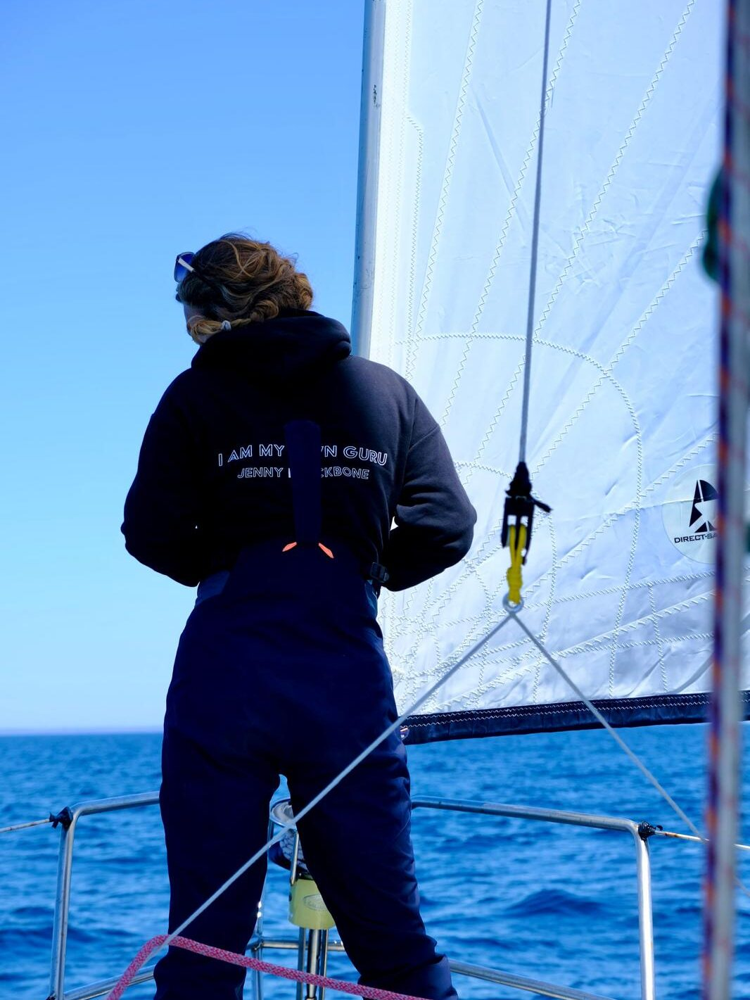

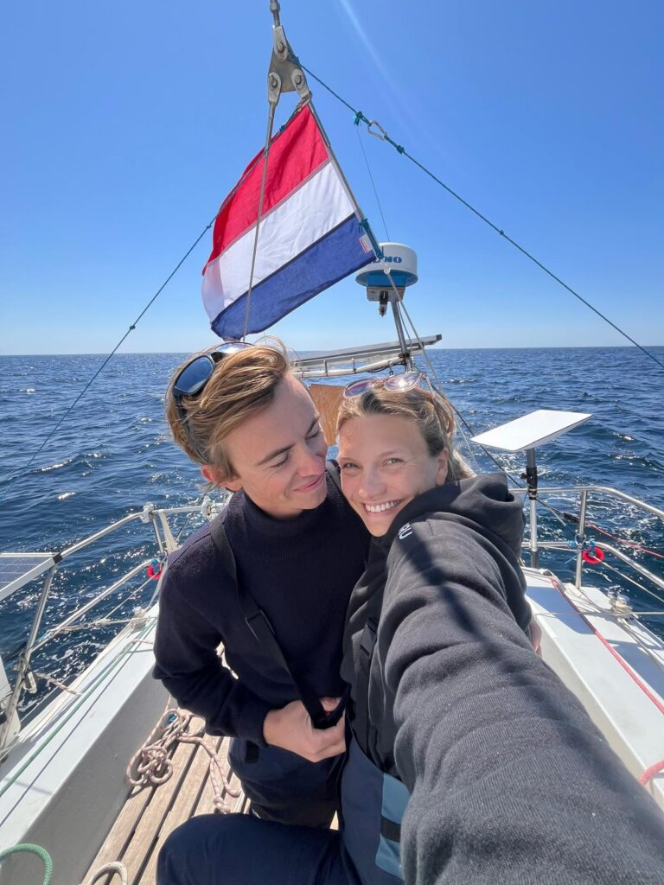

## **Lunenburg**

Diep in de baai draaien we een pier voorbij en dan ontvouwt zich een idyllisch plaatje. Lunenburg ziet er uit als een Noors vissersdorp op een glooiende heuvel. Er steken een paar kerktorens omhoog, de houten huizen zijn in bonte kleuren geschilderd en aan de naar teer ruikende kade liggen grote, roestige dwarsgetuigdeschepen. Een klassieke schoener komt opkruisend door de smalle vaargeul tegemoet. We wijken iets uit om hem de ruimte te geven terwijl we zelf net onze zeilen opvouwen. Vijf mijl terug hadden we onze jassen aan en mutsen op, maar inmiddels is alle zeilkleding uit en hebben we het zelfs in een t-shirt weer warm.

In de baai gaat de wind liggen en leggen we *Luwte* in alle rust aan een drijvende steiger langs de hoge kade waaraan het zeewier in lange slierten naar beneden hangt. Het is eb en het getijverschil is hier een paar meter. De geur van de zee voor landrotten. Op zee ruik je niets. De lucht is er schoon en zuiver. Pas aan land gaat de zee naar zee stinken. Misschien om de stank van ongewassen zeelui te maskeren na een lange tocht zonder douchen en badderen…

De douane verlangt hier dat we bellen om ons aan te melden, maar we hebben geen werkende simkaart. Ik laat Jen aan boord, klim de kade op en spreek het eerste beste echtpaar dat ik zie aan. Het is een ouder echtpaar die elkaar pas een jaar geleden hebben ontmoet. Op een vakantie in Mexico. Ze houden allebei van reizen en kwamen tot de conclusie dat het op hun oude dag nog veel leuker is om met elkaar van het leven te genieten, dan allebei apart. Ze houden het voorlopig nog even op een langeafstandsrelatie, maar in de praktijk doen ze drie maanden bij de een, afgewisseld door drie maanden bij de ander, afgewisseld met gezamenlijke vakanties.

Terwijl ik in gesprek met ze raak hang ik, gebruikmakend van hun mobiele telefoon, aan de lijn met de douane die van alles van me wil weten. Ik had verwacht dat ze na mijn belletje zouden langskomen voor de papieren, maar ik moet alles over de telefoon doorgeven. Al die paspoortnummers, bootregistraties, en vervaldata hebben we inmiddels zo vaak moeten invullen dat ik een heel eind kom uit mijn hoofd. Er wordt op strenge toon gevraagd of we wapens, cannabis, of eten aan boord hebben en ik grap dat we al ons eten hebben opgegeten onderweg. Ik word in de wacht gezet en ben even bang dat ik een grote fout heb begaan met mijn “humor”, maar een minuut of twee later krijgen we een ‘*Welcome to Canada’* van de dame.

Ik roep Jen er nog even bij en we kletsen verder met het echtpaar waarvan we de telefoon hebben mogen lenen. Hij wil alles over onze boot en onze voorbereidingen weten. Het was zijn jongens- jongemannen- en mannendroom om op zeilreis te gaan en hij heeft zo’n beetje alle boeken gelezen over zeilavonturiers die er bestaan, maar heeft zelf nog nooit leren zeilen en voordat hij het wist vond hij zichzelf te oud om zich nog in zo’n groot onbekende te storten. Zijn partner is het roerend met ons eens als we suggereren dat het om goede reden zo is gelopen, anders hadden zij elkaar namelijk nooit ontmoet. Daarmee nemen we afscheid, klimmen de kade af, en trekken een fles bubbels open op onze aankomst in Nova Scotia, Canada.

We verleggen *Luwte* naar een steiger even verderop waar we kunnen blijven liggen. Het ziet er allemaal lieflijk uit, maar als we even later op kantoor komen om ons te melden, krijgen we te horen dat het $72 dollar, zo’n 57 euro, per nacht is om aan de steiger te liggen. Overdag liggen is overigens gratis, zolang je maar voor zonsondergang weg bent. We tekenen voor een nachtje en maken heerlijk gebruik van de gloednieuwe wasmachines die in het washok staan.

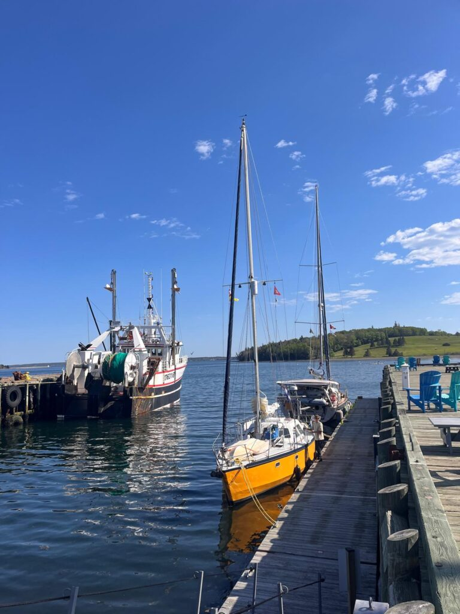

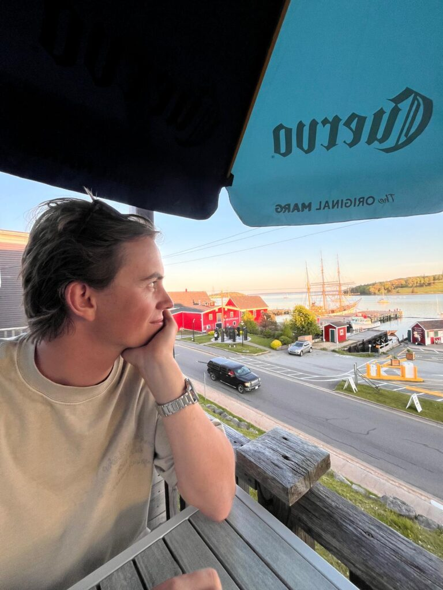

## **Blijven wonen?**

Op zo’n beetje elke bestemming waar Jen en ik komen, zeilend, met de auto, of anderszins, vraag ik haar of ze er wil blijven wonen. We hebben misschien wel een paar van de mooiste plekjes op aarde gezien in de afgelopen acht jaar, maar Amsterdam blijft voor ons altijd op nummer één staan als thuisbasis. De stad, de mensen en familie om ons heen, de wereld op de fiets en de chaos die daarbij horen. Bevangen worden door een uitzicht op de Kaap Verden, waar de mensen óók vriendelijk zijn, het leven gemoedelijk en de huizen betaalbaar, is toch niet genoeg. Tot Lunenburg.

Vanaf het moment dat we voet aan wal zetten in deze trekpleister van Nova Scotia, vallen we met onze neus in de boter. Lunenburg zelf is niet erg groot, een flink dorp hoogstens, maar heeft wel het gevoel van een stad. Er zijn geen grote winkelketens, maar het sprankelt er van de kleine ondernemers en boetiekjes die door de stad verspreid hun waar verkopen. In de vier dagen dat we rondlopen voelen we ons geroepen zo’n beetje elke winkel wel in te lopen om te ontdekken wat er zoal verkocht wordt, en door wie. De koffietentjes, restaurants en barren die er tussendoor gehuisvest zijn zorgen voor een aanslag op onze bankrekening, maar bij zo’n beetje elke winkelier gunnen we hem of haar onze pinpas ook. De *Farmer’s market* die in de droogstaande ijshockeyhal wordt georganiseerd is een extrapolatie van dit gevoel. Families die achter hun stentjes met zelfgebakken brood staan, de appels uit hun tuin verkopen, of zelfgemaakte tassen aanbieden. Bij de ingang van de hal staat een oude heer achter een kooktoestel eieren met spek te bakken. Voor een paar dollar kun je je *community breakfast* bij hem komen halen, gecompleteerd met een kopje koffie van de lokale koffiebrander. De sla die we hier kopen knispert vijf dagen later nog steeds alsof hij net uit de aarde is getrokken en bij de keramiekmaker kunnen we echte *maple syrup* kopen die door zijn buurman wordt gemaakt.

We hebben nog geen geld kunnen pinnen, maar bij de ingang staat een dame die *Market money* verkoopt. Monopolygeld dat door alle farmers wordt geaccepteerd en wat ze aan het eind van de dag kunnen inleveren om hun deel van de pot te krijgen. Als we voor onze derde ronde *Market money* aankloppen is onze bankrekening leeg, maar krijgen we van de verkoopster het WiFi-wachtwoord om ons saldo op te laden. Twee volle tassen én een van zeildoek gemaakte *fannypack* verder halen we ons hart op en wandelen terug naar *Luwte.*

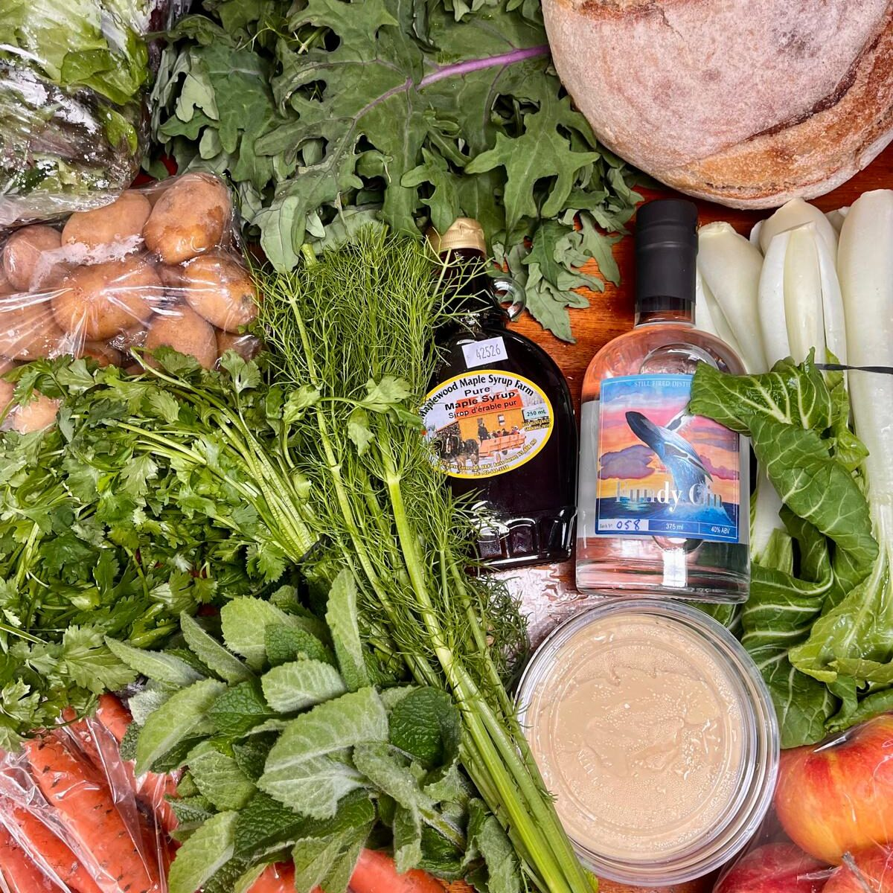

’s Avonds zoeken we onze weg naar de *Knot Pub*, op aanraden van de Canadezen die naast ons geankerd lagen op Bermuda. De jongen van de haven gaat liever naar Halifax om te stappen, daar zijn de shotjes iets goedkoper, maar tekent op een kaart hoe we moeten lopen en wenst ons veel plezier. Het is, zeker bij het binnenkomen van een nieuw land, altijd een klein beetje behelpen en letterlijk en figuurlijk je weg vinden zonder mobiel bereik, maar door de tijd heen zijn we er handiger mee geworden. Van tevoren bekijken we *Google Maps* en als we er niet uitkomen op straat is er altijd wel iemand die de weg wil wijzen. Het zijn juist de momenten dat we onszelf achter de oren krabben waarom we niet gewoon even wat neerleggen voor een simkaart, die de bijzondere ontmoetingen en avonturen met zich meebrengen. Toch is het verleidelijk om telkens een lokale simkaart te kopen en als tweeledige bubbel door de landen te trekken. We kijken nog even online naar de mogelijkheden en kosten, maar weten gelukkig ook nu de snoepwinkel voorbij te lopen en gaan met de kaart onder de arm op pad.

Als we voor de deur van de *Knot Pub* staan lijkt het wel alsof we voor een *Harry Potter* café staan. De scheefgezakte deur ouderwetse klok en piepkleine raampjes doen mij denken aan de scène in deel vier, waarin ze op het *Zwerkbaltoernooi* een ieniemienie tentje instappen, dat door magie vanbinnen een gigantische bungalow is. Zo stappen we ook hier binnen. Het is donker, de plafonds zijn laag en de lichten gedimd. Het is groter dan de voorgevel doet lijken en overal zijn hoekjes met ronde tafels en hoge banken. Rechts van ons zitten groepjes jongeren te borrelen en links van ons aan een lage tafel zitten wat ouderen te kaarten. De bar is hoog, breed en van hout. Aan het plafond hangen allerlei ornamenten die de nautische aard van Lunenburg benadrukken. Niet de kitscherige Xenos-producten, maar echte, versleten blokken, kromgeslagen schroeven en kompasrozen. Wij stationeren ons aan de bar en laten ons verwennen met IPA biertjes met namen die ik niet kan laten staan. *The Salty Seafarer, Touch of Poseidon* en *Clam IPA* worden achter elkaar ingeschonken. Eten hebben ze helaas niet, dus ons avondmaal bestaat uit twee kleine zakjes chips die ze wel aan de muur hebben hangen. Slingerend en lachend vinden we onze weg terug naar de boot door het stille Lunenburg. Er hangt een nevelige mist in de straten en het is fris. We lopen dicht tegen elkaar aan en jubelen nog een keer na over het bezeilen van Nova Scotia. In het licht van de volle maan ligt *Luwte* op ons te wachten. Het is bladstil en de lijnen hangen losjes om de bolders. Voor de ontelbaarste keer blijven we even staan en concluderen wéér dat we eigenlijk het mooiste schip van de wereld hebben.

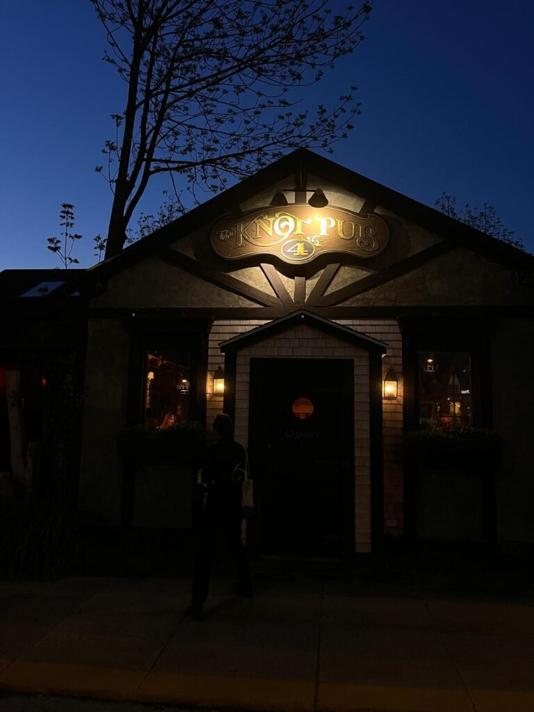

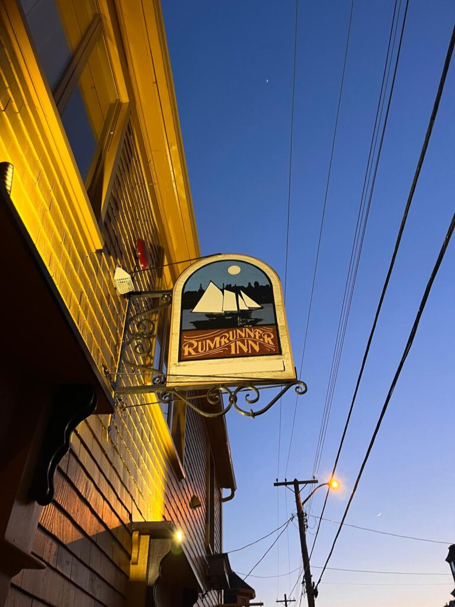

De volgende dag struinen we door de staten en winkeltjes van Lunenburg. Verderop aan de haven staat een grote oude houten loods waarin een grijs geworden piraat zijn schatten van de afgelopen decennia verkoopt. Op het eerste oog doet het denken aan *Bootaccessoires Vinkeveen*, mijn vaste adres voor tweedehands bootspullen. Maar na een half uur tussen de oude prullaria graven komen we naar buiten met een roestig mes, een gietijzeren pan en een paar harpjes. Hier en daar lagen wel losse parels. Zware glimmende massief bronzen schotenblokken, een enkele lier, dekbeslag. Maar het merendeel is inmiddels toch gericht op de toerist die Lunenburg per *touringcar* of auto bezoekt en op zoek is naar een plek die verhalen en avonturen uitstralen. Messing bieropeners, asbakken en andere prullaria doen het duidelijk beter. De piraat probeert een aantal Duitse toeristen duidelijk te maken dat hij geen bankrekening heeft en euro’s alleen accepteert als ze tien euro conversie betalen voor hun sleutelhangers. Ze druipen af en hij ziet er vooral opgelucht uit dat ze zijn schuur weer uit zijn. Als we met onze vondsten naar buiten lopen wordt er een bedrag bedacht en wenst hij ons een goede reis. Op de drempel botsen we tegen de jonge havenopzichter die ons meldt dat we voor sluiting weg moeten wezen, anders moeten we nog een nachtje bij boeken. Dus sjokken we met onze prijzen terug, slijpen het mes, vetten de pan in en gooien dan onze lijntjes los. Voor de haven ligt een mooie beschutte kom waar we goed kunnen ankeren.

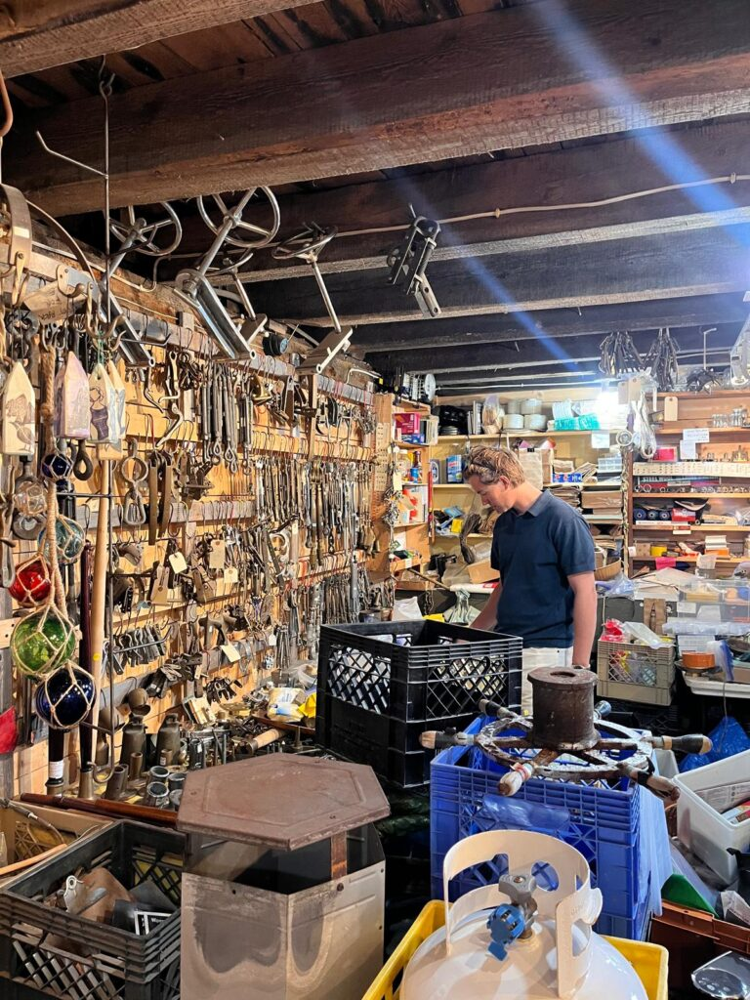

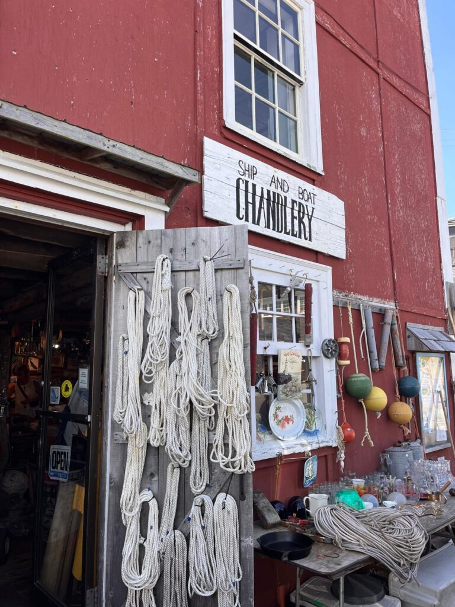

Gehuld in de mist worden we wakker. We liggen nog geen honderd meter van de kade, maar die is verdwenen in een dicht omhulsel van water. We hebben er over gelezen, maar dat het zó mistig zou worden hadden we niet verwacht. De kachel blaast rustig haar warme lucht en met een kopje koffie en een boek *cocoonen* we de ochtend op *Luwte*. De zonnepanelen wekken ondanks de mist verbazingwekkend veel stroom, dus meer hebben we ook eigenlijk niet nodig. Voor een paar uurtjes. Daarna wordt Jen onrustig en moet ze worden uitgelaten.

We wandelen Lunenburg uit en lopen via de andere kant van het schiereiland een rondje over een keurig aangelegd wandelpad. De zon breekt door en het wordt direct erg warm. Het gras is door de dauw vochtig en schittert terwijl we ons nooit eindigende gesprek hervatten over de toekomst, de inrichting van ons huis, onze vrienden en familie. Als we een voorlopige tussenconclusie hebben bereikt doen we allebei een oortje in en luisteren we een *Moordcast*. Al die lieve, vriendelijke mensen die we in het bos tegenkomen veranderen in potentiële bloeddorstige seriemoordenaars, maar we zitten er helemaal in en wandelen door tot het einde van de aflevering.

Daarna zijn onze monden droog en hebben we dorst. We duiken op goed geluk een kroegje in om de hoek bij de steiger en stappen in een zeer gezellige, en bovenal fraai aangeklede cocktailbar met Spaanse roots. Er is gelukkig nog een plekje over om te zitten en we genieten van ons welverdiende drankje. De Horeca-uren zijn hier wat verwarrend voor ons. De meeste tenten sluiten om 21.00 al en de kroegen die het laat maken sluiten om 22.00 de deuren al. Wij vinden het niet erg, want we hebben wel zin om in bed te kruipen, maar net als we aanstalten maken om af te rekenen, raken we aan de praat met een stel van onze leeftijd. Ze vinden ons er uitzien als bootjesmensen én niet van hier en gokten er daarom op dat wij hier met de boot naartoe zijn gekomen. Hun *Nashawena* staat hier in Lunenburg op de kant en gaat volgende week het water in. Voor ons is dat helaas nét te lang wachten om samen op te trekken, maar we ontvangen wel alle pareltjes die ze kennen van Nova Scotia en de zuidkust van Newfoundland!

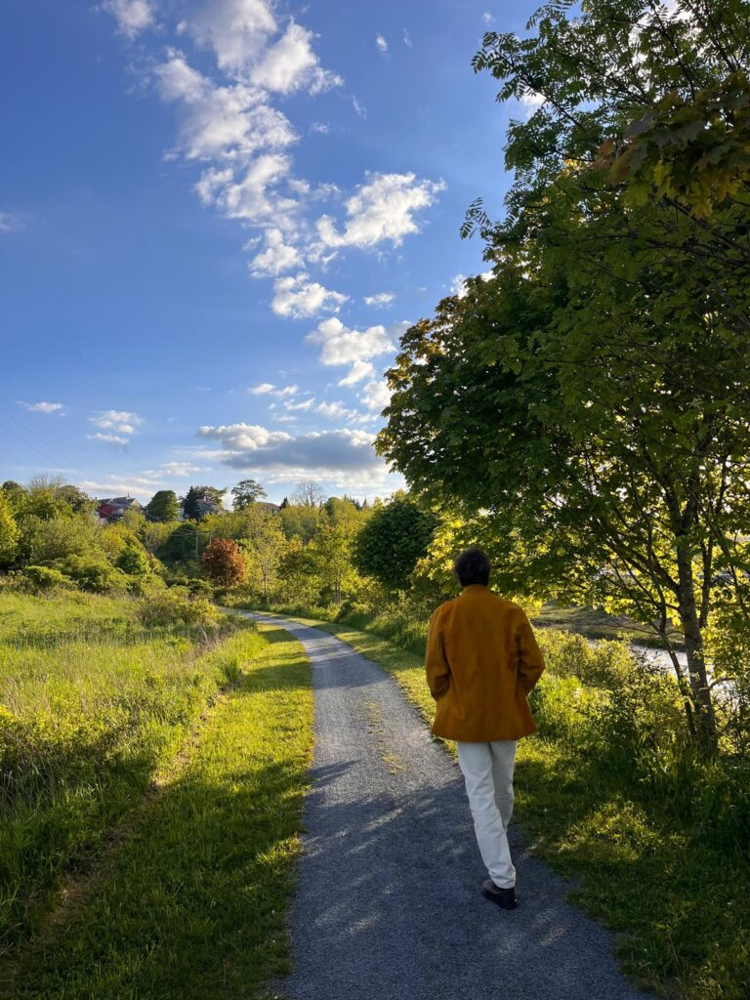

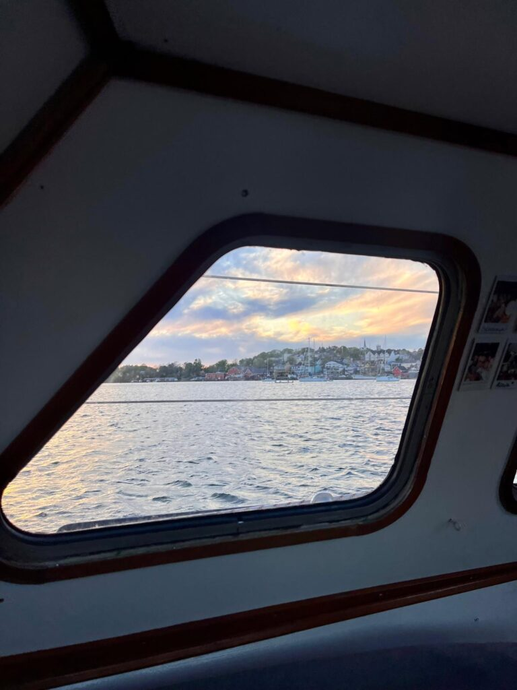

## Op ontdekkingsreis

We worden wakker door een zacht getik op het dek. De mist heeft plaatsgemaakt voor regen. Jen bakt een eitje voor me en met dampende koffie voor onze neus zoeken we op de kaart en in een pdf die we van *Aura* hebben gekregen, naar ankerbaaitjes die we willen aandoen. We hebben een beetje discussie over de komende tijd. In mijn hoofd klinkt drie weken Canada als een heel leven met alle tijd, maar Jen is realistischer en probeert mij duidelijk te maken dat we gas moeten geven als we Newfoundland willen bereiken. Overmorgen is er goede wind naar het noord-oosten voorspeld, waarop we een klap kunnen maken en die willen we grijpen. Dat betekent dat we vandaag en morgen nog hebben om een volgend baaitje te bezoeken. Om de hoek in de volgende *cove* heb ik een mooi ankerplekje gevonden waarvan ik vermoed dat er, op ons tweeën na, weinig mensen zullen zijn. En we liggen er erg beschut voor de zuid-wester die morgen langs komt blazen.

Voordat het zover is gaan we eerst nog een kop koffie drinken met de bemanning van *Aura*. In het koffiehuis op de kade is het warm en gezellig. Het is een oud woonhuis met kleine kamertjes en hoekjes met banken en tafeltjes van allerlei soorten en maten. In de voorkamer vinden we een tafeltje met vier stoelen, naast een man die met zijn zoontje op de bank zit en de krant leest. Het kind weet Jen direct te bereiken en er wordt al snel heen en weer gezwaaid, gelachen en ‘ge-aawhd’. Hoewel we John en Amanda inmiddels een paar keer op de steiger zijn tegengekomen, en ik veelvuldig met hem geschreven heb over het weer tijdens onze oversteek hiernaartoe, is het nog op de valreep dat we elkaar echt leren kennen. We vinden snel veel raakvlakken buiten de zeilerij om en hebben het voor *yachties* onder elkaar verfrissend weinig over onze boten en het varen. Zo tikt de tijd vlot weg. Buiten regent het pijpenstelen en de ramen zijn beslagen. We vinden het wel best en voelen er steeds meer voor om het rustig aan te doen en ons plan om vandaag nog verder te varen te laten schieten.

Eenmaal buiten nemen we afscheid van John en Amanda, wandelen we naar het postkantoor om onze laatste ansichten te posten, en duiken dan een volgend koffietentje in om met een kop thee te schuilen voor de regen. Op weg terug naar de boot lopen we langs een kringloopzaak waar we eigenlijk niets te zoeken hebben, maar uiteindelijk wel naar buiten komen met echt zilveren servies voor op *Luwte*. De juweliersgekte zit er vandaag dus lekker in en we wagen ons nog naar de scheepsjuwelier verderop in het dorp.

Van buiten ziet het winkeltje er uit alsof het al jaren dicht is en langzaam scheef begint te zakken, maar als we de dubbele voordeur door zijn, stappen we in een zeer uitgebreid aanbod artikelen. We zijn niet specifiek op zoek naar iets, en na een paar minuten staan we we te kletsen met de verkoper. Hij heeft zijn zeilschip zelf inmiddels aan de wilgen gehangen, maar buigt over een grote kaart van Nova Scotia op de toonbank en wijst al zijn geheime plekjes langs de kust aan. Tegenwoordig verdient hij zijn loon als verkoper, maar toen hij nog zeilde stond hij vaak in de winkel en liet zich uitbetalen in schotenblokken en nieuwe vallen. Hoewel het aanbod van de winkel meer dan toereikend is, heeft hij geen *cruising guides* meer liggen van dit gebied, die moeten voor dit seizoen nog binnenkomen.

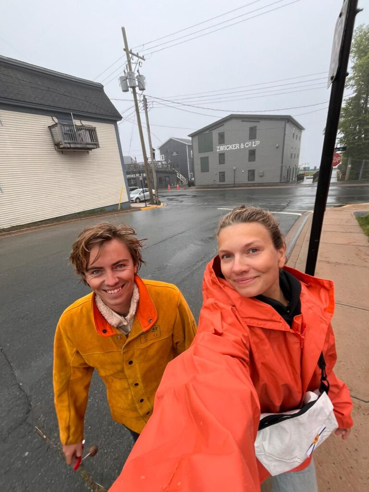

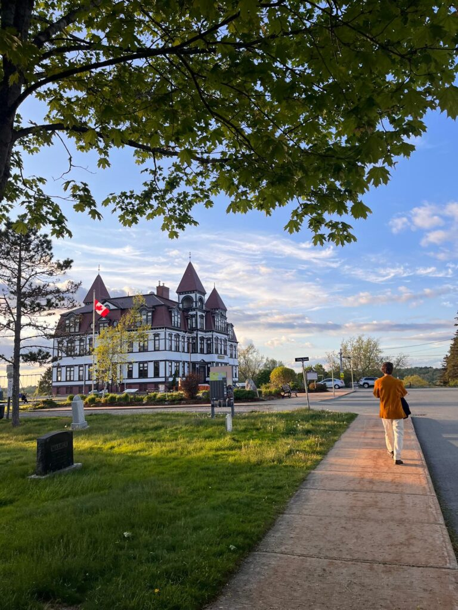

Dus lopen we met lege handen terug naar *Storm*, klimmen aan boord en besluiten toch maar te blijven liggen vandaag. De kachel warmt ons en we hangen wat om en lezen een boek met een kop thee en een koekje. De middag glijdt aan ons voorbij en om een uur of zes kookt Jen maar een maaltje zodat we er vroeg in kunnen. Maar als de afwas gedaan is en we op het punt staan onszelf achter de iPad te installeren voor *Het perfecte plaatje*, worden we overvallen door onrust. Het is nog licht, het zonnetje schijnt waterig door de nevelige bewolking en die gaat pas ver na tienen onder. We kunnen ook gewoon gaan…

Dus plotseling staan we in actie-modus, ruimen we op en trekken we het anker uit de blubber. Nog geen halve mijl verderop hebben we eigenlijk spijt van onze beslissing en overwegen we terug te gaan. Het waait hard en het is koud. Maar we kunnen het niet verkroppen om met hangende pootjes om te draaien en ik zet meteen maar een tweede rif in het grootzeil. De fok rollen we een stukje uit en we maken mooie gang over het vlakke water van de baai, dat langzaam golvender wordt naarmate we dichterbij zee komen.

We draaien het hoekje om en navigeren tussen de rotsblokken, eilanden, zandbanken en lobsterpotjes door. Het is een verraderlijk vaargebied, met riffen en rotsen vlak onder het wateroppervlak. De wind trekt verder aan en op alleen het fokje varen we verder de volgende baai in, waar het vervolgens snel weer rustiger wordt. We zijn de enigen op het water in de wijde omtrek. Van bewoning is nauwelijks een spoort te bekennen en een groot gebied met kleine eilandjes strekt zich voor ons uit. We slingeren er tussendoor en net als de zon laag aan de horizon begint te staan, glijden we de lege baai in die we op basis van de kaarten hadden gekozen. Het is precies zoals we hoopten. We knopen onszelf aan een moorring in de luwte van het bos op het eiland, trekken onze pakken uit en kruipen met een kop warme chocolademelk achter de iPad om *Het perfecte plaatje* te kijken. *Luwte* ligt in niemandsland in Nova Scotia.

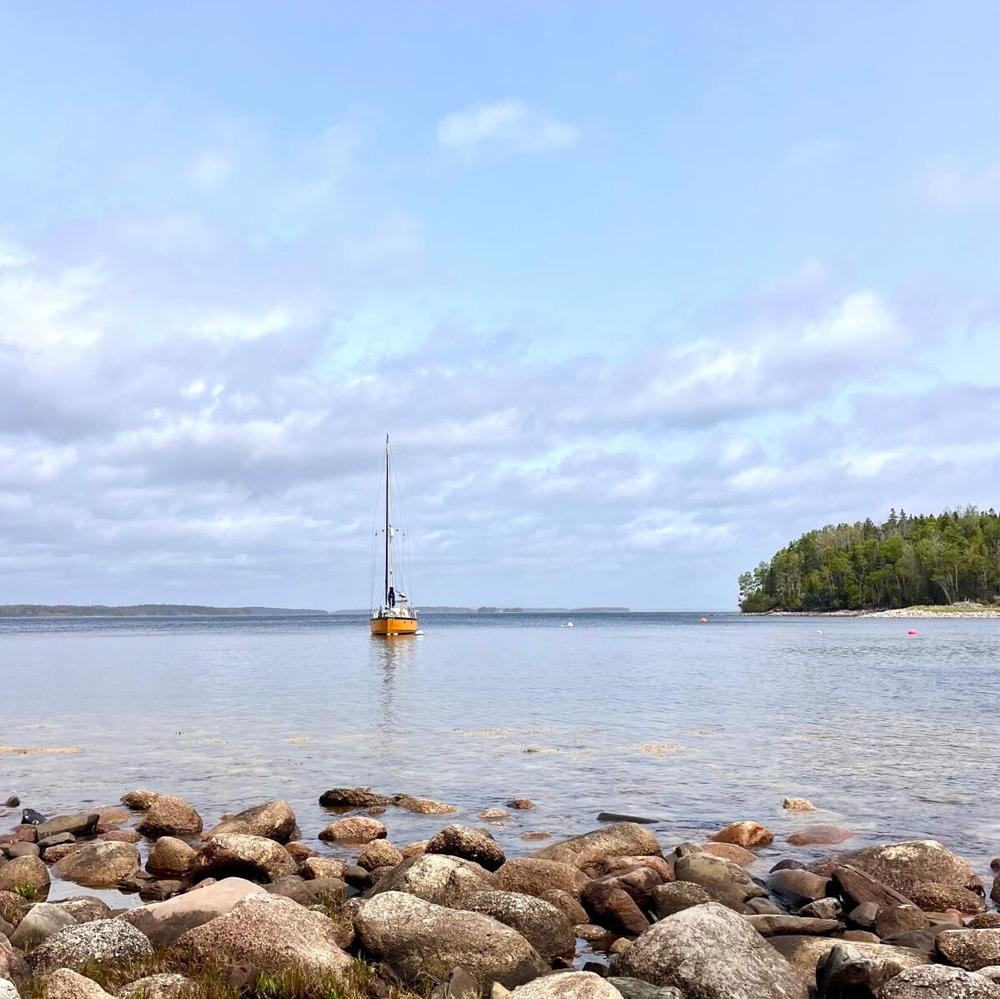
