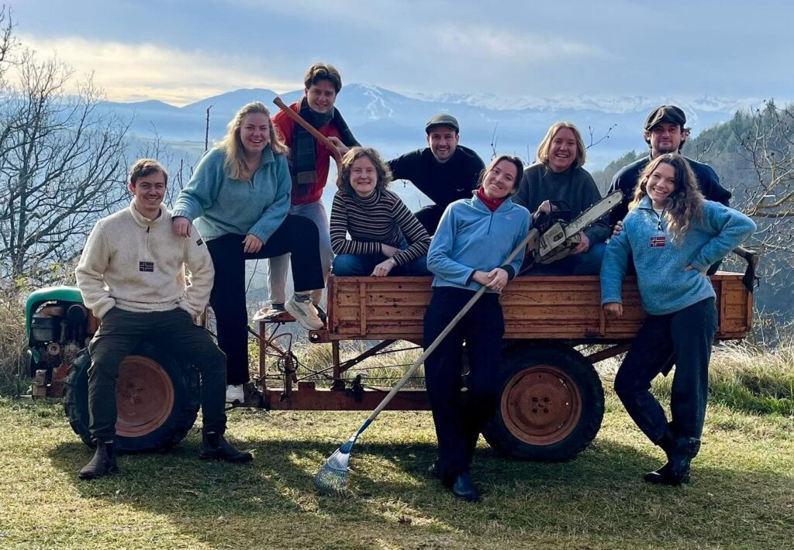
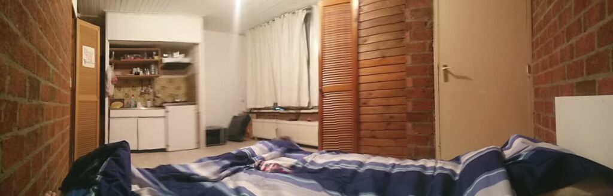
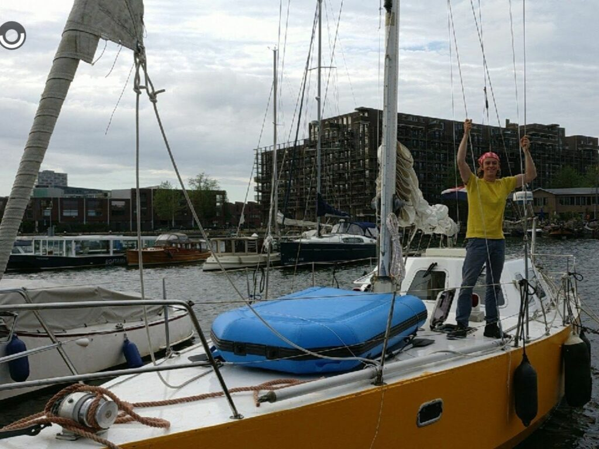
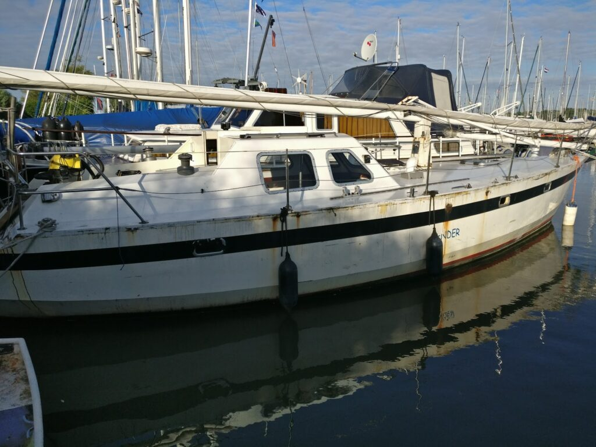
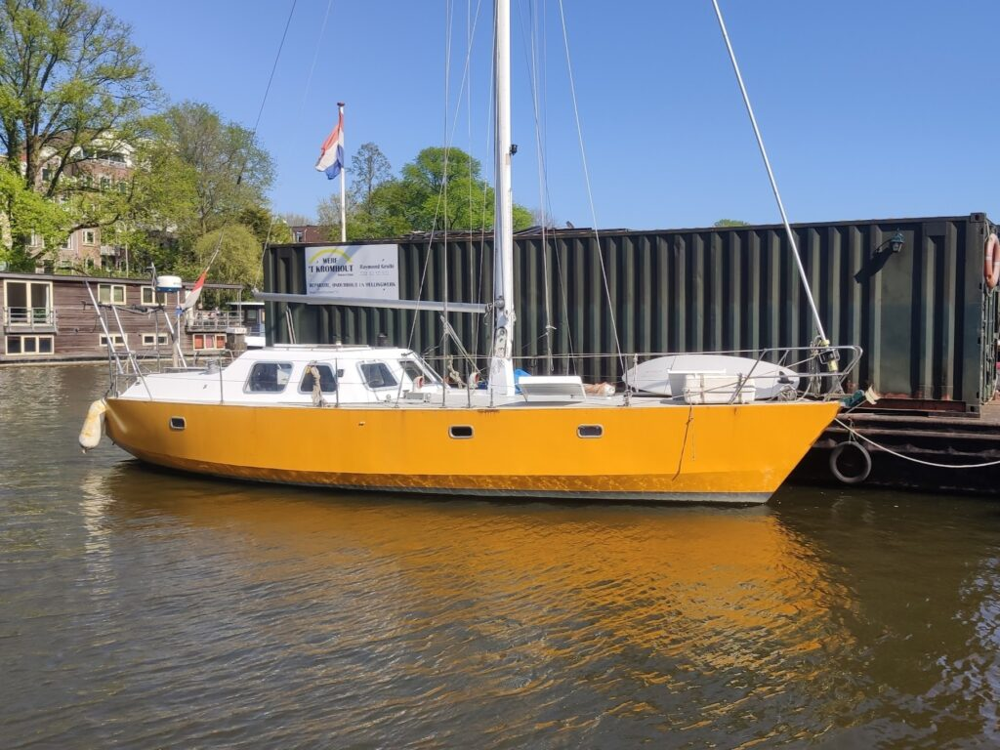
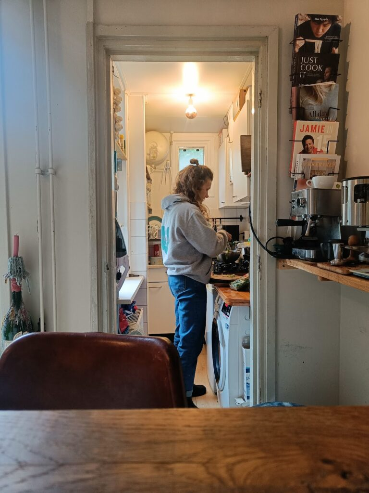
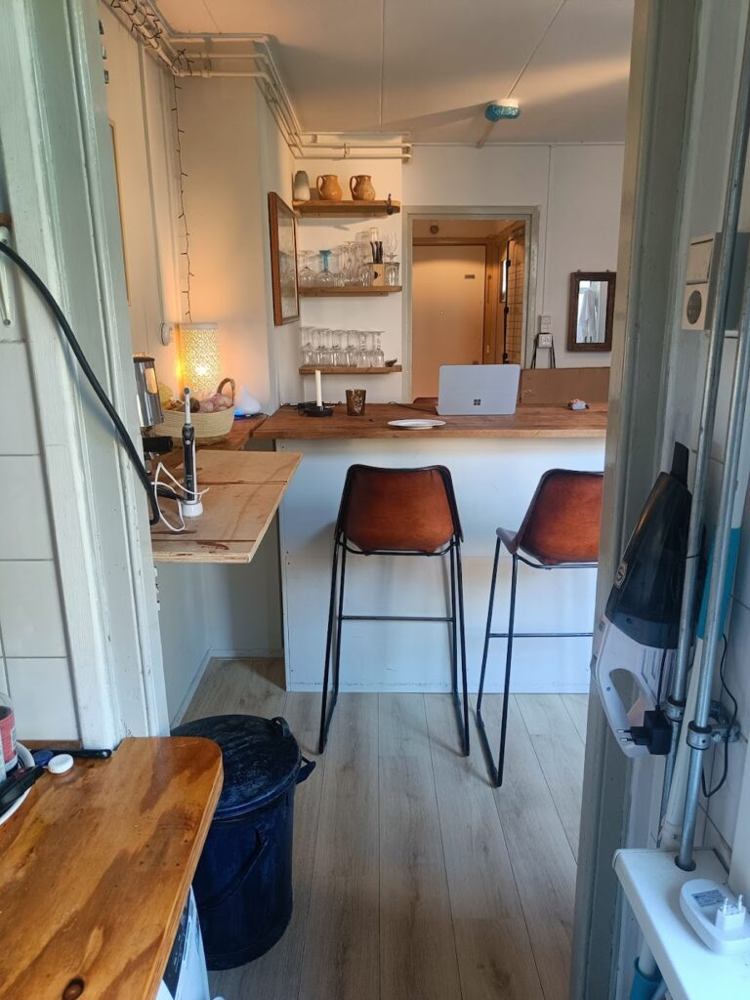
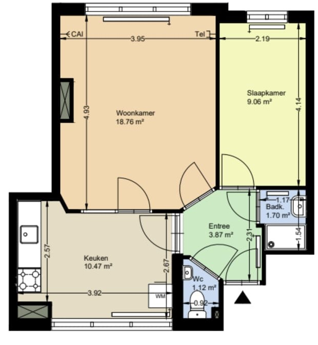

En zo vliegen de dagen voorbij en veranderen ze in weken en eigenlijk kunnen we al spreken over maanden.  
 
23 december schreef ik over ons aanstaande huwelijk met Elon Musk. Dat bleek een gelukkig huwelijk. Onze tijd in Italië was heerlijk en, mede door Musk ook zeer productief op werkgebied. De snelheden die we met zijn Starlink halen kunnen concurreren met de snelheden van ons glasvezel in Oost. 

Konden. De snelheden *konden* concurreren. Inmiddels zijn onze sleutels van Oost namelijk verwisseld voor sleutels in West. In de houthavens, uitkijkend over het IJ, aan de Tasmanstraat (Abel Tasman was de grondlegger voor het in kaart brengen van... Tasmanië!).

## **Oost-West thuis best?**

Dit is een verhaal met enige inleiding en doorlooptijd. Om en nabij 8,5 jaar geleden startte ik namelijk met studeren en werd ik er door mijn vader op gewezen dat er zoiets als sociale huur is, maar dat de wachttijd lang is. Zijn vooruitziende blik liet mij rond mijn 18e nog koud, maar toen ik een jaartje later als kersverse student op zoek moest naar een (betaalbare) kamer werd mij wel duidelijk dat een vooruitziende blik soms handig is.  
 
Gelukkig werd mijn gebrek aan vooruit kijken eerder al opgevangen door mijn ouders en was er voor sociale *studenten*huisvesting wel al vroegtijdig een inschrijving in mijn naam gedaan.   
De inmiddels drie jaar wachttijd was niet voldoende om direct in aanmerking te komen voor een kamer die aan mijn 'Amsterdammer-eisen' voldeed:   
  
\- Niet buiten de ring  
\- Niet ten noorden van het Y  
\- Niet meer dan €450,00  
\- Maximaal 15 minuten fietsen naar het centrum (op tempo, met stoplichten als suggestieve markeringen)  
\- Tenminste even groot als de kamer waar ik vandaan kom 
 
Tot die tijd had ik een start gemaakt die een beetje knaagde aan mijn idealen. In de Watergraafsmeer had ik een 'kamer' gevonden in een pand dat wachtte op vergunning. Er waren inpandig ongeschilderde bakstenen muren opgetrokken die de kamers scheidden en er was een ruime variëteit aan bewoners. De ene rookte altijd jointjes binnen, de ander sprak alleen Pools en sliep onder een lekkend dakraam. Ikzelf had naar mijn toenmalige standaard een vrij ruime kamer, maar wel ook veel slakken en lieveheersbeestjes die hun intrek hadden gevonden tussen de spleten en vloeren. 

Mijn tweede studentenkamer was een upgrade. Qua vloeroppervlak een klein stukje achteruit, maar het Javaplein was dichter bij de stad dan mijn ouderlijk huis.     
Ik scoorde punten door op de hospitatie met een sixpack bier op de proppen te komen en ik vervulde de behoefte van de drie zittende dames om wat meer mannelijke invloed in het huishouden te introduceren. Handig als bijvoorbeeld de wasmachine weer al z'n water in de keuken had geloosd of de lampen moesten worden vervangen.

")

Dit was ook de periode waarin mijn vader de marktplaats advertenties van bootjes begon aan te halen. Per e-mail kreeg ik met regelmaat de suggestie voor een leuk betaalbaar schip waar nog wat liefde in moest worden gestopt als alternatief voor een kamer. Op papieer een interessante move, want €450 euro per maand over een aantal jaar studeren resulteert al snel in een mooi schip.   
Het lukte mij aardig die boot nog even af te houden, maar op een mooie lentedag heb ik mij toch laten verleiden.

> "Ik ga één keer mee kijken of het wat is. Als ik dan nog enthousiast ben kunnen we verder zoeken naar een geschikt schip".

Dat was het motto waarmee ik mezelf naar de "Tender" liet lokken. The rest is history.

Een week later was ik de trotse eigenaar van een op het oog totaal onaantrekkelijk jacht, waar ik enigszins naïef wel de potentie in zag. Er volgden zegevieringen toen de boot na een zomer klussen het water weer in ging en tegenslagen toen ik er achter kwam dat het best lastig is om in Amsterdam een ligplaats te vinden.

De eerste winter aan boord was vooral nat en koud. Het dieselkacheltje werkte prima zolang het rustig weer was, maar woei naar binnen toe uit als de wind zuid-west draaide.  
Ik kwam er ook achter dat condens een flinke uitdager is van wonen aan boord van een stalen schip. Je moet je voorstellen dat een koud stalen romp hetzelfde werkt als een koelelement. Zet in de winter een hete douche aan in een koude badkamer en je ziet een vergelijkbaar effect optreden.     
Hartje winter kwamen mijn kleren 's ochtends dus ook nat en klam uit de kast. Flink doorfietsen naar de VU en daar veel tijd besteden hielp, maar 's avonds terug aan boord zit je dan rustig een uur met je jas aan te wachten tot het een beetje behaaglijk werd.

<figure class="wp-block-gallery alignwide has-nested-images columns-2 is-cropped"><figure class="wp-block-image size-large"><figcaption class="wp-element-caption">Aankomst in Amsterdam</figcaption></figure><figure class="wp-block-image size-large"><figcaption class="wp-element-caption">Toen de Luwte nog "Tender" heette</figcaption></figure><figure class="wp-block-image size-large"><figcaption class="wp-element-caption">De Luwte bij de Kromhout-werf</figcaption></figure></figure>

Gelukkig kwam er die winter ook een oplossing. Jen, die ongeveer ter wereld kwam op een stalen schip in de Amstel, bleek dat leven en de dieselgeur toch wel te missen en kwam af en toe langs om de boel een beetje op te warmen. Als tegenprestatie bezocht ik het Kippenhok in de Helmerbuurt weer om het daar warm en gezellig te houden. 
 
De twee winters die volgden besteedde ik een stuk meer in het Kippenhok, terwijl we in de zomers veel aan boord zaten op ons 'jacht'. Een terugkerende balancing-act tussen 'vijfde huisgenoot' en 'logeren' is mij, ons en de andere kippies goed afgegaan. Althans, zo is de overlevering naar mij toe geweest.  
 
Inmiddels vergroeiden wij een beetje met elkaar. Ondanks dat ik altijd volkomen welkom ben geweest in het Kippenhok, voelden wij allebei dat het tijd was om onze eigen ren te gaan zoeken. Inmiddels had ik, geholpen door een rustig studeer-tempo, op Studentenwoningweb dusdanig veel inschrijftijd opgebouwd dat we de woningen voor het kiezen hadden en trokken we naar Oost. Op steenworp afstand van waar ik ooit ter wereld kwam. De Dappermarkt, Javastraat en gekkies op straat werden ons koninkrijk waar we samen wederom diepe dalen en hoge pieken beleefden.  
Ik kreeg Covid, vlak nadat de boot een flinke refit had gehad en vlak vóór we de sleutel van Oost kregen en beleefde daar nog een flinke nasleep van. Eenmaal weer op de rit begon Jen haar ziekteproces wat een nog veel langere (na)sleep had. Maar daar tegenover staat ook dat we weer uit de as herrezen in Oost, afstudeerden en vrienden werden met de bakker, groenteman en kringloop-medewerkers.  
 
De 33 vierkante meters die we hadden hielden ons dichtbij het bootbestaan. Elke kubieke centimeter was efficiënt benut. Van een bar die als kledingkast diende, tot ingebouwde bakjes in de deur van de kledingkast. Net als aan boord komt er een punt waarop je een optimum vindt en kunt overstappen van optimaliseren naar 'upgraden'. Zo ging ons kleine, handige espresso machientje naar zolder en kwam er een horeca-waardige dubbelpitter voor in de plaats. Dat was nou eenmaal Jen haar prinsessendroom. Dat deze machine 5% van ons vloeroppervlak in beslag nam namen we dan maar voor lief.

Mijn eindelijke afstuderen betekende ook dat we op zoek moesten naar iets nieuws. Gelukkig ben ik inmiddels al iets beter in vooruitkijken geworden en had ik door dat je voor sociale huurwoningen binnen bepaalde grenzen moest vallen, een aanzienlijke wachttijd nodig had én dat per 1 januari 2023 het systeem veranderde.

## **De volgende stap(pen)**

Maar in 2023 veranderde er nogal wat. Ik begon meer te werken en studeerde af. Jen begon juist weer met voltijd studeren en kwam naar mij toe met de mededeling dat ze graag met mij op wereldreis wilde per zeilboot.   
De door mij al lang gekoesterde en vaak uitgesproken droom had ik al een tijd in de koelkast gezet. Het was mij duidelijk geworden dat Jen wat dichter bij de realiteit staat en dat ik wat meer een dromer ben.  
Ik had inmiddels omarmd dat we wellicht *ooit* zouden vertrekken, maar of dat per schip, auto, vliegtuig, benenwagen of fiets zou zijn wist ik niet, laat staan wanneer dat 'ooit' dan zou zijn.  
 
Het duurde natuurlijk niet lang voordat de koelkast open ging en deze droom weer in volle bloei stond. En nog veel leuker, nu was het niet langer mijn droom, maar ónze droom.  
 
Oké en dan? 
 
Ik houd er van om scenario's uit te werken, rekening houdend met zoveel mogelijk variabelen en vervolgens een scenario realiteit te maken. Ten aanzien van onze woonsituatie was dat best een complexe puzzel. 
 
Vanuit een aantal aannames plus nog een hele lijst met andere wensen en eisen kwamen een aantal scenario's. Ik zal de grote lijnen even schetsen, want ze hebben uiteraard alle drie ook nog talloze varianten: 
 
**Scenario 1:** We willen op reis, maar het lukt ons niet om te vertrekken.  
Dat kan allerlei redenen hebben. Van financieel tot politiek. Welk back-up plan hebben we nodig om de boel last-minute terug te draaien en niet helemaal vast te lopen?     
Voor Jen was dit scenario nooit echt een scenario, maar ik heb zelf tot oktober nog een slag om de arm gehouden om alles te cancelen en weer terug te kunnen. 
 
**Scenario 2:** We vertrekken wel, maar volledig op de bonnefooi.  
Geen huis, geen plek om naar terug te keren. Alleen een boot en elkaar. Romantisch misschien, maar ook onzeker. Ik als dromer denk daarbij vooral aan de charme, maar voor Jen leverde dat idee wel enige stress op. Geen vaste grond hebben om terug te keren was een groot thema dat we moesten oplossen. Al dan niet voor een hogere prijs. 
 
**Scenario 3:** We vertrekken, met een huis in onze achterzak om naartoe terug te keren.  
Ideaal scenario, maar misschien ook wel hoog gegrepen. Levert voor Jen veel rust op en voor mij juist weer kopzorgen: Aan wie huur je onder? Wat als diegene veel feestjes geeft en ruzie krijgt met de buren? Wat als diegene na een half jaar een ander aanbod krijgt?  
 
Scenario 1 veranderde rond oktober definitief van aannemelijk naar niet meer aannemelijk. Dat had, zoals ik eerder al beschreef, als voornaamste reden dat we onze ligplaats moesten opzeggen en er eigenlijk geen weg terug meer was in mijn hoofd. Maarja, we hadden ook nog niet écht vooruitzicht op een vervolgwoning. Gingen we dan tussen april en de zomer zwerven? Alvast richting Spanje en nog een beetje heen en weer pendelen? Of zou het ons toch nog lukken een plekje te bemachtigen in de krapte van Amsterdam..? 

## **Een vloek en een zegen**

**9 januari 2024 - WhatsApp groep "de Boertjes"**

> 13.00 Rorik: "We hebben een huis!"  
> 13.01 Papa: "gefeliciteerd!!"  
> 14.01 Mama: "Joepie echt een goed jaar dit!!!"

### **Dat zat zo**

Je bouwt in Amsterdam zogenaamde wachtpunten op op basis van je inschrijftijd en sinds januari 2023 punten voor hoe actief je zoekt. Bottom-line had ik veel wachtpunten en hadden we bijna alle punten voor het zoeken verzameld die we konden verzamelen. Desalniettemin is het aanbod klein en de vraag groot. Er zijn meer mensen zoals Rorik op zoek naar een huis.  
 
Tot je 28e kun je in aanmerking komen voor een jongerencontract van 5 jaar. Na je 28e moet je het doen met 'gewone' contracten en concurreer je met mensen die soms al wel 30 jaar op de lijst staan. 13 Februari werd ik 28, dus rond nieuwjaar werd de deadline voelbaar.  
 
4 januari leek het definitief: We staan op nummer 1 voor een appartement op de NDSM-werf. Nieuwbouw. Geen parkeervergunning, andere kant van het IJ, maar wel een plek die we ons eigen konden maken en een haven naast de deur. Genoeg mogelijkheden vonden we. Ik settlede voor de overkant en Jen was al lang blij dat we een plek hadden om naartoe terug te komen.  
 
9 januari gooide olie op ons vreugdevuur. Terwijl de procedure van de NDSM liep, werden wij ook nummer 1 (dus aanspraak-makende) op de Tasmanstraat. Recht tegenover de NDSM. Goede kant van het IJ, oude (nostalgische) indeling, leuke buurt en €200 per maand minder huur. Onze dag kon niet meer stuk. 

### Die ene knop. Die ene update. Die ene IT afdeling. 

**9 januari, 16.20:**

> Wauw zeg wat een rollercoaster. Fout in het systeem bij Woningnet waardoor we de NDSM accepteerden en het huis wat we wél wilden hebben als geweigerd werd aangemerkt.  
>  
> De Key maakte tickets aan want die zijn helemaal klaar met Woningnet, maar zitten er nou eenmaal aan vast. Woningnet probeerde de schuld in onze schoenen te schuiven, maar daar waren we het niet mee eens. Ze moesten ook te kennen geven dat hun systemen niet altijd helemaal doen wat ze willen.. 
>  
> Ik krijg net een mailtje binnen dat onze 'punten' zijn hersteld en zie in ons overzicht nu staan dat het huis dat we wél willen hebben een soort gekke dubbele status heeft "je hebt deze geweigerd, je hebt aangegeven interesse te hebben in deze woning". Zullen ze achter de schermen wel weer een of andere truc voor hebben uitgehaald. 
>  
> Wij halen voor nu even adem. Lijkt goed te gaan komen...

**10 januari 2024 **
Voor ons lag de druk er nogal op. Dit moést gaan lukken, want we zaten inmiddels dicht op mijn verjaardag en dus de deadline. Na een inlogpoging of 30 kwamen we in ons profiel op de website. Die had nog steeds allerlei storingen. Dat was dus een heel gedoe. 

Daar was niets veranderd. Er stond nog steeds een vreemde dubbele status waar we niet zoveel mee konden. Bellen dan maar weer. 

In totaal hebben we 7 of 8 keer gebeld, maar ook dat was een missie. Naast de wachtrij van ongeveer 45 minuten, hebben zowel De Key als Woningnet een 0900 / 0800 nummer. Deze nummers kun je niet bellen vanuit het buitenland. Om dat op te lossen moest ik mijn vader opbellen, die vervolgens een conference call opzette en mij via zijn lijn doorverbond met de partijen.  
 
**10 januari, 13.54:**

> "Het lijkt gelukt te zijn... Pijpenla op de NDSM staat in de historie en Tasmanstraat staat nog steeds in ons rijtje"

Maar dat betekende niet dat de laatste horde genomen was. 15 januari stond de bezichtiging gepland voor de Tasmanstraat. Wij zaten nog altijd in Italië, maar kregen van Tristan aangeboden dat hij wel wat foto's en filmpjes wilde maken.   
Uiteraard kon ook deze stap niet vanzelf gaan. De medewerker van de Key die er had moeten zijn had zich vergist en kwam niet opdagen. Ik hing alweer in de wacht, maar met een 45-minuten verwachting en het feit dat Tristan in de sneeuw buiten strond, hebben we de poging tot bezichtigen gestaakt. Blind tekenen dus. We hadden een plattegrond, en een paar vage foto's die niet veelzeggend waren. Maar we stonden nog steeds op nummer 1.

Was dat het dan? Nee. Nog een laatste hoepel. Een kleine dit keer. Bij het aanleveren van al onze gegevens ging het nog drie keer mis.

1\) Bij het uploaden was er alleen een invulveld voor mijn gegevens, niet voor Jen haar gegevens. Die moesten we binnen drie dagen aanleveren. Een mail er achteraan kreeg een auto-reply dat ze binnen vijf werkdagen bij ons terug zouden komen. Weer in de wachtrij aan de lijn dus.   
2\) Het mailadres dat ik kreeg om de documenten naar na te sturen bleek een no-reply te zijn. Nog een keer in de wachtrij dus.  
3\) Inmiddels is het woensdag 14 januari. Nadat ze de gegevens goed ontvangen hebben, bekeken hebben én hebben laten weten dat alles er goed uit ziet, kunnen we even ademhalen. Ze gaan nu ons contract opmaken.  
16.05 uur word ik gebeld door de Key dat er toch iets niet in orde is. Jenny woont namelijk in Haarlem, dus ze kunnen niet haar gegevens uit de basisregistratie personen trekken. Vóór vrijdagmiddag een officieel uittreksel uploaden graag.  
 
We loggen in op Jen haar profiel bij de gemeente en doen een aanvraag: "U kunt de aangevraagde documenten binnen 3 werkdagen met de post verwachten".  
 
**15 januari 2024.  **
 Ik heb het eigenlijk al een beetje opgegeven dat dit gaat lukken. Ik twijfel tussen de gemeente Haarlem bellen om ze daar onder druk te zetten, of de Key te bellen om te smeken of we wat extra tijd mogen. Uiteindelijk belt Jen de gemeente. Daar blijkt dat ze er in Haarlem andere standaarden voor service op nahouden. We krijgen binnen een paar seconden een aardige dame aan de lijn die ons weet te vertellen dat ze de aanvraag net in haar handen heeft gehad en in de postzak heeft gegooid. Mij zakt de moed in de schoenen, maar ze stelt voor daar nog even naartoe te lopen, de brief er uit te vissen en even in te scannen. Is dit een keerpunt?  
 
We krijgen het uittreksel van haar opgestuurd. Het laatste puzzelstukje valt op zijn plek. 's ochtendsvroeg op 16 januari sturen wij het laatste document op. Net op tijd.  
 
Nog een extra klapper ontvouwt zich. Met zwetende oksels zitten we de halve dag te wachten op een belletje of mailtje met ons contract. Die krijgen we niet. Rond 14.00 word ik gebeld dat er toch nog een document mist in Jen haar gegevens. De zogenaamde 'verhuurdersverklaring'. Eerder heb ik een medewerker aan de lijn gehad die mij verzekerde dat dit document niet nodig was, aangezien Jen nog bij haar moeder inwoonde. Maarja, zonder verhuurdersverklaring geen vinkje en zonder vinkje geen contract.  
 
Twee uur later lag dat bundeltje ook netjes bij ze in de inbox, maar was het ook 16.00 geweest en tijd voor weekend. Voor ons tijd om weer richting Amsterdam te rijden. 
 
**18 januari 2024, 13.54**

> "Huis is rond!"

We hebben getekend en de huur betaald. Nu moet het goed zitten toch? Bijna. Ook bij de Key hebben de systemen er wat moeite mee. Het scherm ná de betaalpagina, waar je je laatste gegevens moet invullen en een afspraak maakt voor de sleuteloverdracht loopt vast omdat onze betaling niet goed is verwerkt... Een laatste belletje dan maar. Een laatste wachtrij.  
 
Uiteindelijk krijgen we 19 januari, inmiddels weer geland in Amsterdam onze sleutels. Het nog één laatste staartje. Als we binnenkomen moeten we op de tablet van de huismeester nog wat dingen ondertekenen, maar hij is vergeten de tablet op te laden en zit nog op 2% als hij allerlei ingewikkelde menu's moet doen. Met 1% in de accu zetten we onze handtekening. De tablet staat symbool voor wat er nog over is van ons geduld, onze stressbestendigheid en energie. Snel opladen voor verhuizen en verbouwen!
