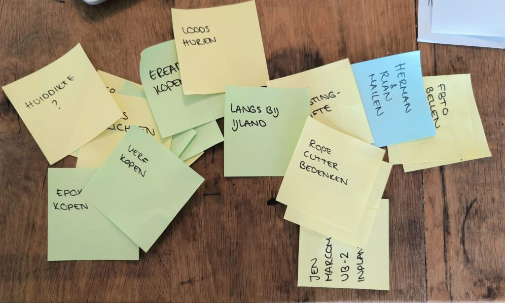
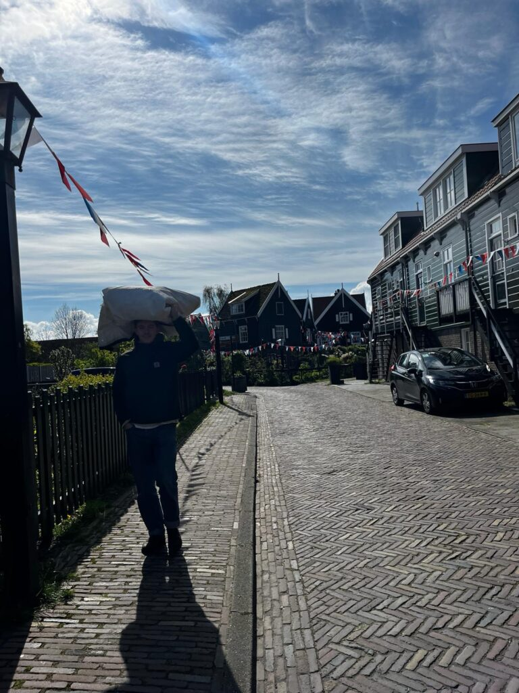
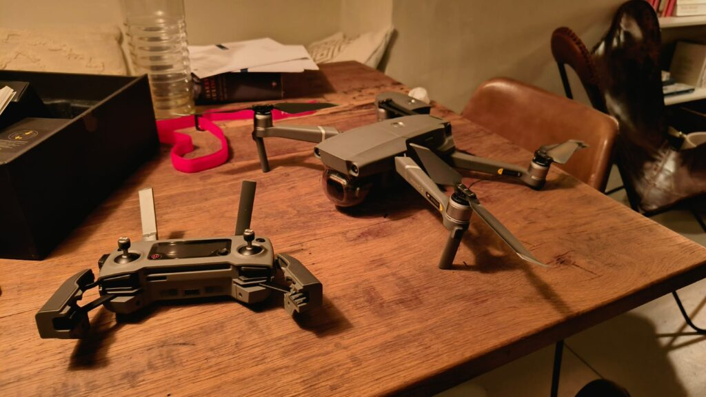

Scrummen, hoewel een beetje overgenomen door de software en dienstverlenende wereld kent zijn oorsprong eigenlijk vanuit het rugbyen. Dat ziet er zo ongeveer uit zoals hierboven.

Na een spelhervatting haken de spelers van het ene team in elkaars schouders en duwen de spelers van het andere team zo mogelijk een stukje in de andere richting.  
Daarbij is het doel natuurlijk om als één geheel de weerstand van de tegenstander op te heffen en als front de goede kant op te werken.

In het "Agile werken" is het sportelement er bij de meeste teams wel een beetje uit verdwenen. De meeste scrummende teams zitten op hun luie kont op een bureaustoel en overleggen over taken om de neuzen allemaal in dezelfde richting te krijgen. De echte fanatiekelingen gaan er bij staan om de energie er in te houden en er voor te zorgen dat het geen lekker-achterover-overleg wordt, maar veel verder dan dat komen we tegenwoordig niet meer.

In onze vorige update was de plaat goed zichtbaar. Onze tegenstander komt ons niet fysiek uitdagen, maar de tijd en de vinkjes die we moeten afvinken voor vertrek proberen ons natuurlijk wel te weerhouden van een vlekkeloze voorbereiding.

## Retrospective 1

Net als bij sportwedstrijden is het goed om naderhand even terug te gaan naar de hoogte- en dieptepunten die je hebt beleefd. Wat kan er in de volgende scrum nou beter? Of was dit de perfecte wedstrijd?

We zijn een week later. Een sprint later in ons geval, en hebben na de verjaardag van de koning nog 9 weken te gaan. Tijd om de tussenbalans op te maken dus.

Wat een week weer.. Dat is de samenvatting in een notendop. Maar geslaagd. Onderstaand lijstje aan taken werkten wij in de afgelopen 7 dagen af.

-   Benodigdheden huiddikte meting (voor het staalwerk vd Luwte)
-   Gele verf inkopen
-   Opslag voor spullen regelen
-   E-reader kopen (Jen heeft alweer 2 boeken uit inmiddels)
-   Herman en Rian van de Lyra bellen (de ervaren zee-zeilende oom en tante van Nanja)
-   Hechtcursus inplannen
-   Locatie afscheidsfeest regelen + langsgaan + uitnodigingen versturen (niet gekregen? Sorry. Je bent welkom, laat het ons weten dat we deze fout hebben gemaakt!)
-   Aanvraag internationale verzekeringspassen
-   Camera telefoon van Jen repareren (zie verderop voor uitleg)
-   Drone brevet halen
-   Epoxyverf onderwaterschip inkopen
-   Aangiftes inkomstenbelasting
-   Uitzoeken ropecutter voor schroefas
-   Uitzoeken benodigde motoronderdelen
-   Verzekering boot rond krijgen
-   Jen Maritieme Radio Communicatie theorie inplannen
-   Jen Klein vaarbewijs II inplannen
-   Rorik Maritieme Radio Communicatie praktijk inplannen
-   Huisbewaring met de Key regelen
-   Benodigde zeekaarten uitzoeken
-   Extra rolfok op de kop tikken
-   Benodigdheden wassen aan boord uitzoeken
-   De boot overvaren naar Jachtwerf de Kokernoot
-   Rorik rijbewijs opnieuw aanvragen

Poeh. Als je het zo onder elkaar zet ziet het er nog veel duizelingwekkender uit dan op onze muur.. Maar het is ons allemaal gelukt!

Voor deze week staat er nog één taak op het programma: De boot helemaal leeghalen voor we de kant op gaan. Maar dat doen we op onze zondag wel..

## Op naar de Kokernoot

Zoals sommigen van jullie misschien al via de <a href="https://www.instagram.com/sailingluwte/" data-type="link" data-id="https://www.instagram.com/sailingluwte/">instagram</a> hebben meegekregen, voeren we afgelopen week dan eindelijk weg van Marken richting de werf. Het lenteweer heeft lang op zich laten wachten, maar lijkt toch haar eerste zonnestralen op ons los te laten nu. Hoog tijd dus om toe te geven aan onze havenkoorts en de boot weer zeilklaar te maken na een lange winter.

Heel veel zeilen kwam er niet aan te pas. Vanaf Marken tot de Schellingwouderbrug was het water spiegeltje glad en tuften we op het motortje met onze neus in de zon over het Markermeer. Echter, zodra we de heldeuren van de stad Amsterdam doorkwamen, begon het te poeieren. Het koufront dat voorspeld was, was net twee uurtjes eerder dan we hadden verwacht.

Zo'n eerste tochtje van het seizoen is toch altijd weer wat roestig. De juiste marifoonkanalen vinden, zorgen dat je je lijntjes allemaal op orde hebt en scherp blijven op grote binnenvaartschepen die al dan niet terecht varen onder het mom van "recht van de zwaarste". Meestal moet je het dan toch afleggen, ook als felgeel bootje.

In de sluis ging alles vrij gesmeerd, behalve dat het schutten wat traag verliep. Een dromende Fransman uit Parijs kwam op zo'n 30 centimeter achter ons liggen (in een lege sluis) en begon meteen zijn beklag over het schip dat hij de dag ervoor in Nederland had gekocht. Motor te klein, zeilen groen, veel te zwaar allemaal, had geen idee waar hij heen moest en had naar het leek zijn laatste rode cent uitgegeven aan een net niet zeewaardig schip.  
Ondanks het feit dat ik er op dat moment niet zoveel voor voelde om aan te pappen met deze verdwaalde dromer, moet je het die Fransen toch meegeven dat hun romantiek ze wel in beweging zet. Toen ik deze Parijsenaar vroeg of hij dan met zijn schip de Seine op wilde, haalde hij zijn schouders op en bracht bijna poëtisch uit dat de wind hem wel ergens zou brengen. Waarschijnlijk geïnspireerd door de boeken van de Franse held Moitessier. Wellicht komen we hem ooit nog eens tegen.

Net voorbij het Centraal station en opgelaten naar ons eigen huis te kunnen zwaaien, trok de wind nog wat verder aan en werden de wolken donkerder. Jen maakte een soepje, maar dat was knap lastig eten. Een groot deel van de soep belandde niet in mijn maag, maar op mijn jas en rond mijn oren, omdat deze van de lepel af woei..

Een half uurtje varen verder kregen we de Kokernoot in het zicht. Ik was er maar wat chagrijnig over, dat we nou in deze wind onze eerst manoeuvre in een onbekende haven moesten doen, maar eenmaal binnen de pieren viel het hartstikke mee en viel de wind weg in de luwte van een grote fabriekshal die aan de haven staat. Box in, lijntjes vast, klaar. No problemo voor dit zeilduo. Terug thuis trakteerden we onszelf bij Café Heilig Leven (het oude koffiehuis van de houthaven-werkers) op een Duveltje en een wijntje.

## Een zeilend bestaan

Waar de meeste mensen terecht kiezen voor een prettig en normaal bestaan met vaste grond onder de voeten, was dat niet weggelegd tot de oom en tante van Nanja. De bemanning van de Lyra koos voor een zeilend bestaan en voeren op zo goed als alle wateren tussen Antartica en de Noordpool.

Met zo'n bak ervaring één 'handshake' bij ons vandaan was het een kwestie van tijd totdat wij elkaar zouden spreken en afgelopen dinsdag was het dan eindelijk zover. Na ons bootje veilig bij de Kokernoot te hebben achtergelaten, belden we met de Lyra om te praten over van alles en nog wat. Van motoronderdelen en drenkelingen uit het water vissen, tot de was doen en het vinden van de mooiste ankerbaaitjes. Met twinkelende oogjes luisterden wij naar de avonturen en de tips en tricks die ze ons konden meegeven. Een ontzettende verrijking om een paar van onze overwegingen nog eens te kunnen benchmarken aan een stel ervaren zeilers die we nog niet hadden gesproken.  
De enige alarmerende conclusie die we moesten trekken is dat zij vonden dat één jaar wel echt zonde is, omdat het veel te leuk is om onderweg te zijn. Wij houden ons voorlopig gedeisd en blijven bij ons jaarplan, maar staan wel helemaal aan om te gaan na dit belletje.

## Vloggen, Bloggen, Vliegen

Het vastleggen van de komende periode en daarna gaan we proberen uit te breiden. Jen is al aan het Instagrammen geslagen en zet mij continu op de foto. Ik ben dankbaar dat die taak niet bij mij ligt, want ik voel mij toch meer thuis achter de typemachine. Toch een generatiekloof denk ik..  
Maar nog veel dankbaarder ben ik voor het feit dat Jen haar ambities om meer op de gevoelige plaat vast te leggen, mij het excuus gaven om een serieuze drone te kopen. Misschien een wel iets té serieuze.

Mijn marktplaats-hobby beleeft hoogtijdagen de laatste tijd en het lukt me dan ook steevast om de parels er tussenuit te plukken. Een kwestie van goed onderzoek, goede zoektermen én een flinke portie geduld lonen meestal.  
Deze specifieke zoektocht begon in januari met het uitzoeken van het juiste type en de vereisten die ik kon bedenken. Sindsdien volg ik alle nieuwe advertenties om een gevoel te krijgen van het prijspunt, tot ik er eentje tegenkwam die beter én goedkoper dan de rest was. Op naar Flevoland dus!

Daar aangekomen stond ik een beetje te kijken. Ik had dit exemplaar alleen op filmpjes en foto's gezien, maar in het echt is het toch wel een serieus apparaat. Dat werd nog eens versterkt in hoe deze jongeman er mee omging. Alsof hij een bom moest ontmantelen werd de drone met grootse precisie in elkaar gezet, en nadat hij gestart was zat het beestje binnen een paar seconden op 120 meter hoogte. Fantastisch! Maar ook erg ingewikkeld. Ik heb het vliegen maar even aan hem overgelaten.

Toen ik akkoord was met de transactie vroeg hij doodleuk of hij me even moest helpen met het overzetten van mijn RDW en ILT registratie-nummer.

Uhhh wat?

Juist. Voor alle toekomstige dronepiloten: Tot 250 gram mag je vrijuit vliegen (binnen een straal van 50 meter). Als de drone zwaarder is en verder weg kan, moet je piloot worden. Oeps.

<figure class="wp-block-image size-large is-resized"></figure>

Inmiddels ben ik er achter dat de twee stiekeme vluchten die ik alvast maakte om de drone een beetje beter te leren kennen niet helemaal volgens de standaarden van het Nederlands / Europees luchtruim waren. Ik zal de details niet op het internet archiveren, maar tijdens mijn cursus tot vliegenier heb ik toch wel een aantal dingen geleerd waar ik mij niet helemaal bewust van was.. Er is niets ernstigs mis gegaan, maar net als op het water "goed zeemanschap" alle regels over-ruled, heb je in de lucht de term "Good Airmanship". En rechts heeft voorrang, ook in de lucht.

Met gepaste trots kan ik jullie allemaal laten weten dat Rorik de Boer, onder registratienr. NLD-RP-vcvetmx4w96i nu officieel piloot is in de A1/A3 Open Class.

Ik heb geprobeerd Jen te laten blozen met de opmerking dat ze nu naast een schipper ook nog met een piloot aan het daten is, maar dat maakte niet de flauw-vallende indruk op haar die ik had gehoopt. Toch maar bij de bootjes blijven dus.

### Influencer?

In tegenstelling tot de andere jeugdigen onder ons, zullen wij ons best doen ons niet te laten verleiden tot het beroep "Influencer". Ook hier moeten we even terug naar waar dit vandaan komt. Dit is een iets minder wetenschappelijke benadering misschien, want het onderstaande is volledig mijn mening.

<blockquote class="wp-block-quote">
Het beroep influencer haalt zijn historie uit het woord "influencing" wat, zoals de oplettende lezer zal zien, direct afstamt van iets waar helemaal niemand blij van wordt: Influenza. Beter bekend als Het Griepvirus.

Het is naar. Het zit in je holtes, je neus, je ogen, je oren en je voelt je er beroert door. Alles in je lichaam probeert er tegen te vechten en toch moet je je er aan overgeven. Bij de meesten gaat het vanzelf over, maar er is één type mens dat er nooit meer van zal genezen: De Influencers. Zij spuwen en spuien alles dat ze maar kunnen bedenken om de wereld om hen heen mee te slepen in hun eigen virus, met dood en verderf van de wereld tot gevolg.

Einde citaat.
<cite>Rorik de Boer, 2024</cite></blockquote>

Zoals je begrijpt zullen wij moeten waarborgen dat we niet die kant op gaan. Ben je dus een lezer, volger van de Instagram, of straks trouwe kijker van ons YouTube kanaal en heb je het gevoel dat we je aan het Influenza-en zijn? Neem dan alsjeblieft contact met ons op voordat we niet meer te genezen zijn!

Dat gezegd hebbende:

Jenny wil wél graag foto's en filmpjes blijven delen tijdens onze vaart en daar sta ik natuurlijk volledig achter. Dat is (hopelijk) leuk voor het thuisfront en voor onszelf leuk voor later.  
Een drone hebben we dus al, maar een film/fotocamera nog niet. Jen gaat komende week onderzoek doen naar vlog / film geschut, maar de route waar we tot nu toe op zaten was om met een stabilisator en externe microfoon voor de telefoon gewoon bij haar iPhone te blijven. Die schiet toch zo scherp dat we daar een heel eind mee komen. Er was alleen één probleem: Er zat vocht achter de lens.

#### Post-it: Taak 7, Week -10: Naar PhoneLab voor camera die vage foto's maakt

Samen met moeders een dagje shoppen in Haarlem en dan loop je er langs: The PhoneLab. Één van die commerciële winkels waar je screenprotectors, schermen en hoesjes kunt krijgen. Met jonge jongens in witte doktersjassen, klaar om je zielsverwant onder het mes te nemen. Jen schoot naar binnen, makkelijk een post-it afvinken als je er zomaar langsloopt!

Na een beetje tekst en uitleg kijkt de jongen achter de toonbank haar indringend aan. Met droge ogen weet hij Jen uit te leggen: Misschien moet je je telefoon een keertje schoonmaken mevrouw. Zoals je begrijpt werd dit een van de hoogtepunten van mijn week...

## Op naar week -9

Komende week wordt een spannende. De boot gaat het water uit en we gaan zien hoeveel werk er op ons te wachten staat. Het is altijd een beetje een naar moment, want een boot hoort nou eenmaal niet op het droge. Maar goed, het is voor een hoger doel zullen we maar zeggen. Zal het ons weer lukken alles af te vinken...?
