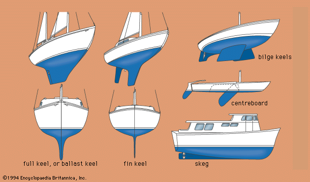
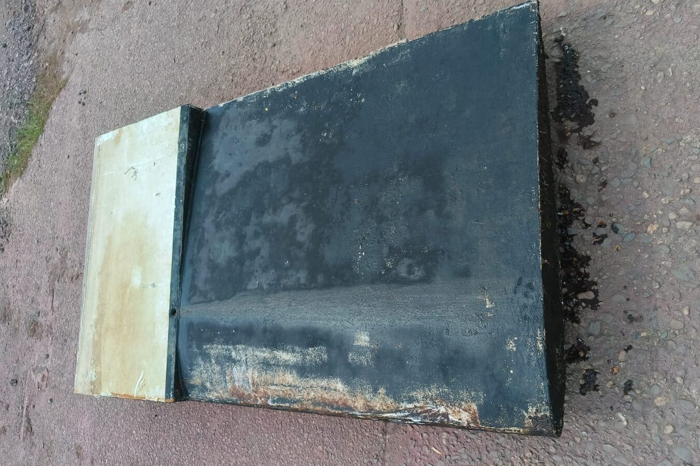
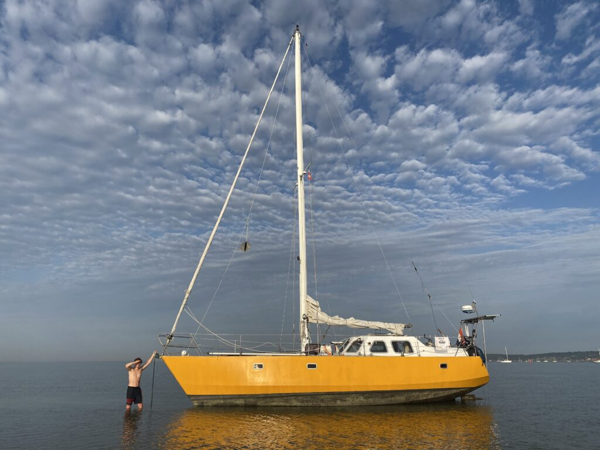
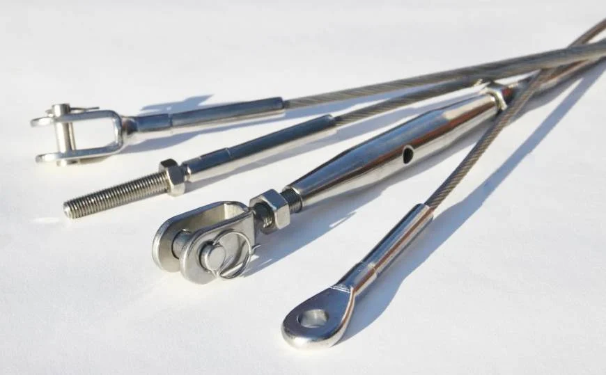
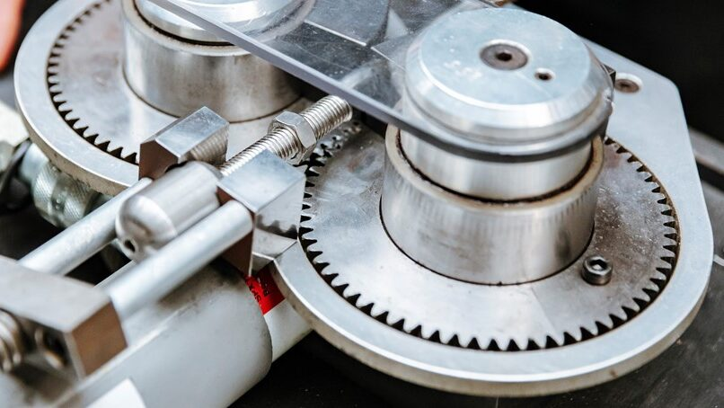
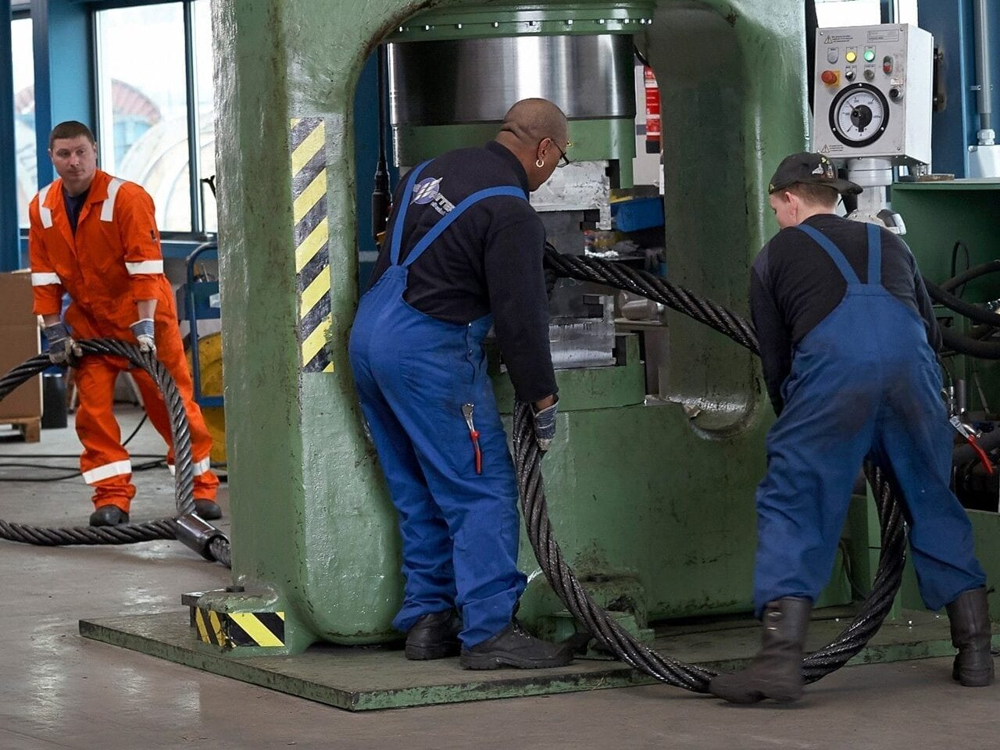
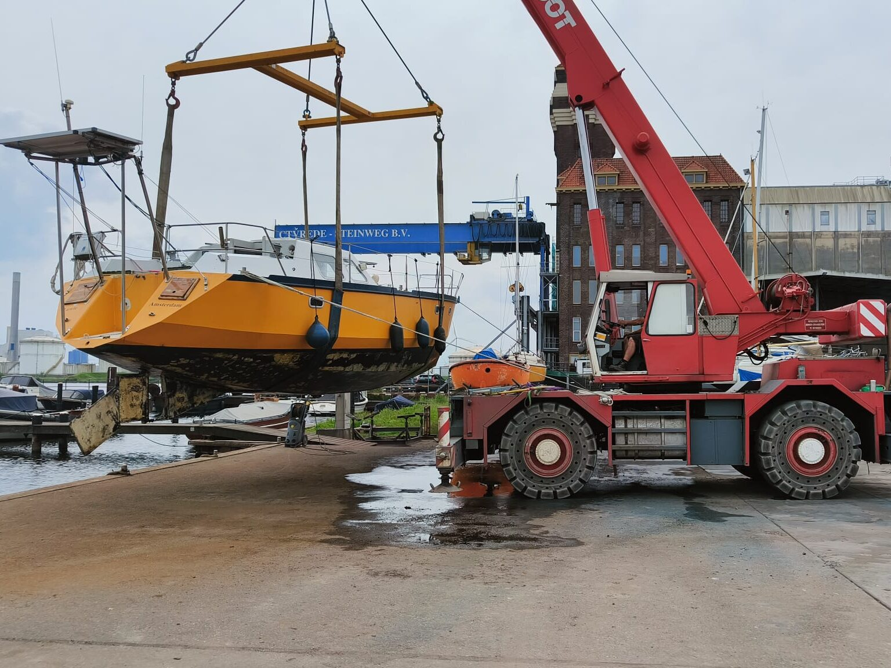
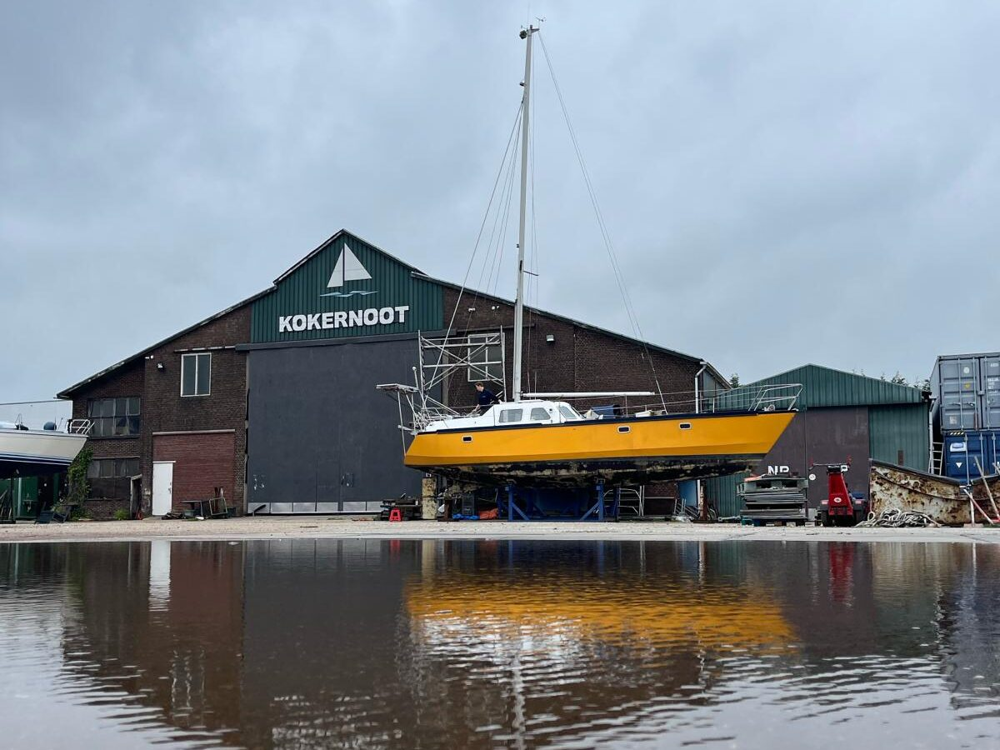
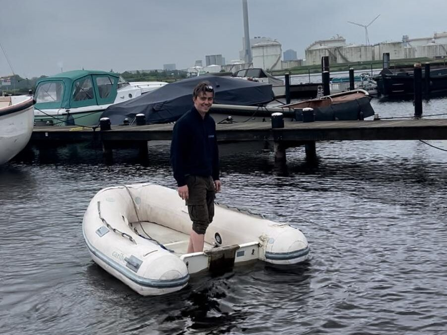
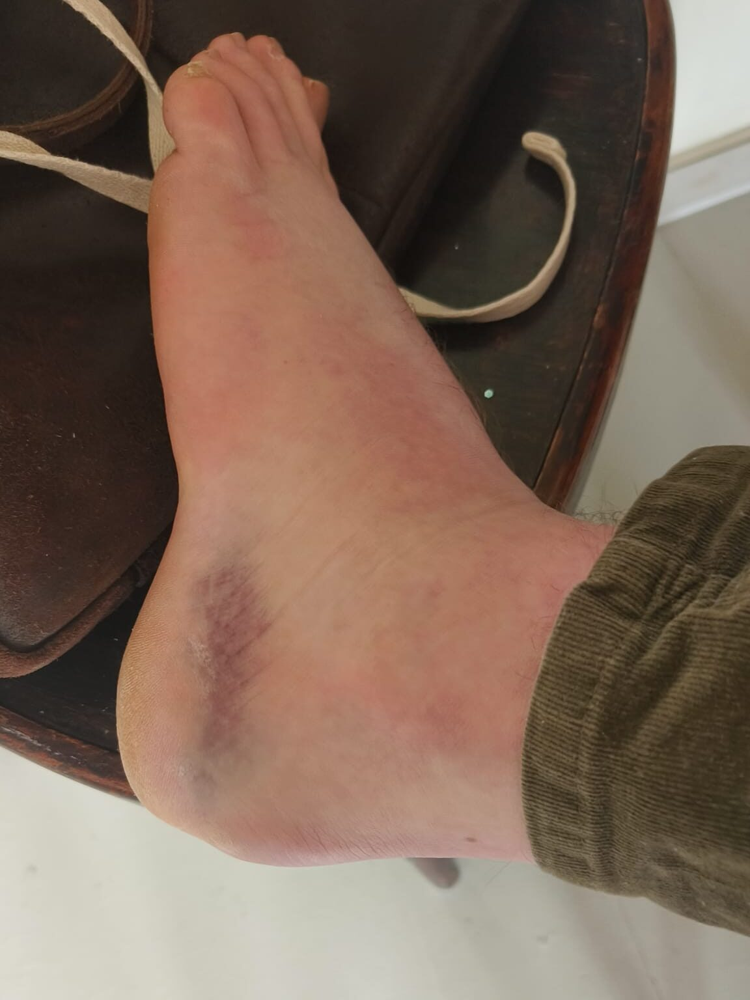

Nog een paar weken tot ons geplande vertrek. Vanaf dan kiezen we voor een lege planning en dat houden we ook graag even zo, al hebben we de neiging om al stiekem om het hoekje te kijken af en toe.

Voor het zo ver is moeten we nog even voelen hoe het is om vaste grond onder onze voeten te hebben.

Letterlijk en figuurlijk.

Afgelopen week werd de Luwte het water uit getakeld en op de bok gezet. Tot vorige week dinsdag lagen we nog altijd in het water en hoe tegenstrijdig ook, dat begon een beetje te knagen. Die boot moest er nu maar eens uit en dat werd elke keer een beetje uitgesteld. Intussen is binnenin de boot wel bijna alles helemaal leeg, schoon, geschilderd en bekeken. Dat was ook nodig en achteraf gezien een fijne volgorde, eerst binnen, dan buiten.

## Als een vis op het droge

Het blijft altijd wat ongemakkelijk, een boot die niet in het water ligt. Het is alsof je de essentie er een beetje uit haalt.

In tegenstelling tot vele (verstandige) mensen gaat de Luwte er gemiddeld maar elke 3 à 4 jaar uit en dat is dan altijd een onwennige situatie en een onwennig proces. Dat wordt nog eens versterkt door het feit dat wij voor gedegen onderhoud onze kiel moeten verwijderen en om die te verwijderen moeten we onze mast van de boot halen.

Kielen zijn er in allerlei soorten en maten. Ik heb een plaatje gevonden waar een aantal op staan om een beeld te schetsen, maar in principe heeft een kiel een aantal functies.

<figure class="wp-block-image size-large is-resized"><figcaption class="wp-element-caption">De kiel van de Luwte</figcaption></figure>

Voor álle zeilboten, van een optimist tot het grootste zeilschip ter wereld, geldt dat en kiel (of zwaard) er voor zorgt dat de kracht van de wind die vaak van opzij komt, niet de boot alleen maar overdwars door het water duwt, maar dat die wordt omgezet in een voorwaartse beweging. Ik zal verder niet te diep ingaan op de aero- en vloeistofdynamica die hier een rol bij speelt, maar zonder kiel komen we nergens.

De tweede functie van een kiel is het recht houden van de boot. Bij de meeste schepen is (het onderste deel van) de kiel daarom meestal van gegoten lood. De kiel moet dus de kracht van het zeil compenseren. Waar het zeil je schuin trekt, trekt de kiel je weer recht. Hoe schuin je gaat heeft dus te maken met hoe hard het waait en waar die twee hun evenwicht vinden.

")

Als je naar bovenstaande plaatje kijkt, is het leuk om te zien dat een zeilboot steeds op zoek is naar die balans, om altijd weer rechtop te willen komen. Immers, hoe schuiner je gaat, hoe kleiner het zeiloppervlak ten opzichte van de wind wordt. Tegelijkertijd wordt de kracht die de kiel uitoefent op het zwaartepunt van het schip juist groter. Met normaal zeilen kun je dus nooit omslaan met een kielboot, want dat zou betekenen dat het zeil parallel komt de staan aan de wind en dus helemaal geen kracht naar beneden uitoefent, terwijl de kiel maximaal terug aan het duwen is!

De kiel van de Luwte is een iets bijzonderder exemplaar. Deze kun je namelijk intrekken, net zoals je bij een optimist of een laser het zwaard omhoog kunt trekken. Dit biedt unieke mogelijkheden, want uitgeschoven behoort de Luwte tot vrij diepstekende jachten (2,10 meter) met alle balans en zeileigenschappen die daarbij horen, terwijl ingetrokken ons schip maar 0,70 meter diep steekt én wij kunnen droogvallen. Dat zorgt er voor dat wij dus hopelijk heel veel unieke plekken kunnen bezoeken en wij af en toe een plaatje als hieronder bij Vlieland kunnen delen..

Het hijsen van de kiel gebeurt vanaf het dek, onder de mast en dat betekent dat wij voor onderhoud eerst de mast moeten verwijderen en dan pas de kiel uit de boot kunnen takelen. Het aftuigen van de boot was in dit geval zeker gewenst, maar is ook altijd een heel karwei..

### De wereld van de staalboeren

De mast wordt namelijk op zijn plaats gehouden door in totaal 8 roestvrijstalen kabels. Deze kabels hebben allemaal apart een breeksterkte van zo'n 5.200 kilogram, elk afzonderlijk dus bijna genoeg om de boot in zijn geheel mee uit het water te trekken.  
Dat lijkt misschien wat overdreven voor een mast die een kilo of honderd weegt, maar je moet niet vergeten dat ze die mast ook overeind moet blijven als de boot tegen de golven inbeukt terwijl hij zo schuin hangt als het plaatje hierboven, met alle dynamische krachten die daarbij horen.

Over de levensduur van de verstaging zijn de meningen, zoals altijd, uiterst verdeeld. De einduitspraak in die discussies is meestal niet op natuurkunde, ervaring, of data berust, maar op wat jouw verzekeringspolis voorschrijft. Zo'n 15 jaar over het algemeen. Er zijn trouwens genoeg voorbeelden te vinden van verstaging die het ruim daarvoor heeft begeven en ook net zoveel voorbeelden van 30 jaar oude verstaging die op de testbank gewoon als nieuw presteerde.

Hoe kan dat?

Het is een vraag die mij flink heeft beziggehouden de afgelopen weken, want wij weten niet precies hoe oud onze verstaging is en willen die dus preventief vervangen. Maar waar?

Mijn grote bruine cruiser's encyclopedie gaf niet echt een waterdicht antwoord. Wel over de breeksterkte en overwegingen om te kiezen voor staalkabel, of juist kevlar versterkt touw, maar niet over waar je dan moet aankloppen.  
Zoekend naar aanbieders ben ik uitgekomen op twee stromen: De jachttuigers en de Staalboeren.

Zoals je kunt verwachten zijn jachttuigers gespecialiseerd in het tuigen van jachten en het verlenen van alle service die daarom heen verlangd kan worden. Ik wil deze tak van sport zeker niet volledig buiten spel zetten, maar het was ontzettend moeilijk om er achter te komen waar je nou precies voor zou betalen, behalve dat mijn zoektocht op het internet een stuk goedkoper uitkwam dan de offertes die we ontvingen.

Hoewel we best nog wat marge in de begroting hadden om de hogere offertes op te vangen, begon het een beetje te knagen toen ik een staalverwerker in Groningen tegenkwam (J.E. Staal). Op basis van de specificaties en prijzen kwam ik toch zeker de helft goedkoper uit dan bij de jachttuiger hier in de buurt. Een verschil van zo'n €1.500,- vind ik dan al snel wat extra tijd waard, al is het alleen al om er achter te komen hoe het zit.

### Walsen en Persen

Aan de uiteinden van een staalkabel moeten namelijk verbindingstukken komen die het mogelijk maken de kabel aan de mast en aan je dek te monteren. De zogenaamde "terminals". Dit is een wereld op zichzelf met weer 1001 meningen over welke terminals goed zijn en welke niet, maar ze dienen allemaal hetzelfde doel: Een koppelstuk zijn tussen mast en boot.

<figure class="wp-block-image size-full is-resized"><figcaption class="wp-element-caption">Verschillende terminals</figcaption></figure>

<figure class="wp-block-image size-large is-resized"><figcaption class="wp-element-caption">Wals</figcaption></figure>

De terminal goed op de staaldraad krijgen is dus van essentieel belang. In de jachttuigerij wordt er eigenlijk altijd gebruik gemaakt van de zogenaamde "wals", een machine die de draad samen met de terminal door een nauw gaatje trekt en zo de boel samenperst. Ze zijn ongeveer zo groot als een naaimachine en dat heeft als groot voordeel dat een tuiger bijvoorbeeld ook op locatie je stagen kan vervangen. Dat gaat meestal goed, maar je bent wel afhankelijk van degene die het apparaat bedient. Begeleid je de draad namelijk niet perfect recht, dan wordt je bevestiging scheef en daarmee niet sterk.

De andere school is die van de hydraulische pers. Die trekt de terminal en kabel niet door een klein spleetje, maar duwt van boven naar onder op de twee en perst ze dus letterlijk samen. Dit is het type pers dat je veelal terugziet in de grotere industrie, waar de kabels dikker zijn en de krachten groter. Het grote voordeel: Je terminal en kabel liggen in een recht gootje en worden dus altijd perfect recht geperst en de pers die ze gebruiken zal er nooit moeite mee hebben, want die gebruiken ze ook om de kabels van hangbruggen mee te maken:

Laat er in Den Oever, waar wij met de familie vroeg een huis hadden, nou zo'n hydraulische pers staan. Aan de visserijhaven in een grote loods waar de mannen met ankertattoo's in oliejassen in- en uitlopen is de Coöperatieve In-en verkoop Vereniging (CIV) voor de visserij en scheepvaart.

Het is maar waar je je tot aangetrokken voelt, maar ik vind de winkels van de CIV altijd leuker dan de bootjuwelier. Zo komen de trossen op het achterschip van de Luwte (de lijnen die ik beleg tijdens het in- en uitvaren) van de CIV, terwijl die op de punt (de lijntjes die Jen belegt) van de jachtjeswinkel.

Op de vraag of ze ook onze slechts wijsvingerdikke kabels konden persen in die megalomane machine van ze werd eerst wat terughoudend gereageerd. Ze doen weinig particulier werk en dus konden ze niet zomaar zeggen hoeveel dat zou kosten en wat er dan precies nodig was. Maar ze waren uiterst behulpzaam en wilden best een voorstel opmaken, al vond de meneer aan de andere kant van de lijn dat ik eigenlijk beter bij een jachttuiger kon aankloppen.

En zo geschiedde. Komende week brengen wij onze verstaging naar Den Oever en komen er verse kabels terug. Een mooi moment om nog even een lekker stukje spek, wat paling en een bakje van de lekkerste filet americain van Nederland mee te pikken.  
Er zitten nog wat uitdagingen op de weg tot dat moment, maar die overwinnen we wel weer. De bouten waarmee één van de stagen op zijn plek wordt gehouden zitten namelijk volledig vastgecorrodeerd en daar ben ik inmiddels al bijna een week mee bezig..

<figure class="wp-block-image size-large"><figcaption class="wp-element-caption">De bijboot waren we vergeten op de kant te leggen.. Die vonden we de volgende dag met 30 cm water aan het uiteinde van de steiger.. Halsoverkop dus nog even naar de werf voordat we onze office-dag van <a href="https://uguru.nl">UGURU </a>hadden...</figcaption></figure>

## Kaarten of kaarten

De avonduren en alle andere gaatjes in de dag kruip ik als vanouds achter mijn laptop om weer nieuwe zaken uit te pluizen. Naar aanleiding van de gesprekken met verschillende zeezeilers zijn we tot de conclusie gekomen dat papieren kaarten heel prettig zijn voor het overzicht, maar dat je in de praktijk toch veelal je digitale kaarten zult gebruiken om te navigeren.

De gehackte "CM93" OpenCPN kaarten van 2015 heb ik intussen weten te bemachtigen. Dat was een leerzame zoektocht over fora en verstopte websites, waar ik natuurlijk weer heel veel nieuwe inzichten uit heb weten te halen. Het was bovenal leuk om te zien dat er veel recalcitrante zeezeilers zijn die elkaar versterken in de drang om alles op alles te zetten om piraten-versies van de software toegankelijk te houden voor anderen. De grootste schat vond ik vanuit een forumpost waarin de naam van een schip werd genoemd, waarna ik daar naar ging zoeken. Via andere forumposts kwam ik op de site van een ander schip, die weer doorlinkte naar zeilschip "Soggy Paws", waarop een subpagina te vinden was genaamd "Terry's topics" waarop een link stond naar een pdf, waarin een link verstopt zat naar een server waarop een groot aantal boeken en kaarten te downloaden waren...

Voor de snelle schatzoekers, <a href="https://svsoggypaws.com/TerrysTopics.htm" data-type="link" data-id="https://svsoggypaws.com/TerrysTopics.htm">klik hier</a>

Tot niet zo lang geleden was OpenCPN naast de kaartplotter aan boord dé gouden standaard voor digitale navigatie. Er zullen vast veel zeilers zijn die er nog altijd veelvuldig gebruik van maken en misschien dat ik over jaar ook wel als evangelist de boeken in kan, maar voorlopig vind ik het erg omslachtige software die doet aanvoelen alsof hij in de laatste twintig jaar ook geen ontwikkeling meer heeft doorgemaakt.

Tot nu toe is onze iPad altijd de primaire vorm voor de navigatie geweest. Met de apps die daarop beschikbaar zijn is navigatie super simpel, goed te plannen en vooral compleet. De redenen om dus toch met OpenCPN, papieren kaarten en een kaartplotter te leren werken lijken dus soms een beetje overdreven, maar zoals met alles is het fijn om een back-up van een back-up van een back-up te hebben.

De papieren overzichtskaarten hebben we met hulp van onze buren op de haven bijna volledig bij elkaar weten te sprokkelen. Die liggen inmiddels opgestapeld onder de bank om nog eens goed te bekijken en op volgorde te leggen.

## Where there is no doctor

Turend naar die kaarten komen we voorlopig nog niet echt op plekken *where there is no doctor*, behalve dan midden op zee. In één van de mappen van Terry's Topics vond ik een collectie boeken waaronder ook de boeken "Where there is no doctor" en van dezelfde serie "Where there is no dentist", fijne documentatie voor op de harde schijf.

Tussen het analyseren van complexe modellen, interviewdata en deadlines door bereidt Jen onze medische kennis voor en daar hoort een goed voorbereidde medische kit bij. De Radio Medische Dienst (de 24/7 hulplijn voor zeevarenden) heeft samen met een ervaren zeezeiler en de KNRM (Koninklijke Nederlandse Reddingmaatschappij) een lijst op van middelen opgesteld die je zou moeten meenemen aan boord bij langere zeilreizen.  
Van zeeziektepillen tot epi-pennen en morfine, de apotheek aan aanbevolen middelen was vrij uitgebreid en van veel dingen lijkt het ons onwaarschijnlijk dat we ze zullen gaan gebruiken.

Maar met deze lijst en de instructies op zak ging Jen met gepaste tegenzin wel even kletsen met de arts. We hebben daar met haar hele ziekteproces niet zo'n heel goed band mee, maar gelukkig zijn in de praktijk de nodige artsen weer doorgestroomd en had Jen een jongedame voor zich die onder de indruk was van de plannen en de aanpak van onze voorbereiding. Veel makkelijker dan gedacht kon zij alleen maar concluderen dat deze lijst (met een uitzondering hier en daar) haar helemaal niet gek leek voor de plannen die wij hebben en dat ze er best voor openstaat om die voor te schrijven, al gaat dat best in de papieren lopen en zal de eerste €380 ons eigen risico terecht komen. Een (medisch) ongeluk zit altijd in een klein hoekje zeggen ze, dus kun je de spullen beter bij je hebben.

Dat bleek afgelopen week maar weer.

Bij het afstappen van het laddertje op de werf zette ik mijn voet niet goed neer en klapte mijn voet dubbel. Ik kan het niemand aanraden, maar voor mij was het de tweede keer. Los van de pijn en het manke lopen is het geluid van een knakkende / scheurende enkelband misselijkmakend.  
Nog voor ik op de grond landde wist ik al dat het niet best was en nog voordat ik weer omhoog kwam zat er een groot ei op mijn voet. De zwelling is inmiddels een beetje weggetrokken, en heeft plaats gemaakt voor een grote bloeduitstorting, meestal niet het beste teken..

<figure class="wp-block-image size-large is-resized"></figure>

Een paar dagen verder strompel ik dus voort. De eerste stappen als een heel gefrustreerde jongeman die de muur aan post-its in het water zag vallen en even niet meer wist hoe nu verder. Maar ook dat tij hebben we gelukkig weten te keren. Na een paar dagen in slow-motion te hebben geleefd begin ik er wel comfortabel mee te worden en moet ik ook inzien dat dat veel beter bij mij en onze toekomstige levensstijl past dan dat gehaaide doordrammen om de post-its af te krijgen. Ik kan mij gelukkig prijzen met een lichaam en geest die resoluut reageren als ik over mijn grenzen aan het gaan ben, dus daar luisteren we maar goed naar.

De komende weken verleggen we de focus dus naar de essentiële elementen om te vertrekken en daar hebben we gelukkig veel helpende handjes bij. Mijn vader helpt met het installeren van een windvaan stuurinstallatie (onze toekomstige beste vriend en eerste stuurman) en het verstevigen van de mastvoet. Dit weekend vliegen onze vrienden in om te helpen schuren, schrobben en bikken en volgende week zien we dan wel weer hoe de vlag erbij hangt.

Het lijstje met "volbrachte taken" is wat warriger geworden en heb ik dus niet helemaal goed bijgehouden de afgelopen weken, maar die zal ik weer wat netter gaan bijhouden!

---

## Product-update

**Website**

Naast de to-do's kunnen we wél vermelden dat de website van de Luwte is geupgrade naar versie 1.2.0! Met de komst van deze versie kunnen jullie nu zelf berichtjes achterlaten op ons blog. Je eerste post moet handmatig worden goedgekeurd, maar daarna kun je als het goed is zelf reacties plaatsen die dan hieronder komen te staan! Ik heb alvast een voorzetje gedaan.

Zoals je hieronder kunt zien hebben we ook nog ergens een hardnekkige "enter" rondom linkjes naar andere plekken op het wereldwijde web.. Wie weet dat we bij versie 1.2.1 een oplossing hebben!

**Instagram**

Jen houdt in de weekenden *stories* bij op onze [Instagram](https://www.instagram.com/sailingluwte/). Wie wordt onze 100e volger?!

**Vlogs**

De eerste stond op de planning voor deze week en we hebben al aardig wat beeldmateriaal verzameld. We zijn alleen nog niet helemaal uit wat voor format dit moet krijgen en of we überhaupt echt met regelmaat iets gaan monteren terwijl we onderweg zijn.  
Jen heeft het ook wat te druk met scriptie schrijven om hier nu in te duiken. Wordt wellicht vervolgd!

