En dan maken we opeens een grote klapper. We zakken bijna tien breedtegraden naar het zuiden in zes en een halve dag. Ter vergelijking, in de afgelopen vijf maanden zeilden we van Amsterdam zo'n 15 breedtegraden naar beneden.

Het verschil is sterk voelbaar. Eerlijk is eerlijk, wij liepen overdag nog in onze korte broek over straat, maar 's avonds gingen wij al weer een tijdje onder ons dikke dekbed om het warm te houden. Ook in het zuiden van Portugal is het winter. Daarnaast hadden we daar steeds meer moeite om de accu's op peil te houden met het aanwezige zonlicht. De zon was duidelijk korter, maar vooral ook lager boven de horizon te vinden.

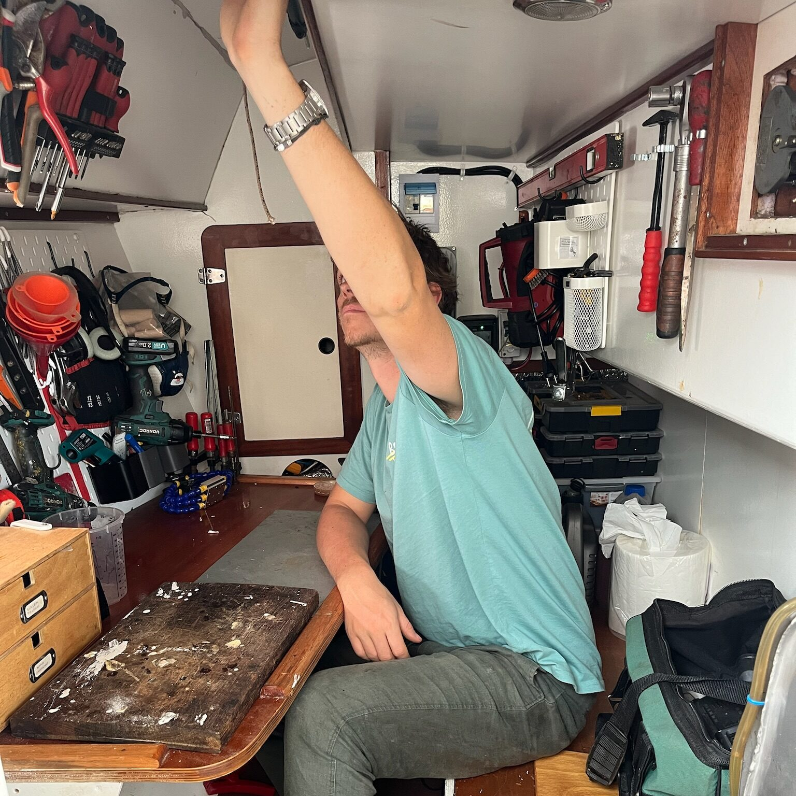

<figure class="wp-block-image size-large">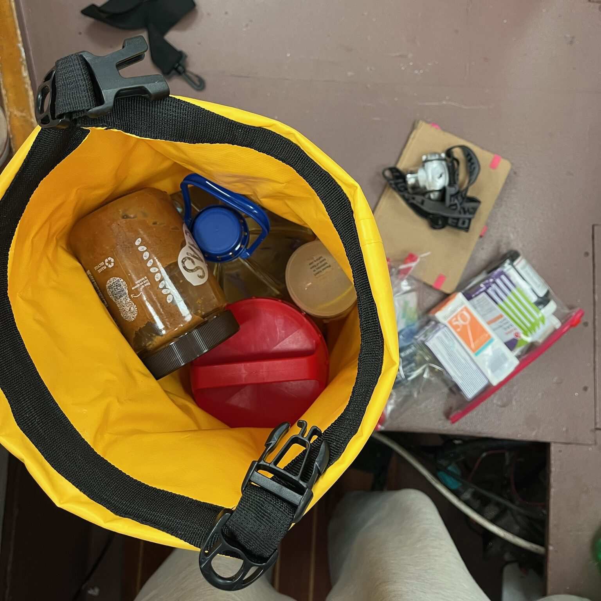<figcaption class="wp-element-caption">Pre-flight checks: Wat zit er in onze <em>grabbag</em> in geval van nood?</figcaption></figure>

## **Ver weg**

We varen weg uit de pieren van Faro door een heksenketel. De monding van het gebied is smal en de hoeveelheid water die er doorheen geperst wordt groot. Met de motor stationair vliegen we met bijna acht knopen naar buiten, waar een paar brekende golven voor ons klaarliggen. Zo goed en zo kwaad mogelijk draaien we om de vissers heen die juist op dit spannende stuk hun slag proberen te slaan. Ik stel me zo voor dat het een walhalla voor de zalm is, maar *Luwte* heeft het liever iets gecontroleerder. Het duurt gelukkig maar kort, al snel zijn we over de drempel heen en varen we op een zee zo vlak als een spiegel weg van de Portugese kust in het blauwe niets.

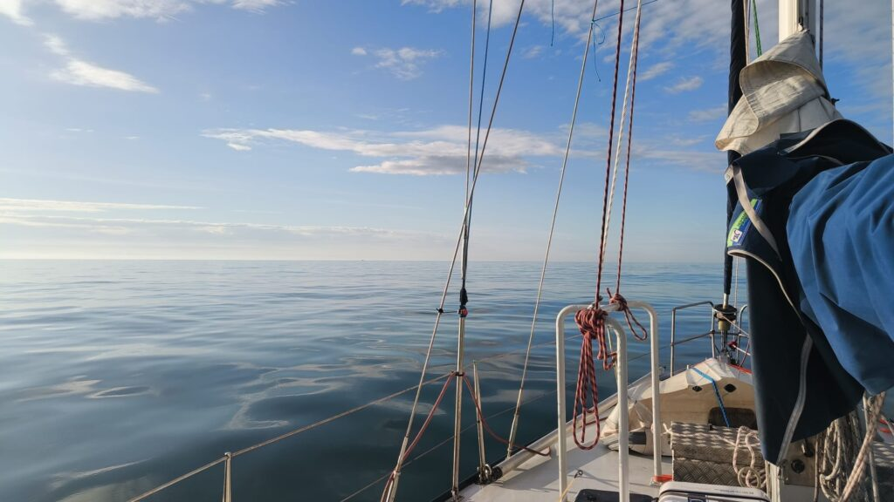

Als we de volgende ochtend wakker worden voelen we de eerste bries opsteken. Het weervenster is wat betreft zeilen niet ideaal, maar nu we het eerste stukje motoren gehad hebben zouden we een noordelijk windje de goede kant op moeten krijgen. Door de windstille dagen hiervoor is de zee zo kalm als ze maar kan zijn. De gennaker en het grootzeil gaan op en met ruime wind glijden we over een blauw heuvellandschap. *Luwte* ligt stabiel, een graad of tien à 15 op haar bakboord oor en de windvaan stuurt ons met de golven en de wind mee de goede kant op.

Op deze manier inslingeren is niet verkeerd. We kunnen gemakkelijk koffie, thee en eten bereiden en gewoon meteen daarna afwassen zonder dat het iets roert in onze buiken. Naarmate de wind blijft staan en de golven iets opbouwen, doen onze lichamen gewoon mee in de zeegang. Tijdens het wachtlopen zijn onze ogen gekluisterd aan de eindeloze sterrenhemels, of aan de iPad die de tijd doodt met series en films. Het is nieuwe maan, waardoor er helemaal geen lichtvervuiling meer is. We kunnen de melkwegstelsels duidelijk waarnemen en ik probeer het jaar Sterrenkunde van de eersteklas middelbare school weer op te rakelen. Verder dan de poolster, de beren en een aantal stelsels die ik wél herken in vorm, maar niet in naam, kom ik niet. De sextant die we onderin het schip hebben liggen begint te roepen, maar zit vooralsnog gewoon nog in zijn kistje te wachten op een studie naar varen op de sterren...

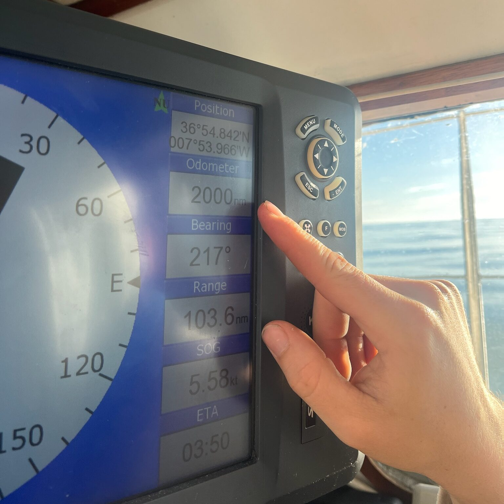

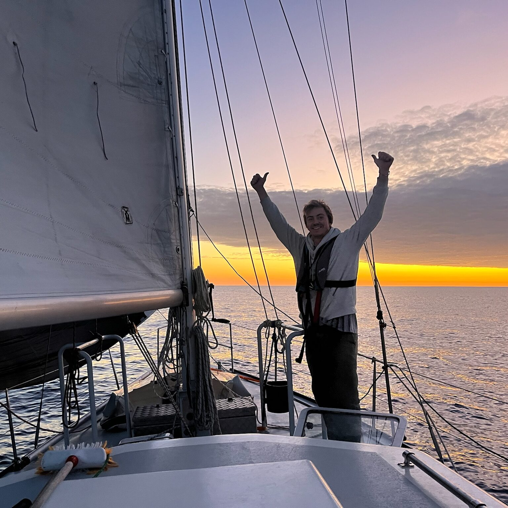

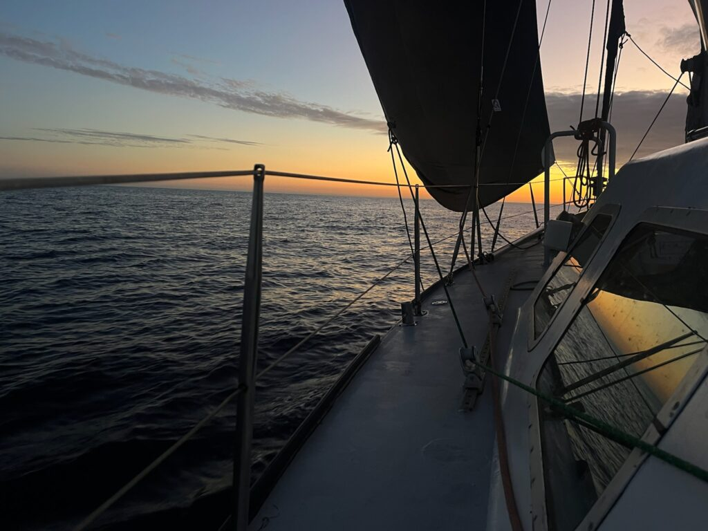

## **Eerste stuurvrouw Doris**

Ze is al vaker aan bod gekomen: Onze windvaan. Tot Portugal liefkozend *Windvanie* genoemd, maar sinds het echte werk is verzet, gedoopt als *Doris*, naar een van de Oceaniden en vrouw van Nereus uit de mythologie. Samen kregen zij vijftig Nereïden en beschermden de zeelui in zwaar weer. Dat klinkt als onze *Doris.* Zodra de wind opsteekt en wij onze weg over de golven moeten zoeken geven we ons lot in haar handen, maar als het rustig wordt moeten we het toch zelf overnemen en is er vast ergens anders op zee een zeeman- of vrouw die haar hulp beter kan gebruiken.

Het is een wonderbaarlijk stukje natuurkunde, naar ontwerp van generaties geleden. *Doris* voer met onze familie al tweemaal de Atlantische Oceaan over en gaat binnenkort voor de derde en hopelijk vierde ronde. Welke tochten ze voor de Familie de Boer voer is onbekend, maar één ding is zeker, van ons allemaal is ze de meest ervaren zeerot. Er komt geen elektriciteit aan te pas en hoe harder het waait, hoe beter ze stuurt.

Het onderstaande plaatje geeft precies weer hoe dat in zijn werking gaat. Het doel: De boot ten opzichte van de wind dezelfde koers laten varen (dus altijd de wind schuin van voren bijvoorbeeld).

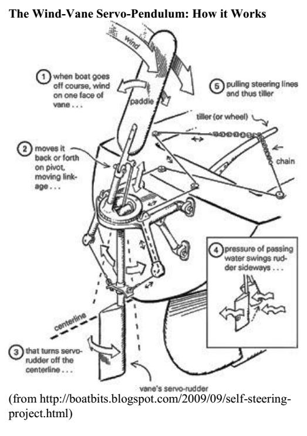

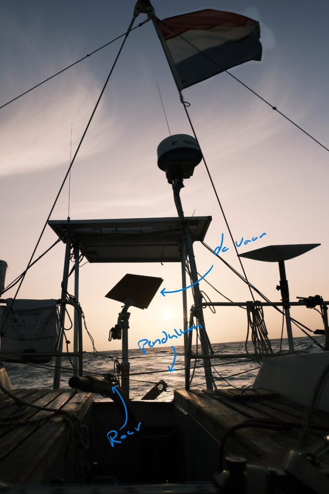

Dat begint dus bovenaan met het opvangen van de wind en voelen of we nog de goede kant op gaan: *the vane.* (1) Die stellen we dus in op een bepaalde koers, dan waait de wind er precies langs, maar als de boot draait komt de wind tegen de voor- of achterkant te staan en duwt de vaan om zijn as (2).

Die as is weer verbonden met de verticale as van het *servo-roer*. (3) Het *servo-roer* verschilt van een gewoon roer, want in plaats van sturen, draait deze om zijn as en kantelt van links naar rechts. De vaan draait dus het roer (2, 3), waarna het roer uitslaat naar bakboord of stuurboord (4). Deze uitslag wordt verbonden aan ons hoofdroer en is ongelofelijk sterk (en hoe harder je gaat, hoe sterker de kracht). Die verbinding trekt dus aan onze helmstok en zorgt ervoor dat de boot gaat draaien (5) totdat de windvaan (1) weer parallel staat aan de wind, het *servo-roer* terug naar het midden gaat en dus niet meer aan de helmstok trekt.

Klinkt vast aardig ingewikkeld, maar als je het ziet is het magisch. Het mooie is namelijk dat een golf die ons schuin duwt, ook een verandering ten opzichte van de wind veroorzaakt en ook die wordt dus door *Doris* opgevangen. Onze elektrische stuurautomaat weet met dat soort verschuivingen geen raad, laat staan met een flinke bries… Het onderstaande filmpje says it all.

<figure class="wp-block-video"><video autoplay="" controls="" loop="" muted="" src="/wp-content/uploads/2024/12/0172d6cc699609efb30af7c5269125b49936a8b36b.mp4"></video></figure>

*Doris* is in zekere zin dus de danspartner van *Luwte.* Samen zwieren ze over de golven en brengen ons al dansend van de ene, naar de andere bestemming. Sturen op de wind in plaats van op kompaskoers heeft één heel groot voordeel en dat is dat je zeilen altijd goed blijven staan als de wind draait, je boot draait dan immers gewoon met de wind mee. Onze elektrische stuurautomaat kan heel strak naar het zuiden blijven varen door het ingebouwde kompas, maar als de wind draait gaan de zeilen klapperen. In een vaargeul, of vlak langs de kust is strak op koers blijven fijn, maar op zee zijn de afstanden groot en de *track limits* eindeloos. Een paar uur de verkeerde kant op varen maakt dan ook niet zoveel meer uit.

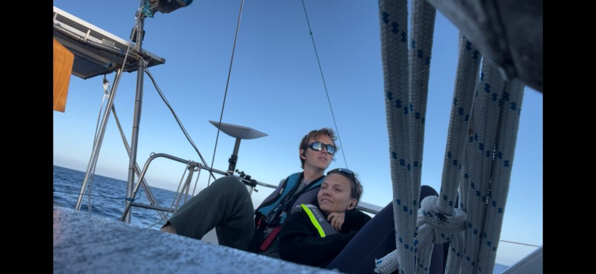

## **Dolfijnen en tonijnen**

Op dag drie worden we allebei volledig uitgerust wakker. Ons slaapritme is om en het zeilen gaat vanzelf, waardoor we ’s nachts weinig anders doen dan wachten tot de tijd om is. Op de vierde dag worden we ’s ochtends wakker met een enorme groep tuimelaars die de hele dag met ons meezwemmen. We zetten koffie en positioneren onszelf met onze voeten over de rand op de boeg, waar het dartelen, springen, op z’n kop zwemmen het best te zien is. Zo zitten we bijna anderhalf uur in de zon ons geluk op te zuigen. Er is niets om ons heen behalve een eindeloze zee en de dolfijnen. Eentje is de grappenmaker van de groep, die maakt continu salto’s, belandt op zijn rug in het water en springt bovenop zijn school-genoten. *Luwte* spint weer op de golven en ik noteer ’s ochtends vroeg in het logboek dat ik verwacht dat we ons 24-uurs record gaan halen. We wisselen zo nu en dan zeilen, reven het grootzeil en halen het rif er weer uit. Met gemiddeld 6+ knopen vliegen we op voor ons hoge snelheid naar het zuiden. Later die dag maak ik de balans op met 24 uur geleden en noteren we 140 mijl. Een record dat voorlopig nog wel even mag blijven staan.

Door de volgende nacht heen draait de wind. Waar we die de hele tijd schuin van achter hebben gehad komt de wind nu precies van opzij (halve wind). Precies zoals de verwachting, en nu gaat het spel beginnen. We weten dat de wind tegen ons gaat draaien en dat de Canarische Eilanden een vreemde invloed kunnen hebben op de wind. Door de nacht heen draait de wind verder en de volgende dag staat de wind recht op onze neus. Vooralsnog blijft de zee rustig, aangezien de wind pas net gedraaid is, maar na dagen noordelijke wind weten we dat deze zuidelijke bries snel voor steile en intense golven gaat zorgen. Nog zo’n 230 mijl naar Gran Canaria..

We concluderen snel dat opkruisen op volle zee echt een ander spel is dan op onze binnenwateren in Nederland. De enorme massa’s water die we tot nu toe mee hadden, keren zich tegen ons en duwen ons weg van de Canarische Eilanden. Met de zeilen over onze stuurboordboeg varen we pal naar het westen, terwijl we met de zeilen over de bakboordboeg zuid-oost halen.

Zo’n 48 uur later is alles zout en zijn we een beetje moe, ondanks het mooie zonnetje dat ons heeft bijgestaan en *Luwte* die onverstoorbaar doorploeterd. Ik zit die middag met een koptelefoon op in de kuip en ontkoppel *Doris* even. Een paar uur lang stuur ik met de hand, terwijl de epische muziek in mijn oren mij doet geloven dat ik in een film zit.

Die rekening betaal ik die avond, als we grote zwarte wolken op ons af zien komen, de wind aantrekt, er riffen moeten worden gezet en Jen terloops opeens onze eerste vis aan de haak heeft! *Luwte* moet eerst naar de andere boeg om onder het potentiële onweer uit te blijven en er is in mijn hoofd even geen tijd om bij te gaan liggen of rustig aan te doen. De bonito aan onze haak komt planerend over de golven naar binnen en krijgt een resoluut einde van onze moker. Jen is in alle staten en spartelt bijna net zo hard als de bonito rond op zoek naar emmers, hamers, messen, visgerij en vooral zichzelf. Zodra onze vangst uit het lijden verlost is, komt ook Jen weer terug op aarde en in het licht van een hoofdlamp fileert ze kundig haar eerste grote vangst. De restjes die nog aan de graat bleven zitten zijn voor de gelukkige vis die voorbij komt zwemmen.

Inmiddels is het in mijn hoofd ook weer een beetje helder besluiten we dat bijliggen om de vis klaar te maken en even rustig te eten helemaal geen slecht idee is. We stuiteren nog altijd over de golven en dat is eigenlijk helemaal niet lekker voor zo’n feestelijk moment! De boeg gaat om, de fok blijft staan en Jen neemt de tijd en de ruimte om de vis klaar te maken, terwijl ik het weer nog eens bekijk en een plan maak voor de komende mijlen. De tataki beviel ons wonderbaarlijk goed en tevreden stuiteren we verder de nacht in.

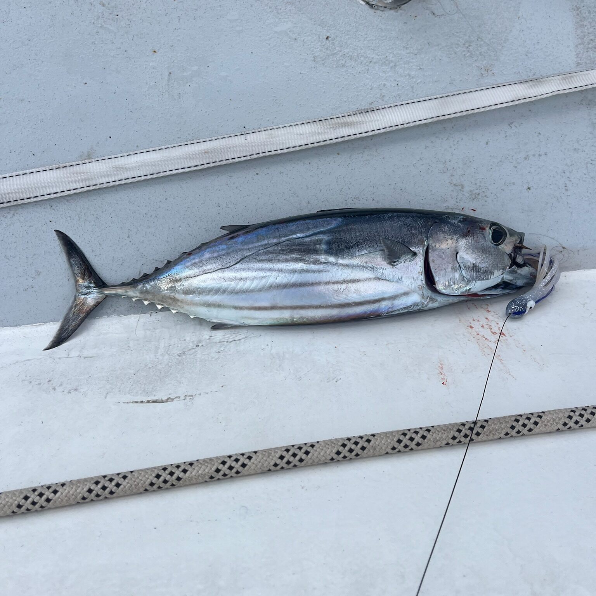

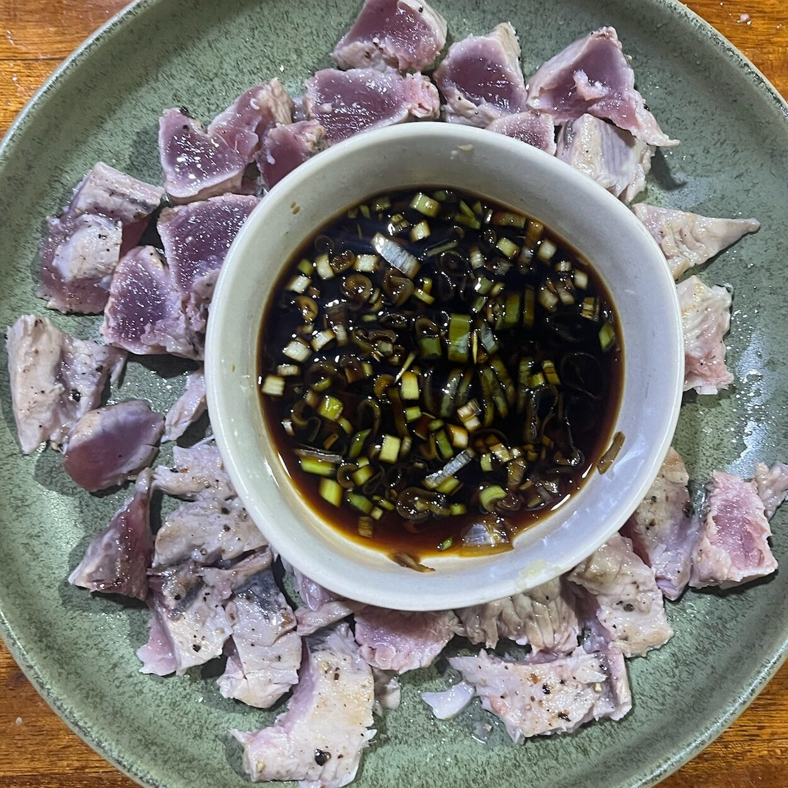

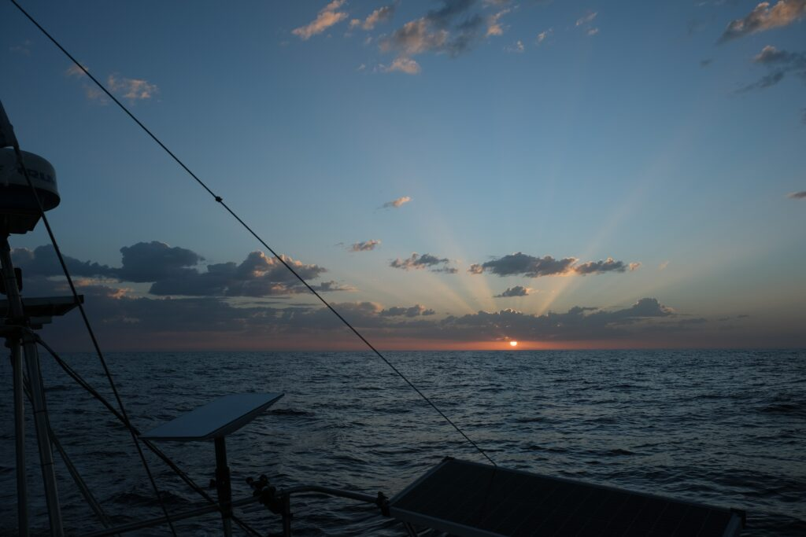

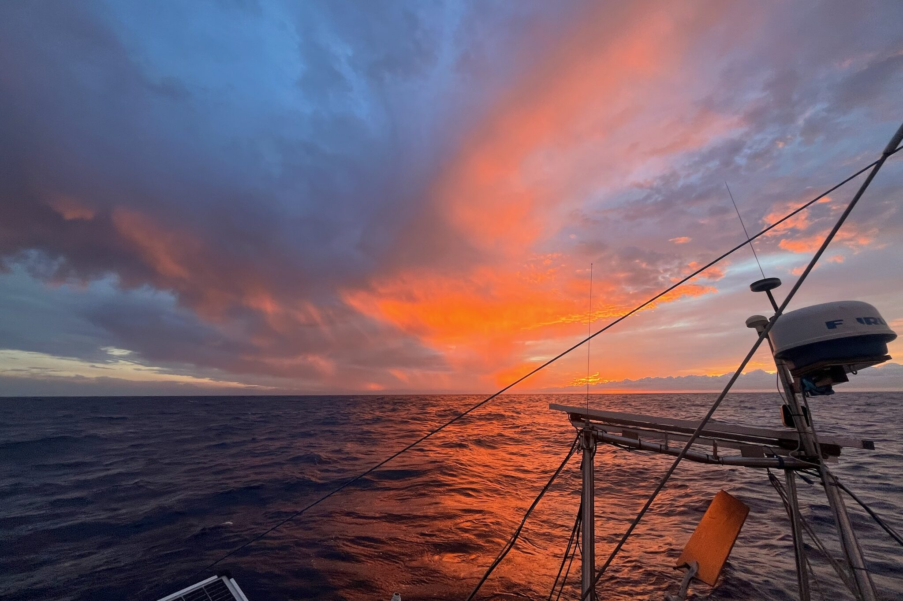

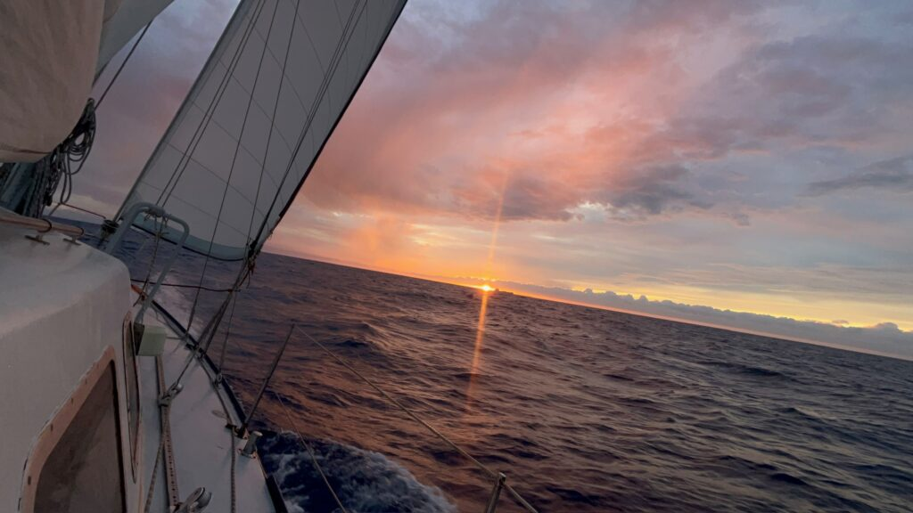

De volgende ochtend hebben we land in zicht. Het water is inmiddels vlak en de motor bromt al een tijdje. Bij het starten hapert onze startmotor en vliegt het ons even naar de keel. Onze Zweedse vrienden hadden ook problemen met de startmotor en bij hun kwam die niet meer tot leven... Bij ons gelukkig wel, maar een nieuwe is geen overbodige luxe besluiten we.

Het is druk in de ankerbaai van Las Palmas. Hoewel de haven volledig leeg is, omdat er de vorige ochtend een grote groep is vertrokken, laten ze nog even niemand binnen. Dicht tussen de andere bootjes en op een stuk dieper water dan we gewend zijn (zo’n 13 meter) laten we ons anker zakken. Er gaat vijftig meter ketting achteraan en na wat achteruit gassen liggen we vast: De Pommery bubbels met Bestemming Canaries hebben we vannacht in de koelkast gelegd en hoewel het pas vroeg in de middag is, proosten we op een behouden vaart. Zes etmalen, zes uur en ruim 750 mijl verder.

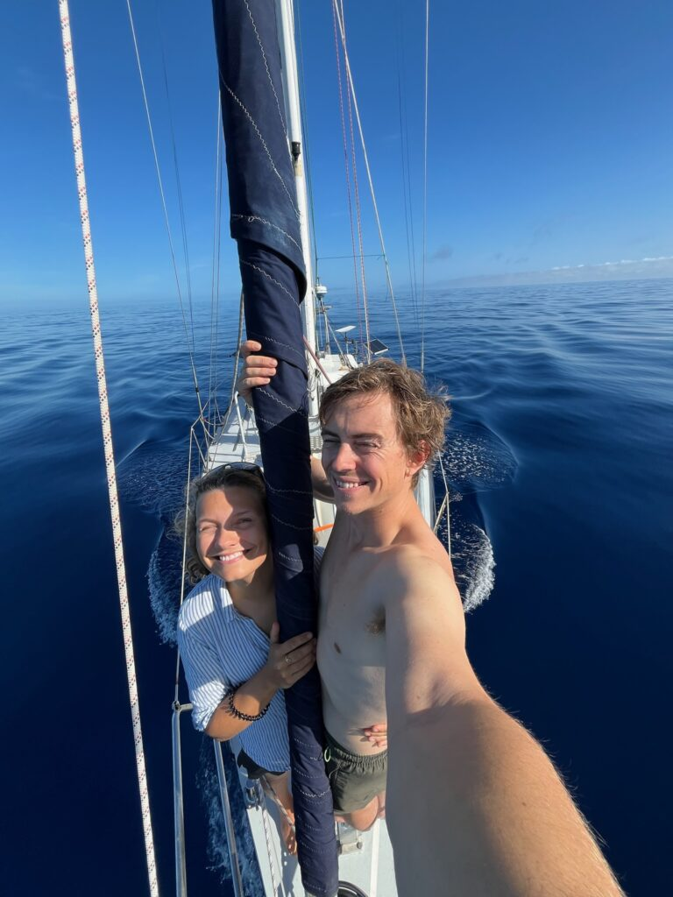

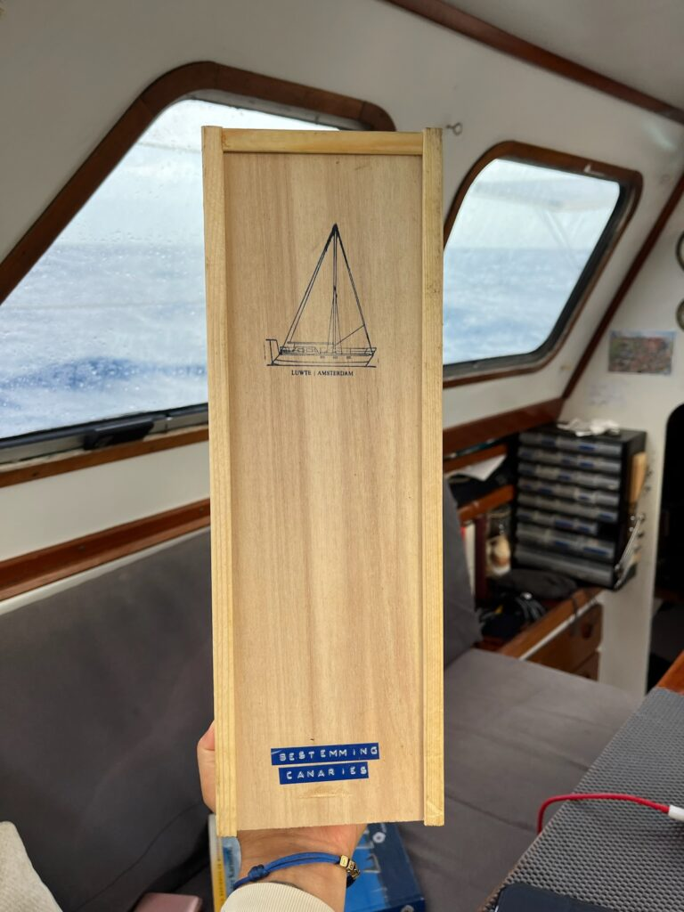

## **Bad- en borrelplaats Las Palmas**

Het aangezicht van Las Palmas is precies hoe het in mijn fantasie er uit zou moeten zien. Ik heb er nog nooit foto’s van gezien, laat staan bezocht, maar diep van binnen wist ik al dat dit een soort Zandvoort design XXL zou moeten zijn. En die fantasie komt uit.

Naast de enorme lelijke flats en eindeloze toeristenstromen van de cruiseschepen, liggen we achter ons anker lekker beschut. Het oude centrum, dat een paar kilometer verderop ligt en bijna een openlucht museum is, bezoeken we per huurfiets. We genieten van onze opgevoerde benenwagen die ons net als in Nederland overal snel en comfortabel brengt, met name over afstanden die niet te lopen zijn. In het huis van Columbus bekijken we zijn kaarten en laten we ons inspireren door de primitieve navigatiemiddelen waarmee hij de oversteek waagde. Andere tijden sport.

Iets wat vermoedelijk nooit veranderd is door de tand des tijds, is het borreltalent van zeilers. En laten er in Las Palmas nou bij uitstek een groot aantal bij elkaar liggen die allemaal in een zinderende energie aan het klaarstomen zijn voor grote zeetochten. Borrelseizoen geopend. Bijna elke avond zitten we aan boord bij andere schepen of andere schepen bij ons. Naast een warm weerzien met *Sya*, die we in Cascais voor het laatst zagen, ontmoeten we Maud en Joris van de *Jonathan*. In Muros hebben we een nachtje in dezelfde baai gelegen, maar nooit kennisgemaakt. En ook Esmée en Dante van de Nova Mahea schudden we na maanden om elkaar heen varen eindelijk een handje en een biertje. We spenderen een paar dagen met de Zweedse jongens van de *Lucky Winny,* die inmiddels twee nieuwe startmotoren hebben waarvan wij er eentje kunnen overnemen, om hun boot te inspecteren en al hun vragen te beantwoorden. Hun overtocht naar de Canaries is toch wel een wake-up call geweest om de afgelegenheid van een bootje op de oceaan niet te onderschatten en ze hebben hier direct een maand in de haven geboekt om full-time te klussen.

Het bijzondere van dit soort plekken en ontmoetingen is dat je merkt dat iedereen volledig zijn, haar of hun eigen plan heeft en toch kom je elkaar tegen. Zo volgen we Hugo van de *Pinta* al een hele tijd via Instagram, zonder hem te kennen en zijn bestemming ligt in Brazilië. Herman en Hella van de *Kolibri* ontmoetten we eerder al en raakten we uit het oog, terwijl we eigenlijk hetzelfde rondje varen. Via via hoorden we al van de *Ella* met Tjeerd en Marieke aan boord en zo waren er nog een heel aantal anderen, die plotseling met z’n allen *Happy birthday* stonden te zingen voor Andreas, een Zweed die solo rondzeilt en op zijn verjaardag aansloot bij de strandborrel.

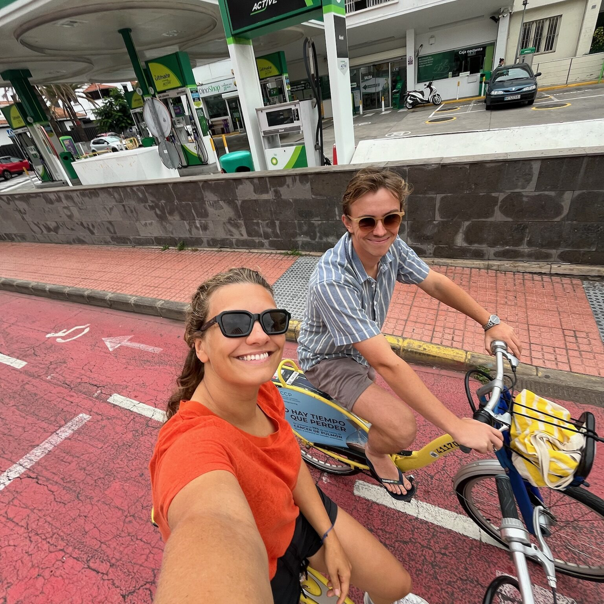

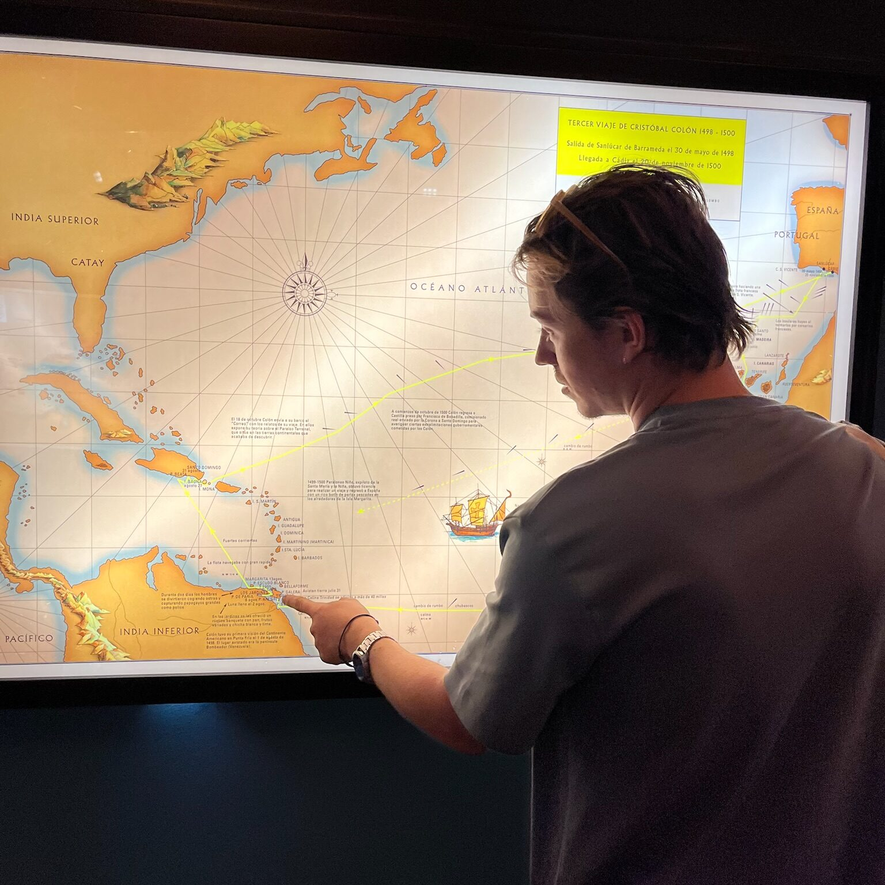

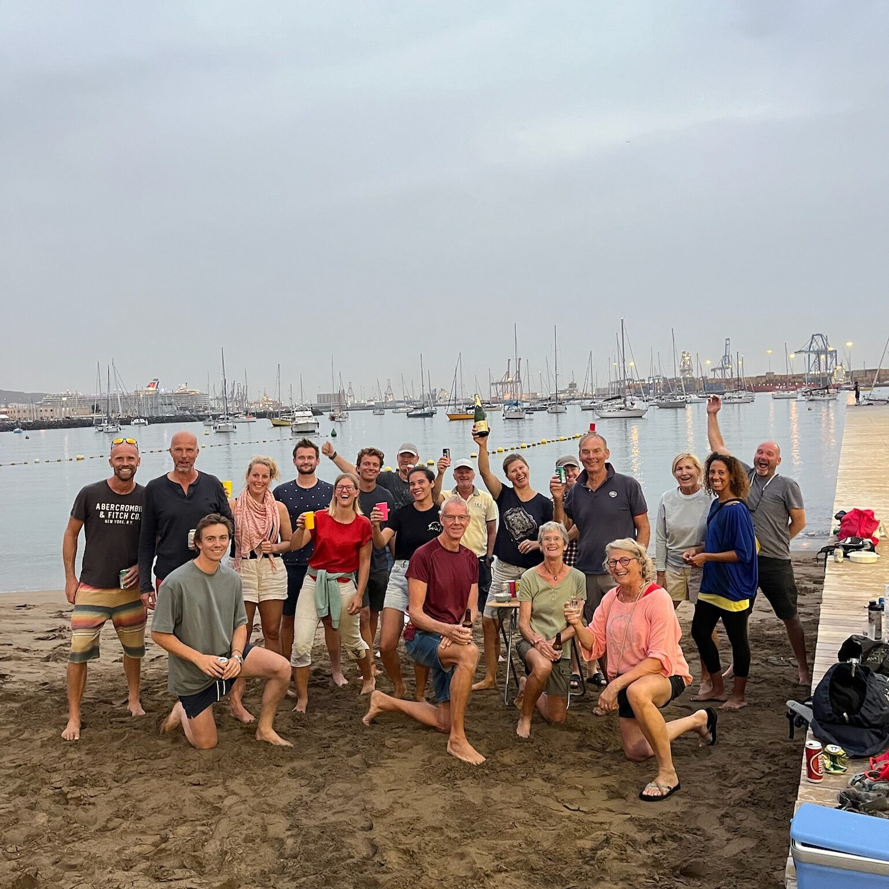

 nieuwe lijntjes.")

Tussen de borrels door spenderen we veel tijd in de bootwinkels. Die zijn hier adembenemend rijkelijk voorzien. Een ware strip met op een rijtje de Volvo Penta, Yanmar, Suzuki en Honda dealer openen het bal, waarna een tal van onderdelenwinkels, bootjuweliers, kledij, zeilmakelarij en viswinkels volgen. We hebben twee volle rondes gemaakt met elke winkel en zijn twee keer ook met volle tassen terug aan boord gekomen. Ons budget voor de komende maand is er al doorheen, maar we zijn weer helemaal op peil met zowel nuttige, als nutteloze massa.

## **La Gomera**

Na bijna een week hard genieten borrelt het op om verder te varen. We hebben eigenlijk nog maar weinig “Canarisch” gezien en vrezen dat we dat hier ook niet gaan vinden. De westelijke eilanden trekken ons en er is een klein venster om onder Tenerife langs naar La Gomera te komen. *Sya* besluit in dat plan mee te gaan en samen varen we op naar het volgende eiland. Jen vist onderweg nog twee bonito’s tegelijk uit het water, waarvan er eentje teruggaat omdat het simpelweg teveel is. Ik en Robin van de *Sya* testen onze marifoons, radar en AIS en concluderen dat het toch niet altijd even heilig is als wij dachten. Af en toe je hoofd uit het luik steken heeft dus nog altijd waarde.

Tussen Gran Canaria en Tenerife zit een beruchte *Venturi*. Door de ligging van de eilanden wordt de wind daar, net als in een beekje, door de versmalling samengeperst en versnelt. Waar we met zo goed als geen wind vertrekken, trekt die aan tot 25 knopen op de kont terwijl we tussen de eilanden door stuiven. Onder Tenerife valt de wind weer weg, maar zodra we iets verder zijn duikt de volgende *venturi* tussen Gomera en Tenerife op. Dit keer op de kop en in vlagen rond de 30 knopen. Normaal hebben wij geen idee van hoe hard de wind waait, dat gaat bij ons op gevoel en op hoe dichtbij het water komt aan de lage kant, maar *Sya* draagt een windmeter en dus hebben we nu ook statistieken.

Dertig knopen wind in je gezicht betekent wel even werken. Het zonnetje schijnt en de wind is hard. Het water spat hoog op rond onze boeg en vliegt zo nu en dan over *Luwte* heen helemaal naar de kuip, waar twee glimlachende koppies aan de helmstok voelen dat *Luwte* in haar sas is. We kunnen op een gegeven moment wat ruimen en schieten met 6,5 knoop richting Gomera. *Luwte* spint en ik merk op dat ons anker niet vastgesnoerd zit. Simpelweg niet aan gedacht omdat we geen zwaar weer verwachtten… Op het voordek dans ik een tango op de overvliegende golven. Ik neurie *hoofd schouders knie en teen* in mezelf om mijn hoofd en lichaam erbij te houden en als het anker eenmaal vastzit en ik inmiddels toch al doorweekt ben blijf ik even zitten om te genieten van het spektakel.

 weer terug naar zee")

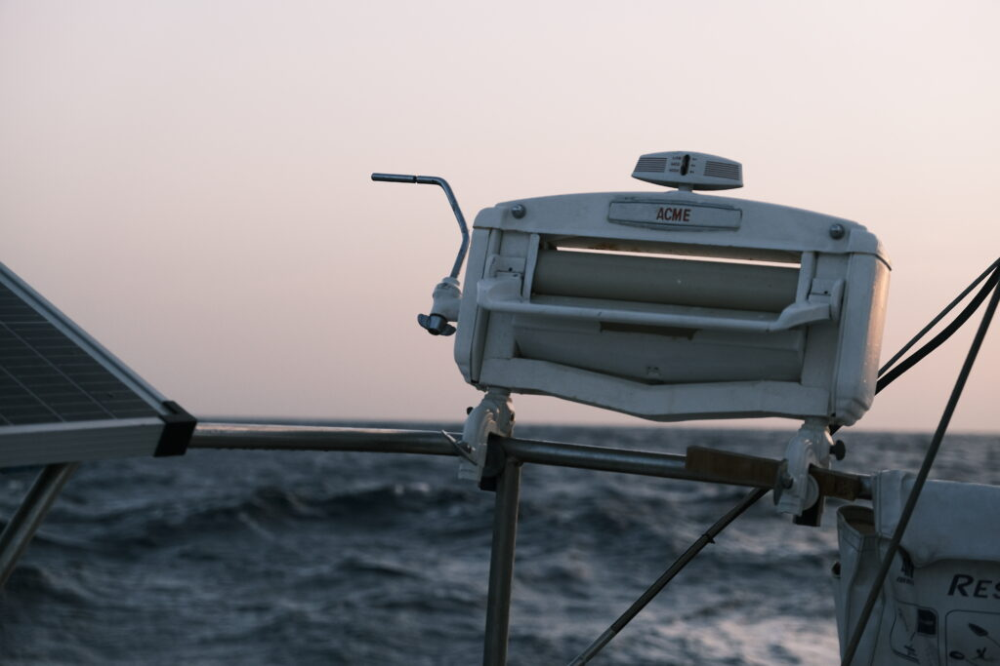

<figure class="wp-block-image size-large">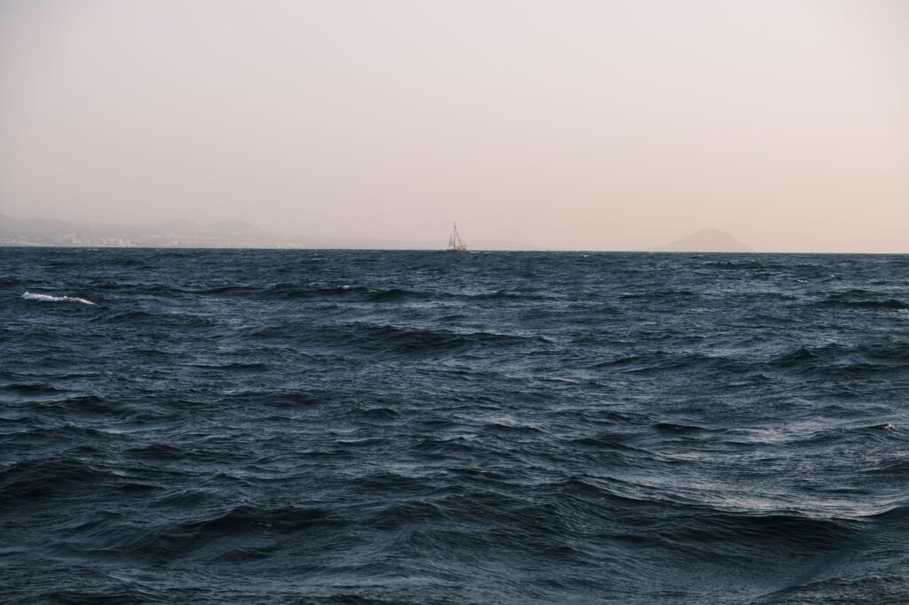<figcaption class="wp-element-caption">In de verte danst <em>Sya</em> op de golven</figcaption></figure>

We lopen de haven van Gomera binnen. Het zoute water is inmiddels opgedroogd en aan zowel ons dek, als onze wenkbrauwen zijn de zoutvlokken blijven plakken. Als twee schuurpapiertjes sluiten we de kraan aan en spuiten het dek – en onszelf – schoon met zoet.

De bonito van gisteravond is in een tupperware bakje met citroen, ui en nog wat andere lekkernijen gegaan en daar heeft de vis een nachtje in kunnen garen. Die komt tijdens de borrel met *Sya* en de *Sunset* op tafel en wordt jubelend naar binnen geschoven. Een uurtje later zitten we moe en voldaan weer aan boord van *Luwte* om de rest van de bonito om te toveren in tataki. Dit gaan we vaker doen. Jen heeft het vis-virus te pakken en weet het kistje met alle squidjes, haken, staaldraad en zelfs de waterpomptang in mijn werkplaats inmiddels te vinden..

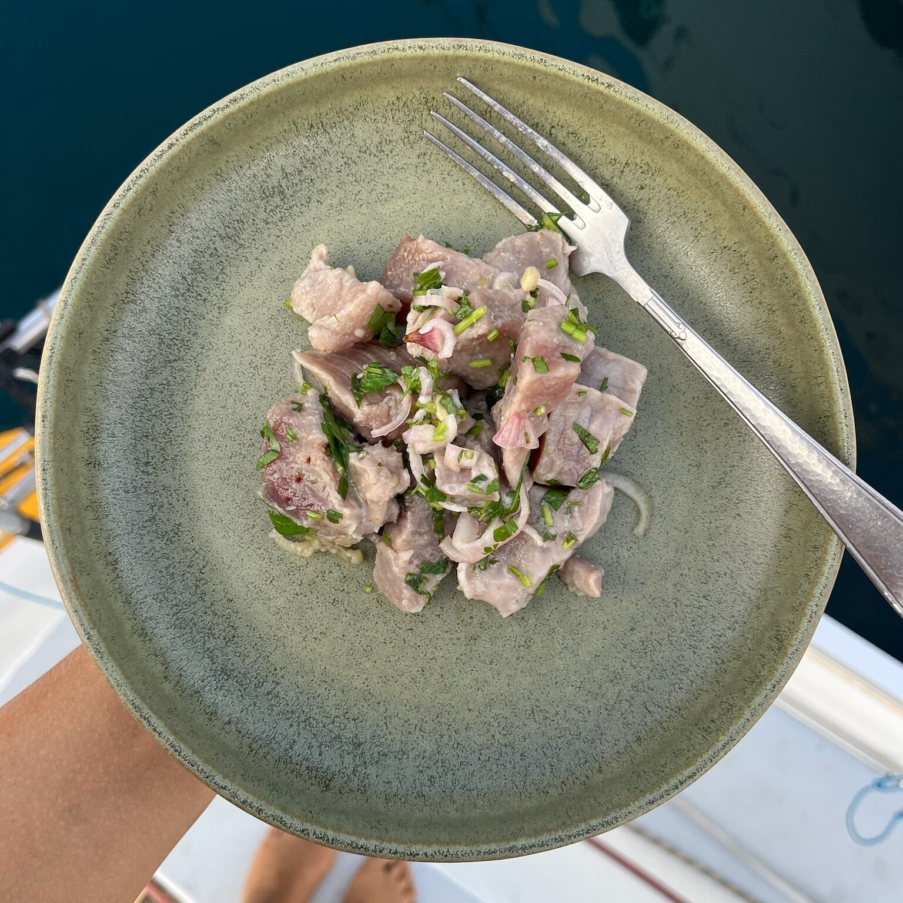

## P.S.: Tech- en content update!

### Comments

Achter de schermen ben ik bezig om de reacties op deze blogs iets interactiever te maken. Wij lezen ze allemaal met heel veel plezier en het is misschien wel de voornaamste reden dat we het zo leuk vinden om te schrijven! We hebben alleen (nog) geen goede manier gevonden om een antwoord direct terug te sturen... Vooralsnog houden we het dus nog even bij lezen en hier en daar een ansicht, maar wees niet getreurd, er gaan geen reacties aan ons voorbij!

### Video

Het is zo ver! Naast de Instagram heeft Jen een eerste cut gemaakt van een film over onze overtocht. Zo kun je dit verhaal in zo'n 25 minuten met ons meebeleven! We maken deze video's in eerste instantie voor onszelf, maar voor de liefhebber leuk om (26 minuten!) mee te kijken!

<a class="wp-block-button__link wp-element-button" href="https://youtube.com/@sailingluwte" target="_blank" rel="noreferrer noopener">Bezoek YouTube kanaal</a>

<figure class="wp-block-embed is-type-video is-provider-youtube wp-block-embed-youtube wp-embed-aspect-16-9 wp-has-aspect-ratio">
https://www.youtube.com/watch?v=iYyOksF2sLc&amp;list=PLzVA3wuBiSpabTngZHBG2cI0ia8adrnn9
</figure>
