11º14.466N 40º50.447W

Het is een groot blauw niets dat met de minuut van gedaante kan wisselen. Even hypnotiserend als een kampvuur waar je de hele avond in kunt staren. Overdag vormen de schuimkoppen bij een opstekende wind een slagroomsoezen bovenop de golven. ’s Nachts is zelfs een lichte deining lastig te traceren en lijken de golven een stuk hoger. Wij glijden mee in het ritme van de oceaan.

Het jargon van vertrekkers ontwikkelt zich snel de afgelopen weken en lijkt ook te convergeren naar een uniforme taal. Waar wij - en met name Jen - in Spanje nog wel eens vraagtekens hadden bij uitspraken en termen van andere zeilers om ons heen (en waarschijnlijk zij ook bij ons), beginnen we nu allemaal dezelfde taal te spreken. Het is een dichtgetikt taaltje en ik merk dat we in belletjes met vrienden bewust moeten blijven van ons nieuwe dialect, anders valt er geen touw meer aan vast te knopen wat we nou eigenlijk aan het doen zijn. De hit van de Kaap Verden: *Zeilersdementie*. Het fenomeen dat zich telkens weer voordoet, waarbij je van je lange zeereizen eigenlijk alleen de mooie delen weet te onthouden. Je noemt in één zin dat het wat onstuimig was, maar weet nog precies hoe het voelde om op diezelfde tocht een paar dagen met de gennaker op geruisloos door het water te glijden.

En ook nu blijkt het ons weer te pakken te hebben. We zien uit naar ons vertrek en dromen van rustige nachten, regenbuien die ook weer overtrekken en grote vissen die we binnenhalen. Dat de eerste 48 uur *altijd* weer een grote test zijn voor lichaam, geest en je relatie waren we al lang weer vergeten. We vliegen tussen Sao Vicente en Santo Antao naar buiten, met een gereefd grootzeil en de fok helemaal uit. Met een golf in de rug beginnen we uit het water te komen en tikken we snelheden van boven de 10 knopen aan. *Luwte* is top en topzwaar, maar scheert kinderlijk eenvoudig over de golven zonder uit haar roer te lopen. Voor even. Want nog geen tien minuten later trekt de wind nog iets verder aan en komt de oceaandeining zich gestaag melden in dit spel der elementen. Met twee handen hang ik aan de helmstok en houd ik *Luwte* recht op de golven. We overleggen kort of we het grootzeil, of de fok willen ophouden, maar komen tot de conclusie dat we voor nu gewoon zo snel mogelijk paardenkrachten moeten lossen. De fok inrollen gaat het snelst en die is nog geen minuut later ingerold. *Luwte* scheert nog altijd met zes a zeven knopen door de golven, maar voelt weer handelbaar. Onze focus ligt niet op snelheid, maar op comfort en ik ga dus nogmaals naar voren om het tweede rif ook meteen maar te zetten. Die nieuwe zeilen van ons mogen meer riffen hebben, en grotere.

Eenmaal tussen de eilanden uit gaat de wind weer wat liggen en komt het tweede rif weer omhoog. Zo gaan we de nacht in. De zee is wat ik noem ‘knobbelig’. We zien om ons heen puntige golven die af en toe spontaan fonteintjes uit lijken te spuwen omhoog. Waarschijnlijk krult de zee om de eilanden heen en komen de verstoorde golven elkaar hier weer tegen. Wij gaan in ieder geval als een pingpong bal heen en weer en worden alle kanten uit geslingerd. We proberen een paar verschillende koersen, maar het is allemaal even oncomfortabel. Morgen weer een dag.

De eerste nachtwacht is pittig, maar daar kom je altijd wel doorheen. We slapen allebei weinig en erg onrustig. *Luwte* maakt schuivers naar bakboord én naar stuurboord en soms bijna tegelijk lijkt het wel. Er zit geen regelmaat in. Jezelf tijdens de wacht liggend op de bank in een hoek duwen en met de kookwekker erbij je rondes doen is dan ook het enige echt werkbare. Zijn we nou zo lang verbonden geweest met land dat we vergeten zijn hoe dit ookalweer moest? Of zijn we gewoon vergeten dat dit elke keer gewoon moet?

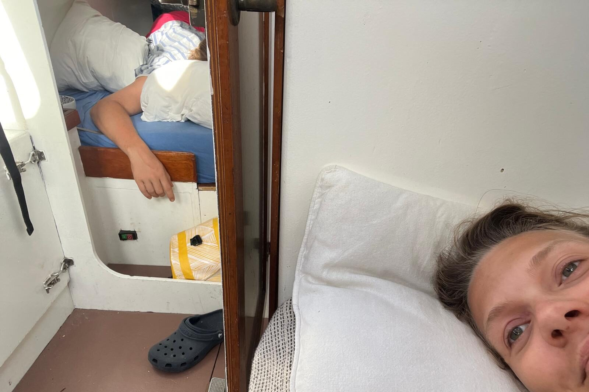

’s Ochtends reven we het grootzeil weer verder en rollen we de genua uit in de zoektocht naar meer balans. Het lijkt iets te helpen, maar we kunnen niet meer lekker de koers varen die we willen. We zijn allebei moe en een beetje kortaf naar elkaar. De zeilwissels proberen we te *timen* met de wachtwissels, maar dat betekent dat één van ons nog slaperig is en de ander bijna in slaap valt. Of je dan nog de beste keuzes maakt is discutabel. Ik word er letterlijk zeeziek van en weet even niet meer waar ik het moet zoeken. Van spugen is geen sprake, maar ik hang een paar keer aan de reling omdat ik denk dat het zover is. Voor het eerst sinds ons vertrek geef ik toe en gaat er een zeeziektepil naar binnen. Niet veel later dommel ik weg in een diepe, diepe slaap. En slapen doet wonderen. Er wordt van alles gezegd over de werking van zeeziektepillen, maar als je het mij vraagt is het gewoon een sterk slaapmiddel, en dat kan precies zijn wat je nodig hebt om over je zeeziekte heen te komen. Voor mij werkt het in ieder geval perfect en vier uur later word ik fris en gebalanceerd wakker. Jen heeft minder last van zeeziekte, maar heeft mij de laatste wachten telkens een half uurtje respijt gegeven en is daardoor ook moe. Die uurtjes kan ik nu teruggeven en zo komen we na een etmaal of twee uit onze winterslaap en kan de oversteek *echt* beginnen.

Zelfs nu, een week later op dezelfde tocht, voelen deze eerste etmalen als een vage herinnering en moet ik het logboek erbij houden om terug te halen hoe we ons nou voelden. We stellen orde op zaken en halen het grootzeil eindelijk weg. De genua bomen we uit naar bakboord en daarmee hebben we een heel flexibel zeilplan waarmee we bijna pal voor de wind een stabiele koers kunnen varen. Als de wind aantrekt kunnen we de genua makkelijk een stuk oprollen en weer uitrollen als de windgoden even uitgeblazen zijn.  We verleggen de schoten zodat ze nergens over randjes of relingen lopen. *Schavielen* is op deze tochten de grote vijand. Kleine punten van wrijving van materiaal op materiaal, waar je in Nederland meerdere seizoenen over doet om last van te krijgen, ontstaan met de mijlen die we nu maken in dagen, zo niet uren. We zien het gebeuren op een randje van de kuip waar de lijnen van de windvaan nét overheen lopen. Inmiddels is de verf daar verdwenen en kijken we tegen de glasmat er onder aan, waar langzaamaan groefjes in aan het ontstaan zijn. En dat is van een touwtje dat daar alleen overheen loopt als het *niet* onder spanning staat. Gelukkig hebben we al de nodige mijlen gemaakt dit seizoen en zijn de meeste van dit soort problemen al lang en breed verholpen. De plekken die nu overblijven zullen we tijdens de oversteek met regelmaat moeten blijven controleren. Zo kom ik er tijdens het bakken van een eitje achter dat de gasslang van het fornuis bij het overhellen naar bakboord tegen het fornuis aan geduwd word. Er is hier niet eens sprake van over elkaar heen glijden. Gewoon tik, en weer los. Tik, en weer los. Met mijn vinger ga ik langs de slang en voel ik dat ook hier al een slijtageplek aan het ontstaan is. Inmiddels is de slang ingekort en loopt hij zelfs bij ver overhellen vrij.

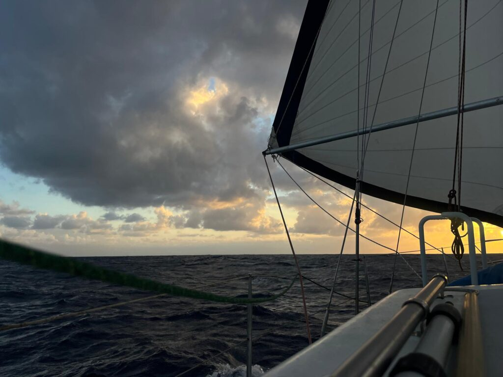

Op de vierde dag valt de wind weg en wisselen we de fok voor de bijna twee keer zo grote gennaker. Zelfs met dit lichte weer blijft die mooi bol staan, houdt ons op snelheid en bovenal dempt hij het rollen op de golven mooi. Vanuit de kuip genieten we in de zon van de kalmerende zee om ons heen. De golven zijn lang en glooiend geworden, *Luwte* snijdt er doorheen en laat een onophoudelijk sissende schuimkraag achter zich. Windvaan *Doris* leunt heen en weer en houdt ons op koers. Als dit onze overtocht wordt, tekenen we er allebei voor. De zonnepanelen houden onze accu’s moeiteloos vol en even na het middaguur kan de ijsblokjesmachine zelfs aan. Normaal zouden we een surplus aan stroom liever besteden aan een extra weersimulatie via *Starlink*, maar op deze route is het weer dusdanig stabiel dat eenmaal daags het weer ophalen meer dan voldoende is. Het thuisfront hebben we laten weten dat we wat minder in de lucht zijn, maar de *Garmin Inreach* geeft wel netjes elke vier uur onze positie door. Geen bericht en mijlen is dus goed bericht.

Als het internetmonster wel aan gaat werken we onze dingetjes bij en hebben we vooral even contact met *Belafonte, Jonathan* en *Kolibri*, die ook onderweg zijn. We wisselen posities uit en de gang van zaken in onze dagelijkse sleur. De posities plotten we in op de kaartplotter en zo lijkt het alsof we toch nog best dicht bij elkaar varen, al zitten we tussen de tachtig en honderdvijftig mijl uit elkaar. Gelukkig vraagt *Elon* genoeg energie om hem ook snel weer uit te schakelen en zo zijn we weer met z’n tweeën in het niets. Jen luistert een podcast over Suriname en ik lees een boek, of andersom, of tegelijk hetzelfde. We gaan naar het voordek om te douchen en gooien omstebeurt emmers water over elkaar heen tot we ons weer fris en fruitig voelen. Zoet water gebruiken we alleen om te koken, te drinken en twee keer per dag twee liter om de afwas mee te doen. Op die manier moeten we het wel een tijdje kunnen uitzingen.

Met het vallen van de avond hebben we een kort overleg over het wel, of niet, oplaten van de gennaker. Volgens de voorspellingen blijft het rustig en het is op dit moment ook nog zo vlak dat het ons geen kwaad lijkt te kunnen de gennaker op te laten staan. In tegenstelling tot onze genua vliegt de gennaker los en is het altijd een beetje een gespannen moment als hij weer naar beneden moet komen. Dat doen we dan ook liever bij daglicht, in dit geval morgenochtend. Maar ja, de voorspellingen hebben het, zelfs op korte termijn, niet altijd bij het rechte eind. Ondanks dat het een heldere nacht is steekt er om een uur of drie plotseling een bries op en begint de gennaker wel heel hard aan *Luwte* te trekken. Zolang dat gewoon rechtdoor gaat is dat geen probleem, maar surfend over de golven komt er een onverwachte golf van opzij en lopen *Luwte* en *Doris* uit het roer. De gennaker wil overstag en dat gaat nogal met een grote lap stof die opeens niet met de wind mee loopt, maar tegen de wind in blaast. Binnen een paar tellen sta ik vanuit slaap buiten en stuurt Jen *Luwte* op de hand weer voor de wind. De deklichten gaan aan, we rollen de genua uit en halen de gennaker weer omlaag. Dat gaat gelukkig snel en soepel. Vanaf nu niet meer ’s nachts op laten staan…

Ondanks de aantrekkende wind worden we de volgende ochtend wakker in een rustige zee met een lekkere passaat 3-4 op de kont. De genua staat uitgeboomd en laat ons pal voor de wind varen als we willen. We spelen met verschillende hoeken, met name ten opzichte van de golven om zo comfortabel en rustig mogelijk te liggen. We merken dat *Luwte* echt pal voor de wind wat te weinig steun uit de zeilen haalt en heen en weer gaat rollen, dus loeven we nog een vijftiental graden op en zijn we tevreden. In het gangboord vinden we een paar vliegende vissen die hun hoofd gestoten hebben tegen een geel monster. Na een klein anatomisch onderzoek gaan ze terug naar zee waar een of andere mahi mahi of tonijn er nog lekker van kan genieten.

De vislijn staat uit, maar vangt vooral veel Sargassowier. Dit wier, afkomstig uit de gelijknamige Sargassozee in de buurt van Bermuda vervult een cruciale rol in ons wereldwijde ecosysteem. Wij zijn er in Nederland vooral gebaat mee omdat onze IJsselmeerpaling ergens een genetische tik van de molen heeft gekregen en nog steeds denkt dat het efficiënt is om de hele oceaan over te zwemmen om daar in het dichte Sargassowier te paren en daarna de jonkies op pad te sturen terug naar ons IJsselmeer. Voor degene die zich nu verwonderend zit af te vragen of dit echt zo is, Zijlstra schreef er een lied over onder de titel *“Waar is de paling?”*.

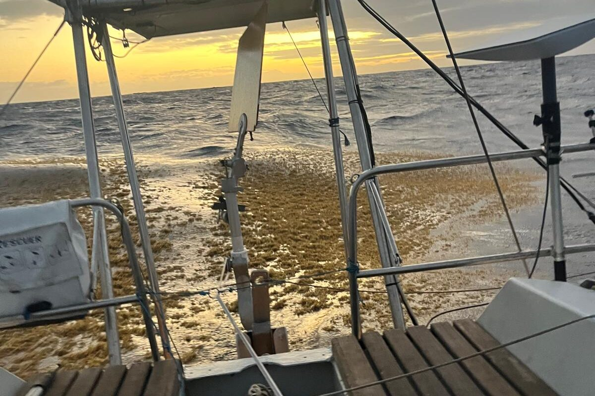

Ik ben wel benieuwd hoe het gaat zijn als we wat dichterbij de daadwerkelijke Sargassozee komen, want de hoeveelheid en dichtheid van dit wier is niet misselijk. Zo nu en dan voelen we de boot vertragen en horen we het ritselen langs de romp als we door een groot wierveld heen varen. *Doris* is er ook niet zo’n fan van en stuurt daarna niet meer goed door het wier dat achter het pendulumroer is blijven hangen. Op een of andere manier gebeuren dit soort dingen altijd ’s nachts, als we moe zijn en geen behoefte hebben aan actie. Het doet erg denken aan het in het Markermeer uit de pan groeiende fluitekruid. Gelukkig is het Sargasssowier niet zo lang en glijdt het grotendeels gewoon langs de romp en kiel weg.

Overdag haalt Jen routinematig elke vijf a tien minuten de vislijn weer binnen om de bossen Sargassowier af te schudden. Het is een weinig motiverend tijdverdrijf en elke keer dat het elastiek strak komt te staan een kleine teleurstelling als er weer geen vis aan de haak hangt. Halverwege de dag is Jen er wel een beetje klaar mee en gooit ze nog één laatste keer de lijn uit. En het is raak! Het elastiek gaat nu echt ver uit en we zien in de verte een groene flits heen en weer schieten. We zien meteen dat het een flinke is en hopen dat hij zich niet weet los te werken van de haak. Mahi Mahi’s zijn magische dieren om te zien. Ik vind ze gracieus. Ze vechten woest voor hun vrijheid en schitteren met hun geelgroene lijven heen en weer door het water. Het gevecht om de dood is nog altijd aan mij toebedeeld, maar ik ben er inmiddels bedreven in. Aangezien we geen hengel met molen hebben, maar gewoon een dikke vislijn, kan ik de lijn met grote halen intrekken. Het ziet er misschien wat minder spectaculair uit dan een vishengel die helemaal krom staat, maar het gaat wel een stuk sneller. Daarbij hebben we in de *Offshore Cruising Encyclopedia* gelezen dat je voor Mahi Mahi slechts zeven meter lijn hoeft uit te zetten, dus hij is dichtbij. Het spannendste stuk is om hem het water uit te krijgen en op het zwemplateau te hangen. Daarna is het snel gebeurd. We spuiten voor het gemak een beetje alcohol in de kieuwen, waarna de vis direct verdoofd is. De kieuwen snijden we door en nog geen minuut later is hij uitgebloed en kan de rust wederkeren. Ookal ben ik inmiddels bedreven geworden in het nemen van vissenlevens, blijft het bij de mahi mahi altijd een beetje een triest moment. Binnen een minuut na sterven verliezen deze prachtige dieren al hun kleur en blijft er een grijsgroene variant over. Op de foto lijken ze nog altijd kleurrijk, maar dat is niets in vergelijking met hoe ze het water uit komen. We danken de zee voor deze gift.

Daarna neemt Jen het weer over. Op het voordek komt onze grootste snijplank te liggen, een emmer water en de fileermessen. Ik trek de mahi mahi omhoog en loop naar voren. Dan pas is goed te zien wat een joekel dit is! Z’n kop past nauwelijks op de snijplank en Jen kan hem voor de foto maar net met twee handen omhoog houden. We snijden vier dikke plakken steak uit en fileren de rest. De komende dagen eten we vis voor ontbijt lunch en avondeten. Vanavond, zo vers uit de zee, komen er plakjes op bolletjes sushirijst te liggen en gaat een deel door de pokébowl, bij gebrek aan sushivellen. Het smaakt ons heerlijk.

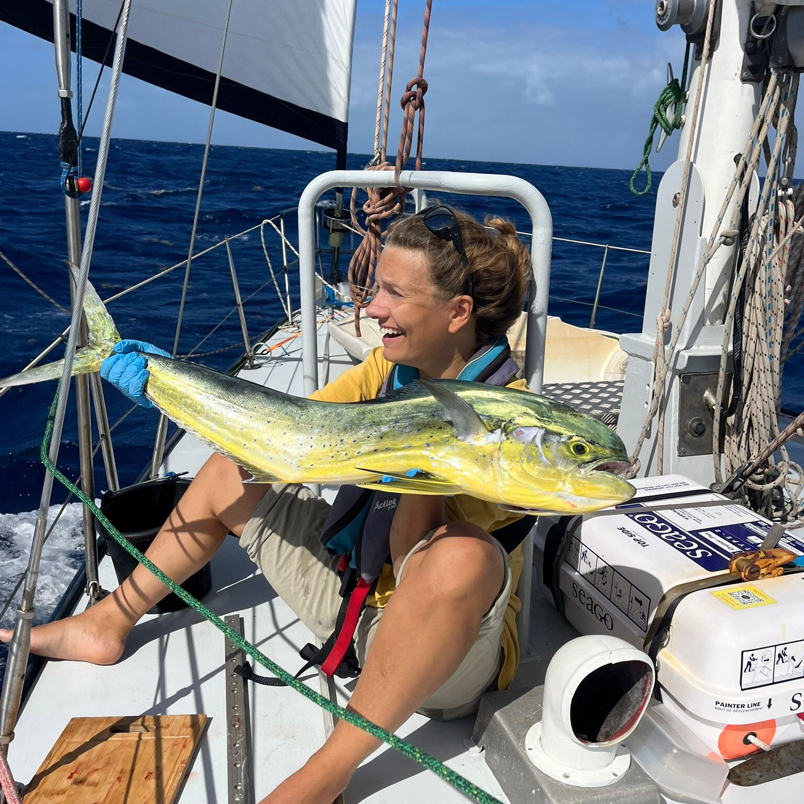

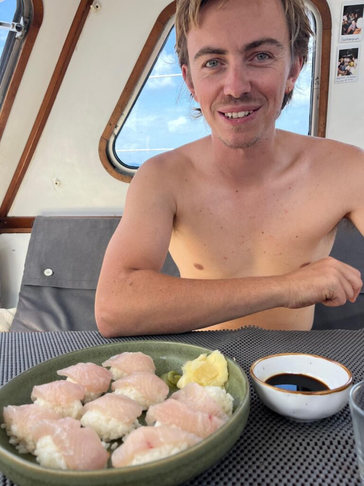

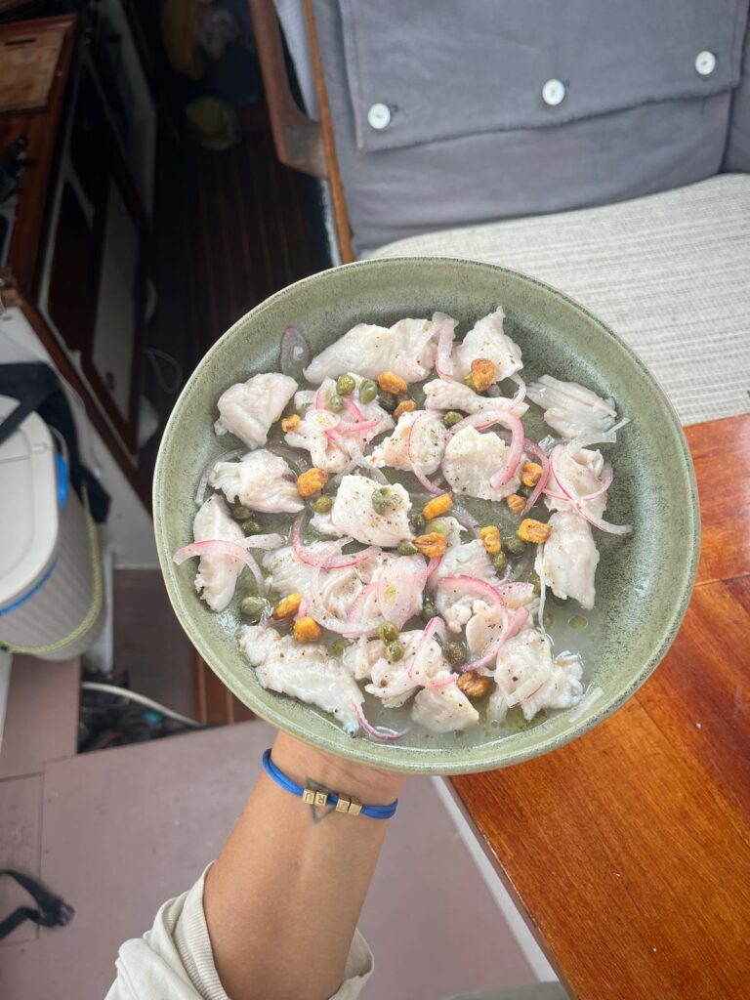

Met goed gevulde buiken gaat het wachtschema om een uur of 17.00 alweer in. Ik slaap dan tot een uur of 20.00 en neem het dan over van Jen tot middernacht. Dan heeft Jen tot 04.00 en gaan we over naar een drie-uurs schema, omdat die tweede nachtwacht altijd wat zwaarder is dan de eerste. Ik schrijf in mijn eerste wacht veel en kijk in de tweede vaak een film. Jen leest in de eerste e-books en luistert in de tweede onder de sterren een podcast. De maan komt hier pas laat op, maar op heldere nachten geven zelfs de sterren genoeg licht om de windvaan wat af te stellen, of de fok wat te reven. Als de maan er eenmaal is kom je er ook niet meer omheen. De opkomst van de maan is magisch, net zo rood als de zonsopkomst. Daarna wordt hij snel helder wit, zo fel dat je er buiten een boek bij kunt lezen. We zijn twee dagen voor volle maan vertrokken en hebben tot nu toe dus veel maan gehad bij de nachtwacht.

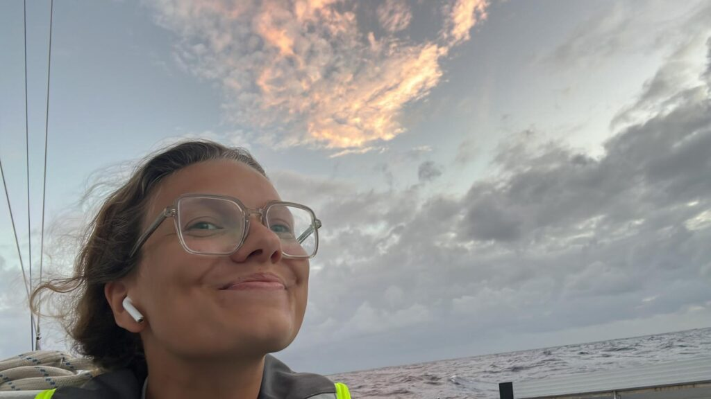

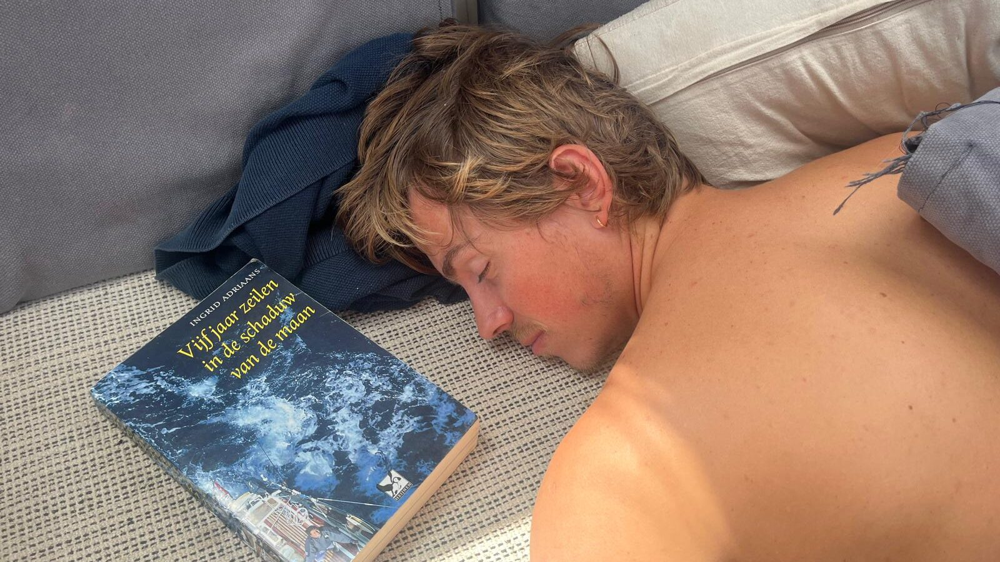

En zo beginnen de dagen in elkaar over te vloeien en wordt tijd een vaag begrip dat enkel nog een getal is op de marifoon die in UTC staat en ons wachtschema dicteert. We hebben wat meer tijd overdag samen ingeboekt dan op eerdere overtochten, omdat we het anders zo ongezellig vinden dat we elkaar zo weinig zien. Maar naar mate de tocht vordert merken we allebei dat we vanzelf wel een uurtje aan het eind van de dag langer wakker blijven en een uurtje of wat eerder wakker worden in de ochtend. Als ik bruut uit mijn slaap wordt getrokken om Jen ’s nachts af te wisselen, wordt er eerst nog een hapje en een drankje gemaakt en vice-versa.  

En ook afstand is zo’n vaag begrip geworden. De kaartplotter geeft aan dat we vooruit gaan met gemiddeld zo’n  5 à 5.5 knoop. Het kompas geeft een vrij stabiele richting aan en op de kaart zien we ons stipje langzaam maar zeker vooruit kruipen. Dat is dan ook wel de enige feedback die we hebben over onze plek op aarde. Een stip op een kaart die beweegt. Wij hopen maar dat die kaart klopt en we uitkomen waar we hopen uit te komen, maar zelfs als dat niet zo zou zijn, is het ook wel best en houden we het zo nog wel even vol.

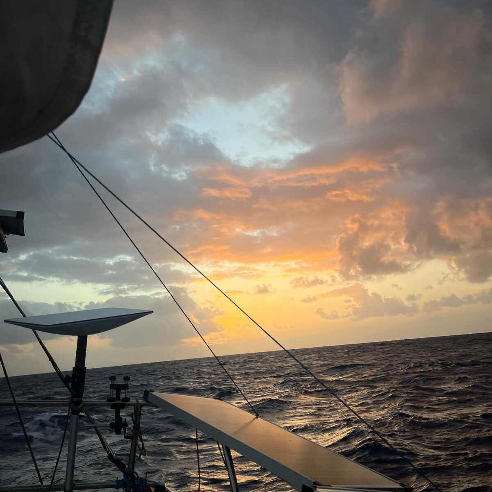

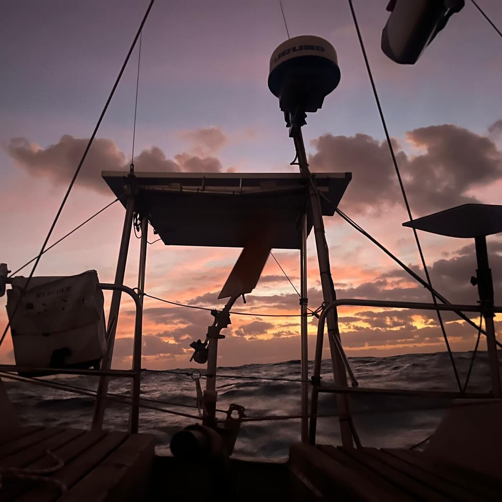

Ondanks het verwateren van die begrippen is er één punt waar we wél bewust bij willen stilstaan: We zijn halverwege de Atlantische Oceaan. Na zo’n negen dagen op zee hebben we 950 zeemijlen achter ons gelaten en liggen er nog 950 voor de boeg. We zijn halverwege. Traditiegetrouw komt Neptunus langs bij zeevaarders die voor het eerst de evenaar oversteken, maar daar gaan wij deze reis nét niet aan toe komen. Desalniettemin weet ik van zeventien jaar geleden dat Neptunus ook bezoekjes brengt aan zeelieden die elders over de aardbol zwerven. Zo vervulde hij destijds de rol van Sinterklaas, toen die had aangegeven het wel wat ingewikkeld te vinden om ook nog midden op de oceaan pakjes te komen bezorgen. In onze kotsemmertjes werden op petroleum gebakken pepernoten gestrooid en kregen we cadeaus van de heerser van de zee.

Ik kon het dan ook niet laten om Neptunus vlak na ons vertrek op te roepen en om een gunst te vragen voor deze overtocht. Voor mij is het natuurlijk gesneden koek, maar op mijn verzoek zou Neptunus halverwege onze reis langskomen om Jen te verwelkomen als wezen van de oceaan. Gisterochtend heb ik dan ook met de vislijn zeewier verzameld, mijn duikbril uit het vooronder getoverd en met een puts zout water over mijn hoofd trad Neptunus tot mij. Een schreeuw en een emmer water door de kuip waren genoeg om Jen halsoverkop de kooi uit te krijgen, maar bij het aangezicht van Neptunus werd ze zó boos, dat de hele act letterlijk en figuurlijk in het water viel. Jen dacht dat ik overboord was gevallen en kon er niet de humor van inzien dat ik met slierten zeewier in mijn haar en onderbroek doorweekt in de kuip zat. Neptunus droop af en Jen werd niet gedoopt.

’s Middags gaan we voor de herkansing. Neptunus is wat beledigd en komt niet meer aan boord, maar met een borrel, een misthoorn en een ode aan de vissen is hij ons wel weer goed gezind. De volgende ontmoeting zal pas plaatsvinden bij het oversteken van de evenaar. Hij heeft wel nog een trofee voor haar achtergelaten en die zal thuis in onze boekenkast komen te pronken. Daarna pakken we het tijdschrift erbij dat we van al onze lieve vrienden en familie kregen op ons afscheidsfeest: *Ronny op reis*. We doorlopen de tips van Femke en Damir, gaan na welke tradities we al hebben omarmd en welke we daar nog aan willen toevoegen, en voelen dat het eindelijk tijd is om de grote vragen des levens te beantwoorden die Olivier ons opdroeg. Wij zullen beginnen met de vraag *‘Wat is pure objectiviteit en is dit überhaupt haalbaar?’.* We gaan Jula’s ceviche recept nog even na en ik moet toch concluderen dat ik de prijs van ‘eerste vis gevangen’ moet overdragen aan Jen. Hoewel de rode poon die ik bij Fisterra ving ook echt een vis was en geen zoogdier, moet ik zeggen dat de skipjack tuna’s en mahi mahi’s die volgden wel een nieuwe definitie hebben gegeven aan ‘vis’ en dat ik in het vervolg een rode poon gewoon weer teruggooi omdat er te weinig vlees aan zit. We besluiten het bal met Jen die het gedicht van Pine opdraagt aan de vissen van de zee en Neptunus. Jen bladert daarna nog wat na en herleest met tranen over haar wangen de tekstjes die alweer een beetje weggezakt waren.

We zijn halverwege de oceaan en het gaat goed met ons.

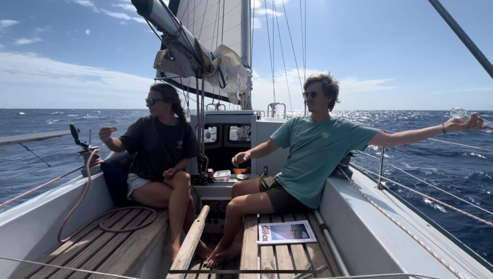

## Prijsvraag

Ook nu is het weer mogelijk hieronder je voorspelling uit te brengen over onze aanloop naar Paramaribo. De spelregels zijn simpel: We varen naar de uiterboei van de Surinamerivier, daar stopt de tijd. Je stuurt hieronder jouw voorspelling van dag en tijd (UTC) van aankomst. Onderstaande gegevens kun je gebruiken om je inschatting preciezer te maken.

-   Op moment van posten is het 22 Januari 16:30 UTC, onze positie is 11º07.570N 4º05.328W en we hebben nog zo’n 850 mijl te gaan tot aankomst.
-   Ons vertrek was op 12 januari 13.00 UTC te Mindelo

Rorik: 29 januari 13:30 UTC  
Jen: 29 januari 10.30 UTC
