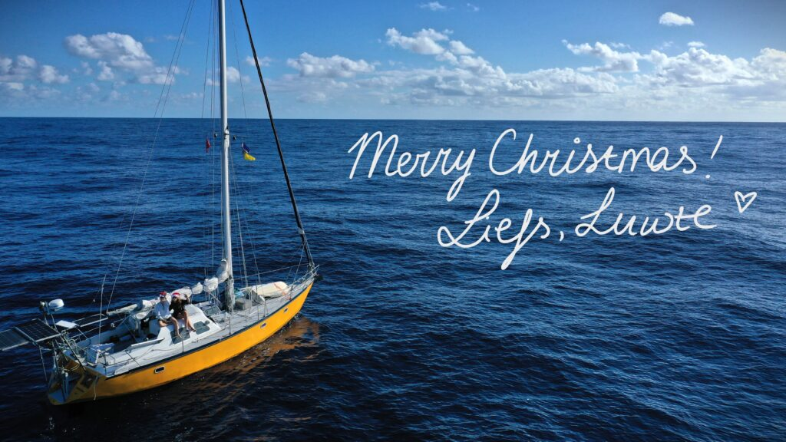

16°53.097N 24°59.335W 25 december 2024 11:02 UTC

Kerst op de Kaap Verden. Jen had haar zinnen er op gezet en hoewel ze mij nog even om de tuin wist te leiden door het compromis te sluiten dat we kerst op zee zouden vieren, was kerstavond voldoende. 11.02 UTC leggen we de lijnen aan de kade en halen we de tuinslang tevoorschijn. We gaan even één of twee nachtjes ontzouten en dan achter ons anker liggen. De bubbels zijn inmiddels open.

Wij feliciteren Mama en Papa (van Rorik) met de meest accurate ETA, maar zijn minstens zo onder de indruk van opi en omi (van Jen) die binnen het uur ernaast zaten met een stuk minder zeemijlen. De troostprijs gaat naar Mark, die ondanks de rekenfouten, wel het aantal dagen van onze overtocht bijna precies wist te berekenen! Jullie prijs komt jullie kant op!

De laatste dagen van onze overtocht waren heerlijk. De wind nam af en de deining werd snel langer. We hebben gisteren de gennaker opgezet en met de laatste zuchtjes wind zoveel mogelijk mijlen zeilend afgelegd terwijl we in het zonnetje omhingen en boeken lazen. Ik heb geprobeerd met de sextant een plaatsbepaling te maken, maar dat behoeft nog wat oefening vrees ik. Jen gooide haar lijnen uit en had een grote mahi mahi aan de lijn die we helaas op het laatste moment verloren door een gebroken *swivel*. Net na zonsondergang kwam daar nog een Wahoo bij, maar daar is maar weinig vlees van afgekomen.

Al met al kijken we positief terug op dit enigszins sportieve stuk zeilen. Dat we ook een paar dagen hebben lopen stuiterballen vergeet je heel snel als de zee weer tot rust komt. Het voelt niet eens meer zo, maar we hebben toch maar weer mooi 850 mijl door niemandsland afgelegd zonder noemenswaardige gebreken.

Fijne kerst, fijne feestdagen en alvast een gelukkig nieuwjaar toegewenst!

