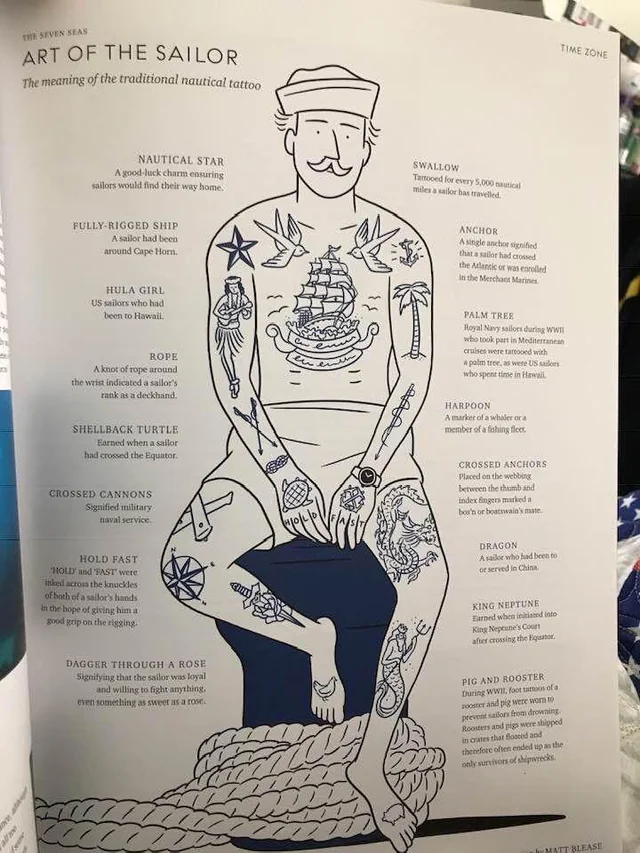

Vooralsnog verloopt alles voorspoedig. De eerste 24 uur hebben we flink gehobbeld op de restanten van het overgetrokken laag waar we achter zaten. Twee zeeziektepillen en veel slaap hebben ons er doorheen getrokken. 

Na zo’n 2,5 etmaal hebben we het continentaal vlak van Canada verlaten en is de zeebodem weer op een paar kilometer afstand. Daarmee zijn de golven lang en rustig geworden en glijden we comfortabel op één oor de goede kant op.

Terwijl we over het wrak van de Titanic (en sinds kort de mislukte onderzeeër) heen varen snappen we wel hoe dat kon gebeuren. Wij hebben al sinds vertrek een horizon die zo ongeveer uitkijkt tot de volgende golf, op een helder moment de tweede. Gelukkig is de aarde inmiddels wat warmer en worden de ijsbergen bijgehouden, maar het blijft een beetje spooky als je met zes knopen door het niets schiet.

Vanochtend noteerden we een wezenlijke mijlpaal: 10.000 zeemijlen sinds vertrek. Daarmee schaart Jen zich onder de orde van de dubbele zwaluw, en mag ik bij thuiskomst een kleine zwerm plakken… 

Alle inzendingen zijn genoteerd! We stuiven vooralsnog voor op schema met bijna 7 knopen de goede kant op, maar het Azoren Hoog kan nog verraderlijk traag weer opleveren… 

Tot slot zijn Jen en ik tegenwoordig ook te bewonderen als realityster:

<a href="https://www.bnnvara.nl/artikelen/rorik-en-jenny-zeilen-de-wereld-rond-toen-ik-ziek-werd-besloten-we-deze-reis-te-maken" target="_blank" rel="noreferrer noopener">https://www.bnnvara.nl/artikelen/rorik-en-jenny-zeilen-de-wereld-rond-toen-ik-ziek-werd-besloten-we-deze-reis-te-maken</a>

Over stand-by.
